<p align="center">
  <picture>
    <source media="(prefers-color-scheme: dark)" srcset="docs/assets/readme-hero-en-dark.gif" />
    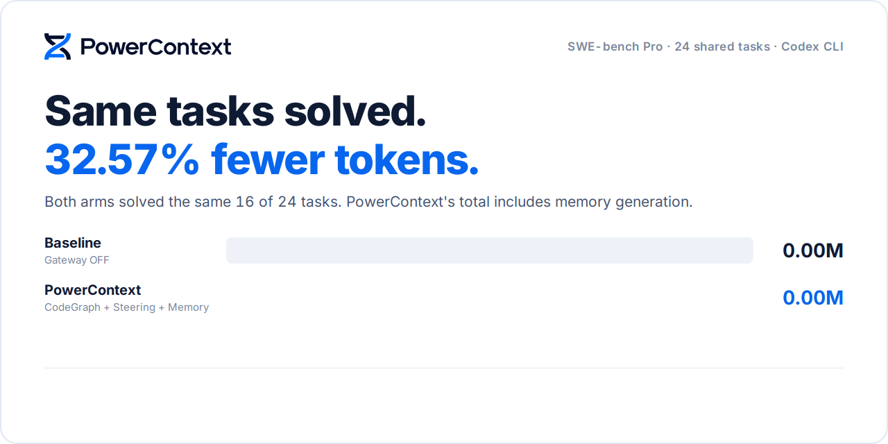
  </picture>
</p>

<h3 align="center">The open-source context service for AI agents</h3>
<p align="center">
  Fewer detours. Fewer tokens.<br />
  <a href="#use-cases">Handoffs</a> · <a href="#use-cases">shared memory across agents</a> · <a href="#use-cases">company knowledge bases</a> · <a href="#use-cases">per-user profiles</a> · <a href="https://powercontext.oceanbase.io/en/docs/workflows/review-dream-revisions/">Dream</a> · <a href="#traceable-and-governed">Scope isolation</a> · <a href="#memory-rules-for-every-scope">memory rules per Scope</a> · <a href="#use-your-existing-subscription">your existing subscription</a>, all in one service.
</p>

<p align="center">
  <a href="#what-is-powercontext">What</a> &nbsp;·&nbsp;
  <a href="#why-powercontext">Why</a> &nbsp;·&nbsp;
  <a href="#use-cases">Use cases</a> &nbsp;·&nbsp;
  <a href="#architecture">Architecture</a> &nbsp;·&nbsp;
  <a href="#quick-start"><b>Quick start</b></a> &nbsp;·&nbsp;
  <a href="#ecosystem">Ecosystem</a> &nbsp;·&nbsp;
  <a href="#news">News</a> &nbsp;·&nbsp;
  <a href="https://powercontext.oceanbase.io/en/docs/">Docs</a> &nbsp;·&nbsp;
  <a href="#community">Feishu</a> &nbsp;·&nbsp;
  <a href="https://discord.com/invite/74cF8vbNEs">Discord</a>
</p>
<p align="center">
  <a href="README.md">English</a> · <a href="README_CN.md">中文</a> · <a href="README_JP.md">日本語</a> &nbsp; / &nbsp;
  <a href="https://pypi.org/project/powercontext/">Python package</a> · <a href="LICENSE">Apache 2.0</a>
</p>

## What is PowerContext

**PowerContext helps agents and harnesses manage context.** It turns conversations, documents, and work records into knowledge that can be searched, updated, and traced to its sources, and brings it to the agent when needed:

- **Fewer tokens:** help agents find the right code and read the right lines, with fewer round trips to finish a task. [See the benchmark →](#fewer-tokens)
- **Multi-agent collaboration:** agents, sessions, and teammates share memory in one Scope and pick up work through handoffs. [See use cases →](#use-cases)
- **Self-improvement:** Dream proposes memory and prompt revisions from past evidence, applied after your review. [About Dream →](https://powercontext.oceanbase.io/en/docs/workflows/review-dream-revisions/)
- **Traceable:** every memory traces back to its source evidence and exact revision. [Learn more →](#traceable-and-governed)
- **Per-Scope rules:** every team, project, or user can have its own memory rules, with revisions. [Learn more →](#memory-rules-for-every-scope)
- **Governed:** Scopes isolate data and access, and generated experiences and skills are recalled only after review. [Learn more →](#traceable-and-governed)

Run it as a service through HTTP, MCP, Python, or Agent integrations, or embed Core in your own application.

<!-- Video slot: a 30–60 second real recording of an agent continuing, in a second session, the work of the first. -->

## Why PowerContext

### Fewer tokens

**Every model call in an agent loop re-sends the accumulated context.** So PowerContext optimizes the round trips and total cost of finishing the whole task: helping the agent find the right code, read the right lines, batch independent work, and run focused tests, with less repeated exploration and fewer unproductive attempts.

- **Same 24 tasks, memory generation included:** **32.57% fewer tokens** and **15.42% lower estimated model cost**, with both groups solving the same 16 tasks. Solving alone uses 40.30% fewer tokens; the best task uses 63.49% fewer.
- **Fewer round trips:** in a separate run on the same task IDs (OFF vs. MS), main-model requests fell from 708 to 539, **23.87% fewer**. That run uses a different configuration, so its numbers do not combine with the ones above.
- **Memory generation reuses the cache:** generating memories costs tokens, and the 32.57% above includes them. In gateway mode, memory extraction can reuse the context prefix of solving requests, on a Codex subscription too; 97% of input to memory-generation calls with recorded cache fields hit the cache.

This benchmark runs in **gateway mode**, with code retrieval, working guidance, and project memory enabled together:

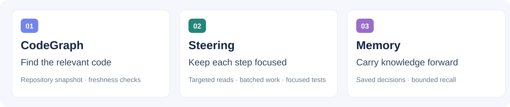

[24-task benchmark: results and methodology →](docs/benchmarks/token-savings/README.md) · [Main-model request counts →](docs/benchmarks/token-savings/request-counts.md) · [Memory-extraction cost and quality →](https://gist.github.com/jasper-yl/d02bfb7d9b45ca175bf74ad09cfa5ba4#file-00-report-en-md)

### Memory rules for every Scope

<picture>
  <source media="(prefers-color-scheme: dark)" srcset="docs/assets/readme-prompt-rules-en-dark.svg" />
  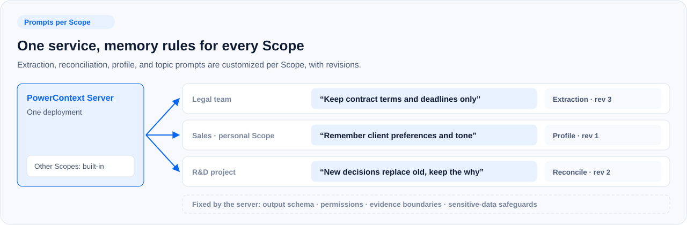
</picture>

Many memory services configure extraction rules for a whole service or project. PowerContext keeps the prompts for memory extraction, reconciliation, profile generation, and Topic Memory as Scope-level artifacts, so every team, project, or even individual user can have its own memory rules. Every change is kept as a revision you can restore, and Dream can propose revisions from past evidence for your review.

Rules decide only what to keep and how to organize it. The output schema, tools and permissions, evidence boundaries, and sensitive-data safeguards stay fixed by the server, so changing a rule cannot break the system. With access control enabled, changes need Scope admin rights. The Dashboard has no editor yet; applications can expose this to their own users through the API. [Manage prompts →](https://powercontext.oceanbase.io/en/docs/workflows/manage-prompts/)

### Traceable and governed

- **Evidence behind every memory:** each memory traces back to its source evidence and exact revision, and can point to the precise location in the source.
- **Reviewed changes:** generated experiences and skills are recalled only after review; Dream revisions take effect after your approval; outdated memories can be retired while their history is kept.
- **Clear boundaries:** Scopes isolate data and access; operational telemetry excludes prompts, content, and model responses.

[Review candidates →](https://powercontext.oceanbase.io/en/docs/workflows/review-candidates/) · [Scopes and access →](https://powercontext.oceanbase.io/en/docs/workflows/scopes-and-access/)

## Use cases

PowerContext works with coding agents, personal assistants, and office agents, and embeds into applications built by teams and companies.

<!-- Cards are generated by docs/assets/render_scenarios.py; keep the three READMEs aligned. -->
**Coding agents**

<p align="center">
  <a href="https://powercontext.oceanbase.io/en/docs/workflows/memory-and-handoff/"><picture><source media="(prefers-color-scheme: dark)" srcset="docs/assets/scenarios/card-handoff-en-dark.svg" />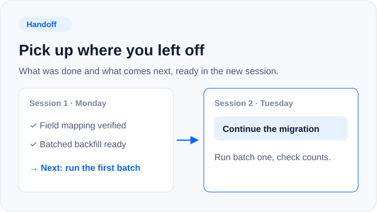</picture></a>
  <a href="https://powercontext.oceanbase.io/en/docs/workflows/scopes-and-access/"><picture><source media="(prefers-color-scheme: dark)" srcset="docs/assets/scenarios/card-shared-en-dark.svg" />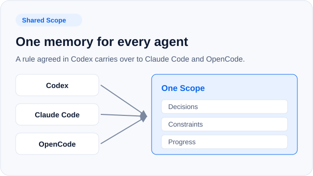</picture></a>
</p>

**Personal assistants and office agents**

<p align="center">
  <a href="https://powercontext.oceanbase.io/en/docs/integrations/openclaw/"><picture><source media="(prefers-color-scheme: dark)" srcset="docs/assets/scenarios/card-assistant-en-dark.svg" />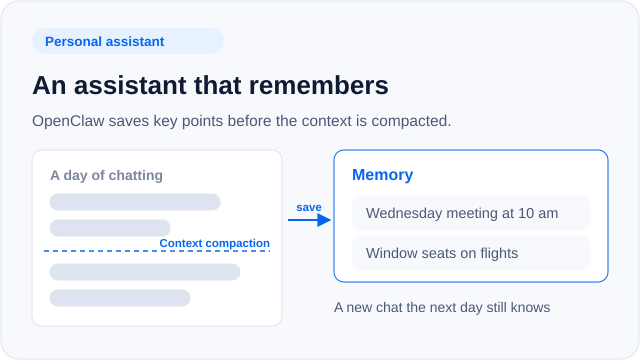</picture></a>
  <a href="https://powercontext.oceanbase.io/en/docs/workflows/experience-and-skill-lifecycle/"><picture><source media="(prefers-color-scheme: dark)" srcset="docs/assets/scenarios/card-office-en-dark.svg" />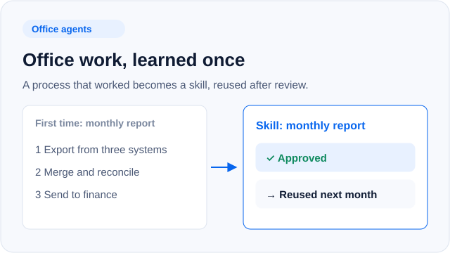</picture></a>
</p>

**Team and business applications**

<p align="center">
  <a href="https://github.com/oceanbase/powercontext/blob/master/docs/en/docs/workflows/knowledge-base.md"><picture><source media="(prefers-color-scheme: dark)" srcset="docs/assets/scenarios/card-knowledge-en-dark.svg" />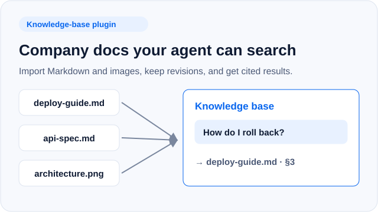</picture></a>
  <a href="https://powercontext.oceanbase.io/en/docs/workflows/use-profiles/"><picture><source media="(prefers-color-scheme: dark)" srcset="docs/assets/scenarios/card-users-en-dark.svg" />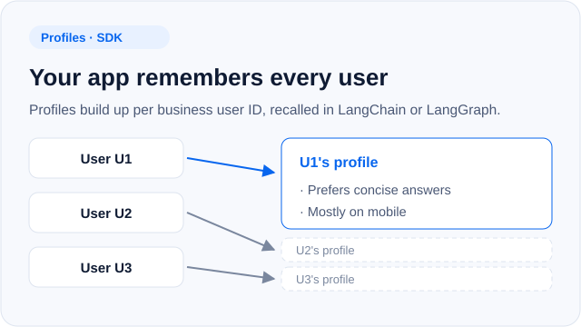</picture></a>
</p>
<p align="center">
  <a href="https://powercontext.oceanbase.io/en/blog/power-system-agent-memory/"><picture><source media="(prefers-color-scheme: dark)" srcset="docs/assets/scenarios/card-domain-en-dark.svg" />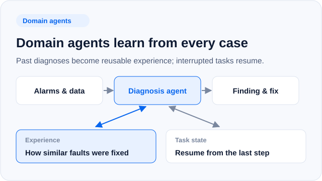</picture></a>
  <a href="https://powercontext.oceanbase.io/en/docs/develop/plugins/"><picture><source media="(prefers-color-scheme: dark)" srcset="docs/assets/scenarios/card-plugins-en-dark.svg" />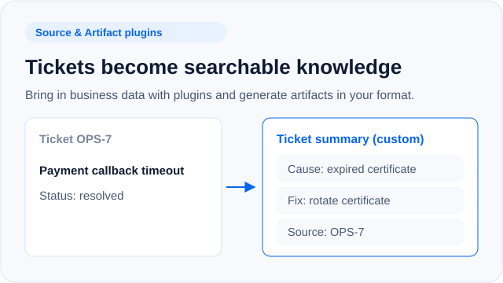</picture></a>
</p>

[Handoffs](https://powercontext.oceanbase.io/en/docs/workflows/memory-and-handoff/) · [Scopes and sharing](https://powercontext.oceanbase.io/en/docs/workflows/scopes-and-access/) · [OpenClaw](https://powercontext.oceanbase.io/en/docs/integrations/openclaw/) · [Hermes](https://powercontext.oceanbase.io/en/docs/integrations/hermes/) · [Experience and skills](https://powercontext.oceanbase.io/en/docs/workflows/experience-and-skill-lifecycle/) · [Knowledge-base plugin](https://github.com/oceanbase/powercontext/blob/master/docs/en/docs/workflows/knowledge-base.md) · [Profiles](https://powercontext.oceanbase.io/en/docs/workflows/use-profiles/) · [Power-system diagnosis case](https://powercontext.oceanbase.io/en/blog/power-system-agent-memory/) · [Source and Artifact plugins](https://powercontext.oceanbase.io/en/docs/develop/plugins/)

## Architecture

<picture>
  <source media="(prefers-color-scheme: dark)" srcset="docs/assets/readme-architecture-en-dark.svg" />
  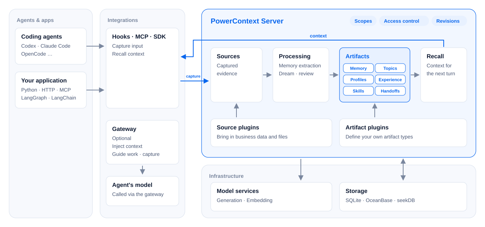
</picture>

Agents connect to the Server through hooks, MCP, or SDKs, or send model requests through the gateway, which injects context and provides working guidance. The Server keeps source evidence (Sources) per Scope, processes it in the background into Artifacts such as memories, Topic Memory, profiles, experiences, and skills, and recalls them into context for the next turn. Source and Artifact plugins add new data sources and artifact types. [Architecture and responsibilities →](https://powercontext.oceanbase.io/en/docs/workflows/architecture/)

## Quick start

### Let your agent install it

Send this to your coding agent, such as Codex, OpenCode or Claude Code. It detects your environment, asks a few questions, then installs PowerContext and checks that memory works. For personal use, Codex and OpenCode connect through the gateway by default; team administrators can use it to deploy as well.

```text
Install PowerContext on this machine by following https://powercontext.oceanbase.io/en/llms.mdx/docs/get-started/agent-install/content.md. Ask me before deciding anything on my behalf, don't guess, and never read or show any of my keys.
```

<details>
<summary><b>Install it yourself</b></summary>

You need Python 3.11+, Git, and [uv](https://docs.astral.sh/uv/getting-started/installation/), plus the CLI of any Agent you want to connect. This setup pins **PowerContext 1.6.0** for macOS and Linux; Windows support is experimental. The [installation script](https://powercontext.oceanbase.io/en/docs/get-started/install-and-run/#install-with-the-recommended-script) can also provision Python and uv.

Choose **Basic memory** in the wizard to try explicit saves and recall without a separate Server model API. Automatic extraction requires **Full memory** with Generation and Embedding credentials. SQLite is a simple first storage choice.

```bash
uv tool install --force "powercontext[cli,server]==1.6.0"
mkdir -p powercontext-config && cd powercontext-config
powercontext config init --language en --output .env
powercontext config validate --env-file .env
powercontext service install --env-file .env
powercontext service status
```

The service keeps running after you close the terminal. Linux requires an available `systemd --user` manager. The generated `.env` and `.env.next-steps.md` may contain credentials; keep them out of Git.

Load the generated configuration and check the service:

```bash
set -a
. ./.env
set +a
powercontext ready
powercontext capabilities
```

Follow **`.env.next-steps.md`** to create and bind your Scope, using the real `scope_id` returned by the creation request. Use the same Server and Scope in your Agent and Dashboard; changing directories does not create project isolation. After editing `.env`, reload it and rerun `powercontext service install --env-file .env` to apply the changes.

For Codex, install the matching integration:

```bash
powercontext setup codex --env-file .env --ref powercontext-v1.6.0
powercontext doctor codex
```

Before sending the first message in a new Codex session, open **`/hooks`** and trust the PowerContext hooks when prompted. The `UserPromptSubmit` hook must be enabled for automatic prompt capture and recall, even when MCP connects. [First-session checks and recovery →](https://powercontext.oceanbase.io/en/docs/integrations/codex/#first-session-hook-trust)

Verify the workflow you enabled:

- **Basic memory:** explicitly ask the Agent to save a project decision, then start a new session in the same Scope and recall it with a source reference.
- **Full memory:** confirm that an input appears as a Source, wait for configured processing to produce Topic Memory, then check that a related update is reflected and can be recalled in a new session.

`doctor codex` checks installation and connectivity only. Source capture alone does not create memory; automatic processing also depends on configured schedules and model work. The Agent still uses its own model in Basic memory mode. [Full setup guide →](https://powercontext.oceanbase.io/en/docs/get-started/quickstart/)

<sub>This starts the context service. It does not automatically reproduce the benchmark's Gateway, CodeGraph, or Steering configuration; see the evidence report.</sub>

</details>

### Use your existing subscription

Already subscribed to Codex, Claude Code, GitHub Copilot, Grok, Gemini, Qwen Code, or Kimi Code? Use it to generate memories, experiences, and profiles, without a separate generation model API:

- **Background generation:** the Server generates memories, experiences, and profiles with your subscription. Inference protection must stay off; Topic Memory and Dream are not supported yet, and embedding still needs its own model.
- **Agent requests through the gateway:** the agent sends its model requests through the gateway with your subscription, and the gateway injects context and captures the conversation. On a Codex subscription, memory extraction also reuses the prefix cache of the agent's session, counted against the same subscription. Support differs by subscription.

[Configure background generation with a subscription →](https://powercontext.oceanbase.io/en/development/pydantic-ai-inference/#reuse-existing-subscription-credentials) · [Gateway OAuth subscriptions →](https://github.com/oceanbase/powercontext/blob/master/gateway/SUBSCRIPTIONS.md)

## Ecosystem

<!-- Add integrations using an original logo asset, a product name, and a documentation link. -->
<table width="100%">
  <tr>
    <td align="center" width="20%"><a href="https://powercontext.oceanbase.io/en/docs/integrations/codex/">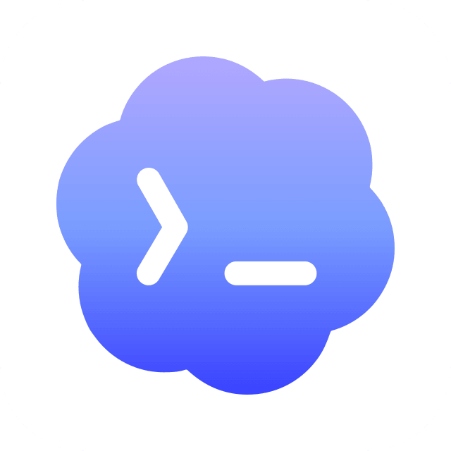<br />Codex</a></td>
    <td align="center" width="20%"><a href="https://powercontext.oceanbase.io/en/docs/integrations/claude-code/"><br />Claude Code</a></td>
    <td align="center" width="20%"><a href="https://github.com/oceanbase/powercontext/tree/master/integrations/minimax#readme"><br />MiniMax Code</a></td>
    <td align="center" width="20%"><a href="https://powercontext.oceanbase.io/en/docs/integrations/dsh/"><br />DeepSeek Harness</a></td>
    <td align="center" width="20%"><a href="https://powercontext.oceanbase.io/en/docs/integrations/zcode/"><br />ZCode</a></td>
  </tr>
  <tr>
    <td align="center" width="20%"><a href="https://powercontext.oceanbase.io/en/docs/integrations/kimi-code/"><br />Kimi Code</a></td>
    <td align="center" width="20%"><a href="https://github.com/oceanbase/powercontext/tree/master/integrations/hermes#readme"><br />Hermes Agent</a></td>
    <td align="center" width="20%"><a href="https://powercontext.oceanbase.io/en/docs/integrations/pi/"><br />Pi Coding Agent</a></td>
    <td align="center" width="20%"><a href="https://powercontext.oceanbase.io/en/docs/integrations/openclaw/"><br />OpenClaw</a></td>
    <td align="center" width="20%"><a href="https://powercontext.oceanbase.io/en/docs/integrations/opencode/"><br />OpenCode</a></td>
  </tr>
  <tr>
    <td align="center" width="20%"><a href="https://github.com/oceanbase/powercontext/tree/master/integrations/workbuddy#readme"><br />WorkBuddy</a></td>
    <td align="center" width="20%"><a href="https://github.com/oceanbase/powercontext/tree/master/integrations/bub#readme"><br />Bub</a></td>
    <td align="center" width="20%"><a href="https://powercontext.oceanbase.io/en/docs/integrations/pydantic-ai/"><br />Pydantic AI</a></td>
    <td align="center" width="20%"><a href="https://powercontext.oceanbase.io/en/docs/integrations/langchain/"><br />LangChain</a></td>
    <td align="center" width="20%"><a href="https://powercontext.oceanbase.io/en/docs/integrations/langgraph/"><br />LangGraph</a></td>
  </tr>
</table>

Codex is officially maintained; other Agent and Python framework integrations are community-maintained. Bub is for evaluation only. See the capability matrix for supported features.

[More integrations and capability comparison →](https://powercontext.oceanbase.io/en/docs/integrations/capabilities/)

**Apps & teams** — [Python / HTTP / MCP](https://powercontext.oceanbase.io/en/docs/develop/interfaces/) · [Memory & Handoff](https://powercontext.oceanbase.io/en/docs/workflows/memory-and-handoff/) · [Deployment & access](https://powercontext.oceanbase.io/en/docs/workflows/scopes-and-access/)

## News

- **2026-11-23 · [v1.6.0](https://powercontext.oceanbase.io/en/changelog/v1.6.0/)** — Knowledge bases debut: import Markdown and images, search with hybrid retrieval, and manage revisioned chunks in the Dashboard. The Gateway reaches its stable release with prebuilt binaries, and memory extraction can reuse the prompt cache of the Agent's conversation.
- **2026-11-16 · [v1.5.2](https://powercontext.oceanbase.io/en/changelog/v1.5.2/)** — Batched writes and query optimizations: maintainer measurements report about 190% higher write throughput and 171% higher query throughput than v1.5.1. The Dashboard now shows processing progress, failure diagnostics, and token usage.
- **2026-11-09 · [v1.5.1](https://powercontext.oceanbase.io/en/changelog/v1.5.1/)** — Trace memories to precise source locations, plus an optional monitoring stack for metrics, logs, and traces.
- **2026-11-03 · [v1.5.0](https://powercontext.oceanbase.io/en/changelog/v1.5.0/)** — Source and Artifact plugins for custom ingestion and artifact types, and reversible encoding that removes repeated evidence from model input.

[All releases →](https://github.com/oceanbase/powercontext/releases)

## Learn more

- [Core concepts](https://powercontext.oceanbase.io/en/docs/get-started/core-concepts/) · [Architecture and responsibilities](https://powercontext.oceanbase.io/en/docs/workflows/architecture/) · [Plugins](https://powercontext.oceanbase.io/en/docs/develop/plugins/)
- [Python / HTTP / MCP interfaces](https://powercontext.oceanbase.io/en/docs/develop/interfaces/) · [Deploy the Server](https://powercontext.oceanbase.io/en/docs/operate/deploy-server/)
- [Token benchmark report](docs/benchmarks/token-savings/README.md) · [Blog](https://powercontext.oceanbase.io/en/blog/)

## Community

Join the PowerContext community on Feishu to share tips, ask questions, and explore context management for AI agents.
Scan the QR code below with Feishu to join the group.

<p align="center">
  
</p>

[Discord](https://discord.com/invite/74cF8vbNEs) · [Issues](https://github.com/oceanbase/powercontext/issues) · [Contributing](https://github.com/oceanbase/powercontext/blob/master/CONTRIBUTING.md)

PowerContext is the successor to [PowerMem](https://www.powermem.ai/). Released under [Apache 2.0](LICENSE).
