<p align="center">
  <picture>
    <source media="(prefers-color-scheme: dark)" srcset="docs/assets/readme-hero-zh-dark.gif" />
    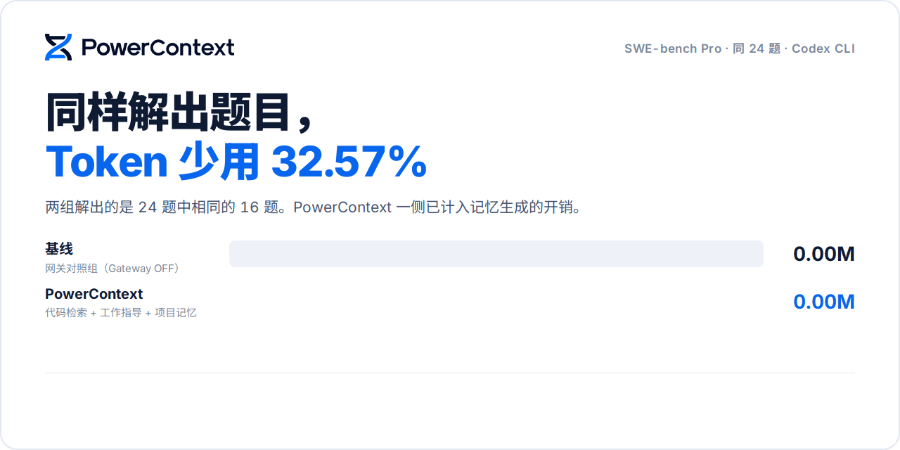
  </picture>
</p>

<h3 align="center">面向 AI Agent 的开源上下文服务</h3>
<p align="center">
  让 Agent 少走弯路、少花 Token。<br />
  <a href="#使用场景">任务交接</a> · <a href="#使用场景">多 Agent 共享</a> · <a href="#使用场景">企业知识库</a> · <a href="#使用场景">用户画像</a> · <a href="https://powercontext.oceanbase.io/zh/docs/workflows/review-dream-revisions/">Dream 自进化</a> · <a href="#可追溯与可管控">Scope 隔离</a> · <a href="#记忆规则每个-scope-自己定">按 Scope 定制记忆规则</a> · <a href="#复用已有订阅">复用已有订阅</a>，都在同一个服务里。
</p>

<p align="center">
  <a href="#powercontext-是什么">是什么</a> &nbsp;·&nbsp;
  <a href="#为什么选-powercontext">为什么</a> &nbsp;·&nbsp;
  <a href="#使用场景">场景</a> &nbsp;·&nbsp;
  <a href="#架构">架构</a> &nbsp;·&nbsp;
  <a href="#快速开始"><b>快速开始</b></a> &nbsp;·&nbsp;
  <a href="#生态">生态</a> &nbsp;·&nbsp;
  <a href="#最新动态">最新动态</a> &nbsp;·&nbsp;
  <a href="https://powercontext.oceanbase.io/zh/docs/">文档</a> &nbsp;·&nbsp;
  <a href="#社区">飞书群</a> &nbsp;·&nbsp;
  <a href="https://discord.com/invite/74cF8vbNEs">Discord</a>
</p>
<p align="center">
  <a href="README.md">English</a> · <a href="README_CN.md">中文</a> · <a href="README_JP.md">日本語</a> &nbsp; / &nbsp;
  <a href="https://pypi.org/project/powercontext/">Python package</a> · <a href="LICENSE">Apache 2.0</a>
</p>

## PowerContext 是什么

**PowerContext 帮助 Agent 和 Harness 管理上下文。** 它把对话、资料和工作记录整理成可检索、可更新、可追溯的知识，在需要时交给 Agent：

- **节省 Token：** 帮 Agent 找对代码、读对内容，减少完成任务所需的往返。[查看评测 →](#节省-token)
- **多 Agent 协同：** 多个 Agent、会话和同事共用同一个 Scope 的记忆，用任务交接接续进度。[查看场景 →](#使用场景)
- **自我进化：** Dream 根据过往依据提出记忆和提示词修订，经你审核后生效。[了解 Dream →](https://powercontext.oceanbase.io/zh/docs/workflows/review-dream-revisions/)
- **准确可追溯：** 每条记忆都能追溯到来源证据和精确版本。[了解更多 →](#可追溯与可管控)
- **按 Scope 定制：** 每个团队、项目或用户都可以有自己的记忆规则，并保留版本。[了解更多 →](#记忆规则每个-scope-自己定)
- **安全可控：** 按 Scope 隔离数据和权限，生成的经验和技能经审核后才会被召回。[了解更多 →](#可追溯与可管控)

可以直接运行服务，通过 HTTP、MCP、Python 或 Agent 集成接入，也可以将 Core 嵌入自己的应用。

<!-- 视频位置：30–60 秒真实录屏，展示 Agent 在第二个会话中接着第一个会话的进度工作。 -->

## 为什么选 PowerContext

### 节省 Token

**Agent 每调用一次模型，都要把累积的上下文重新发送一遍。** 所以 PowerContext 优化的是完成整项任务的往返次数和总开销：帮 Agent 找对代码、读对内容、合并独立操作、只跑相关测试，减少重复探索和无效尝试。

- **同 24 题，计入记忆生成：** Token 减少 **32.57%**，估算模型成本降低 **15.42%**，两组解出相同的 16 题。只看解题，Token 减少 40.30%；单题最高减少 63.49%。
- **往返更少：** 在同一批题号的另一轮实验（OFF 对比 MS）中，主模型请求从 708 次降到 539 次，减少 **23.87%**。这一轮的配置与上面不同，两组数字不能合并计算。
- **记忆生成也复用缓存：** 生成记忆要花 Token，上面的 32.57% 已经计入。网关模式下可以复用解题请求的上下文前缀，用 Codex 订阅时也一样；记录了缓存字段的记忆生成调用中，97% 的输入命中了缓存。

本次评测采用**网关模式**，同时开启代码检索、工作指导和项目记忆：

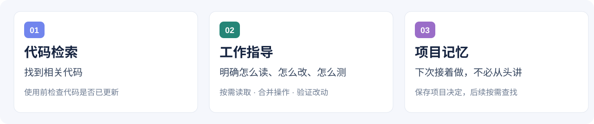

[24 题评测：逐题结果与统计口径 →](docs/benchmarks/token-savings/README_CN.md) · [主模型请求次数 →](docs/benchmarks/token-savings/request-counts_CN.md) · [记忆提取的成本与质量 →](https://gist.github.com/jasper-yl/d02bfb7d9b45ca175bf74ad09cfa5ba4#file-01-report-zh-md)

### 记忆规则，每个 Scope 自己定

<picture>
  <source media="(prefers-color-scheme: dark)" srcset="docs/assets/readme-prompt-rules-zh-dark.svg" />
  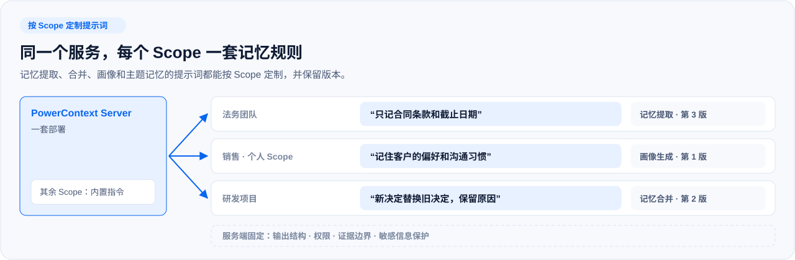
</picture>

很多记忆服务按整个服务或项目配置提取规则。PowerContext 把记忆提取、记忆合并、画像生成和主题记忆的提示词做成 Scope 级的制品：每个团队、项目，甚至每位用户，都可以有自己的记忆规则。每次修改都保留版本，可以随时恢复；Dream 也可以根据过往依据提出修订，审核后生效。

规则只决定"记什么、怎么整理"。输出结构、工具和权限，以及证据边界和敏感信息保护，都由服务端固定，改规则不会改坏系统。启用访问控制时，修改需要 Scope 管理权限；Dashboard 暂不提供编辑器，应用可以通过 API 把这项能力开放给自己的用户。[管理提示词 →](https://powercontext.oceanbase.io/zh/docs/workflows/manage-prompts/)

### 可追溯与可管控

- **有据可查：** 每条记忆都能追溯到来源证据和精确版本，并可定位到来源中的具体位置。
- **任务结果：** Claude Code、Codex 和 OpenCode 每轮都会收到指引，在任务实际完成或明确中断时记录证据。
- **改动经过审核：** 生成的经验和技能经审核后才会被召回；Dream 的修订由你批准后生效；过时的记忆可以停用，历史版本保留。
- **边界清晰：** 按 Scope 隔离数据和访问权限；运行遥测不包含提示词、正文和模型响应。
- **模型网关观测**在参考监控栈中提供模型流量指标和采样调用的 trace。

[审核候选内容 →](https://powercontext.oceanbase.io/zh/docs/workflows/review-candidates/) · [Scope 与访问控制 →](https://powercontext.oceanbase.io/zh/docs/workflows/scopes-and-access/)

## 使用场景

PowerContext 能接入编程 Agent、个人助理和办公 Agent，也能嵌入团队和企业自己的应用。

<!-- Cards are generated by docs/assets/render_scenarios.py; keep the three READMEs aligned. -->
**编程 Agent**

<p align="center">
  <a href="https://powercontext.oceanbase.io/zh/docs/workflows/memory-and-handoff/"><picture><source media="(prefers-color-scheme: dark)" srcset="docs/assets/scenarios/card-handoff-zh-dark.svg" />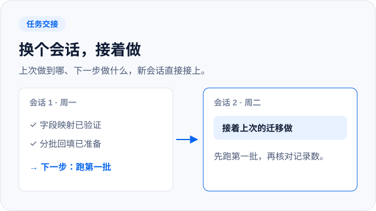</picture></a>
  <a href="https://powercontext.oceanbase.io/zh/docs/workflows/scopes-and-access/"><picture><source media="(prefers-color-scheme: dark)" srcset="docs/assets/scenarios/card-shared-zh-dark.svg" />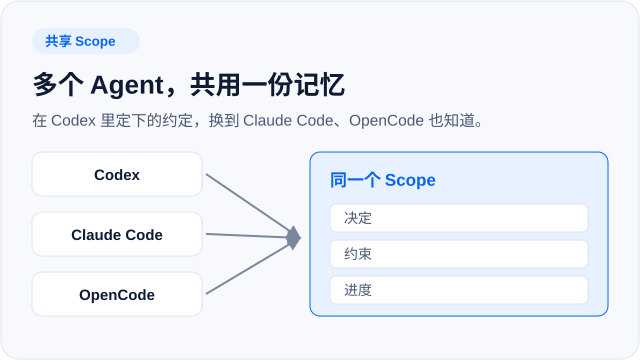</picture></a>
</p>

**个人助理与办公 Agent**

<p align="center">
  <a href="https://powercontext.oceanbase.io/zh/docs/integrations/openclaw/"><picture><source media="(prefers-color-scheme: dark)" srcset="docs/assets/scenarios/card-assistant-zh-dark.svg" />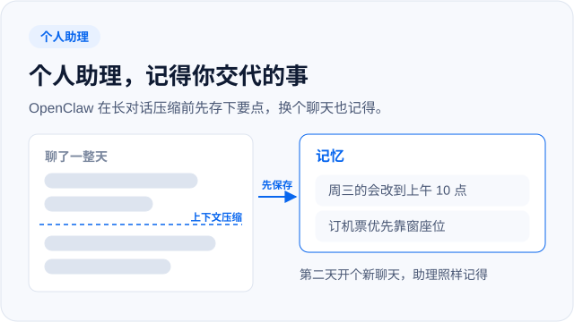</picture></a>
  <a href="https://powercontext.oceanbase.io/zh/docs/workflows/experience-and-skill-lifecycle/"><picture><source media="(prefers-color-scheme: dark)" srcset="docs/assets/scenarios/card-office-zh-dark.svg" />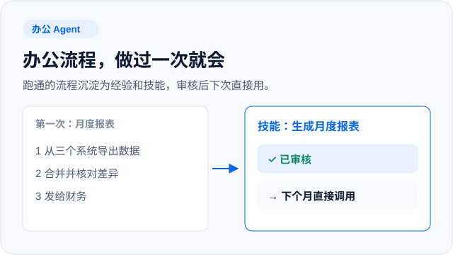</picture></a>
</p>

**团队与企业应用**

<p align="center">
  <a href="https://github.com/oceanbase/powercontext/blob/master/docs/zh/docs/workflows/knowledge-base.md"><picture><source media="(prefers-color-scheme: dark)" srcset="docs/assets/scenarios/card-knowledge-zh-dark.svg" />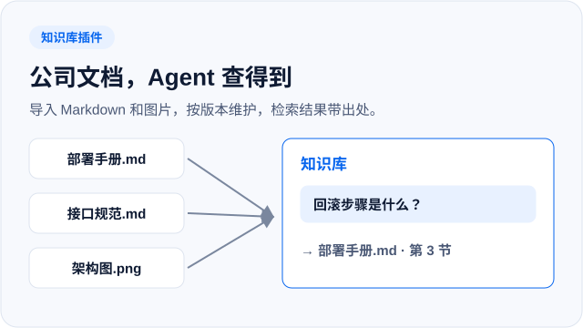</picture></a>
  <a href="https://powercontext.oceanbase.io/zh/docs/workflows/use-profiles/"><picture><source media="(prefers-color-scheme: dark)" srcset="docs/assets/scenarios/card-users-zh-dark.svg" />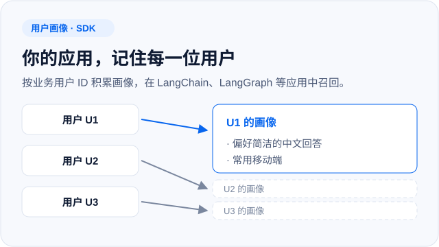</picture></a>
</p>
<p align="center">
  <a href="https://powercontext.oceanbase.io/zh/blog/power-system-agent-memory/"><picture><source media="(prefers-color-scheme: dark)" srcset="docs/assets/scenarios/card-domain-zh-dark.svg" />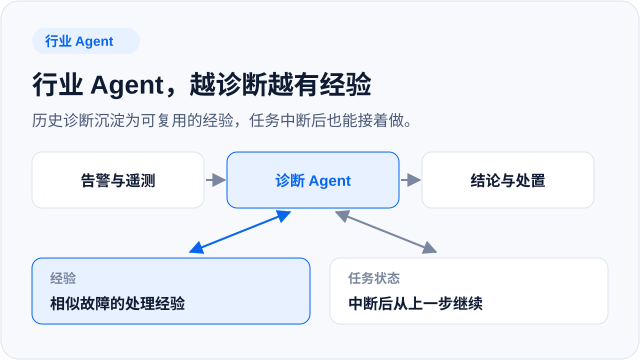</picture></a>
  <a href="https://powercontext.oceanbase.io/zh/docs/develop/plugins/"><picture><source media="(prefers-color-scheme: dark)" srcset="docs/assets/scenarios/card-plugins-zh-dark.svg" />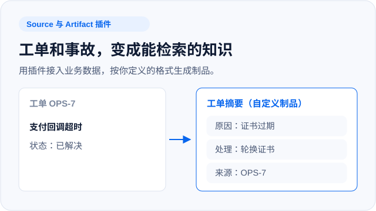</picture></a>
</p>

[任务交接](https://powercontext.oceanbase.io/zh/docs/workflows/memory-and-handoff/) · [Scope 与共享](https://powercontext.oceanbase.io/zh/docs/workflows/scopes-and-access/) · [OpenClaw](https://powercontext.oceanbase.io/zh/docs/integrations/openclaw/) · [Hermes](https://powercontext.oceanbase.io/zh/docs/integrations/hermes/) · [经验与技能](https://powercontext.oceanbase.io/zh/docs/workflows/experience-and-skill-lifecycle/) · [知识库插件](https://github.com/oceanbase/powercontext/blob/master/docs/zh/docs/workflows/knowledge-base.md) · [用户画像](https://powercontext.oceanbase.io/zh/docs/workflows/use-profiles/) · [电力诊断 Agent 实践](https://powercontext.oceanbase.io/zh/blog/power-system-agent-memory/) · [Source 与 Artifact 插件](https://powercontext.oceanbase.io/zh/docs/develop/plugins/)

## 架构

<picture>
  <source media="(prefers-color-scheme: dark)" srcset="docs/assets/readme-architecture-zh-dark.svg" />
  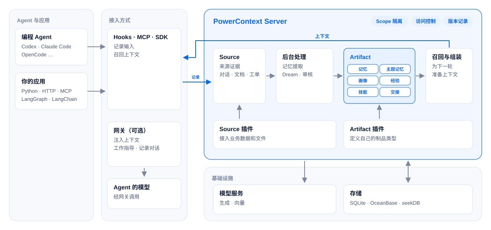
</picture>

Agent 通过 Hooks、MCP 或 SDK 接入 Server；也可以让模型请求经过网关，由网关注入上下文、提供工作指导。Server 按 Scope 保存来源证据（Source），后台把证据整理成记忆、主题记忆、画像、经验和技能等制品（Artifact），需要时再召回、组装成下一轮使用的上下文。Source 插件和 Artifact 插件可以接入新的数据来源、定义新的制品类型。[架构与职责边界 →](https://powercontext.oceanbase.io/zh/docs/workflows/architecture/)

## 快速开始

### 让 Agent 帮你安装

把下面这段话发给你的 Coding Agent，例如 Codex、OpenCode 或 Claude Code。它会先检测环境、问你几个问题，再完成安装和验收：个人使用时，Codex 和 OpenCode 默认通过网关接入；团队管理员也可以用它完成部署。

```text
按照 https://powercontext.oceanbase.io/zh/llms.mdx/docs/get-started/agent-install/content.md 在这台机器上安装 PowerContext。需要我决定的事先问我，不要猜；不要读取或显示我的任何密钥。
```

<details>
<summary><b>自己动手安装</b></summary>

需要 Python 3.11+、Git 和 [uv](https://docs.astral.sh/uv/getting-started/installation/)；接入 Agent 时还需安装对应的 CLI。以下命令安装 **PowerContext 1.6.0**，适用于 macOS 和 Linux；Windows 为实验性支持。需要自动准备 Python 和 uv 时，可使用[安装脚本](https://powercontext.oceanbase.io/zh/docs/get-started/install-and-run/#使用推荐安装脚本)。

首次体验可在向导中选择**基础记忆**，显式保存与召回不需要为 Server 配置模型 API；自动提取需要选择**完整记忆能力**并配置生成模型和 Embedding 凭据。存储可先选 SQLite。

```bash
uv tool install --force "powercontext[cli,server]==1.6.0"
mkdir -p powercontext-config && cd powercontext-config
powercontext config init --language zh --output .env
powercontext config validate --env-file .env
powercontext service install --env-file .env
powercontext service status
```

关闭终端后，服务仍会继续运行。Linux 需要可用的 `systemd --user` 管理器。向导生成的 `.env` 和 `.env.next-steps.md` 可能包含凭据，请勿提交到 Git。

加载生成的配置，检查服务状态：

```bash
set -a
. ./.env
set +a
powercontext ready
powercontext capabilities
```

按 **`.env.next-steps.md`** 创建并绑定 Scope，使用创建请求返回的真实 `scope_id`。Agent 和 Dashboard 要连接同一个 Server 和 Scope；切换工作目录不会自动隔离项目。修改 `.env` 后，重新加载环境文件，并执行 `powercontext service install --env-file .env` 使配置生效。

接入 Codex 时，安装对应版本的集成：

```bash
powercontext setup codex --env-file .env --ref powercontext-v1.6.0
powercontext doctor codex
```

在新 Codex 会话发送第一条消息前，打开 **`/hooks`** 检查并按提示信任 PowerContext Hook。即使 MCP 已连通，自动采集输入和召回上下文仍需要启用 `UserPromptSubmit` Hook。[首次会话检查与恢复 →](https://powercontext.oceanbase.io/zh/docs/integrations/codex/#首次会话-hook-信任)

按所选模式检查是否生效：

- **基础记忆：** 明确要求 Agent 保存一条项目决定，再用同一 Scope 开启新会话，要求它带来源找回。
- **完整记忆能力：** 确认输入已进入 Source，等待配置的后台处理生成 Topic Memory，再检查相关更新是否被记录，并能在新会话中找回。

`doctor codex` 只检查安装与连接。采集到 Source 不等于已生成记忆，自动处理还需要调度和模型运行。基础记忆模式下，Agent 仍使用自己的模型。[完整安装流程 →](https://powercontext.oceanbase.io/zh/docs/get-started/quickstart/)

<sub>以上命令用于启动服务。要复现测试中的网关、代码检索和工作指导配置，请查看详细报告。</sub>

</details>

### 复用已有订阅

已经订阅了 Codex、Claude Code、GitHub Copilot、Grok、Gemini、Qwen Code 或 Kimi Code？记忆、经验和画像的生成可以直接用它，不必另配生成模型 API：

- **后台生成：** Server 用订阅生成记忆、经验和画像。此时不能开启推理保护；主题记忆和 Dream 暂不支持，向量模型仍需单独配置。
- **经过网关的 Agent 请求：** Agent 带着订阅把模型请求发往网关，由网关注入上下文、记录对话。用 Codex 订阅时，记忆抽取还能复用 Agent 会话的前缀缓存，用量计入同一个订阅额度。各订阅支持的范围不同。

[用订阅配置后台生成 →](https://powercontext.oceanbase.io/zh/development/pydantic-ai-inference/#复用已有订阅凭据) · [网关 OAuth 订阅 →](https://github.com/oceanbase/powercontext/blob/master/gateway/SUBSCRIPTIONS.md)

## 生态

<!-- Add integrations using an original logo asset, a product name, and a documentation link. -->
<table width="100%">
  <tr>
    <td align="center" width="20%"><a href="https://powercontext.oceanbase.io/zh/docs/integrations/codex/"><br />Codex</a></td>
    <td align="center" width="20%"><a href="https://powercontext.oceanbase.io/zh/docs/integrations/claude-code/"><br />Claude Code</a></td>
    <td align="center" width="20%"><a href="https://github.com/oceanbase/powercontext/tree/master/integrations/minimax#readme"><br />MiniMax Code</a></td>
    <td align="center" width="20%"><a href="https://powercontext.oceanbase.io/zh/docs/integrations/dsh/"><br />DeepSeek Harness</a></td>
    <td align="center" width="20%"><a href="https://powercontext.oceanbase.io/zh/docs/integrations/zcode/"><br />ZCode</a></td>
  </tr>
  <tr>
    <td align="center" width="20%"><a href="https://powercontext.oceanbase.io/zh/docs/integrations/kimi-code/"><br />Kimi Code</a></td>
    <td align="center" width="20%"><a href="https://github.com/oceanbase/powercontext/tree/master/integrations/hermes#readme"><br />Hermes Agent</a></td>
    <td align="center" width="20%"><a href="https://powercontext.oceanbase.io/zh/docs/integrations/pi/"><br />Pi Coding Agent</a></td>
    <td align="center" width="20%"><a href="https://powercontext.oceanbase.io/zh/docs/integrations/openclaw/"><br />OpenClaw</a></td>
    <td align="center" width="20%"><a href="https://powercontext.oceanbase.io/zh/docs/integrations/opencode/"><br />OpenCode</a></td>
  </tr>
  <tr>
    <td align="center" width="20%"><a href="https://github.com/oceanbase/powercontext/tree/master/integrations/workbuddy#readme"><br />WorkBuddy</a></td>
    <td align="center" width="20%"><a href="https://github.com/oceanbase/powercontext/tree/master/integrations/bub#readme"><br />Bub</a></td>
    <td align="center" width="20%"><a href="https://powercontext.oceanbase.io/zh/docs/integrations/pydantic-ai/"><br />Pydantic AI</a></td>
    <td align="center" width="20%"><a href="https://powercontext.oceanbase.io/zh/docs/integrations/langchain/"><br />LangChain</a></td>
    <td align="center" width="20%"><a href="https://powercontext.oceanbase.io/zh/docs/integrations/langgraph/"><br />LangGraph</a></td>
  </tr>
</table>

Codex 为官方维护；其余 Agent 和 Python 框架集成为社区维护；Bub 仅用于评测。各项支持范围见能力对照。

[其他集成与能力对照 →](https://powercontext.oceanbase.io/zh/docs/integrations/capabilities/)

**应用与团队** — [Python / HTTP / MCP](https://powercontext.oceanbase.io/zh/docs/develop/interfaces/) · [记忆与任务交接](https://powercontext.oceanbase.io/zh/docs/workflows/memory-and-handoff/) · [部署与访问控制](https://powercontext.oceanbase.io/zh/docs/workflows/scopes-and-access/)

## 最新动态

- **2026-11-23 · [v1.6.0](https://powercontext.oceanbase.io/zh/changelog/v1.6.0/)** — 知识库首次发布：导入 Markdown 和图片，混合检索并在 Dashboard 中管理版本化分块。Gateway 推出正式版并提供预编译二进制，记忆提取可复用 Agent 对话的提示词缓存。
- **2026-11-16 · [v1.5.2](https://powercontext.oceanbase.io/zh/changelog/v1.5.2/)** — 批量写入和查询优化：维护者实测写入吞吐提升约 190%、查询吞吐提升约 171%（对比 v1.5.1）；Dashboard 原生展示处理进度、失败诊断和 Token 用量。
- **2026-11-09 · [v1.5.1](https://powercontext.oceanbase.io/zh/changelog/v1.5.1/)** — 记忆可追溯到来源中的精确位置；新增可选的监控栈，覆盖指标、日志和链路追踪。
- **2026-11-03 · [v1.5.0](https://powercontext.oceanbase.io/zh/changelog/v1.5.0/)** — Source 与 Artifact 插件，可扩展数据接入和自定义制品；用可逆编码减少模型输入中的重复证据。

[全部版本 →](https://github.com/oceanbase/powercontext/releases)

## 了解更多

- [核心概念](https://powercontext.oceanbase.io/zh/docs/get-started/core-concepts/) · [架构与职责边界](https://powercontext.oceanbase.io/zh/docs/workflows/architecture/) · [插件开发](https://powercontext.oceanbase.io/zh/docs/develop/plugins/)
- [Python / HTTP / MCP 接口](https://powercontext.oceanbase.io/zh/docs/develop/interfaces/) · [部署 Server](https://powercontext.oceanbase.io/zh/docs/operate/deploy-server/) · [为每个 Gateway 请求选择 Scope](docs/zh/docs/operate/deploy-server.md#gateway-请求-scope)
- [Token 评测报告](docs/benchmarks/token-savings/README_CN.md) · [博客](https://powercontext.oceanbase.io/zh/blog/)

## 社区

欢迎加入 PowerContext 飞书交流群，分享使用经验、交流问题，一起探索 AI Agent 的上下文管理。
使用飞书扫描下方二维码即可加入。

<p align="center">
  
</p>

[Discord](https://discord.com/invite/74cF8vbNEs) · [报告问题](https://github.com/oceanbase/powercontext/issues) · [参与贡献](https://github.com/oceanbase/powercontext/blob/master/CONTRIBUTING.md)

PowerContext 是 [PowerMem](https://www.powermem.ai/) 的后续项目，采用 [Apache 2.0](LICENSE) 发布。
