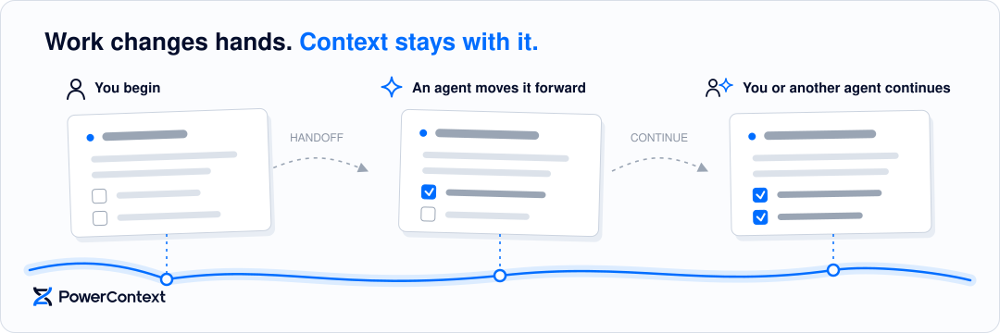
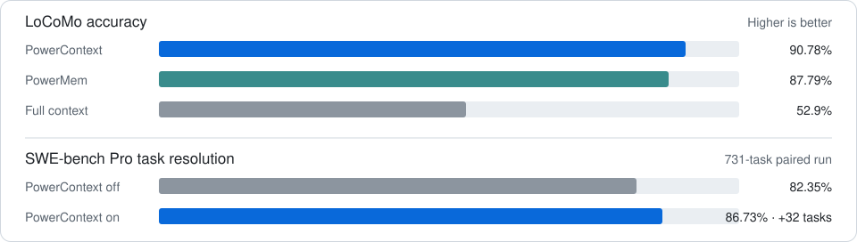
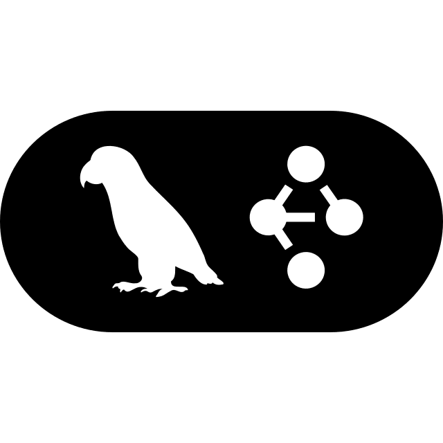

# PowerContext

**作業とともに残るコンテキスト —— セッション、Agent、人をまたいで。**

[](https://pypi.org/project/powercontext/)
[](LICENSE)
[](https://discord.com/invite/74cF8vbNEs)
[](https://deepwiki.com/oceanbase/powercontext)

*[English](README.md) · [中文](README_CN.md) · [日本語](README_JP.md)*

[Web サイト](https://powercontext.oceanbase.io/en/) · [クイックスタート](https://powercontext.oceanbase.io/en/docs/get-started/quickstart/) · [Agent 連携](https://powercontext.oceanbase.io/en/docs/integrations/) · [ベンチマーク](https://powercontext.oceanbase.io/en/benchmarks/) · [インターフェース](https://powercontext.oceanbase.io/en/docs/develop/interfaces/)

## クイックスタート

PowerContext は、長く使うプロジェクトのコンテキストを 1 つの会話の外に保持します。最初の実行は次の流れです。

```text
Agent の入力 → Source の証拠 → Memory / Topic Memory → PreparedContext → 新しいセッションまたは Agent
```

PowerContext 1.3.0 には対話式セットアップウィザードが含まれています。Python 3.11+、Git、[uv](https://docs.astral.sh/uv/getting-started/installation/) が必要です。必要に応じて uv が Python を用意できます。Agent に接続するには、その CLI もインストールしてください。ウィザードでは、モデル API なしで明示的な保存と想起を試す場合は Basic memory、自動抽出を有効にする場合は Full memory を選択してください。Full memory には Generation と Embedding API の個別の認証情報が必要です。モデル API なしでローカル Server だけを起動する場合は[インストールと実行](docs/en/docs/get-started/install-and-run.md)を参照してください。macOS と Linux をサポートし、Windows のサポートは `experimental` です。

目的に合う経路を選択してください：

| 目的 | 選択 | 必要なもの |
| --- | --- | --- |
| 明示的な保存と想起を試す | **Basic memory** | CLI と Server。モデル API は不要 |
| Source を自動処理し、Topic Memory やセマンティック検索を使う | **Full memory** | Generation と Embedding API の個別の認証情報。スケジュールと Scope ポリシーも適用されます |
| Python で基本ワークフローを学ぶ | 最初の 7 本の Jupyter チュートリアル | リポジトリの checkout と `uv`。モデルや API キーは不要 |

### 1. ウィザードをインストールして実行する

```bash
uv tool install --force "powercontext[cli,server]==1.3.0"
mkdir -p powercontext-config && cd powercontext-config
powercontext config init --language en --output .env
powercontext config validate --env-file .env
powercontext server run --env-file .env      # このターミナルは開いたままにする
```

ウィザードでは、ストレージ、ローカルまたはリモート利用、メモリ機能、Dashboard/アクセス制御、Agent 接続を選択します。最初は SQLite が簡単です。組み込み seekdb は必要な場合だけ選び、依存関係のインストールを許可してください。

ウィザードは `.env` と `.env.next-steps.md` を生成します。これらのファイルには認証情報が含まれることがあるため、コミットしないでください。Server を起動したまま、別のターミナルで `powercontext-config` に戻り、生成された環境ファイルを読み込んで接続を確認します。

```bash
set -a
. ./.env
set +a
powercontext ready
powercontext capabilities
```

続いて `.env.next-steps.md` の手順に従い、Scope を作成して紐付けます。作成リクエストが返す実際の `scope_id` を使ってください。
計画された `codex-...` タイトルは ID ではありません。ディレクトリを変えても分離は作られないため、Dashboard と Agent で同じ Server と
Scope を使います。その後、対応するプラグインをインストールして新しい Agent セッションを起動します。[完全な手順](https://powercontext.oceanbase.io/en/docs/get-started/quickstart/)では、Codex と Claude Code、Dashboard へのログイン、SSH 転送、HTTPS の前提条件、確認可能な受け入れチェックを扱っています。対応する Codex のインストールは次のとおりです。

```bash
powercontext setup codex --ref powercontext-v1.3.0
powercontext doctor codex
```

### 2. 最初のエンドツーエンド結果を確認する

この確認では、PowerContext が役立つ流れを検証します：Source の取得 → バックグラウンド処理 → セッションをまたぐ想起。
同じ Scope に紐付けた新しい Agent セッションで、次のような具体的な決定を送ります。

```text
Aurora の受け入れプロジェクトを設計しています。Python の依存関係には uv、設定には .env を使います。
最初のデプロイは 1 台の Linux サーバーで行い、Mac から SSH トンネルで接続します。
これらの制約を変えずに言い直してください。コードは変更しないでください。
```

Dashboard を有効にした場合は、ウィザードが表示した URL を開いてください。取得前に Dashboard が空なのは正常です。
その後、次を確認します。

1. 入力が Source として表示されること。
2. 設定した検査間隔とモデル処理の後、関連する Topic Memory が現れること。
3. 関連する更新を送り、新しい Source が入り、トピックの内容またはリビジョン履歴に反映されること。
4. 同じ Scope で新しい Agent セッションを開始し、Aurora の決定を引用付きで探すこと。

`doctor codex` はインストールと接続だけを確認します。Source の取得だけでは Memory や Topic Memory は作成されず、バックグラウンド処理には設定したスケジュールとモデルの実行が必要です。
Basic memory では Agent に決定を明示的に保存させ、新しいセッションで検索してください。ただし、これは自動抽出の検証ではありません。

### 3. Python で最初に試す

チュートリアルはリポジトリの checkout 内で実行し、依存関係は `uv` の dependency group から取得します。`powercontext` パッケージには含まれません。リポジトリのルートで実行してください：

```bash
uv sync --locked --group notebooks
uv run --locked --group notebooks jupyter lab --notebook-dir=examples/jupyter
```

まず [01 · Memory across sessions](examples/jupyter/01_memory_across_sessions.ipynb) を実行し、その後 [22 本の Jupyter チュートリアル（中国語）](examples/jupyter/README.md)で、Memory、コンテキストの準備、Handoff、Experience、Skill、実際の Agent を動かしながら学べます。
最初の 7 本はモデルや API キーなしで実行できます。

### よくある問題

- `doctor codex` は Codex のインストールと接続を確認します。自動記憶を検証するには、実際の入力が Source になり、Topic が生成され、関連する入力で主題が変化し、同じ Scope を使う新しいセッションで想起できることを確認してください。
- Python 依存関係のダウンロードが遅い、または失敗する場合は、[uv](https://docs.astral.sh/uv/configuration/indexes/) にパッケージインデックス（ミラー）を設定してから再試行してください。
- 自動 Memory と Topic Memory を試すには **Full memory** を選択し、Generation と Embedding の API 接続を設定してください。Agent のサブスクリプションとは別の認証情報が必要です。**Basic memory** は追加のモデル API なしで明示的な保存・検索を利用できます。
- seekdb のインストールが必要な場合、ウィザードが一度確認し、依存関係をバックグラウンドでインストールします。
- オプションの想起十分性ゲートは、Scope ごとの 1 日あたりの検索量と予算超過を記録し、後からポリシー評価に使えます。記録範囲と失敗時の挙動は[設定リファレンス](docs/en/docs/operate/configuration.md)を参照してください。
- Server が別のマシンにある場合は HTTPS を使用するか、[リモート接続ガイド](docs/en/docs/operate/connect-remote-server.md)に従ってください。セットアップはフラグや環境変数からリモート HTTP URL を認識し、明示的な同意を求めます。自動化されたセットアップでは `--allow-insecure-http` を使います。

## PowerContext とは何か？

**PowerContext は、AI Agent 向けのオープンソース・コンテキストサービスです。** 作業のうち長く使う価値のある部分 —— 確定した判断、制約、根拠、進捗 —— を単一の会話の外に置きます。これにより、次のセッション、次の Agent、あるいは次の担当者が、記録をすべて読み返すのではなく現在の状態から続けられます。

PowerContext は、そのまま使える Server としても、同じ契約を別のアプリケーションに組み込む形でも利用できます。
まずは次の 3 層で理解すると分かりやすくなります。

| レイヤー | 担当 | 使う場面 |
| --- | --- | --- |
| Core protocol | `Source`、`Artifact`、`Trigger` の契約 | PowerContext を組み込む、またはコンポーネントを追加する |
| Builtin runtime | Memory、Handoff、Experience、Skill、スケジュール、推論、対応ストレージ | 標準のローカル Server を実行する |
| Server と integrations | HTTP/MCP、Python Client、CLI、Dashboard、Agent プラグイン | Agent やアプリケーションを接続する |

作業を始めた人や Agent が、そのまま最後まで終えるとは限りません。あなたが Agent にタスクを渡し、Agent が途中まで進めた後、あなたや別の誰かが引き継ぐことがあります。そのとき、判断の理由や現在の状態は、その会話に置き去りになりがちです。PowerContext はそれらを会話の外に移し、検査可能なリビジョン付きの Artifact として保持します。



すべての項目は **Scope** に属します。Scope は、独立した Source ジャーナル、Memory のライフサイクル、レビュー受信トレイ、Handoff 履歴の単位です。Scope ID はデータを選択するためのものであり、ユーザー識別の証明、ツールアクセス権の付与、実行の認可を行うものではありません。

```text
Scope
├── Source journal    # 根拠：入力、ドキュメント、作業契約、タスク結果
├── Memory            # atomic-memory/ARTIFACT_ID@REVISION —— 判断、制約、次の手順
├── Review Inbox      # レビュー待ちの Experience / Skill 候補
├── Handoff history   # handoff/ARTIFACT_ID@REVISION —— セッションをまたぐ作業の継続
└── Topic Memory      # 対象となる Source からバックグラウンドで抽出
```

*以下 2 枚の Dashboard 画面は合成のデモ記録を使用しています。*

### Memory — セッションを超えて残る判断と制約

Memory は、再利用可能な判断・制約・事実・状態・次の手順を保持するリビジョン付き Artifact ファミリです。エントリの状態は `active`、`forgotten`、`merged`、`retired` のいずれかです。`POST /v1/atomic-memory/lifecycle` で forget するとアクティブな想起から外れますが、内容と履歴は利用可能なまま保持され、復元できます。内容のリビジョンは進みません。明示的な Memory の書き込みにモデルは不要です。取得済み Source からの抽出には、生成パイプラインの設定が必要です。

> 「古い auth モジュールはリファクタリングしないで。モバイル側がまだ使っているから。」
> これほど価値のある文脈を、毎セッション誰かが言い直すことに依存させるべきではありません。


### Handoff — 全文ではなく現在の状態

Handoff は作業の継続を、4 ステップのループとして記録します。

```text
Work Contract → Prepared Handoff → Acknowledgement → Task Outcome
```

`handoff_current_work` は検査済みの境界を取り込み、一時的な Prepared Handoff を返します。コミットして永続的なリビジョンになるのは、マイルストーンとして残したいとユーザーが判断した場合だけです。受け手は Handoff を解決して Acknowledgement を記録し、Task Outcome が最終状態とチェック内容を Source の根拠として保存します。[Handoff Report](https://powercontext.oceanbase.io/en/docs/workflows/use-handoff-report/) は、選択した各 Scope の最新 Handoff リビジョンを投影して閲覧・エクスポートできます。読み取り専用で、Memory を書き換えることはありません。


### Experience — レビューを経て再利用される知見

Experience は、状況・行動・観察された結果・再利用可能な教訓を記録します。Scope 内のレビュー受信トレイに `pending` の候補として入ります。レビュー書き込みは `expected_version` を使うため、他の書き込み者が提案を変更した後に決定が暗黙のうちに適用されることはありません。承認は不変のリビジョンを書き、却下は理由を記録します。どちらも終端状態であり、想起に参加するのは承認済みの現在のヘッドのみです。保留中、却下済み、過去のリビジョンは除外されます。

### Skill — レビュー済みの手順、明示的にエクスポートして使う

管理対象の Skill は、名前、発見用の説明、手順、検証項目、来歴で構成されます。承認はインストールでも実行でもありません。Agent ホストが配下のコピーを発見するには、承認済みの特定リビジョンを明示的にエクスポートする必要があります。

## なぜ PowerContext なのか？

- **コンテキストは会話の外にあります。** Memory、Handoff、Experience、Skill はサーバー側の Artifact であり、ある Agent のホームディレクトリ内のファイルではありません。Codex から Claude Code に乗り換えても、同僚に作業を渡しても、作業自体がついてきます。
- **すべてがリビジョン管理され、追跡可能です。** 各 Artifact は `ファミリ/ARTIFACT_ID@REVISION` で識別されます。承認された置換が後のリビジョンを作っても ARTIFACT_ID は変わらず、正確な参照を読めば、ファミリのヘッドが進んだ後でもその時点のスナップショットが返ります。
- **生成・レビュー・実行は別々のステップです。** モデルが内容を提案し、レビューがリビジョンを承認し、エクスポートがホスト内のコピーを作ります。いずれのステップも、Agent に命令実行の権限を与えるものではありません。各入口が現在何を公開しているかは[インターフェース](https://powercontext.oceanbase.io/en/docs/develop/interfaces/)を参照してください。
- **想起はまとめてではなく、境界つきで行われます。** `PreparedContext` は設定されたセクションからアクティブな Memory と承認済み Experience を選択し、必要に応じて Profile スナップショットと Topic Memory を加え、共有のバイト予算を適用して `ready` または `empty` を返します。想起された内容は履歴であり、命令の権威ではありません。受け手の Agent は現在の指示に従い、実際のワークスペースの状態を確認します。
- **再利用の前にレビューを通します。** Experience と Skill はレビューの決定を経て、承認・却下のいずれも終端です。承認は不変リビジョンを書き込みます。アクセス制御が有効な場合、承認には `scope.review` が必要です。レビュー権限を持つ Agent は自分の Candidate も承認できます。人が判断する運用では、異なる ID と権限で[Agent の提出とレビューを分離](https://powercontext.oceanbase.io/en/docs/workflows/review-candidates/#separate-agent-submission-from-review)してください。
- **1 つの Server、同じ契約の複数の見え方。** HTTP が完全なリモートアプリケーション契約です。Python クライアントは型付きアクセスを提供し、MCP は Agent 向けに取捨選択された投影であり、Core プロトコルを使えばアプリケーション側で Source・Artifact・Trigger の実装を組み込めます。

### 他手段との比較

以下は一般的な単一 Agent またはホスト内の構成を前提とした比較であり、具体的な能力は各システムのデプロイと連携方法によって異なります。

| | 会話履歴を読み返す | 会話履歴への RAG | ホスト内の記憶ファイル（CLAUDE.md など） | PowerContext |
|---|---|---|---|---|
| 新しいセッションに残る | 手動 | はい | はい | はい |
| Agent を乗り換えても有効 | いいえ | いいえ | いいえ | はい |
| 人への引き継ぎ | 手動 | 手動 | 手動 | Handoff（第一級） |
| 再利用可能な手順 | なし | なし | 散文のみ | Experience / Skill |
| 過去の版が残る | いいえ | インデックス次第 | git 経由のみ | 不変リビジョン |
| 再利用前のレビュー | 該当なし | いいえ | いいえ | レビュー受信トレイ |
| 1 ターンの想起に予算 | いいえ | 一部 | いいえ | `PreparedContext` のバイト予算 |
| Agent の外から検査可能 | いいえ | いいえ | はい | はい |

## 効果の検証



- **長い会話の記憶（LoCoMo；カテゴリ 1–4 の 1,540 件の採点対象質問）：精度 90.78%**。PowerMem は 87.79%、全文コンテキストの再生は 52.9% で、**+37.88 ポイント**です。
- **コーディングタスク（SWE-bench Pro；公開 v2 の 731 タスクによるプロジェクトのペア実行で、公式提出ではありません）：PowerContext 有効時のタスク解決率 86.73%、無効時 82.35%**。**+4.38 ポイント**、32 タスク多く解決しました。
- **想起の品質（LoCoMo Plus）**：ネイティブの PowerContext と、検索後に Jev で候補を絞り込んだ場合の比較です。各モデルは Memory 抽出と回答生成の両方に使用し、埋め込みには `qwen3.7-text-embedding`（1024 次元）を使用しています。

  | モデル | PowerContext | PowerContext + Jev | 差 |
  |---|---|---|---|
  | GPT-4o-mini | 40.855% | 49.78% | +8.925 ポイント |
  | Qwen3.7-plus | 60.37% | 68.947% | +8.577 ポイント |
  | GPT-4o | 65.082% | 69.28% | +4.198 ポイント |

評価手法、詳細な結果、適用範囲は[公式ベンチマークページ](https://powercontext.oceanbase.io/en/benchmarks/)を参照してください。隠すより書いておきたい注意点が 2 つあります。上記 6 件の LoCoMo Plus スコアはプロジェクト所有者から提供されたもので、検証用の実行成果物は公開されていません。公開されている再現手順は評価ハーネスの説明であり、これらのスコア自体の検証を意味するものではありません。また、Windows のサポートは `experimental` です。

## Agent と接続する

Codex は `official`、他のメンテナンス対象ホストと Python Agent フレームワークは `community`、Bub は評価専用の `evaluation` です。これらは PowerContext 連携のメンテナンス主体と用途を示すタグです。どのホストが資格を満たしているか、対応機能と利用可能なバージョンは[機能一覧](https://powercontext.oceanbase.io/en/docs/integrations/capabilities/)に記載されています。

<table>
<tr>
<td align="center" width="120"><a href="docs/en/docs/integrations/codex.md"><br /><sub><b>Codex</b></sub></a></td>
<td align="center" width="120"><a href="docs/en/docs/integrations/claude-code.md"><br /><sub><b>Claude Code</b></sub></a></td>
<td align="center" width="120"><a href="integrations/minimax/README.md"><br /><sub><b>MiniMax Code</b></sub></a></td>
<td align="center" width="120"><a href="docs/en/docs/integrations/dsh.md"><br /><sub><b>DeepSeek Harness</b></sub></a></td>
<td align="center" width="120"><a href="docs/en/docs/integrations/zcode.md"><br /><sub><b>ZCode</b></sub></a></td>
<td align="center" width="120"><a href="docs/en/docs/integrations/kimi-code.md"><br /><sub><b>Kimi Code</b></sub></a></td>
<td align="center" width="120"><a href="integrations/hermes/README.md"><picture><source media="(prefers-color-scheme: dark)" srcset="assets/hermes-dark.png"></picture><br /><sub><b>Hermes Agent</b></sub></a></td>
<td align="center" width="120"><a href="docs/en/docs/integrations/pi.md"><picture><source media="(prefers-color-scheme: dark)" srcset="assets/pi-dark.png"></picture><br /><sub><b>Pi Coding Agent</b></sub></a></td>
</tr>
<tr>
<td align="center" width="120"><a href="docs/en/docs/integrations/openclaw.md"><br /><sub><b>OpenClaw</b></sub></a></td>
<td align="center" width="120"><a href="docs/en/docs/integrations/opencode.md"><picture><source media="(prefers-color-scheme: dark)" srcset="assets/opencode-dark.png"></picture><br /><sub><b>OpenCode</b></sub></a></td>
<td align="center" width="120"><a href="integrations/workbuddy/README.md"><br /><sub><b>WorkBuddy</b></sub></a></td>
<td align="center" width="120"><a href="integrations/bub/README.md"><br /><sub><b>Bub</b></sub></a></td>
<td align="center" width="120"><a href="docs/en/docs/integrations/pydantic-ai.md"><br /><sub><b>Pydantic AI</b></sub></a></td>
<td align="center" width="120"><a href="docs/en/docs/integrations/langchain.md"><br /><sub><b>LangChain</b></sub></a></td>
<td align="center" width="120"><a href="docs/en/docs/integrations/langgraph.md"><picture><source media="(prefers-color-scheme: dark)" srcset="assets/langgraph-dark.png"></picture><br /><sub><b>LangGraph</b></sub></a></td>
</tr>
</table>

アプリケーションは、非同期 Python クライアント、HTTP API、MCP、または同一プロセス内の Core SDK から PowerContext を利用できます。入口を選ぶには[インターフェースリファレンス](https://powercontext.oceanbase.io/en/docs/develop/interfaces/)を参照してください。

## PowerContext を開発する

```bash
make install
make check
make test
```

開発ワークフロー全体については [CONTRIBUTING.md](CONTRIBUTING.md) を参照してください。
コーディング評価、メモリ品質評価、性能ベンチマーク、Skill 回帰テストは [`evaluation/`](evaluation/README.md) にまとめています。

## さらに詳しく

- [はじめる](https://powercontext.oceanbase.io/en/docs/get-started/quickstart/)
- [Agent と接続する](https://powercontext.oceanbase.io/en/docs/integrations/)
- [コンテキストの管理](https://powercontext.oceanbase.io/en/docs/workflows/)
- [デプロイと運用](https://powercontext.oceanbase.io/en/docs/operate/)
- [開発と API](https://powercontext.oceanbase.io/en/docs/develop/)

PowerContext は [PowerMem](https://www.powermem.ai/) の後継プロジェクトです。

## コントリビューター

PowerContext に貢献してくださる皆さまに感謝します。❤️

<a href="https://github.com/oceanbase/powercontext/graphs/contributors">
  
</a>

[すべてのコントリビューターを見る](https://github.com/oceanbase/powercontext/graphs/contributors) ·
[開発に参加する](CONTRIBUTING.md)

## ライセンス

PowerContext は [Apache License 2.0](LICENSE) のもとで提供されています。
