<p align="center">
  <picture>
    <source media="(prefers-color-scheme: dark)" srcset="docs/assets/readme-hero-en-dark.gif" />
    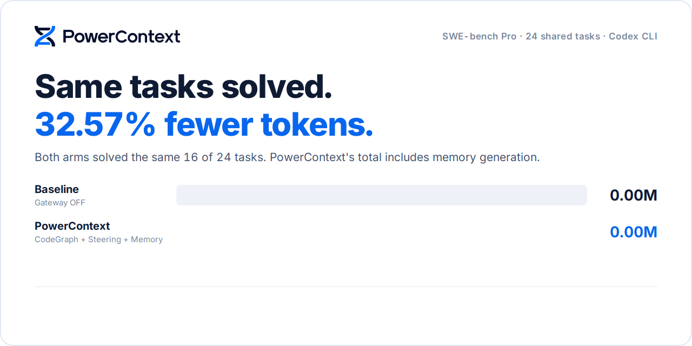
  </picture>
</p>

<h3 align="center">AI Agent のためのオープンソース・コンテキストサービス</h3>
<p align="center">
  回り道を減らし、トークンを減らす。<br />
  <a href="#ユースケース">タスクの引き継ぎ</a> · <a href="#ユースケース">複数 Agent での記憶共有</a> · <a href="#ユースケース">社内ナレッジベース</a> · <a href="#ユースケース">ユーザーごとのプロファイル</a> · <a href="https://powercontext.oceanbase.io/en/docs/workflows/review-dream-revisions/">Dream による自己進化</a> · <a href="#追跡と統制">Scope による分離</a> · <a href="#記憶ルールを-scope-ごとに">Scope ごとの記憶ルール</a> · <a href="#既存のサブスクリプションを使う">既存のサブスクリプションの活用</a>を、ひとつのサービスで。
</p>

<p align="center">
  <a href="#powercontext-とは">概要</a> &nbsp;·&nbsp;
  <a href="#なぜ-powercontext-なのか">特長</a> &nbsp;·&nbsp;
  <a href="#ユースケース">ユースケース</a> &nbsp;·&nbsp;
  <a href="#アーキテクチャ">アーキテクチャ</a> &nbsp;·&nbsp;
  <a href="#クイックスタート"><b>クイックスタート</b></a> &nbsp;·&nbsp;
  <a href="#エコシステム">エコシステム</a> &nbsp;·&nbsp;
  <a href="#最新情報">最新情報</a> &nbsp;·&nbsp;
  <a href="https://powercontext.oceanbase.io/en/docs/">ドキュメント</a> &nbsp;·&nbsp;
  <a href="#コミュニティ">Feishu</a> &nbsp;·&nbsp;
  <a href="https://discord.com/invite/74cF8vbNEs">Discord</a>
</p>
<p align="center">
  <a href="README.md">English</a> · <a href="README_CN.md">中文</a> · <a href="README_JP.md">日本語</a> &nbsp; / &nbsp;
  <a href="https://pypi.org/project/powercontext/">Python package</a> · <a href="LICENSE">Apache 2.0</a>
</p>

## PowerContext とは

**PowerContext は、Agent や Harness のコンテキスト管理を支えるサービスです。** 会話、資料、作業記録を、検索・更新でき、出典までたどれる知識に整理し、必要なときに Agent へ届けます。

- **トークンの節約：** 正しいコードを見つけ、必要な箇所だけを読むよう Agent を導き、タスク完了までの往復を減らします。[検証結果 →](#トークンの節約)
- **複数 Agent の協働：** 複数の Agent、セッション、チームメンバーが同じ Scope の記憶を共有し、引き継ぎで作業を続けます。[ユースケース →](#ユースケース)
- **自己進化：** Dream が過去の根拠から記憶とプロンプトの改訂を提案し、あなたのレビュー後に反映します。[Dream について →](https://powercontext.oceanbase.io/en/docs/workflows/review-dream-revisions/)
- **出典をたどれる：** すべての記憶は、根拠となる Source と正確なリビジョンまでたどれます。[詳しく →](#追跡と統制)
- **Scope ごとのルール：** チーム、プロジェクト、ユーザーごとに記憶ルールを持て、版も残ります。[詳しく →](#記憶ルールを-scope-ごとに)
- **安全に管理：** Scope ごとにデータと権限を分離し、生成された経験とスキルはレビュー後にのみ想起されます。[詳しく →](#追跡と統制)

サービスとして起動して HTTP、MCP、Python、Agent 連携から使うことも、Core を自分のアプリケーションに組み込むこともできます。

<!-- 動画の位置：2 回目のセッションで Agent が 1 回目の作業を引き継ぐ様子を、30〜60 秒の実録で。 -->

## なぜ PowerContext なのか

### トークンの節約

**Agent はモデルを呼び出すたびに、積み上がったコンテキストを丸ごと送り直します。** そのため PowerContext は、タスク全体を終えるまでの往復回数と総コストを最適化します。正しいコードを見つけ、必要な箇所だけを読み、独立した操作をまとめ、関連するテストだけを実行するよう導き、探索のやり直しや無駄な試行を減らします。

- **同じ 24 タスク、記憶の生成を含む：** トークンは **32.57% 減少**、推定モデルコストは **15.42% 低下**し、両群は同じ 16 タスクを解決しました。問題解決のみではトークンが 40.30% 減少し、単一タスクでは最大 63.49% 減少しました。
- **往復の削減：** 同じタスク ID を使った別の実験（OFF と MS の比較）では、メインモデルへのリクエストが 708 回から 539 回へ、**23.87% 減少**しました。この実験は構成が異なるため、上の数値と合算はできません。
- **記憶の生成もキャッシュを再利用：** 記憶の生成にはトークンがかかり、上の 32.57% にも含まれています。ゲートウェイモードでは、問題解決リクエストのコンテキストのプレフィックスを再利用でき（Codex のサブスクリプションでも同様）、キャッシュ項目が記録された記憶生成の呼び出しでは、入力の 97% がキャッシュにヒットしました。

このベンチマークは**ゲートウェイモード**で、コード検索、作業ガイダンス、プロジェクトの記憶を同時に有効にしています。

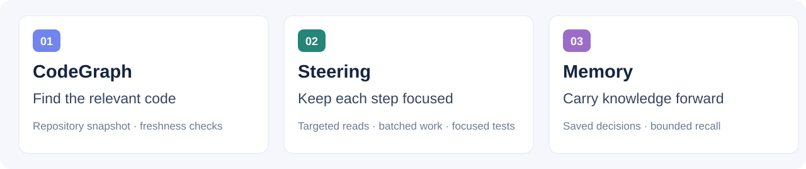

[24 タスクのベンチマーク：結果と集計方法 →](docs/benchmarks/token-savings/README.md) · [メインモデルのリクエスト数 →](docs/benchmarks/token-savings/request-counts_JP.md) · [記憶抽出のコストと品質 →](https://gist.github.com/jasper-yl/d02bfb7d9b45ca175bf74ad09cfa5ba4#file-00-report-en-md)

### 記憶ルールを Scope ごとに

<picture>
  <source media="(prefers-color-scheme: dark)" srcset="docs/assets/readme-prompt-rules-ja-dark.svg" />
  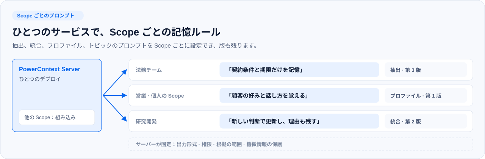
</picture>

多くの記憶サービスは、抽出ルールをサービス全体やプロジェクト単位で設定します。PowerContext は記憶の抽出、統合、プロファイル生成、Topic Memory のプロンプトを Scope 単位の Artifact として扱うため、チーム、プロジェクト、さらにはユーザー一人ひとりが自分の記憶ルールを持てます。変更はすべて版として残り、いつでも元に戻せます。Dream も過去の根拠から改訂を提案し、レビュー後に反映されます。

ルールが決めるのは「何をどう残すか」だけです。出力形式、ツールと権限、根拠の範囲、機微情報の保護はサーバーが固定するため、ルールを変えてもシステムは壊れません。アクセス制御を有効にすると、変更には Scope の管理権限が必要です。Dashboard にはまだ編集画面がありませんが、アプリケーションは API を通じてこの機能を自分のユーザーに提供できます。[プロンプトの管理 →](https://powercontext.oceanbase.io/en/docs/workflows/manage-prompts/)

### 追跡と統制

- **根拠のある記憶：** それぞれの記憶は、根拠となる Source と正確なリビジョンまでたどれ、Source 内の具体的な位置も示せます。
- **タスクの結果：** Claude Code、Codex、OpenCode には、タスクが完了するか明示的に中断された時点で根拠を記録するよう、各ターンで案内が提示されます。
- **レビューを経た変更：** 生成された経験とスキルはレビュー後にのみ想起され、Dream の改訂はあなたの承認後に反映されます。古くなった記憶は履歴を残したまま無効化できます。
- **明確な境界：** Scope ごとにデータとアクセス権を分離します。運用テレメトリにはプロンプト、本文、モデルの応答は含まれません。

[候補のレビュー →](https://powercontext.oceanbase.io/en/docs/workflows/review-candidates/) · [Scope とアクセス制御 →](https://powercontext.oceanbase.io/en/docs/workflows/scopes-and-access/)

## ユースケース

PowerContext は、コーディング Agent、パーソナルアシスタント、オフィス Agent に接続でき、チームや企業が作るアプリケーションにも組み込めます。

<!-- Cards are generated by docs/assets/render_scenarios.py; keep the three READMEs aligned. -->
**コーディング Agent**

<p align="center">
  <a href="https://powercontext.oceanbase.io/en/docs/workflows/memory-and-handoff/"><picture><source media="(prefers-color-scheme: dark)" srcset="docs/assets/scenarios/card-handoff-ja-dark.svg" />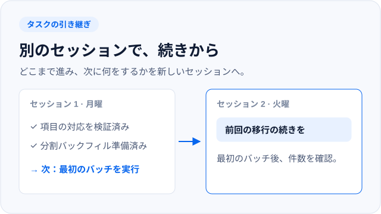</picture></a>
  <a href="https://powercontext.oceanbase.io/en/docs/workflows/scopes-and-access/"><picture><source media="(prefers-color-scheme: dark)" srcset="docs/assets/scenarios/card-shared-ja-dark.svg" />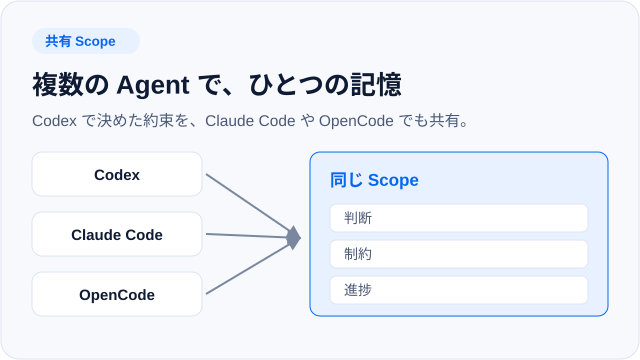</picture></a>
</p>

**パーソナルアシスタントとオフィス Agent**

<p align="center">
  <a href="https://powercontext.oceanbase.io/en/docs/integrations/openclaw/"><picture><source media="(prefers-color-scheme: dark)" srcset="docs/assets/scenarios/card-assistant-ja-dark.svg" />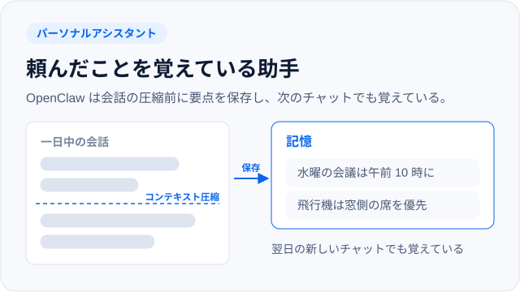</picture></a>
  <a href="https://powercontext.oceanbase.io/en/docs/workflows/experience-and-skill-lifecycle/"><picture><source media="(prefers-color-scheme: dark)" srcset="docs/assets/scenarios/card-office-ja-dark.svg" />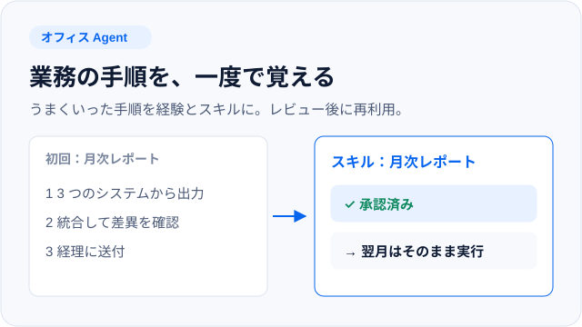</picture></a>
</p>

**チームと企業のアプリケーション**

<p align="center">
  <a href="https://github.com/oceanbase/powercontext/blob/master/docs/en/docs/workflows/knowledge-base.md"><picture><source media="(prefers-color-scheme: dark)" srcset="docs/assets/scenarios/card-knowledge-ja-dark.svg" />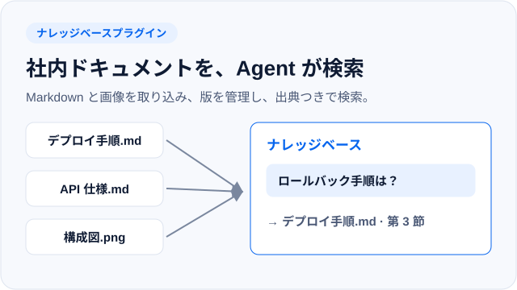</picture></a>
  <a href="https://powercontext.oceanbase.io/en/docs/workflows/use-profiles/"><picture><source media="(prefers-color-scheme: dark)" srcset="docs/assets/scenarios/card-users-ja-dark.svg" />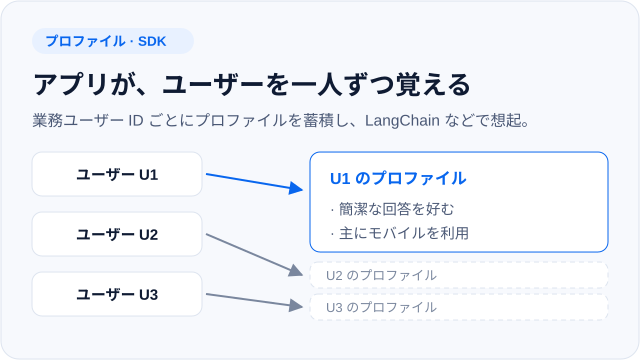</picture></a>
</p>
<p align="center">
  <a href="https://powercontext.oceanbase.io/en/blog/power-system-agent-memory/"><picture><source media="(prefers-color-scheme: dark)" srcset="docs/assets/scenarios/card-domain-ja-dark.svg" />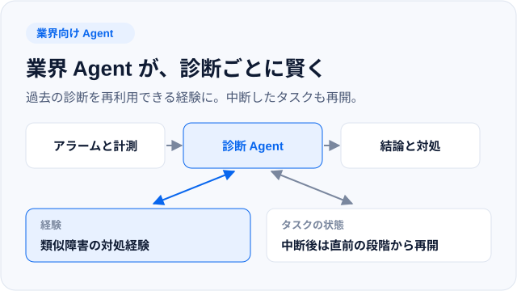</picture></a>
  <a href="https://powercontext.oceanbase.io/en/docs/develop/plugins/"><picture><source media="(prefers-color-scheme: dark)" srcset="docs/assets/scenarios/card-plugins-ja-dark.svg" />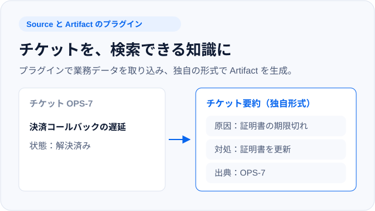</picture></a>
</p>

[タスクの引き継ぎ](https://powercontext.oceanbase.io/en/docs/workflows/memory-and-handoff/) · [Scope と共有](https://powercontext.oceanbase.io/en/docs/workflows/scopes-and-access/) · [OpenClaw](https://powercontext.oceanbase.io/en/docs/integrations/openclaw/) · [Hermes](https://powercontext.oceanbase.io/en/docs/integrations/hermes/) · [経験とスキル](https://powercontext.oceanbase.io/en/docs/workflows/experience-and-skill-lifecycle/) · [ナレッジベースプラグイン](https://github.com/oceanbase/powercontext/blob/master/docs/en/docs/workflows/knowledge-base.md) · [プロファイル](https://powercontext.oceanbase.io/en/docs/workflows/use-profiles/) · [電力診断 Agent の事例](https://powercontext.oceanbase.io/en/blog/power-system-agent-memory/) · [Source と Artifact のプラグイン](https://powercontext.oceanbase.io/en/docs/develop/plugins/)

## アーキテクチャ

<picture>
  <source media="(prefers-color-scheme: dark)" srcset="docs/assets/readme-architecture-ja-dark.svg" />
  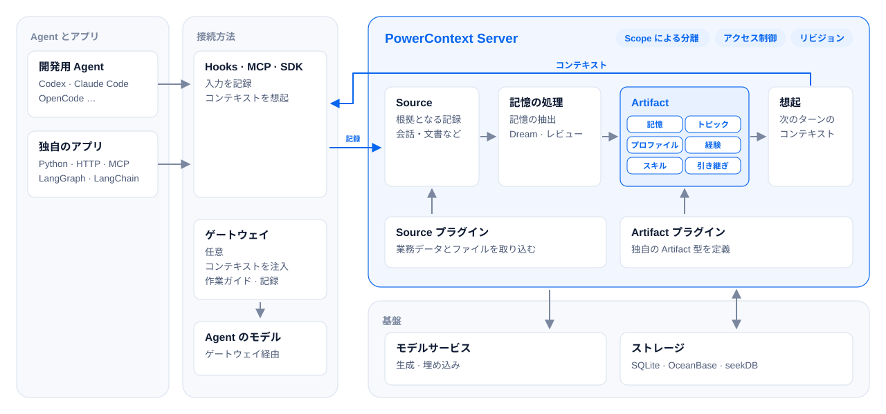
</picture>

Agent は Hooks、MCP、SDK で Server に接続します。モデルへのリクエストをゲートウェイ経由にすると、ゲートウェイがコンテキストを注入し、作業ガイダンスを提供します。Server は Scope ごとに根拠（Source）を保存し、バックグラウンドで記憶、Topic Memory、プロファイル、経験、スキルなどの Artifact に整理し、次のターンで使うコンテキストとして想起・組み立てます。Source と Artifact のプラグインで、新しいデータ源や Artifact の種類を追加できます。[アーキテクチャと責任範囲 →](https://powercontext.oceanbase.io/en/docs/workflows/architecture/)

## クイックスタート

### Agent にインストールを任せる

次の文章を Codex、OpenCode、Claude Code などのコーディング Agent に送ってください。Agent が環境を確認し、いくつか質問したうえで、インストールと動作確認まで進めます。個人利用では Codex と OpenCode は既定で Gateway 経由で接続し、チームの管理者はデプロイにも使えます。

```text
https://powercontext.oceanbase.io/en/llms.mdx/docs/get-started/agent-install/content.md の手順に従って、このマシンに PowerContext をインストールしてください。私が決めるべきことは推測せずに先に確認し、私の鍵は一切読み取ったり表示したりしないでください。
```

<details>
<summary><b>自分でインストールする</b></summary>

Python 3.11+、Git、[uv](https://docs.astral.sh/uv/getting-started/installation/) と、接続する Agent の CLI が必要です。以下は macOS と Linux 向けに**PowerContext 1.6.0** をインストールする手順です。Windows のサポートは実験段階です。[インストールスクリプト](https://powercontext.oceanbase.io/en/docs/get-started/install-and-run/#install-with-the-recommended-script)を使えば、Python と uv も用意できます。

ウィザードは英語で表示されます。Server 用の追加のモデル API なしで明示的な保存と想起を試すには、**Basic memory** を選んでください。自動抽出には、Generation と Embedding の認証情報を設定した **Full memory** が必要です。最初のストレージには SQLite が手軽です。

```bash
uv tool install --force "powercontext[cli,server]==1.6.0"
mkdir -p powercontext-config && cd powercontext-config
powercontext config init --language en --output .env
powercontext config validate --env-file .env
powercontext service install --env-file .env
powercontext service status
```

サービスはターミナルを閉じた後も動作し続けます。Linux では `systemd --user` が利用できる必要があります。生成される `.env` と `.env.next-steps.md` には認証情報が含まれることがあるため、Git にコミットしないでください。

生成された環境ファイルを読み込み、サービスを確認します。

```bash
set -a
. ./.env
set +a
powercontext ready
powercontext capabilities
```

**`.env.next-steps.md`** に従って Scope を作成し、作成リクエストが返した実際の `scope_id` を使って紐付けます。Dashboard と Agent は同じ Server と Scope に接続してください。ディレクトリを変えるだけではプロジェクトは分離されません。`.env` を編集した場合は再度読み込み、`powercontext service install --env-file .env` を再実行して反映します。

Codex には対応するバージョンの連携をインストールします。

```bash
powercontext setup codex --env-file .env --ref powercontext-v1.6.0
powercontext doctor codex
```

新しい Codex セッションで最初のメッセージを送る前に、**`/hooks`** を開き、求められたら PowerContext Hook の信頼を許可してください。入力の自動取得と想起には `UserPromptSubmit` Hook の有効化が必要です。MCP に接続できるだけでは動作しません。[初回確認と復旧 →](https://powercontext.oceanbase.io/en/docs/integrations/codex/#first-session-hook-trust)

選んだワークフローを確認します。

- **Basic memory：** Agent にプロジェクトの判断を明示的に保存させ、同じ Scope の新しいセッションで、出典を参照しながら想起できることを確認します。
- **Full memory：** 入力が Source として保存され、設定した処理によって Topic Memory が生成されるのを待ちます。続いて関連する更新を送り、その内容が反映され、新しいセッションで想起できることを確認します。

`doctor codex` が確認するのはインストールと接続だけです。Source の取得だけでは記憶は作られず、自動処理には設定したスケジュールとモデルの実行も必要です。Basic memory でも Agent 自身のモデルは使用します。[完全なセットアップ手順 →](https://powercontext.oceanbase.io/en/docs/get-started/quickstart/)

<sub>この手順はコンテキストサービスを起動するものです。ベンチマークの Gateway、CodeGraph、Steering の設定は自動では再現されません。詳細は検証レポートを参照してください。</sub>

</details>

### 既存のサブスクリプションを使う

Codex、Claude Code、GitHub Copilot、Grok、Gemini、Qwen Code、Kimi Code をすでに契約していますか？記憶、経験、プロファイルの生成にそのまま使え、生成モデルの API を別に用意する必要はありません。

- **バックグラウンドでの生成：** Server がサブスクリプションで記憶、経験、プロファイルを生成します。この場合、推論保護は有効にできません。Topic Memory と Dream はまだ対応しておらず、埋め込みモデルは別途設定が必要です。
- **ゲートウェイ経由の Agent リクエスト：** Agent はサブスクリプションのままモデルへのリクエストをゲートウェイに送り、ゲートウェイがコンテキストを注入して会話を記録します。Codex のサブスクリプションでは、記憶の抽出も Agent セッションのプレフィックスキャッシュを再利用し、使用量は同じサブスクリプションの枠に計上されます。対応範囲はサブスクリプションごとに異なります。

[サブスクリプションでバックグラウンド生成を設定 →](https://powercontext.oceanbase.io/en/development/pydantic-ai-inference/#reuse-existing-subscription-credentials) · [Gateway OAuth サブスクリプション →](https://github.com/oceanbase/powercontext/blob/master/gateway/SUBSCRIPTIONS.md)

## エコシステム

<!-- Add integrations using an original logo asset, a product name, and a documentation link. -->
<table width="100%">
  <tr>
    <td align="center" width="20%"><a href="https://powercontext.oceanbase.io/en/docs/integrations/codex/"><br />Codex</a></td>
    <td align="center" width="20%"><a href="https://powercontext.oceanbase.io/en/docs/integrations/claude-code/"><br />Claude Code</a></td>
    <td align="center" width="20%"><a href="https://github.com/oceanbase/powercontext/tree/master/integrations/minimax#readme"><br />MiniMax Code</a></td>
    <td align="center" width="20%"><a href="https://powercontext.oceanbase.io/en/docs/integrations/dsh/">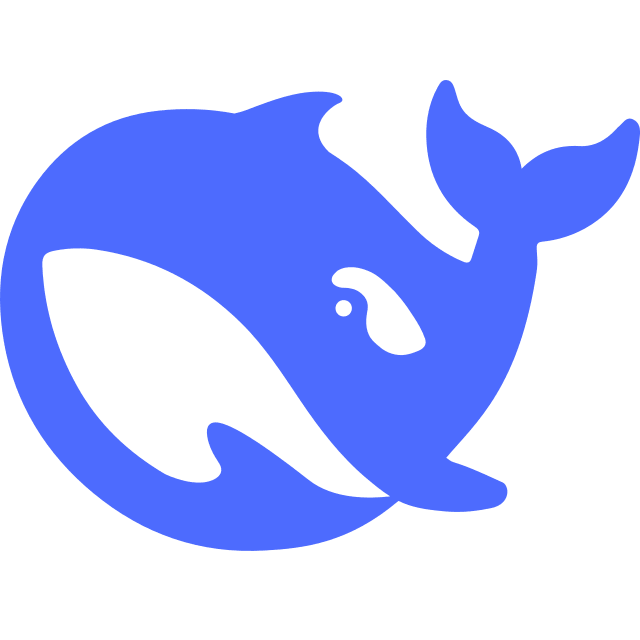<br />DeepSeek Harness</a></td>
    <td align="center" width="20%"><a href="https://powercontext.oceanbase.io/en/docs/integrations/zcode/"><br />ZCode</a></td>
  </tr>
  <tr>
    <td align="center" width="20%"><a href="https://powercontext.oceanbase.io/en/docs/integrations/kimi-code/"><br />Kimi Code</a></td>
    <td align="center" width="20%"><a href="https://github.com/oceanbase/powercontext/tree/master/integrations/hermes#readme"><br />Hermes Agent</a></td>
    <td align="center" width="20%"><a href="https://powercontext.oceanbase.io/en/docs/integrations/pi/"><br />Pi Coding Agent</a></td>
    <td align="center" width="20%"><a href="https://powercontext.oceanbase.io/en/docs/integrations/openclaw/">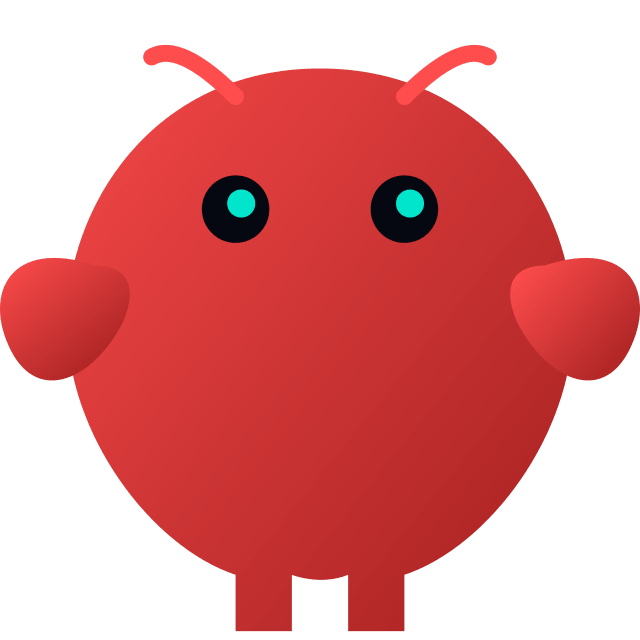<br />OpenClaw</a></td>
    <td align="center" width="20%"><a href="https://powercontext.oceanbase.io/en/docs/integrations/opencode/"><br />OpenCode</a></td>
  </tr>
  <tr>
    <td align="center" width="20%"><a href="https://github.com/oceanbase/powercontext/tree/master/integrations/workbuddy#readme"><br />WorkBuddy</a></td>
    <td align="center" width="20%"><a href="https://github.com/oceanbase/powercontext/tree/master/integrations/bub#readme"><br />Bub</a></td>
    <td align="center" width="20%"><a href="https://powercontext.oceanbase.io/en/docs/integrations/pydantic-ai/"><br />Pydantic AI</a></td>
    <td align="center" width="20%"><a href="https://powercontext.oceanbase.io/en/docs/integrations/langchain/"><br />LangChain</a></td>
    <td align="center" width="20%"><a href="https://powercontext.oceanbase.io/en/docs/integrations/langgraph/">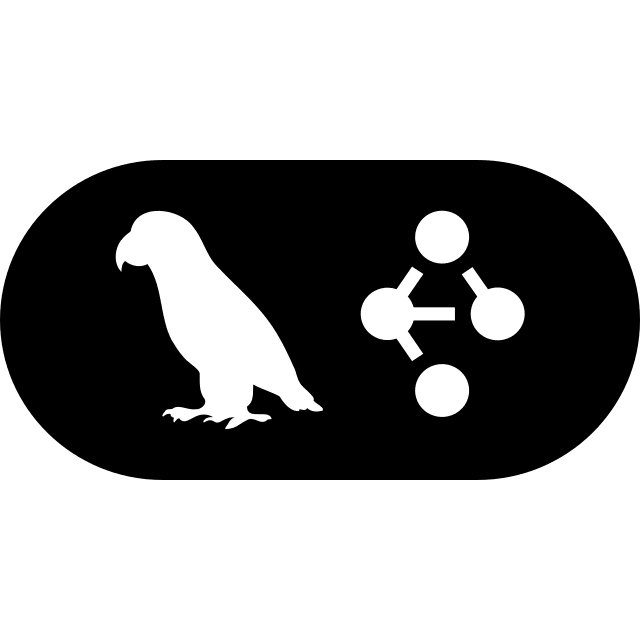<br />LangGraph</a></td>
  </tr>
</table>

Codex 連携は公式メンテナンス、その他の Agent と Python フレームワークの連携はコミュニティメンテナンスです。Bub は評価専用です。対応機能は機能一覧を参照してください。

[その他の連携と機能一覧 →](https://powercontext.oceanbase.io/en/docs/integrations/capabilities/)

**アプリケーションとチーム** — [Python / HTTP / MCP](https://powercontext.oceanbase.io/en/docs/develop/interfaces/) · [Memory と Handoff](https://powercontext.oceanbase.io/en/docs/workflows/memory-and-handoff/) · [デプロイとアクセス制御](https://powercontext.oceanbase.io/en/docs/workflows/scopes-and-access/)

## 最新情報

- **2026-11-23 · [v1.6.0](https://powercontext.oceanbase.io/en/changelog/v1.6.0/)** — ナレッジベースを初公開。Markdown と画像を取り込み、ハイブリッド検索で探し、Dashboard でバージョン管理されたチャンクを管理できます。Gateway は安定版になりビルド済みバイナリを提供し、記憶の抽出で Agent の会話のプロンプトキャッシュを再利用できます。
- **2026-11-16 · [v1.5.2](https://powercontext.oceanbase.io/en/changelog/v1.5.2/)** — 書き込みのバッチ化とクエリの最適化。メンテナーの計測では、v1.5.1 と比べて書き込みスループットが約 190%、クエリスループットが約 171% 向上しました。Dashboard で処理の進捗、失敗の診断、トークン使用量を確認できます。
- **2026-11-09 · [v1.5.1](https://powercontext.oceanbase.io/en/changelog/v1.5.1/)** — 記憶を Source 内の正確な位置までたどれるようになり、メトリクス、ログ、トレースを扱う監視スタックを任意で追加できます。
- **2026-11-03 · [v1.5.0](https://powercontext.oceanbase.io/en/changelog/v1.5.0/)** — Source と Artifact のプラグインで、データの取り込みと独自の Artifact を拡張できます。可逆なエンコードで、モデル入力に含まれる重複した根拠を減らします。

[すべてのリリース →](https://github.com/oceanbase/powercontext/releases)

## さらに詳しく

- [基本概念](https://powercontext.oceanbase.io/en/docs/get-started/core-concepts/) · [アーキテクチャと責任範囲](https://powercontext.oceanbase.io/en/docs/workflows/architecture/) · [プラグイン](https://powercontext.oceanbase.io/en/docs/develop/plugins/)
- [Python / HTTP / MCP インターフェース](https://powercontext.oceanbase.io/en/docs/develop/interfaces/) · [Server のデプロイ](https://powercontext.oceanbase.io/en/docs/operate/deploy-server/) · [Gateway のリクエストごとに Scope を選択する](docs/en/docs/operate/deploy-server.md#gateway-request-scope)
- [トークン削減のベンチマーク](docs/benchmarks/token-savings/README.md) · [ブログ](https://powercontext.oceanbase.io/en/blog/)

## コミュニティ

Feishu の PowerContext コミュニティに参加して、活用のヒントや質問を共有し、AI エージェントのコンテキスト管理について交流しましょう。
Feishu で以下の QR コードをスキャンすると、グループに参加できます。

<p align="center">
  
</p>

[Discord](https://discord.com/invite/74cF8vbNEs) · [Issues](https://github.com/oceanbase/powercontext/issues) · [コントリビューション](https://github.com/oceanbase/powercontext/blob/master/CONTRIBUTING.md)

PowerContext は [PowerMem](https://www.powermem.ai/) の後継プロジェクトであり、[Apache 2.0](LICENSE) ライセンスで公開されています。
