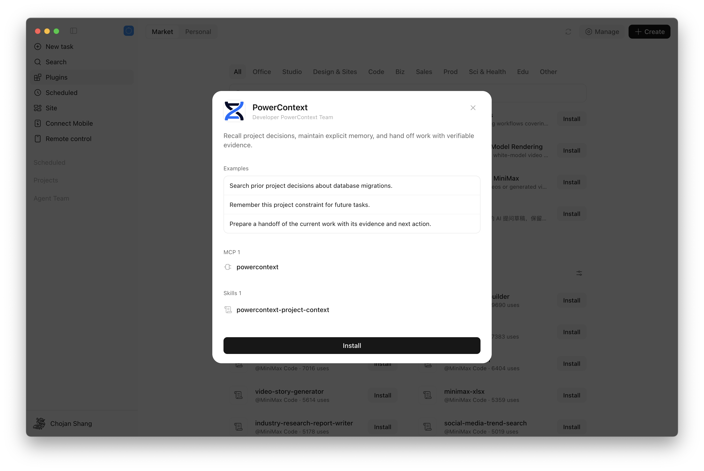
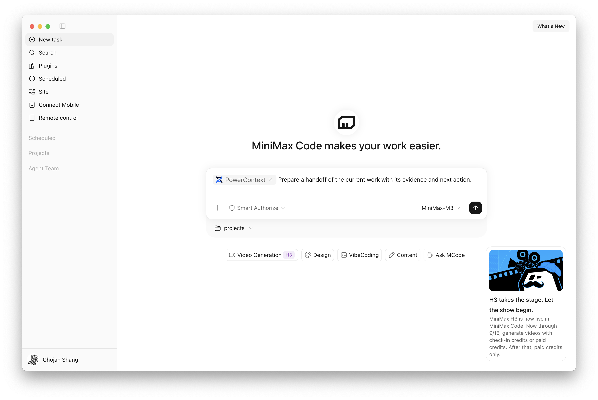

## Key takeaways

- Keep original screenshots, code, and logs linked to the text and embeddings used for search. seekdb can combine keyword search, vector search, and structured filters in one database.
- Give constraints, task state, evidence, and long-term memory their own update rules. A compressed summary should preserve what the next action depends on.
- Use PowerContext Memory to retain project decisions and Handoff to carry unfinished work into another session. Commit a handoff explicitly when you need a durable checkpoint.

A screenshot shows the bottom navigation covering the checkout button. A log shows a failing request. You give a coding agent both, along with the repository, and ask it to investigate.

The agent has the materials. It still needs to establish what they mean: which commit produced the screenshot, what triggered the request failure, and whether the two symptoms share a cause.

As it reads files, changes code, and runs tests, it produces more information. Some findings are verified. Others are hypotheses. Some checks are still pending. By the time you pause the task, the next session needs a clear account of all three.

This is the context-management problem we'll follow through MiniMax Code: how to turn mixed inputs into evidence, keep the current context useful, and leave enough verified state for the work to continue. seekdb provides a retrieval foundation; PowerContext provides project memory and handoffs across sessions.

<figure class="fig" id="fig-figure-1">

<svg viewBox="0 0 960 340">
<path class="fig-wire" d="M300 50 L654 50" marker-end="url(#fig-arrow)"/>
<path class="fig-wire" d="M810 100 L810 234" marker-end="url(#fig-arrow)"/>
<path class="fig-wire" d="M660 290 L306 290" marker-end="url(#fig-arrow)"/>
<path class="fig-wire dashed" d="M150 240 L150 106" marker-end="url(#fig-arrow)"/>
</svg>

<b>Input context</b>Screenshots, documents, code and logsdescribe the same problem

<b>Project scope</b>The workspace and relevant filesdefine what this task covers

<b>Tool execution</b>Edit files and run commandsInspect page state in a browser

<b>Result validation</b>Review diffs, tests and outputsIterate on the fix

<b>One closed loop in MiniMax Code</b>A checkout screenshot where the bottom navigation covers the button, the request error logs, and the repository

Iterate

<figcaption>Figure 1. A debugging task moves from screenshots, logs, and code through investigation, implementation, and verification.</figcaption>
</figure>

## Keep search results connected to the source

For a developer, the screenshot, log, and repository belong to one bug report. The agent still has to connect them.

The affected region in the screenshot needs to map to a page and component. A code snippet needs a file path and commit. A log entry needs a timestamp, enough surrounding context to explain the failure, and a reference to the relevant request or tool call.

That makes source traceability part of the retrieval design. Every useful hit should give the agent somewhere concrete to look next.

Keep original artifacts separate from the representations used to find them:

| Input | Search representation | Source details to retain |
| --- | --- | --- |
| Screenshot | OCR text, layout description, embedding | Original image and region coordinates |
| Code | Searchable snippets | Repository, file path, and commit |
| Log | Error codes and extracted messages | Original record, timestamp, and request or tool-call references |

The original captures what happened. The search representation helps the agent find it. If a parser improves, you can regenerate the text or embeddings, record the parser version, and keep the original available for comparison.

<figure class="fig" id="fig-figure-2">

<svg viewBox="0 0 960 350">
<path class="fig-wire" d="M210 68 L244 68" marker-end="url(#fig-arrow)"/>
<path class="fig-wire" d="M460 68 L494 68" marker-end="url(#fig-arrow)"/>
<path class="fig-wire" d="M710 68 L744 68" marker-end="url(#fig-arrow)"/>
<path class="fig-wire accent" d="M176 256 L201 256" marker-end="url(#fig-arrow-accent)"/>
<path class="fig-wire accent" d="M366 256 L391 256" marker-end="url(#fig-arrow-accent)"/>
<path class="fig-wire accent" d="M556 256 L581 256" marker-end="url(#fig-arrow-accent)"/>
<path class="fig-wire accent" d="M746 256 L771 256" marker-end="url(#fig-arrow-accent)"/>
</svg>

<b>1 Collection</b>Screenshots, documents, logs, codeRecord task and source IDs

<b>2 Parsing</b>OCR, ASR, visual understandingChunk and extract structure

<b>3 Governance</b>Deduplication, versions, sensitive fieldsPermission mapping and validity

<b>4 Indexing</b>Metadata, full text, vectorsSearchable representations

<header><b>End-to-end lineage</b></header>

<b>Source</b>

<b>Parsed version</b>

<b>Chunks and vectors</b>

<b>Search hits</b>

<b>Output citations</b>

On updates or deletions, sync full text, vectors, caches and access permissions together.

<figcaption>Figure 2. Source references connect each indexed representation to the original artifact.</figcaption>
</figure>

Updates need to follow the same chain. A replacement screenshot should have a clear relationship to the previous one. When an artifact is deleted or invalidated, update its search indexes and caches so it stops appearing as current evidence.

In a shared environment, apply access rules when selecting candidates. The agent should search within the resources the current user can access. After retrieval, it still needs to check whether a result applies to the code and environment under investigation.

## Use seekdb to search exact and semantic clues together

Debugging involves several kinds of search. Error codes, API names, and function names are strong keyword clues. A description such as “the bottom navigation covers the checkout button” can help semantic search find related components or past issues.

Both need the same scope: the right project, the relevant version, and the permitted resources.

OceanBase seekdb supports vector, full-text, relational, and JSON data in one engine, with embedded and server deployment options. That makes it a candidate for this retrieval layer. Structured filters can narrow the scope while keyword and vector search find the clues.

[seekdb project](https://github.com/oceanbase/seekdb)

For the checkout investigation, organize retrieval around three jobs:

1. Set the scope. Select the project, version, and resources the user can access.
2. Search the clues. Match exact errors and identifiers, then look for semantically related pages, components, or issues.
3. Return the source details. Include the image region, log location, code path, and version needed to inspect the hit.

<figure class="fig" id="fig-figure-3">

<svg viewBox="0 0 960 330">
<path class="fig-wire" d="M250 90 L280 90 Q290 90 290 80 L290 42 Q290 32 300 32 L324 32" marker-end="url(#fig-arrow)"/>
<path class="fig-wire" d="M250 160 L280 160 Q290 160 290 170 L290 198 Q290 208 300 208 L324 208" marker-end="url(#fig-arrow)"/>
<path class="fig-wire accent" d="M580 32 L810 32 Q820 32 820 42 L820 64" marker-end="url(#fig-arrow-accent)"/>
<path class="fig-wire accent" d="M580 208 L810 208 Q820 208 820 198 L820 176" marker-end="url(#fig-arrow-accent)"/>
</svg>

<b>Authorization, project, valid version</b>Relational and JSON metadata:tenant, resource, time, type

<b>Full text · BM25</b>

Function names, error codes, API names

<b>Vector search</b>

Page semantics, similar requirements

<b>Fusion and reranking</b>Evidence chunks + source citations

seekdb stores metadata, text and vectors together; the application handles parsing, authorization and task relevance.

<figcaption>Figure 3. Structured filters set the scope; keyword and vector search find exact and semantic matches.</figcaption>
</figure>

In this design, parsing produces the text or embeddings to index, while seekdb stores and retrieves those representations. The application also needs to define how artifacts relate to versions, projects, and access rules.

Check retrieval against the task: did the error code lead to the relevant API, did the layout description identify the affected component, and does the evidence match the current code? Those checks determine whether the agent has enough information to make a change.

## Keep the current context focused

Finding a document doesn't mean the entire document belongs in the next prompt. A long log may contain one relevant failure. A past decision may explain an implementation, while today's requirement changes what should happen next.

A useful way to organize context is to separate four types of information:

- Constraints: the goal, project rules, and permission boundaries that govern the work.
- Task state: verified progress, open questions, blockers, and next steps.
- Retrieved evidence: the snippets needed now, with source references and versions.
- Long-term memory: project decisions, stable preferences, and lessons worth reusing.

<figure class="fig" id="fig-figure-4">

<b>Persistent constraints</b>User goals, project rules and permission boundaries; always follow the instructions currently in force.

<b>Task state</b>Plans, verified progress, blockers and next steps; updated as the task moves, and ready for handoff.

<b>Retrieved evidence</b>Chunks, citations and versions for this round; chosen by relevance within the context budget.

<b>Long-term memory</b>Stable preferences, project decisions and troubleshooting lessons; traceable and revisable, retired when outdated.

<figcaption>Figure 4. Constraints, task state, evidence, and memory have different update and retention rules.</figcaption>
</figure>

Each type changes at a different pace. Task state needs updating as work progresses. Evidence needs a source and an applicable version. Long-term memory needs revision or retirement when the project changes.

MiniMax Code's context-management approach includes memory controls and visibility into context usage, along with CLI mechanisms such as output budgets, tool-result trimming, and compression. These serve a practical goal: preserve enough information for the next step while keeping large outputs available elsewhere.

Keep full logs and reports in files. Bring the relevant excerpts and read-back paths into context. At a checkpoint, capture the goal, decisions, verified progress, blockers, and next action.

Compression is useful only if the agent can still tell what it knows and what it needs to check. If it has traced the button overlap to a layout issue but hasn't explained the failing request, the summary should preserve those as separate findings. Their timing alone doesn't establish a shared cause.

The same principle applies to Agent Team collaboration. Coordination, execution, and verification need enough context for their respective jobs. Files, focused summaries, and source paths let agents exchange useful results without carrying the entire investigation into every context. A completion claim still needs supporting checks.

[MiniMax Code Agent Team](https://agent.minimax.io/docs/code/agents/team)

## Carry project knowledge and unfinished work across sessions

Within a session, retrieval and compression help the agent keep moving. Across sessions, the next person or agent needs to know why the project works this way and where the current task stopped.

PowerContext separates those needs into Memory and Handoff. Memory retains reusable project knowledge. Handoff packages the state of a particular task so someone else can continue it.

<figure class="fig" id="fig-figure-5">

<svg viewBox="0 0 960 330">
<path class="fig-wire" d="M300 165 L320 165 Q330 165 330 155 L330 59 Q330 49 340 49 L354 49" marker-end="url(#fig-arrow)"/>
<path class="fig-wire" d="M300 165 L354 165" marker-end="url(#fig-arrow)"/>
<path class="fig-wire" d="M300 165 L320 165 Q330 165 330 175 L330 271 Q330 281 340 281 L354 281" marker-end="url(#fig-arrow)"/>
</svg>

<b>PowerContext</b>Keeps traceable project context and handoff state outside the harness.The host still owns current code, live tool state and context compaction.

<b>Source · Memory</b>Sources keep evidence; Memory manages reusable facts, decisions and their revisions.

<b>Prepared context</b>Selects history for each request, limits item count and budget, and keeps precise citations.

<b>Handoff · Outcome</b>Hands off goals, progress, blockers and next steps; records outcomes for review and reuse.

<figcaption>Figure 5. Memory carries project knowledge forward; Handoff carries the state of unfinished work.</figcaption>
</figure>

The MiniMax Code plugin combines a Skill with a native MCP configuration. The Skill guides the agent's use of PowerContext; MCP connects it to PowerContext Server. The plugin saves context when requested and does not automatically capture every conversation.

The server uses a local SQLite database by default. Its persistence is separate from the MiniMax Code session, so saved context remains available after you close the app. If generation or embedding services are enabled, relevant content may be sent to the configured model endpoints.

[Plugin documentation](https://github.com/oceanbase/powercontext/tree/master/integrations/minimax/plugins/powercontext)

## Memory: preserve the decision and its rationale

A repository shows how a feature is implemented. Understanding why it was implemented that way often requires project history: a compatibility requirement, a rejected alternative, or a constraint that applied at the time.

With PowerContext connected, you can ask:

> Find our earlier decisions about database migrations and show their sources.

The references give you a way to inspect the original reasoning and compare it with the current code.

When you confirm a constraint worth retaining, save it explicitly:

> Remember that this project must support Python 3.11.

Good candidates include confirmed technical decisions, stable constraints, and verified debugging lessons. Keep the reason and scope with the conclusion. If a requirement changes, revise or retire the corresponding memory.

Retrieved memory provides background for the next task. The agent should still reconcile it with the current workspace and active instructions before acting.

## Handoff: make unfinished work easy to resume

Suppose the checkout investigation has identified the layout cause and a partial fix is in place. Small-screen behavior still needs testing. The request failure remains unexplained.

A handoff that says “checkout fixed” loses the information the next session needs. A useful handoff distinguishes four things:

- Confirmed: how the overlap occurs, with the relevant screenshot and code location.
- Changed and checked: what was edited, which checks ran, and their results.
- Still open: untested screen sizes and unresolved clues about the request failure.
- Next action: inspect the current diff, finish layout verification, and continue investigating the request.

<figure class="fig" id="fig-figure-6">

<svg viewBox="0 0 960 326">
<path class="fig-wire accent" d="M240 92 L314 92" marker-end="url(#fig-arrow-accent)"/>
<path class="fig-wire accent" d="M640 92 L714 92" marker-end="url(#fig-arrow-accent)"/>
<path class="fig-wire" d="M168 282 L192 282" marker-end="url(#fig-arrow)"/>
<path class="fig-wire" d="M366 282 L390 282" marker-end="url(#fig-arrow)"/>
<path class="fig-wire" d="M564 282 L588 282" marker-end="url(#fig-arrow)"/>
<path class="fig-wire" d="M762 282 L786 282" marker-end="url(#fig-arrow)"/>
</svg>

<b>Investigation agent</b>

Organizes evidence and observations, then confirms the handoff

<b>Inspectable handoff record</b>Goals and scopeVerified progress and code stateBlockers, risks and next stepsEvidence citations and exact versions

<b>Execution and validation agent</b>

Rechecks the current workspace, then executes, tests and confirms

<b>Outcome</b>

<b>Candidate lessons</b>

<b>Human review</b>

<b>Reusable experience</b>

<b>Explicit Skill export</b>

<figcaption>Figure 6. A handoff records the goal, verified progress, evidence, open questions, and next action.</figcaption>
</figure>

Start by preparing a temporary handoff:

> Use PowerContext to prepare a handoff for this task, including verified progress, key evidence, remaining checks, and next steps. Show it to me before committing it.

Review the contents. When you want a checkpoint that a later session can retrieve, ask to persist it:

> Commit this handoff as a durable checkpoint and return its version.

Then, in the next session:

> Resume the latest committed handoff for this project. Check the current workspace, then continue the remaining work.

Preparing a handoff and committing it are separate operations. Confirm that the commit succeeded before relying on it for a later session. On resumption, compare the checkpoint with the current files, diff, and instructions; the workspace may have changed since it was recorded.

This leaves the receiver with conclusions they can inspect, questions that remain open, and a concrete starting point. Once the task is complete, reusable findings can be saved to Memory at the user's request.

[Handoff documentation](https://github.com/oceanbase/powercontext/blob/master/integrations/minimax/plugins/powercontext/README.md#pick-up-where-the-work-left-off)

## Start with one real debugging task

The workflow connects three responsibilities: retrieve relevant evidence, select what the agent needs now, and preserve enough state for the next session to continue.

Try it on a task that uses screenshots or logs and will span multiple sessions. Check whether retrieval leads to the right sources, whether the change passes its acceptance checks, and whether resumption avoids repeating already verified investigation.

<figure class="fig" id="fig-figure-7">

<svg viewBox="0 0 960 330">
<path class="fig-wire" d="M300 165 L320 165 Q330 165 330 155 L330 59 Q330 49 340 49 L354 49" marker-end="url(#fig-arrow)"/>
<path class="fig-wire" d="M300 165 L354 165" marker-end="url(#fig-arrow)"/>
<path class="fig-wire" d="M300 165 L320 165 Q330 165 330 175 L330 271 Q330 281 340 281 L354 281" marker-end="url(#fig-arrow)"/>
</svg>

<b>Validate with real tasks</b>Keep the model, task set, environment and budget fixed.Compare four setups: baseline, retrieval, context, and both.

<b>Task quality</b>Success rate, test results and human corrections, counting failures, timeouts and reruns.

<b>Evidence quality</b>Citation accuracy, stale results and unauthorized retrieval; check traceability and version consistency.

<b>Continuity and cost</b>Recovery time, repeated investigation and input tokens; also p95 end-to-end latency and tool errors.

<figcaption>Figure 7. Evaluate the workflow through evidence quality, verified results, and the work needed to resume.</figcaption>
</figure>

The PowerContext plugin is available in the official MiniMax plugin marketplace. To use it, you need MiniMax Code, Python 3.11 or later, and `uv`:

1. Install and start PowerContext Server on the machine running MiniMax Code, following the [installation documentation](https://powercontext.oceanbase.io/en/docs/get-started/install-and-run/).
2. Enable PowerContext in the MiniMax plugin marketplace. Its default MCP endpoint is `http://127.0.0.1:8000/mcp`. The [plugin documentation](https://github.com/oceanbase/powercontext/tree/master/integrations/minimax/plugins/powercontext) covers connection checks and protected servers.
3. Select PowerContext with `@` in a MiniMax Code session, then ask it to find a project decision, save a confirmed constraint, or prepare a handoff.

*Figure 8. Enable the PowerContext plugin in the MiniMax plugin marketplace.*

Explicit Memory writes and reads, and handoffs of current work, do not require a separate PowerContext generation model. Vector search needs an embedding service; model-generated content needs the appropriate server-side model configuration. MiniMax Code's own account and model settings are managed separately.

*Figure 9. Ask MiniMax Code to use PowerContext for project memory and handoffs.*

Build a small routine around the work: retrieve relevant decisions before starting, save reusable conclusions once confirmed, commit a handoff when you need a lasting checkpoint, and reconcile it with the workspace when you resume.

Back at the checkout page, the next session should know which layout changes are in place, which screen sizes remain untested, and what evidence is still missing for the request failure. It can inspect the current code and continue from there.

That is the payoff of context management: each round of work leaves the next round with a starting point it can verify.
