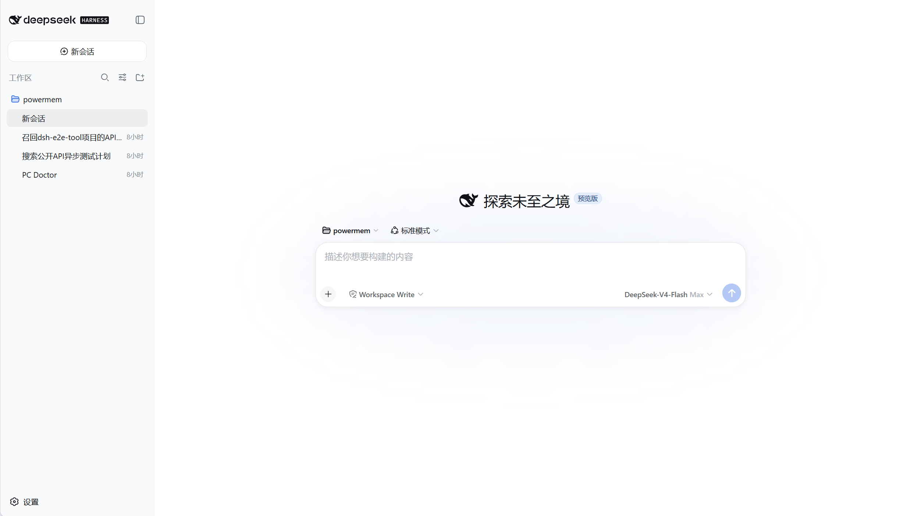
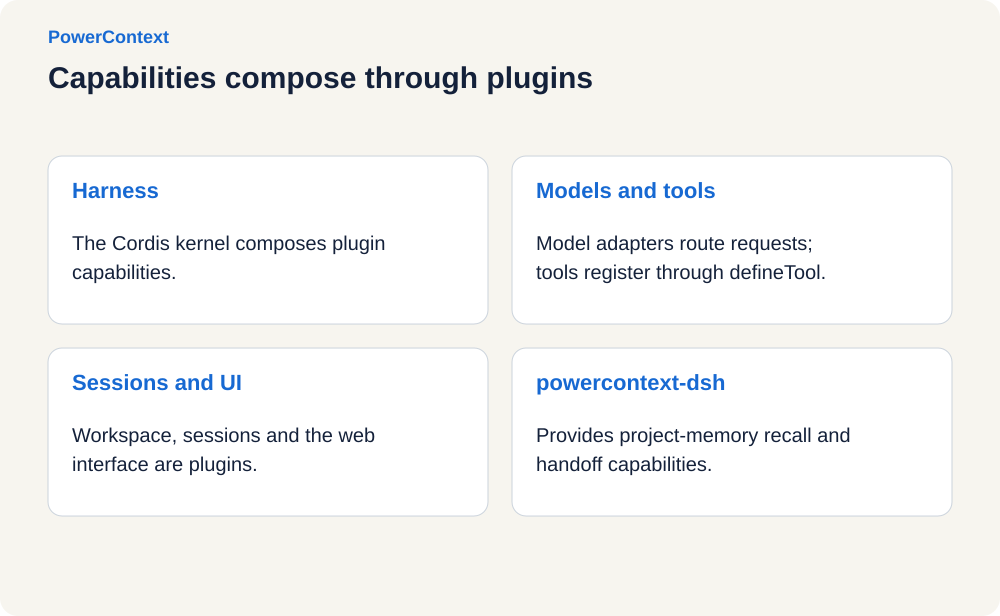
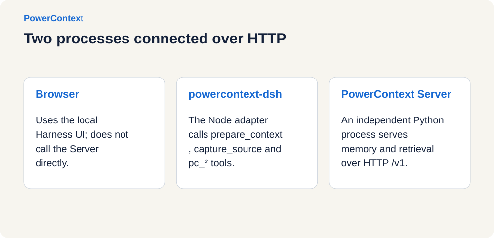
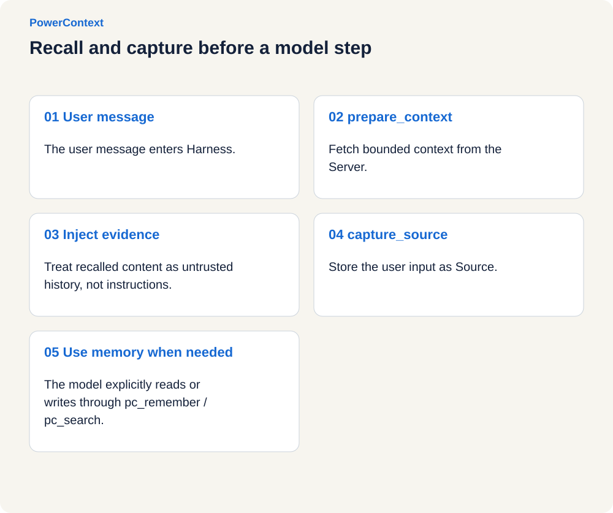
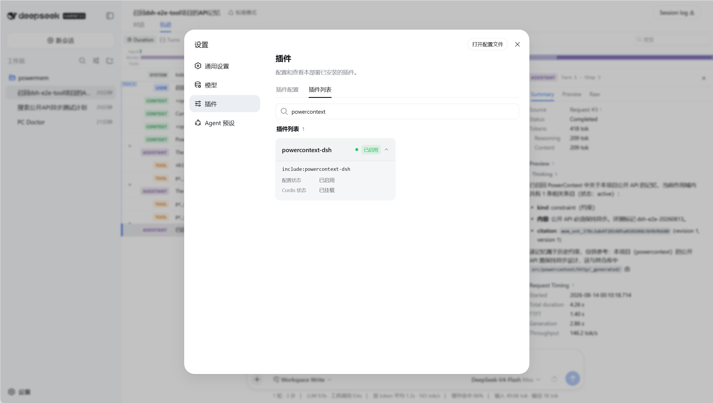
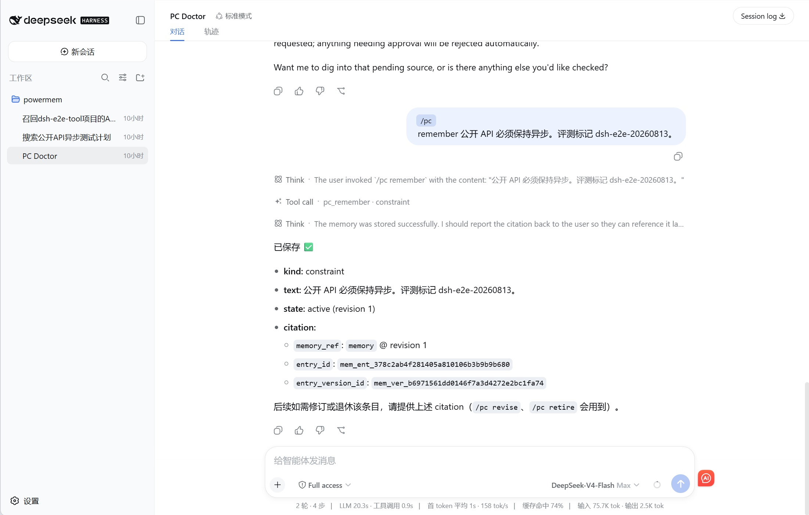

# Building a PowerContext plugin for DeepSeek Harness

On August 13, 2026, DeepSeek open-sourced the developer preview of
[DeepSeek Harness](https://github.com/deepseek-ai/deepseek-harness). One of its most interesting design choices is the
plugin system built on [Cordis](https://github.com/cordiverse/cordis): models, tools, sessions, sandboxes, storage,
loops, scheduling, and UI can all be composed as plugins without modifying the Harness core.

That design is a natural fit for PowerContext. PowerContext already keeps project Memory, Experience, Skill, and
Handoff in an independent Server. DeepSeek Harness only needs a thin adapter that connects Cordis lifecycle events,
tools, and commands to the PowerContext HTTP API.

<!-- more -->

## DeepSeek Harness and Cordis

The shortest way to start the DeepSeek Harness Web UI is:

```bash
npx @deepseek-ai/dsh web
```

The default URL is `http://127.0.0.1:3080`. You can also run it from source:

```bash
git clone https://github.com/deepseek-ai/deepseek-harness.git
cd deepseek-harness
pnpm install
pnpm run build
pnpm dsh web
```



*Original product screenshot; interface and example conversation retain their source language.*

Cordis organizes the Harness around a composable configuration tree rather than capabilities embedded permanently in
the main program. Tools, commands, events, and services registered by a plugin are reversible effects; removing the
plugin removes those capabilities from the runtime as well.

[](../../../assets/blog/deepseek-harness-powercontext/cordis-plugin-tree.en.svg "View full-size diagram")

Two DeepSeek Harness concepts are important here:

- A **bundle** is a distributable plugin package. Its `dsh.bundle` declaration and `cordis.patch.yml` describe how it
  enters the configuration tree.
- A **profile** is the user's runtime recipe under `$DSH_HOME/profiles/<name>`. It selects the bundles to combine for a
  particular launch.

Think of bundles as building blocks and a profile as the assembly instructions. `dsh plugin --profile web add <pkg>`
installs a bundle into the `web` profile; it does not copy plugin code into the DeepSeek Harness repository.

## Why use two processes?

PowerContext and DeepSeek Harness cooperate across two processes:

1. **DeepSeek Harness Web** owns the browser UI, sessions, and agent loop.
2. **The PowerContext DSH plugin** runs inside the Harness process and registers hooks, `pc_*` tools, `/pc` commands,
   and usage guidance.
3. **PowerContext Server** is an independent Python process. It listens on `http://127.0.0.1:8000` by default and owns
   persistence, retrieval, review, and Handoff.

[](../../../assets/blog/deepseek-harness-powercontext/two-process-architecture.en.svg "View full-size diagram")

The browser never connects directly to PowerContext Server. The Harness plugin makes the HTTP calls, so the local Web
UI does not need an additional CORS path. The required network path is from the machine running `dsh web` to the Server.

This boundary also allows both sides to evolve independently. The plugin neither reimplements storage nor embeds the
Python runtime; it depends only on PowerContext's public HTTP contract.

## Connecting the plugin to Cordis

A minimal bundle needs an entry point, `package.json`, and `cordis.patch.yml`. A production plugin should also follow a
few rules:

| Rule | Purpose |
| --- | --- |
| Use named exports for function plugins | Export `name`, `inject`, `Config`, and `apply`; do not mix in a default export |
| Declare only hard dependencies in `inject` | Resolve optional services through `ctx.get(name)` so their absence does not block loading |
| Use Standard Schema for `Config` | Allow Cordis to populate defaults and validate configuration |
| Register model tools through `defineTool` | Give inputs and outputs stable schemas |
| Ship a built `lib/` directory | Profiles do not compile TypeScript for external bundles |

The PowerContext plugin entry point can be summarized as:

```ts
export const name = 'powercontext-dsh'
export const inject = ['tools', 'agents']

export async function apply(ctx: Context, config: Config): Promise<void> {
  const runtime = createRuntime(ctx, config)
  registerGuidance(ctx)
  registerTools(ctx, runtime)
  registerRecall(ctx, runtime)
  registerCommands(ctx, runtime)
  registerSkill(ctx)
}
```

Its default patch inserts the plugin into the configuration tree and connects to the local Server:

```yaml
- insert:
    - id: powercontext-dsh
      name: powercontext-dsh
      config:
        baseUrl: http://127.0.0.1:8000
        timeoutMs: 4000
        requestTimeoutMs: 1000
        maxBytes: 8000
        capturePrompts: true
        flushOnCapture: false
```

Do not put credentials in the patch. `--dump-config` prints the complete merged configuration tree, so secrets belong
in environment variables.

## Four layers of capability exposure

Registering every PowerContext operation as a model tool would flood the tool table with low-frequency operations.
The plugin instead covers the complete API through four layers:

| Layer | Caller | Purpose |
| --- | --- | --- |
| HTTP Client | Plugin internals | Covers the complete public API |
| Automatic hooks | Agent loop | Prepare context and capture Source before each model step |
| Named `pc_*` tools | Model | Common Memory, Handoff, Source, Experience, and Skill paths |
| `/pc` and generic calls | Human and model | Diagnostics, review, and less common operations |

Common named tools include:

- Memory: `pc_search`, `pc_remember`, `pc_memory_get`, `pc_memory_revise`, and `pc_memory_retire`;
- Context: `pc_prepare_context` and `pc_capture_source`;
- Handoff: `pc_handoff_activate`, `pc_handoff_prepare`, `pc_handoff_finalize`, `pc_handoff_commit`, and
  `pc_handoff_continue`;
- Experience and Skill: `pc_experience_generate`, `pc_experience_get`, `pc_skill_generate`, and `pc_skill_get`;
- Review: `pc_review_list` and `pc_review_get`.

The operation table used by the tools and generic call path comes from `openapi/powercontext.yaml`. The runtime does not
read PowerContext's Python source.

## Recall first, then capture

Automatic hooks provide cross-session continuity. After the user sends a message and before the model begins analysis,
the plugin independently performs two steps:

1. Call `prepare_context` to obtain relevant, size-bounded project context and inject it as reference material.
2. Call `capture_content_source` to preserve the current user input as raw Source evidence.

Capturing Source is not the same as extracting Memory. Explicit Memory writes do not require a generation model. A
generation model is still required when the Server should extract Memory automatically from captured Sources.

[](../../../assets/blog/deepseek-harness-powercontext/recall-timeline.en.svg "View full-size diagram")

Recall and capture fail open: a stopped Server or timeout does not interrupt the conversation. Project isolation uses
the normalized workspace Git remote when available and the workspace path otherwise. Set a stable override with
`POWERCONTEXT_DSH_SCOPE_ID` when required.

## Install and verify

Install and start PowerContext Server first:

```bash
uv tool install "powercontext[cli,server] @ git+https://github.com/oceanbase/powercontext.git@master"
powercontext server run
```

Check it from another terminal:

```bash
curl http://127.0.0.1:8000/health/live
curl http://127.0.0.1:8000/health/ready
```

After creating the DeepSeek Harness `web` profile, install the integration:

```bash
powercontext setup dsh --source oceanbase/powercontext --ref master
```

Keep `--ref` aligned with the PowerContext tool version. A local checkout works too:

```bash
powercontext setup dsh --source .
```

Start DeepSeek Harness:

```bash
dsh web
```

Use dump-config to confirm that the tree contains `id: powercontext-dsh`:

```bash
dsh --profile web --dump-config
```

You can also run the full diagnostics:

```bash
powercontext doctor
powercontext doctor dsh
```



*Original product screenshot; interface and example conversation retain their source language.*

Enter `/pc` in the Web UI to list commands or `/pc doctor` to check Server connectivity. Once loaded, the plugin recalls
context and captures user input automatically. The agent invokes the corresponding `pc_*` tools for explicit Memory or
Handoff operations.



*Original product screenshot; interface and example conversation retain their source language.*

## Remote Server and privacy controls

For a remote deployment, provide the URL and complete Authorization header through environment variables:

```bash
export POWERCONTEXT_DSH_BASE_URL=https://pc.example.com
export POWERCONTEXT_DSH_AUTHORIZATION="Bearer <long-random-secret>"
dsh web
```

The main settings are:

| Field | Environment variable | Default | Meaning |
| --- | --- | --- | --- |
| `baseUrl` | `POWERCONTEXT_DSH_BASE_URL` | `http://127.0.0.1:8000` | Server root URL |
| `authorization` | `POWERCONTEXT_DSH_AUTHORIZATION` | empty | Complete `Bearer <token>` value |
| `scopeId` | `POWERCONTEXT_DSH_SCOPE_ID` | inferred | Override the project scope |
| `timeoutMs` | — | `4000` | Shared automatic recall and capture budget |
| `requestTimeoutMs` | — | `1000` | Per-request HTTP timeout |
| `maxBytes` | — | `8000` | Prepared-context size budget |
| `capturePrompts` | `POWERCONTEXT_DSH_CAPTURE_PROMPTS` | `true` | Capture user prompts as Source |
| `flushOnCapture` | `POWERCONTEXT_DSH_FLUSH_ON_CAPTURE` | `false` | Flush immediately after capture |

Disable prompt capture before starting the Harness when the current work must not be persisted:

```bash
export POWERCONTEXT_DSH_CAPTURE_PROMPTS=false
dsh web
```

Never put credentials in prompts, Memory, patches, or configuration that `--dump-config` can print.

## Conclusion

DeepSeek Harness determines how a model acts in its environment. PowerContext preserves project context across sessions
and agents. Cordis lets the two systems combine as an installable, replaceable, and removable layer. The memory system
and coding agent can therefore evolve independently instead of becoming one monolithic runtime.

Related projects:

- [PowerContext](https://github.com/oceanbase/powercontext)
- [DeepSeek Harness](https://github.com/deepseek-ai/deepseek-harness)
- [Cordis](https://github.com/cordiverse/cordis)
- [A Programming Paradigm for Spatiotemporal Composability](https://github.com/cordiverse/paper)
- [DeepSeek Harness introduction](https://deepseek.com/harness/en/)
