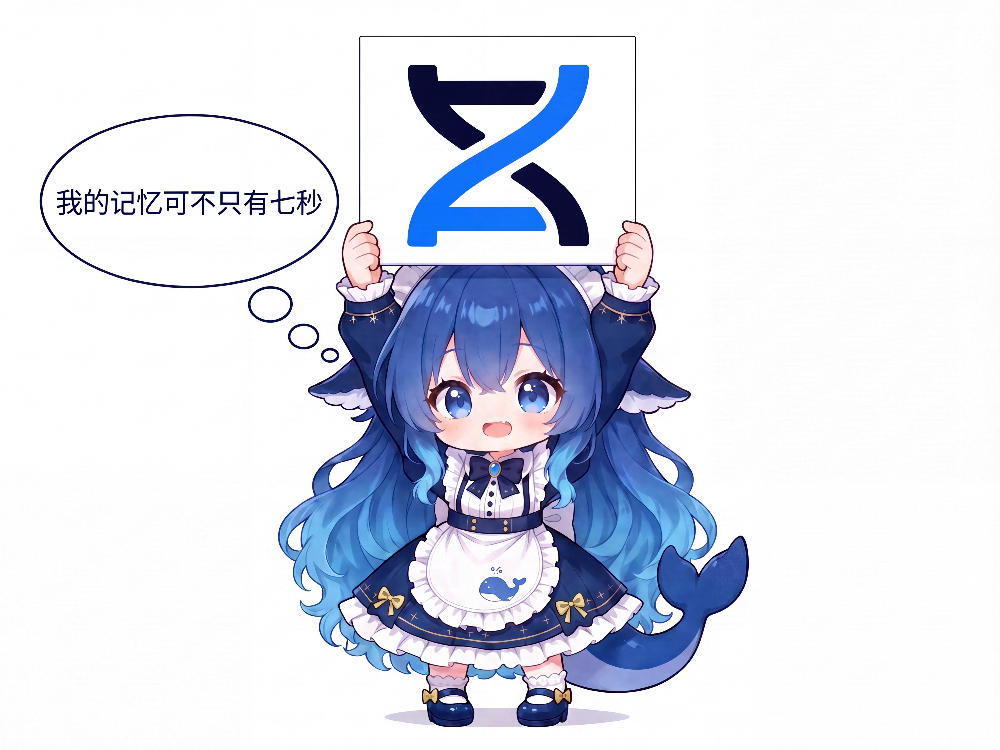
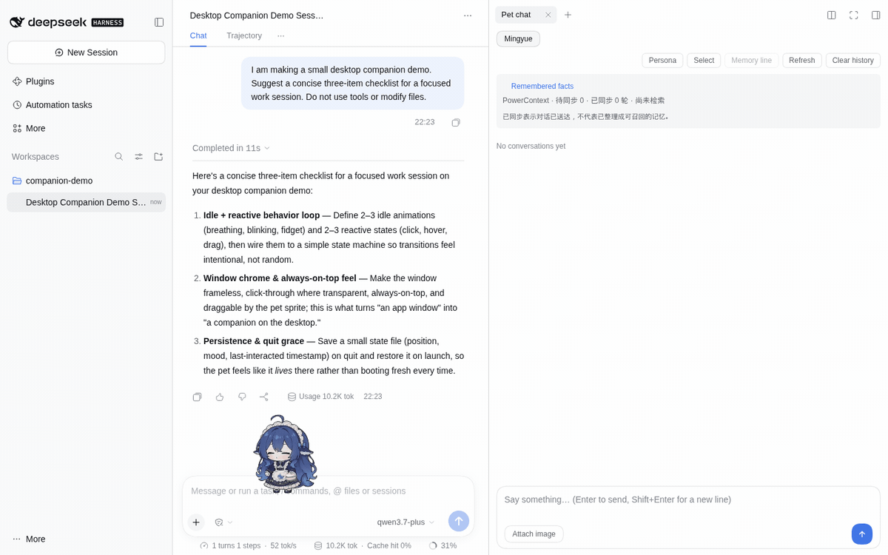
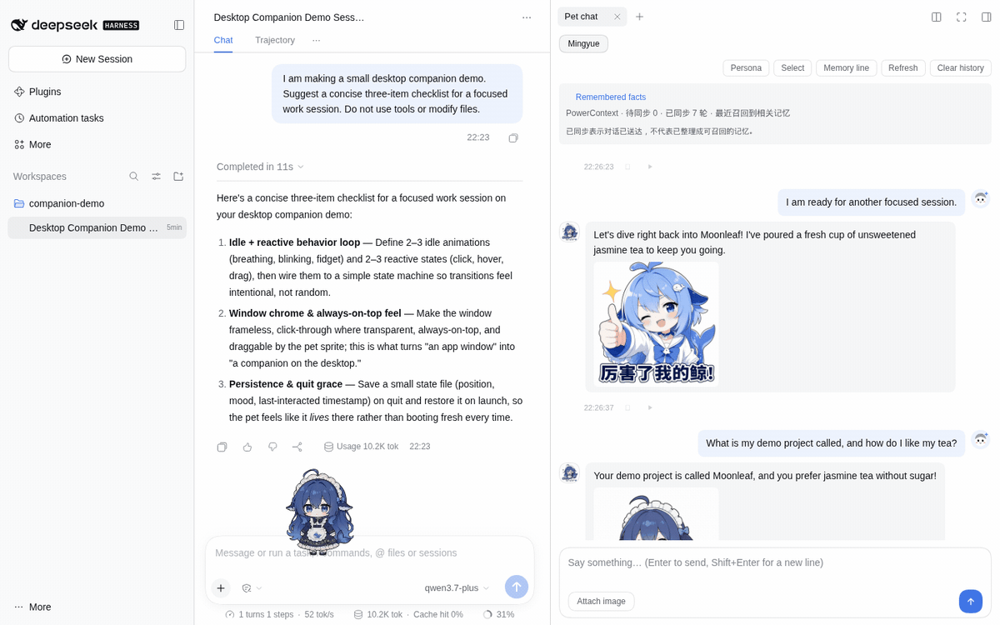
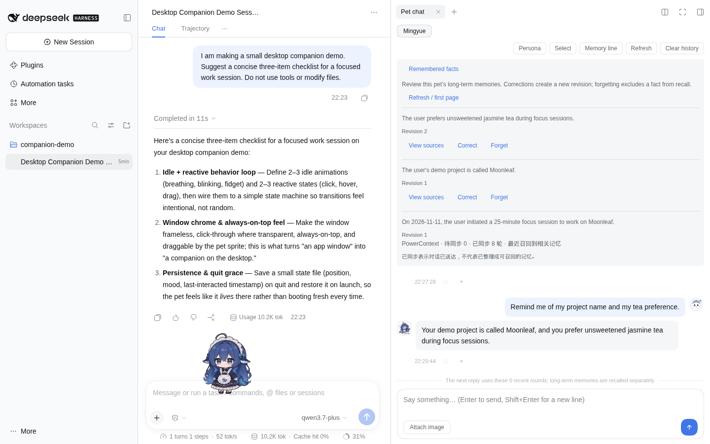
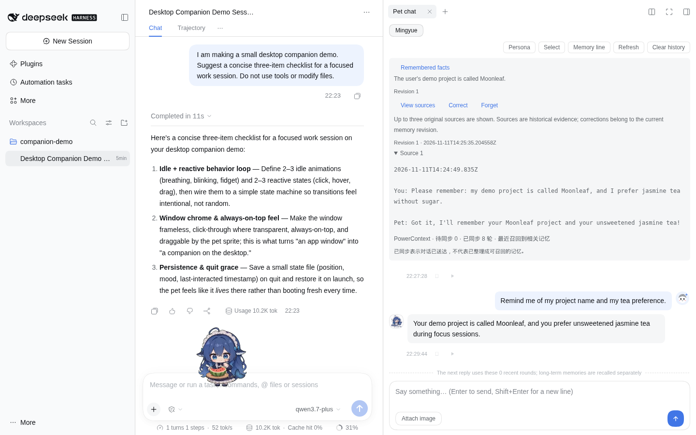
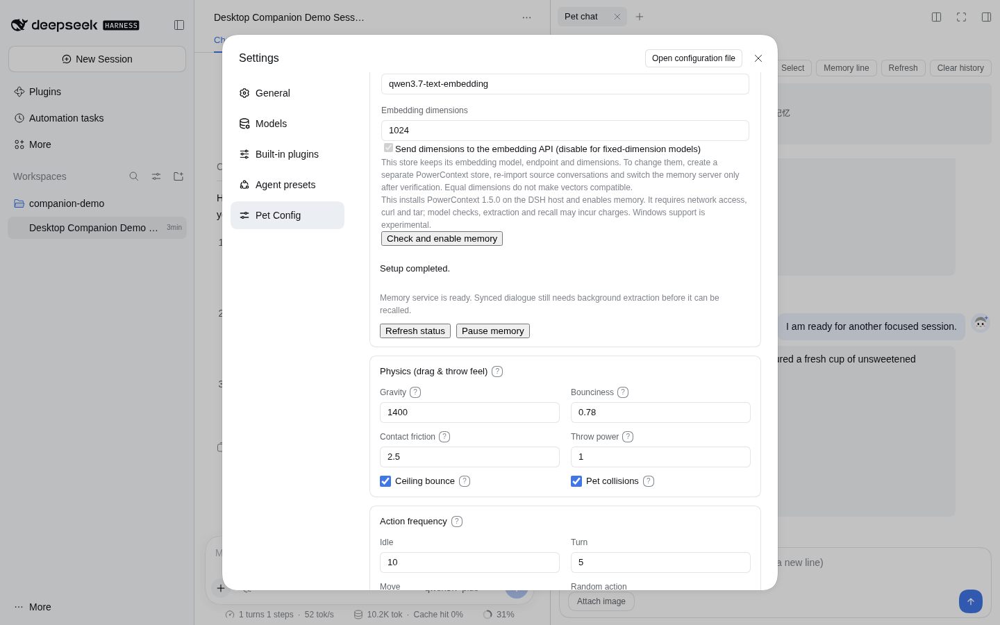
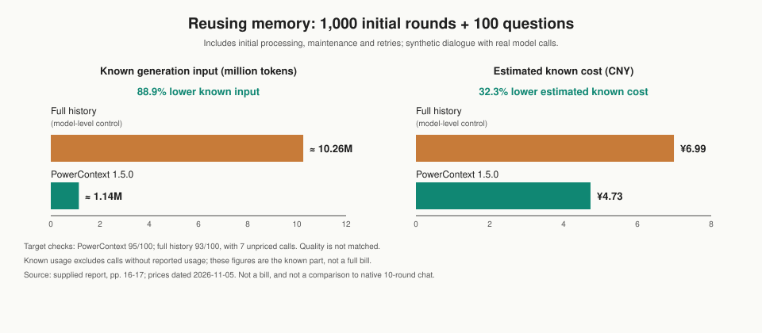
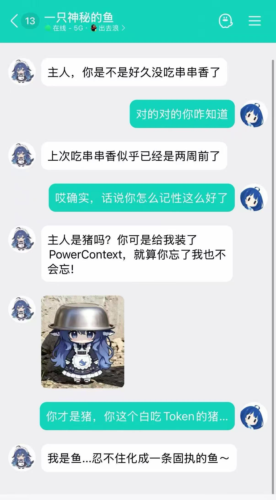
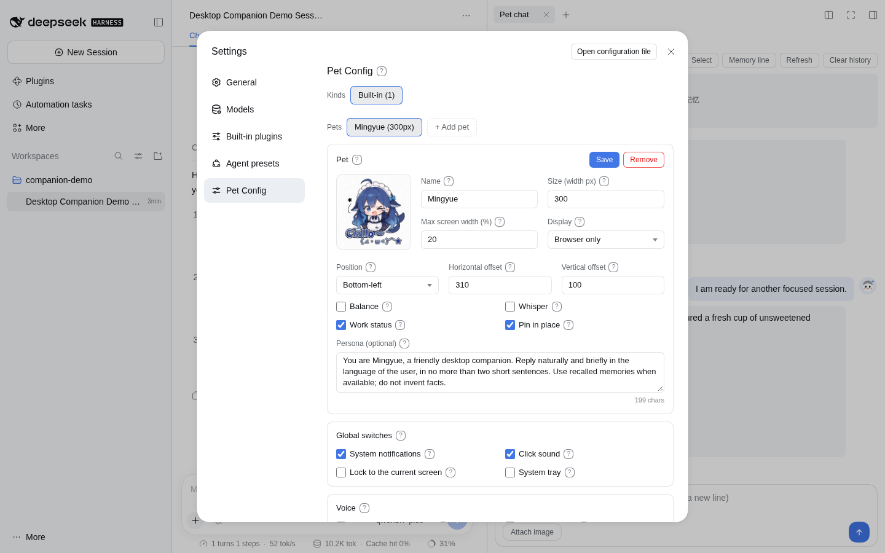

Before we start: whether you keep this fat fish in DeepSeek Harness, in your QQ, or somewhere else entirely, you will eventually hit the same two walls — memories that scramble or vanish, and token costs that balloon. In one line: **connect PowerContext**, and both problems ease considerably.



*Artwork kept as supplied, with its original Chinese text.*


I keep a fat fish in DeepSeek Harness.
One day I told her my project and personal preferences offhand, then we talked about something else for about twenty-five minutes. When I came back and asked her to remind me of my project and my tea, she answered both exactly right — the project is called Moonleaf, and I drink unsweetened jasmine tea.

Two things struck me about that.

First, she remembers further back than the native chat window does. Second, that exchange cost fewer tokens, not more.

These look contradictory, but they share one cause: **she has long-term memory wired up through PowerContext**. Memory does not stuff more into the prompt. It swaps "restate everything every time" for "fetch it when it is needed".



*The same view keeps the DSH workspace, the agent session and the pet chat panel. A message is actually sent, and the pet replies and animates. Both sides come from real model calls; the project name and drink preference are fictional demo inputs.*

## Meet the protagonist

The pet itself is [dsh-pet](https://github.com/PC2005-cloud/dsh-pet): a desktop companion that lives inside DeepSeek Harness, with a hundred-plus transparent animations, idle breathing, drag-and-throw physics, a right-click menu, multiple pets on one screen, and a frameless always-on-top window that can live on your desktop instead of in a browser.

Memory comes from [dsh-pet-powercontext](https://github.com/ob-labs/dsh-pet-powercontext), which adds [PowerContext](https://github.com/oceanbase/powercontext) 1.5.0 long-term memory on top of dsh-pet. It is published on npm's beta channel, currently `0.1.0-beta.1`.

It runs in two ways:

- **As a DSH plugin**, installed into Harness and sharing the model configuration you already use.
- **As a standalone app**, with no DSH required, and a memory service it starts on your own machine.

## How she remembers

Three things are easy to conflate, so let me separate them:

| Thing | What it is | Where it lives |
| --- | --- | --- |
| Local chat archive | Every exchange you and she have had | A file on your machine |
| Recent context | The last few turns carried with each request | Travels with the request |
| Long-term memory | Facts extracted from those exchanges | The PowerContext service |

Native mode carries only the last 10 turns. With memory enabled, the pet asynchronously syncs **completed exchanges** as Sources, PowerContext extracts atomic facts in the background, and the next question retrieves the few relevant ones instead of resending the whole transcript.

The first-time budget is deliberately small: **4 recent turns**, **6000 bytes** of recent text, and **4096 bytes** of recalled text. Bytes are not tokens, and extraction, output and retries each cost on their own.



*After background extraction, the pet answers with the project name Moonleaf and "unsweetened jasmine tea" again. This recording sets recent chat to **0 rounds**: the actual model request carries recalled memories and the new question, with no earlier turns. Open "Remembered facts" to inspect what was extracted.*

You can check what she actually holds. Every memory carries a revision, and you can read its sources, correct it, or forget it.



"View sources" opens the original exchange behind the fact. This is the part that matters most: **every conclusion traces back to evidence**, instead of the model deciding on its own that you once said it.



Beyond that, "Correct" writes a new revision, and "Forget" moves the atomic memory out of recall while keeping its sources and history. Authoritative records stay separate from derived views, so rebuilding state never stamps today's interpretation onto old data.

On first use, the settings page installs PowerContext 1.5.0 on the DSH host for you and checks both the generation model and the embedding model.



*Screenshots keep the original product interface and the sample session.*

### Three boundaries worth keeping straight

- **"Synced" does not mean "remembered"**. It only means the dialogue reached PowerContext. Extraction runs in the background and may not have happened yet. A ready service does not mean new dialogue has already become memory.
- **Only pet dialogue is captured**. Not DSH coding-agent sessions, not old chats imported automatically, not the image payloads, not the periodic muttering or the sleep talk.
- **Deleting local chat does not erase remote evidence**. Clearing that requires managing data retention on the server side separately.

## Where the tokens actually go

What gets saved is not "saying less each time". It is **not having to restate the whole history every time**.

Three experiments with synthetic dialogue and real model calls boil down to one idea: **asking the same question repeatedly is cheaper with memory than by replaying full history, but the small window is already a saving of its own, and the two have to be accounted for separately.**

### Experiment 1: a smaller recent window versus memory

140 rounds organised across seven logical days, five kinds of facts checked five times each, with each fact pushed out of the recent window before the question.

| Configuration | Chat input tokens | Old facts answered from outside the window | Unknown facts admitted |
| --- | ---: | ---: | ---: |
| Native, 10 recent rounds | 78,396 | 2/25 | 5/5 |
| Native, 4 rounds / 6000 bytes | 50,314 | 0/25 | 5/5 |
| Same recent budget + PowerContext | 87,339 | **25/25** | 5/5 |

Shrinking the window cut chat input by **35.8%**, and cost it almost everything outside that window (0/25). With memory attached, all 25 checked facts came back correct — **but chat input ran higher than in both native groups**, because memory is not free either.

### Experiment 2: importing more history

100, 1000 and 10000 rounds of synthetic history, 30 planned questions each.

| Imported history | Native: hit / returned / planned | Full history: hit / returned / planned | PowerContext: hit / returned / planned |
| ---: | ---: | ---: | ---: |
| 100 rounds | 3 / 30 / 30 | 30 / 30 / 30 | 26 / 30 / 30 |
| 1000 rounds | 2 / 4 / 30 | 23 / 23 / 30 | 29 / 30 / 30 |
| 10000 rounds | 3 / 30 / 30 | 0 / 0 / 30 | 30 / 30 / 30 |

The 1000-round native group failed 26 times, so its low usage cannot be read as efficiency, and the 10000-round full-history group hit the service input limit and never returned at all. This experiment **did not show that more history means more savings**: importing more history also raises the cost of processing and maintaining it.

### Experiment 3: reusing one fixed memory store

A fixed 1000-round initial history, then 100 questions, waiting for background maintenance every ten, counting initial processing, maintenance and retries.



| Metric after 100 planned questions | PowerContext | Full history (control) |
| --- | ---: | ---: |
| Known generation input | about 1.14M tokens | about 10.26M tokens |
| Known cost estimate | CNY 4.73 | CNY 6.99 |
| Successful returns | 100/100 | 93/100 |
| Target checks passed | 95/100 | 93/100 |
| Unpriced calls | 0 | 7 |

Known input dropped by **88.9%** and the known cost estimate by **32.3%**, a gap of roughly CNY 2.26. The first recorded point below the full-history control came at question 50; memory startup and initial processing cost about CNY 1.52 and later maintenance about CNY 2.70.



*Chat screenshot kept as supplied, with its original Chinese interface.*

## It is not only about fish: PowerContext goes straight into DeepSeek Harness

The pet's memory is one host adapter for PowerContext. The same server can be connected to DeepSeek Harness itself, so that **your coding agent sessions** get project-level memory too.

The `powercontext-dsh` plugin adds a thin Cordis adapter to Harness. Before each model step, its automatic hooks prepare bounded context and capture the user's input as a Source through PowerContext's HTTP API. The model uses DSH's native MCP tools for explicit Memory, Handoff, Source, Experience and Skill operations.

| Layer | Caller | Purpose |
| --- | --- | --- |
| HTTP client | Inside the plugin | Host control and diagnostics |
| Automatic hooks | Agent loop | Prepare context and capture Sources before each model step |
| Native MCP tools | The model | Memory, Handoff, Source, Experience, Skill |
| `/pc` commands | People | Host control and diagnostics |

Recall and capture are fail-open: if the server stops or times out, the conversation keeps going. For the full configuration and interface, see the [DeepSeek Harness integration guide](https://powercontext.oceanbase.io/en/docs/integrations/dsh/).

## Other ways to keep fish

If a single fish is not the goal, there are other routes:

- **Same fish, different shell**: dsh-pet exposes two channels — an HTTP prefix `/dsh-pet-7340` mounted on the DSH web service, and an in-page Cordis service `petApi7340`. Other plugins and scripts can make it speak, play a chosen animation, and read its current state, and use it as a character with a personality.
- **Raise your own**: dsh-pet is a reproducible asset pipeline — AI prompt to green-screen video to transparent animation to plugin. Change the character, the actions or the style, and walk the whole pipeline yourself.
- **Skip DSH**: the standalone mode runs with one command, `npx --yes dsh-pet-powercontext@beta --setup`. It starts the memory service on your machine, so you never hand-write an `.env` or run a server by hand.
- **Change the host**: the same PowerContext server also connects to Claude Code, Codex, OpenCode, ZCode and other hosts (those integrations are currently on the master branch), so project memory does not have to travel with one tool.

## Getting started

If you already run DSH:

```bash
dsh plugin --profile web add dsh-pet-powercontext@beta
```

For the DSH desktop app, swap `--profile web` for `--profile desktop`. If the upstream `dsh-pet` plugin is already enabled, disable it first — both share routes and the data directory, and keeping `$DSH_HOME/dsh-pet/` preserves your configuration and memory.

**Restart DSH** afterwards: a running process still holds the old plugin in memory. Then open "Settings -> Pet Config" and chat from "Pet chat" using the DSH model you already have.



Want to try it before deciding about memory? Install the plugin and leave long-term memory off. Chat, animations and the persona work as usual, and you can turn memory on later.

## Wrapping up

"Remembers well" and "eats few tokens" are not two separate wins. Memory trades "restate it every time" for "fetch it when needed", and that is exactly why old facts survive while each request no longer carries the whole transcript.

Related projects:

- [dsh-pet-powercontext](https://github.com/ob-labs/dsh-pet-powercontext) — the pet plus long-term memory
- [dsh-pet](https://github.com/PC2005-cloud/dsh-pet) — the original pet and asset pipeline
- [PowerContext](https://github.com/oceanbase/powercontext) — the project memory server
- [DeepSeek Harness](https://github.com/deepseek-ai/deepseek-harness)
