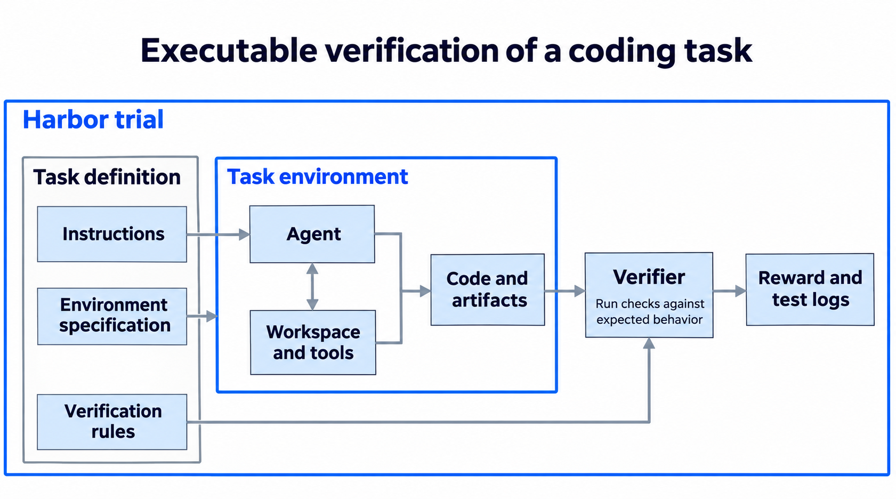
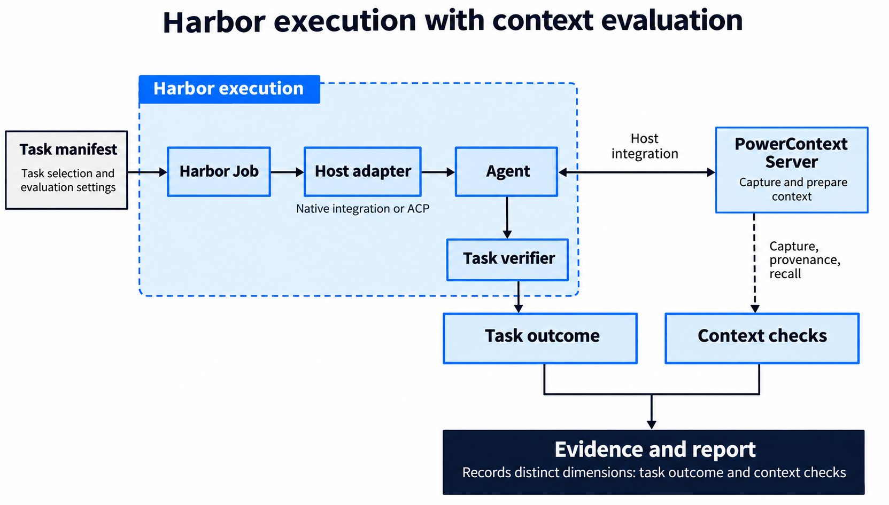
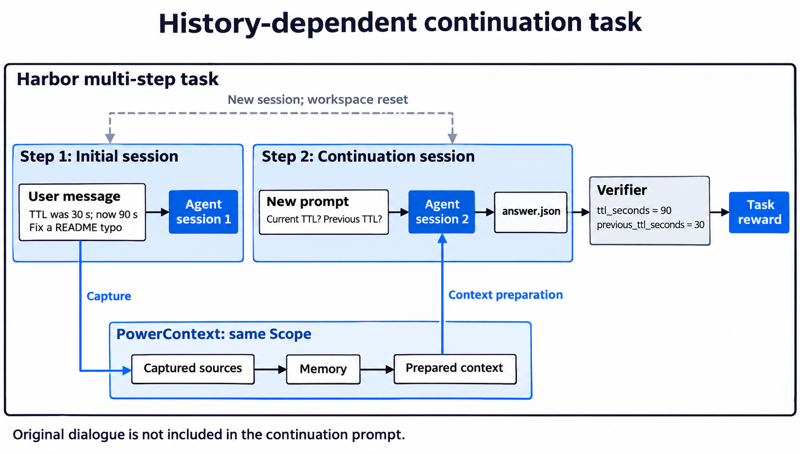
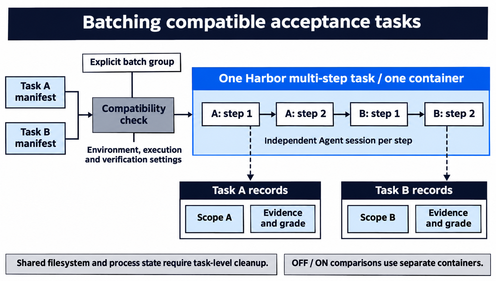

A developer settles an API contract in one conversation, then asks an agent to continue the implementation a few days later. A debugging session uncovers a useful lead, and the investigation continues in another session. Both depend on information accumulated earlier. For PowerContext, we want to know whether an agent can use that history to continue its work and deliver a valid result.

This goal calls for several kinds of evaluation. A retrieval query checks whether information can be found, a continuation conversation checks whether an agreement has been retained, and a complete coding task reveals whether that information improves the delivered result. Each has its own evaluation method, but environment preparation, agent invocation, and result collection share common requirements. Those requirements are where the E2E harness began.

## Finding an execution framework through coding tasks

Coding tasks reflect how developers actually use agents. They were also one of the scenarios we had in mind when we first built PowerContext. A context system can help an agent continue to follow established requirements after switching sessions.

From an evaluation perspective, coding tasks usually have concrete deliverables, and many acceptance criteria can be checked with executable tests. Examining how an agent completes a coding task also reveals where the context system participates, whether it retrieves useful information, and whether there are observable improvements in step count, token usage, and elapsed time.

While researching Terminal-Bench, we started looking at [Harbor](https://harborframework.com/). It already provides a way to organize tasks: the task description states the requirements, the environment supplies files and dependencies, the agent performs the work, and the Verifier checks the result. For tasks scored with executable tests, the verifier runs predefined checks and produces a score from the actual results. [Harbor's task structure](https://docs.harborframework.com/tasks/overview)

*Figure 1: Submitted code is then run and checked. Predefined tests apply the same acceptance criteria across runs.*

A database WAL recovery task, for example, includes database files, a runtime environment, and verification scripts. We chose to reuse these native tasks and extend evaluation through Harbor's task model to avoid rebuilding that machinery. We integrate PowerContext into this workflow and collect evidence to compare agent behavior with and without it.

## Choosing where to extend Harbor

Task scores show whether the code meets the acceptance criteria. Capture and recall records help us analyze how PowerContext contributed to the task.

Reusing the native execution flow is simpler than implementing another framework. Tasks retain Harbor's environment and agent interfaces, Harbor Job executes them, and the Verifier checks their output as before. Task manifests declare the context behavior to observe, while the custom layer handles PowerContext integration and additional context evaluation.

*Figure 2: Context integration connects through Harbor's interfaces. Native tasks keep their own environments and acceptance methods.*

Native scores and context evaluations are stored separately. For example, the Terminal-Bench Verifier determines whether the work is complete, while the additional evaluation checks whether inputs were captured, whether memory sources belong to this run's inputs, and whether queries returned the expected content. [Execution and evaluation contracts](https://github.com/oceanbase/powercontext/blob/20f64d72b13594ad834fcd342f5927d0d0102abb/e2e/bub/README.md)

Harbor offers another advantage: it already integrates common agents such as Codex, and other hosts that support ACP can connect through that protocol. Harbor manages execution throughout, while the host adapter adds the preparation required for context integration.

## Making history part of the task

If every requirement appears in the current prompt, it is difficult to observe whether the context system helps an agent continue earlier work. The task must express dependencies on information from previous sessions.

Harbor's multi-step tasks suit this scenario. Earlier steps provide information, later steps make related requests in new sessions, and the Verifier then checks the deliverable. One continuation sequence shares a PowerContext Scope, the space that stores context for that experiment. In these continuation tasks, the original conversation is not passed directly into later sessions.

For example, an initial session explicitly states that the search-result cache duration was 30 seconds and has now changed to 90 seconds. A later session asks for the current and previous values in a structured answer. The Verifier checks both fields, avoiding a pass for an answer that mentions both numbers but confuses their relationship.

*Figure 3: The new session prepares context through the same Scope. The task's verifier then checks whether the answer distinguishes the current and previous values.*

We also adapted MemoryCode for ongoing coding collaboration. Its mentoring exchanges contain coding conventions, rule updates, and unrelated content. Each exchange becomes a separate session. The final session writes code following the earlier conventions, and MemoryCode's verification process checks the output.

Unlike the protocol in the original paper, our final session does not receive the original conversations. This tests whether an agent can use context from earlier sessions to follow the established conventions. After the preliminary stage, the task resets the workspace to reduce the opportunity to recover requirements from notes left there. [MemoryCode task design](https://github.com/oceanbase/powercontext/blob/20f64d72b13594ad834fcd342f5927d0d0102abb/e2e/bub/README.md#memorycode-workloads)

These tasks also support OFF/ON comparisons of agent behavior with and without PowerContext. The OFF group runs the native agent without PowerContext integration. The ON group enables the host's PowerContext integration, captures information from the initial sessions, and prepares relevant context for continuation. Both groups use the same task, host, and model configuration, and run in separate containers.

## Combining repeated preparation work

As the task collection grows, repeatedly starting environments and installing dependencies adds to execution costs. Even a short acceptance task can spend considerable time preparing its environment. Tasks with the same environment and controllable interference can share that preparation.

The Runner combines local acceptance tasks into one Harbor multi-step task when they are assigned to the same group and use compatible configurations. They run sequentially in a single container, with separate Scopes for context data but shared filesystem and process state. The task and host adapter clean residual session records, temporary files, and other state according to each task's retention rules. Tasks that need independent environments continue to run separately. [Task grouping in the Runner](https://github.com/oceanbase/powercontext/blob/20f64d72b13594ad834fcd342f5927d0d0102abb/e2e/bub/src/powercontext_e2e/runner.py)

*Figure 4: Compatible tasks share one environment setup and run in sequence. Each task keeps its own context, evidence, and scores.*

PowerContext's specialized evaluations of memory quality, performance, and other concerns still have their own execution flows. Scenarios suited to actual agent workflows can gradually become Harbor tasks; experiments that depend on specialized data processing and evaluation protocols remain with their respective suites.

## Conclusion

The harness uses Harbor's task execution and verification mechanisms, with PowerContext integration, cross-session tasks, and context evaluation. Task scores and context evaluations are stored separately, with runtime configuration and evidence retained for review.

Thanks to [Fengzdadi](https://github.com/Fengzdadi), [knqiufan](https://github.com/knqiufan), [Russell Lin](https://github.com/russell001209-ai), [ThunGuo](https://github.com/thunguo), and everyone who contributed to the design, implementation, and validation of the E2E harness.
