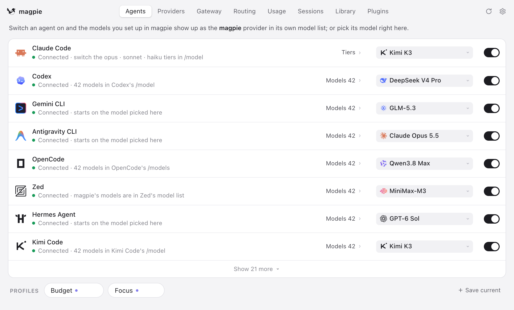
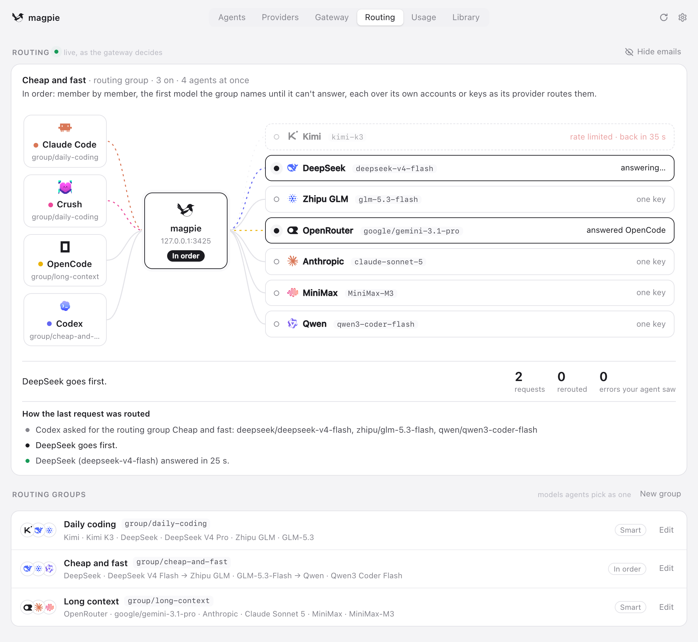
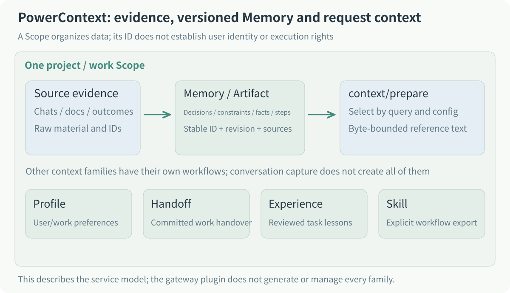
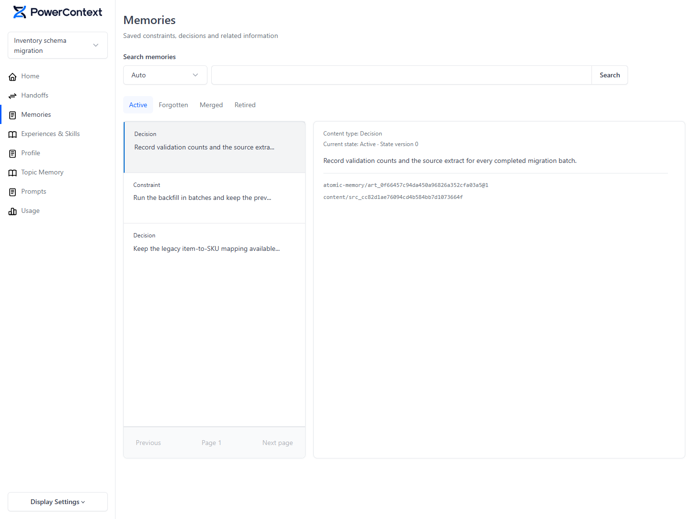
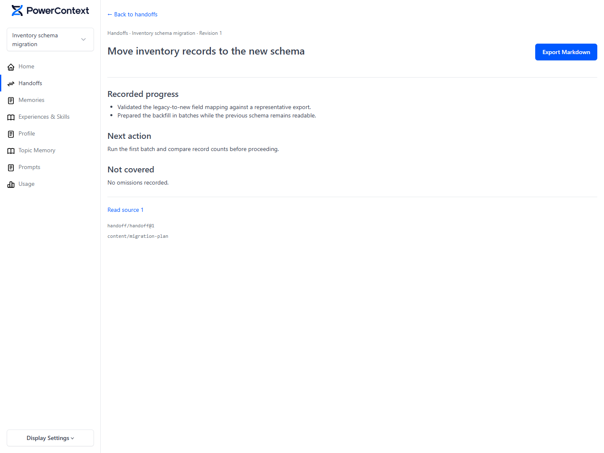
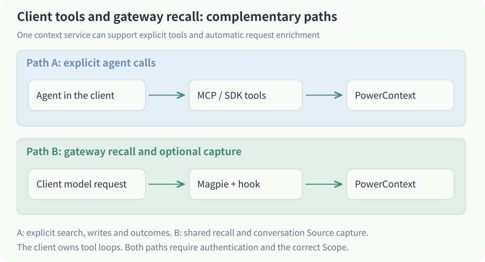
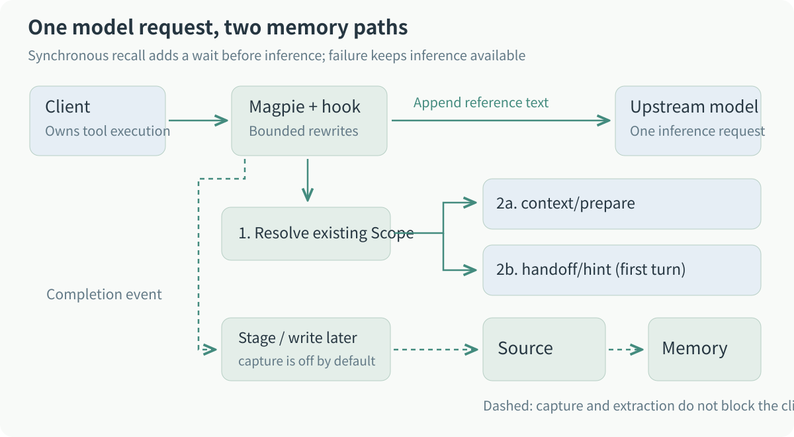
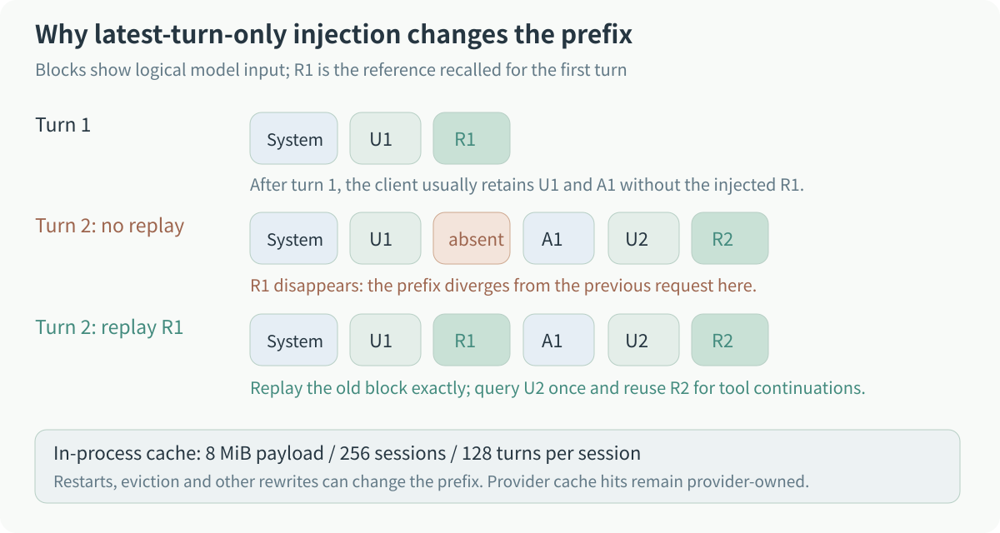
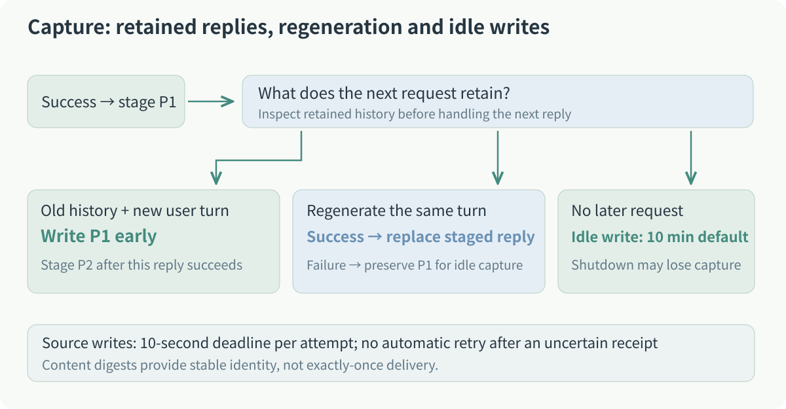
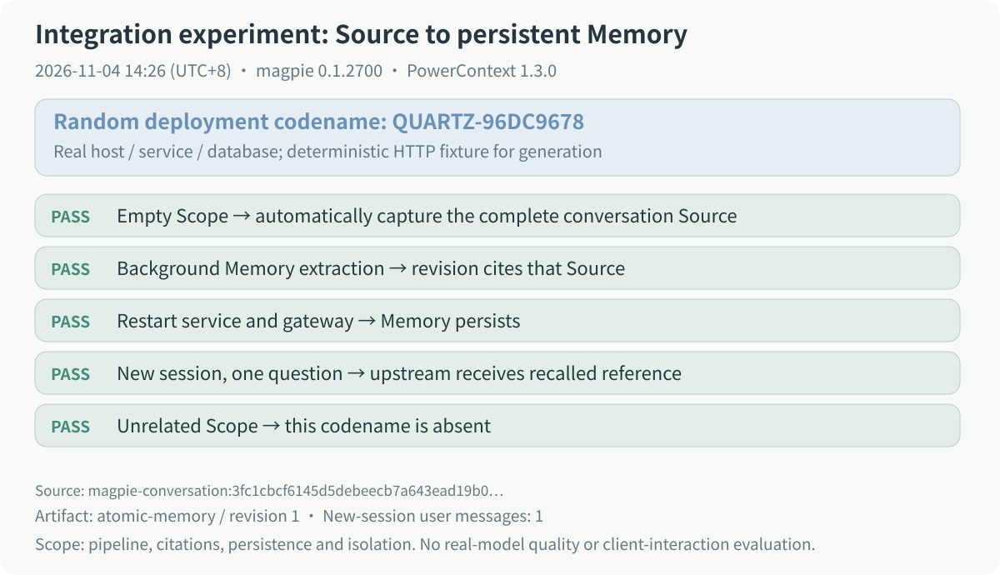

I switch between Claude Code and Codex. Some project conventions have already been explained in one session, but I end up repeating them in another tool: deploy with Helm, prepare a temporary HOME for tests, leave generated files alone. Long conversations can bury those conventions too.

I wanted the tools to share project memory. I was already using Magpie, and model requests passed through it, which suggested a place to start: could the gateway query a memory service before sending the request to the model, then append whatever was useful?

That became the [PowerContext plugin](https://github.com/magpie-community/plugins/tree/main/packages/powercontext), `@magpie-community/gateway-powercontext`, now merged into the Magpie community repository. Clients keep their existing workflows and execute tools as usual. The extra work happens in the gateway: recall before inference and, when enabled, send the conversation to PowerContext afterward.

## Magpie puts model configuration in one place

If you haven't used [Magpie](https://github.com/yetone/magpie/blob/main/README.md), think of it as a model gateway running on your machine. Claude Code, Codex, and Gemini CLI connect to it; it forwards their requests to the model providers you configure.

This removes some of the configuration work involved in switching agents. Each client otherwise has its own model names, service addresses, and credentials. With Magpie, providers and accounts are managed in one place, and a model can be selected for each client. You can keep Claude Code's workflow while using another provider's model, or give Codex a routing group with several candidate models.

[](../../../assets/blog/magpie-gateway-powercontext-memory/magpie-agents.en.png)

Figure 1: selecting a model for each client on Magpie's Agents page. [Original README demonstration screenshot](https://github.com/yetone/magpie/blob/main/README.md).

The agent and the model have different jobs here. The client reads files, executes commands, organizes tool calls, and decides whether to request more inference. Magpie receives those requests and handles routing and protocol adaptation. Changing the upstream model leaves the client's part of the work in place.

Magpie serves OpenAI Chat Completions, Responses, Anthropic Messages, and Gemini interfaces, so clients can use their own protocols. When a provider supports a different protocol, the gateway handles conversion. The memory plugin does not have to make clients adopt one common format first.

A routing group puts several models or accounts behind one selection. The next screenshot shows how a request travels through Magpie to a provider. Fallback requires actual alternative accounts or routes; configuring only one account still leaves its own limits in place.

[](../../../assets/blog/magpie-gateway-powercontext-memory/magpie-routing.en.png)

Figure 2: Magpie's Routing page. The models, timings, and counters are part of the [original README example](https://github.com/yetone/magpie/blob/main/README.md).

That common entrance is a useful place to add memory. Claude Code and Codex can reuse the connection settings and recall code. I wanted storage and retrieval themselves to stay with a service already working on those problems.

## PowerContext keeps work context for later

[PowerContext](https://github.com/oceanbase/powercontext/blob/master/README.md) is OceanBase's open-source context service for agents. It can run independently over HTTP, MCP, or an SDK, or be embedded in an application. This plugin connects to an independently deployed Server.

A memory service can sound like a database of transcripts, but preserving a transcript is only part of the job. A migration discussion may contain attempted approaches, rejected suggestions, confirmed constraints, and unfinished work. Another agent taking over usually needs the latter two without rereading the whole discussion.

A few PowerContext names appear in the implementation and are worth explaining first.

The conversation captured by the plugin is a **Source**, the original material. The service can extract Memory from that material to retain project decisions, constraints, facts, and next steps. The result belongs to an **Artifact**, with its own ID and revision, and can cite the Source. A recalled item can therefore be traced back to the material it came from.

For recall, the plugin calls `context/prepare` and receives **PreparedContext**: relevant reference text for this query, bounded by a byte budget. The service can retain more material than any one model request needs to receive.

[](../../../assets/blog/magpie-gateway-powercontext-memory/context-model.en.svg)

Figure 3: original material becomes reference context for a request. The other families belong to PowerContext; this plugin mainly uses recall and conversation Source writes.

These records belong to a Scope, which can organize a project or work area. Clients sharing project memory need to resolve to the same authorized Scope. Its ID selects data; service authentication still determines access.

The following Memory page comes from the official documentation and uses demonstration data. The list contains decisions and constraints, while the selected entry shows its content, status, and Artifact and Source references.

[](../../../assets/blog/magpie-gateway-powercontext-memory/powercontext-memory.en.png)

Figure 4: PowerContext's Memory page with synthetic demonstration records. [Image source](https://github.com/oceanbase/powercontext/blob/master/README.md).

PowerContext also has Handoff, Profile, Topic Memory, Experience, and Skill. This plugin does not incorporate all their operations, but two distinctions directly affect its design.

The first is **Memory versus Handoff**. For a migration, keeping the old schema readable is a continuing constraint that fits Memory. Having checked the mappings and needing to run the first backfill describes current progress and fits a Handoff. A new session may need both the project convention and the point where a particular task stopped.

[](../../../assets/blog/magpie-gateway-powercontext-memory/powercontext-handoff.en.png)

Figure 5: progress, next steps, and evidence references in a Handoff, using synthetic demonstration records. [Image source](https://github.com/oceanbase/powercontext/blob/master/README.md).

The second is **conversation content versus task outcomes**. An assistant saying it has finished does not establish success. Experience needs recorded outcomes and review before reuse. This plugin captures the visible conversation without inferring task success or automatically submitting a Handoff.

The remaining names can be understood by their uses: Profile holds user or work preferences; Topic Memory organizes related material by subject; Skill manages procedures and checks that can be exported to a host. The [PowerContext documentation](https://powercontext.oceanbase.io/en/docs/) covers their individual workflows.

I also see this as something that can work alongside a repository's `AGENTS.md`. Stable project rules stay in the repository and get reviewed with code. Decisions formed during work can go into the context service when they need provenance and later reuse. An agent receiving an old memory still has to inspect the current repository and task state.

## First, the gateway had to wait for an external request

One way to connect PowerContext is to configure MCP tools in a client and let its agent decide when to search, write, or record outcomes. I wanted automatic recall too: whenever a model request passed through Magpie, query related context first, without installing a separate memory MCP or skill in each client.

Both approaches can be used together. Project conventions can be recalled automatically on each turn, while an agent explicitly records an outcome when the task actually ends.

PowerContext now also has an [official Rust Gateway](https://github.com/oceanbase/powercontext/blob/master/gateway/README.md) as another integration option. I kept Magpie as the entry point because it already managed model configuration, routing, and protocol adaptation for my clients. The following sections describe this plugin's development; the independent experiment later in the article pins PowerContext to 1.3.0.

[](../../../assets/blog/magpie-gateway-powercontext-memory/integration-choices.en.svg)

Figure 6: explicit agent tools and automatic gateway recall suit different operations.

The first obstacle was Magpie's plugin entry point at the time. Synchronous gateway middleware could rewrite fields, but recall needed an HTTP request and a wait for PowerContext before inference could continue.

I proposed [yetone/magpie#2118](https://github.com/yetone/magpie/issues/2118), then implemented a pre-inference async hook and a completion notification in my fork. The maintainer later ported them to mainline. The released entry is `magpie.hooks`, executed by the Bun plugin host.

```json
{
  "magpie": {
    "hooks": "./powercontext.hooks.mjs"
  }
}
```

A plugin exports `onRequest(body, ctx)`, which the host awaits, and can export `onResponse(reply, ctx)` for completion notifications. The context supplies protocol, session, working directory, request origin, options, and cancellation. Client headers and credentials are not forwarded directly to the hook.

One agreement stayed the same throughout: recall in the gateway would not start another inference round or add memory tools to the client. The hook adds references to the incoming request and continues its existing inference. The client still arranges tool execution and subsequent requests.

The host checks rewrites as well. A change to tool declarations, tool choice, `model`, or `stream` is rejected, as is an exception, timeout, or invalid return value. In a chain of hooks, the previously accepted request state remains. A rolled-back hook receives no `onResponse` for that request. The [hook documentation](https://github.com/yetone/magpie/blob/main/docs/subsystems/gateway-request-hooks.md) describes the full contract.

The plugin first resolves an existing Scope and retrieves context. On the first turn, it also fetches the latest committed Handoff hint in parallel. References are appended to the latest user message before the request reaches the model.

[](../../../assets/blog/magpie-gateway-powercontext-memory/architecture.en.svg)

Figure 7: recall before a request and capture after a reply. Figures can be opened at full size.

## The memory added on turn one disappears on turn two

Appending references to the user message leaves a less obvious problem.

On turn one, the client sends `U1`, the plugin recalls `R1`, and the model receives `U1 + R1` before generating `A1`. But the gateway added `R1`. The client usually knows nothing about it, so its history still contains only `U1` and `A1`.

On turn two, the client sends `U1, A1, U2`. If the plugin appends only the latest `R2`, the model gets `U1, A1, U2 + R2`. The `R1` it received previously is gone.

This changes the historical prefix and can affect the provider's prompt cache. Querying `U1` again is unreliable too: memory may have changed, or results may come back in a different order, so `R1'` need not equal the original.

[](../../../assets/blog/magpie-gateway-powercontext-memory/prompt-prefix.en.svg)

Figure 8: restore the original R1 on the next turn rather than merely querying again.

I keep the injected reference blocks in an in-process session cache. A new request first gets the old blocks restored, then queries for the latest turn. The following pseudocode omits origin checks, Scope resolution, and budget accounting:

```js
for (const oldTurn of historicalUserTurns) {
  replayExactReference(oldTurn, cache.get(turnKey(oldTurn)));
}

const key = turnKey(latestUserTurn);
if (cache.has(key)) {
  appendReference(latestUserTurn, cache.get(key));
} else {
  const reference = await recall(latestUserTurn);
  cache.set(key, reference);
  appendReference(latestUserTurn, reference);
}
```

A user turn can also produce several model requests. After a tool call, the agent submits tool results and continues inference without a new user question. Reusing that turn's reference block avoids another service query and keeps the context from changing halfway through tool execution.

The cache needs limits. Its current aggregate payload budget is 8 MiB, with at most 256 sessions and 128 turns per session. Aggregate pressure evicts the least recently used sessions first. Origin, protocol, and session information participate in the key so that requests do not share blocks accidentally.

This stores reference text, not the provider's cache. A restart, eviction, or client history compaction can still change the prefix. The implementation tries to preserve content already sent; this article does not measure real-provider cache hits or cost changes.

### The whole message is not always the right query

Clients such as Codex can put environment blocks and instruction files alongside the user's input. Searching with all of it can bury the actual question. The host supplies `ctx.query`, and the plugin prefers that extracted user input while leaving the original content in the model request.

Results go inside a `<powercontext-reference>` block labeled as reference material. Matching opening or closing tags inside the content are escaped so the material cannot close its own block early. The tags help identify where text came from; tool permissions and Scope access still require their respective authentication controls.

### Recall adds a wait, so it needs a deadline

Each service request defaults to a 1000-millisecond deadline, including body reads. The request hook defaults to a 5000-millisecond budget and is constrained by the host's overall deadline. Since Scope resolution precedes parallel context and Handoff lookup, recall can span two service deadlines.

If PowerContext cannot be reached or the query times out, this turn continues to inference without new memory. A default 30-second backoff prevents every subsequent request from waiting for the same outage. Client cancellation aborts the query too, without starting backoff.

Handoff is optional and handled separately. A 404 or 503 indicating no committed Handoff is normal. A connection failure at that endpoint starts only its own backoff, while healthy Memory recall continues. A memory outage therefore mainly affects whether this turn receives references and the query wait already incurred.

## When to capture a conversation

Capture starts at `onResponse`. The host forwards streaming output to the client while collecting the reply for completion notification; capture does not wait for the service write before ending the client's stream. Failed, incomplete, or truncated replies are skipped.

A successful reply is staged first. The client may regenerate that answer, so the previous version may not be retained.

If the next request keeps the old history and adds a user message, the plugin writes the staged conversation early. A successful regeneration of the same turn replaces it. Failure or cancellation preserves the previous successful answer's idle-capture opportunity. Without another request, the default write happens after ten minutes. History forks and capacity reclamation can also cause an early write.

[](../../../assets/blog/magpie-gateway-powercontext-memory/capture-lifecycle.en.svg)

Figure 9: how continuations, regeneration, and idle waiting treat a staged answer.

The write uses `POST v1/sources/content`. A Source contains user and assistant messages plus client-supplied tool calls and results. Injected references are removed. PowerContext then extracts Memory according to its service-side configuration, so a completed reply does not immediately imply a new item on the Memory page.

### The previous Responses turn may be only an ID

Responses supports `previous_response_id`. A client can send an increment referencing history kept by the model service. The model knows that history; the plugin looking at the current request body may not.

Saving only the current input and output would omit the earlier conversation. With capture enabled, the plugin therefore caches Responses inputs and outputs it observes and retrieves the prefix by response ID for archiving. The model request keeps its incremental form.

If the current process has never observed an ID, for example when a client references an older response after Magpie restarts, capture is skipped. That missing history cannot be reconstructed from the current request, and a record that merely looks complete would be harder to investigate later.

### What if a write receipt never arrives?

Source writes have a separate ten-second timeout, and large conversations are fragmented. Content gets a stable identifier, but writes are not automatically retried. The service may have committed before the receipt was lost. A timeout alone cannot distinguish an uncommitted write from a committed write the client does not know about.

Each fragment is attempted once; a failed fragment stops the remaining ones. Shutdown can lose staged content too. Without a durable queue, delivery is best effort and may be lost or partial. A content digest alone is not enough for an exactly-once promise.

A successful write is also separate from successful work. The plugin sees a conversation and does not convert an assistant's claim of completion into a task outcome. Feeding Experience still requires the agent to record status and checks through `record_task_outcome` at a real completion or interruption boundary.

## A permission check added during review

One change in [plugin PR #117](https://github.com/magpie-community/plugins/pull/117) deserves its own explanation.

I first restricted capture: other callers of a shared gateway should not have their conversations stored in my memory by default. The maintainer then pointed out the same problem on recall. Blocking writes still left another caller able to submit a question through a shared key and read my memory.

Recall and capture now check origin independently, before Scope resolution, service lookup, and sticky replay. Blocking network lookup alone would still allow an existing in-memory reference to be reused.

There are three separate options:

| Option | Default | Purpose |
| --- | --- | --- |
| `capture` | `false` | Enable conversation capture |
| `recallRemote` | `false` | Permit recall for non-`local` origins |
| `captureRemote` | `false` | With capture enabled, permit non-`local` capture |

`captureRemote` does not also enable reading, and `recallRemote` does not enable writing. Magpie derives origin from the connection and key category. The plugin accepts only `local` by default; named keys on the same machine and proxied requests can have another classification.

Origin classification is not user identity. Enabling remote recall permits those callers to use the configured service and Scope without allocating independent memory for each person. Shared multi-user use still needs a design mapping identities to Scopes and permissions.

Captured conversations can contain much more than ordinary chat. File contents and command output may appear in an agent's tool results. Before capture, the plugin checks common credential patterns and skips the whole conversation on a match. Rules will miss some formats, so capture remains off until the user decides which conversations may be sent to the service.

One identifier detail also needs care: Scope resolution sends the raw session ID as a binding key and a SHA-256 digest of the normalized workspace path. Source metadata hashes both. Raw paths already present in conversation content are still captured; hashed metadata does not anonymize the conversation.

The earliest version also tried automatic installation: download uv, install Python and PowerContext, then start and supervise the service. Review removed that code. The plugin now contains the connection logic, while Python, model configuration, and service lifecycle belong to PowerContext's independent deployment.

## Checking the pipeline with an independent experiment

Unit tests cover timeouts, caching, and permission checks, but I also wanted to see whether a captured Source could become Memory on the service and be read in a new session.

The [independent experiment script](https://tsukikage7.com/examples/magpie-powercontext/extraction.mjs) creates temporary HOME and database directories and separate ports. It runs real Magpie, PowerContext, and SQLite, with deterministic local HTTP fixtures for the model endpoints. That makes service calls and data flow inspectable; real-model semantic quality needs a separate evaluation.

Each run generates a random deployment codename. Session A gives it to the agent, the assistant acknowledges it, and the plugin captures those two messages. The Scope starts without Sources or Memory, and no explicit memory-write call seeds the answer.

The script then waits for background processing. The generation fixture returns a candidate only when the Source evidence supplied by the service contains that run's codename. After Memory is created, the script reads its Artifact revision and checks that `sources` cites the captured conversation.

Both Magpie and PowerContext are then restarted. A new session sends only a question asking for the codename. The check inspects the upstream request for a reference block and the codename, and makes sure the old prompt and reply were not carried forward. A final query in an unrelated Scope must not contain the same codename.

[](../../../assets/blog/magpie-gateway-powercontext-memory/experiment-result.en.svg)

Figure 10: a summary of the November 4, 2026 run. Original data is in [result.json](https://tsukikage7.com/examples/magpie-powercontext/result.json).

This run used Magpie 0.1.2700, Bun 1.4.3, PowerContext 1.3.0, and plugin 0.2.1. Idle capture and Memory scheduling were shortened to one second to reduce waiting. The generated Memory text was:

```text
The Quartz application deployment codename is QUARTZ-96DC9678.
```

Its `atomic-memory` revision 1 cited the captured Source. After restart, a session with one user message still sent a reference containing `QUARTZ-96DC9678` upstream. The query in another Scope omitted it.

This excludes two possible sources of a misleading pass: old conversation history and the previous process's recall cache. No flush call forced extraction; the script waited for the service schedule. It did not run interactive Claude Code and Codex sessions or evaluate how well a real generation model extracts memory, so those remain separate checks.

The [run instructions](https://tsukikage7.com/examples/magpie-powercontext/README.en.md) describe the environment. To reproduce it, check out the plugin, set its absolute path, and run:

```sh
export POWERCONTEXT_PLUGIN_DIR="/absolute/path/to/plugins/packages/powercontext"
bun "extraction.mjs" \
  --magpie "/absolute/path/to/magpie" \
  --report "result.json"
```

The script pins PowerContext 1.3.0. Its report also records the tested hook file's SHA-256, corresponding to the [pinned plugin source](https://github.com/magpie-community/plugins/tree/1a05a77431c5d6c64a43c3a80a2cc2562048e666/packages/powercontext). Other versions need their own interface and result checks.

## Trying the plugin

This article was verified with PowerContext 1.3.0 and plugin 0.2.1. The steps below describe the basic integration; check plugin compatibility before using another Server version. The quickstart documentation changes with the project, so its current version is not necessarily one verified by this experiment.

Deploy a Server using the [PowerContext quickstart](https://powercontext.oceanbase.io/en/docs/get-started/quickstart/). Automatic extraction needs a generation model and Memory schedule configured on the service; semantic retrieval needs the appropriate embedding configuration. These use the service's own models and credentials.

Install PowerContext from Magpie's plugin discovery page, or use the CLI:

```sh
magpie plugin add @magpie-community/gateway-powercontext
magpie plugin options @magpie-community/gateway-powercontext \
  '{"serverUrl":"http://127.0.0.1:8000"}'
```

The plugin requires Magpie 0.1.1273 or newer. Use at least 0.1.1531 so settings saved from the configuration page take effect on subsequent requests. Enter the Server address, optional Scope ID, and service key, then use the clients through Magpie as usual. The key is saved in local plugin configuration, not the system keychain.

With no explicit Scope ID, the service resolves session or workspace bindings, or its default Scope. Failure skips the hook rather than creating a Scope. If diagnostics say `skipped`, check origin classification and Scope resolution first. Saving configuration does not probe connectivity; actual recall outcomes appear in Magpie's plugin diagnostics.

Trying recall before deciding to enable capture makes the stages easier to inspect. Once capture is on, check that the Source was saved, background processing produced Memory, and the Memory cites the right Source, then try a new session. The ten-minute idle timer and background schedule both take time; the Memory list may still be empty immediately after a reply.

The PR was submitted on October 14 and merged on October 29. Review changed several substantial parts: service installation moved out, recall gained origin restrictions, and capture kept more failure handling. I also fixed a problem in the tests themselves. Giving every HTTP request a 50-millisecond deadline caused false failures under load. Healthy requests now keep a normal deadline; deliberately hung requests get a shorter one after reaching the fixture, and backoff tests advance a controlled clock.

Thanks to Magpie's maintainer for reviewing these details and porting the async hook implementation to mainline. The code and discussion are linked below. The same hook is also a starting point for connecting another context service.

## Links

- [PowerContext plugin source and options](https://github.com/magpie-community/plugins/tree/main/packages/powercontext)
- [Plugin PR #117](https://github.com/magpie-community/plugins/pull/117)
- [Async hook proposal #2118](https://github.com/yetone/magpie/issues/2118)
- [Magpie request hook documentation](https://github.com/yetone/magpie/blob/main/docs/subsystems/gateway-request-hooks.md)
- [PowerContext documentation](https://powercontext.oceanbase.io/en/docs/)
- [Independent-service experiment and run instructions](https://tsukikage7.com/examples/magpie-powercontext/README.en.md)
