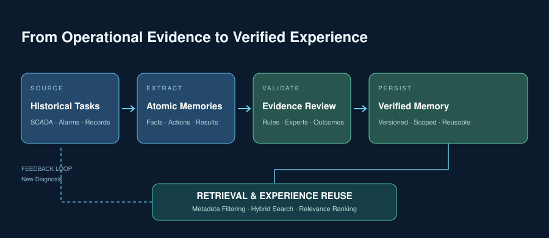
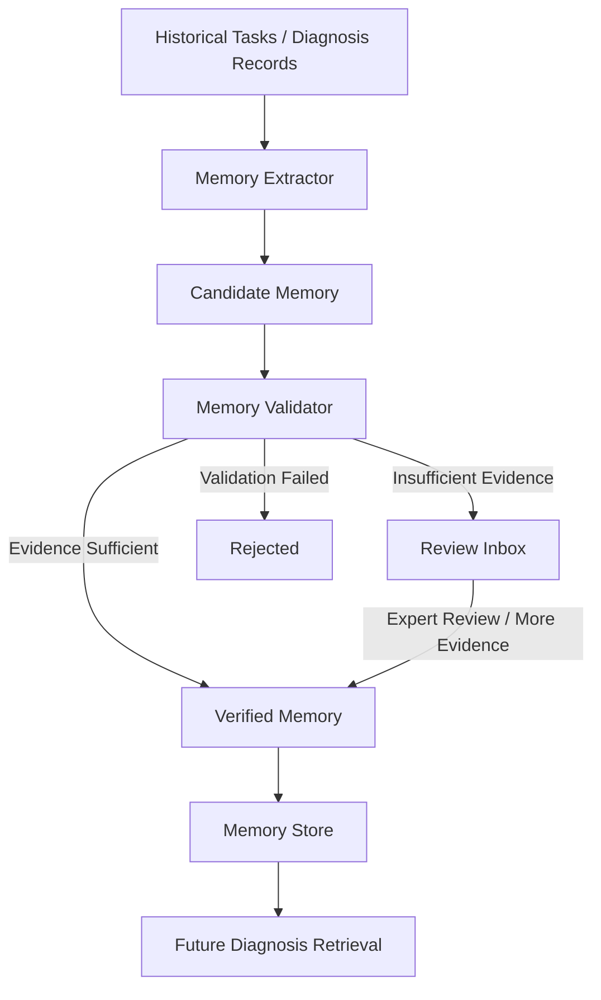
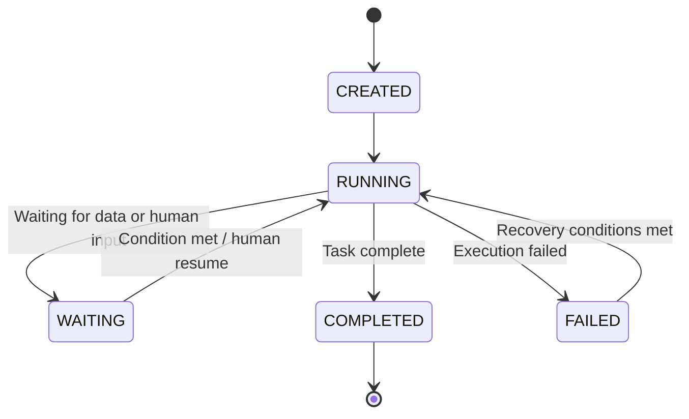
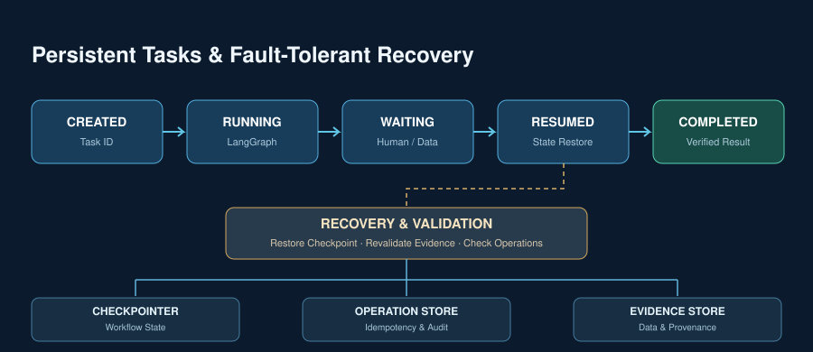
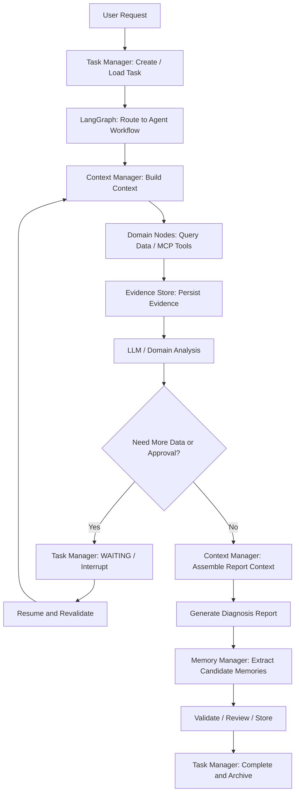

> A power-system agent must do more than complete one question or one diagnosis. Faced with changing operating data, complex fault-analysis procedures, and tasks that continue across shifts, we organize an Agent Runtime around LangGraph: LangGraph orchestrates workflows, Context Manager manages the context for the current inference, Memory Manager preserves reusable experience, and Task Manager manages task state and recovery.

## 01 Why do power-system agents need Memory?

The power-intelligence platform we are building supports operational analysis and fault diagnosis for a port power system. When a user selects an agent, the system calls a local model, knowledge services, databases, and domain algorithms to run a multi-step analysis and produce diagnostic conclusions, charts, and reports.

This is different from ordinary chat. A fault diagnosis may first read telemetry and status signals, then query equipment topology, historical alarms, and relevant procedures. During analysis it produces candidate causes, eliminated hypotheses, and new data requirements. After the task ends, the diagnosis and maintenance outcome may become important evidence for the next analysis.

If every task starts from zero, historical cases remain trapped in logs. If all history is placed in the prompt, context becomes redundant, data can be stale, and facts can be confused with inferences. If a service restarts halfway through a task, simply running the whole analysis again is also unsafe.

We therefore consider Agent Memory as part of the complete Agent Runtime and focus on three questions:

- **Context:** What should this inference see now?
- **Memory:** Which facts and experiences from the past are worth keeping and reusing?
- **Task:** Where is the current task, and how can it continue accurately after interruption?

These responsibilities are different, but they cooperate within one diagnosis. LangGraph remains the workflow engine, while Context Manager, Memory Manager, and Task Manager are organized around it.

## 02 The existing system: LangGraph orchestrates six power agents

The platform currently contains six business agents:

| Agent | Main responsibility |
|---|---|
| Risk Analysis Agent | General risk analysis for the power system |
| Current Fault Diagnosis Agent | Read telemetry and status data, cluster signals, organize evidence, classify faults, and generate reports |
| Power Quality Risk Agent | Analyze power-quality events, power correlations, and harmonics |
| Resonance Risk Agent | Check harmonic resonance |
| Cable Insulation Risk Agent | Assess insulation risk from partial discharge, temperature, and insulation resistance |
| System Operation Risk Agent | Analyze operating risk and recommend actions from snapshots, alarms, and topology |

The diagnostic backend uses LangGraph to organize multi-node flows. Each agent contains a State, Graph, and Nodes layer:

- **State** defines the data structure carried through the flow;
- **Graph** assembles nodes, edges, and conditional routes;
- **Nodes** perform data access, analysis, knowledge retrieval, and report generation.

MCP subservices provide access to databases, the RAGFlow knowledge base, standards and procedures, cable data, and resonance checks. The model is a locally deployed Qwen model, while BGE-M3 provides embeddings. RAGFlow and a local Wiki provide knowledge retrieval; load forecasting and partial-discharge recognition are handled by independent domain algorithm services. The backend streams workflow steps, diagnostic results, charts, and report content to the Vue frontend over SSE.

This stack already covers the main capabilities required to run the business agents. We keep LangGraph as the workflow core and organize Memory capabilities on top of the existing architecture rather than introducing another orchestration framework.

## 03 Overall architecture: LangGraph orchestrates; the Runtime manages context, memory, and tasks


*Figure 1. The Agent Runtime for a power system. LangGraph orchestrates business agents and calls context, memory, and task capabilities; the lower layers connect local models, knowledge services, data, and domain algorithms.*

The architecture has four layers.

**First, business agents.** Risk analysis, current-fault, power-quality, resonance, cable-insulation, and system-operation agents carry the specific business tasks.

**Second, workflow orchestration.** LangGraph executes nodes, routes conditions, and advances workflow state. MCP connects databases, knowledge bases, standards, and domain tools; SSE sends progress and results to the frontend.

**Third, the Agent Runtime.** Context Manager, Memory Manager, and Task Manager handle current inference context, cross-task memory, and the business task lifecycle.

**Fourth, infrastructure.** A local Qwen model provides inference, BGE-M3 provides vector representations, RAGFlow and Wiki provide knowledge retrieval, databases hold operational data, and domain services perform professional numerical analysis.

The boundary is important: **LangGraph manages the flow, while the three Managers manage domain state and data.** LangGraph decides which node runs next; Context Manager decides what the current model call needs; Memory Manager decides which past experience is reusable; Task Manager maintains task lifecycle, results, and recovery.

They are complementary responsibilities. LangGraph calls and coordinates them from within workflow nodes.

## 04 Context Manager: prepare the context before every inference

Power-diagnosis data comes from many sources: real-time telemetry, status signals, alarms, equipment records, topology, historical cases, procedures, and hypotheses produced during analysis. If these are simply concatenated into a long prompt, the model has difficulty distinguishing current facts, historical information, and inference.

We therefore represent context as a structured object rather than an ever-growing conversation.

### 4.1 What belongs in context?

A diagnosis context mainly contains:

- the task goal, task identifier, and current stage;
- confirmed facts;
- diagnostic hypotheses that still need verification;
- key evidence and reference IDs;
- completed steps and open work;
- relevant knowledge, historical memory, and constraints;
- the token budget for the current model call.

A simplified representation is:

```python
class AgentContext(TypedDict):
    task_id: str
    task_goal: str
    task_status: str

    conversation_summary: str
    current_step: str

    confirmed_facts: list
    diagnosis_hypotheses: list
    evidence_refs: list

    completed_steps: list
    pending_steps: list

    knowledge_refs: list
    constraints: list
    token_budget: int
```

The key is to keep **facts and inferences separate**. “The temperature at a measurement point was 85.2 °C” is an observed fact with a data source and timestamp. “The equipment may have a cooling problem” is a diagnostic hypothesis that requires further verification. They have different positions and statuses in context, so repeated model reasoning does not silently turn a hypothesis into a fact.

### 4.2 Connect conclusions to original data with evidence IDs

We do not store only natural-language descriptions generated by the model. We associate them with original data through `evidence_id`. An evidence object includes its source, equipment, collection time, data type, value, quality, and validity period:

```json
{
  "evidence_id": "EV-001",
  "source": "SCADA",
  "equipment_id": "TRANSFORMER-01",
  "timestamp": "2026-10-30T10:30:00+08:00",
  "data_type": "temperature",
  "value": 85.2,
  "unit": "°C",
  "quality": "valid",
  "valid_until": "2026-10-30T10:35:00+08:00"
}
```

The model context keeps an evidence summary and reference ID; complete original data stays in external storage. When a report is generated, the evidence can be read back by reference. When a task resumes, the system can check the evidence window and validity.

This matters especially in power systems: operating data is time-sensitive, and data that was valid yesterday may not support today's conclusion.

### 4.3 How should context be selected and compressed?

More context is not always better. We consider four dimensions when building context:

1. **Task relevance:** Does it directly serve the current diagnosis?
2. **Temporal validity:** Is the data still within its valid period?
3. **Trust:** Is the source reliable, and has the memory been verified?
4. **Diagnostic value:** Does it distinguish candidate causes or determine the next action?

Retrieval combines metadata rules, keyword search, and vector search. Assembly then allocates the available budget by importance, instead of truncating blindly and losing key evidence.

Context compression uses a structured summary: it preserves intermediate conclusions, key evidence references, eliminated causes, and open questions while retaining an index to the original evidence. **A summary stores conclusions and process references; it cannot replace the original evidence.**

LangGraph State stores only the state, summaries, and external references needed by the current workflow. It does not accumulate every historical tool result. Before each LLM node runs, Context Manager assembles the model input again from the current task state.

## 05 Memory Manager: turn repeated diagnoses into reusable experience

Context Manager answers “what should this inference see?” Memory Manager answers “what is worth preserving across tasks, and how can the next task use it?”

We do not treat Memory as a complete log or a copy of every conversation. The useful material is organized, traceable, and reusable in similar tasks.



### 5.1 Short-term and long-term memory

**Short-term memory** serves the current task. It records the goal, execution progress, collected-data references, current hypotheses, verification results, eliminated causes, and open work. It changes as the task advances and works with LangGraph State and Checkpointer to keep the workflow continuous.

**Long-term memory** is shared across tasks. It stores historical faults and maintenance outcomes, equipment signatures, typical fault patterns, verified diagnostic paths, expert rules, and professional handling experience.

The boundary is clear: short-term memory follows the current task; long-term memory can be retrieved and reused by other tasks.

### 5.2 Fact Memory and Experience Memory

Within long-term memory, we distinguish fact and experience:

| Type | Stored content | Example |
|---|---|---|
| Fact Memory | Confirmed objective facts | A maintenance inspection confirmed a cooling-fan failure |
| Experience Memory | Scenario, action, result, and reusable lesson | When temperature rise and vibration occur together, check the cooling system first |

Experience memory uses a scenario–action–result–lesson structure:

```json
{
  "memory_id": "MEM-001",
  "type": "experience",
  "scenario": "Temperature rise and vibration are abnormal under a specific load",
  "action": "Check the cooling system and related alarms",
  "result": "Maintenance confirmed a cooling-fan failure",
  "lesson": "This combination is a useful lead for investigating a cooling-system fault",
  "source_ids": ["EV-001", "WORKORDER-009"],
  "confidence": 0.92,
  "status": "Verified"
}
```

Each memory is an atomic unit that can be retrieved, updated, merged, or retired independently. `source_ids` keep it connected to original evidence or maintenance records.

### 5.3 Extract and validate memories

After a task is complete, Memory Extractor reads task records, diagnostic conclusions, and maintenance outcomes to produce candidate memories. Memory Validator checks them against data, rules, historical cases, and final outcomes. Content that cannot be confirmed automatically enters a Review Inbox, where specialists can add evidence or review it.



Memories have explicit lifecycle states:

| State | Meaning | Used in normal diagnosis retrieval |
|---|---|---|
| Candidate | Newly extracted candidate | No |
| Pending | Waiting for validation or review | No by default |
| Verified | Passed validation and can be reused as trusted experience | Yes |
| Rejected | Failed validation or was rejected in review | No |
| Retired | Expired, superseded, or no longer applicable | No |

Validation is not the extracting LLM declaring itself correct. Memory Validator checks whether the memory is supported by real operating data, is consistent with equipment logic and professional rules, has similar cases, and was confirmed by later maintenance results. Each validation records its evidence, rule version, time, and outcome. For high-risk knowledge, specialist review and authoritative business outcomes are important sources of trust.

### 5.4 How is memory retrieved?

For a new task, Memory Manager narrows the scope with metadata such as equipment type, equipment ID, fault type, region, operating condition, and time. It then combines keyword and vector similarity to retrieve relevant memories.

Ranking considers semantic relevance, evidence completeness, verification state, and validity period. Normal diagnostic context includes only Verified memories that are still valid. Pending content remains in the review process and is not mixed with trusted experience.

### 5.5 What PowerContext suggests

PowerContext treats agent context and memory as independent engineering objects instead of hiding them in conversation history. For power diagnostics, we take inspiration from these design ideas:

| PowerContext idea | Design for power-system agents |
|---|---|
| Source and Memory separation | Operational data, alarms, and maintenance records are sources; extracted memories are stored independently |
| Atomic Memory | Each memory can be retrieved, updated, merged, or retired independently |
| Memory / Experience | Separate confirmed facts from scenario–action–result experience |
| Review Inbox | Candidate memories enter the trusted store only after validation or expert review |
| Prepared Context | Filter, rank, and budget recalled memories before passing them to the model |
| Scope | Organize memories by global, region, station, or equipment scope |
| Handoff | Preserve work handed across shifts or agents |

Scope organizes memory and retrieval boundaries. It does not replace authentication or authorization.

## 06 Task Manager: continue after interruption

A power diagnosis is not always a short request. “A 110 kV bus at a substation has an abnormal voltage; analyze the cause and generate a report” may require data collection, topology queries, alarm correlation, fault-hypothesis analysis, waiting for additional data, result verification, and report generation. It may last minutes or hours and cross several shifts.

We therefore keep task management as a separate concern. Task Manager maintains the business task lifecycle and works with LangGraph workflow state.

### 6.1 Task lifecycle state machine

The task lifecycle can be described as:



We distinguish two kinds of state:

- **Task lifecycle state:** CREATED, RUNNING, WAITING, COMPLETED, and FAILED describe the business task;
- **Workflow execution state:** `collect_data`, `analyze_fault`, or `verify_hypothesis` describe the current LangGraph node.

A task can be RUNNING while it is waiting for an external data interface rather than executing an LLM node. Keeping these states separate prevents business status and graph execution status from being conflated.

### 6.2 LangGraph moves workflow state forward

LangGraph State, Checkpointer, Interrupt, and Conditional Edge provide the core execution mechanisms:

- **State:** pass the goal, current stage, hypotheses, evidence references, and open work between nodes;
- **Checkpointer:** persist workflow state and find the execution thread through `thread_id`;
- **Interrupt:** pause when additional information or approval is needed, then resume when conditions are met;
- **Conditional Edge:** choose the next route based on data completeness, diagnosis, and approval state.

`task_id` and `thread_id` have different jobs. `task_id` identifies the business diagnosis; `thread_id` identifies the LangGraph workflow thread. They are mapped, but they are not the same concept.

State holds the information the current flow needs: goal, step, hypotheses, key results, and evidence IDs. Large raw datasets and complete tool results stay in external storage so State does not grow without bound.

### 6.3 Checkpointer, Task Store, Evidence Store, and Operation Store

Recovery needs to know both where execution stopped and what the step produced. We therefore separate task data:

| Store | Contents | Purpose |
|---|---|---|
| Checkpointer | LangGraph State and node position | Recover the workflow |
| Task Store | Task ID, lifecycle, progress, time, and errors | Manage the business task |
| Evidence Store | Original evidence, collection results, and metadata | Reconstruct the basis for the task |
| Operation Store | External operations, status, result, and idempotency key | Prevent duplicate execution |

If data collection completed but the service failed during later analysis, recovery needs more than “data collection is complete.” It needs the `evidence_id`, data window, and source of the result.

### 6.4 Why do we need an Operation Store?

Checkpoint state and external operations are not automatically consistent.

Suppose an agent sends an alarm to an external system. The external system succeeds, but the agent crashes before saving a new checkpoint. On recovery, the workflow may execute the alarm node again and create a duplicate operation.

For tools with external side effects, Operation Store records operation status and an idempotency key. Recovery checks the operation record before deciding whether to retry. Operations with business impact also require authorization and, when necessary, human approval; their execution remains auditable.

This connects workflow state with external operation results instead of assuming that a checkpoint alone proves whether an operation succeeded.

### 6.5 Recheck data validity during recovery

Grid operating data changes continuously. If an agent queried a line current yesterday and resumes today, yesterday's value may no longer describe the current operating condition.

During recovery, the system checks whether original data is still valid, whether equipment state has changed, whether topology and operating mode have changed, and whether the original hypothesis still holds. It collects fresh data when necessary before continuing.

**Recovery restores more than a program position; it restores the task's business meaning and currently valid evidence.**



## 07 How the three Managers cooperate in one diagnosis

Putting the design together, one diagnosis follows this flow:



A diagnosis starts when Task Manager creates a task. LangGraph routes it to the appropriate agent graph. Before every model node, Context Manager assembles the current task context. Nodes call databases, knowledge bases, and domain tools through MCP, and their evidence enters Evidence Store.

When data is insufficient or human intervention is needed, Task Manager marks the business task WAITING and LangGraph pauses through Interrupt. When conditions are met, the task resumes, revalidates key evidence, and continues. After the report is generated, Memory Manager extracts candidate memories and stores them after validation or review. Task Manager then completes and archives the task.

LangGraph connects the flow, the three Managers handle context, memory, and task state, and the underlying services continue to provide models, data, knowledge, and algorithms.

## 08 Closing thoughts

In a local deployment, performance is not measured by token count alone. We also care about diagnostic accuracy, evidence coverage, memory-retrieval quality, retrieval latency, end-to-end response time, inference efficiency, and local compute utilization.

Agent Memory for power systems is more than adding a vector database or saving every historical conversation. It organizes current reasoning, cross-task experience, and long-running task execution into one operating mechanism.

We want power-system agents to do more than complete one diagnosis. They should accumulate experience across tasks, preserve the path back to evidence, handle interruptions, and update their judgment when operating data changes. This is the value of Agent Memory in vertical-domain engineering.
