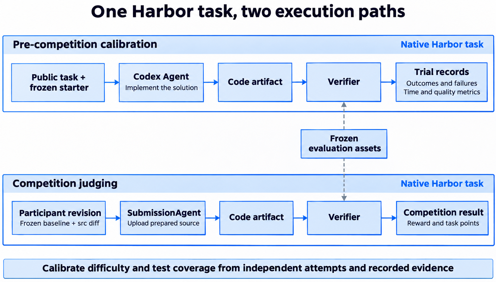
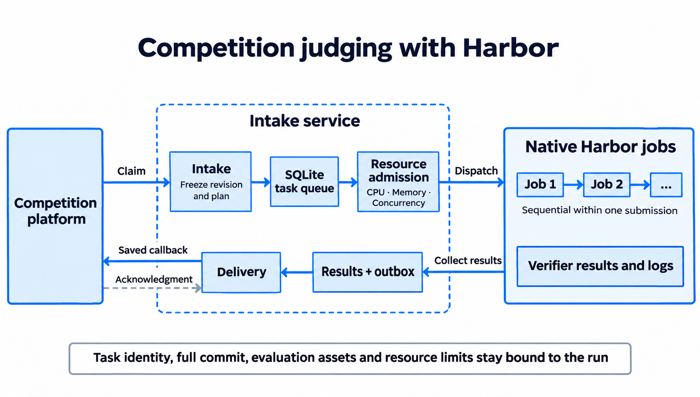
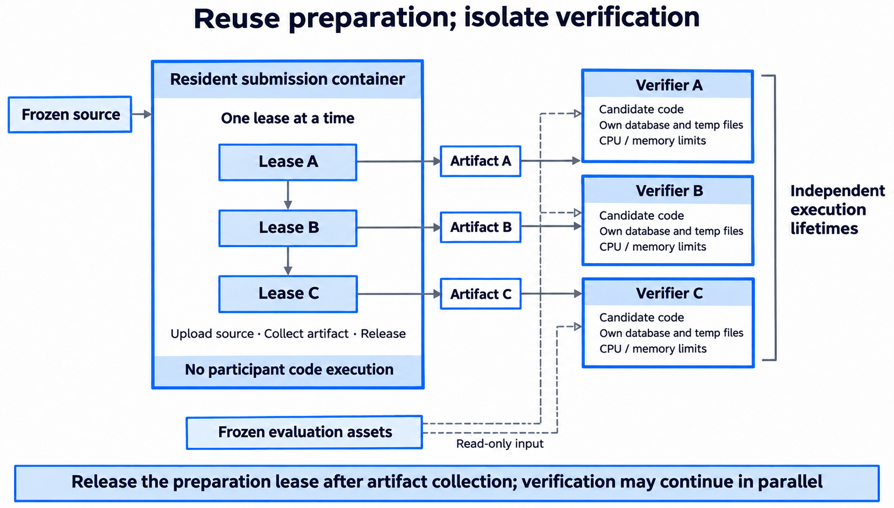
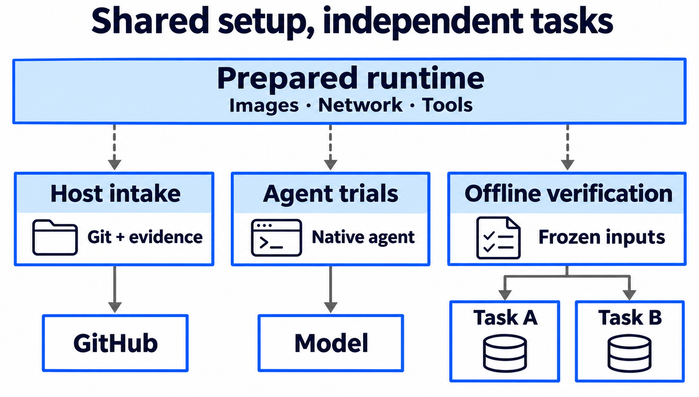
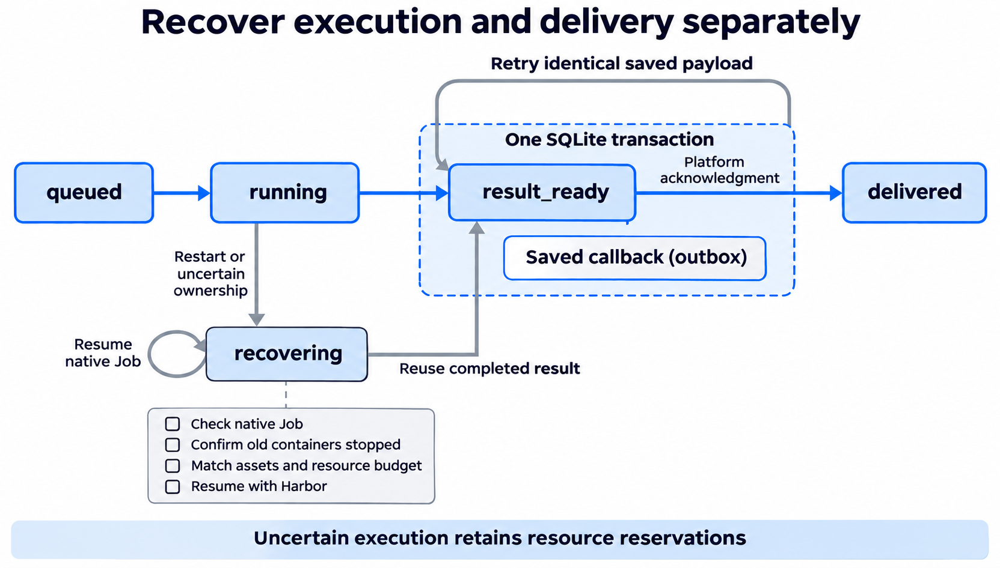

During the first three days of the [sixth OceanBase Database Competition](https://open.oceanbase.com/competition), PowerContext's judging service handled more than 4,000 judging runs. The PowerContext problem set consists of 11 challenges worth 240 points, covering data ingestion, memory state, retrieval, and context construction.

We built this judging service specifically for the competition, using [Harbor](https://harborframework.com/) to manage execution environments, run tests, and save results. Before the competition, we had agents attempt the challenges independently to assess their difficulty and find gaps in the tests. During the competition, we check participant code against the same acceptance criteria.

## From requirements to acceptance tests

We first freeze the PowerContext version used by the product challenges, giving all submissions and later regrades the same product baseline. Participants work from this version to implement the required behavior. For example, the [CSV ingestion challenge](https://github.com/oceanbase/powercontext/blob/2026-competition/competition/challenges/source-01-table-evidence/instruction.md) requires record identity to survive persistence and a process restart, so citations can still resolve to the original records. The [hybrid search challenge](https://github.com/oceanbase/powercontext/blob/2026-competition/competition/challenges/retrieval-02-hybrid-search/instruction.md) asks participants to reduce database queries while preserving filtering behavior, citation identity, and retrieval quality. Each statement specifies the behavior and passing conditions, which the tests check through public interfaces. Participants choose the algorithms and internal data structures.

Each challenge follows [Harbor's task structure](https://docs.harborframework.com/tasks/overview): `task.toml` configures the environment and time limit, `instruction.md` describes the requirements, and a test entry point invokes the acceptance checks. Challenges with performance requirements must pass the mandatory functional groups before running benchmarks. The final result goes into Harbor's native `reward.txt`. This task definition is shared by trial attempts, competition judging, and regrades.

For local development, we extracted the public self-tests into the [competition/ directory on the 2026-competition branch](https://github.com/oceanbase/powercontext/tree/2026-competition/competition). The branch retains the frozen product baseline, while `competition/` supplies statements, public examples, behavior tests, and fixed runtime dependencies. Participants implement the functionality in the product's `src/`, then check their code with commands such as `make -C competition test-csv`. The tests load source directly from the selected product directory, so they need no connection to the judging service, model API keys, or platform tokens. Participants who cannot conveniently configure local dependencies can use the included offline Docker self-test environment.

The public tests cover a subset of inputs and behavior. Formal judging uses held-out tests and data to check additional inputs, boundary cases, and the quality, cost, and performance requirements in the statement. Both follow the same specification; the held-out tests introduce no hidden requirements, but passing the public tests does not establish that an implementation passes every acceptance check. Local self-test results are not reported as competition scores.

## Checking the tasks and tests with agent attempts

Authors know the reference solution and can unconsciously fill in conditions they have never put into the statement. We first check the tests against the reference implementation, starter code, and deliberately incorrect implementations, confirming that the reference passes, the starter fails, and the tests catch the targeted defects. We then have an agent solve the challenge independently using only the public materials. Its attempt shows where it struggles, how it interprets the requirements, and whether it takes an approach the author had not considered.

Harbor already [integrates agents such as Codex](https://docs.harborframework.com/agents/pre-integrated-agents), so we use its native Codex Agent for the product challenges. Every attempt starts from the same clean baseline. We supply only the public statement and permitted materials, with no reference solution, and carry no changes over from earlier attempts. We record the model, reasoning setting, time limit, and container resources for each run. After the agent finishes, an independent Verifier evaluates the source artifact it left behind. We save test-group outcomes, quality and cost measurements, and the agent trajectory together so we can compare them when investigating a failure.

*Figure 1: Codex Agent writes an implementation during calibration; SubmissionAgent loads participant code during formal judging. In both cases, an independent Verifier evaluates the source artifact.*

We ran three independent attempts for each challenge. Some implementations of the financial-report PDF task passed the parsing checks but fell short of the recall requirement for evidence-page retrieval. On hybrid search, we also saw implementations that met the SQL-count and latency limits while reducing retrieval quality for individual queries.

The automatic-processing task exposed a gap in the tests themselves. It requires background work to start when the number of new source entries reaches a threshold, but some implementations only woke processing after ordinary capture. When the final entry arrived through another valid write path, the count reached the threshold and the background work never started. The statement already covered this requirement; the early tests had missed that ordering of writes. After adding the checks, we used Harbor's [regrading support](https://docs.harborframework.com/jobs/regrade) to evaluate the saved original artifacts against the expanded tests. This checks the same implementation without asking the agent to solve the task again, so it does not count as another independent attempt.

These attempts help us find problems, but three per challenge are too few to estimate a stable pass probability or infer how long a human developer would need. We also distinguish functional or quality failures from attempts left unfinished at the time limit and confirmed model or infrastructure faults, rather than treating every unsuccessful run as a failure to solve the challenge.

## Freezing the code for each submission

During formal judging, `SubmissionAgent` only uploads the prepared participant source. A Verifier runs the acceptance checks and assigns the score. Each platform submission corresponds to one task ID, under which the 11 challenges run sequentially; different submissions can run concurrently. A completed acceptance run is a valid result whether its reward is 0 or 1. The service then calculates the competition score using the point value of each challenge.

Participants can update their branches while a submission is queued. If the intake service saved only the branch name, the code eventually judged could differ from the accepted submission, and the service could struggle to recover the original version after a restart. We therefore retain the platform's revision constraints, resolve the actual branch and full commit before executing code challenges, and save them in the evaluation plan. A preparation hook uses this revision to extract the `src/` diff against the frozen product baseline, checks that the changed paths are permitted, and applies the patch to a clean baseline. The organizer supplies dependencies and test assets separately. Scoring conditions are fixed in the evaluation plan and cannot be changed by files in the participant's repository.

The repository-preparation task also checks the official fork relationship or whether any branch retains the frozen baseline's history. Because this information can change with the repository, trusted intake collects and saves the GitHub metadata for an offline verifier to inspect. Later reviews use that saved evidence as well. If the requested revision does not exist, the collection service is unavailable, or saved evidence is corrupt, the service records the specific cause and retains the original revision constraints for investigation.

*Figure 2: Intake fixes the submission revision and evaluation plan, Harbor executes the challenges, and intake aggregates and returns the scores.*

## Reusing preparation containers and isolating code execution

The same source code must be evaluated against several challenges. Starting a submission container for each one repeats the cost of container startup and source transfer, which is particularly noticeable when the tests themselves are short. We keep one resident submission container for this preparation work, leasing it exclusively to one Harbor task at a time. Inside it, the task uploads prepared source and collects artifacts without executing participant code. As soon as collection finishes, the task releases the lease so another submission can begin preparation, while a separate Verifier container executes the collected source.

Reusing a container means explicitly dealing with what the previous task left behind. Every task removes old source and logs when its lease begins. If a cancelled transfer or failed subprocess leaves an unfinished marker, we restart the container before the next lease to stop any transfer that may still be running. The Verifiers that execute code each have their own source, database, and temporary directories, with CPU and memory limits set by the evaluation plan. Platform tokens, repository credentials, and intake configuration remain on the host.

*Figure 3: Artifact preparation leases the resident container serially and releases it when finished. Verifiers for different submissions can run concurrently within the resource budget.*

The scheduler accounts for the resident container once. Each running or recovering Verifier, however, needs its own concurrency slot, CPU, and memory reservation. Since challenges within a submission run sequentially, a submission uses at most one Verifier at a time. Intake uses this resource budget to limit both platform claims and local prefetch. When capacity is exhausted, tasks remain in the platform queue, avoiding a long local wait that would consume their platform leases.

Performance tests also need protection from other tasks. Without dedicated CPU sets, a performance Job waits for other Jobs to exit and then runs exclusively, with ordinary Jobs barred from starting during that interval. If ordinary and performance Jobs have disjoint CPU sets, both types can run at once; each performance Job then leases nonoverlapping CPUs according to its quota. We hold the isolation lock only for the current challenge and release it when that challenge finishes. Locking the whole submission would let its ordinary functional challenges block other submissions and prolong the wait unnecessarily.

These constraints also affect capacity estimates. Submissions that finish every check occupy resources for a different length of time from those that fail early, and the resident preparation container, CPUs available for performance tests, or memory may become a bottleneck before concurrency slots do. Submissions also tend to arrive in bursts. An hourly average calculated from several days of judging runs cannot explain queues at peak times; that requires execution durations and waiting times for each resource.

## Preparing shared dependencies before judging

Containers can share the runtime dependencies prepared ahead of judging. We build the fixed dependencies into a shared image and check the local image, Harbor runtime, Docker, and Git before starting the service. Evaluations then use that image without repeating the build or dependency installation. Database libraries are fixed in the image as well, but each evaluation has its own temporary database directory. Tests use the native runtime to check writes, reads, and state after reopening.

Network access is needed at different stages: the host fetches repositories and collects GitHub evidence, while agents need model access during trial solving. We configure networking for each because a service process may not inherit an interactive shell's proxy settings, and a host loopback proxy is not directly reachable from a container. Repository credentials stay on the host, and the native agent adapter supplies model authentication temporarily. During PowerContext's deterministic acceptance checks, the Verifier runs entirely offline, reading only the prepared source and evaluation assets.

*Figure 4: Dashed arrows indicate shared runtime preparation; solid arrows show access or execution within each stage. Offline verification does not access repositories or models, and each task owns its data.*

If a stage lacks its required image, network route, or authentication, the run has not met the agreed conditions and cannot establish a defect in the participant's implementation. We retain the failure cause and original submission revision so we can examine the same code after repairing the environment. Functional, quality, or performance failures obtained under the specified conditions still count toward the task result.

## Where to continue after a restart

When the service restarts, a submission may have completed several challenges while the current challenge still has a container running. A score-delivery timeout creates a different uncertainty: the platform may already have received the score, but intake has not received an acknowledgment. Restarting the evaluation from scratch in either case would repeat work, consume additional resources, and risk producing a different result for the same submission.

The service uses periodic scheduling to claim tasks, coordinate execution, and deliver scores, while a database stores task progress and results. Concurrency checks and state changes use short transactions; slow Git, HTTP, and Harbor operations run outside them to avoid holding transactions open. After a restart, the service recreates its periodic schedules and compares database records with native Harbor Job state to determine which work is complete and what remains to be done.

Execution recovery starts by checking Job identity, completion state, exceptions, and reward. If the result is complete, the service reuses it. An unfinished Job can continue through native Harbor resume only after the service confirms that old containers have stopped, evaluation assets match the original plan, and sufficient resources are available. Recovery must also account for execution that outlives the intake process: native subprocesses inherit execution locks, and the service checks container termination before releasing resources. Until those checks are complete, the task stays in `recovering` and its reserved resources remain unavailable to other tasks.

Once judging finishes, a single database transaction saves the terminal result and callback request and marks the task as awaiting delivery. The request's content is fixed when it enters the outbox. A separate delivery process sends it and marks it delivered only after the platform acknowledges receipt (ACK). After a network timeout, the service can therefore resend the saved request without executing participant code again.

Automatic delivery stops if the platform explicitly rejects the request or the retry limit is reached. The service retains the record for investigation; it does not alter scores to get a request accepted. If too many results are waiting for acknowledgment, intake pauses new claims while those undelivered scores are addressed.

*Figure 5: Execution recovery checks existing Jobs and containers. After a score-delivery timeout, the service resends the original request saved in the outbox.*

Keeping the material needed for recovery also means managing growing storage use. Under each task ID, we archive the source patch against the frozen baseline, its digests, and the source audit. Reapplying that patch to the shared baseline and checking the digests restores the source that was judged, without accessing the participant's repository again. We reclaim full worktrees, Git caches, and repeated per-challenge source only after score delivery is acknowledged, the retention interval has elapsed, and execution is confirmed to have stopped. Native Harbor results, verifier logs, frozen plans, and delivery records remain available for later review.

## Conclusion

Harbor executes each challenge, while our competition integration layer handles resource scheduling, recovery, and score delivery. By freezing the product baseline and saving each submission's exact revision, acceptance conditions, and results, we can revisit problems found during trial solving using the original artifacts. The same records also let formal judging continue after a service restart.

Some tasks are difficult to score with fixed assertions. For these, an agent could run the subject in a container, collect evidence, and use it to make a judgment. This would require pilot reviews to establish judging principles and a scoring baseline, along with preservation of the original inputs and evidence for later reevaluation. Harbor's execution and record keeping would still apply, but the scoring method would need to be designed for those tasks.
