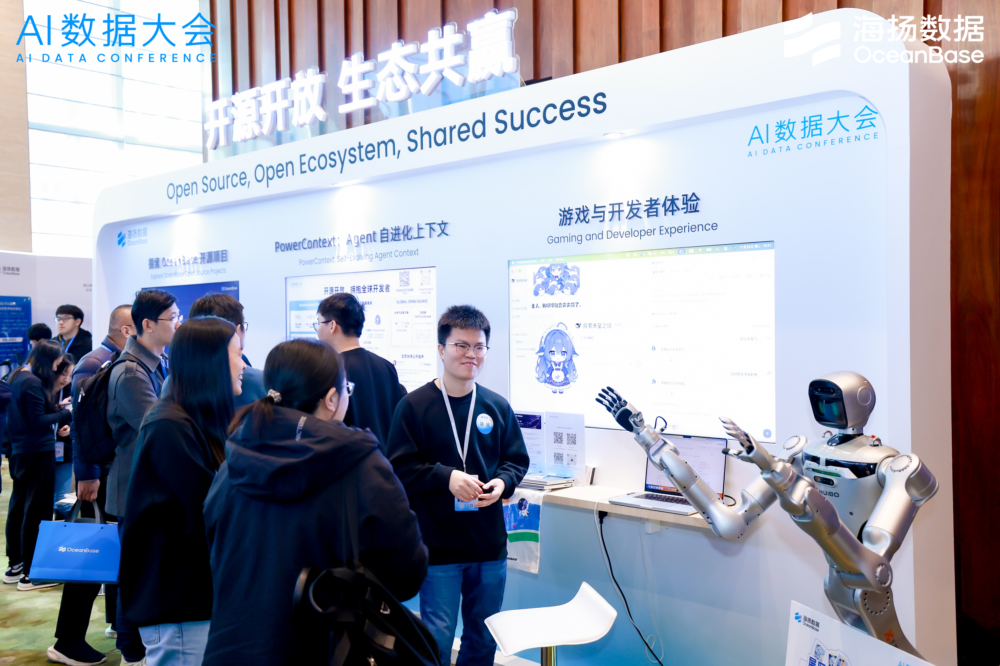
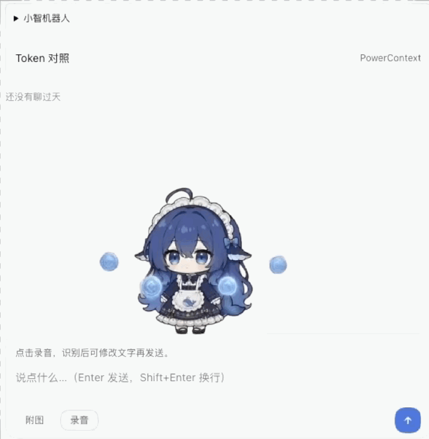
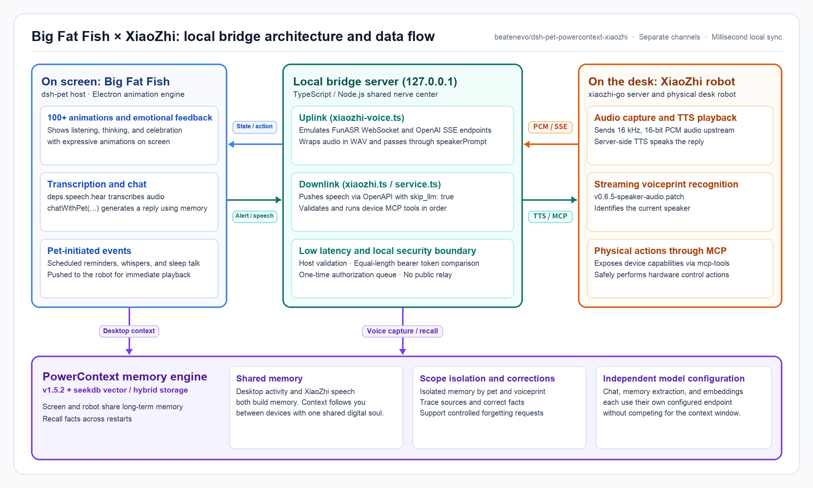
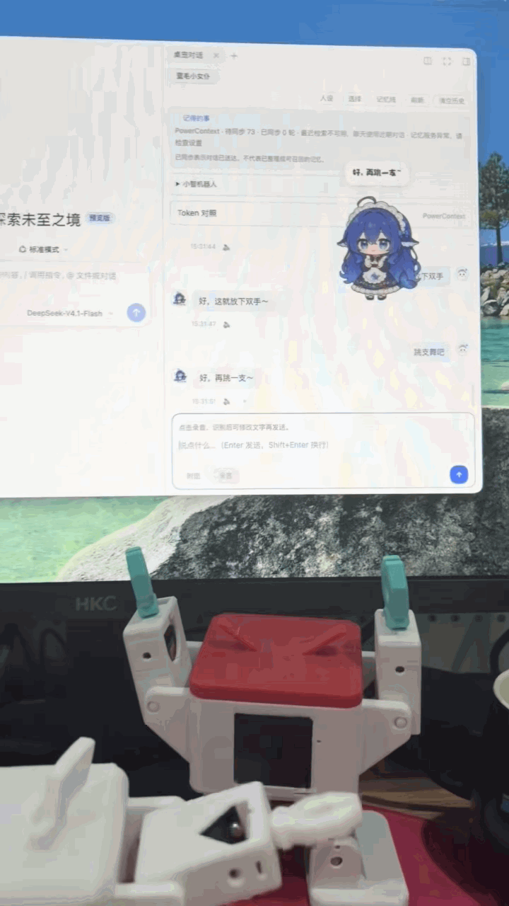

# When Big Fat Fish Got a Body

> Bridging the desktop pet's “last mile” by letting Big Fat Fish speak through a robot on the desk

There's a customizable pet you can interact with anytime on your screen and a robot you can talk to anytime at the corner of your desk. **Neither is particularly new on its own these days.**

What made me decide to connect them was the open-source booth at the AI Data Conference on November 24. At the booth that day, **Jingshun** brought along the Big Fat Fish desktop pet equipped with PowerContext long-term memory and connected it to a robot for an interactive demo.

*At the AI Data Conference*

After seeing Big Fat Fish on the screen work together with the hardware on the desk, I went home and kept thinking about one question. **If they shared a single “soul,” could they become a desktop pet in the truest sense?** That led me to try adapting Big Fat Fish to XiaoZhi, a small robot people can put on their own desks.

Imagine studying or writing code at your computer while Big Fat Fish remembers what you talked about yesterday. Turn to XiaoZhi beside you and it can pick up the conversation without asking you to introduce yourself again. It can even recognize from your voice whether it's you or your child standing at the desk.

I built this integration on the open-source project [ob-labs/dsh-pet-powercontext](https://github.com/ob-labs/dsh-pet-powercontext) and released it as [beatenevo/dsh-pet-powercontext-xiaozhi](https://github.com/beatenevo/dsh-pet-powercontext-xiaozhi). I want to look at the project from two angles. First, I'll explain **how a local server acts as a shared “nerve center” connecting a virtual pet and a physical robot**. Then I'll share some thoughts on **AI × education, the evolution of physical prototypes, and companionship**.

## 1. Giving the Desktop Pet a Memory with PowerContext

Before connecting Big Fat Fish to a physical desk, we need to solve an old problem. Many desktop pets get boring after a couple of days because they have no memory. Every restart feels like meeting them for the first time. For more on this, see the earlier article “How to Raise Big Fat Fish Faster, Better, and for Less.”

The upstream repository [ob-labs/dsh-pet-powercontext](https://github.com/ob-labs/dsh-pet-powercontext) is a desktop pet plugin for **DeepSeek Harness (DSH)**. It can also run independently, and its desktop animations use Electron. It supports more than 100 animated interactions, including clicking, dragging, and throwing, as well as per-pet personalities, voice (TTS/ASR), reminders, and “whispers.”

More importantly, it integrates **PowerContext (1.5.2)** with **seekdb**, a local vector and hybrid store.

* **Independent model configuration.** The main chat model, memory extraction (Generation), and vectorization (Embedding) can each be configured independently, so they do not compete for context.

* **Long-term memory across sessions.** It can recall facts across restarts and beyond long conversation windows. Different pets have separate memory scopes, and the system supports tracing memories back to their sources, correcting facts, and forgetting.

With PowerContext, Big Fat Fish becomes a “digital companion” that can accumulate shared experiences. Yet its world is still confined behind the glass of the monitor.

## 2. The Implementation Using a Local Server as a Shared Nerve Center

To connect Big Fat Fish and XiaoZhi with low latency, I kept the robot's firmware protocol in [beatenevo/dsh-pet-powercontext-xiaozhi](https://github.com/beatenevo/dsh-pet-powercontext-xiaozhi). A **lightweight local relay server with separate channels in each direction** acts as a “nerve center” between the pet host (`dsh-pet`) and the self-hosted XiaoZhi Go server (`xiaozhi-go`), connecting the virtual desktop to the physical device.

### 1. Architecture and Data Flow

### 2. How the Integration Works

* **Shared memory through PowerContext.** Whether you interact with the pet on your computer or speak directly to XiaoZhi at your desk, all conversation streams and event context converge in the same PowerContext memory pool. XiaoZhi knows what you did at your computer, and Big Fat Fish remembers what you just discussed with XiaoZhi.

* **Protocol emulation and two-way routing on the local server.** In [xiaozhi-voice.ts](https://www.google.com/search?q=https://github.com/beatenevo/dsh-pet-powercontext-xiaozhi/blob/master/dsh-pet/src/host/robot/xiaozhi-voice.ts), I use `startXiaozhiVoiceBridge` to start a TypeScript / Node.js HTTP and WebSocket service on the host at `127.0.0.1`. It listens for and forwards events from both sides.

  * **Hardware triggers the screen through uplink chat and state synchronization.** The local server provides both a **FunASR WebSocket offline recognition endpoint** and an **OpenAI Chat Completions endpoint** for `xiaozhi-go`, with support for standard JSON and streaming SSE via `text/event-stream`. XiaoZhi sends `16000Hz` 16-bit mono PCM audio, up to 60 seconds at a time. The local server wraps it in a 44-byte RIFF/WAVE header and passes it to the pet's `deps.speech.hear` for transcription. It then passes the text to `chatWithPet(...)`, which generates a reply using PowerContext memory, and XiaoZhi speaks the reply through TTS. XiaoZhi's listening, thinking, and replying states also drive corresponding animations on Big Fat Fish in real time.

  * **The screen triggers the hardware through downlink speech and device control.** [xiaozhi.ts](https://www.google.com/search?q=https://github.com/beatenevo/dsh-pet-powercontext-xiaozhi/blob/master/dsh-pet/src/host/robot/xiaozhi.ts) and [service.ts](https://www.google.com/search?q=https://github.com/beatenevo/dsh-pet-powercontext-xiaozhi/blob/master/dsh-pet/src/host/robot/service.ts) connect to the `xiaozhi-go` device OpenAPI, and [routes/robot.ts](https://www.google.com/search?q=https://github.com/beatenevo/dsh-pet-powercontext-xiaozhi/blob/master/dsh-pet/src/host/routes/robot.ts) exposes the control routes. When Big Fat Fish sends a scheduled reminder, talks in its sleep, or has something to whisper, `POST devices/inject-message` tells XiaoZhi to read the original text aloud by explicitly setting `skip_llm: true` and `mode: 'notify'`. The pet can also use `GET devices/<deviceId>/mcp-tools` and `POST devices/<deviceId>/mcp-call` to discover and invoke device MCP tools, with strict JSON Schema validation through `AjvJsonSchemaValidator`.

* **Passing through voiceprint recognition so the pet knows who's speaking.** When parents and children share the computer and robot, memory alone isn't enough. In [patches/xiaozhi-go/v0.6.5-speaker-audio.patch](https://www.google.com/search?q=https://github.com/beatenevo/dsh-pet-powercontext-xiaozhi/blob/master/patches/xiaozhi-go/v0.6.5-speaker-audio.patch), I fixed streaming voiceprint recognition and the trimming of the first audio segment in `asr.go` in `xiaozhi-go` v0.6.5. The local server's `readSpeakerPrompt` extracts the voiceprint identity from the system prompt and passes it to `chatWithPet`, so Big Fat Fish can naturally switch to the tone and memory context for the speaker.

* **Low latency at the edge and local privacy.** The local bridge server binds only to the loopback address `127.0.0.1`, strictly checks `Host: 127.0.0.1:<port>`, compares bearer tokens of equal length, and limits concurrent WebSocket connections (`< 4`). Physical device actions use **one-time authorization and a serial queue**, with no automatic retries and authorization cleared when the host restarts. In [index.ts](https://www.google.com/search?q=https://github.com/beatenevo/dsh-pet-powercontext-xiaozhi/blob/master/dsh-pet/src/host/index.ts), `ctx.effect` manages graceful startup and shutdown. The two sides synchronize state within milliseconds, and desktop interaction context requires no roundabout relay through the public internet, keeping interactions smooth and preserving the local privacy boundary.

> The repository README and the [XiaoZhi integration guide](https://www.google.com/search?q=https://github.com/beatenevo/dsh-pet-powercontext-xiaozhi/blob/master/docs/en/guides/xiaozhi.md) cover startup configuration and interfaces. Developers are welcome to clone the repository and try it out.

*Big Fat Fish and XiaoZhi dance in sync*
## 3. AI × Education and Learning Beyond the Glass

Getting the technology to work was only the first step. What makes the project meaningful to me is what it might make possible in **AI × education**.

When we talk about embodied AI, we often picture expensive humanoid robots. For an ordinary desk, a digital counterpart on screen and voice hardware off screen offer a simple, accessible form of embodiment. More children and students now use computers and AI tools in their everyday learning, but current AI education products often feel disconnected in two ways. **They either feel like cold tools for looking up and solving questions, with little emotional connection, or keep children glued to the screen with interactions that take effort and make distraction easy.**

Once the screen and the physical desk are connected, there's a new way to learn through play.

* **Positive feedback through multiple senses.** Learning often goes against our instincts, and immediate positive feedback matters especially for young people. With the two sides working together, XiaoZhi can answer questions in natural language, practice spoken English, or help set the pace of a study session. Big Fat Fish becomes a study buddy on screen, celebrating when a child gets an answer right or completes a focus task and keeping them company visually. **Visual expressions and voice interaction** make learning much more fun.

* **Effortless interaction that lets students stay in the flow of learning.** When students come across something they don't understand, they can leave their notes or code on screen and ask XiaoZhi a question as naturally as they would ask a classmate beside them. There's no need to open a browser and type a long prompt. The pet on screen responds with a look and a movement. **AI goes from software that demands deliberate interaction to a study companion quietly sitting beside you.**

### What's Next? A Physical Prototype of the Virtual Pet Itself

Take the AI × education idea a step further. For now, Big Fat Fish still borrows the “mouth” of a generic box-shaped XiaoZhi robot. **Now that the memory engine, voiceprint recognition, local relay server, and MCP action protocol all work together, could we build a physical prototype specifically for Big Fat Fish or another virtual pet?**

From an engineering perspective, the path is already clear.

* **Give the same software a physical shell.** With open-source voice hardware and 3D printing, we could replace the generic box with a three-dimensional Big Fat Fish, complete with a microphone array, a speaker, a small screen for expressions, and perhaps micro servos to make it nod or flick its tail. The local server's MCP channel could map on-screen interactions directly to physical movements on the desk.

* **Give every custom character a way to step off the screen.** The architecture can work with any character. Big Fat Fish, a cartoon companion a child designed, or a school subject mascot can all have a digital counterpart on screen and a physical figure on the desk by connecting to the same PowerContext memory pool and local bridge protocol. It can sit with you while you do homework or look things up on the computer. Turn the computer off and it's still there in the corner of the desk, remembering the words you memorized last week and the problems you solved.

It's hard for a cold “AI tool” to give a child a lasting sense of belonging. A study companion they can see, touch, and even help design can turn the everyday grind of studying into something that feels like warm companionship.

## 4. A Final Thought on Real Companionship

> **No matter how smart the pet on the screen or how lifelike the robot in the corner of the desk, neither compares to real companionship between people.**

AI desktop pets and robots can be fun, but at heart they use deterministic code and probabilistic models to take a few everyday chores off our hands and brighten the time we spend studying or working. If this little tool can save parents some effort answering repetitive questions or give children a little more ease and curiosity when they're alone at a computer, it has done its job.

The rest of that time is for the people you can see when you look up, for listening to someone properly, or for going out for a walk together.

If you're also interested in desktop pets, hardware robots, and long-term memory, take a look at the repository, open an issue, or join in and build something.

* Integration repository [beatenevo/dsh-pet-powercontext-xiaozhi](https://github.com/beatenevo/dsh-pet-powercontext-xiaozhi)

* Upstream projects [ob-labs/dsh-pet-powercontext](https://github.com/ob-labs/dsh-pet-powercontext),    [oceanbase/powercontext](https://github.com/oceanbase/powercontext), [PC2005-cloud/dsh-pet](https://github.com/PC2005-cloud/dsh-pet)
