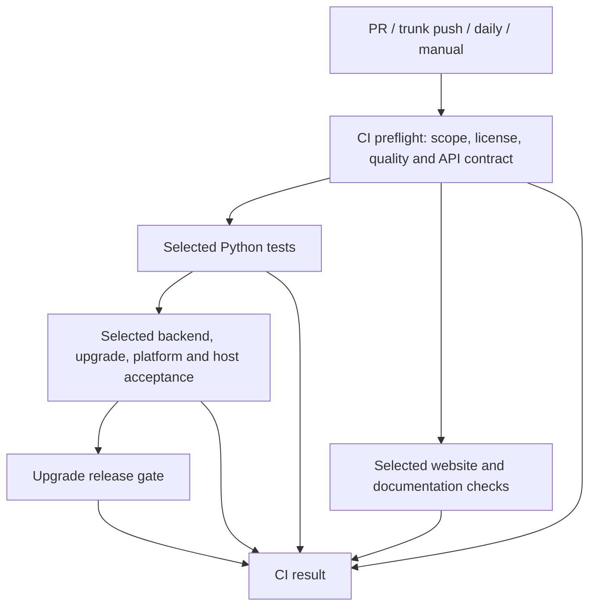

# GitHub CI design and operation

CI must validate affected behavior while controlling duplicate work, wasted work and bursts of runner demand. The upstream trunk branch is `master`, and automatic trunk validation listens only to that branch. Workflow policy, path ownership and required outcomes are reviewed with code. Release acceptance remains independent.

## Entry points and admission

Ordinary PRs targeting `master` and pushes to `master` start only `Main`. Its `CI preflight` job checks out the repository once and runs scope selection, license validation, quality checks and API-contract validation as separate steps on one runner. It then calls existing reusable workflows with the complete change scope. Called workflows reuse this selection without allocating another detector runner; directly invoked manual workflows retain their own scope detection. The Desktop `codex/desktop-preview` branch and workflow-specific manual diagnostics retain independent entry points.



Preflight failure prevents downstream tests and heavy work from starting. Python-test failure prevents dependent backend, upgrade, platform and host acceptance from expanding. Website and documentation checks can run alongside Python tests after preflight succeeds. Skipping downstream work never turns the original failure green. Grouping the four preflight checks in one job removes two runner allocations per ordinary validation run and avoids a separate runner wait between license and quality checks; each check retains its own step result and logs.

Draft PRs allocate no automatic CI runners. Marking a PR ready validates its complete diff; conversion back to draft cancels the old run. Only the latest automatic run survives for each PR. Schedule, push and manual entry points use separate concurrency groups so diagnostics do not cancel trunk or daily validation. These groups replace obsolete work for the same change; they are not cross-PR resource queues.

## Validation profiles

| Entry point or input | Python validation | Other acceptance |
| --- | --- | --- |
| Ordinary ready PR | 3.11/3.14 unit tests and 3.12 E2E: 3 combinations | Complete selected backend, upgrade, installation-role, platform and host acceptance |
| PR changes dependencies, shared fixtures, CI policy or unclassified files | 3.11–3.14 × unit/E2E: 8 combinations | Conservative affected or full selection |
| PR update/reopen already carrying `ci:full` | 8 combinations | Complete PR scope, without forcing unrelated diagnostics |
| `master` push | 8 combinations | Compare with a successful trunk baseline, retaining unverified changes |
| Daily at 20:17 UTC | 8 combinations | Full ordinary acceptance, excluding historical schema generation and lock experiments |
| Manual Main | 8 combinations | Full scope; upgrade selection defaults to `full`, with an explicit diagnostic subset available |
| Published release | Independent installed-package and publication checks | Complete upgrade evidence and validated publication bytes; PR scope cannot bypass acceptance |

Ordinary PR Python combinations drop from eight to three, a 62.5% reduction in combination count. This is not a measured reduction in runner minutes or queue latency. Dependency and CI-policy changes keep the full matrix, so a PR editing CI itself may still run eight combinations.

When packaging is selected, installation validation uses two jobs, one each for Python 3.11 and 3.14. Each job builds its wheel once and verifies five roles: `core` without extras, plus `builtin`, `cli`, `builtin,cli` and `server,cli`. Each role gets its own virtual environment, application state and temporary directory, and runs against the installed wheel with checkout imports excluded. The core role checks public imports without optional dependencies. The CLI role also verifies that adding unrelated SQLAlchemy and FastAPI packages does not enable optional roles. Every role produces a result; any failed role fails its job. All ten Python/role combinations remain covered while eight runner allocations and eight duplicate wheel builds are removed. The job-count reduction does not establish a queue-latency or throughput improvement without measurements.

`ci:full` is read from opened/synchronize/reopened/ready PR events. Adding the label to a running PR does not dispatch another workflow: update the branch or reopen the PR afterward. Manual Main uses the repository ref selected in Actions. For a fork PR, select its branch in the source repository; a successful default-branch run is not evidence for the PR head.

## Ownership and comparison baseline

`.github/ci-paths.toml` declares independent scopes in `[suites]`, shared inputs in `[shared.*]`, and successful Main root jobs required for each selected scope in `[checks]`. A new scope must declare its required terminal jobs.

- PRs compare their merge base to the complete head, covering all commits and excluding unrelated base changes.
- Trunk pushes compare with a successful ancestor from the same Main workflow and branch, examining up to 100 successful pushes. Failed or cancelled commits never become baselines; their unverified changes remain in the next comparison.
- Missing history, unavailable APIs or failed diffs select every scope and the full Python matrix. Unknown paths also fall back conservatively.
- Git supplies the full diff, without native path-filter truncation. Disabled rename detection includes both removed and added paths.
- Runtime, API and root dependencies conservatively cover consumers. Websites and isolated integrations retain their ownership rules. Extended lock observation is manual. Historical schema capture and short lock probes run for their own changed inputs or manual requests, outside ordinary daily validation.

For example, documentation selects website and documentation-contract checks; Cindy changes select Python regression and Cindy-package checks; migrations and shared runtime changes retain relevant real-database and upgrade acceptance. A smaller PR Python matrix does not replace selected real backends with simulations.

Helm charts select deployment-contract checks. Managed resource producers select the Windows x86-64, macOS arm64 and macOS x86-64 candidate builds through Main, after quality and any selected Python tests succeed. Their native build matrix has no independent PR trigger. Shared runtime and dependency changes retain these candidate builds; unrelated website or Desktop UI changes do not start them. Candidate artifacts remain unqualified until the separate resource qualification process accepts them.

Shared helpers select their actual consumers: the clean-migration runner also selects managed-startup and upgrade acceptance; the pnpm cache action also selects the Python test setup and Cindy package. A path filter must follow dependencies, not only directory names.

## Parallelism and cancellation budgets

| Matrix | Maximum parallel jobs per run | Failure behavior |
| --- | --- | --- |
| Python tests | 3 | Stop remaining combinations after the first failure |
| Isolated installations, one job per Python version | 2 | Attempt every role within a job; a failed job cancels the other Python job if still running |
| Installed-release upgrades | 3 | Preserve all cases and complete evidence collection |
| OceanBase clean-migration shards | 2 | Preserve all shards and completeness checks |
| Candidate replay | 2 | Preserve every backend result |
| Historical schema capture | 2 | Preserve every configuration result |
| Managed resource candidates | 2 | Preserve all three native targets |

`max-parallel` bounds one matrix run, not the repository or organization. Do not place unrelated PRs in a normal concurrency group as a global semaphore: the default group retains only one pending run and replaces other waiting work. Release publication must not share a cancellable PR group.

A concurrency cap does not remove work and can lengthen one PR's completion time. Queue reduction comes from skipping unrelated scopes, eliminating duplicate entries, grouping short checks on one runner, reusing installation builds, using the smaller PR compatibility matrix and cancelling superseded runs. Runtime and CI-policy changes still require broad acceptance, so their completion time remains sensitive to organization capacity.

Organization capacity should provide separate pools: reserve capacity for basic checks and Python tests, isolate database/upgrade workloads in a heavy pool, and budget Windows/macOS separately. GitHub larger-runner groups or appropriately isolated ephemeral runners can provide these pools. Create and verify actual group names and capacity before changing `runs-on`; nonexistent labels would only queue indefinitely. Account for other repositories sharing organization capacity.

These rollout tasks require organization administration. Workflow code does not change paid plans, budgets, runner groups or organization concurrency:

1. Inspect organization Settings → Actions → Runners for active jobs, total/OS limits and other repositories' usage. Check billing, budgets and service availability as well.
2. Create and qualify runner groups before migrating workflows. A starting allocation of roughly 20% basic checks, 40% ordinary tests and 40% heavy acceptance can be evaluated against measured minutes; it is not a capacity configuration already applied by this change.
3. After merging and validating the workflows, require the stable `CI result` check while preserving existing review requirements. The quality job's displayed check name is `CI preflight`; license and scope validation are its steps, rather than separate status checks. Replace required-check rules that still name the old quality, license or scope checks. Reusable workflow check names acquire Main caller prefixes, so external status-check rules must be reconciled.

See GitHub's [concurrency semantics](https://docs.github.com/en/actions/how-tos/write-workflows/choose-when-workflows-run/control-workflow-concurrency) and [organization job and capacity monitoring](https://docs.github.com/en/actions/how-tos/manage-runners/github-hosted-runners/view-current-jobs).

## Terminal gates

`CI result` depends on every Main root job. Any failure or cancellation blocks it. Root jobs required by selected scopes must succeed: unexpected skipping or missing results also block. Only explicitly unrelated jobs may skip.

`Upgrade release gate` accepts skipped acceptance only after successful preflight explicitly excludes upgrades. Selected acceptance must succeed. Cancelled runs allocate no new summary-gate runners; necessary in-job cleanup and diagnostics retain `always()`. Publication still checks the complete upgrade matrix and evidence files independently of path selection.

The upgrade evidence collector runs after ordinary case failures so missing or failed evidence cannot pass; it stops on workflow cancellation. Harness acceptance explicitly checks successful validation with a cancellation-aware condition, so skipping the redundant child scope detector cannot silently skip its SQLite/OceanBase matrix.

## Clearing an existing backlog

Inspect jobs, rather than treating a workflow awaiting its final summary as an entirely unstarted matrix:

```sh
python3 scripts/ci_queue_report.py --repo oceanbase/powercontext \
  --max-runs 40 --output /data/codex-tmp/ci-queue.json
```

This bounded read-only report records sample coverage and actual job states. It never cancels, retries or changes a run. `workflow_age_minutes` is the workflow's age, not an individual job's queue latency. Incomplete or failed queries are not evidence of zero backlog.

Operational sequence:

1. Compare queued work with current PR heads and state. Remove only obsolete runs for closed PRs or superseded heads. Preserve current-head checks, latest trunk verification, daily full verification and releases. Updated concurrency policy does not establish that historical runs have already been cleared.
2. For summary jobs remaining after cancellation, confirm the parent run and current PR head before removing the old run. The new cancellation predicates prevent recurrence.
3. If jobs queue while no actual jobs run, investigate organization capacity, budgets and runner availability first. A smaller matrix cannot substitute for capacity troubleshooting.
4. Rerun only failures supported by evidence of nondeterminism. Fix deterministic assertions, contract drift and incompatible database schemas first. Retain failure logs and real-backend evidence; do not add unbounded automatic retries.

Observe at least one full working day and one daily full validation after rollout. Track ready-PR to basic-check completion, selected jobs' queue p50/p95, actual runner minutes, consumed minutes of cancelled jobs, OS usage and failure/rerun rate. Suggested targets are basic-check p95 under five minutes and ordinary PR test-start queue p95 under ten minutes. These require capacity and runtime measurements; they are not guarantees from a code change.

To roll back coverage policy, restore the full PR matrix while retaining orchestration, scope selection and cancellation fixes. Never simultaneously enable automatic child triggers and Main calls, which would duplicate executions.

## Validation

```sh
uv run pytest -q tests/test_ci_changes.py tests/test_ci_pipeline.py \
  tests/test_upgrade_release_gate.py tests/test_workflow_actions.py tests/test_e2e_workflow_contract.py
uv run python scripts/check_workflow_actions.py .github/workflows .github/actions
actionlint -shellcheck= -pyflakes=
```

Local checks use real Git histories, simulated Actions metadata and executable terminal-gate scripts. They validate selection, budgets and outcome contracts, not the GitHub scheduler, native operating systems or real-database acceptance. Measure throughput improvement after deployment.
