# Desktop interface

This document describes the target screens, state changes, and interaction rules for the Desktop
design dated 2026-11-19. The screenshots come from the current Tauri Desktop development preview in
Simplified Chinese and use frontend mock data. Mock data is for design review only. It does not mean
the corresponding backend capability is connected. The English interface uses the same layout, with
labels localized for that language.

Visual tokens, component states, and shared interaction rules live in `desktop/DESIGN.md`. This
document specifies what each page shows for a given data state.

## 1. Design goals

- Help the user understand the current context, “service → space → Agent → memory”, before acting.
- When nothing is connected, answer only “what to do next”. Do not show business content that cannot be used.
- After a connection exists, keep one page structure and let the data show an empty state, a list, details, or management actions.
- Local and remote services share the same information hierarchy and show only the management actions each one actually has.
- Use one compact, stable desktop layout. Do not keep a separate page implementation for each mock scenario.

## 2. Scope

| Connection | Module | Design state |
| --- | --- | --- |
| Disconnected | Home, Memories, Services & Agents | Guide the user to install a local service or connect an existing one |
| Connected | Home | Space with no Agent and no data; space with Agents and data |
| Connected | Memories | Empty list, populated list, side detail, expanded detail |
| Connected | Services & Agents | Local service, remote service, service actions, Agent actions, startup guidance, model configuration |
| Shared | Settings, check for updates, status refresh | Desktop preferences, native update dialogs, service and Agent status polling |

## 3. Disconnected: what to do next

### 3.1 Home

Home asks whether a usable service already exists and offers two mutually exclusive entries:

1. **Install on this computer**: start the local installation flow. The Chinese UI labels this entry “没有服务”.
2. **Connect an existing service**: connect a remote service or a service already running on this computer. The Chinese UI labels this entry “已有服务”.

Hide the service and space context in the top bar so the page does not show an empty menu or an internal concept. Keep the main content centered. The user does not need to learn implementation terms such as Server or Scope first.

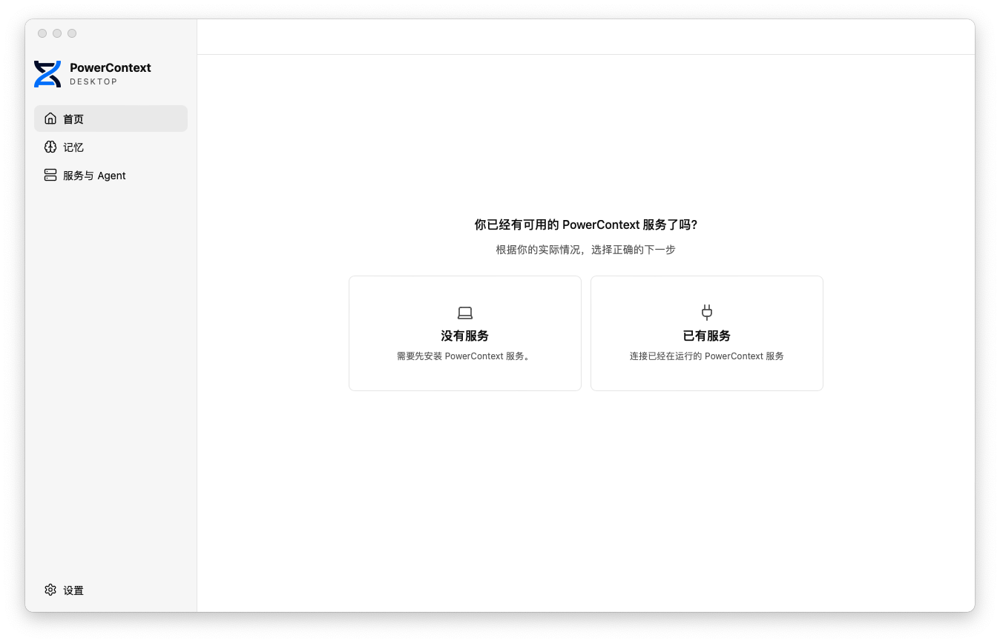

### 3.2 Memories

Memories cannot be read or written while disconnected. The Memories page uses the same connection gate: it says no memory space is accessible yet and offers “Install service” and “Connect service”. It does not show search, filters, an empty result list, or the record-memory entry. After the user connects a service and enters the default space, the page becomes the Memories workspace.

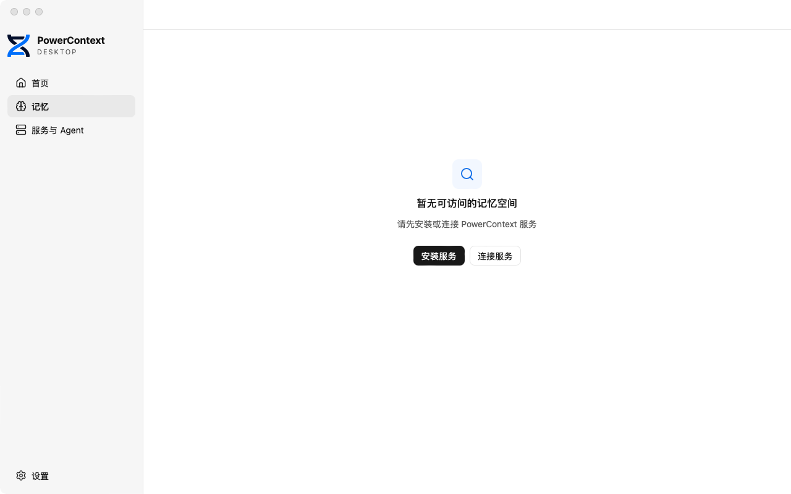

### 3.3 Services and Agents

While disconnected, this module owns installation and connection. The page says no service or Agent is available and offers “Install service” and “Connect service”. The flows themselves stay inside their dialogs. Do not add an intermediate page:

- Local path: explain the install location and startup behavior. After completion, create the default space and return to Home.
- Existing-service path: collect the service address and authentication details. After the check succeeds, activate the connection and enter the default space.
- Progress and failure stay inside the dialog that started the operation.

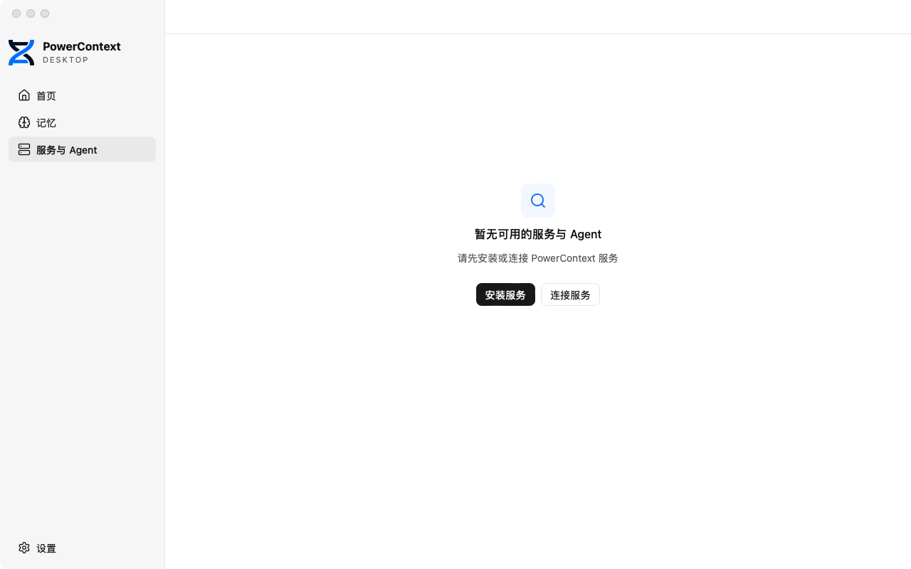

## 4. Connected: Home

### 4.1 Space with no Agent and no data

The top of Home shows the current service and space. The content first explains that this space has no local Agent yet and offers the primary action. The memory overview on the right shows a real zero. The usage area explains that the period has no activity. Do not invent a trend.

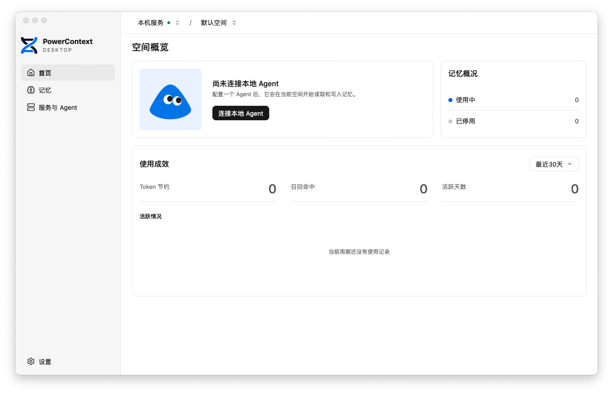

### 4.2 Space with Agents and data

When the space has bound Agents and memory data, Home becomes an overview:

- The Agent list shows the name, connection status, project, last write time, and a management entry.
- The memory overview separates in-use and inactive counts.
- Usage shows token reduction, recall hits, active days, and activity for the selected period.
- Changing the period changes only the usage statistics. It does not change the current service or space.

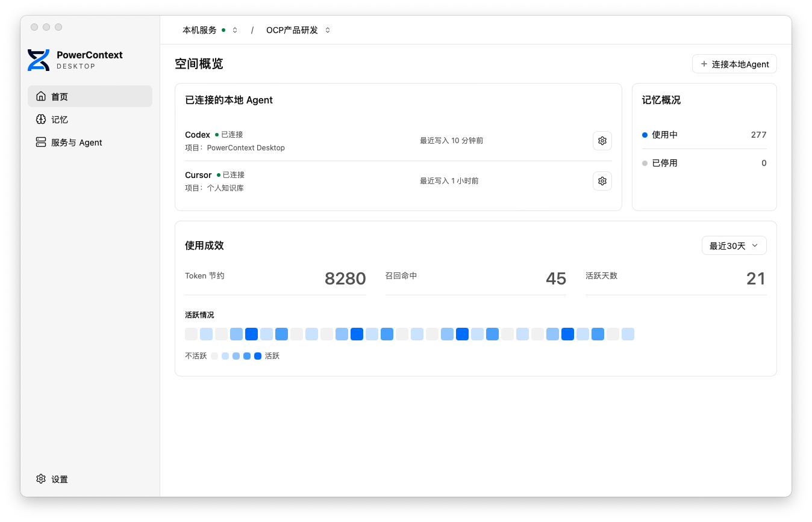

## 5. Connected: Memories

### 5.1 List and filters

Memories is a list. Search, status, source, sort, and record-memory stay fixed at the top. A row shows only the summary, recall count, and last-used time needed to choose an item. Do not stack detail tags in the list.

- Search locates specific content.
- Status distinguishes “In use” and “Inactive”.
- Source distinguishes manual entry and automatic extraction.
- Sort supports recently created, recently used, and recall count.
- When nothing matches, keep the same page structure and show an empty result for the current filters.

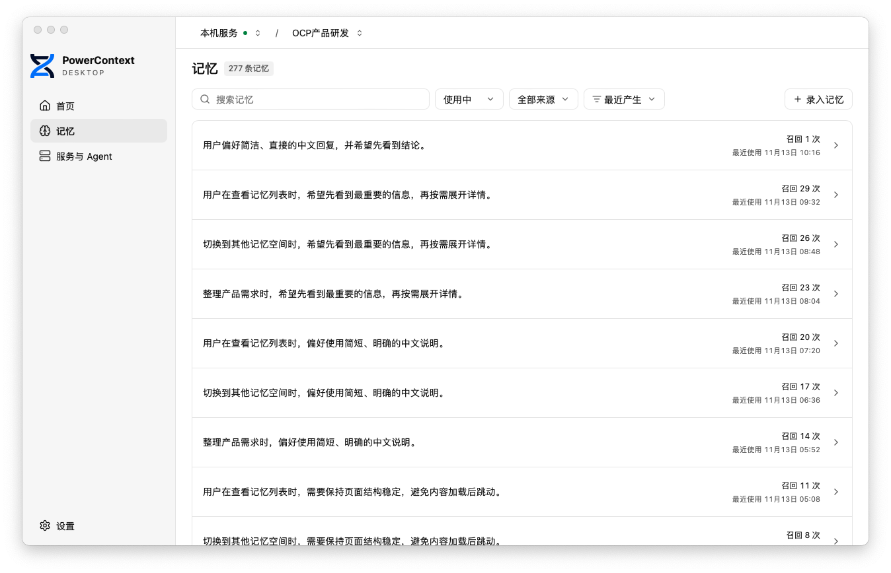

### 5.2 Side detail

Selecting a row opens a detail panel on the right and keeps the list on the left, so the user can move through items. The panel shows the memory content, source excerpts, and basic status. `Esc` or the close button returns to the list and restores focus to the original row.

If the active connection no longer verifies its identity, clear the old memory list and details. When a save has an uncertain outcome, keep the submitted text and original service and space in a read-only recovery view for the current window. The user confirms a check of that target before sending the same text again. Display the space ID in both the picker and the save confirmation so spaces with the same name are distinguishable.

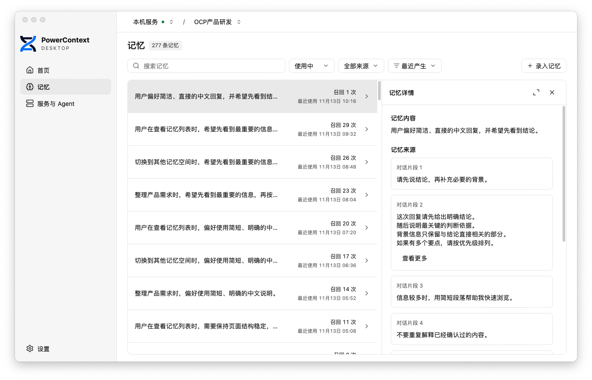

### 5.3 Expanded detail

When there are many sources or the content is long, the detail can expand. The expanded body is for reading the content and sources. The right side gathers status, source, created time, last used, and recall count, and offers enable or disable. The top supports previous, next, and returning to the side panel.

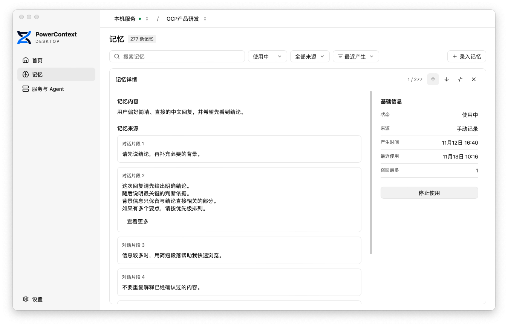

## 6. Connected: Services and Agents

### 6.1 Local service

The local service region has four layers:

1. **Service information**: type, running status, address, and more actions.
2. **Local Agents**: only Agents associated with this service. The user can connect one, change its binding, change capture, or delete the connection.
3. **Start automatically**: a local-service capability. It does not appear for a remote service.
4. **Model configuration**: separate status for the generation model and the embedding model.

More actions include edit connection, check status, start, stop, restart, and uninstall. A dangerous action requires a second confirmation.

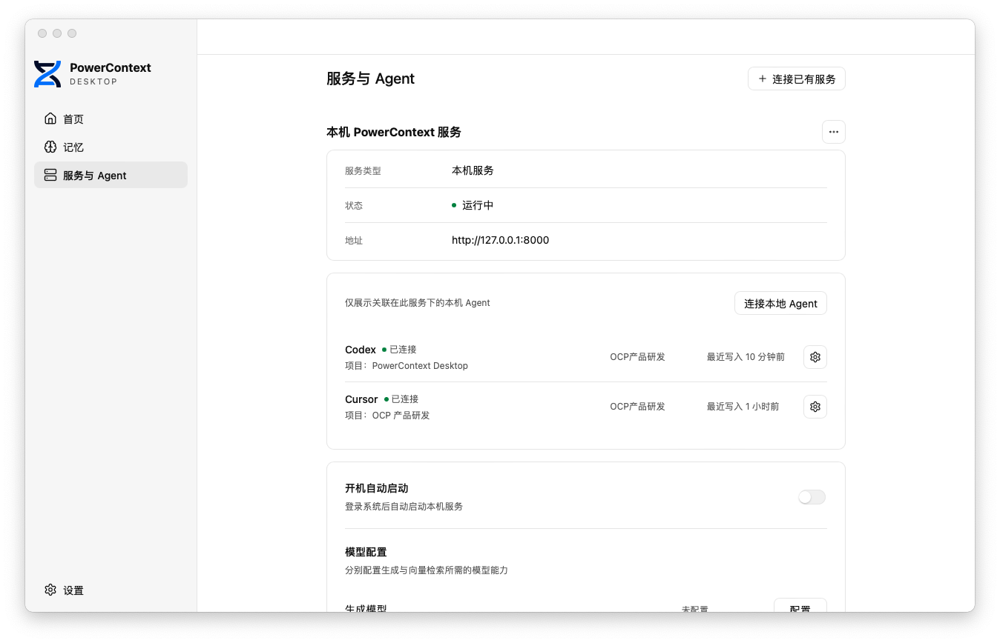

### 6.2 Model configuration

Model configuration has two paths:

- **Agent assistance**: choose the target Agent and copy a prompt that does not contain an API key. After the Agent finishes, Desktop checks the result.
- **Manual configuration**: enter the service address and API key, check connectivity, choose a model, and save.

The API key stays in Desktop secure storage. It does not enter the prompt, chat content, or an ordinary receipt. A failed check uses a semantic Alert and keeps what the user already entered.

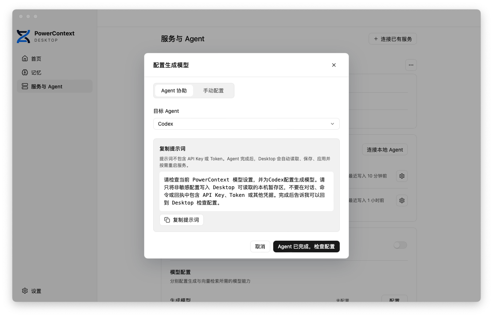

### 6.3 Remote service

The remote-service region keeps the address, connection status, more actions, and Agent association. It does not offer process control or start-on-login. When no Agent is associated, show an empty state and keep “Connect local Agent”.

If this computer has no local service, the local region separately shows its empty state and install entry. Installation, process control, and start-on-login belong to the local service. They are not part of the remote service's own information.

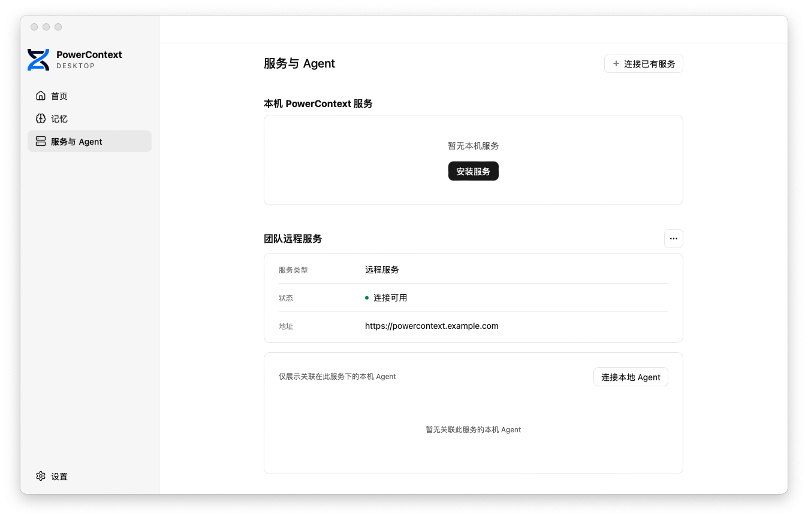

## 7. Settings

Settings holds Desktop preferences only. It does not mix in service or space configuration:

- Language: Simplified Chinese / English.
- Appearance: System / Light / Dark.
- System notifications: service failures, Agent failures, and version updates.
- Open Desktop at login: opens Desktop only. It does not start the PowerContext service.
- Help and about: Usage help and Report an issue.

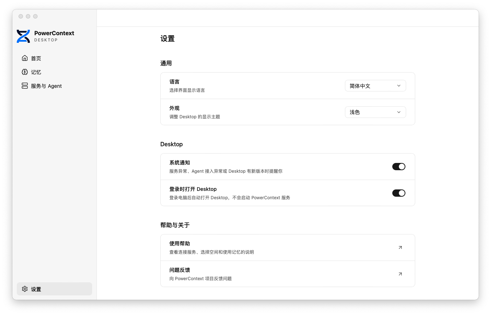

## 8. Other interactions

### 8.1 Check for updates

- Add “Check for Updates” to the platform's application menu.
- macOS and Windows use their own native update dialogs and system behavior.
- Checking, already up to date, update available, and check failed each need their own feedback.
- The current debug build does not include Sparkle.framework, so a debug preview screenshot is not acceptance evidence for the release update flow.

### 8.2 Service and Agent status refresh

- Desktop polls service and Agent status on an interval and refreshes when the application becomes focused again.
- Normal, checking, and failed states use a small dot beside the name. A failure uses the red status and does not switch to another page.
- A failed poll must not clear the last successful data. Keep the content and mark the status as failed.
- Connection and validation progress inside a dialog stays in that dialog. It does not rewrite page-level state.

## 9. Mock data

| Scenario | Example data | Purpose |
| --- | --- | --- |
| Disconnected | No connection profile and no active context | Verify the install and existing-service entries |
| Default space | Local service, default space, 0 memories, no Agent | Verify the connected empty state |
| OCP Product Development | 277 memories, Codex and Cursor, 30-day usage | Verify Home, the list, and details with data |
| Remote only | Team remote service, OCP Product Development, no local service | Verify that a remote service is managed on its own |

Every example name, address, time, and count is design mock data. The product renders these states from one data model. Do not create a separate business page for a mock scenario.

## 10. Acceptance checks

- Moving between disconnected and connected changes data state only. It does not return to an older page.
- After a service or space change, Home, Memories, and Services use the same context.
- Memory details open on the right by default. Expanding is the second reading mode of that detail.
- A local service and a remote service do not show actions that do not belong to them.
- Light and dark themes keep the same information structure. Status colors and illustration backgrounds use the theme tokens.
- Dialog titles are left-aligned. Fields, buttons, Alerts, and focus follow `desktop/DESIGN.md`.
- Keyboard access covers navigation, menus, filters, closing details, and dialogs. Screenshots do not replace keyboard or screen-reader acceptance.

## Implementation boundary

This is a design and interaction description. The current mocks can show the interface completely. Memory listing, Agent management, model configuration, local service control, system notifications, and launch-at-login still need their formal interfaces or Tauri implementations. Accepting the screens does not accept those interfaces or the host behavior.

Native connection management supports checking, editing, and removing saved local and remote connections. A connection check verifies reachability, identity, and compatibility. Readiness requires a separate probe. Service installation, Agent management, model configuration, service lifecycle, system notifications, and launch-at-login are unavailable in the corresponding native UI until wired to their owning interfaces.

After a temporary outage, **Retry read** on Home verifies the original service identity and reopens the same space before loading statistics. To activate a saved service from its action menu, choose **Use this connection** to check it and enter its default space. **Check connection status** leaves the current service and space selection unchanged.
When changing the address of a Bearer connection, enter the credential for the new address. Desktop keeps the credential's existing storage mode.
