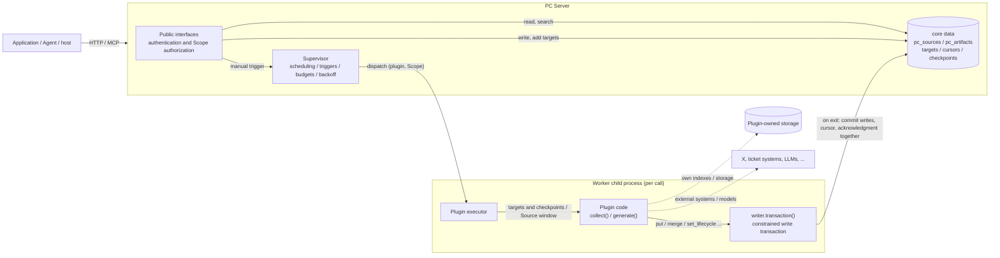

- Proposal Name: `plugin_interfaces`
- Start Date: 2026-11-08
- RFC PR: [oceanbase/powercontext#0000](https://github.com/oceanbase/powercontext/pull/0000)

# Summary

This proposal redefines PowerContext's third-party plugin model: each plugin kind implements a few fixed interfaces,
and PC Server calls them when needed. Plugins are callees that only turn inputs into results; they take no part in
scheduling, state management, or persistence protocols.

- **Source plugins** provide Source definitions (reusing the existing `SourceDefinition` / `SourceProjection`) and may
  implement `collect`. For writes, Server calls the definitions to validate, transform, and save. Collection works on
  **collection targets**, such as "one account on X"; hosts can add, disable, and re-enable targets at runtime without a
  restart. The Supervisor dispatches a Worker on schedule to call `collect`, and core commits the returned Sources and
  each target's checkpoint in one transaction.
- **Artifact plugins** implement `generate`. The Supervisor dispatches a Worker on a configured schedule, when new
  Sources arrive, or on a manual request; the Worker reads that Scope's unconsumed Source window and passes it to
  `generate` together with a **writer** (`ArtifactWriter`). The plugin does slow work such as model calls outside the
  writer, then performs Artifact writes inside an `async with writer.transaction()` block: core opens a transaction when
  the block starts, writes in the block act directly on core data and immediately return real revisions, and when the
  block ends normally core commits those writes, the consumption cursor, and the completion acknowledgment together. An
  exception in the block rolls everything back. Plugins can neither read nor change the cursor.
- Core manages only two kinds of core data, `pc_sources` and `pc_artifacts` (with heads, lineage, merge records,
  lifecycle, handles, and tags), and their consumption progress. Plugins may keep their own indexes and storage, which
  they manage and keep consistent themselves. Applications read and search plugin families through the existing public
  Artifact interfaces, and the read path runs no plugin code.
- `collect` and `generate` run in Worker child processes managed by the Supervisor, reusing its existing process
  isolation, timeouts, concurrency budgets, leadership lease, and failure backoff. Users deploy only one Server.
- Plugins load from a directory at Server startup; code or manifest changes require a restart. Server stores no plugin
  enabled state, registration generation, or management phase, and offers no enable / disable / reload / unload
  management interface.

This proposal replaces the plugin contracts and management mechanisms of the
[Source plugin framework RFC #2012](2012-source-plugin-system.md) and the
[Artifact plugin framework RFC #2175](2175-artifact-plugin-system.md). Neither implementation has shipped as a stable
interface, so this proposal keeps no compatibility: old plugin manifests, management interfaces, the management
service, and plugin-management tables are removed, and custom Artifact data written by old Artifact plugins is not
migrated.

This document describes the target design, not availability in mainline or a released version. Interface names and
code examples illustrate the contract; final syntax ships with the implementation.

# Motivation

Both existing plugin frameworks make PowerContext carry substantial lifecycle management for third-party plugins:

| Framework | Work Server carries for plugins |
| --- | --- |
| Artifact plugins (#2175) | `desired_state`, `phase`, `binding_generation`, and `last_error` in `pc_artifact_processing_binding_states`; seven management states and their transitions; `enable-all / reload / enable / disable / unload` management interfaces with `expected_generation` concurrency checks; registration-generation fencing of old Worker commits; content schemas and index definitions frozen in `pc_artifact_family_schemas`, with changes returning 409; framework-owned building, rebuilding, and availability of custom declarative indexes |
| Source plugins (#2012) | A separate plugin management service with its own SQLite (instances, capabilities, targets, desired state, submission records); one Runtime process per plugin instance; a poll / reply channel and capability-catalog synchronization between management and Server; the `source load` deployment command; MCP tools to enable and disable instances |

Everyone pays for these mechanisms:

- **Plugin authors** must understand bindings, generations, schema-freezing rules, index declarations, and the
  management channel before they can write a plugin.
- **Deployers** run several processes, maintain two databases, and use management APIs before a plugin can run.
- **Maintainers** keep state machines, concurrency fencing, schema and index governance, and recovery paths for
  third-party code; that code and its test surface already exceed the plugins' business logic.

A plugin needs to be called at the right time, receive the input it needs, and hand results back to core. Scheduling,
isolation, consumption progress, and transactional commits are capabilities core already has; the Supervisor provides
them to built-in Artifacts today. Plugin models such as Dify's show that a host defining interfaces and invocation
timing, with plugins only implementing interfaces, is enough for a large ecosystem of third-party extensions.

Goals:

1. Plugin authors implement a few interfaces without learning scheduling, cursor, and commit protocols.
2. Plugin code runs in isolated Worker processes; plugin failures do not affect Server or other plugins.
3. Plugin results go into `pc_sources` / `pc_artifacts` and commit atomically with consumption progress, so existing
   read interfaces work.
4. Core manages only these two kinds of core data and their consumption progress; content structure, indexes, and other
   storage belong to plugins.
5. Plugin writes to core data go only through a core-provided writer that covers every generic Artifact write operation
   and reuses core's existing validation rules.
6. Artifact generation can run on a configured schedule or be triggered by new Sources or manual requests; collection
   targets can be added and removed at runtime.
7. Users deploy only one Server; plugins load when Server starts.

# Guide-level explanation

## 1. Core idea



| Responsibility | Owner |
| --- | --- |
| Authentication, Scope authorization, public HTTP / MCP interfaces, collection target management | Server |
| When to call: scheduling, trigger coalescing, Worker budgets, timeouts, backoff, leadership lease | Supervisor (existing) |
| Reading inputs, providing a constrained write transaction, committing core data / cursors / checkpoints / acknowledgments in one transaction | Plugin executor in the Worker (core) |
| Reading external data, identifying and normalizing collection targets, Source definitions and Projection computation | Source plugin |
| Artifact content structure, generation algorithm, plugin-owned indexes and storage and their consistency | Artifact plugin |
| Deploying plugin code, dependencies, and plugin-owned storage | Deployer |

Plugin code does one thing: given input, produce results or raise. Raising is failure; core commits no core data and
retries the same input later.

## 2. Plugin directory and manifest

Server loads plugins from `POWERCONTEXT_SERVER_PLUGINS_DIR`. Each direct child directory is one plugin containing
`plugin.yml` and code:

```text
/opt/powercontext/plugins/
├── x-posts/
│   ├── plugin.yml
│   ├── definition.py
│   └── plugin.py
└── incident-report/
    ├── plugin.yml
    └── plugin.py
```

```yaml
name: incident-report          # Plugin name, unique in the deployment, matches the directory name
kind: artifact                 # source or artifact
entry: ./plugin.py:create      # Factory function; path relative to the plugin directory
scopes: [team-a]               # Optional; omitted means every Scope with matching input
config:                        # Business configuration validated by the plugin's Config model
  title_prefix: Incident report
  index_url: ${REPORT_INDEX_URL}     # ${NAME} resolves from the environment inside the Worker
```

The manifest describes only **what the plugin is and how it runs**, not whether it is enabled. If the directory exists
and loads successfully, the plugin is available; to stop it, move it out of the directory and restart Server. The same
code can be deployed several times through multiple plugin directories with different `name` and `config` values.

## 3. Source plugin example

A Source plugin exports Source definitions. With definitions alone, hosts can submit complete content through the
existing Source write interface (the write use of MCP `pc_source_add`); Server calls the definition's `resolve` and
each Projection, then saves to `pc_sources`.

To collect continuously from an external system, the plugin also implements `collect`. Collection works per
**collection target**: each target is one external resource the plugin can collect, such as one account on X. This
plugin collects new posts from each target account every 5 minutes:

```yaml
name: x-posts
kind: source
entry: ./plugin.py:create
scopes: [team-a]
collect:
  schedule: {interval_seconds: 300}
  max_workers: 1
  timeout_seconds: 120
  max_items: 200
  targets:                      # Optional; initial targets imported on first start
    - {scope_id: team-a, input: {account: "@oceanbase"}}
config:
  bearer_token: ${X_BEARER_TOKEN}
```

```python
from pydantic import BaseModel

from powercontext.plugins import (
    CollectedItem, CollectRequest, CollectResult, PluginContext, TargetIdentity,
)

from .definition import PostCapture, XPostDefinition

definitions = (XPostDefinition(),)


class Config(BaseModel):
    bearer_token: str


class TargetInput(BaseModel):          # Input a host submits when adding a target
    account: str


def identify_target(value: TargetInput) -> TargetIdentity:
    account = value.account.strip().removeprefix("@").lower()
    if not account:
        raise ValueError("account must not be blank")
    return TargetIdentity(key=f"account:{account}", input={"account": account})


class XCollector:
    def __init__(self, client: XClient) -> None:
        self.client = client

    async def collect(self, request: CollectRequest) -> CollectResult:
        result = CollectResult()
        for target in request.targets:
            since = (target.checkpoint or {}).get("since_id")
            page = await self.client.user_posts(target.input["account"], since_id=since)
            result.add(target, [CollectedItem(definition="x-post", value=PostCapture(**p)) for p in page.posts],
                       checkpoint={"since_id": page.newest_id or since})
        return result


async def create(ctx: PluginContext, config: Config) -> XCollector:
    client = await ctx.enter_async_context(XClient(config.bearer_token))
    return XCollector(client)
```

A host adds a target at runtime without a restart:

```text
pc_source_add(scope_id="team-a", capability="x-posts", input={"account": "@PowerContextAI"})
```

Server validates the input with `TargetInput`, calls `identify_target` for a stable target key and normalized input,
saves the target, and immediately requests a collection. Adding the same account again yields the same key and reuses
the existing target; targets can be disabled and re-enabled with progress retained.

Each target's checkpoint is read-only input; the plugin proposes new checkpoints through its return value. Core commits
all Sources returned by one call and each target's new checkpoint in one transaction. If `collect` raises or times out,
nothing is committed and the next call receives the old checkpoints.

## 4. Artifact plugin example

This plugin generates one report per ticket Source. It first looks up a similar existing report in its own vector
index, revises that report on a match and creates a new one otherwise, and writes the report into its own vector index.

```yaml
name: incident-report
kind: artifact
entry: ./plugin.py:create
scopes: [team-a]
generate:
  family: incident-report
  inputs:
    source_types: [example-ticket]
    projection: powercontext.text-evidence@1
    max_sources: 50
  schedule: {interval_seconds: 300}     # Periodic check
  on_sources: true                      # Trigger when new Sources arrive
  manual: true                          # Allow manual triggers
  max_workers: 1
  timeout_seconds: 300                  # Limit for the whole call
  transaction_timeout_seconds: 30       # Limit for the write transaction block
config:
  title_prefix: Incident report
  index_url: ${REPORT_INDEX_URL}
```

```python
from pydantic import BaseModel

from powercontext.plugins import ArtifactWriter, GenerateRequest, PluginContext
from powercontext.sources import TextEvidence


class Config(BaseModel):
    title_prefix: str = "Incident report"
    index_url: str


class IncidentReports:
    def __init__(self, config: Config, index: VectorIndex, model: Summarizer) -> None:
        self.config, self.index, self.model = config, index, model

    async def generate(self, request: GenerateRequest, writer: ArtifactWriter) -> None:
        # 1. Slow work stays outside the write transaction: model calls, vector computation
        planned = []
        for source in request.sources:
            evidence = TextEvidence.model_validate(source.projection)
            summary = await self.model.summarize(evidence.content)
            vector = await self.model.embed(summary)
            planned.append((source, summary, vector))

        # 2. Short write transaction: reads in the block see what the block has written
        async with writer.transaction() as tx:
            for source, summary, vector in planned:
                match = await self.index.nearest(request.scope_id, vector, threshold=0.92)
                current = await tx.get(match.artifact_id) if match else None
                artifact_id = current.ref.artifact_id if current else writer.stable_id(
                    "report", source.ref.source_type, source.ref.source_id)
                ref = await tx.put(
                    artifact_id,
                    content={"title": self.config.title_prefix, "summary": summary},
                    search_text=summary,
                    source_refs=[source.ref],
                )
                # With the real artifact_id and revision in hand, upsert into the plugin's own index by ID
                await self.index.upsert(request.scope_id, ref.artifact_id, ref.revision, vector)
        # The block ended normally: core commits the Artifact writes, the cursor advance, and the acknowledgment


async def create(ctx: PluginContext, config: Config) -> IncidentReports:
    index = await ctx.enter_async_context(VectorIndex.connect(config.index_url))
    return IncidentReports(config, index, Summarizer())
```

When the block raises, core rolls back all Artifact writes in the block, the cursor stays put, and the same window is
retried later. The plugin's own index is not part of core's transaction: the plugin upserts by stable ID so a retry
overwrites entries left by the previous attempt, and reads from its own index defer to core's current revision (see
reference-level section 1.6).

Applications access plugin families through the existing public Artifact interfaces, which read `pc_artifacts`
directly and run no plugin code:

| Purpose | Interface |
| --- | --- |
| Browse | `GET /v1/scopes/{scope_id}/artifacts/{family}` |
| Current content | `GET /v1/scopes/{scope_id}/artifacts/{family}/{artifact_id}` |
| Exact revision / revision history | `GET .../{artifact_id}/revisions/{revision}`, `GET .../{artifact_id}/revisions` |
| Tags | `GET .../{artifact_id}/tags` |
| Text search | `POST /v1/scopes/{scope_id}/artifacts/{family}/search` |
| Trigger generation manually | `POST /v1/scopes/{scope_id}/artifacts/{family}/generate` |

## 5. Scheduling and triggers

Plugin scheduling and triggers belong to the existing Artifact processing Supervisor. Each plugin registers at startup
as one Supervisor binding named `plugin:<name>`; the scheduling key remains `(binding, Scope)`.

Artifact generation supports three call origins in any combination; at least one must be configured:

| Configuration | When a Worker is dispatched | `request.reason` |
| --- | --- | --- |
| `schedule: {interval_seconds: N}` or `schedule: {cron: "0 2 * * *", timezone: Asia/Shanghai}` | When due, for Scopes with pending work | `schedule` |
| `on_sources: true` | The Scope's Source journal is ahead of the plugin's cursor | `sources` |
| `manual: true` | The manual trigger interface is called | `manual` |

- For plugins with `inputs`, every call carries that Scope's unconsumed Source window; when the window is empty,
  scheduled and Source-triggered calls skip the plugin and acknowledge completion directly.
- Plugins without `inputs` (for example, a daily cleanup of existing Artifacts) consume no Sources, are called when
  due, and must configure `scopes` explicitly.
- Manual triggers always call the plugin and may carry `params`, which the plugin interprets. A manual request is
  persisted on acceptance and returns `202 Accepted`; it still runs after a Server restart.

Source plugin `collect` supports `schedule` and `manual`
(`POST /v1/scopes/{scope_id}/sources/plugins/{name}/collect`); adding or re-enabling a target also requests a collection.

At most one Worker runs at a time for the same plugin and Scope. The Supervisor coalesces triggers that arrive during a
call into one call after it finishes.

## 6. Operations

- Startup: Server checks plugin directories one by one. A plugin that fails its check (invalid manifest, import
  failure, missing required exports, family or Source type conflicting with a built-in or another plugin) affects only
  itself; Server and other plugins start normally.
- Inspection: `GET /v1/plugins` (requires `server.admin`) lists each plugin's check result, kind, family or Source
  definitions, schedule configuration, and per-Scope latest call outcome and next retry time. Collection targets and
  their latest collection outcomes are shown by `pc_source_status` and the target interfaces.
- Changes: after changing code or the manifest, restart Server. Server does not watch files or reload plugins at
  runtime. Collection targets are business data; adding or removing them needs no restart.
- Removal: move the plugin out of the directory and restart. Saved Sources, Artifacts, collection targets, cursors, and
  checkpoints are retained and remain readable; redeploying a plugin with the same name continues from where it stopped.
  The deployer keeps or cleans up plugin-owned storage.

# Reference-level explanation

## 1. Interface contract

The public interfaces live in a new `powercontext.plugins` module, replacing the plugin-author-facing parts of
`powercontext.artifact_plugins` and `powercontext.source_management`. Interfaces are expressed as `typing.Protocol`
and Pydantic models.

### 1.1 Entry module, factory, and context

The entry module exports:

| Export | Required | Notes |
| --- | --- | --- |
| Factory function (named by `entry`) | Yes | `async def create(ctx, config) -> plugin instance` |
| `Config` | No | Pydantic model validating the manifest's `config`; without it, `config` must be empty |
| `definitions` | Source plugins | Sequence of `SourceDefinition` |
| `TargetInput`, `identify_target` | Source plugins with `collect` | Collection target input model and identification function |

```python
class PluginContext:
    name: str                          # Plugin name from the manifest
    scope_id: str                      # Scope of this call
    plugin_dir: Path                   # Plugin directory (read-only by convention)
    logger: logging.Logger             # Logger bound to the plugin name

    async def enter_async_context(self, cm: AbstractAsyncContextManager[T]) -> T: ...
```

- The factory runs once per Worker call; instances are not reused across calls. Resources that need closing (including
  connections to plugin-owned storage) register through `ctx.enter_async_context` and are released by the executor when
  the call ends.
- `${NAME}` environment references resolve inside the Worker before `Config` validation, so credentials never enter
  Supervisor dispatch parameters or logs.
- Plugins get no connection to core's database and no write interface for cursors or checkpoints. There are only two
  paths for writing core data: the return value of a Source plugin's `collect`, and an Artifact plugin's
  `ArtifactWriter`.

### 1.2 Source plugins

```python
class TargetIdentity(BaseModel):
    key: str                          # Stable target key; always the same for the same external resource
    input: dict[str, JsonValue]       # Normalized input keeping every parameter that affects collection

class CollectTarget(BaseModel):
    key: str
    input: dict[str, JsonValue]
    checkpoint: JsonValue | None      # Last successfully committed checkpoint for this target; None the first time; read-only

class CollectRequest(BaseModel):
    scope_id: str
    reason: Literal["schedule", "manual", "target_added"]
    targets: Sequence[CollectTarget]  # Enabled targets to collect in this call
    max_items: int
    params: JsonValue | None = None   # Manual triggers only

class CollectedItem(BaseModel):
    definition: str                   # name of one definition in definitions
    value: BaseModel                  # Instance of that definition's input_class

class CollectResult(BaseModel):
    targets: dict[str, TargetResult] = {}       # Keyed by target key
    def add(self, target: CollectTarget, items: Sequence[CollectedItem], *, checkpoint: JsonValue | None) -> None: ...

class TargetResult(BaseModel):
    items: Sequence[CollectedItem]
    checkpoint: JsonValue | None
    has_more: bool = False

class SourceCollector(Protocol):
    async def collect(self, request: CollectRequest, /) -> CollectResult: ...
```

- Plugins that provide `definitions` without a `collect` configuration support write only. The factory runs only for
  collect calls.
- Source types and Projections in `definitions` register into the existing Source definition manifests at startup;
  conflicts with built-ins or other plugins fail the check.
- **write** needs no plugin method. Server validates input with `definition.input_class`, calls `resolve` to obtain the
  Source, computes each Projection, and saves, with the same semantics as existing built-in Source writes.
- Each **collect** call covers one Scope and carries at most `max_targets` (manifest setting, default 50) enabled
  targets; with more targets, calls rotate by target key, and targets reporting `has_more` go first in the next call.
  The executor applies the same validation, `resolve`, and Projections as write to every returned Source, then saves all
  Sources, writes each target's checkpoint and latest collection time, and acknowledges the call in one transaction. If
  any entry fails, nothing is committed. A total entry count above `max_items` or a target key absent from the request
  is a failure, not truncated.
- Targets absent from the result keep their checkpoints unchanged.
- Source identity is determined by `resolve`. When repeated collection of the same external state yields the same
  identity, existing deduplication rules apply and no duplicate Source is created.

### 1.3 Collection targets

Collection targets are business data stored by core; like Sources, they are not plugin lifecycle state:

| Operation | Interface | Notes |
| --- | --- | --- |
| Add | MCP `pc_source_add` (collect use), `POST /v1/scopes/{scope_id}/sources/plugins/{name}/targets` | Validate input with `TargetInput` and call `identify_target` for the key and normalized input. The same key with the same normalized input returns the existing target; the same key with different input returns a conflict. A new target is saved enabled and a collection is requested |
| Inspect | MCP `pc_source_status`, `GET /v1/scopes/{scope_id}/sources/plugins/{name}/targets` | Target key, normalized input, enabled state, latest successful collection time, latest failure category |
| Disable / re-enable | MCP `pc_source_target_set_enabled`, `PATCH .../targets/{key}` | Disabled targets leave collect requests while their checkpoints and collected Sources are retained; re-enabled targets continue from the old checkpoint |

- Adding and changing targets requires Source write permission on the Scope, and the Scope must be within the plugin's
  `scopes`.
- `identify_target` must be pure: it only validates and normalizes, without contacting external systems or checking
  external authorization. Whether an external resource exists or is readable is determined by the plugin during
  collect and expressed as an exception or empty result. Like write, it runs synchronously in the Server process under
  a timeout.
- The manifest's `collect.targets` are imported once only when their keys do not exist. Afterward core's data is
  authoritative; changing the manifest neither overwrites nor deletes existing targets.

### 1.4 Artifact plugins, the writer, and the write transaction

```python
class ArtifactGenerator(Protocol):
    async def generate(self, request: GenerateRequest, writer: ArtifactWriter, /) -> None: ...

class GenerateRequest(BaseModel):
    scope_id: str
    reason: Literal["schedule", "sources", "manual"]
    sources: Sequence[GenerationSource]   # This window; empty when inputs is not configured
    params: JsonValue | None = None       # Manual triggers only

class GenerationSource(BaseModel):
    ref: SourceRef                        # Exact Source reference
    projection: JsonValue                 # Content of the Projection named by inputs.projection

class ArtifactWriter(ArtifactReads):
    family: str                           # Fixed to the manifest's generate.family

    def stable_id(self, *parts: str) -> str: ...
    def transaction(self) -> AbstractAsyncContextManager[ArtifactTransaction]: ...

class ArtifactTransaction(ArtifactReads):
    ...                                   # Reads (see 1.5) plus write operations (see the table below)
```

`generate` runs in two parts:

- **Outside the transaction**: the plugin reads committed data through `writer` (each read uses its own short read-only
  transaction) and does slow work such as model calls and vector computation.
- **The write transaction block**: `async with writer.transaction() as tx:`. When the block starts, core opens a write
  transaction and rechecks the Supervisor lease and invocation intent. Writes in the block execute directly in that
  transaction and immediately return a real `ArtifactRef` (with revision), and reads in the block see what the block has
  written. When the block ends normally, core CAS-advances the cursor, acknowledges the call, and commits, all in the same
  transaction. If the block raises, exceeds `transaction_timeout_seconds`, or conflicts at commit, the transaction rolls
  back entirely and the call fails.

Rules:

- Each call opens at most one write transaction block; opening a second raises. The cursor and call acknowledgment
  commit only with this one transaction, so a window's core data is never partially committed.
- Returning normally without opening a write transaction block means the window needs no output; the executor commits
  the cursor advance and call acknowledgment on its own.
- After the write transaction block commits, exceptions raised by later code in `generate` no longer affect the
  committed results; the executor records them as post-commit errors and does not retry the window. Plugins should make
  the write transaction block the last step of `generate`.
- The write transaction block's time limit defaults to 30 seconds and counts toward the whole call's `timeout_seconds`.
  The block should contain only reads, write operations, and writes to plugin-owned storage, not model calls.

**Write operations**: the write transaction covers every generic Artifact write operation. Each reuses core's existing
implementation and validation rules and raises immediately on a violation:

| Operation | Reused core implementation | Semantics |
| --- | --- | --- |
| `put(artifact_id, *, content, search_text=None, source_refs=(), artifact_refs=())` | `ArtifactRepository.create` / `revise` | Creates revision 1 when absent; otherwise appends a revision against the current head. When content and `search_text` equal the current revision, it is a no-op returning the current reference |
| `revert(artifact_id, *, to_revision, reason)` | The rollback path of `revise` | Appends a new revision with a historical revision's content, recording `restored_from_revision` and the reason |
| `set_lifecycle(artifact_id, state, *, replacement_artifact_id=None)` | `ArtifactGovernanceRepository.transition` | active ↔ deprecated (optionally naming a replacement), any state → retired (irreversible). Changes the head's governance state without appending a revision; frozen merge inputs cannot change individually |
| `merge(inputs, *, into, content, search_text=None, source_refs=())` | The shared merge method ([RFC #1859](1859_artifact_merge.md)) | Takes the current revisions of `inputs`, creates `into`, records the merge relation, and freezes the inputs. `into` must be a new ID |
| `preview_undo_merge(artifact_id)` / `undo_merge(artifact_id, *, preview=None)` | Preview and restoration of the shared merge method | Undoes the merge that produced the Artifact, restoring inputs and retiring the result; when executing a preview, stale previews are rejected if related state changed |
| `bind_handle(handle_key, ref)` | Artifact handle binding | Binds a stable handle to a given revision |
| `set_tags(artifact_id, tags)` | Artifact tag replacement | Replaces the Artifact's tags entirely |

**Write constraints**:

- Only Artifacts in this Scope and in the manifest's `generate.family` can be touched; plugins cannot name another
  family or Scope.
- `source_refs` may reference only Sources in this window; `artifact_refs`, `to_revision`, and `bind_handle` targets must
  be revisions that actually exist in this family.
- Operation count, single-content size, and total bytes per write transaction block are bounded; exceeding a limit
  raises and rolls back, without truncation or partial commit.
- Core neither validates the business structure of `content` nor stores or freezes a schema. The plugin owns content
  structure evolution and may carry a version field inside `content`.

### 1.5 Reads

`ArtifactWriter` (outside the transaction, committed data only) and `ArtifactTransaction` (inside the transaction, also
seeing what the block has written) offer the same read methods, scoped to this Scope and this family:

```python
class ArtifactReads(Protocol):
    async def get(self, artifact_id: str, *, revision: int | None = None) -> ArtifactSnapshot | None: ...
    async def revisions(self, artifact_id: str, *, cursor: str | None = None, limit: int = 50) -> RevisionPage: ...
    async def list(self, *, states: Collection[LifecycleState] = ("active",), tags: Collection[str] = (),
                   cursor: str | None = None, limit: int = 50) -> ArtifactPage: ...
    async def search(self, query: str, *, states: Collection[LifecycleState] = ("active",),
                     limit: int = 10) -> Sequence[ArtifactSnapshot]: ...
    async def by_source(self, ref: SourceRef, *, cursor: str | None = None, limit: int = 50) -> ArtifactRefPage: ...
    async def lineage(self, ref: ArtifactRef) -> ArtifactLineage: ...
    async def governance(self, artifact_id: str) -> ArtifactGovernance: ...    # Lifecycle, replacement, merge ownership
    async def merge_record(self, artifact_id: str) -> ArtifactMergeRecord | None: ...
    async def tags(self, artifact_id: str) -> ArtifactTagSet: ...
    async def resolve_handle(self, handle_key: str) -> ArtifactRef | None: ...
```

- `get` reads the current content or a given revision; `revisions` lists the full history.
- `list` and `search` can filter by lifecycle state, including deprecated, retired, and frozen merge inputs, to find
  "data that already existed". `search` is core's text search (see section 5); inside the write transaction it finds
  content the block has written but not yet committed.
- `by_source` finds Artifacts whose lineage references a Source, so plugins can locate Artifacts to revise after a
  Source changes.
- Snapshots returned by reads carry exact revisions and can be used directly as `artifact_refs` or `to_revision` in
  write operations.
- When a plugin needs search core does not provide, such as vector similarity, it uses its own index and then defers to
  core's current revision through `get`.

### 1.6 Consistency and idempotency

**Core data**: a window's Artifact writes, cursor advance, and call acknowledgment commit in one transaction. A failure
leaves core data completely unchanged, so retries start clean; after success the cursor has passed the window, so the
same window is never delivered again. Core data is committed exactly once per window. Operations in the write
transaction act directly on the database, and conflicts (for example, a head changed concurrently after being read) are
reported immediately at the operation or at commit, rolling back everything for the Supervisor to reschedule. Plugin
families expose no public write interfaces in the first version, and calls are single-flight per plugin and Scope, so
such conflicts occur only in abnormal cases.

**Reprocessing the same business object**: manual reruns, scheduled cleanups without `inputs`, and similar scenarios
process objects already processed. Plugins derive Artifact IDs from business identity with `writer.stable_id(...)`;
`put` is a no-op for identical content, `set_lifecycle` is a no-op when the target state equals the current one, and
`merge` is a no-op when all inputs are already merged into the same result, so no duplicate Artifacts or meaningless
revisions appear.

**Plugin-owned storage**: plugin indexes and other storage are a different database from core and are outside core's
transaction. Core does not guarantee consistency between them; the plugin does. Recommended practice:

1. Write plugin-owned storage inside the write transaction block, after obtaining the `ArtifactRef`, upserting by
   `artifact_id` (with revision when needed). A failed write to plugin-owned storage then rolls back the core writes too.
2. If the write transaction fails to commit, plugin-owned storage may keep entries from that attempt. The retry
   processes the same window, derives the same stable IDs, and overwrites them.
3. Check results read from plugin-owned storage with `get`, confirming the Artifact exists in core with a matching
   revision; ignore mismatched entries, or periodically rebuild from core data.

`generate` itself may run more than once due to retries, so model calls and external requests issued by the plugin are
not exactly once.

## 2. Plugin executor and consumption cursor

The plugin executor is core code in the Worker that implements the Supervisor Worker entry and replaces the old
`run_artifact_plugin_worker`. One Artifact plugin call proceeds as follows:

```text
Worker receives (plugin:<name>, scope_id, request_generation)
  -> Short transaction: ScopeInvocation.start; load the cursor for (scope_id, plugin:<name>) from pc_source_cursors
     -> read the journal high watermark and fix the window (after, through], through ≤ after + max_sources
     -> read the window with list_window_for_generation, filter by inputs.source_types, compute inputs.projection
  -> Load the plugin, call the factory, create the writer, call generate (under timeout_seconds)
     -> Reads outside the transaction: separate short read-only transactions
     -> Write transaction block starts: open a transaction; guard (lease and invocation intent)
        Writes in the block execute in that transaction
        Block ends: CAS the cursor to through; acknowledge; commit
  -> generate returns without opening a write transaction block: a short transaction performs the cursor CAS and acknowledgment
```

- Sources in the window whose type does not match are filtered out, but the cursor still advances past the whole window;
  a matching Source missing the required Projection fails the call rather than being skipped.
- The cursor advances only in the executor's commit transaction; plugins never receive its value and have no write
  interface for it. The cursor CAS ensures a window commits only once even if leadership changes or duplicate dispatch
  happens between reading the window and committing.
- `on_sources` reuses the existing `SourceProcessingPendingProvider`: when the journal high watermark exceeds the
  cursor, the Scope is marked pending and the Supervisor dispatches within budget. The check uses persisted data, so a
  Server restart loses no pending input.
- Manual triggers and target additions reuse existing invocation intents
  (`ArtifactProcessingIntentRepository.request`): the acceptance transaction advances the requested generation,
  multiple requests coalesce, and requests arriving during a run are handled by a later call.
- Without `scopes`, automatic scheduling applies to every Scope whose journal is ahead of the cursor; with `scopes`,
  both automatic scheduling and manual triggers accept only listed Scopes.

Collect calls have the same structure: the input becomes the Scope's enabled targets and their checkpoints, and the
commit carries Sources and each target's new checkpoint. Collect needs no write transaction block; the executor commits
from the return value at once.

## 3. Loading and lifecycle

```text
Server start
  -> Scan direct children of POWERCONTEXT_SERVER_PLUGINS_DIR (load nothing when unset)
  -> For each directory: parse and validate the manifest (name matches directory, kind matches configuration sections)
     -> In a time-limited check child process, import the entry and confirm the factory, Config, and other required
        exports match the kind, without calling the factory
     -> Source plugins: import definitions, TargetInput, and identify_target in the Server process and register Source types
     -> Import initial collection targets from the manifest that do not exist yet
     -> Register the family access profile; register a Supervisor binding when collect / generate is configured
  -> Any step fails: record the error, mark the plugin failed, continue with the next
Server stop
  -> Stop dispatch and reclaim Workers through the existing Supervisor shutdown
```

A plugin has only two outcomes, `loaded` and `failed`, held in process memory. Server does not persist plugin enabled
state, registration generations, or configuration snapshots; each start rechecks the directory as it is then. Without
hot reload, no registration generation is needed to fence old Workers; the existing Supervisor lease fence already
rejects stale commits after leadership changes.

Workers import plugin code on every call. If a plugin directory changes while Server runs, newly dispatched Workers may
see the new code; deployers should restart Server after changes, and the first version does not detect this case.

## 4. Execution constraints

- **Isolation**: `collect` / `generate` run in Worker child processes started by the Supervisor; crashes, memory leaks,
  and blocking do not affect Server. Child processes isolate ordinary failures but are not a sandbox for untrusted code:
  plugins run with the Worker's operating-system permissions and can access its files, network, and environment.
- **Timeouts and budgets**: `timeout_seconds` (default 300) is the total Worker time limit,
  `transaction_timeout_seconds` (default 30) the write transaction block limit, and `max_workers` (default 1) the
  plugin's concurrency limit across Scopes. These map to existing Supervisor binding parameters or are enforced by the
  executor. Input bytes, write operation count, and output bytes per call are bounded; exceeding a limit fails the call.
- **Lock impact of the write transaction**: while the write transaction block is open, it locks the heads and cursor row
  it touches; on SQLite, a write transaction blocks all other writes to the database. The block must therefore be short,
  and exceeding its limit rolls it back.
- **Failure and backoff**: a failed call commits no core data, and that plugin and Scope enter the Supervisor's existing
  backoff without affecting other Scopes or plugins. Core never skips input automatically after repeated failures;
  persistent failures require fixing the plugin or data and restarting. A target that keeps failing during collect
  blocks the other targets in the same Scope; disable it first.
- **Multi-instance deployments**: with several OceanBase Server instances, dispatch happens only on the instance holding
  the Supervisor leadership lease; writes, target management, and reads may run on any instance. Plugin-owned storage
  must be reachable from instances that run Workers. SQLite deployments have one Server process.

## 5. Public reads and search

Core handles all public reads of plugin families without running plugin code:

- list / get / revisions / tags reuse the existing generic Artifact read path. Plugin family `content` is returned as
  JSON without a schema from `pc_artifact_family_schemas`. Frozen merge inputs and deprecated and retired Artifacts are
  presented under the shared merge and lifecycle rules.
- search is a generic text search core adds for plugin families; like the existing search interface, it accepts only
  text queries. On write, `search_text` passes through existing lexical analysis into `pc_artifact_heads.searchable_text`,
  and search matches on that column, returning only revisions in the requested Scope that the caller may read. Artifacts
  without `search_text` are not searchable. The writer's `search` uses the same implementation. The implementation PR
  specifies the search method on SQLite and OceanBase and validates it at scale.
- Review, Recall, and Prepared Context are not available for plugin families in the first version, nor are the public
  create, revise, merge, lifecycle, handle, and tag write interfaces; writes to plugin families come only from the
  plugin. Those interfaces return an explicit "unsupported" error, and `GET /v1/capabilities` reflects the operations
  actually supported.

## 6. Persistence

| Data | Handling |
| --- | --- |
| `pc_sources`, Projections, the Source journal, `pc_source_definition_manifests` | Kept; results of Source plugins |
| `pc_artifacts`, `pc_artifact_heads`, `pc_artifact_lineage_*`, merge records, handles, tags | Kept; results of Artifact plugins |
| `pc_source_cursors` | Kept; Artifact plugin consumption cursors keyed by `(scope_id, plugin:<name>)` |
| `pc_connector_checkpoints` | Kept; per-target checkpoints keyed by `(scope_id, target binding ID)` |
| `pc_source_collect_targets` | Added; collection targets: Scope, plugin name, target key, normalized input, enabled state, creation and update times, latest successful collection time, latest failure category |
| Supervisor invocation intent, pending, and lease tables | Kept; shared by plugin and built-in bindings |
| Columns added for plugins to `pc_artifact_processing_binding_states` (`plugin_id`, `plugin_family`, `binding_generation`, `desired_state`, `phase`, `last_error`) | Removed |
| `pc_artifact_family_schemas` | Removed |
| Search state and vector index data used by custom-family declarative indexes | Removed; the implementation PR drops the tables after confirming built-in families do not depend on them |
| Artifacts, heads, and lineage written by old Artifact plugins | Deleted, not migrated |
| `pc_source_write_plugins` | Removed; write entries come from the plugin directory at startup |
| The Source plugin management service's SQLite | Removed along with the service |
| Plugin-owned indexes and storage | Not part of core; managed by the plugin and deployer |

A target's binding ID derives deterministically from the plugin name and target key, using a digest when it exceeds the
column width. Additions and removals happen in one new database migration whose notes list the added and dropped
tables, columns, and data ranges.

## 7. Interface changes

| Change | Content |
| --- | --- |
| Removed | `/v1/admin/artifact-plugins` and its subpaths; the Source plugin management service, plugin instance Runtime, and poll / reply channel; the `source load` command; MCP `pc_source_instances`, `pc_source_instance_set_enabled` |
| Removed | Declarative indexes for custom families (`ArtifactSearchDeclaration`, `TextIndex`, and related types), `ArtifactFamily` schema declarations, `ArtifactDraft`, and the old Worker plugin executor |
| Added | `GET /v1/plugins`, `GET /v1/plugins/{name}` (`server.admin`, read-only) |
| Added | `POST /v1/scopes/{scope_id}/artifacts/{family}/generate`, `POST /v1/scopes/{scope_id}/sources/plugins/{name}/collect` (`202 Accepted`) |
| Added | `GET` / `POST /v1/scopes/{scope_id}/sources/plugins/{name}/targets`, `PATCH .../targets/{key}` |
| Changed | Generic Artifact read and search interfaces support plugin families; `GET /v1/capabilities` lists plugin families |
| Changed | The write use of MCP `pc_source_add` uses plugin definitions and its collect use adds collection targets; `pc_source_capabilities` lists plugin Source types and target inputs; `pc_source_status` reports targets and their latest collection outcomes; `pc_source_target_set_enabled` acts on targets stored by core |
| Changed | Environment variable `POWERCONTEXT_SERVER_PLUGINS_DIR` replaces `POWERCONTEXT_SERVER_ARTIFACT_PLUGINS_DIR` and the Source plugin directory settings |

`openapi/powercontext.yaml` is updated per this table and `src/powercontext/http/_generated/` regenerated.

## 8. Observability

Plugin calls reuse the Supervisor and Worker's existing operation vocabulary, execution identities, and outcome fields,
and scheduled calls create no request ID. New fields:

| Field | Meaning |
| --- | --- |
| `plugin_name` | Plugin name from the manifest |
| `plugin_method` | `collect` or `generate` |
| `trigger` | `schedule`, `sources`, `manual`, `target_added` |
| `operation_count` | Number of write operations (Artifact) or Sources (collect) committed by the call |
| `target_count` | Number of targets carried by a collect call |
| `transaction_ms` | Time from the start of the write transaction block to commit or rollback, in milliseconds |

Metric labels may use `plugin_name` and `plugin_method`, never Scope IDs or target keys. Logs go through `log_safely`
and exclude Source content, Projections, Artifact content, target inputs, `params`, `config` values, and environment
variable values; plugin exceptions record only their type and known error category, never the exception message. New
fields are registered in the allowlists per the developer guide and documented in both locales' observability
documentation.

# Drawbacks

- **Some plugin code runs in the Server process**: write must return synchronously, so Source definitions' `resolve`,
  Projections, and `identify_target` do not go through a Worker. They should be pure data transformations, but blocking
  or exceptions still affect request handling. Server applies timeouts to these calls and converts exceptions into
  request errors.
- **The write transaction holds locks**: the write transaction block holds database locks, and on SQLite it blocks other
  writes. A plugin doing slow work inside the block slows writes across Server until the block times out and rolls back.
- **Plugin-owned storage is not guaranteed consistent with core data**: they are not in one transaction, so a failed
  commit may leave entries in plugin-owned storage; plugins overwrite them by stable ID and verify against core.
- **Every call starts a Worker and loads the plugin**: child startup and factory initialization have fixed costs,
  unsuitable for high-frequency calls every few seconds; plugins cannot reuse connections or caches across calls.
- **Not a security sandbox**: Workers isolate ordinary failures but do not restrict plugin access to files, network, and
  credentials, nor provide hard memory or CPU quotas. The writer constrains plugin writes to core data; it cannot stop
  plugin code from reaching other resources available to the Worker.
- **Compatible dependencies required**: all plugins share one Python environment with Server; deployers resolve
  dependency conflicts.
- **Content structure is not governed by core**: core does not validate `content` schemas; plugins and applications
  keep the interpretation of historical revisions compatible themselves.
- **Limited core search**: core provides only generic text search over `search_text`; vector and other search requires
  plugin-built indexes.
- **Collection runs with Server**: collection executes in Server Workers, so Server must reach external data sources.
- **Code changes require restarts**: without hot reload, Server is briefly unavailable during plugin updates.

# Rationale and alternatives

| Approach | Tradeoff |
| --- | --- |
| Keep the current design and only simplify its interfaces | Limited improvement for plugin authors; the lifecycle state machine, management service, and schema freezing still cost maintenance |
| Run plugins in the Server process | Simplest deployment and calls, but plugin failures can bring Server down; the Supervisor already provides isolation and scheduling, so there is no reason for another mechanism |
| Plugins fully manage their own storage and cursors | Core read interfaces would not work directly, every plugin would reimplement window reads and idempotency, and cursors and results would be hard to commit atomically |
| Plugins write item by item through a context interface, each committed separately, then return success or failure | Writes and cursor advance would be in separate transactions; failures would leave partial results and retries would write again |
| Plugins return drafts, or a writer stages operations in memory and commits them at the end | Commits atomically, but plugins cannot obtain real revisions before commit, making it hard to write their own indexes alongside; merge, merge undo, lifecycle, and other operations would need core's semantics reimplemented in memory; search cannot see staged content |
| Wrap all of `generate` in one transaction | Model calls may take minutes, and holding locks that long blocks other writes, blocking the whole database on SQLite; plugin-owned storage is another database that one transaction could not cover anyway |
| A short write transaction block inside `generate` (this proposal) | Slow work stays outside the block; inside, core's write operations and validation are reused directly, real revisions are returned, and reads see the block's writes; the block commits with the cursor and acknowledgment and rolls back on exceptions. The cost is holding locks inside the block, bounded by a time limit |
| Resident plugin processes (like Dify's plugin daemon) | Would reuse connections and support other languages, but needs process management, serialization, and cancellation protocols. Interfaces are request / response models, so execution can change later without changing plugin code |
| Support hot reload | Reintroduces load states, registration-generation fencing, and reclamation of old calls, conflicting with the goals |

"The Supervisor dispatches Workers, plugins write directly inside a short write transaction block, and core commits it
with the cursor" was chosen because plugin authors need only a factory and one method; isolation, scheduling, triggers,
backoff, and leadership all reuse the Supervisor already in production; write operations reuse core's existing
implementation instead of a second set of semantics; Sources and Artifacts stay in core's shared storage, so existing
read interfaces, lineage, merge records, and access control apply directly; and core manages only the two kinds of core
data and their progress, leaving the rest to plugins.

# Prior art

- **Dify plugins**: interfaces are defined per plugin type (tools, models, agent strategies, extension endpoints, and
  others). A plugin declares its type and parameters in a manifest and implements the matching methods; Dify calls them
  when a workflow or application needs them. Plugins run in a separate plugin daemon. This proposal keeps the "host
  defines interfaces and invocation timing" approach and reuses PowerContext's existing Supervisor Workers for isolation.
- **Airbyte connector protocol**: a Source connector's `read` receives the previous state and emits records and new
  state, which the platform persists. Collection checkpoints here use the same division of responsibility, stored per
  target.
- **Transaction context managers**: interfaces such as SQLAlchemy's `async with engine.begin()` open a transaction when
  the block starts, commit when it ends normally, and roll back on exceptions. `writer.transaction()` follows this usage
  and adds the cursor and call acknowledgment to the commit.
- **Existing PowerContext foundations**: the [Artifact processing Supervisor](1515_artifact_processing_supervisor.md)'s
  scheduling, invocation intents, Workers, and lease fence; the [shared merge method](1859_artifact_merge.md);
  `ArtifactRepository`, `ArtifactGovernanceRepository`, and the handle and tag write implementations;
  `SourceDefinition` / `SourceProjection`; the Source journal, `pc_source_cursors`, and `list_window_for_generation`;
  `pc_connector_checkpoints`; and the `identify_target` identification rule from the old Source plugin design.

# Unresolved questions

| Question | Notes |
| --- | --- |
| Plugin-defined search | The existing search interface accepts only text queries, so core provides generic text search in the first version. Whether plugins may later provide implementations for the public search interface requires deciding which process runs search code |
| Write transaction block limits and defaults | Whether 30 seconds is the right default; whether SQLite and OceanBase use different defaults; per-block operation and byte limits |
| Shared model client | Whether `PluginContext` should expose Server's configured model client so LLM plugins need not bring their own credentials, with usage counted in existing model usage statistics |
| Deleting collection targets | The first version supports only disabling and re-enabling. Whether to fully delete a target and its checkpoint, and how to treat Sources already collected |
| Plugin families in Recall / Prepared Context | Requires candidate content and budget constraints; suggested as a separate proposal |

# Future possibilities

- Resident plugin processes that reuse connections and initialization while keeping interfaces unchanged.
- More plugin kinds, such as providing candidates to Recall or text fragments to Prepared Context.
- Plugin packaging and installation tools, such as installing from a Git URL or wheel into the plugin directory.
