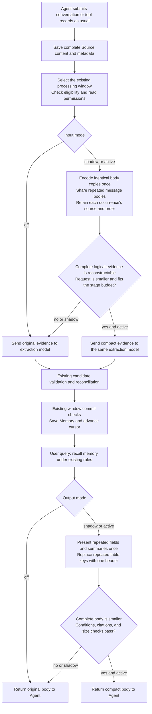

- Proposal Name: `token_efficient_memory_lifecycle`
- Start Date: 2026-10-13
- Status: Proposed
- RFC PR: [oceanbase/powercontext#1990](https://github.com/oceanbase/powercontext/pull/1990)
- Related Issue: [#1989](https://github.com/oceanbase/powercontext/issues/1989)
- Related Discussion: [#1971](https://github.com/oceanbase/powercontext/discussions/1971)
- Related RFCs: [RFC 1400](1400_source_definition_and_observation_model.md),
  [RFC 1515](1515_artifact_processing_supervisor.md), [RFC 1809](1809-atomic-memory.md),
  [RFC 1489](1489_prepared_context_text_assembly.md), [RFC 1560](1560_recall_sufficiency_gate.md),
  [RFC 0081](0081_end_to_end_evaluation_architecture.md)

# Summary

Reduce tokens at two model-input boundaries that PowerContext already owns:

1. **Input gate: Source is saved; memory has not been extracted.** First remove duplicate copies of the body within an
   extraction request, then share repeated message bodies and structured snapshots within the same window. The model
   still sees complete logical evidence, occurrence order, conditions, and sources.
2. **Output gate: Memory is recalled; context has not been delivered.** Group duplicate fields, summaries, and table keys
   inside the existing `prepare_context`, adopting a new representation only when the complete body is smaller and passes
   the existing contracts.

Both gates are independently disabled by default and support `off / shadow / active`. The input gate reduces PowerContext's
extraction input; the output gate reduces the historical material delivered to callers. Savings from prepare cannot stand
in for input-gate benefits. Ordinary capture, flush/supervisor, and prepare calls follow their existing workflows. Agents
need neither replace history nor manage new state.

The first release adds **0 database tables, 0 columns, 0 migrations, 0 HTTP endpoints, 0 MCP operations, and 0 public
request/response fields**. The optimizer does not rewrite original Source evidence or official Artifact content. Temporary
representations and shared bodies exist only within the current processing window or request.

Initial active policies are limited to complete representation transformations that have passed acceptance. Identifying
inputs that need no memory could save an entire model request, but changes the opportunity to generate memory. This stays
in shadow until durable facts, temporal interpretation, citations, and future question-answering quality pass separate
acceptance before activation is considered.

# Motivation

## Why both input and output matter

Optimizing prepare alone does not reduce model input already paid for during extraction. Repeated conversation snapshots,
log wrappers, or Source projections may first enter PowerContext's extraction model, then become official memory, and only
later reach prepare. Measure the full lifecycle from existing raw evidence to downstream use, rather than checking only
whether the final body became slightly shorter.

Concrete input opportunities exist:

- Atomic extraction receives `content` from a materialized Source or an existing TextEvidence projection, while
  `source_metadata` contains a complete Source dump. For Content Sources and Observations carrying payload/projections,
  the body can appear more than once in a single extraction request. Remove duplicate representations while preserving
  meaningful metadata.
- A window may contain progressively growing structured conversation snapshots. An early message can appear in several
  Sources. Each Source is reliably saved, but the extraction model need not receive the same body repeatedly.
- Topic already projects known Source types and uses bounded fragments; Atomic already checks budgets and reduces
  oversized windows. These are the baseline. Existing projection, fragmentation, incremental cursor consumption, and
  capture idempotency cannot be counted as new savings.
- Existing output count, byte, and fragment limits already bound delivery size. Additional benefits must come from less
  repetition or separately accepted coverage changes, rather than arbitrary reductions to existing configuration.

Input implementation belongs to the existing
[Atomic extraction](https://github.com/oceanbase/powercontext/blob/master/src/powercontext/builtin/artifacts/atomic_memory/extraction.py),
[Atomic window processor](https://github.com/oceanbase/powercontext/blob/master/src/powercontext/builtin/runtime/atomic_memory_processing.py),
and [Topic processor](https://github.com/oceanbase/powercontext/blob/master/src/powercontext/builtin/runtime/topic_memory_processing.py).
The output gate reuses
[Runtime prepare](https://github.com/oceanbase/powercontext/blob/master/src/powercontext/builtin/runtime/application.py)
and the existing builder/renderer.

## Product starting point

PowerContext saves raw evidence, sends that evidence to extraction models, and delivers memory to downstream models. At
these two server boundaries it can apply one rule: send each body once while retaining distinct sources and occurrences.
Each boundary must prove its own benefits.

The distinguishing capability is **temporary shared representations backed by complete original evidence, with extraction,
citations, commits, and later question answering all verifiable**. Structured snapshots can encode only their changes while
retaining complete logical snapshots, without requiring a new original-text store or a cross-request memory cache.

Success means lower net usage across actual generation and consumption, while preserving durable facts and task quality.
Reconstructing a representation is an algorithm prerequisite; it does not replace acceptance of model understanding and
final answers.

# Guide-level explanation

## The complete user flow

A user and an Agent discuss order retry rules over several turns:

```text
Message m1: Read-only idempotent queries may be retried at most three times.
Message m2: Financial operations must never retry automatically.
Message m3: Starting next week, reduce the limit to two; all other restrictions remain unchanged.
```

The host saves three structured snapshots containing `[m1]`, `[m1,m2]`, and `[m1,m2,m3]`.

1. All three Sources are saved as usual. Original content and metadata remain readable through the existing interfaces.
2. The input gate encodes each message body once and separately lists the messages in each snapshot. It **does not send
   only m3**: the model still sees the old limit, when the new limit takes effect, and the financial-operation exception,
   along with each snapshot's independent source and occurrence order.
3. The existing extraction model produces candidates. Existing reconciliation, authorization, write checks, and window
   transactions continue to commit official memory.
4. When the user later asks about retry policy, existing prepare retrieves relevant memory. The output gate presents
   repeated expressions once while retaining conditions, citations, and format.
5. The Agent receives the body through the existing interface and works as usual. It needs no history replacement,
   supplementary reading protocol, or decoding tool.



The server checks whether complete logical evidence can be reconstructed. The model receives directly readable shared
bodies and occurrence records. This does not guarantee correct model understanding; that requires independent evaluation.
Unknown ordinary text is not parsed as structured conversation.

## Switches and rollback

| Input mode | Output mode | Actual behavior |
| --- | --- | --- |
| off | off | Existing extraction and delivery |
| active | off | Change extraction input only; validate the input gate independently |
| off | active | Existing memory generation; change prepare body only |
| active | active | Both gates operate; validate their combined effect |

Shadow on either side only computes plans and records safe measurements; that side still runs its legacy path. Input
shadow makes no second extraction-model call, generates no second Memory, and never advances the cursor based on a
candidate no-op decision.

Proposed input configuration:

```bash
export POWERCONTEXT_SERVER_RUNTIME_MEMORY_INPUT_OPTIMIZATION_MODE=off
```

The output gate retains the proposed `POWERCONTEXT_SERVER_RUNTIME_TOKEN_OPTIMIZATION_MODE`. Input defaults to off and does
not inherit output active, avoiding unexpected changes to durable memory when a deployment enables output optimization.
Configuration is read at startup; changes require a restart. No request-level parameters are added.

Turning output off restores the original body for subsequent prepare calls. Turning input off changes only subsequent
extraction; **already consumed Sources are not automatically re-extracted**. Retaining raw Sources does not restore omitted
Memory. Projection rebuild and Artifact restore do not replay Sources either. Lossless representation is the first-release
input boundary; lossy input requires an explicit recovery and renewed acceptance process first.

# Reference-level explanation

## 1. Ownership and change inventory

| Item | Change |
| --- | --- |
| Source capture / GET | Preserve original content, metadata, identity, idempotency, and readback contracts |
| Database | Add no tables, columns, indexes, or migrations; store no shared-body library or feature ledger |
| HTTP / MCP / SDK | Add no operations or public fields; retain caller workflows |
| RuntimeConfig | Add input mode; retain output mode, target, and tokenizer configuration |
| Atomic / Topic processing | Produce temporary model-input views after authorization, before request encoding and stage budget checks |
| Existing extraction output / publisher | Retain evidence IDs, source mapping, candidate validation, original-window revalidation, and transaction commits |
| prepare | Select compact representations after existing recall admission and current availability checks, before the first truncation |
| Logs / evaluation | Reuse existing trace, usage reporters, and external artifacts; add no business statistics tables |

The domain layer retains complete original evidence; generators send only the selected temporary view. Shared references
must not be written into authoritative Sources, and worksets must not present compressed objects as original evidence.
HTTP, MCP, and host adapters do not implement their own gate rules.

This does not intercept every model request. Input encoding is enabled only for specified built-in Atomic/Topic stages;
a general generator must not acquire trimming branches that guess behavior by operation. Output schemas and business
evidence IDs remain unchanged. Built-in model-input encoding and its instructions may be versioned. Custom Prompts and
injected pipelines without declared support for the encoding use legacy by default and require separate acceptance.

Use explicit **private typed model-input views and dedicated built-in generator bindings**. Existing generic generators
check the input type and serialize the original typed object directly. Topic content is a string and extra fields are
forbidden; a blocks/refs dictionary cannot be inserted into that DTO. Retain original Atomic/Topic logical input and construct
a separate private input type carrying the encoding version, body blocks, and original evidence occurrence records. Only
built-in stages bind this type and instructions explaining the shared representation at the factory. Outputs retain the
original candidate/proposal schemas.

Each plan explicitly selects legacy typed input with the original generator, or a compact typed view with its corresponding
built-in generator. Budgets, stage fit, and actual sending share the selected type's deterministic serialization, including
its instructions/schemas. Record a digest of the final serialization to verify that the measured representation becomes
the actual request. Do not measure compact input while passing the original object to TypeAdapter, or substitute an
unmeasured string after budget checks. Model results are still validated against original IDs; subsequent worksets, lineage,
and publishers use original logical evidence. Changes remain within private inference input and built-in bindings, without
expanding public APIs or the generic generator's domain responsibilities.

## 2. Integration with existing processing budgets

Input retains the Atomic input limit, Topic stage budgets, existing window limits, fragments, and output reserves. It does
not add one small input cap overriding every stage. Output `token_optimization_target_tokens` still applies only to prepare
bodies. Measurement profiles may reuse `token_optimization_tokenizer`, without assuming it matches the provider tokenizer.

Initially, fix the windows and candidates selected by legacy before comparing representations. A smaller compact input does
not expand windows, historical candidates, or Scope. Topic window selection, batch fit, fixed prompt/schema costs, and
final sending must use one consistent measurement contract. Do not replace input after a budget check with a different,
unmeasured request, or treat a smaller data body as proof that the complete request, including schemas, instructions, and
retries, is smaller.

For each supported stage, construct legacy and candidate inputs and measure them with fixed instructions, input/output
schemas, and sharing instructions. Encoder errors, unsupported formats, failed complete reconstruction, candidates that
are not smaller, or violations of existing stage budgets use the original path. If that path is still oversized, follow
existing window reduction / failure contracts. Dropping trailing Sources cannot be reported as successful processing.

No mandatory online LLM call is added to decide whether input is worth remembering. If model-based trimming is introduced
later, every added call and failure cost belongs in total input usage; a reduction in the main extraction request alone
is insufficient.

## 3. Input I1: encode one body per evidence item

Target explicit duplication in Atomic input:

```text
Original logical input:
  evidence_id = source:41
  content = {source_id: s1, content: Body A, metadata: Original business metadata}
  source_metadata = {Other original fields, content: The same Body A, metadata: The same business metadata}

Temporary model input:
  evidence_id = source:41
  Body A: appears once
  Original content.content and source_metadata.content both refer to this body
  Identical content.metadata and source_metadata.metadata may share their complete subtree
  All other fields and field roles: fully retained
```

This removes copies within the same request while retaining SourceRefs, times, metadata, and original records. Requirements:

1. Handle only known Source/projection paths. Identify duplicates by complete original strings or JSON subtrees with strict
   type equality.
2. Represent known duplicate paths with explicit references local to this request. Retain paths and roles; matching
   sentences inside a body must not be interpreted as system markers.
3. Retain effective times, recorded times, entities, roles, quantities, conditions, states, and unknown metadata fields.
   Unsupported schemas/projections retain original input; do not delete fields based on names or keywords.
4. The server verifies that expanding the view reproduces the original typed logical input. Scalar types, list order,
   multiplicity, and every source ID remain unchanged.
5. Domain evidence and native Source GET remain unchanged. Required instructions, paths, and references count toward tokens;
   short bodies may offer no benefit.

Replacing `source_metadata` with a tiny field allowlist cannot manufacture savings. Group proven duplicate copies first;
lossy field selection requires separate consideration. Topic's existing standard projection is an independent baseline and
is not counted again as an I1 benefit.
The example corresponds to native ContentCapture. For Observations, validate actual TextEvidence and payload/projection
paths subtree by subtree; do not assume that complete content equals a payload.

## 4. Input I2: share repeated bodies, retain complete snapshots

I2 separates **how many copies of a body are encoded** from **how many logical occurrences exist**. Sharing is limited to
the same authorized window and stage input. It never crosses Scope, scans the full collection or history, or builds a
cross-request dictionary.

Illustrative candidate representation for validated structured message snapshots:

```text
Body blocks:
  b1 = {role: user, text: Read-only idempotent queries may be retried at most three times.}
  b2 = {role: user, text: Financial operations must never retry automatically.}
  b3 = {role: user, text: Starting next week, reduce the limit to two; all other restrictions remain unchanged.}

Evidence occurrence records:
  source:41 = [b1]         + This Source's own times and metadata
  source:42 = [b1,b2]      + This Source's own times and metadata
  source:43 = [b1,b2,b3]   + This Source's own times and metadata
```

Every Source remains fully reconstructable within this request. The model cites `source:41/42/43`, never b1 or a fabricated
duplicate group. The third snapshot retains the context behind “all other restrictions remain unchanged”; it is not reduced
to a tail containing only b3.

Rules and boundaries:

- Initially support explicitly versioned structured message/record sequences or completely identical long fields. Unknown
  prose, nested formats, unclear record boundaries, and excessively deep objects retain original input. Token similarity
  cannot establish that two facts are identical.
- Block equality preserves complete content, types, and internal roles. Different numbers, versions, negation, tool results,
  and exit codes must not be shared as one value.
- Occurrence records retain original order and multiplicity. `[b1,b1]` in one Source cannot become `[b1]`; repeated table rows
  cannot become one row.
- A snapshot's event/effective/recorded times, journal position, and independent conditions remain separate. The same body at
  two times remains two occurrences of evidence. Text duplication cannot justify skipping a new Source or assigning every
  fact the latest timestamp among all supporting Sources.
- Input block references must have distinct types, be acyclic and fully bound, and never bind across scopes. Reconstruction
  checks make no network, model, or database reads. Text resembling `b1` inside a body is not a structured reference.
- Planners bound scanned characters, depth, block counts, reference counts, and CPU. Exceeding a limit falls back to legacy.
  Adoption requires a smaller complete request.

This is **fully reconstructable incremental encoding within a window**. It does not extract only a new tail across windows
or rebrand existing incremental cursor consumption. The main extraction stage still sees complete logical evidence, so no
new persistent fingerprints of previously remembered facts are needed.

Atomic extract and Topic probe are the initial insertion points. Topic global/evolve/temporary requests that include the
same original evidence may reuse the rules independently within each request. Reporting only probe reductions must not
hide growth from later expansion, reduction, or retries. Reconciliation retains its existing historical facts and conflict
conditions; the input gate does not remove historical comparison material.

## 5. Input I3: skip a request only when no memory information is established

I3 is an independent admission policy. Its benefits must not be combined with I1/I2 representation savings. It attempts to
avoid entire extract/probe requests and subsequent empty operations, but an inference that no useful memory will be
produced can cause lasting information loss.

Initially I3 is shadow-only: compute `would_noop` for a fixed complete window, perform original extraction, then compare the
decision with independent facts offline. It makes no second model call and never advances the cursor early because of
`would_noop`.

Future active eligibility must be reviewed separately by family, built-in profile, Prompt, and format. An initial candidate
could cover isolated greetings/filler explicitly excluded by built-in Atomic rules, provided the **entire window** matches
complete rules, with no unknown metadata, context dependencies, or other event content. Topic does not automatically inherit
Atomic rules; custom Prompts are not automatically enabled.

Short messages, few keywords, similar existing Memory, or low model confidence cannot justify skipping input. Preserve or
fall back for inputs such as:

```text
“OK”                      May confirm a previous proposal
“No”                      May reject a previous decision
“Change it to Friday”     Changes a planned time
“It failed”               Changes task state
“Do not retry automatically” Is a negative constraint, not disposable low-information text
```

Local duplication and similarity to current memory do not prove a no-op. Without explicit recovery/re-extraction and
independent held-out acceptance, I3 remains in shadow. Uncertain content must never default to worthless merely to produce
large savings.

## 6. Evidence identity, commits, and cursors

The server continues assigning Atomic `source:{journal_position}` IDs and Topic opaque evidence IDs within windows. Keep
the original `evidence_id → StoredSource/SourceRef` mapping. Only bodies are shared; logical evidence identities are neither
merged nor renumbered by optimization.

Extraction output may cite only original evidence IDs actually supplied in that stage. The server resolves these IDs to
exact SourceRefs; it does not automatically add every Source containing a shared block to every fact's lineage. Sharing a
body does not prove that all sources support the same fact. A valid ID does not prove semantic support either; support is
scored independently.

Each publisher retains its own existing commit checks and the **complete original window**. Sources not delivered to the
model must not disappear from revalidation:

- Atomic revalidates the window, generation eligibility, Source authorization, cursor generation, and relevant Artifact
  read set, retaining the optional processing invocation guard before the original transaction commit.
- Topic retains Worker fencing, complete-window revalidation, cursor CAS, and optional commit_authorizer. This does not
  claim that Topic already performs Atomic-style complete Artifact read-set revalidation.

| Case | Candidate/request handling | Cursor |
| --- | --- | --- |
| I1/I2 validation failure or unknown format | Extract using original input | Existing success/failure contract |
| shadow | Original input, model, and writes | Existing contract; no advancement based on candidate plans |
| Successful extraction with empty candidates | Commit existing empty workset / empty operations | Advance only after the original transaction succeeds |
| Future approved I3 whole-window no-op | Reuse the existing empty-result publisher; still revalidate the complete window | Advance only after the original transaction succeeds |
| Model timeout, invalid output, budget or commit failure | Existing failure/window reduction/conflict retry contract | Never report false success or skip failed Sources |

Public processing counts still describe the original window/eligible Sources, rather than unique body blocks. Model evidence
counts, shared-block counts, and no-op diagnostics belong only in internal traces, preserving the API's `source_count`
meaning.

On window conflict retries, recheck the plan against the window, input, policy, and Prompt. Initially there is no persistent
extraction cache or cross-request reuse of old model output. Source retention, switching modes, and policy updates do not
implicitly roll back consumed cursors.

## 7. Output: reduce delivery bodies inside existing prepare

The output gate operates on bounded typed candidates after existing authorization, retrieval, admission, and Atomic current
availability checks, before the first truncation. Legacy and candidate representations share the same snapshot. Optimization
neither reruns retrieval, fetches complete Sources, nor accesses evaluation answers.

| Rule | What is actually removed | Initial boundary |
| --- | --- | --- |
| O1 Experience identical-value grouping | Copies of complete, character-identical values in different fields | Retain all roles and distinct values; never group failure across roles |
| O2 Topic exact deduplication | Snippet copies identical to the complete summary field | Self-contained instructions retain role meaning; no semantic merge or fuzzy substring substitution |
| O3 Tabulate homogeneous rows | Field names repeated across rows | Retain columns, types, order, duplicate rows, and numbers; fall back for unknown formats |
| O4 Task-relevant complete paragraphs | Paragraphs unrelated to the current question | Lossy; qualify separately by format, condition relationships, and held-out quality |
| O5 Deliver fewer candidates with little new information | Candidate coverage | Lossy; report origins / information coverage changes separately from lossless compression |

O1 example:

```text
Action / Lesson: Only idempotent queries may be retried at most three times; financial operations must never retry automatically.
```

This retains both roles and complete conditions while removing a second copy of the same sentence. Lesson remains present.
The rule does not infer implicit dependencies in arbitrary free text. Experience situation/action/outcome/lesson and failure
verification are protected as complete groups; Atomic text is not split into sentences. A Topic hit is not the complete
detail and cannot be claimed to contain every hidden condition.

O3 must reconstruct every column and value under its supported input contract. Reject missing fields, duplicate JSON keys,
non-finite numbers, and unsupported nesting. Headers, JSON cell escaping, instructions, and citations all count toward cost.
Reconstructable structure still requires testing for model misinterpretation.

Adopt only when the complete new body's tokens and UTF-8 bytes are both smaller and it meets existing `request.max_bytes`,
assembly format/sections/limit/show, and the deployment target. Unmet targets, no reduction, unsupported inputs, incompatible
protected groups, and internal errors fall back to legacy. Fallback does not establish that legacy prefix truncation
protects conditions and must not be reported as successful optimization.

Initial active candidates are O1/O2/O3. O4/O5 retain empty allowlists or remain in shadow until they pass independent
eligibility thresholds. Output retains existing `schema/status/content/content_bytes`, trust, citation, escaping, and
truncated contracts; native GET remains unchanged. Profile, include_code, and unknown formats initially use the original path.

## 8. Coverage and resource limits

| Existing flow | Input | Output |
| --- | --- | --- |
| capture Source → Atomic/Topic processing | Apply at supported server input stages | Apply when queries call prepare |
| Manually created Memory / Artifact | No extraction; no input benefit | Apply when queries call prepare |
| HTTP / SDK prepare / existing recall hook | This call does not generate Memory | Same Runtime rules; no Agent changes |
| MCP search/get/hint | Input can operate independently when another path generates Memory | Current catalog has no prepare; native reads are not automatically compressed |
| Third-party tool history / arbitrary external model requests | Outside server-owned input boundaries | Outside prepare delivery boundaries |

Build no tool executor, model proxy, original-text vault, persistent dictionary, cross-request allowance, or Agent checkpoint.
Actual extraction and prepare are both server-controlled and can roll out independently without host input replacement.

Processing windows and stage inputs are bounded. Sharing plans, full reconstruction checks, and tokenizing both
representations have separate CPU/memory limits. Do not scan complete Scopes or revision history, or search other Sources
for duplicates. I1/I2 add no database reads or writes. If I3 avoids subsequent stages, report actual I/O changes separately;
do not combine them with a blanket promise of no additional I/O within the same window.

## 9. Measurement: generation through consumption, beyond one ratio

Record complete original/candidate requests, final adoption, and actual model observations separately:

- Input: mode, family/stage, policy/Prompt/encoding versions, window range, original evidence counts, shared blocks and
  occurrences, rules and fallback reasons; complete request tokens/bytes, model attempts, provider input/output/cache,
  and fragment/reduction/retry counts.
- Generation overhead: reconciliation, related recall, embedding/indexing, and any new classification/summarization/recovery
  calls. Count all actual work, rather than only extractor or probe costs.
- Output: complete body tokens/bytes, actual origins, condition/information coverage, fallback, and actual Reader
  input/output/cache.
- Quality: independent durable facts, temporal/conditional correctness, evidence support, valid output formats, and final
  task scores.

For one extraction followed by K uses:

```text
Total model usage = one complete memory-generation flow + K actual query flows
```

Fix K before the experiment and report generation and per-query costs separately. Do not select the most favorable reuse
count after observing results. Record embeddings separately in their own billing units rather than indiscriminately adding
them to generation tokens. Evaluation Judge costs are reported separately from product online benefits.

Provider `prompt_tokens` already includes cached tokens; do not add them twice. Missing actual usage remains unknown.
Preselected failures stay in quality denominators; cost comparisons use only same-condition pairs with complete accounting
and disclose missing coverage. Random output variation cannot be directly attributed to input optimization. Calculate
monetary savings only with verified pricing contracts; profile tokens are not actual bills.

The existing Source→context recall estimator is neither the input legacy→compact nor output legacy→compact metric. Do not
expand its denominator to inflate benefits. Default traces retain no original text, user messages, complete Prompts, or new
Source copies. Complete evidence is retained only in controlled external evaluation directories.

## 10. Evaluation: two generated snapshots, four consumption combinations

### 10.1 Four arms and attribution

| Arm | Memory generation | prepare delivery | Purpose |
| --- | --- | --- | --- |
| I0O0 | Input off | Output off | Current complete-flow baseline |
| I1O0 | Input active | Output off | Isolate extraction losses and benefits |
| I0O1 | Reuse the I0 generated snapshot | Output active | Isolate delivery losses and benefits |
| I1O1 | Reuse the I1 generated snapshot | Output active | Combined effects and interaction |

Generate Memory once with input off and once with input active. Use each exact Artifact revision snapshot for both output
modes, with background writes stopped. Output active must not trigger another stochastic extraction. Changing source material
beforehand and then reporting shorter output is not compression of the same evidence.

Fix original Source content, order, metadata, profile, Prompt/model, windows/history/budgets, retrieval, questions, Readers/
Judges, timeouts, and retries. Artifact IDs may differ between input arms; compare independent facts and original Source
identities. Output pairs within one input arm must use exactly the same revisions. Repeated batches regenerate two isolated
snapshots and alternate execution order.

Report I1O0−I0O0, I0O1−I0O0, I1O1−I0O0, and interaction; do not directly add independent percentages from both gates. Durable
quality in I1O0 must pass before assessing the combined case. Output optimization cannot hide facts already lost at input.

### 10.2 Reuse existing repository capabilities

| Existing tool | Reuse | Required additions or limits |
| --- | --- | --- |
| LongMemEval-V2 | Frozen data, prepare-consuming arm, Reader/scoring, messages/hashes, replay | Current insertion writes prepared Memory; add actual capture→processing→durable readback |
| Atomic supervisor E2E | Completion checks, lineage, restart, original Source readback, failure handling | Recording models cannot establish real-model extraction quality |
| configured-service A/B harness from [implementation PR #1991](https://github.com/oceanbase/powercontext/pull/1991) | Actual TCP HTTP, isolated databases, per-attempt usage, body hashes | Reusable source must be introduced; static Reader experiments with manually written Topic prove output only, not actual extraction |
| work-continuity | Independent rubrics for omitted/stale facts and next actions | Current synthetic recordings are not native Agent execution |
| SWE-bench Pro / Bub | Independent patch/task acceptance, isolation, alternating pairs | Split whole-PowerContext OFF/ON into two-gate treatments and establish actual input paths |

[LongMemEval-V2](https://github.com/oceanbase/powercontext/blob/master/evaluation/memory/longmemeval_v2/README.md)
`query-time-compact-v1` calls public prepare and suits output evaluation. In the existing insertion path, the harness captures
Sources, creates deterministic projections, and directly remembers Memory. It bypasses actual extraction and cannot validate
the input gate.

A real input experiment uses existing capture, flush/supervisor, and public Artifact/source readback:

```text
Freeze original material and independent gold labels
→ Capture through the existing API
→ Wait for actual processing to complete through the target Source watermark
→ Verify commits and citations through list/get/lineage
→ Stop writes and freeze Artifact revisions
→ Call prepare in both output modes
→ Save actual complete Reader messages and usage
→ Independently score, read back after restart, and replay offline
```

Retain Topic's existing fragmentation, historical candidate limits, and reduction, and Atomic's existing input budget with
identical configuration. Report any further Reader truncation by the harness as `memory_context_was_truncated`, never as
output-gate savings. Missing values and transport failures in existing aggregate usage need per-attempt unknown records;
unaccounted calls must not be treated as zero.

### 10.3 Fixed counterexamples and independent quality

Annotate independent gold labels from original material first: facts to remember, conditions, effective times, exceptions,
and supporting evidence ranges. Off extraction output is not the gold standard. Freeze material, rule eligibility, and
Reader subsets before outputs. Gold labels never enter the encoder, extraction input, or retrieval query.

Cover at least:

- Repeated wrappers, no redundancy, unknown formats, nested structures, mixed languages, and otherwise identical tables
  differing in one number/unit/version.
- Shared prefixes of growing snapshots, repeated messages, and repeated table rows; preserve counts, order, roles, and
  complete context.
- Trailing negation, financial-operation exceptions, version constraints, premises/conclusions across fragments,
  unfinished progress, and failure verification.
- Late-arriving old evidence, future-effective decisions, and identical bodies at different times/from different Sources;
  do not overwrite newer effective facts incorrectly.
- Identical text in different Scopes, valid IDs with incorrect semantic support, and distinct facts that must not
  automatically receive the union of all Source citations.
- Brief confirmations, negations, corrections, and time/state changes; I3 must not classify them as information-free.
- Questions revealed only after extraction, verifying that input has retained facts needed beyond a known current question.
- Invalid JSON/structured output, timeouts, missing provider usage, budget-driven window reduction, commit conflicts,
  authorization changes, and window changes.

Acceptance uses public exact GET to verify cited Source content and metadata, and checks semantic support against independent
evidence ranges, rather than merely testing membership in an allowed ID set. Compare durable-fact recall/precision, severe
conditional errors, temporal interpretation, citation correctness, and final task/format success. Coding profiles need retain
expensive decisions, constraints, and progress required by their contracts; they need not remember code facts that are
cheap to retrieve again.

### 10.4 Durability, cost, and load thresholds

I1/I2 first pass reconstruction equivalence, then real-model quality. Keep every preselected failure in denominators. If
output is wrapped in Markdown fences or repeats two objects, score it as failure under the preregistered contract; correct
internal values do not justify relaxing scoring after the fact.

Release eligibility requires:

1. Unchanged Source content, metadata, identity, and digests. Durable Memory and citations remain usable through GET/search/
   prepare after shutdown and restart. Model/commit failures never skip the Source cursor.
2. No additional severe conditional, temporal, identity, or citation errors. Durable facts and final tasks meet
   preregistered non-inferiority margins and paired confidence intervals. Small smoke sets screen for problems; they do not
   establish non-inferiority.
3. Lower actual net provider usage across complete generation and query flows. Include shared-encoding instructions, every
   stage, retries, fallback, and unknown coverage, rather than reporting one body's profile ratio.
   If critical counts are missing, the full cohort's net cost is indeterminate; the subset with complete usage alone cannot
   pass rollout thresholds.
4. Separate measurements of input CPU/memory, extraction-stage p50/p95/p99, window throughput/queueing, and actual
   HTTP/OceanBase prepare load. Report shadow overhead, no-op, and fallback rates separately. Pure algorithm CPU throughput
   does not establish service capacity.

I3 and other lossy input policies must also pass durable-fact/future-question tests for incorrect no-ops and deliver an
explicit recovery plan. Replaying retained Sources completely in an isolated Scope proves recoverability in evaluation;
it does not establish production recovery support. Stay in shadow until these thresholds pass.

Data downloads, frozen fixtures, gold labels, databases, raw model answers, CSVs, logs, reports, and intermediate snapshots
remain outside the repository, for example under `/data/codex-tmp/`. Keep reusable harness source and instructions in the
repository; do not commit run results or embed measurement attachments in the RFC.

## 11. Implementation order and exit criteria

1. **P0: actual input baseline, I1, and output O1/O2/O3.** Fix both switches and per-stage accounting; address Atomic's known
   duplicate copies first. Establish actual Source→Memory→prepare→Reader experiments across all four cells. Every active
   rule still requires its own eligibility.
2. **P1: complete snapshot sharing in I2.** Start with explicitly versioned structured message formats. Verify complete
   window reconstruction, time, sources, and model understanding, then cover Topic's multiple stages. Do not guess unknown
   formats; extracting only a new tail across windows is outside this phase.
3. **P1 shadow: I3 no-op.** Freeze rules by family/profile/format, measure misclassification and potential request savings,
   and propose active only after durable quality and recovery thresholds pass. Output O4/O5 likewise require separate lossy
   eligibility.
4. **Rollout:** Enable one side first, then both. Expand after actual net cost, durable quality, and tail latency pass.
   Output allowlists never automatically become input rules. Keep off when fewer representation tokens increase failures,
   retries, or total cost.

Stop a rule if natural material has little repetition, dictionary instructions consume the savings, shared views cause
model misinterpretation, or it offers no improvement over reasonable existing budgets. Do not remove difficult cases,
expand candidates, or prebuild fingerprint tables to manufacture large benefits. New interfaces/storage require separate
evidence that existing contracts cannot support the need.

# Drawbacks

Input is more sensitive than output: one extraction error can affect many future queries. Disabling input does not
implicitly repair omissions from consumed Sources. Even reconstructable representations can change model understanding and
need end-to-end acceptance. I1 hit rates depend on Source types; I2 depends on actual repetition. I3 risks misclassification.
Savings cannot be promised for every user.

Shared encoding, dual-representation measurement, and validation add bounded CPU/memory costs. Format instructions may
consume any benefit on small inputs. Existing budgets already reduce delivery and stage work; incremental opportunities
need actual measurement. Neither gate controls existing external Agent history or arbitrary third-party model requests.

# Rationale and alternatives

| Choice | Tradeoff |
| --- | --- |
| Optimize prepare only | Serves existing consumers directly, but does not reduce extraction costs already incurred |
| Discard data before capture | May reduce storage, but loses complete evidence and replay foundations; rejected |
| Summarize/classify with a cheaper model first | May reduce the main request while adding model costs and failure modes; a separate experiment rather than a mandatory path |
| Reduce existing window/stage budgets | Strong baseline; may increase requests or lose coverage and cannot be presented as new compression |
| Complete shared representations within one window | Add no persistent state and retain every occurrence/source; validate model understanding |
| Cross-window cache of only new facts | Requires dependency, time, invalidation, and recovery protocols; excluded initially |
| Host or model proxy | May cover more external input, but adds integration/deployment boundaries; not a prerequisite for the two-gate flow |

# Prior art

Reuse existing Source journals, standard evidence projections, windows/budgets, candidate citations, transactional publishers,
prepare renderers, and actual model usage. The new behavior constructs fully reconstructable temporary representations of
the same logical evidence and qualifies generation and delivery boundaries separately.

# Unresolved questions

Before acceptance and implementation, determine:

1. Initial I1 Source types and duplicate paths, unknown fields to retain completely, and built-in Prompt compatibility criteria.
2. Initial I2 structured snapshot schemas, directly readable encoding, scan/block limits, actual repetition, and improvement
   over reasonably configured original input.
3. Independent I3 family/profile rules, misclassification definitions, and production recovery thresholds. Remain shadow-only
   until resolved.
4. Per-stage input provider usage/unknown coverage, durable-fact non-inferiority margins, net usage, and p95/throughput thresholds.
5. Existing output-rule eligibility, held-out future questions, repeated four-cell batches, and reuse count K fixed in advance.

# Future possibilities

Prove the cost and quality of the current two gates before exploring cross-window incremental extraction, semantic
necessity judgments, more input formats, or new delivery entry points. Any capability requiring persistent fingerprints,
re-extraction, or additional scoped reads needs a separate design for compatibility, authorization, recovery, and storage
necessity. None is a hidden prerequisite for the first release.
