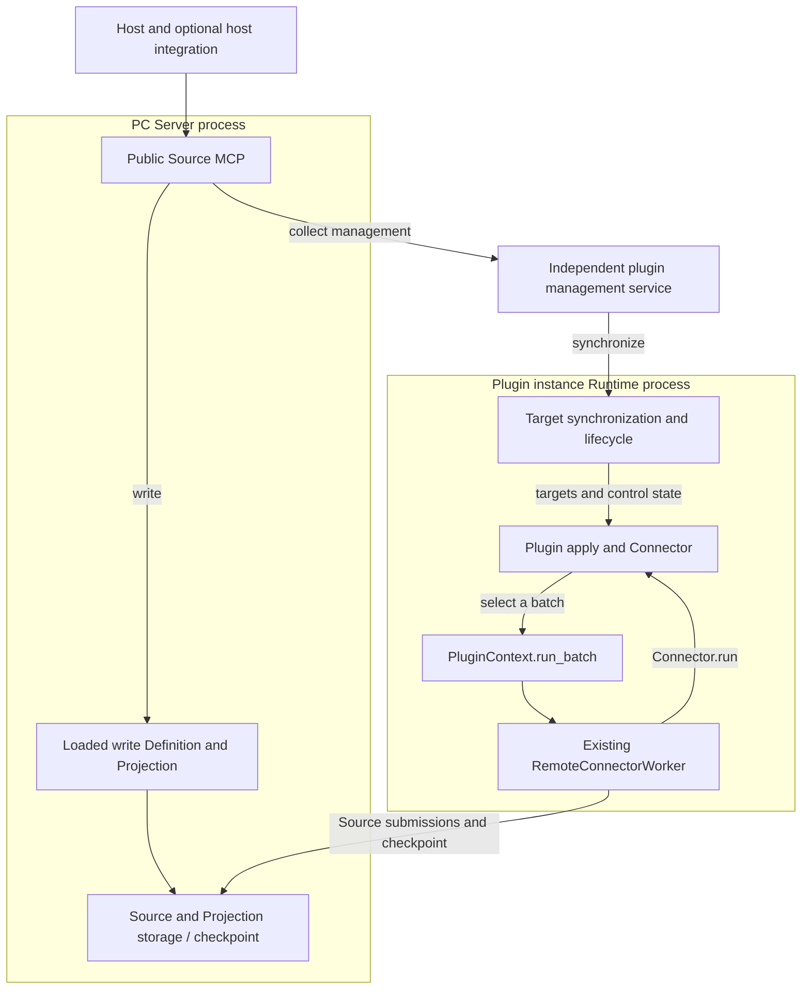
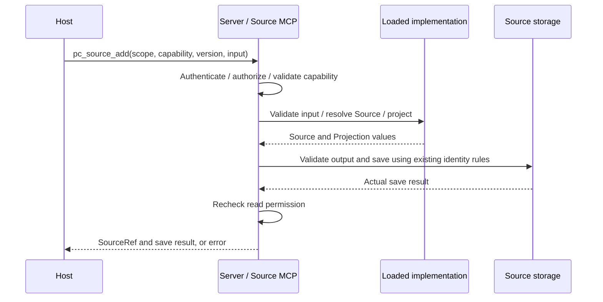
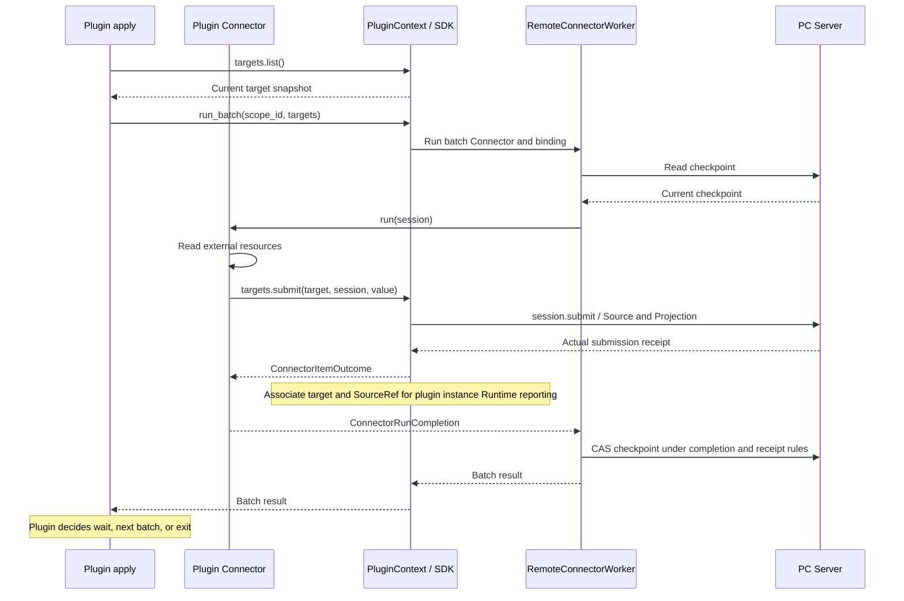
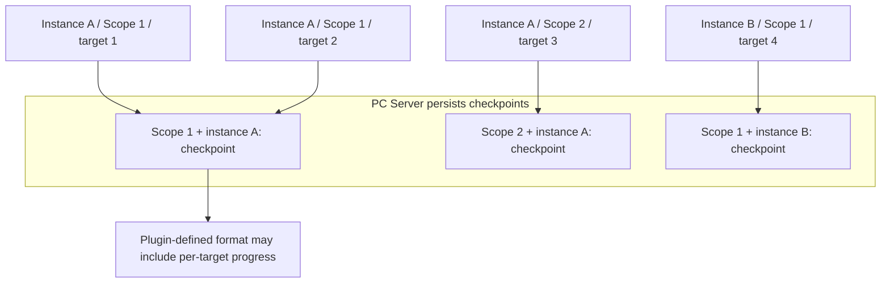
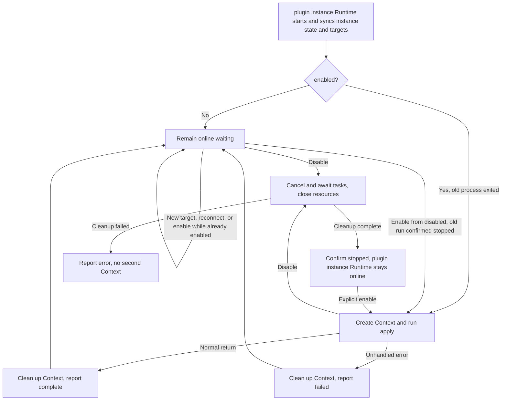

- Proposal Name: `source_plugin_framework`
- Start Date: 2026-10-14
- RFC PR: [oceanbase/powercontext#2012](https://github.com/oceanbase/powercontext/pull/2012)

# Summary

This proposal introduces a Source plugin framework for PowerContext so users can develop or use plugins to define custom Source types, data models, and Projections, as well as collection logic for different data origins, without modifying PowerContext core. It supports two data-ingestion paths: `write` runs plugin-defined validation and transformation inside Server and synchronously saves complete content supplied by the caller; `collect` uses independently running plugins to continuously read external resources, with collection targets added and managed at runtime. The framework handles plugin loading, lifecycle management, and the submission pipeline, reusing existing Source persistence rules and authorization; plugins decide what to collect, when to run, and how to retry. Applications and other hosts use the public MCP to discover and use built-in and custom Source capabilities through a common interface.

This RFC specifies proposed behavior. Examples of interfaces and deployment commands do not imply availability in a released version.

**Example conventions:** Commands, configuration, and code illustrate intended usage and interface relationships rather than final released syntax. Proposed interface names, module paths, and configuration layouts may be adjusted during implementation. Changes to public interfaces or usage steps must be explained in the implementation PR and reflected in this RFC; runnable usage is documented in the user guide and examples shipped with the implementation. Responsibility boundaries, permissions, persistence, synchronous returns, and repeat-call semantics are design constraints; changing them requires a rationale and design review in the PR. Existing public interfaces remain subject to their established contracts.

# Motivation

Data brought into PowerContext has different business meanings. Data from different business domains varies in structure, Source identity rules, and Projection requirements; built-in Source types cannot cover every requirement. If every customization requires a core change, business extensions depend on PowerContext's own release and maintenance schedule. Users need to develop Source plugins independently or configure and use plugins supplied by others.

Defining a data type alone does not complete data integration. The same business data may come from systems with different authentication, APIs, and update patterns. Plugin authors need to implement the reading, filtering, or incremental collection their data origin requires and choose execution timing according to external access limits and business requirements. They should also be able to reuse PowerContext's submission and progress handling instead of reimplementing that common logic in every plugin.

Users also obtain data in different ways. An application may already hold complete content that only needs saving, or resources may remain in an external system whose changes need continuous collection. Both needs should share Source data definitions and Projections. Saving existing content should complete directly; ongoing collection needs to run independently and continue after the application or host that initiated it exits.

Collection scope changes during use. For example, a user may add a newly created document to a running collection instance or have the same instance serve another authorized Scope. Users should be able to add targets, inspect existing submissions, and stop or resume collection while reusing the instance and its progress, without deploying a separate plugin instance for every resource or Scope.

These capabilities need to serve business applications, automation workflows, coding agents, and other hosts. Custom Sources should have discovery and invocation consistent with built-in capabilities, and adding a plugin should not require a separate integration implementation for every host. A common entry point and shared collection instances let users reuse existing plugins and continue using the same data integration capabilities across applications and workflows.

# 1. Overview

Hosts use built-in and custom Source capabilities through **the same public MCP on PC Server**:

- **write**: the host supplies complete content. Server executes loaded SourceDefinition and Projection implementations, saves synchronously, and returns.
- **collect**: plugins continuously read external resources. One independent background plugin management service stores collection targets; each instance executes in its own plugin instance Runtime process and can serve multiple authorized Scopes. Management and plugin instance Runtimes can run on different machines, with instances shared by hosts.

Both paths reuse SourceDefinition, Projection, and existing Source persistence rules. The same Source type can originate from write or collect. The framework provides loading, lifecycle management, and the data pipeline; plugins decide collection content, timing, batching, retries, and exit.

One plugin management service serves one Server. This proposal excludes management clustering, automatic migration, general task scheduling, and in-process Python code replacement. Default local deployment prepares independent background services during Server startup. Installation or startup commands return when done; host exit does not stop collection.

# 2. Architecture, connections, and storage

## Component organization

Arrows show business calls and data flow. write implementations run in Server; collect Context, Worker, and Connector run in the plugin instance Runtime process.

| Component | Responsibility |
| --- | --- |
| Public Source MCP | Server `/mcp`; authenticates hosts, checks PC permissions, and provides discovery, submission, query, and controls |
| PC Server data pipeline | Loads write implementations, registers Definitions, and saves and reads Sources, Projections, and checkpoints |
| Plugin management service | Stores plugin instances, capabilities, targets, desired control state, and received submission records; delivers management requests without scheduling collection or relaying Source data |
| Plugin instance Runtime | Outer framework of each plugin instance; loads plugins, maintains management connectivity, synchronizes targets and controls, and creates and ends business runs |
| PluginContext (Context) | Context for one business run, passed as ctx to apply; owns Connector, clients, and resources, and provides plugin interfaces such as run_batch |
| RemoteConnectorWorker | Existing batch pipeline; creates sessions, calls Connector.run, and processes receipts and checkpoint CAS |
| apply / Connector | Plugin business code; apply decides timing, while Connector reads, transforms, and submits batch data |

write alone requires only Server. N plugin instances add one plugin management service and N plugin instance Runtime processes. Plugin instance Runtimes run as ordinary background processes by default; users explicitly opt into system service management.

## Startup loading and adding instances at runtime

**write:** The deployer prepares trusted code and dependencies on the Server machine and configures an entry with `server.admin`. Server's generic loader imports the module, validates Definitions, Projections, capabilities, and name/version conflicts, and publishes capabilities after registration succeeds. The registration API stores definition contracts rather than Python implementations and cannot replace code loading. Entry and required configuration references are persisted for reimport on Server restart.

**collect:** Server scans the plugin directory specified through an environment variable once at startup. Each `powercontext.yml` declares an instance `id`, code entry, business configuration, credential references, and serviceable Scopes. id is instance_id, unique within a PC deployment and stable across restarts. Several instances can use the same local code without publishing a wheel; placing configuration in the trusted directory authorizes loading.

Users run `source load` on the plugin execution machine to load instance configuration and connect to a local or remote Server and plugin management service. The command validates the plugin, uses deployment credentials to register Definitions and the instance and grant required Scope permissions, prepares Runtime credentials and startup configuration, and starts an independent Runtime on that machine. Existing permissions are reused; identities for an external Server are provisioned through its authentication mechanism. Users do not run a separate registration script or manually submit credential digests. Local automatic deployment can prepare management as needed; cross-machine deployment connects to services that have already been prepared.

Server startup scanning reuses the same loading flow. Adding an instance while running explicitly invokes `source load`, without continuous directory scanning or restarting other instances. Repeated loading of the same ID and matching configuration reuses registration and processes without resetting desired state. Conflicting configuration is rejected; updates follow section 5.

Configuration may contain initial `targets`, each specifying Scope, capability, and business input. First target initialization imports them using normal add rules and records initialization. Management is authoritative thereafter; the file no longer replaces or adds targets. Empty targets or connection failure do not trigger reimport.

No plugin instances means management need not start. Failure to prepare one instance does not block built-ins. Removing a directory, stopping Server, or disabling all instances does not implicitly uninstall independent services or delete data. After preparing code and dependencies on a remote execution machine, users run `source load` there. The command starts Runtime only on the machine where it runs; it does not distribute code or invoke remote shells.

## Component communication and connection directions

| Connection initiator | Receiver | Content |
| --- | --- | --- |
| Host | Server | Public MCP and data reads |
| Plugin management service | Server | Authentication, capability catalog synchronization, request polling, and replies |
| Plugin instance Runtime | Plugin management service | Instance authentication, resource identification, target/control synchronization, and submission reports |
| Plugin instance Runtime | Server | Worker Source submission and checkpoint reads/updates |
| Plugin business code | External system | Resource access and external business authorization |

The management channel uses active HTTP polling: management calls Server's `channel/poll` to receive requests and `channel/reply` to return results. Server matches replies to the original MCP call using temporary message IDs. Business requests flow from Server to management, but management initiates all network connections. Plugin instance Runtime likewise initiates connections to management, which must be reachable by plugin instance Runtime.

On connection or reconnection, management proactively synchronizes the complete **capability catalog**: capability names, versions, input requirements, instances, state, and public visibility. Changes trigger updates. Server combines this catalog with built-ins and loaded write capabilities and checks current PC permissions to answer discovery directly. Actual collect management operations still use the channel; cached discovery does not replace operation-time authorization and execution checks.

## Persistent data and storage ownership

The framework's new independent persistence management is confined to the plugin management service. PC Server reuses existing data storage, and plugin instance Runtime retains only startup files; neither adds a separate plugin business-state store. write entries and required configuration references are retained as deployment configuration.

| Owner | Authoritative data and recovery basis |
| --- | --- |
| Plugin management service | Its own SQLite stores instances, capabilities, collect targets, desired state, and received submission records, plus last reported execution state and confirmation time |
| PC Server | Existing storage holds Sources, Projections, checkpoints, and user authorization; write entries and configuration references belong to deployment configuration, while code and dependencies remain on its filesystem |
| Plugin instance Runtime | Persists only code, startup configuration, and credential references; target snapshots, batches, and undelivered reports remain in memory and are resynchronized after restart |

Management's `records` stores deployment bindings, instances, capabilities, targets, and submission records (Source references and times). `follow_identity` maps stable collect resource identities to target_id for repeat-add reuse. write uses existing Source storage rules without a separate acceptance ledger.

**Management stores what to collect; Server stores what has been collected; plugin instance Runtime executes.** Source persistence and submission reporting are separate actions: a lost report does not undo data, and management does not guarantee report backfill after restart. Its result view is not a complete inventory of Server data; both databases require persistent storage. Plugins may persist additional business data as needed.

# 3. Public MCP: unified host usage

## Objects to understand before calling

| Object | Meaning |
| --- | --- |
| capability | Callable behavior with name, version, description, input_schema (business input structure), and kind; not a Source type, and one collect capability may produce several types |
| kind | write receives complete content and saves synchronously; collect establishes continuous collection; declared by the capability |
| capability_version | Version of input and operation contracts, including resource identity rules for collect; separate from the output SourceDefinition version |
| instance_id | collect executor with its configuration, external credentials, and environment; may serve multiple Scopes; write has no instance |
| target_id | Durable collection relationship ID for querying and controls, not a Source ID |
| SourceRef | source_type and source_id of a saved Source, read with its Scope through existing data interfaces |
| enabled / actual | Desired control state / last confirmed business state; neither replaces connection availability |

Hosts call only Server. After authentication and PC authorization, Server handles write and catalog discovery directly or delivers collect requests through the section 2 channel. Management checks resource Scope and execution conditions and replies; Server then completes the original MCP call. Returning data requires current read permission. Business input cannot declare caller identity; plugins handle external permissions during actual access. Section 5 centralizes operation permissions.

The following describes proposed methods, essential parameters, call flows, and return semantics.

## pc_source_capabilities: discover capabilities and input requirements

**Input:** scope_id, optionally filtered by capability or instance_id.

**Flow:** Host calls → Server checks Scope read permission and whether writing is permitted → filters local capabilities and the synchronized collect catalog by visibility and serviceable Scope → directly returns names, versions, kind, input_schema, permissions, instances, and availability.

Discovery does not access external resources or invoke plugin authorization prechecks. Visible offline or disabled instances may appear as unavailable. A disconnected management channel prevents cached information from promising collect execution; records are withheld when visibility cannot be established. Missing management does not affect built-ins or loaded write capabilities.

Hosts use the discovered contract to fill input. collect requires explicit instance_id; a suggested default is only a recommendation, and retries do not reselect instance or version. Discovery is a snapshot; add still checks conditions.

## pc_source_add: write content or add a collection target

**Input:** scope_id, capability, capability_version, and input; collect additionally requires instance_id. Server checks `scope.contribute` and `scope.read`, then dispatches by capability kind.

### write: the original call waits for Source persistence

1. Server checks capability version and loading readiness, then validates complete input with the associated Definition's input model.
2. It calls `resolve()` to produce a stable Source identity and `project()` for Projections, validates output, and saves through the existing pipeline.
3. After receiving actual persistence receipts, it returns SourceRef and saved / unchanged through the original MCP call. Validation, transformation, or persistence failures return errors. The host need not query processing status separately.

Built-in and custom write share this path. The same `(scope_id, source_type, source_id)` and data reuse the Source; different data conflict, while different IDs represent different Sources. The underlying submitter owns stable identity: built-in adapters provide it, and custom plugins derive it through Definitions. If the host must provide a resource ID, input_schema says so.

A timeout or lost response does not imply nothing was saved; retries preserve identity and actual data. Server does not recover or replay interrupted calls. Repeated calls may repeat validation and transformation and do not guarantee exactly-once external effects.

### collect: return the collection relationship, then continue processing

1. Server checks permissions and input and passes the request with trusted caller identity to management through the channel.
2. Management asks plugin instance Runtime to invoke plugin `identify_target`, obtaining stable `target_key` and complete `normalized_input`, defined in section 4.
3. It looks up **Scope + instance + capability and version + target_key**. Matching identity and configuration reuse a target; conflicting configuration is rejected. New targets additionally require validated Definition deployment, a serviceable Scope, active management connectivity, enabled=true, and running instance business execution before target and identity association are persisted.
4. Management replies; Server returns target_id, enabled, tracking, existing Source references, and latest submission time. A new target has no references or submission time. The response confirms a collection relationship, not saved external content.

After the response, plugin instance Runtime synchronizes targets. Existing apply discovers additions through `ctx.targets.list()` and calls run_batch at plugin-selected times. Worker executes Connector and saves Sources directly to Server. SDK associates actual receipts, and plugin instance Runtime reports references and times to management. Hosts choose whether to query progress; queries do not drive collection.

Repeated add does not reset progress, trigger extra collection, or resume a stopped target. Different users in the same Scope reuse matching identity and configuration; different Scopes, instances, or versions do not merge. Identification requires reachable plugin instance Runtime; reusing an existing target does not require running apply. Failure to establish identity returns an error rather than guessing a new target. Stopped targets retain identity; target hard deletion is outside this proposal.

## pc_source_status: query collection results or control state

**Input:** scope_id and target_id; the default view reads collection status, while `view="control"` reads control fields.

**Flow:** Server checks the view's permissions → management verifies the target's actual Scope → reads persistent target and received submission records → reply → Server returns to the host.

| View | Return |
| --- | --- |
| Default | target_id, enabled, tracking, source_refs, last_submitted_at, last confirmation time, and instance availability |
| control | target_id, enabled, tracking; no input, Source references, or business error bodies |

tracking expresses enabled / stopping / stopped. Submission records show confirmed and reported persistence, not complete collection of a target. No new submission does not distinguish unprocessed resources, unchanged content, or absent data. Disconnected plugin instance Runtime is offline / unknown; unreachable management makes this query unavailable, while authorized direct reads of saved Sources remain possible.

## pc_source_target_set_enabled: stop or resume a target

**Input:** scope_id, target_id, enabled.

**Flow:** Server checks scope.contribute → management verifies target Scope and, when resuming, instance serviceable scope → persists desired state → reply → returns target control state; plugin instance Runtime synchronizes and applies it.

The response confirms saved intent rather than completed execution. Target identity, Sources, and checkpoint remain. Resuming a target does not enable a disabled instance or rerun completed apply.

## pc_source_instances: discover instances or read instance control state

| View and input | Call-to-return flow |
| --- | --- |
| Business: scope_id | Server checks Scope permissions and directly returns visible instances, capabilities, writability, and state using capabilities catalog rules |
| Control: instance_id, view=control | Server checks server.admin, queries persistent instance control state and latest execution reports through management, then returns instance_id, enabled, actual, availability, and update time |

Control view requires no Scope and returns no Config, target input, or Sources. Persistent control state remains readable when only plugin instance Runtime is offline, with offline or unknown availability; unreachable management makes control queries unavailable.

## pc_source_instance_set_enabled: enable or disable instance business execution

**Input:** instance_id, enabled. This affects every Scope and target served by the instance, not installation or remote system-process startup.

**Flow:** Server checks server.admin → management checks transition conditions and persists desired state → reply → returns instance_id, enabled, actual → plugin instance Runtime synchronizes and executes. Section 5 defines cleanup and restart behavior.

Responses do not promise execution has started or stopped. Disablement can be saved while plugin instance Runtime is offline, but stopping cannot be confirmed; reenabling requires confirmed stopped business execution. Repeated enablement does not rerun apply even after complete or failed. Rerunning requires explicit disablement, confirmed stop, and enablement. Individually disabled targets remain disabled when the instance is reenabled.

## Operation retries

Discovery and queries are read-only. collect add reuses stable target identity; write reuses underlying Source rules. Controls set desired state: identical state causes no new action, and different intents take effect in processing order. Communication timeout does not undo persisted data or control state; hosts can repeat calls or read state under these rules.

# 4. Plugin interfaces and data pipeline

## Contracts provided by plugins

Plugins can load directly from local directories. write code and dependencies reside on the Server machine; collect code resides on the plugin instance Runtime machine. Both can reuse data definitions from the same package.

**Shared data contracts:** SourceDefinition declares input and Source models, name, and version. `resolve(value)` produces a stable Source identity; `project(source)` implementations in `projections` produce Projections. Plugins export implementation objects in `definitions` and declare capability name, version, description, kind, and input_schema in `capabilities`. Capabilities describe callable behavior; Definitions describe output data, without requiring a one-to-one type mapping.

**write loading:** Each write capability associates a Definition name and version, with input_schema matching its input model. Plugin modules export actual Definition and Projection objects. Server's generic loader imports and registers them through a trusted entry. Adding a module requires code, dependencies, and entry configuration; uploading definition structure through registration alone cannot supply executable functions.

**collect runtime contracts:**

| Export | Plugin responsibility |
| --- | --- |
| plugin_api_version | Declares the interface version used with plugin instance Runtime |
| Config | Pydantic model for plugin business configuration, such as external credential references; not public to hosts |
| capabilities / definitions | Nonempty capabilities and data definitions; capability input describes external resources or selection criteria |
| connector_name / connector_version | Stable Connector name and compatibility version for checkpoint ownership |
| identify_target(request, config) | Derives stable resource identity and normalized parameters from capability, version, input, and instance configuration |
| apply(ctx, config) | Async entry; creates clients, connects a Connector, and decides loops, batches, waits, retries, and exit |
| Connector.run(session) | Reads and submits batch data, returning ConnectorRunCompletion: batch completion and next checkpoint |

`identify_target` runs independently of collection and returns `target_key` and `normalized_input`. The former identifies a resource, such as a document ID after removing a navigation-only URL fragment. The latter preserves every collection-affecting option to detect configuration conflicts. This method does not check authorization or readability, which are handled during collection; insufficient input for identity produces an explicit failure.

Capabilities cannot override built-ins. The same name/version preserves input and operation semantics; collect also preserves target identity rules. Administrators register Definitions during deployment or upgrade. Daily Worker execution uses only Scope permissions and fails on missing or mismatched definitions without registering every batch.

## collect: from apply to Source persistence

Context holds one Connector and business resources. Worker creates each batch's session with Scope, checkpoint, and submission capability. **One run_batch is one batch, fixed to one Scope and selected targets; one apply can execute many batches.**

Plugins obtain synchronized target snapshots through `ctx.targets.list()` (identity, ownership, normalized input, and reported Source references), select targets in one Scope, and call `ctx.run_batch(scope_id=..., targets=selected)`. Batches execute sequentially within a Context without concurrent mutation of the batch snapshot. Managed execution supplies an explicit selection, with an explicit empty set for autonomous collection; the standalone entry retains `run_batch(scope_id=...)`.

Connector submits through `ctx.targets.submit(target, session, item_id, definition_name, value)`. SDK checks instance, Scope, and batch membership, wraps session.submit, and associates targets with Sources using actual receipts. item_id is unique within the batch; plugins check whether the returned ConnectorItemOutcome was accepted. Data goes directly to Server, not through management storage.

## collect receipts and batch completion

| Signal | Meaning |
| --- | --- |
| Successful submission receipt | Server accepted one item; SDK can associate and report its real SourceRef without waiting for other targets |
| ConnectorRunCompletion | Batch completion and next checkpoint, processed by Worker under existing receipt/completion rules |
| Management receives submission report | References and times are stored for host queries; continuous collection is not declared fully complete |

Plugins decide loops, pagination, and retries. Source persistence, checkpoint advancement, and reporting are separate actions; section 5 describes failure recovery. The framework does not infer business outcomes from the absence of new submissions.

## Checkpoint isolation, advancement, and new targets

ConnectorBinding identifies an instance's Connector execution within a Scope, using instance_id as binding_id. Server stores checkpoints by `(scope_id, binding_id)` and checks Connector name/version. This differs from the authorization system's Scope Binding.

Plugins define checkpoint content. Targets and capabilities within one instance and Scope share a checkpoint, which can hold per-target progress. Worker reads the current value and uses CAS to advance according to Connector's returned business progress (update only while stored state still matches the value read for this batch), without skipping unprocessed resources.

For example, if A is collected through time T and newly added B predates T, the plugin initializes and backfills B rather than skipping it using A's cursor. Target controls do not clear checkpoints. Restart reads Server progress without restoring batch execution steps; upgrades cannot evade progress compatibility checks by changing versions.

# 5. Lifecycle, restarts, and permissions

write implementations load and release with Server. New implementations load explicitly, and matching repeated loads reuse registration. Replacing existing code requires a controlled restart. Startup revalidates entries; failed capabilities are unavailable while other valid capabilities remain usable. The instance lifecycle below applies to collect.

## Plugin instance Runtime connectivity and apply execution

Plugin instance Runtime maintains management connectivity; Context owns one apply run's resources. enabled is desired state, while actual is last confirmed running / complete / failed / stopping / stopped. Connection failure is separately offline / unknown; old state cannot promise active collection.

After apply returns or fails, Context is cleaned up but plugin instance Runtime stays online. New targets, reconnection, or repeated enablement do not rerun apply. Plugins needing continuous target handling maintain their own loop without blocking management operations while waiting.

Rerunning within a process requires disablement, confirmed stopped state, and enablement. Process restart instead synchronizes and decides whether to create a Context from enabled. The direct execution entry exits when apply ends and cannot share instance identity with background mode. After a system service exits or is uninstalled, deployment tooling on that machine must restart it.

## Instance disablement and resource cleanup

On disablement, plugin instance Runtime blocks new batches, cancels and waits for apply and its child tasks, and closes Context. It reports stopped only after cleanup; the outer process stays online. Business tasks belong to apply, and resources register with Context for cleanup. Plugins must not leave detached tasks or swallow cancellation. Cleanup failure or surviving old tasks prevent stopped confirmation and creation of a second Context.

Disablement does not undo saved Sources or affect Server write capabilities. Disconnection does not mean stopped; unreachable management cannot confirm a new control state was saved.

## Disconnections, restarts, and data recovery

| Situation | Behavior |
| --- | --- |
| No initial target snapshot | list / run_batch reports unavailable; plugin decides to wait or exit, without treating failure as an empty target list |
| Plugin instance Runtime disconnected from management | Collection, including new batches, may continue with the last in-memory targets and controls; Server still checks submission permissions |
| Same plugin instance Runtime reconnects | Synchronize current controls before further processing; do not rerun active or ended apply |
| Plugin instance Runtime process restarts | Resynchronize targets/state and run new apply if enabled, even after previous complete / failed; Worker reads Server checkpoint, and undelivered reports are lost |
| Management disconnected from Server | Host collect management is unavailable; existing collection can continue, while built-ins and loaded write remain independent |
| Server unavailable | Submissions fail or wait for recovery; saved Sources remain, and write calls are not automatically recovered or replayed |

Each plugin instance runs only one Runtime. Stop the old Runtime before redeploying.

Recovery follows actual persisted data: a saved Source without an advanced checkpoint may be recollected using stable identity; a lost checkpoint-update response requires rereading it. Lost submission reports do not roll back Sources or checkpoints and are not guaranteed to be backfilled in management records.

## Adding instances, configuration changes, and upgrades

- **New instance:** Deploy code and dependencies, register Definitions and the instance, and start plugin instance Runtime without restarting others.
- **Expand Scopes:** Grant execution identity the relevant Scope Binding (Server role assignment) and update serviceable scope. After synchronization, targets can use the new Scope with the same Context. Passing scope_id alone grants no permission.
- **Reduce scope, change execution configuration, or upgrade collect:** Disable and confirm stopped, exit old plugin instance Runtime, validate and update code, Config, and registration, then explicitly enable after the new plugin instance Runtime validates. Credential changes use configuration updates, with business meaning interpreted by the plugin.

Upgrades preserve Sources, targets, checkpoints, and received submission records. Validate compatibility of capability input and target identity, Definitions, Connector, and checkpoint formats. New code must handle retained targets, including disabled ones. Uncertain compatibility keeps the instance disabled for explicit deployment handling, without automatic migration. New instances do not inherit old targets automatically.

write updates first resolve in-flight calls, then restart and load while preserving capability and Definition contracts and existing Source identity. Ordinary repeated loading does not replace configuration updates.

## Permission responsibilities and operation conditions

User authorization reuses Server Access. A Principal is the user or service identity authenticated by Server; management does not maintain a second user authorization system.

| Operation | Server check |
| --- | --- |
| Capability and business instance discovery | scope.read, with scope.contribute indicated |
| write, new or repeated collect | scope.contribute and scope.read, since replies may contain data or Source references |
| Query collect results or read Sources | scope.read |
| Target control view and target controls | scope.contribute, returning control fields only |
| Load write; instance control view, loading, configuration, removal, or controls | server.admin; deployment tools perform actual process operations |
| Grant Scope roles | Existing Access authorization rules |

Server forwards authorized operations and trusted identity. Management verifies actual resource Scope, instance serviceable scope, and execution conditions to prevent addressing another Scope's target through an authorized Scope. Authenticated plugin instance Runtime synchronizes and reports only its instance and cannot impersonate Server management requests. Plugins handle external authorization; identify_target does not authorize.

Any contributor in the Scope can control targets, regardless of creator; instance-wide controls require server.admin. collect uses the instance PC identity for continuous execution, checked on each submission. write uses the current host identity; denial does not undo already saved data. Control responses exclude business configuration, target input, and Source data.

## Credentials and initial authorization

AuthenticationProvider maps credentials to Principals. Local deployment can prepare identities through its deployment-controlled Provider. External Servers retain their Provider and may require administrator-provisioned identities; deployment does not replace authentication settings or promise automatic issuance.

| Credential | Use and ownership |
| --- | --- |
| Deployment | The startup loading flow uses these credentials to load code, register Definitions, grant permissions, and configure instances; not passed to plugin instance Runtime |
| Host | Stored in host security configuration to call Server |
| Management channel | Management authenticates to Server |
| PC execution | Per-instance identity for Source submission and checkpoints, without server.admin |
| Instance connection | plugin instance Runtime proves its own identity to management |
| External system | Stored and interpreted by plugins, optionally referenced in Config |

Before business execution, the startup loading flow verifies actual identities, registers Definitions, grants Scope permissions, records instance scope and connection identities, and checks access using execution credentials. Server checks deployment authority before forwarding instance registration to management, which stores the instance connection credential digest. Management authenticates Runtime connections directly without consulting Server on each connection. Existing identity and Access interfaces are reused. Instances may be registered without Scope authorization but cannot accept work for that Scope. write has no separate execution credentials and does not borrow deployment authority for daily saves. Credentials are excluded from command arguments, catalogs, and ordinary logs; cross-machine connections use TLS or equivalent security.

# 6. Drawbacks

**The main cost is greater framework complexity than the initial independent-plugin-process design.** That design handled loading, background start/stop, and the data pipeline, leaving target management to plugins. This proposal adds a common capability catalog, persistent targets and control state, and synchronization, authentication, and disconnection handling between management and Runtime. Developers maintain more protocols, deployers manage additional components and storage, and troubleshooting spans more steps.

These costs provide consistent discovery and management of built-in and custom Sources across hosts, reducing per-plugin integration. Target and lifecycle management behind that interface needs an explicit owner; this proposal assigns it to the framework. An independent management service is an architectural choice, not the only way to provide a common interface; section 7 compares alternatives. Users needing only autonomous collection with fixed configuration also bear this general management cost.

**The first release executes only plugin code trusted by the deployer; it provides no sandbox for untrusted code, automatic signature verification, or automatic capability reduction.** The first release provides no plugin distribution system. Plugins supplied with the PowerContext repository and their dependencies are covered by project code review, testing, and release processes. User-supplied plugins remain loadable; deployers review their provenance and dependencies. Administrator approval to load code does not prove it safe. PC Access restricts data operations through standard interfaces, not arbitrary Python code's system access.

| Path | Execution identity and impact |
| --- | --- |
| write | Standard saves use the host's PC identity, but plugin code runs with the Server process's operating-system permissions and access to its resources. Blocking, resource exhaustion, or process-level failure may affect the entire Server |
| collect | Worker uses the instance PC identity for authorized Scopes; code runs with the Runtime process's operating-system permissions. Separate processes reduce direct process-failure propagation, but shared-machine resource contention and excessive submissions can still affect other components |

Deployers needing stronger isolation can use separate system users, containers, or machines; these deployment measures are not a framework sandbox guarantee. Process separation does not guarantee high availability or resource quotas.

# 7. Rationale and alternatives

**write reduces execution components while accepting the risk of trusted code running inside Server.** When the host already has complete content, a Server-local implementation can validate, transform, and save it without a separately managed execution process. External execution can also return synchronously, so synchronous semantics do not require execution inside Server. This path reuses data contracts and persistence rules but extends #1400's boundary where custom implementations execute in Worker.

**collect provides a common management interface.** The initial independent-plugin-process design already supported one background process per directory, local run / stop, multiple Scopes, and plugin-defined target updates through files, configuration services, or events; the process exited when apply ended. Its limitation was that each plugin defined its target format and update interface, requiring hosts to integrate with plugins individually.

For example, a Yuque plugin already collecting document A should accept document B created by a host through the same instance. The initial design could do this, but the host needed to understand the plugin's target interface. This proposal requires a consistent entry point for built-in and custom Sources and shared management capabilities across hosts. The framework therefore accepts and persists targets and controls, while plugins retain control of collection timing.

| collect alternative | Benefits | Costs or limitations |
| --- | --- | --- |
| Add only discovery and loading to existing Worker | Few components; reuses collection and submission pipelines | Plugins or external systems still provide dynamic targets and common management |
| Initial design: one background process per directory, plugin-managed targets | Background start/stop, resource cleanup, and multiple Scopes; plugins can refresh targets dynamically | No common target interface across plugins; no outer Runtime receives controls after apply ends |
| Place collect management inside Server | One fewer service and less management communication; remote Runtimes remain possible | Collection management and data service share a process lifecycle |
| Independent plugin management service and Runtime | Multiple instances share a management entry point; management deploys independently | Additional service, storage, and communication costs |

A common MCP does not inherently require a separate management process. This proposal also requires one service shared by multiple instances, deployable on any network-reachable machine and separate from the PC Server process. It therefore selects an independent service, still serving only one Server. write execution placement and collect management structure are independent choices. The lighter independent-process design remains suitable when only autonomous plugin collection is needed.

# 8. Prior art

[#1400: Source Definition and Connector contracts](1400_source_definition_and_observation_model.md) provides data definitions, Projections, remote registration and submission, receipts, and checkpoint rules. Its remote ingestion boundary executes custom implementations in Worker while Server validates and persists results; definition registration does not transfer executable code. collect reuses this pipeline and adds capability discovery and target management; write adds Server-local implementation loading. User authorization continues to reuse existing Access. Plugin management does not replace these data and authorization contracts.

# 9. Unresolved questions

Implementers must propose and validate the following in implementation PRs, with maintainer confirmation before the first release. Changes to this RFC's public semantics require a design update first.

| Question | Established boundary and remaining decisions |
| --- | --- |
| Plugin API compatibility support | The first release loads only explicitly supported plugin_api_version values and rejects unsupported versions at load time. It provides no multi-version compatibility layer or commitment to support periods for older versions. Repository-supplied plugins are maintained alongside the framework. Implementation PRs must list and validate supported versions and rejection behavior; Definition and checkpoint compatibility rules still apply |
| Server resource protection | Scope permissions and process separation do not provide resource quotas. Input-size, concurrency, and submission-load limits and their failure behavior need to be specified and validated. This proposal does not yet promise an upper bound on a plugin's resource impact on Server |

Section 6 defines plugin maintenance and trust boundaries for the first release. Plugin distribution and automatic signature and supply-chain verification are outside this proposal’s scope.

# 10. Future possibilities

Future work may evaluate isolated write execution, sandboxes for untrusted code, plugin signatures and dependency verification, and per-instance resource quotas. These are not first-release commitments. Changes to execution placement, the trust model, or public invocation semantics require separate design review.
