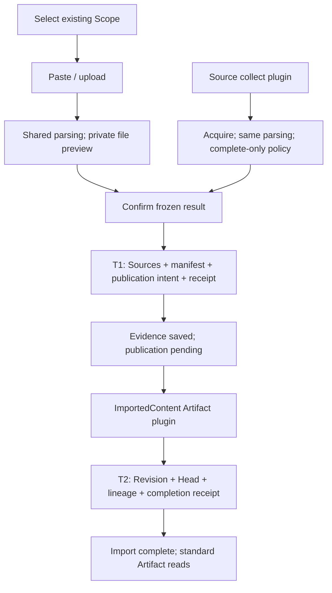
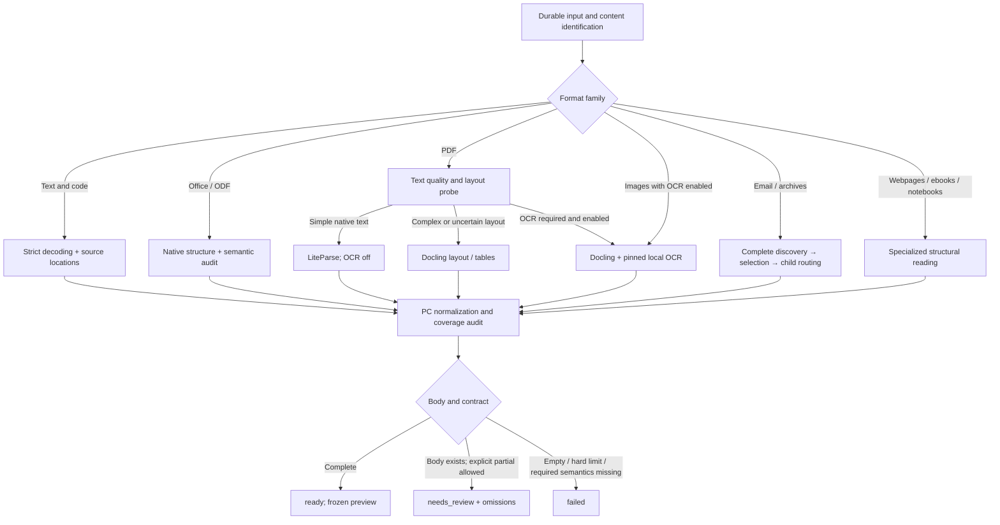
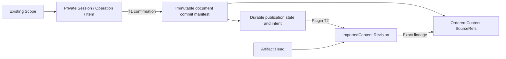
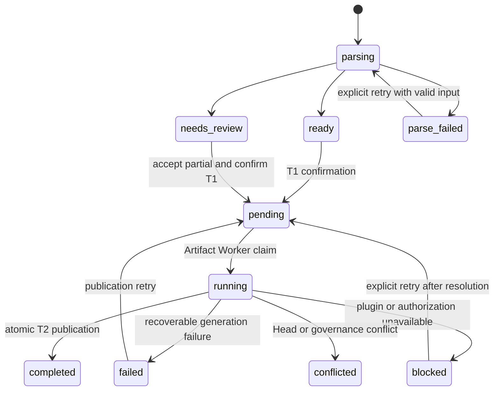

- Proposal Name: `text_material_import`
- Start Date: 2026-09-18
- Status: Proposed
- RFC PR: [oceanbase/powercontext#2073](https://github.com/oceanbase/powercontext/pull/2073)
- Design Baseline: [PowerContext master / cab054db (2026-10-19)](https://github.com/oceanbase/powercontext/tree/cab054dbf6d86e2311b079388e5158178257def2)
- Related RFCs: [Source Definition and Observation](1400_source_definition_and_observation_model.md), [Source and Artifact REST API](1437_source_artifact_rest_api.md), [Source access and generation eligibility](1458_artifact_generation_source_access.md), [Scope and Source discovery](1502_scope_source_discovery.md)

- Plugin Baselines: [Source #2210](https://github.com/oceanbase/powercontext/pull/2210) (`6ef5c494d701c355686806b6b1042d5729267690`), [Artifact #2246](https://github.com/oceanbase/powercontext/pull/2246) (`9fe2e68220a6e0aa8ebe4b78900cd12421db5cc3`).

# Summary

Provide import of text, office documents, webpage files, spreadsheets, email, ebooks, code, scans and archives. Users must select an existing Scope with `scope.read` and `scope.contribute`, paste or upload input, inspect a private parsed preview, and confirm. Continuous collection uses Source collect plugins and the same parsing components.

Confirmation has two durable stages. T1 atomically saves all `content` Sources for one document, an immutable commit manifest, publication intent and acceptance receipt. T2 lets the official ImportedContent Artifact plugin deterministically assemble the Artifact, while the framework atomically publishes its Revision, Head, lineage, declared indexes and completion receipt. T1 creates no Artifact. Evidence can be saved while publication is pending; `202` does not mean import completion. Completion requires T2 success or explicit reuse of a published revision.

One logical document has one `ImportedContent`, with family `importedcontent` and fixed `source_kind=content`. Body text lives only in Sources; the Artifact stores document metadata, parser provenance, omissions and ordered exact references. No LLM or Candidate approval is required. There is no separate ImportedContent main/version table or FileImportJob business resource.

This RFC separates existing plugin capabilities, required framework extensions and import-specific responsibilities. Both plugin PRs are dependency baselines, not claims of merged or complete import support. Complete-document input assembly, durable handoff and transactional completion are release prerequisites. Parser profiles expose actual available/unavailable/planned deployment status; recognition alone is not successful extraction. The overview infographic remains a separate deliverable, outside this RFC.

# Motivation

Source plugins unify acquisition, targets and runtime management. Artifact plugins unify generation, revisions, reads and declared search. Import reuses those frameworks while retaining upload, private preview, explicit confirmation, complete-document boundaries and recovery. A Source journal window is not a complete document, and a plugin checkpoint is not a user acceptance receipt.

Parse before saving evidence so accepted text matches the preview. Artifact generation consumes accepted exact evidence without downloading the original or repeating OCR. Memory and other downstream processing remain independently configured; neither evidence acceptance nor ImportedContent publication promises their completion.

# Guide-level explanation


## Supported formats and capability levels

The following matrix is the target. A is the base capability, B the standard document package, and C optional OCR or
extension adapters. Each published entry requires real fixtures. Missing dependencies mean unavailable; unfinished
adapters mean planned, not supported.

| Category | File types and common extensions | Level and extracted content |
| --- | --- | --- |
| Plain text and logs | `.txt`, `.text`, `.log`; explicitly selected extensionless text | A; body and line numbers |
| Markdown and lightweight markup | `.md`, `.markdown`, `.mdown`, `.rst`, `.adoc`, `.asciidoc`, `.org`, `.tex` | A; markup source, paragraphs, and lines; no typesetting execution |
| Data and configuration | `.csv`, `.tsv`, `.json`, `.jsonl`, `.ndjson`, `.yaml`, `.yml`, `.toml`, `.ini`, `.cfg`, `.conf`, `.xml` | A; original text and verifiable record/row/column locations; no object construction or external entities |
| Code and build files | `.py`, `.js`, `.ts`, `.jsx`, `.tsx`, `.java`, `.c`, `.h`, `.cpp`, `.hpp`, `.go`, `.rs`, `.sh`, `.bash`, `.zsh`, `.sql`, `.css`, `.scss`, `.vue`, `.svelte`, `.rb`, `.php`, `.swift`, `.kt`, `.kts`, `.scala`, `.r`, `.R`, `.lua`, `.pl`, `.ps1`, `.bat`, `.cmd`, `.proto`, `.graphql`, `.gql`, `.diff`, `.patch`; Dockerfile, Makefile, CMakeLists.txt | A; preserve text without running, compiling, or installing dependencies |
| Subtitles and records | `.srt`, `.vtt`, `.ass`, `.ssa`, `.ics`, `.vcf` | A; timestamps or original fields; no calendar/contact API calls |
| Saved webpages | `.html`, `.htm`, `.xhtml`, `.mhtml`, `.mht` | B; static DOM body, headings, lists, tables, and link text; no scripts, external fetches, or browser-computed visibility guarantee |
| PDF | `.pdf` | B; text layer, page numbers, extractable tables; scanned/mixed pages require C-level OCR |
| Word and templates | `.docx`, `.doc`, `.dot`, `.dotx`, `.docm`, `.dotm` | B; paragraphs, headings, tables, footnotes; macros never execute |
| Excel and templates | `.xlsx`, `.xls`, `.xlsb`, `.xlt`, `.xltx`, `.xlsm`, `.xltm` | B target; sheets, cell values, formulas, existing cached results, and ranges; full and values-only XLSB profiles have separate admission rules in Section 1.4 |
| PowerPoint and templates | `.pptx`, `.ppt`, `.pps`, `.pot`, `.ppsx`, `.potx`, `.pptm`, `.ppsm`, `.potm` | B; slide text, tables, speaker notes, and slide order |
| Open office formats and rich text | `.odt`, `.ott`, `.ods`, `.ots`, `.odp`, `.otp`, `.fodt`, `.fods`, `.fodp`, `.rtf` | B; document, sheet, or presentation content with corresponding location rules |
| Ebooks | `.epub`, `.fb2` | B; navigation, chapters, and body; no DRM decryption |
| Email and mailbox exports | `.eml`, `.msg`, `.mbox` | B; subject, sender information, body; one document per message, explicitly selected attachments |
| Notebooks | `.ipynb` | B; Markdown/code cells and saved text outputs; no execution or recalculation |
| XML documents and feeds | `.rss`, `.atom`, `.opml`, `.xlf`, `.xliff`, `.tmx`, `.svg` | A source preservation; B semantic text extraction; SVG text nodes only, no execution or graphical understanding |
| Images and scans | `.png`, `.jpg`, `.jpeg`, `.tif`, `.tiff`, `.bmp`, `.webp`; static `.gif` | C; OCR text, image/page order, and available locations; animated GIFs cannot silently use only the first frame |
| Batch archives | `.zip`, `.tar`, `.tar.gz`, `.tgz`, `.gz`, `.bz2`, `.xz` | B; safe expansion and per-member identification/import; an archive is not a body format |
| Extended archives | `.7z`, `.rar`, `.tar.bz2`, `.tbz2`, `.tar.xz`, `.txz` | C; installed and validated unpacking adapters required |
| Proprietary/long-tail formats | `.pages`, `.numbers`, `.key`, `.wps`, `.et`, `.dps`, `.wpd`, `.hwp`, `.chm`, `.one`, `.pst`, `.mobi`, `.azw`, `.azw3`, `.heic`, `.heif` | C extension targets; admission per format generation, actual body extraction, decoder, and license; a generic parser installation is insufficient |

A and B are the formal delivery scope; C uses the same extension mechanism with deployment-specific enablement. A
lightweight installation may enable only A. Standard installations must bundle and pin B dependencies. Reading
WPS-produced DOCX/XLSX/PPTX does not imply native WPS/ET/DPS support; detecting newer iWork containers does not prove
body extraction.

The explicit “read as plain text” fallback is not limited to listed suffixes, but must pass encoding, control-character,
and size checks. Directory collection scans allowed types, not every decodable file. Defaults exclude keys, credentials,
`.env`, version-control directories, dependencies, and build outputs; users can explicitly select other rules.

Audio/video transcription, arbitrary database dumps, executable decompilation, graphic/chart reasoning, and breaking
encryption/DRM are out of scope. Yuque, webpage, and Git URL acquisition belong to independent Connectors. Importing
local HTML or exported Markdown does not implement URL fetching.

## User flow

An entry inside a Scope may preselect it; a global entry requires an existing Scope. If none is available, direct users to existing Scope management. Import does not create Scopes. Sessions bind one Scope and creator; changing the target requires a new session.

Display available formats, limits and parser/publication readiness first. A text request itself confirms its input. Files require a preview of text, page/sheet/slide counts, parts, OCR and omissions before confirmation. Partial extraction requires explicit acceptance. Cancellation, expiry and unconfirmed previews create no official Sources.



Distinguish parsing, awaiting confirmation, evidence saved/publication pending, publication blocked/failed, and import complete. After T1, evidence is visible in the Scope and eligible downstream processors may consume it. New documents do not appear in Artifact lists until T2. Updates leave the old Head readable until T2 succeeds.

Names and digests never automatically merge documents. Manual creation assigns a new identity; updates explicitly specify artifact_id and expected_head_revision. At most one nonterminal publication commit exists per document. Recover that commit after failure instead of uploading again. Publication failure or cancellation of remaining input does not roll back accepted evidence.


## Format-specific behavior

- **Encoding:** UTF-8, BOM-marked UTF-16/UTF-32, and explicitly specified GB18030, GBK, Big5, Windows-1252, ISO-8859-1. Detection suggests an encoding; except for BOM and strictly valid UTF-8, guesses require confirmation. Never hide decode errors with replacement characters.
- **Sheets:** preserve sheet names and cell coordinates across all sheets. CSV/TSV retain source text and may add validated record/column locations. Never recalculate or refresh links. Hidden sheets/rows/columns are included and marked by default; explicit pre-preview exclusion enters snapshot identity.
- **Slides:** preserve slide order and separate notes. Include and mark hidden slides by default. Image text requires OCR and must not be counted as already read.
- **Word/open documents:** extract headings, body, tables, and footnotes under declared rules. Use the accepted-changes view. Comments are excluded by default with counts; optional inclusion records authors. A parser unable to produce these views reliably reports insufficient capability.
- **HTML/notebooks:** do not execute JavaScript/cells or fetch CSS, images, or links. Include saved notebook text outputs by default; hidden metadata, rich media, and widgets are not body text.
- **PDF/OCR:** choose native text or OCR per page/region without double counting. Distinguish blank, image-only, and failed pages. OCR is machine recognition, not an exact transcription guarantee. Unavailable layout/page counts are unknown, not proof of completeness.
- **Email/archives:** retain quoted history; select one plain-text or HTML alternative and record the rule. List attachments by default but import only selections. Expand the first archive layer by default; nesting requires explicit enablement and depth limits. Keep failed/unselected members in the manifest.

# Reference-level explanation

## 1. Architecture and plugin reuse boundaries

| Capability | Evidence and status | Use in this feature |
| --- | --- | --- |
| Source discovery, loading, Scope authorization, write/collect routing | Reuse #2210 | Admin deployment and ordinary Scope operations; discovery is not parser support |
| collect instances, targets, independent Runtime, lifecycle and checkpoints | Reuse #2210 | OpenDAL becomes a collection plugin; no parallel instance manager |
| Synchronous `content.inline` | Exists in #2210; not the complete-import path | Single-Source capture does not replace document confirmation |
| Artifact Family/schema, ArtifactDraft, Worker and lifecycle | Reuse #2246 | Official importedcontent plugin generates deterministically, without an LLM |
| Revisions, Head CAS, lineage and standard reads | Reuse #2246 and existing Artifact persistence | No separate document version system; explicitly integrate Scope-shared authorization |
| Declared indexes, construction and queries | Reuse #2246 when declared for a deployment | Initially only fields stored in content, such as title/origin; no automatic Source-body dereference |
| Upload, controlled staging, private preview, parsing and confirmation | New in this RFC | Isolated file workers; retain import-specific APIs |
| `document_commit` input, exact part reads and evidence validation | Required framework extension | Replaces journal-window triggering for this family; not an existing InputContract field |
| Durable T1 handoff, transactional T2 completion, receipts and recovery | New integration in this RFC | Connect two transactions; an in-memory notification is insufficient |
| Public collect adapter for import submission and checkpoint acknowledgement | Required Source integration extension | Do not access the private Context client or treat run_batch as document-atomic submission |

Pinned evidence: [Source write](https://github.com/oceanbase/powercontext/blob/6ef5c494d701c355686806b6b1042d5729267690/src/powercontext/source_management/write.py), [Source Context](https://github.com/oceanbase/powercontext/blob/6ef5c494d701c355686806b6b1042d5729267690/src/powercontext/source_management/context.py), [Artifact SDK](https://github.com/oceanbase/powercontext/blob/9fe2e68220a6e0aa8ebe4b78900cd12421db5cc3/src/powercontext/artifact_plugins.py), [Artifact Worker](https://github.com/oceanbase/powercontext/blob/9fe2e68220a6e0aa8ebe4b78900cd12421db5cc3/src/powercontext/builtin/runtime/artifact_plugins.py). These establish the reusable baseline; the new contracts require separate implementation and acceptance.

Source write executes synchronously inside Server and submits one observation: add JSON is limited to 1 MiB and an observation to 4 MiB. It is not the large-file/OCR path. Custom write plugins cannot override a built-in Definition, so registering content again cannot implement this feature. collect can run remotely; current local collect process management requires Linux, not a claimed macOS/Windows deployment.

Artifact generation currently uses journal windows, a 1 MiB input budget and direct Source evidence limited to the invocation. Artifact reads in GenerationContext do not provide arbitrary historical Source reads. The 8 MiB/128-part document contract needs document_commit input support; increasing max_sources or bypassing validation is insufficient. A trusted Server adapter assembles it without changing other families' window budgets.

The importedcontent binding uses only document_commit mode, never automatic consumption of every content Source. New plugins start disabled; deployment must load and explicitly enable the plugin and verify schema, permissions, document budgets and adapter readiness. Install parser dependencies at deployment time. Complex parsing runs separately; the Artifact plugin consumes exact saved evidence only.


### 1.1 Parser responsibilities and selected components

Prefer native structure, route PDF by layout, and enable OCR explicitly. PowerContext owns detection, structural
auditing, bundle normalization, evidence segmentation, operations, and persistence. Libraries decode formats and perform
layout/OCR; this proposal does not build a general OCR model. Profile names below are proposed product contracts, not
existing upstream APIs or completed adapters.

| Component | Selected responsibility | Excluded responsibility |
| --- | --- | --- |
| Native text/container adapters | Strict decoding; CSV/JSON/XML locations; OOXML/ODF audits; email/archive discovery | No execution or LLM rewriting |
| LiteParse | Simple PDF text, geometry, and complexity signals; built-in OCR off on the standard path | No universal Office-to-PDF conversion; cleaned Markdown cannot replace complete evidence |
| Docling | Complex PDF layout and modern Word/open-document structure; selected local OCR engine when enabled | No material identity, commits, indexing, or direct reuse of retrieval chunks as Sources |
| openpyxl / Apache POI | Native cells, formulas, stored values; POI also adapts legacy Office | No formula calculation, refreshed connections, or workbook printing to PDF |
| python-pptx + OOXML audit | Modern slide text, tables, notes, hidden state | No macros, animation interpretation, or chart reasoning |
| Apache Tika | Controlled legacy, RTF, MSG, and admitted long-tail parsing | No unrestricted autodetection, recursion, cloud OCR fallback, or metadata-only success |
| Local RapidOCR | Scanned PDFs/images through Docling; initial target languages Simplified Chinese and English | No automatic external transfer; Traditional Chinese, other languages, and handwriting require separate validation |
| MinerU / DeepDoc / LlamaParse | Independently enabled C-level alternatives; LlamaParse is external or enterprise self-hosted | No implicit fallback from standard profiles |
| LlamaIndex | Optional future Reader/retrieval-transform reference and indexing use | Does not own transactions, versions, or Sources; no default silent Reader error skipping |

Selections draw on the [RAGFlow study](https://yuque.antfin.com/obopensrc/knowledge_sharing/lmziuic5tzhgny8c),
[Docling/MinerU study](https://yuque.antfin.com/obopensrc/knowledge_sharing/rcga2z7gr8r3vwbo), and [LiteParse/LlamaIndex
study](https://yuque.antfin.com/obopensrc/knowledge_sharing/yl6nfo4yugep4n6a). These are implementation choices, not a
quality ranking. Initial adapter baselines are LiteParse Python 2.14.7 and Docling 2.129.0; MinerU 4.0.5 is an optional
validation baseline. Release images must pin transitive dependencies, models, and conversion tools, never `latest`. Pin
other components and image digests after fixture and security validation.

### 1.2 Level A: native text, markup, and locations

Each group covers all corresponding extensions in the matrix. A preserves decoded original text; structural parsing adds
verifiable locations without rewriting the body by default.

| Input | Default profile and implementation | Extraction, locations, and failures |
| --- | --- | --- |
| TXT/TEXT/LOG, explicit extensionless text | `text-native-v1`: strict Python codecs | Preserve newlines, indentation, characters, lines; uncertain encoding requires confirmation |
| Markdown/RST/AsciiDoc/Org/TeX | `markup-source-v1`: same decoder; optional markdown-it-py block identification | Preserve markup source; no TeX rendering, includes, plugins, or remote resources |
| All code/build/diff/patch files | `code-source-v1`: original text and line index | No compiler/formatter; failed language recognition does not discard text |
| CSV/TSV | `delimited-text-v1`: source plus Python csv reader | Freeze delimiter, quotes, encoding; logical records, fields, source ranges; multiline fields allowed; ambiguous delimiter requires confirmation |
| JSON/JSONL/NDJSON | `json-source-v1`: bounded syntax scanning and record parsing | Preserve source and duplicate-key order; record/field occurrence locations; never replace source with dict serialization |
| YAML/YML/TOML/INI/CFG/CONF | `config-source-v1`: source; optional PyYAML SafeLoader, tomllib, interpolation-disabled ConfigParser validation | Bound YAML aliases/depth, no arbitrary construction; ambiguous key locations fall back to source lines |
| XML | `xml-source-v1`: DTD/entities/network disabled | Source, node paths, namespaces, available lines; no XInclude/XSLT |
| SRT/VTT/ASS/SSA | `subtitle-source-v1`: text and bounded timestamp scan | Original fields and time ranges; no sorting or translation |
| ICS/VCF | `record-source-v1`: source, folded lines, record boundaries | Distinguish physical lines/logical records; no calendar/contact calls |
| RSS/Atom/OPML/XLF/XLIFF/TMX/SVG source mode | `xml-source-v1` | Source preservation; semantic extraction uses a separate B profile, never silent switching |

Failed auxiliary validation reports usable source text but unavailable structural locations. If the selected profile
requires complete structure, fail or require review rather than substituting source mode. A's source fidelity does not
depend on structural parsing, but encoding, control-character, and size checks remain mandatory.

### 1.3 PDF: native text, layout, and OCR routing

`pdf-standard-v1` is a pinned composite profile. LiteParse first performs bounded probing. Use its structured
`text_items` when the entire native text layer is usable and no complex-layout signal exists. Multiple columns, complex
tables, unusual order, or uncertainty route to Docling's standard layout/table path. Both disable OCR and generative
enhancement by default; fixture-validated routing thresholds are versioned profile configuration.

| PDF condition | Parsing | Completeness rule |
| --- | --- | --- |
| Simple native text, normal reading order | LiteParse JSON/structured output → ordered PC blocks | Physical page order, display labels, dimensions, available bbox; not Markdown that drops headers/footers by default |
| Multiple columns, complex tables, contents/footnote layout | Docling pipeline, DoclingDocument and provenance | Structure/reading order; table rows, columns, merges, original page locations; not rendered Markdown alone |
| Scanned/mixed/garbled text, `ocr_mode=off` | Usable native text only; identify OCR-required pages/regions | Body exists: needs_review; metadata-only/empty: ocr_required or no_extractable_text failure |
| Scanned/mixed, `ocr_mode=auto` | Docling + pinned local RapidOCR where needed | Region deduplication; actual engine, language, OCR execution and omissions; needs_ocr is not proof of execution |
| `ocr_mode=force` | Same engine, forced within declared range | Use configured OCR output without duplicate native text; preview policy and possible quality changes |
| Unreliable formulas, handwriting, complex charts | Keep usable text/locations and report objects | Never invent text; user may start another attempt with a C-level MinerU/DeepDoc/LlamaParse profile |

`needs_ocr` and layout complexity are separate signals. No OCR requirement does not imply simple layout. Count source
pages, requested ranges, returned pages, blank pages, and failures independently. Engine `max_pages` truncation is not
completeness; an unrequested partial range caused by a hard limit rejects the document.

Choose one body backend per PDF in this release; it may use native text or OCR internally by page. Do not splice
different engines page by page because tables, reading order, and coordinates may disagree. Probe results may be cached,
but are not an interchangeable cross-engine representation. If cross-page table merging is unreliable, retain separate
tables/page ranges and report the unresolved relationship.

Include extractable headers/footers by default and mark their block types. Profiles declare watermark, annotation, form,
and image-text inclusion. An unenabled category is not a known zero; detected but unprocessed content enters omissions.
Locations describe provenance, not a promise of permanent binary PDF preview.

### 1.4 Level B: Office and open office formats

Native structure takes precedence over print layout. Modern Office is not converted to PDF by default. Identify
templates and macro variants by MIME, container content types, and relationships; read the original container rather
than renaming suffixes to bypass library limitations.

| Input | Default profile/backend | Preservation and admission |
| --- | --- | --- |
| DOCX/DOTX/DOCM/DOTM | `word-ooxml-v1`: Docling DOCX + PC OOXML audit/supplement | Headings, body, tables, footnotes/endnotes, revision view, selected comments; no macros; unsupported variants need a controlled OOXML adapter or remain planned |
| DOC/DOT | `word-legacy-v1`: controlled Tika OfficeParser / POI HWPF plus audit | Flat text does not prove footnote/revision/comment completeness; unreliable selected views fail capability_insufficient, without silent PDF conversion |
| XLSX/XLTX/XLSM/XLTM | `sheet-ooxml-v1`: openpyxl + raw OOXML cells/relationships | Sheets, A1 coordinates, types, merged ranges, hidden state, formulas/cached values; count macros as excluded objects |
| XLS/XLT | `sheet-biff-v1`: POI HSSF | Available formula-token expression and stored cache; no FormulaEvaluator; validate/reject individual BIFF generations |
| XLSB | `sheet-xlsb-v1`: POI XSSFB events plus explicit structure adapter | Full formula-and-value contract must pass before available; values-only is a separate profile, below |
| PPTX/PPSX/POTX/PPTM/PPSM/POTM | `slides-ooxml-v1`: python-pptx + raw OOXML audit | Slide order, text boxes/group text, tables, notes, hidden slides; template handling belongs to adapter, not file mutation |
| PPT/PPS/POT | `slides-legacy-v1`: POI HSLF in Java worker | Native slides/notes; do not infer page boundaries from Tika's concatenated text; unknown OLE/graphics are omissions |
| ODT/OTT/FODT | `odf-text-v1`: Docling + safe PC ODF XML | Validate package/flat forms, headings, tables, comments, revision views; no fallback to all XML text |
| ODS/OTS/FODS | `odf-sheet-v1`: safe native PC ODF XML | Tables/rows/columns, repeats, merges/covered cells, hidden state, formulas/stored values; budget repeats before expansion |
| ODP/OTP/FODP | `odf-slides-v1`: safe native PC ODF XML | draw:page order, text boxes, tables, notes, display state; explicitly downgrade location capability if object identity is unstable |
| RTF | `rtf-native-v1`: structured Tika RTFParser + PC normalization | Body/paragraphs, available tables/footnotes; list embedded objects without execution; report unsupported control groups |

**Word supplemental reads are adapter work, not a claim that Docling/python-docx implements everything.** Audit OOXML
relationships for paragraphs, tables, footnotes/endnotes, comments, and revision nodes. The accepted view includes
insertions/moveTo and excludes deletions/moveFrom; unsupported property or complex revisions cannot be guessed. Reject
profiles unable to produce that view. Another view requires supported capabilities and a new attempt. Insert
supplemental text at original anchors without duplicating or reordering it at the end.

**Never recalculate workbooks.** Align XLSX formula and `data_only` views by identical input digest, sheet, and
coordinates; read `<f>` and `<v>` directly when needed to distinguish empty cells, cached empty strings, and missing
caches. Formula, cached value, type, and formatted display are separate fields. Preserve external references as strings
without fetching. Report affected ranges for broken shared/array formulas or dynamic structures.

**XLSB is a known admission risk.** POI's public XSSFB documentation limits formula-expression extraction; readable XLSB
does not imply formula fidelity. `sheet-xlsb-v1` remains planned until its full contract works. An explicitly selected
`sheet-xlsb-values-v1` may import cached values only when sheets/cells/hidden ranges are verifiable. It always requires
review, declares omitted formula expressions, and requires `accept_partial`. Unverifiable coverage or no body still
fails. This does not complete B-level XLSB delivery and cannot satisfy automated complete-only collection. See [POI XLSB
limitations](https://poi.apache.org/apidocs/5.0/org/apache/poi/xssf/extractor/XSSFBEventBasedExcelExtractor.html).

**LibreOffice is outside the standard workbook path.** Conversion can change cached formulas, fonts, pagination, and
object semantics. Do not convert XLS/XLSB/ODS to XLSX/PDF to bypass the no-recalculation contract. Document conversion,
if needed, requires a separately published extension profile validated for no external links, macros, or computational
side effects; initial sheet guarantees cannot depend on it.

### 1.5 Level B: webpages, ebooks, email, notebooks, and archives

| Input | Default profile/implementation | Body/member rules |
| --- | --- | --- |
| HTML/HTM/XHTML | `html-dom-v1`: html5lib + PC DOM traversal; safe XML for XHTML | Headings, paragraphs, lists, tables, link text; exclude script/style/template and explicitly hidden nodes; no CSS/JS execution or browser visibility guarantee |
| MHTML/MHT | `mhtml-native-v1`: Python MIME → selected root HTML → html-dom | Identify root using root-part data/content-location; ambiguous roots fail; embedded resources listed, never fetched by URL |
| EPUB | `epub-spine-v1`: safe ZIP → container/OPF → spine → html-dom | Reading order, chapters, navigation, text; not ZIP filename order; no scripts, remote resources, or DRM |
| FB2 | `fb2-native-v1`: safe XML → body/section/notes | Body, chapters, footnote references; binary images are not text |
| EML | `mail-rfc822-v1`: Python email BytesParser | Decode headers/MIME; prefer usable text/plain in multipart/alternative, otherwise html-dom; list CID images/attachments, no double body |
| MBOX | `mailbox-mbox-v1`: bounded iteration + mail-rfc822 | Discover before selection/parsing; retain ordinal, available Message-ID, container chain; duplicate Message-ID is not unique identity |
| MSG | `mail-msg-v1`: controlled Tika/POI HSMF | Subject/sender/body; HTML via html-dom, RTF via rtf-native; recursive concatenation cannot replace complete attachment discovery |
| IPYNB | `notebook-native-v1`: bounded JSON + nbformat | Original Markdown/code/raw cell order; saved text/plain, stdout/stderr, textual errors by default; explicit sanitized HTML inclusion; rich media/widgets excluded |
| RSS/Atom/OPML | `feed-xml-v1`: format-specific safe XML mapping | Feed/channel/entry/item/outline titles, body, link text and node paths; no linked-body fetch |
| XLF/XLIFF/TMX | `translation-xml-v1`: schema-specific source/target/segment | Unit ID, language, source and translation marked separately; no duplicated combined body; validate XLIFF generations separately |
| SVG semantic mode | `svg-text-v1`: safe XML text/tspan/title/desc | No rasterization/script execution, path-text/graphic understanding, or image-resource fetch |
| ZIP/TAR/TAR.GZ/TGZ | `archive-native-v1`: bounded Python zipfile/tarfile streaming | Complete discovery before selection and dispatch; no extractall to arbitrary paths; reject links/devices/duplicate paths |
| GZ/BZ2/XZ | `compressed-stream-v1`: standard-library decoders | Reidentify decompressed stream: TAR enters archive discovery, otherwise one child document; not every stream is a multi-file archive |

Python MIME/mailbox provide basic reading; PC still owns budgets, malformed structures, selection, and identity. A
returned object does not prove a complete manifest. See [email
parser](https://docs.python.org/3/library/email.parser.html) and
[mailbox](https://docs.python.org/3/library/mailbox.html).

Tika invokes only registered format parsers with automatic OCR, network, and uncontrolled embedded recursion disabled.
Controlled callbacks expose attachments/resources for discovery rather than silently adding them to body text. If
detected attachments cannot be fully enumerated, discovery fails rather than publishing a selectable “complete” list.
Unselected embedded objects in ordinary documents follow declared exclusions.

### 1.6 Level C: OCR, alternative engines, and long-tail formats

| Input/need | Selected extension | Enablement/limits |
| --- | --- | --- |
| PNG/JPEG/BMP/WebP/static GIF | `image-ocr-v1`: Pillow decode/orientation → Docling + local RapidOCR | Explicit OCR; original-to-rotated coordinate mapping; no chart reasoning |
| Multipage TIFF/TIF | `image-multipage-ocr-v1`: bounded all-page enumeration → same OCR | Per-page counts, pixels, OCR budget; failed pages reported; not first frame only |
| Animated GIF/multiframe variants | Reject by default | Separate profile requires frame semantics and repeated-text validation |
| HEIC/HEIF | `heif-ocr-v1`: pillow-heif/libheif → image OCR | Distinguish primary, thumbnail, auxiliary, sequence images; fixed selection; metadata alone is insufficient |
| Alternative complex PDF/scans | `pdf-mineru-v1` / `pdf-deepdoc-v1` | Direct MinerU structure protocol or isolated DeepDoc wrapper; pin tier/models; no indirect whole-RAGFlow integration |
| Optional parsing service | `document-llamaparse-v1` | Explicit deployment enablement/user choice and visible data destination; pinned API/version/tier; download then freeze results; never automatic external fallback |
| 7Z/RAR | `archive-libarchive-v1`: validated libarchive-c decoders | Safe enumeration and bounded reads; per-method/generation admission; encrypted inputs rejected |
| TAR.BZ2/TBZ2/TAR.XZ/TXZ | `archive-native-extra-v1`: standard decompressor + tarfile | Same archive budgets; C switch remains required despite available dependencies |
| Pages | `iwork-pages-v1`: Docling format-iwork | Validate body/structure per generation; otherwise planned; metadata-only newer Tika support is insufficient |
| Numbers/Keynote | `iwork-legacy-v1`: only Tika-readable, structurally validated older generations | New generations planned; sheet/slide contracts mandatory; otherwise request XLSX/PPTX export |
| Native WPS/ET/DPS | `wps-native-v1`: reserved controlled adapter, initially planned | Export DOCX/XLSX/PPTX; renaming, recognition, or PDF printing is not native support |
| WPD | `wordperfect-tika-v1`: Tika WordPerfectParser | Validated generations and scope only |
| HWP | `hwp-tika-v1`: Tika HwpV5Parser | HWP v5 validation does not cover all HWP/HWPX |
| CHM | `chm-tika-v1`: controlled ChmParser discovery → html-dom | No help-program execution; require verifiable chapter order |
| ONE | `onenote-tika-v1`: Tika OneNoteParser | Validate pages/sections/embedded objects; not full notebook synchronization |
| PST | `pst-tika-v1`: controlled OutlookPSTParser discovery → mail adapter | Require complete folders/messages/attachments and stable identity rules; no mailbox account linkage |
| MOBI/AZW/AZW3 | `ebook-calibre-v1`: isolated ebook-convert → EPUB → epub-spine | DRM-free validated variants only; pinned conversion/options and loss reporting; disabled by default |

References: [Tika formats](https://tika.apache.org/docs/4.0.x/formats.html), [Docling
formats](https://docling-project.github.io/docling/usage/supported_formats/),
[pillow-heif](https://pillow-heif.readthedocs.io/en/stable/pillow-plugin.html), and [calibre
conversion](https://manual.calibre-ebook.com/generated/en/ebook-convert.html). Profiles are PC implementation choices;
upstream support does not prove compliance with every required semantic.

### 1.7 Routing, fallback, and freezing



Freeze router/profile versions and candidate chain at input acceptance; record the selected branch after probing.
`pdf-standard-v1` only selects LiteParse or promotes to Docling under declared rules. No voting or default all-engine
execution. Fallback cannot enable OCR, bypass insufficient capability, encryption, budgets, or prohibited external
transfer.

Allow at most one alternate parse for technical failure or structural validation failure, only when the profile
predeclares another local candidate with the same extraction contract. Share the original deadline and cumulative
resources. No fallback after a bundle is frozen. Engine, OCR, view, or acceptance-scope changes require a new attempt.
Missing required declared backends return parser_unavailable; incidental installed libraries do not alter routing.

Record selected_profile, router_version, actual_backend, engine/model versions, conversion chain, routing reason, actual
OCR execution, output schema, and normalization version. Profile digest covers selection policy; bundle/snapshot digests
cover the actual semantic chain. Equal text from different engines cannot hide different locations, coverage, or
processing provenance.

### 1.8 Deployment units and delivery scope

The base installation contains lightweight A dependencies. Standard B workers pin LiteParse, Docling, openpyxl,
python-pptx, HTML/XML/notebook adapters, with Tika/POI in a separate Java worker. PC's ODF/OOXML supplements share safe
XML and container budgets, not duplicated unbounded XML entry points. OCR models, MinerU/DeepDoc, commercial services,
proprietary decoders, calibre, and libarchive are separately packaged/enabled.

Standard workers may include layout models. OCR engines/language packs run only with C enabled. Prepare
dependencies/models at deployment, never download/install/update while parsing user files. Bound process pools,
concurrency, PDFium global locks, Java heaps, and OCR workers independently to prevent backend CPU oversubscription.

B is a delivery target, not unconditional availability. Profiles missing required semantics remain planned. An explicit
partial profile may serve manual import but does not complete B delivery. Display body/formula/comment/location
capabilities rather than one misleading supported checkmark.

## 2. Capability discovery and identification

### Protocol compatibility and runtime availability

Keep the existing separation between Server discovery surfaces. Package versions or static contracts do not establish
parser health.

| Endpoint | Responsibility and proposed extension |
| --- | --- |
| `GET /v1/server-info` | Deployment identity and compatibility. Add `content.import: {major: 1, minor: 0}` to OpenAPI `x-powercontext-feature-contracts`; protocol support is not enablement |
| `GET /v1/capabilities` | Add optional `content_import` with `enabled`, `readiness` (ready/degraded/unavailable), and `capabilities_endpoint`. Absence cannot imply support. Runtime summary does not replace format health or Scope authorization |
| `GET /v1/scopes/{scope_id}/import-capabilities` | Actual formats, profiles, limits, and caller permissions for an existing Scope; drives UI availability |

`content.import` and `content_import` are new contracts requiring OpenAPI, generated code, Server assembly, and client
compatibility tests. The existing global endpoints retain `server.observe`. Ordinary callers with only Scope permissions
can query the Scope-level endpoint directly; global observation is not an import prerequisite. That response also
includes import protocol version and enablement, avoiding write probes.

Import-service configuration owns API enablement; the Dashboard switch controls only its UI write entry point. Ready
means all enabled, declared-available profiles passed health checks; partial failure is degraded while healthy profiles
remain usable; disabled/no usable profiles is unavailable. Planned profiles do not degrade enabled capabilities.
Disabling imports or losing parser availability does not block published Artifact/Source reads. Discovery is a current
snapshot: operation creation, retry, and commit recheck applicable permission, runtime state, and frozen-result validity. An
unrelated parser outage cannot cause confirmation to reparse or discard frozen text.

### Format and profile identification

The new `GET /v1/scopes/{scope_id}/import-capabilities` endpoint requires an existing `scope_id` and `scope.read`; malformed path IDs return 400; absent/invisible Scopes follow 404/403 policy.
It reports `scope.contribute`, but starting import requires both permissions. Return fixed `source_kind=content`,
extensions, canonical MIME, capability level, available/unavailable/planned status, parser profiles, extraction scope,
OCR/conversion dependencies, and actual limits. Registration plus startup self-checks establish status; an API-mounted
parser does not prove a healthy backend.

Combine magic, container structure, declared MIME, and extension. Suffix matching is case-insensitive; source-path
identity preserves case. A PDF disguised as TXT routes as PDF or fails type mismatch, never blind decoding. Recognize
DOCX/XLSX/PPTX/EPUB as specialized containers before generic ZIP discovery.

Reject unknown binary inputs. Extensionless/unknown-suffix text uses fallback only with explicit `as_text`, recorded in
the response. Server and workers use the same pinned profile.

Per format generation and profile, return profile_id, profile_digest, router_version, default flag, backend candidates,
installed versions, extraction_scope, required_features, optional_features, locator_kinds, known_limitations,
dependencies, data destinations, and limits. Declare formulas, caches, comments, revisions, notes, hidden content,
attachment discovery, and OCR independently. Unhealthy dependencies mean unavailable; incomplete adaptation/semantic
validation means planned; available requires every prerequisite for that exact scope, not complete support for every
same-suffix profile.

A suffix may offer full and explicitly selected partial profiles; routing cannot silently downgrade. Unknown/conflicting
options return 422. Required semantics found unsupported after identification fail capability_insufficient.
`accept_partial` cannot bypass identification, safety, size, encryption, or user-required semantics. Only profiles
declaring permitted partial output may produce needs_review when usable body and explainable omissions exist.

Publication readiness is reported separately. Source capability discovery does not establish file-format support. If document_commit input support, the ImportedContent plugin or its registered schema is unavailable, reads and private previews remain available but confirmation returns 503 publication_unavailable. Transactional admission resolves races with plugin transitions; already accepted commits wait durably.

## 3. Data model and persistence

ImportedContent is the document identity; Session/operation/item identify input attempts. commit_id identifies one accepted immutable snapshot and its publication handoff. Commit status is not a second document catalog, arbitrary CRUD resource or Artifact Revision.



The following are logical table responsibilities. Implementation freezes actual SQL names, constraints and migrations. No business table is added per file extension.

| Persistent structure | Ownership | Responsibility and constraints |
| --- | --- | --- |
| `pc_sources`, Source journal, existing processing intents | Reuse Core | Immutable bodies, exact references and downstream work registration |
| `pc_artifacts`, `pc_artifact_heads`, Source/Artifact lineage tables | Reuse Artifact | Sole published document and version authority |
| Family/schema, binding/lease/cursor, index definitions/state/projections | Reuse #2246 | No duplicate plugin registration, scheduling or indexing tables; its eight logical framework tables are not import-specific additions |
| collect instance, target and checkpoint state | Reuse #2210 | No duplicate lifecycle; not private previews or complete-document receipts |
| `pc_import_sessions` | New import responsibility | Creator, fixed Scope and expiry |
| `pc_import_operations` | New import responsibility | Durable input, discovery, selection, leases, quotas and parsing state |
| `pc_import_operation_items` | New import responsibility | Unique `(operation_id,item_id)`; frozen parse result/target and commit_id, not permanent body copies |
| `pc_import_source_authorities` | New / connection configuration integration | Trusted connection, fixed root/bucket, allowed Principals and Scope; origin cannot grant authority |
| `pc_import_source_bindings` | New import responsibility | Unique `(scope_id,authority_id,source_key)` to artifact_id; digest indexes retain collision checks against the full key |
| `pc_import_request_receipts` | New import responsibility | Caller, operation, normalized fingerprint, original HTTP status/body for exact replay |
| `pc_import_quota_ledger` | New import responsibility | Shared Principal/Scope/deployment reservations and usage, CAS and reconciliation |
| `pc_import_commits` | New import responsibility | commit_id, Scope, artifact_id, frozen target/expected Head, accepter, full manifest, acceptance semantics and SourceRefs; immutable after T1 |
| `pc_import_publications` | New / framework durable handoff integration | Unique commit_id; state, generation, leases, retries and completed ArtifactRef; document reservation permits one nonterminal commit per target |

There are nine new logical import persistence responsibilities. Any physical reuse of quota/connection tables must be explicit in the migration manifest without dropping constraints. Commit manifests contain no duplicate body, only recovery and exact input assembly data. Pending publications are not deleted by staging TTL. Retain a lightweight commit_id-to-ArtifactRef result with the revision so callers and collect can verify outcomes after short-lived request receipts expire.

source_kind remains content for pasted text, files and future webpages; entry point, MIME, origin and parser carry distinct information. Omitted and explicit content normalize identically; other values return 422. SourceRef still uses source_type. Saved evidence and published documents are Scope-readable; private operations require their creator or an explicitly authorized administrator.


### Revision content

| Field | Constraint |
| --- | --- |
| `schema_version`, `title` | Trimmed title: 1–256 Unicode characters |
| `source_kind`, `origin` | content; required namespace/key, optional display_name (1–256 Unicode characters, no controls); provenance only |
| `input_media_type`, `input_bytes`, `input_digest` | Original type, byte length, SHA-256; pasted input is received UTF-8 |
| `text_media_type`, `text_bytes`, `text_digest` | text/plain or text/markdown; complete extracted length/digest |
| `parser` | selected_profile/digest, router_version, actual backend/version, route reason, conversion chain, output schema, normalization/segmentation version, encoding, OCR model/language/execution; semantic fields enter frozen digest |
| `bundle_digest`, `snapshot_digest` | Frozen extraction and acceptance semantics; not logical identity; exclude execution/persistence-assigned IDs |
| `content_manifest` | Ordered ordinal, bytes, part digest, full-text character interval, location; no SourceRef/journal position/staging blob ID |
| `parts` | SourceRef and journal position per ordinal, one-to-one with manifest and exactly matching lineage.sources order |
| `coverage`, `warnings`, `omissions`, `accepted_partial` | Completeness within declared scope and explicit acceptance; preserve known omissions |
| `container_chain` | Ancestor digests, member paths/ordinals, provenance; separate from cross-snapshot stable member identity |

Body text is stored only in immutable Content Sources. Source metadata records artifact_id, commit_id, ordinal, source_kind, origin and locations; it must not predict a future Artifact revision or be rewritten after publication. The Artifact content also records commit_id. Captures must remain ordinary content: working_note=False, internal=None and handoff_receipt=False; reserved roles or metadata are rejected.

namespace is at most 128 characters; key at most 1024; both nonempty, without outer whitespace or controls. File keys
are relative POSIX paths; reject absolute paths, backslashes, `.`, `..`, empty components; do not case-fold. Do not
store credentials, signed URLs, or local absolute paths. origin is required and namespace/key are caller supplied.
CLI/UI may generate visible labels, but cannot match existing Artifacts by filename. A pasted-text key is a provenance
label, not a stable binding.

The Source metadata and digest rules use commit_id rather than a future Artifact revision. The completed commit status provides the exact ArtifactRef; publication never mutates Source metadata.

### Logical document identity

| Input | Stable identity |
| --- | --- |
| First manual upload/paste | Allocate artifact_id even for equal name/content; replay of the same creation key returns that document |
| Explicit update | artifact_id + expected_head_revision; name, format, body may change |
| OpenDAL directory | Scope + stable source_authority_id + relative path; namespace/display name cannot replace authority |
| OpenDAL object storage | Scope + stable source_authority_id + object key; not ETag, mtime, or digest |
| Future knowledge-platform Connector | Scope + trusted platform/connection + native document ID; not title/mutable URL |
| Container member | Parent stable source key + nested stable member keys; ZIP canonical paths without duplicates; email prefers verified unique/stable native IDs |

source_authority_id is durable configuration identity for a fixed root/bucket and connection, not credentials or run ID.
Changing roots/buckets creates a new source; rotating credentials or changing filters/profiles does not automatically
change identity. Binding creation/use follows Scope connection authorization; arbitrary origin cannot seize another
binding.

Ordinals are stable within an operation, not necessarily across versions. Messages/duplicate-named attachments without
unique stable IDs use parent input digest plus nested ordinals as snapshot-local identity. Changed containers default to
new documents unless users explicitly select update targets. container_chain retains ancestor digests for provenance,
but stable member keys exclude those digests from cross-version identity. Renames without native stable IDs create new
documents; old documents remain.

Unique stable-binding constraints prevent concurrent first collection from creating two Artifacts in one Scope. Explicit
manual creation has no filename/digest uniqueness. Equal content may belong to distinct documents; cache deduplication
cannot change identity, authorization, or origin.

## 4. Normalization, locations, and segmentation

Strictly decode with the selected encoding and remove one leading BOM. Preserve line endings, indentation, and Unicode;
no replacement U+FFFD, global NFKC, or code formatting. Reject whitespace-only bodies, NUL, surrogates, and C0 controls
other than TAB/CR/LF. Do not force control-heavy data through ordinary text import.

Converted output is UTF-8 with LF under a fixed profile and Section 1 routing. Native Office semantics do not default
through PDF. CSV/code/config markup can remain text/plain; specialized structured output requires explicit validated
selection. Failed JSON/XML parsing cannot silently switch semantics.

Build an ordered bundle containing complete text, structure, page/sheet/slide/cell/message locations, coverage, and
omissions. Distinguish PDF pages, slides, sheets/A1 ranges, paragraph ordinals, code lines, and notebook cell indexes.
Do not invent Word page numbers. OCR bbox includes coordinate system and image dimensions. Identify whether locations
refer to original input or converted output; converted PDF coordinates are not original cells/slide objects. Represent
disabled, enabled-empty, failed, and unknown coverage separately. Persist text/locations, not permanent links dependent
on temporary screenshots, converted PDFs, or signed URLs. Exact Source reading survives staging cleanup.

Segment at chapters/pages/slides/table-row groups/paragraphs with at most 256 KiB UTF-8 per part. Split oversized
paragraphs by lines then Unicode boundaries. Pin algorithm version; no overlap/truncation. Concatenating parts by
ordinal must exactly reproduce frozen text and text_digest. Display headings/repeated headers belong in metadata, not
inserted into every part body.

Per document: at most 8 MiB extracted text, 128 parts, and 2 MiB locations/manifest. Exceeding limits rejects the
document, not its latter half. Each serialized Source must also satisfy the existing 4 MiB observation ceiling.
Other processors retain their own windows. ImportedContent document_commit must validate the complete document; atomic T1 persistence does not imply synchronous T2 completion.

## 5. Size, time, and parsing limits

| Object | Initial default |
| --- | --- |
| Paste | 256 KiB body, 2 MiB JSON request |
| Uploaded file | 50 MiB, measured from actual stream |
| Dashboard selection | 100 files, 200 MiB total, 4 concurrent uploads |
| PDF/presentation/multipage image | 500 pages/slides/frames; at most 200 OCR pages per task |
| Workbook | 100 sheets, 100,000 actual nonempty cells, also bounded by extracted bytes |
| Archive/mailbox | 1,000 members, 200 MiB expanded total, 50 MiB/member, explicitly enabled nesting depth ≤2 |
| Compression ratio | Actual expanded cumulative bytes / consumed compressed bytes ≤100; expanded byte ceiling independently enforced |
| All child documents of one operation | 32 MiB extracted text, 512 parts total, plus each document's own limits |
| Image decode | 40 million pixels; compressed size is insufficient |
| Ordinary/OCR task | 120/600 seconds, separate process CPU/memory quotas |
| Staging | 24 hours; actual expires_at returned |
| Directory scan | 10,000 selected inputs per round; bounded listing/reads |

Validate these proposed budgets with fixtures; deployments may lower them within validated hard ceilings. Return
format-specific limits, not ambiguous max_file_size alone. Expanded-byte limits also apply inside Office/EPUB. Internal
document nodes use dedicated XML/page/output budgets rather than the ordinary archive 1,000-member limit.

Errors identify input bytes, expanded bytes, pages, pixels, cells, or output overflow. Enforce while streaming, not
after unbounded loading; declared lengths cannot bypass actual metering.

### Aggregate quotas and backpressure

Browser concurrency is only UX. All entry points share server quotas across tabs, CLI, and API replicas. Capabilities
return actual configured defaults and caller-visible remaining budget, never other Principals' usage details.

| Budget | Principal / Scope / deployment defaults |
| --- | --- |
| Actual staged bytes: originals, expansion, output caches | 1 GiB / 5 GiB / 20 GiB |
| Active task slots, based on work state below | 20 / 100 / 500 |
| Concurrent ordinary parses | 2 / 4 / 8 |
| Concurrent OCR | 1 / 2 / 4; also consumes ordinary parser slots |
| Actually attempted OCR pages per UTC calendar day | 1,000 / 5,000 / 20,000 |

At acceptance, tasks belong to creator Principal and fixed session scope_id, even for administrative actions. All three
quota levels must permit admission; multiple sessions share Scope budgets. Reservation/settlement/release/retry always
use that fixed Scope: no temporary Scope quota or quota migration. Atomically reserve task slots and declared bytes in
the shared durable ledger before upload; unknown lengths reserve the file maximum. Enlarge reservations before consuming
more, or stop. Before parsing, reserve bounded expansion/output space, running slots, and OCR pages. Settle actual
streaming usage without writing beyond budget first. Rejected upload admission creates no task. Accepted work blocked on
parser reservations stays durably queued with blocked_reason/retry_after and no running slot.

Task slots and parser/OCR slots are distinct. An operation holds at most one task slot, updated transactionally with
state:

| Work state | Task slot |
| --- | --- |
| uploading/queued/running, including resource waits | Held |
| idle after discovery awaiting selection, or selected uncommitted ready/needs_review documents | Held |
| Partial commits with queued/parsing/selection/confirmation work | Held |
| failed, including partial commits with only failures and no scheduled automatic retry | Released; explicit retry needs readmission |
| completed/cancelled/expired | Released |

Scheduled automatic retries remain queued and hold a slot; exhausted retries enter failed and release it. Slot release
neither releases extant staged bytes nor removes retry eligibility. Any transition back to pending work from a slotless
operation must atomically reacquire all three levels; multi-document retry still needs only one slot, and held slots are
not charged twice. Insufficient quota returns 429/503 with Retry-After without changing task/item/generation/retry
counters, enqueueing, or successful acceptance receipts. The same key may retry admission after backoff. Replaying an
accepted key returns its receipt without another reservation.

Bind running slots to fenced leases. Replicas share transactions or equivalent atomic ledgers. Cancellation, inactive
failure, and expiry release unused reservations, but one member failure cannot release resources needed by others. Disk
budget releases only after actual deletion; task completion does not imply blob removal. Attempted OCR pages are not
refunded on failure/cancellation; retries consume more, only unused reservations release. Recovery reconciles
tasks/blobs/leases; orphan files consume quota until deleted. Long-term Source storage follows existing governance
separately.

Principal/Scope exhaustion returns 429; deployment/dependency exhaustion returns 503, both with Retry-After; per-input
hard limits remain 413. Queries expose waits for already accepted tasks. Workers durably schedule jittered backoff
instead of hot-loop reuploads.

Release the parsing task slot once every selected document reaches T1 and no parsing/preview work remains, even if the operation is publishing. Publication backlog capacity follows Section 6 independently.

## 6. Parsing execution, state and retention

Return upload 202 only after durable controlled staging, digest verification, quota reservation and queue registration. Multiple replicas require shared durable storage, not API-process /tmp. Interrupted uploads never execute partial files; orphan blobs count against bytes until reconciliation deletes them. Isolated parser workers use frozen profiles, digests, selection versions, lease generations and deadlines; expired workers cannot replace results.

Select ordinary single documents automatically. Containers first publish a complete bounded member inventory and stable item IDs atomically, then wait for one selection freezing members and individual targets. Incomplete discovery cannot be selected or checkpointed; attachments default to unselected. New members/options/targets require a new attempt; retry cannot renumber a published inventory.

Parse states are pending/parsing/ready/needs_review/failed. Ready means required semantics and the declared extraction scope are complete. Known omissions require needs_review and explicit accept_partial. Empty text, encryption, safety failures, limits and missing required semantics cannot be bypassed by accepting partial output. Freeze bundle_digest: never preview A and save recomputed B.

Transient parsing errors have at most three automatic retries; permanent failures have none. Explicit parsing retry applies only to unfrozen retryable discovery/documents, re-admits quotas and does not reset automatic attempts. Parsing and publication retries are separate: after T1, retry generation for the same commit without reparsing or replacing evidence.



Sessions/unconfirmed operations expire within 24 hours; retries do not extend them. Cancellation/expiry serialize with T1: a winning confirmation survives; expiry first returns 410 and cancellation first returns 409 for unconfirmed input. Cancellation only closes unconfirmed input, never accepted commits or Sources. Retain parsing tombstones and request mappings for 30 days after expires_at; replay preserves original HTTP status/body.

Accepted commits recover independently of sessions, items and staging. T1 persists all generation metadata/provenance, and Sources hold text. Delete original blobs/caches within one hour after all selected documents are accepted, cancellation or expiry; unfinished containers remain until expiry. Never TTL-delete pending/running/blocked/failed commits or required bindings. Conflicted results retain evidence and verification data without retracting Sources. Lightweight completed mappings and exact Artifact revisions remain durable. Original files are not a permanent archive.

Parsing and publication slots are separate. Section 5 governs parsing quotas; T1 additionally reserves durable publication backlog capacity, defaulting to 20/100/500 per Principal/Scope/deployment. Pending/running/blocked/failed commits hold capacity until completed/conflicted, preventing unbounded acceptance during plugin downtime. Failure does not release backlog capacity; retry does not double-charge. Artifact workers use framework concurrency. Discovery exposes all actual limits.


## 7. Identity, idempotency and two-stage publication

### Sessions, digests and request identity

Session creation requires an existing Scope, scope.read + scope.contribute and `{}`. Session, operation, item, commit, Source and Artifact remain in that Scope; reject body overrides and cross-Scope references. Reauthorize every access; unconfirmed inputs additionally require their creator. Saved Sources and Artifacts use Scope authorization.

Idempotency-Key is required: 1–128 ASCII letters, digits or `-_.`. Session creation keys are Principal+operation+key with Scope in the fingerprint. Other session operations use Principal+session_id+operation+key; publication retry uses Principal+scope_id+commit_id+operation+key. Fingerprints include full path, normalized body, actual file digest, frozen target and acceptance semantics. Replayed raw input uses the initial defaults/profile. Same key/input replays original status/body; different input returns 409. Reauthorize replays. Unaccepted 429/503 creates no success receipt.

artifact_id is logical identity, commit_id an accepted snapshot, operation/item an input attempt, and ArtifactRef an exact published version. bundle_digest hashes RFC 8785 canonical JSON containing schema_version, source_kind, origin/container_chain, title, input digest/MIME/size, parser/profile/encoding/OCR, normalization/segmentation versions, full-text digest, content_manifest, coverage and structured omissions. Exclude runtime diagnostics, display messages, timestamps, Principal, execution IDs, commit_id, artifact_id, Revision, SourceRef and journal position. snapshot_digest hashes `{schema_version,bundle_digest,accepted_partial}`. Digests may recur across documents or A→B→A history; no globally unique digest substitutes for document identity.

Caches reuse parsing, never acceptance, authority or Head. Only the same creator, target/expected Head, bytes, origin/title, profile/options/selection can merge a valid unfrozen attempt. reparse=true forces execution. Partial cache results still require this attempt's acceptance; manual create never merges by digest.

### T1: confirmation and evidence persistence

One confirmation service owns the database transaction:

1. In a consistent lock order validate current authorization, Scope, private input, expiry, frozen digest, governance, source binding and expected_head_revision; reserve the document. Another nonterminal commit returns 409 publication_pending. A unique source binding assigns the same artifact_id for a new origin.
2. Verify adapter/Family/schema admission and reserve backlog quota; assign stable commit_id. If an explicit update matches both expected Head and its published snapshot, atomically persist the manifest, completed mapping, reused receipt and exact revision, release this reservation/quota, return 200 and create no Sources or Artifact. The manifest may reference that published revision's existing Sources.
3. For a new snapshot, save every ordinary ContentSource, journal entry and existing dirty/pending registration on the same connection. Reuse persistence units, not independently committing HTTP/capture calls. Metadata records commit_id, artifact_id and ordinal, never a future Revision.
4. Save the ordered immutable manifest, accepter/authorization context, target/expected Head, parser provenance, input mapping, publication intent, quotas and acceptance receipt. Any failure rolls everything back; no Artifact/Head is created.
5. After commit, return 202 with C and best-effort wake the framework. Durable intents recover lost notifications. Other processors can now see all accepted Sources, without a promise to consume the whole document in one window.

### Complete-document input adapter (required addition)

document_commit is a proposed framework input mode. Schedule one commit_id with a generation, Scope, family/schema and code/configuration version; do not also consume that family's journal cursor. The trusted adapter reads exact SourceRefs from the durable manifest and verifies contiguous zero-based ordinals, count, part digests, concatenated full-text digest, ownership and ordinary roles. Missing evidence blocks publication instead of creating a partial document.

The plugin receives a bounded manifest and controlled `read_part(ordinal)` capability (proposed API): at most 256 KiB per read, 8 MiB per document, 2 MiB for manifest/locations and 128 parts. Body validation can stream. Output excludes body copies and has a separate 4 MiB total draft-JSON budget in document_commit mode. This does not increase the existing journal-window 1 MiB limit. Worst-case input/output/memory acceptance is mandatory; publication cannot be ready before this extension exists.

The Server adapter registers the complete invocation evidence set. draft.source_refs must exactly equal the ordered manifest, not merely be a subset. Reject client-supplied arbitrary references, forged metadata commit IDs and cross-Scope reads. Only trusted T1 records trigger generation; ordinary content, Working Notes and system commands are not automatically wrapped. The official plugin validates and deterministically assembles one draft for that commit, without network acquisition or reparsing.

### T2: plugin generation and transactional publication

Reuse Artifact workers, drafts, repositories, index preparation, leases/fencing and publication transactions. A new trusted completion adapter must share the publication connection; plugin Python must not open a second transaction to record completion.

Recheck commit generation, enabled plugin generation, document reservation, Scope/governance, the accepter's current scope.read+scope.contribute and Worker write authority inside the transaction. Integrate an explicit Scope-shared ImportedContent profile rather than inheriting generic Worker ownership. Revocation blocks publication; Worker authority cannot substitute for the accepter. Restore that subject's permissions and explicitly retry; administrative action requires separate authorization and audit.

Create uses expected_revision=0. Updates must read the exact baseline Revision and pass expected_revision validation. Atomically write Revision, Head CAS, ordered lineage, prepared declared indexes, commit_id-to-ArtifactRef mapping, completed status and completion receipt, and release reservation/backlog quota. Failure rolls back T2 without retracting T1 evidence. Recover a lost reply from the completed record, never by creating another Revision.

A second confirmation for the same document returns publication_pending until the first terminates. External Head/governance changes produce conflicted, release the reservation and retain evidence; never silently read the latest Head and overwrite it. The caller reviews the new Head and confirms a new request. Failed/blocked retains the reservation and retries the same commit. One accepted snapshot produces at most one Revision. Sequential A→B→A produces R1/R2/R3, never restores R1 as Head. Replays do not change Head.

### Reads, indexes and retention

Reuse Artifact listing/details/exact history. Generic POST/PUT, rollback and merge cannot bypass document submission and remain unsupported for this family. Sources become visible at T1 and Artifacts at T2. Disable/unload preserves published reads; pending commits wait durably and readiness rejects new confirmations.

An initial declaration may index title/origin fields stored in Artifact content through shared search. Body text remains only in Sources; the framework does not follow parts automatically for full-text indexing. No initial body/vector-search promise. Undeclared search is unsupported; an unready initial index can return 503, not an empty-document claim. Registered search schema/indexes obey #2246 freezing rules; later body indexing is not an arbitrary hot update.


## 8. HTTP, client, and page contracts

### 8.1 Conventions, identities and operations

Follow [RFC 1437](1437_source_artifact_rest_api.md): Scope-qualified resources, lowercase plural collections, kebab-case static multiword paths, snake_case JSON/query/operationId and no trailing slash. Domain actions use POST, not arbitrary PUT/PATCH state edits. Path identities cannot be repeated in bodies; validate every parent relationship. All import operations below are proposed, not existing #2210/#2246 APIs.

```text
P = /v1/scopes/{scope_id}
S = P/import-sessions/{session_id}
O = S/operations/{operation_id}
I = O/items/{item_id}
C = P/import-commits/{commit_id}
```

| operationId | Method and path | Success semantics |
| --- | --- | --- |
| `get_import_capabilities` | `GET P/import-capabilities` | 200; formats, profiles, authorization, parser/publication readiness |
| `create_import_session` | `POST P/import-sessions` | 201; creator-bound session in an existing Scope |
| `list_import_sessions` | `GET P/import-sessions` | 200; creator recovery list |
| `get_import_session` | `GET S` | 200; session and expiry |
| `import_content_text` | `POST S/texts` | 202; T1 saved, publication pending; published-current reuse returns 200 |
| `create_import_operation` | `POST S/operations` | 202; durable single-file acceptance, not confirmation |
| `list_import_operations` | `GET S/operations` | 200; input recovery list |
| `get_import_operation` | `GET O` | 200; discovery, parsing, confirmation and publication summary |
| `list_import_items` | `GET O/items` | 200; member metadata |
| `get_import_item` | `GET I` | 200; frozen target, parsing and commit links |
| `get_import_part` | `GET I/parts/{ordinal}` | 200; bounded preview, Source-backed after T1 |
| `select_import_items` | `POST O/select` | 202; freeze members/targets and queue parsing |
| `commit_import_item` | `POST I/commit` | 202; document T1 succeeded, not Artifact creation; reuse returns 200 |
| `retry_import_operation` | `POST O/retry` | 202; discovery or unfrozen parsing only |
| `cancel_import_operation` | `POST O/cancel` | 200; close unconfirmed input only |
| `get_import_commit` | `GET C` | 200; current publication state and exact outcome of an accepted commit |
| `retry_import_publication` | `POST C/retry` | 202; re-admit publication of this commit without parsing again |

Reuse standard Artifact operations without another document-details API:

| operationId | Method and path | Behavior |
| --- | --- | --- |
| `list_artifacts` | `GET P/artifacts/importedcontent` | Visible published Heads |
| `get_artifact` | `GET P/artifacts/importedcontent/{artifact_id}` | Standard Revision and Head ETag; If-None-Match/304 |
| `list_artifact_revisions` | `GET P/artifacts/importedcontent/{artifact_id}/revisions` | Version history |
| `get_artifact_revision` | `GET P/artifacts/importedcontent/{artifact_id}/revisions/{revision}` | Exact immutable revision |

Declared search reuses `POST P/artifacts/importedcontent/search`; Artifact discovery supplies supported modes. No import-specific search. Generic Artifact POST/PUT, restore and merge remain unsupported for this family with standard 422 behavior; other families retain ETag/304/412/428. Import expected_head_revision conflicts return 409. Reuse plugin admin management without granting it to ordinary importers.

### 8.2 Common fields, headers, and validation

| Item | Format and constraints |
| --- | --- |
| scope_id | Existing Scope contract: 1–256 characters including a non-whitespace character; encode as one URL segment |
| session_id, operation_id, item_id | Server-generated opaque strings, 1–128 visible ASCII characters; no prefix parsing or UUID assumption |
| artifact_id | Existing 1–128 visible ASCII characters; must belong to the path Scope and importedcontent Family |
| revision / expected_head_revision | Published and update-expected revisions are positive integers; acceptance revision is null before publication |
| ordinal | Zero-based integer; the nth part has ordinal n-1 |
| Times | RFC 3339 UTC, e.g. `2026-10-19T08:00:00Z` |
| Digests | `^sha256:[0-9a-f]{64}$`; input, bundle, snapshot, and text digests have separate meanings |
| Sizes / durations | Integer bytes use `_bytes`; integer seconds use `_seconds` |
| Missing / null | Defaults apply only to omitted request fields; reject null unless explicitly nullable. Unknown response counts are null; zero means verified absence |
| source_kind | Optional request field defaulted to content before fingerprinting; only content accepted; always persisted/returned |

When authentication is enabled, send `Authorization: Bearer <token>`. Every import write requires Idempotency-Key (1–128 ASCII letters/digits or `-_.`); missing/malformed headers return 400. All success/error responses include X-PowerContext-Request-ID. JSON is UTF-8, with no extra code/message/data success envelope. Unknown body fields return 422; unknown queries and invalid path/header/cursor values return 400. Duplicate/extra multipart parts return 422. Reject NUL, invalid Unicode, and C0 controls other than TAB/CR/LF in nonblank text.

Session Location points to S; upload Location points to O; text/commit Location points to C. Acceptance receipts do not carry a Head ETag. 429/503 include Retry-After in seconds. Upload/selection/parse-retry 202 returns an immutable ImportOperation acceptance snapshot; text/commit returns ImportAcceptanceReceipt, publication retry returns an ImportCommit acceptance snapshot. Replays preserve the original response; GET obtains current state.

### 8.3 Deployment capabilities and sessions

`GET P/import-capabilities` requires scope.read, not server.observe; invisible/missing Scopes follow existing 403/404 policy.

| Response field | Type and meaning |
| --- | --- |
| scope_id, family, source_kind | Path Scope, importedcontent, content |
| contract_version | `{major:1,minor:0}`, matching the content.import feature contract, not runtime availability |
| enabled, can_import | Booleans for deployment enablement and current caller write permissions, not future authorization grants |
| readiness | ready / degraded / unavailable, as defined in Section 2 |
| limits | Effective max_text_bytes, max_json_bytes, max_file_bytes, max_metadata_bytes, max_document_text_bytes, max_parts_per_document, max_part_bytes, max_selected_items, session_ttl_seconds, operation_ttl_seconds; also Section 5's format-specific and aggregate limits |
| formats[] | format_id, extensions, media_types, level(A/B/C), status(available/unavailable/planned), nullable default_profile_id, profile_ids, extraction_scope, limits, nullable reason |
| profiles[] | profile_id, profile_digest, status, defaults, options_schema, extraction_scope, dependencies; options_schema is a bounded JSON Schema 2020-12 subset with additionalProperties=false, never executable code or arbitrary parser classes |
| publication | `{mode:"document_commit",status,reason}`; readiness requires the adapter, plugin schema/permissions and document budgets; otherwise reject new confirmations and retain accepted commits |
| `quotas` | Caller-visible quota limits/remaining amounts, without other Principals' usage |

Extensions include the dot, e.g. `.pdf`; media_types are canonical MIME values; reason is `{code,message}`. Profile digests cover pinned configuration/dependencies, not a release clock. This is a current snapshot; every write rechecks eligibility. Initial limits follow Section 5, e.g. max_file_bytes=52428800, max_text_bytes=262144, max_document_text_bytes=8388608, max_parts_per_document=128, max_part_bytes=262144, max_metadata_bytes=65536; clients must not hard-code these as deployed values.

Create a session:

```http
POST /v1/scopes/project-docs/import-sessions
Content-Type: application/json
Idempotency-Key: session-notes-001

{}
```

Only the empty object is accepted; no body scope_id or Scope-creation parameters. After scope.read + scope.contribute checks, return 201:

```json
{
  "scope_id": "project-docs",
  "session_id": "is_001",
  "created_at": "2026-10-19T08:00:00Z",
  "expires_at": "2026-10-20T08:00:00Z",
  "idempotency_expires_at": "2026-11-19T08:00:00Z"
}
```

GET S returns the same ImportSession fields with server-calculated times. Keep session-creation replay mappings for at least 30 days after session expiry, including sessions that never upload. Child deadlines never exceed session expiry. List only creator-visible sessions within the path Scope; cross-Scope session discovery is out of scope.

### 8.4 Shared target and origin

artifact_target is a mode-discriminated union, defaulting to `{"mode":"create"}`. Never infer updates from filenames/origin:

| mode | Fields | Rules |
| --- | --- | --- |
| create | mode only | Explicit creation intent; server allocates identity |
| update | Required artifact_id and expected_head_revision | Freeze at acceptance; validate Scope/Family/Head at commit, never silently retarget |
| source | Required source_authority_id and source_key | Authorized Connector Principal only; resolve binding/absence assertion and freeze target at acceptance |

source_authority_id is 1–128 visible ASCII characters. source_key is 1–1024 Unicode characters, nonempty, without outer whitespace/controls, following its registered authority's normalization. Read-only resolved_target is `{mode,artifact_id,expected_head_revision}`; mode is create/update, create has null expected_head_revision. Unselected container members have null targets. Clients cannot submit resolved_target, sources, artifacts, parts, or writable lineage.

origin is required: namespace (1–128 characters), key (1–1024), optional display_name (1–256); no controls, and no outer whitespace in namespace/key. File keys are relative POSIX paths, rejecting absolute paths, backslashes, empty components, `.` and `..`. Origin is provenance, not binding authorization or a fetch instruction. Derive/return container-member origins and container_chain using Section 3's stable-member rules; ordinals cannot masquerade as stable cross-version identity.

### 8.5 Direct text import

```http
POST /v1/scopes/project-docs/import-sessions/is_001/texts
Content-Type: application/json
Idempotency-Key: text-notes-001
```

```json
{
  "title": "API conventions",
  "artifact_target": {"mode": "create"},
  "source_kind": "content",
  "origin": {"namespace": "project-notes", "key": "api-conventions"},
  "media_type": "text/markdown",
  "text": "# API conventions\n\nPagination uses opaque cursors.\n"
}
```

| Field | Required / default | Meaning |
| --- | --- | --- |
| title | Required | 1–256 Unicode characters after trimming |
| artifact_target | create | Section 8.4 target |
| source_kind | content | Fixed Source type |
| origin | Required | Controlled provenance |
| media_type | text/plain | Only text/plain or text/markdown; saved body representation |
| text | Required | Nonblank string; UTF-8 bytes ≤ max_text_bytes, total JSON ≤ max_json_bytes |

This request confirms the supplied text without requiring a file parsing operation. A new accepted snapshot returns 202 ImportAcceptanceReceipt; reuse of the current published revision returns 200. Poll GET C for publication. HTML/code remains literal text; this endpoint accepts no parser, URL or Server path.

### 8.6 File uploads and parser parameters

POST S/operations accepts multipart/form-data with exactly one file part (raw bytes) and one metadata part (application/json, at most 64 KiB). Reject extra files, URLs, and server paths. Filename/client Content-Type are hints; identify actual type from bytes, MIME, and container structure.

```json
{
  "title": "Product manual",
  "artifact_target": {"mode": "create"},
  "source_kind": "content",
  "origin": {"namespace": "product-docs", "key": "manual.pdf"},
  "parser": {
    "profile_id": "pdf-standard-v1",
    "options": {"ocr_mode": "auto"}
  },
  "reparse": false
}
```

| metadata field | Required / default | Meaning |
| --- | --- | --- |
| title | Optional | Document title follows text-title constraints; omitted uses normalized filename, with the fixed locale-independent value `Untitled material` as empty-name fallback. Container title is display-only; members use manifest titles |
| artifact_target | Single-document default create | Containers accept only omission/create; select assigns update/source per member, never one shared update target |
| source_kind / origin | content / required | Same as text import |
| parser | Optional | ParserSelection below |
| reparse | false | New upload bypasses parsing-result cache and cross-key operation merging; never mutates old work or assumes old staging exists |

| parser field | Type/default | Semantics |
| --- | --- | --- |
| profile_id | Optional string | Available profile; omission pins router registry and chooses format default |
| profile_digest | Optional SHA-256 | Requires profile_id; pins exact configuration; mismatch is 409 profile_conflict, not silent replacement |
| options | Object, empty by default | Explicit overrides only; reject undeclared profile options |
| options.encoding | Optional string | Capability-listed encoding; omission uses BOM/strict UTF-8 or encoding_required |
| options.as_text | boolean, false | Requires strict text validation, never bypasses binary/resource limits |
| options.ocr_mode | off/auto/force, off | Disabled, selective, forced; actual execution recorded separately |
| options.languages | Optional string[] | Nonempty, unique capability-listed language IDs; omission uses fixed profile set, never guesses/downloads models |
| options.include_notes | boolean, true | Include supported notes |
| options.include_comments | boolean, false | Include supported comments |
| options.include_hidden | boolean, true | Include supported hidden content |
| options.archive_depth | integer, 1 | Only 1 or 2 |

Explicit inapplicable options return 422; profile defaults apply only to appropriate formats. Return effective options after defaulting. Containers pin their child router/profile registry and apply overrides only to applicable members; an override applicable to no discovered member is a discovery-stage parameter error, not silently ignored. For pinned cross-key requests, send both profile_id/profile_digest. Return actual backend/model/conversion information on items; clients cannot specify arbitrary import classes.

The following command reads and uploads a local file to a previously selected Scope/session. Add Authorization when enabled; metadata.json contains the preceding example:

```bash
curl --request POST \
  'http://127.0.0.1:8000/v1/scopes/project-docs/import-sessions/is_001/operations' \
  --header 'Idempotency-Key: upload-manual-001' \
  --form 'file=@manual.pdf;type=application/pdf' \
  --form 'metadata=@metadata.json;type=application/json'
```

Return 202/ImportOperation only after durable bytes, digest verification, quota, queue, and receipt persistence. Interrupted upload never accepts a partial file. Public status has no uploading value; clients display upload progress themselves.

Example single-document 202 response, with Location `/v1/scopes/project-docs/import-sessions/is_001/operations/io_001`:

```json
{
  "scope_id": "project-docs",
  "session_id": "is_001",
  "operation_id": "io_001",
  "family": "importedcontent",
  "status": "queued",
  "phase": "parsing",
  "discovery": {"status": "not_required", "retryable": false, "error": null},
  "selection_version": 1,
  "progress": {"discovered_items": 1, "selected_items": 1, "parsed_items": 0, "failed_items": 0, "committed_items": 0, "published_items": 0, "excluded_items": 0},
  "available_actions": ["cancel"],
  "created_at": "2026-10-19T08:05:00Z",
  "expires_at": "2026-10-20T08:00:00Z",
  "idempotency_expires_at": "2026-11-19T08:00:00Z",
  "blocked_reason": null,
  "retry_after_seconds": null,
  "error": null
}
```

### 8.7 Operations, items and previews

ImportOperation fields apply to POST acceptance snapshots, GET and list items:

| Field | Type and meaning |
| --- | --- |
| scope_id, session_id, operation_id, family | Path identity and importedcontent |
| status | queued/running/awaiting_selection/awaiting_commit/publishing/completed/failed/cancelled/expired |
| phase | discovery/parsing/commit/publication/done; failure retains its stage |
| discovery | `{status,retryable,error}`; not_required/pending/running/completed/failed |
| selection_version | Nonnegative; containers 0 before selection, 1 after; single documents 1 |
| progress | discovered_items/selected_items nullable when unknown; parsed_items/failed_items/committed_items/published_items/excluded_items nonnegative and overlapping, not an additive total |
| available_actions | select/retry/cancel hints, not authorization |
| created_at, expires_at, idempotency_expires_at | RFC 3339 UTC; input/request-mapping deadlines do not expire accepted publication |
| blocked_reason, retry_after_seconds, error | Nullable safe reason, nonnegative seconds and ErrorDetail |

Priority: preserve cancelled; unconfirmed input past its deadline is expired; otherwise parsing execution/queue is running/queued, selection is awaiting_selection and confirmation is awaiting_commit. Once all selected items reach T1, pending publication is publishing, only blocked/failed/conflicted work is failed, and all published/reused is completed. With mixed input and publication work, display the input stage while progress and commit states expose publication. Accepted commits continue after operation expiry/cancellation through C. committed_items counts T1; published_items counts completed Artifacts.

ImportItem fields:

| Field | Type and meaning |
| --- | --- |
| scope_id, session_id, operation_id, item_id | Complete parent identity |
| title, origin, container_chain, input_media_type | Bounded metadata; unknown MIME null |
| selectable, selection_suggested, selected | Booleans; structural nodes are not selectable |
| artifact_target, resolved_target | Frozen target, nullable before selection |
| parse_status, commit_status | pending/parsing/ready/needs_review/failed; uncommitted/committed, with committed meaning T1 only |
| commit_id, publication_status | Null before T1; then link to C, whose state is authoritative |
| retryable | Parsing retry eligibility, not publication retry eligibility |
| parser | profile_id/profile_digest/router_version/options/actual backends and conversions; null before identification |
| statistics | page_count/sheet_count/slide_count/table_count/part_count/text_bytes; integers or null, unknown is not zero |
| ocr | requested_mode, used, processed_page_count, engine, languages; unknown entries null |
| coverage, warnings, omissions | complete/partial/unknown or null; bounded `{code,message,locator}` arrays |
| input_digest, bundle_digest | SHA-256 or null |
| reusable_artifact | Nullable `{family,artifact_id,revision}`; parse-cache candidate, not this attempt's acceptance |
| receipt | Immutable ImportAcceptanceReceipt after T1, otherwise null |
| available_actions, error | Action hints and safe ErrorDetail |

`GET I/parts/{ordinal}` returns scope_id/session_id/operation_id/item_id/ordinal/text/media_type/text_bytes/text_digest/bundle_digest/locators. Ordinals start at zero; return one complete part up to 256 KiB without truncation. Missing ordinal 404, unfinished parsing 409, expired unconfirmed preview 410, cancelled preview 409. After T1, read Sources while the mapping remains; thereafter use exact SourceRefs from C or the Artifact.

Locations discriminate by kind: pdf/page_number, spreadsheet/sheet_name/cell_range, slide/slide_number, text/line_start/line_end. Pages/slides/lines start at one; line ranges are inclusive and character ranges use Unicode code-point `[start,end)`. PDF bbox includes page dimensions, unit=pt, origin=top_left and left/top/right/bottom. Unavailable locations are explicitly unknown.

### 8.8 Selection, retry, and cancellation

POST O/select:

```json
{
  "expected_selection_version": 0,
  "items": [
    {"item_id": "ii_001", "artifact_target": {"mode": "create"}},
    {"item_id": "ii_002", "artifact_target": {"mode": "update", "artifact_id": "ic_002", "expected_head_revision": 3}}
  ]
}
```

expected_selection_version is required and must be 0. items is required/nonempty/unique, at most 1,000; each item_id is required and artifact_target defaults to create. Accept only a complete, not-yet-frozen manifest. Atomically validate every target, reject multiple members updating one Artifact, freeze version 1, and enqueue. Unknown/foreign members are 422 without disclosure; changed frozen selection is 409. Same-key replay returns its original snapshot. Single documents neither need nor permit select again.

POST O/retry accepts one of two mutually exclusive bodies:

```json
{"stage": "discovery"}
```

```json
{"stage": "documents", "item_ids": ["ii_002", "ii_003"]}
```

stage is required. discovery forbids item_ids and requires failed/retryable discovery, unpublished complete manifest, and valid staging. documents requires a nonempty unique item_ids array of at most 1,000 selected, failed, retryable, unfrozen members of this operation. Reject the whole request if any member is ineligible. Never retry ready/needs_review/committed, change inputs/profiles/targets, or extend deadlines. Manual retries do not reset the per-phase maximum of three automatic retries. Return 202 only after atomic quota readmission, queue, and receipt persistence. 429/503 means not accepted; back off and reuse the key. Accepted background resource waits appear through GET O blocked_reason.

POST O/cancel accepts only `{}`; atomically fence uncommitted writes and return 200 ImportOperation. Repeated cancellation does not repeat effects, completed remains completed, expired returns a tombstone, and accepted Sources/commits survive and continue publication; cancellation only closes unconfirmed input. select/retry return 409 for cancelled and 410 for expired operations. Every action rechecks creator, current Scope permissions, and ancestry; administrative exceptions follow Section 10.

### 8.9 Confirmation, commit queries and publication retry

`POST I/commit` accepts only the frozen digest and acceptance decision:

```json
{
  "bundle_digest": "sha256:0123456789abcdef0123456789abcdef0123456789abcdef0123456789abcdef",
  "accept_partial": false
}
```

bundle_digest is required; accept_partial defaults to false. Ready accepts false only; needs_review requires true. Safety/format/limit failures cannot be bypassed. Target, title, origin, parser and expected Head are frozen. Digest mismatch is 409 bundle_conflict, Head mismatch 409 revision_conflict and an outstanding reservation 409 publication_pending. Unready/cancelled input returns 409; expired unconfirmed input 410.

A new T1 snapshot returns 202 ImportAcceptanceReceipt with Location C; reuse of an identical published current snapshot returns 200. Never report 201 Artifact creation. Replay always returns the original status/body even after generation; GET C obtains current results. C is independent of session lifetime, with no repeated Scope/commit identity in its body.

GET C requires current scope.read and the creator, or explicit administration with Scope read. Published Artifact/Source content remains Scope-readable. It returns 200 ImportCommit even for generation failures. POST C/retry requires the original accepter's current scope.read+scope.contribute or authorized administration. Its body is:

```json
{"expected_generation": 2}
```

expected_generation is a required positive integer from the latest GET C; mismatch returns 409. Only retryable failed or resolved blocked states can retry. Completed/conflicted/running/pending returns 409 without changing the snapshot, target or expected Head. Reuse commit_id/Sources, CAS-increment generation, retain backlog reservation and register execution intent. Return 202 ImportCommit acceptance snapshot with Location C; replay exactly by key. 503 means plugin/authorization prerequisites remain unavailable, not accepted work.

### 8.10 Acceptance receipts and publication results

Text/commit ImportAcceptanceReceipt example (illustrative identifiers/digest):

```json
{
  "scope_id": "project-docs",
  "commit_id": "icm_001",
  "family": "importedcontent",
  "artifact_id": "ic_001",
  "revision": null,
  "outcome": "accepted",
  "source_kind": "content",
  "accepted_partial": false,
  "snapshot_digest": "sha256:0123456789abcdef0123456789abcdef0123456789abcdef0123456789abcdef",
  "accepted_at": "2026-10-27T08:00:00Z",
  "status_url": "/v1/scopes/project-docs/import-commits/icm_001",
  "sources": [{"source_type": "content", "source_id": "cs_001"}],
  "parts": [{"ordinal": 0, "source_type": "content", "source_id": "cs_001", "journal_position": 42}]
}
```

| Field | Format and meaning |
| --- | --- |
| scope_id, commit_id, family, artifact_id | Flat identities; commit_id is an opaque Server-generated 1–128 visible ASCII string; artifact_id may not yet be published |
| revision, outcome | Null/accepted for new snapshots; actual positive revision/reused for current published reuse. Immutable receipt, not a standard ArtifactRevision |
| source_kind, accepted_partial, snapshot_digest | Fixed content, this acceptance decision and semantic digest |
| accepted_at, status_url | T1 acceptance time and same-deployment relative C URL |
| sources, parts | Ordered standard SourceTypeReferences; parts add ordinal/journal_position and exactly match the frozen manifest |

ImportCommit (GET C and retry acceptance snapshots) includes the identities, digests, acceptance data and sources/parts above, plus:

| Field | Format and meaning |
| --- | --- |
| status | pending/running/blocked/failed/conflicted/completed; not Artifact lifecycle_state |
| generation | Positive integer for retry CAS and Worker fencing; clients cannot blindly increment it |
| revision, outcome | Both null before completion; actual Revision and created/updated/reused when completed |
| completed_at, artifact_url | Null before completion; then UTC time and exact-revision relative URL, not just Head |
| retryable, available_actions | Boolean and array of hints; reauthorize and CAS on invocation |
| error, blocked_reason | Nullable `{code,message,details}` and `{code,message}`; no bodies, secrets or private paths |

```json
{
  "scope_id": "project-docs",
  "commit_id": "icm_001",
  "family": "importedcontent",
  "artifact_id": "ic_001",
  "source_kind": "content",
  "accepted_partial": false,
  "snapshot_digest": "sha256:0123456789abcdef0123456789abcdef0123456789abcdef0123456789abcdef",
  "accepted_at": "2026-10-27T08:00:00Z",
  "status_url": "/v1/scopes/project-docs/import-commits/icm_001",
  "sources": [{"source_type": "content", "source_id": "cs_001"}],
  "parts": [{"ordinal": 0, "source_type": "content", "source_id": "cs_001", "journal_position": 42}],
  "status": "completed",
  "generation": 1,
  "revision": 1,
  "outcome": "created",
  "completed_at": "2026-10-27T08:00:02Z",
  "artifact_url": "/v1/scopes/project-docs/artifacts/importedcontent/ic_001/revisions/1",
  "retryable": false,
  "available_actions": [],
  "error": null,
  "blocked_reason": null
}
```

Source references use source_type and ArtifactRef uses family/artifact_id/revision. Standard published Artifact shape, ETag and content_digest remain unchanged. T1 receipts never predict final revisions; use this commit's exact outcome rather than the current Head to determine completion.

### 8.11 Pagination, errors, idempotency, and recovery

New lists use limit (default 50, range 1–100) and opaque cursor. Session lists are Scope-bound by path; operations optionally filter status; items optionally filter selected/parse_status/commit_status. Responses use `{items:[],next_cursor:null}`, null at the end, without fabricated total. Bind cursors to caller, complete ancestry, filters, limit, high-water mark, and TTL; reauthorize every page. High water limits new records, not changing status, so filtered lists are not status snapshots. Invalid/mismatched cursors return 400; expired cursors return 410. Standard Artifact lists retain their shape, using only framework-provided filters; no new namespace list filter is promised.

Use the existing error envelope:

```json
{
  "error": {
    "code": "revision_conflict",
    "message": "The document changed. Read its current revision before starting a new import.",
    "details": {"artifact_id": "ic_001", "expected_head_revision": 2, "actual_head_revision": 3}
  }
}
```

| HTTP status | Conditions |
| --- | --- |
| 400 | Invalid path/query/header, missing Idempotency-Key, invalid/mismatched cursor |
| 401 / 403 / 404 | Authentication, permission, visibility, or absence under existing non-disclosure policy |
| 409 | State, revision, bundle, selection, source-binding, profile, or idempotency conflict |
| 410 | Expired uncommitted session/operation work or cursor |
| 413 | Request/file size overflow known at admission |
| 415 | Unsupported format identified at admission |
| 422 | JSON shape, unknown body fields, invalid parameter combinations, unsupported Family capability |
| 429 | Admission quota/concurrency limit, with Retry-After |
| 503 | Required parser temporarily unavailable at admission, with Retry-After |

Format/extraction/overflow/parser failures after 202 are operation/item errors; successful queries remain 200, not 500. ErrorDetail is `{code,message,details}` with null details when absent, never credentials/private blob addresses. Keep 412/428 for existing conditional requests; import commit does not borrow them.

Import Idempotency-Key is a new durable domain protocol, not a claim that existing Source/Artifact Create is idempotent. Section 7 defines namespaces. Normalize after defaulting; file requests compare actual byte digest and metadata, not multipart boundaries. Same key/request replays original status and receipt; changed request returns 409. Identical raw replay retains originally frozen defaults despite deployment profile changes. Unaccepted 429/503 writes no success receipt; accepted replay returns its original acceptance snapshot even after publication or Head changes; GET C provides the exact outcome without another Revision. Retention/tombstones/GC follow Sections 6–7.

### 8.12 Clients, UI and examples

HTTP/OpenAPI is authoritative; generate Python/JavaScript clients. Dashboard uses existing Tabler/Jinja2/HTMX, locales and themes. The write entry defaults off and requires explicit enablement/authentication. CLI/SDK call the same service without independent per-part writes. MCP source add is not file preview/confirmation. Any import MCP tools require separately generated contracts and equivalent recovery coverage.

| Scenario | Sequence and outcome |
| --- | --- |
| Pasted Markdown | Capabilities → create session → POST S/texts 202 → GET C pending/completed → exact Artifact revision; no LLM |
| 80-page PDF with 40 parts | Upload → inspect text/OCR/omissions → POST I/commit 202 → T1 atomically saves all 40 parts and manifest → document-mode plugin → GET C completed; no assumption that a 20-entry journal window contains the document |
| Scanned PDF without OCR | needs_review or ocr_required; no confirmation for empty text, explicit acceptance for usable partial text; collect complete-only rejects it |
| Update | Specify artifact_id/expected_head_revision → confirmation 202 → old Head remains readable → T2 CAS; conflicts retain evidence and expose conflicted |
| ZIP/mailbox | Complete discovery → selection → per-member preview/confirmation → individual C; independent transactions, no rollback of accepted members |
| Generation failure | GET C failed → correct dependency → POST C/retry with generation → GET C completed; no reupload or duplicate Sources |
| Source collect / OpenDAL | Same parsing/confirmation APIs → durably record commit_id → recover publication independently → CAS checkpoint only after exact completion receipts |

Document lists show published Artifacts only; recovery views also show evidence saved with pending publication. Empty Artifact lists do not mean upload failed. Cancelled operations retain links to accepted commits. Reuse existing history/comparison pages, reading ordered Sources through exact Revision.parts without substituting Head evidence. Bound comparison computation/display and disclose incomplete display. Do not show rollback/restore/merge actions initially.


## 9. Source collect and OpenDAL

Deploy OpenDAL acquisition as a Source collect plugin, reusing #2210 instances, targets, execution processes, lifecycle, credential separation and checkpoint foundations. Loading requires administration; runtime identities need only their Scope permissions. Targets must already exist. Do not silently change old opendal-text-files/text-file-snapshot evaluation types, identities, authorization or checkpoints; configure the new mode explicitly.

Use the proposed public import adapter with the same capabilities/session/upload/confirmation/commit-status APIs. Do not access private PluginContext properties or use current per-Source run_batch submission for T1. Parsing may run near acquisition, but Server must validate normalized input budgets/digests/permissions. Public uploads accept neither arbitrary remote URLs nor Server paths.

Scope+source_authority_id+relative path/object key defines identity. mtime/ETag assists detection, while actual bytes define the digest; prefer immutable external revisions or conditional reads. Credential rotation preserves authority; changing root/bucket creates another authority. Profile/filter changes update the collection fingerprint without changing document identity.

Persist attempts with binding, input_key, attempt_uuid, session/operation/item, commit_id, idempotency expiry and backoff. CAS the attempt before sending; recover lost responses with the same key. After T1, retain commit_id and recover publication through C even after session expiry, never reupload accepted evidence. Only pre-T1 expiry needs new bytes and a new attempt key.

A successful checkpoint means every selected member in a complete listing has a completed/reused exact ArtifactRef. T1 is evidence_saved, not a successful checkpoint; the plugin's latest single-Source report is not whole-document completion. The adapter reuses checkpoint CAS and durably associates attempts through a transaction or equivalent protocol. Other files may proceed while failures remain outstanding; crash recovery must not create duplicate Revisions.

Automatic confirmation accepts coverage=complete only, including caches and recovery; it does not inherit earlier partial acceptance. User-cancelled unconfirmed input becomes paused, not automatically recreated by scanning. Stopping a target does not retract an accepted Server publication; show that saved commits may still complete. External deletion never deletes Sources/Artifacts/history; incomplete listing and permission failures cannot imply deletion.

## 10. Authorization and isolation

Private sessions/previews require their creator or explicit administration. T1 rechecks scope.read+scope.contribute; T2 checks both original accepter and Worker current authority. Revocation blocks publication. Plugin administration alone cannot silently accept on someone's behalf. Integrate Scope-shared reads across Family authorization, HTTP/runtime/SDK/UI; avoid lists that are readable while details require Worker ownership.

Parser workers receive only assigned staging/profile access, not arbitrary Scope writes. Artifact workers receive controlled committed evidence and exact part reads, not temporary input URLs. Subprocess isolation is not an untrusted-code sandbox; deploy trusted plugins and enforce resource/time/network defaults, archive-path and decompression defenses.

Never execute code, macros, notebook cells or HTML scripts. Disable XML DTD/external entities. Reject archive absolute/traversal paths, symbolic/hard links, devices and duplicate overwrites. Reject encrypted/DRM input explicitly. OCR defaults local; cloud services require explicit deployment and visible disclosure, without runtime model downloads. Logs/errors/metrics exclude text, signed URLs, credentials and private paths.

## 11. Errors and observability

Retain 401/403/404 visibility rules. Invalid fields 422, hard limits 413, unsupported media 415, state/idempotency/version conflicts 409, unconfirmed expiry 410, quota 429 and unavailable dependencies 503. After 202, parsing/publication failures appear in state objects returned by successful GET 200. Network timeout can mean unknown outcome: replay the same key or query C. 429/503 includes Retry-After.

Measure upload, complete/partial parsing, T1 acceptance, pending/blocked/failed/conflicted/completed publication, index readiness and downstream processing separately. Never count 202 as completed import. Observe generations, recovery delay, backlog age, parts and budgets. Logs may correlate commit_id; metrics avoid high-cardinality identities. Reuse repository operation/unit/outcome/error conventions; logging failure cannot alter transactions.

## 12. Implementation, migrations and acceptance

### Implementation order and release gates

1. Pin both plugin dependencies and compatibility with the original master baseline; unmerged dependencies are not completed capabilities.
2. Deliver document_commit input/controlled part reads/evidence validation, Scope-shared Family access and transactional T2 completion, covering maximum document budgets.
3. Implement nine import persistence responsibilities, T1, C queries/retries, idempotency and quotas; generate from HTTP/OpenAPI without editing generated code.
4. Implement the official ImportedContent plugin and shared parsers, preserving all section 1 A/B targets and optional C scope; unvalidated profiles remain planned.
5. Integrate Dashboard/CLI/SDK and the public Source collect/OpenDAL adapter; run recovery and complete-document acceptance.

No second Artifact version system or Source process manager. Parsing workers are distinct from Artifact generation workers. Installing plugins is not completed text import. Keep the infographic separate. This PR proposes design only, without runtime/database changes.

### Database and compatibility

Register import and dependency schemas, initialization, upgrades, indexes, uniqueness and postconditions for SQLite, embedded seekdb and OceanBase. No first-request table creation. Reuse db-migrate status/plan/apply/verify with new revisions and frozen manifests, never rewriting released migrations. Recover interrupted DDL according to backend capabilities; MySQL-compatible DDL does not promise whole-upgrade rollback.

Backups and maintenance gates cover every writer. Cross-process checkpoints/reservations/receipts use database CAS and uniqueness, not process locks alone. Preserve Source/Artifact history and exact references; existing content is not automatically wrapped. TTL must retain pending evidence and durable result mappings. Report backend execution separately: local SQLite can be validated first; unavailable seekdb/OceanBase instances remain untested rather than inferred from SQLite.

### Required behavioral acceptance

| Scenario | Required result |
| --- | --- |
| Ordinary scope.read+scope.contribute user | Preview, confirm, query C and read publication without admin; plugin deployment authority separate |
| Any T1 Source/manifest/receipt failure | No evidence/intent commits and no Artifact |
| Lost wakeup or restart after T1 | Durable recovery, original 202 replay, no duplicate Sources |
| T2 failure or lost reply | Artifact, Head, indexes and completion record commit/rollback together; retry produces at most one Revision |
| 80 pages/40 parts crossing journal windows | Commit-scoped complete assembly; missing/out-of-order/digest-invalid evidence blocks, not partial publication |
| 8 MiB/128 parts and 2 MiB manifest | Test separate input budgets and 4 MiB draft limit; other window budgets unchanged |
| Forged commit metadata/references or cross-Scope input | Reject; no wrapping ordinary content or expanding evidence authority |
| Concurrent updates and A→B→A | One outstanding commit per document, correct R1/R2/R3, no stale Worker overwrites |
| Revocation, retirement or Head change after T1 | Blocked/conflicted; preserve old revisions/evidence without silently retargeting |
| Plugin disable/unload/reload | Published reads survive; pending commits durable; stale generations cannot commit; recover after readiness |
| 24-hour expiry/cancel and 30-day mapping expiry | Clean private input only; C still verifies accepted/published outcomes |
| collect/checkpoint crash boundary | T1 is not completion; exact C result restores CAS without duplicate publication |
| Format matrix | Real structure/encoding/formula/cache/revision/comment/OCR/container/location/omission samples; metadata-only fails |
| HTTP and locales | Same 17 import operations; acceptance 202/reuse 200/state GET 200; standard conditional requests unchanged |
| Databases and UI | Independent backend evidence; distinguish preview/evidence/publication/index readiness |

Implementation runs make api-generate, make contract-test, make check, focused Source/Artifact/Access/Parser/SDK/Dashboard/Connector tests and make docs-test. Cross-component tests belong in tests/e2e; use tox when supported Python versions are affected. Document checks are not runtime acceptance.

# Drawbacks

Two stages permit visible evidence without a published Artifact. Publication failure cannot roll back evidence already consumed downstream. Durable handoff and recovery UI are necessary. One outstanding commit blocks further updates to that document but avoids undefined publication ordering.

Complete-document input and transactional completion require framework extensions, not just two plugin declarations. Large-document budgets, parser dependencies and OCR cost still require real samples; plugin packaging does not remove these costs.

# Rationale and alternatives

Choose two stages to reuse Artifact plugin execution/publication. T1 atomically accepts document evidence and intent; T2 atomically publishes the Artifact and completion record. Holding an HTTP request open does not combine transactions.

Source-only capture can use content.inline but lacks document identity, revisions and import-result reading. Synchronous Source+Artifact atomicity is a different contract needing a controlled publication API, not the current generate workflow. Per-window aggregation needs durable accumulation and historical evidence access and risks premature cursor advancement. This proposal uses a complete commit as its input unit.

Use native structure and PDF layout routing with mature parsers; RAGFlow/LlamaIndex do not own versioning, authorization, jobs or transactions. Body text is stored once in Sources and precisely referenced by ImportedContent. Future body indexing needs an explicit derived projection, not body duplication to evade input budgets.


# Prior art

The proposal builds on verifiable repository designs and implementations:

- [RFC template](0000_example.md) and [process](README.md): structure and numbering.
- [ContentSource](https://github.com/oceanbase/powercontext/blob/cab054dbf6d86e2311b079388e5158178257def2/src/powercontext/builtin/sources/content.py): captured text, metadata, projections, internal roles.
- [Relational capture](https://github.com/oceanbase/powercontext/blob/cab054dbf6d86e2311b079388e5158178257def2/src/powercontext/builtin/persistence/records.py): transactional Source/pending persistence.
- [OpenDAL evaluation](https://github.com/oceanbase/powercontext/blob/cab054dbf6d86e2311b079388e5158178257def2/integrations/opendal/README.md) and [ConnectorLifecycle](https://github.com/oceanbase/powercontext/blob/cab054dbf6d86e2311b079388e5158178257def2/src/powercontext/sources/connectors.py): snapshots, per-item results, checkpoint CAS.
- [Dashboard principles](../development/dashboard.md): Scope boundaries, full text, recovery, static identity.
- [Adjacent Dashboard RFC](https://yuque.antfin.com/obopensrc/knowledge_sharing/frkh86luw67rkcpt): Artifact pages/exact evidence reading; its profile/handoff-export contracts are unchanged.
- [SourceRepository](https://github.com/oceanbase/powercontext/blob/cab054dbf6d86e2311b079388e5158178257def2/src/powercontext/builtin/persistence/sources.py) and [eligibility](https://github.com/oceanbase/powercontext/blob/cab054dbf6d86e2311b079388e5158178257def2/src/powercontext/builtin/source_eligibility.py): connection-taking persistence, dirty intents, body roles.
- [Authorization profiles](https://github.com/oceanbase/powercontext/blob/cab054dbf6d86e2311b079388e5158178257def2/src/powercontext/server/authz/profiles.py) and [Server routes](https://github.com/oceanbase/powercontext/blob/cab054dbf6d86e2311b079388e5158178257def2/src/powercontext/server/app.py): Family authorization and API integration.
- [Revision pages](https://github.com/oceanbase/powercontext/blob/cab054dbf6d86e2311b079388e5158178257def2/src/powercontext/server/dashboard/revisions.py) and [merge restoration](https://github.com/oceanbase/powercontext/blob/cab054dbf6d86e2311b079388e5158178257def2/src/powercontext/builtin/artifacts/merge_restoration.py): reuse history/compare without assuming generic evidence restoration.
- [Artifact Search](1858-artifact-search.md) and [Artifact Merge](1859_artifact_merge.md): search registration and merge/restoration boundaries.
- [Database migrations](../docs/operate/database-migrations.md) and [migration RFC](1771-unified-database-migrations.md): managed bundles, three backends, recovery limitations.
- [OpenAPI](https://github.com/oceanbase/powercontext/blob/cab054dbf6d86e2311b079388e5158178257def2/openapi/powercontext.yaml) and [ServerInfo](https://github.com/oceanbase/powercontext/blob/cab054dbf6d86e2311b079388e5158178257def2/src/powercontext/server/info.py): protocol/feature contracts versus runtime capabilities.

Upstream references inform adapters, not proof of completed PowerContext support:

- [Tika formats](https://tika.apache.org/docs/4.0.x/formats.html): detection exceeds body extraction; image metadata is not OCR.
- [Docling formats](https://docling-project.github.io/docling/usage/supported_formats/): unified document representation and layout/structure conversion.
- [MarkItDown](https://github.com/microsoft/markitdown): optional-dependency Markdown conversion, an alternative for selected formats.
- [RAGFlow study](https://yuque.antfin.com/obopensrc/knowledge_sharing/lmziuic5tzhgny8c), [Docling/MinerU study](https://yuque.antfin.com/obopensrc/knowledge_sharing/rcga2z7gr8r3vwbo), [LiteParse/LlamaIndex study](https://yuque.antfin.com/obopensrc/knowledge_sharing/yl6nfo4yugep4n6a): platform boundaries, routing, versions, evidence.
- [Pinned LiteParse](https://github.com/run-llama/liteparse/tree/python-v2.14.7): structured PDF, complexity, page ranges, failures; Office-to-PDF is not the default workbook path.
- [Docling OCR](https://docling-project.github.io/docling/concepts/OCR/), [openpyxl options](https://openpyxl.readthedocs.io/en/stable/api/openpyxl.reader.excel.html), [POI spreadsheets](https://poi.apache.org/components/spreadsheet/), [python-pptx notes](https://python-pptx.readthedocs.io/en/latest/user/notes.html): component evidence; PC still needs semantic audits and per-format acceptance.

# Unresolved questions

1. Finalize document_commit SDK names, physical mappings and adapter composition with framework implementation; complete evidence validation, two-stage transactions and budgets are mandatory acceptance constraints.
2. Validate 50 MiB files, 8 MiB text, 128 parts and OCR quotas with real samples and each backend before advertising availability.
3. Decide whether title/origin search is a default deployment declaration before registering the first searchable schema. Body indexing requires a separate contract, not assumed hot-update support.

# Future possibilities

Add other trusted Source connectors, permanent original-file archives, explicit body-search projections and cross-document reference browsing. Containers still publish per document; downstream Memory reports its own coverage/completion evidence. Extensions preserve existing Scopes, stable document identity, exact revisions, explicit omissions and recoverable commits.
