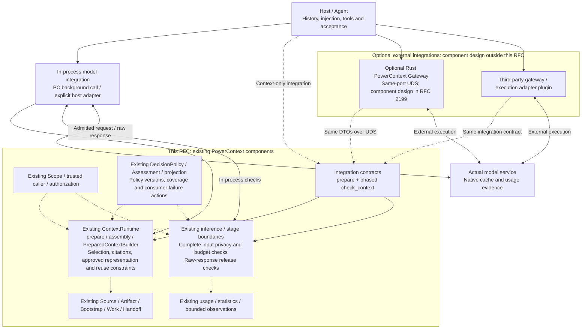
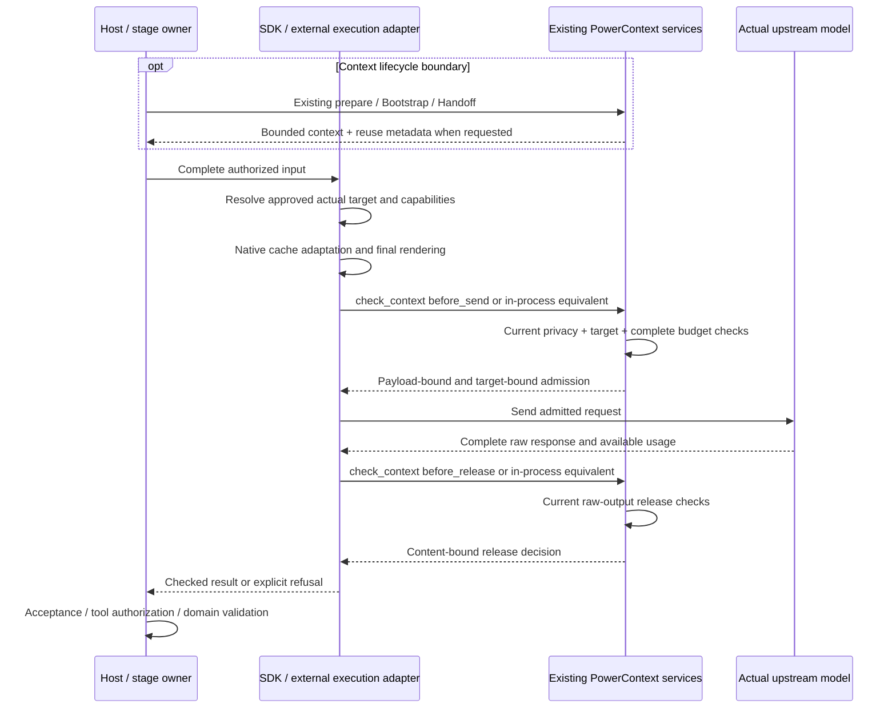

- Proposal Name: `integrated_privacy_interception_and_token_efficiency`
- Start Date: 2026-10-19
- RFC PR: [oceanbase/powercontext#2086](https://github.com/oceanbase/powercontext/pull/2086)
- Related RFCs: [RFC 0016](0016_pydantic_ai_inference_integration.md), [RFC 0028](0028_context_pack.md),
  [RFC 0046](0046_observability_foundations.md), [RFC 0048](0048_handoff_artifact.md),
  [RFC 1435](1435_explainable_prepared_context_receipts.md), [RFC 1770](1770-decision-policy-governance.md),
  [RFC 1783](1783-handoff-session-rollover.md)

# Summary

This RFC focuses on two product goals at the context layer: **privacy and security interception**, preventing prohibited
context from leaving its trusted boundary or reaching recipients through model results; and **token efficiency**,
reducing unnecessary context, repeated computation and output while preserving authorization, freshness, task quality
and evidence fidelity. Safety comes first, then correctness/evidence, complete-task cost, and cache-hit rate.

Both capabilities extend existing context preparation, policy governance, stage projections and inference adapters.
ContextRuntime names existing `ContextApplication.for_scope(scope_id).prepare(...)`, recall/assembly,
`PreparedContextBuilder` and Bootstrap/Work/Handoff composition. It is not a new context engine, policy runtime or
execution database. The public result remains ephemeral `PreparedContext`; history, injection and acceptance stay
host-owned.

Core owns context selection, approved representation, stable reuse boundaries, refresh conditions and safety constraints.
The execution adapter controlling the final model request maps those constraints to native caching for the actual
model, API and deployment. It enforces required checks after final rendering and before sending, and before raw results
are released. The inference service owns the actual KV cache.

This RFC reuses existing preparation, defines opt-in reuse metadata and one phased check operation, and supports in-process access without HTTP.
**PowerContext Gateway and third-party gateways are optional external integrations. Gateway implementation, language,
routing, rate limits, shared caches and operational governance are outside this RFC.** PowerContext-owned background
calls or a host's explicitly integrated in-process model adapter can enforce complete checks without a gateway.
Using an SDK only to obtain context cannot claim control of the complete request.

The implementation baseline is `origin/main` at repository commit `0bc42d0b`. This is a design proposal, not a claim that general outbound
privacy interception, complete-request checks, native cache adapters or measured savings exist in that baseline.

| Decision | Contract |
| --- | --- |
| Primary goals | Privacy interception and token efficiency at the context layer. |
| Algorithm ownership | Existing context, stage projection and inference components, with applicable DecisionPolicy/Assessment/projection consumers. |
| ContextRuntime | Existing context organization; no second selector, transcript store or forwarding runtime class. |
| Security checkpoints | Before sending each complete supported request and before raw-response release, including auxiliary model boundaries. |
| Cache ownership | Core supplies reuse constraints; the final execution adapter generates target-specific native settings; the provider supplies usage evidence. |
| Gateway boundary | Reserve PowerContext Gateway and third-party integration; do not design or deliver a gateway component. |
| Public API | Reuse context/continuity APIs; opt-in prepare metadata and only one phased check operation. |
| Storage | Algorithms/checks in this RFC add no tables; #2199 separately defines two optional Gateway tables in Server's database, with no new Artifact families. |
| Default optimization | Existing bounded selection, exact prepared-value reuse, approved structural encoding, cache compatibility and explicit output limits. |
| V1 privacy behavior | Allow unchanged semantic content or block/withhold; no automatic general redaction or secret restoration. |
| Acceptance | Disclosure counterexamples, false blocks, task quality, complete usage/cost, end-to-end latency and explicit coverage. |

# Motivation

PowerContext already selects and delivers cited project context, manages Source/Artifact evidence, supports Handoff,
and calls generation, Embedding, rerank, and decision backends. Users need these existing paths to answer two questions:

1. Will prohibited material leave the trusted boundary or reach a recipient through model output?
2. Can the same task use fewer unnecessary tokens and repeated calls, while preserving required facts and quality?

The useful change is to add the appropriate algorithms at these existing boundaries. A separate runtime would add
another composition root, configuration surface, and authority without removing the need to integrate actual provider
calls. It would also obscure that context selection, privacy decisions, serialization, and Artifact validation have
different owners and failure semantics.

The priority order is mandatory safety, correctness/evidence, complete-task cost, then cache-hit rate. A shorter input
that loses a constraint, causes more retries, or destroys a valuable cache prefix is not established improvement.
Keeping a prohibited prefix stable is never an acceptable cache optimization.

## Scope and non-goals

This RFC covers retrieval/delivery rules for context organized by PowerContext, context checks in supported model calls,
deterministic representation optimization, stable reuse constraints and execution-feedback contracts. Inspecting the
complete request prevents host-added instructions, history and tool results from bypassing context protection. It does
not transfer Agent history, tool execution or all network traffic to Core.

The initial scope introduces no new Context Engine, Execution Kit, ContextPlan resource or feedback bus. Gateway
authentication implementations, routing algorithms, load balancing, connection pools, queues, distributed caches,
request coalescing, management surfaces and financial ledgers are outside scope. General lossy summaries, compaction,
response/semantic caches and tool-result caches are also excluded. Each needs separate scenarios, quality evidence,
authorization/freshness rules and state-cost justification; none is a prerequisite for integration.

Cohesive helpers may be extracted beside existing components where contracts and failure semantics match.
A desire to share algorithms does not justify a new universal orchestration layer.

# Guide-level explanation

## One coding task

A user asks an Agent to fix an API client in a registered project Scope:

1. The host calls existing `/v1/context/prepare` at a supported recall boundary. Current runtime policy retrieves and assembles evidence within authorized Scope/family boundaries, retaining citations and historical-data trust wrapping. Callers need not enumerate every Memory.
2. The host retains that exact prepared value and injection position across ordinary tool turns. Task, freshness, permission or explicit refresh changes establish a new boundary through the existing prepare or explicit Handoff operation.
3. The actual execution adapter resolves the approved target and its cache capabilities, assembles context at permitted protocol positions and generates native cache settings. When SDK and gateway coexist, one owner controls representation optimization, final rendering and sending; preparation or compression must not run twice.
4. The owning inference boundary checks privacy, target, complete token window and output limits in the final input. Required checks must pass before sending; model or final-payload changes require rechecking.
5. The adapter obtains the complete raw response and completes required release checks before delivering it. Strict mode releases no model content before approval.
6. The host accepts the checked answer or authorizes a tool. Background results still pass existing schema, evidence, eligibility and Artifact commit validation. Approval does not imply tool execution or persistence.

A secret in a host-added tool result must be checked even if it was never part of PreparedContext. Ordinary tool turns
must not repeat context search solely for inspection. Empty context remains normal; a privacy refusal is explicit and
cannot be disguised as an empty success.

## A Core background stage

Memory or Topic processing uses its current Source projection, instructions and output schema. Atomic Memory extraction
already removes carriers whose canonical text exactly equals the selected body, retaining distinct payload, wire and
Projection evidence. Reuse that behavior without rewriting the authoritative Source. Additional stage codecs need their
own versions and acceptance, retaining every occurrence, identity, order and evidence reference.

The provider boundary checks the actual request, then checks raw output before parsing and domain validation. The stage
keeps its existing generation/output budget. Embedding v1 only inspects or blocks unchanged semantic input; no generic
compression is applied to documents or queries under an existing index profile.

## What users can observe

Privacy results distinguish allowed, blocked, unavailable, and unsupported coverage without echoing the matching secret.
Efficiency diagnostics distinguish preparation frequency, estimated text reduction, actual input/output usage, provider
cache reads/writes, failed attempts, and missing accounting. Strict mode reports upstream first-token time separately
from first released content. No percentage saving or cache hit is inferred solely from shorter text or a configured flag.

# Reference-level explanation

## Concrete integration into current modules

| Existing owner | Current capability | Extension in this RFC |
| --- | --- | --- |
| `ScopedContextApplication.prepare` / `_prepare_build` | Scoped recall, assembly, bounded recall effort, per-preparation query-vector reuse | Retain selection authority; compose approved context representation strategies here. |
| `PreparedContextBuilder` / prepared text/code | Final selection, citations, trust wrapping, omissions, UTF-8 budget | Apply context representation changes before final fit/count; never truncate an already built envelope elsewhere. |
| Stage-owned input projection | Domain-specific instructions, schema, Source windows, evidence and extraction-body deduplication | Add only verified structural codecs for those exact stage contracts. |
| `InferenceConfig`, inference ports and provider adapters | Generation, Embedding, rerank, decision configuration and real calls | Integrate mandatory send/release checks, whole-request limits, cache mapping, and per-attempt enforcement. |
| `TokenEstimator` / estimator profile | Deployment-fixed text estimates and estimator identity | Reuse estimates with explicit scope/uncertainty; do not relabel them as provider token counts. |
| `DecisionPolicy` / `DecisionAssessment` | Policy versions, modes, local-rule/model verdicts and unknown coverage | Register narrow privacy consumers when needed; keep final action owned by the call boundary. |
| `decision_projection` | Bounded, request-only projection protection for decision calls | Reuse its contract and verified algorithms where compatible, not its payload bounds as a universal scanner. |
| Existing Source/Artifact and Work/Handoff | Evidence, exact revisions, explicit continuity and commits | Preserve domain identities, authority, transactions, and supported readback. |
| Usage wrappers / statistics / observations | Best-effort usage, bounded diagnostics and recorder-loss observations | Reuse applicable fields and sinks; do not turn them into a financial or response-recovery ledger. |

Source baseline:
[context application](https://github.com/oceanbase/powercontext/blob/0bc42d0bc978ded22db1901305280c5b840d6533/src/powercontext/builtin/runtime/application.py),
[context builder](https://github.com/oceanbase/powercontext/blob/0bc42d0bc978ded22db1901305280c5b840d6533/src/powercontext/builtin/runtime/prepared_context.py),
[inference configuration](https://github.com/oceanbase/powercontext/blob/0bc42d0bc978ded22db1901305280c5b840d6533/src/powercontext/builtin/runtime/config.py),
[provider adapter](https://github.com/oceanbase/powercontext/blob/0bc42d0bc978ded22db1901305280c5b840d6533/src/powercontext/builtin/inference/pydantic_ai.py),
[policy governance](https://github.com/oceanbase/powercontext/blob/0bc42d0bc978ded22db1901305280c5b840d6533/src/powercontext/builtin/runtime/decision_policy.py),
[projection protection](https://github.com/oceanbase/powercontext/blob/0bc42d0bc978ded22db1901305280c5b840d6533/src/powercontext/builtin/runtime/decision_projection.py),
[token estimation](https://github.com/oceanbase/powercontext/blob/0bc42d0bc978ded22db1901305280c5b840d6533/src/powercontext/builtin/inference/tokens.py),
[extraction evidence projection](https://github.com/oceanbase/powercontext/blob/0bc42d0bc978ded22db1901305280c5b840d6533/src/powercontext/builtin/artifacts/atomic_memory/extraction.py),
[processing results](https://github.com/oceanbase/powercontext/blob/0bc42d0bc978ded22db1901305280c5b840d6533/src/powercontext/builtin/runtime/models.py),
[usage recorder](https://github.com/oceanbase/powercontext/blob/0bc42d0bc978ded22db1901305280c5b840d6533/src/powercontext/builtin/runtime/_model_usage.py).

## Architecture and ownership

### Algorithms inside existing components



Solid data paths and dashed checking/integration paths show ownership; external integrations are not internal Core
dependencies. Checks carry actual content, not only fingerprints. External execution arrows imply protection only
where their final boundaries have passed acceptance. ContextRuntime retains selection authority; inference checks
consume complete requests. Policy consumers cannot grant retrieval rights or replace Artifact validation.

### Implementation and reuse boundaries

Place cohesive new algorithms beside existing context or inference code. Share scanners, codecs and budget algorithms
only where carrier contracts and failure semantics agree. Deterministic preparation helpers are not automatically
DecisionPolicy consumers; only registered narrow consumers use that governance contract.

Share domain rules, versioned contracts and conformance examples. Reuse implementations where language and contract
permit it. External or different-language integrations consume Core decisions through check operations; this RFC does
not assume that a Python SDK and a gateway link the same binary or execution component. Do not introduce parallel rule
engines, generic plugin frameworks, session facades or grouping-only runtimes.

Existing narrow decision consumers keep their behavior. `DecisionRequest` bounds serve their own purpose; inspecting a
small prompt prefix is not a complete-request check. A high-level structured-generator wrapper cannot establish coverage
of final serialization, internal retries, raw errors or first release. Verify each promised provider path at real boundaries.

### Declare integration capabilities by visibility

| Integration | Permitted claim | Required limitation |
| --- | --- | --- |
| Context Provider / MCP / Hook obtaining only a fragment | Optimize and inspect the context PowerContext actually delivers, retaining citations and byte budget. | Unknown final host prompt, model and subsequent changes prevent complete egress/release or real billing claims. |
| In-process model integration | Check complete payloads at verified final send/release boundaries, apply target-specific cache settings and collect available usage. | Other application traffic can bypass it; coverage is declared by protocol, carrier, model and version. |
| PowerContext Gateway integration | Consume Core through the same preparation/check contracts and enforce decisions at its actual send/release boundaries. | Separately designed and delivered; this RFC requires no gateway deployment. |
| Third-party gateway integration | Call check operations through final-boundary plugins, or integrate through a verified passthrough route. | Transparency, actual target, retries, transformations and usage define coverage; branding or an OpenAI-compatible label is not conformance evidence. |

MCP, Hook and SDK names do not determine authority. A host with greater boundary control is verified for its actual
capability. Without usage, report delivered bytes, estimates or local reuse only; unknown is not zero.

For example, checks integrated at the actual provider boundary of PowerContext's Atomic Memory extractor cover its
background requests. A host that calls `prepare` and then sends through its own model client still has context-delivery
coverage only. It must explicitly route the complete request through a verified model adapter to obtain that adapter's
send/release coverage. No replacement of every model SDK is required, and importing PowerContext does not automatically
intercept other network calls.

## Goal 1: privacy and security interception

### What is inspected and where

| Boundary | Inspection | Owner and result |
| --- | --- | --- |
| Context retrieval/delivery | Existing Scope/Artifact authorization, source eligibility, trust wrapping; configured delivery rules if applicable | Current context/domain operation; preserve its response contract. |
| Before every covered model send | Complete instructions, supported content, tools/schema/results, allowed target and content-affecting settings | Existing inference-boundary consumer; allow unchanged content, block, or withhold. |
| Before strict response release | Complete raw text, tool arguments, exposed provider errors, completion state and current release policy | Existing inference/executor boundary; withhold until checks pass. |
| Before domain writes | Existing schema, evidence, review, identity and commit checks | Owning Source/Artifact service; an allowed model response does not bypass these checks. |

Permission to read a Source or obtain prepared context does not automatically permit sending it to every model service.
Prepare does not know arbitrary future destinations and cannot certify a complete request that the host has not yet
assembled. Final egress checks remain necessary, including when context preparation is skipped.
Query Embedding, reranking and auxiliary calls made during retrieval need their own covered pre-send boundary; checking
only the eventual prepared result cannot protect earlier disclosures.

The initial enforcing profile covers configured secret values/patterns, supported text/structured tool carriers, and
controlled destinations. It states detection bounds and false-positive cases. It does not claim universal semantic
privacy detection, prompt-injection prevention, or protection of unsupported opaque/multimodal content.

### Policy reuse and explicit failure semantics

Basic rules run within the existing PowerContext process: configured secret-value/pattern matching and destination checks
require no separate component deployment. PII describes personally identifiable information, not a particular library.
Entity recognition for names or addresses may use an optional in-process dependency or external DLP, with explicit
coverage, model/resource costs and trust boundaries. Presidio, a separate detector service and Gateway are not initial
prerequisites; the basic installation does not download recognition models by default. If deployment policy makes an
optional detector mandatory, its unavailability still withholds sending/release.

Deterministic rules run locally first. A substantive local judgement can use the existing `DecisionAssessment` vocabulary;
registered consumers reuse version, mode, reason, coverage and observation contracts. A consumer maps that assessment
to its own send/release action. `deny` blocks, and `unknown`, missing mandatory coverage, or unavailable enforcement
withholds. An LLM result cannot override a mandatory rule or grant data/tool authority.

`FailOpenDecisionModel` keeps its existing abstention contract. Optional advisory consumers may ignore abstention under
their domain contract. A mandatory privacy consumer must interpret that same abstention as insufficient evidence to
send/release. Do not globally change all decision consumers or treat a provider failure as a clean privacy result.

Background processing must retain domain failure semantics. A current write-gate `HOLD` commits no Memory but advances
the cursor and consumes the Source window. Mandatory privacy block/withhold, timeout or unknown must not become that
`HOLD`, an empty extraction success or a skipped window. Surface an explicit send/release-boundary failure; the owning
processing flow preserves pending evidence/progress and follows its existing retry budget. Changing models, restarting
or changing policy must not automatically grant a new budget; no new retry store is introduced. Topic Memory's existing
blocking/explicit-retry facilities retain their authorization and idempotency contracts, rather than becoming generic
inference state. Existing write-gate `HOLD` behavior remains unchanged.

External auxiliary models receive only an already permitted bounded projection. Raw prohibited material cannot first
be sent to a hosted classifier, compressor, or judge to decide whether it was safe to send. Existing decision projection
sanitization remains specific to decision requests and does not establish universal model DLP coverage.

### Inspection algorithm and content handling

1. Bind trusted caller, Scope, stage, target and policy version. Resolve permitted destinations/credentials from controlled configuration.
2. Validate protocol, carrier, encoding, nesting and size limits before acceptance. Unsupported strict carriers are rejected or withheld.
3. Inspect supported raw representations and parsed content fields. JSON normalization must not hide a secret in an overwritten duplicate key, numeric lexical form, escaped value, error body, or tool structure.
4. Evaluate required local rules and any eligible optional assessment. Preserve whether content was actually inspected; unknown is not allow.
5. Check the complete final send representation or complete raw release unit. Return a content-free reason and bounded coverage metadata.

V1 does not automatically redact code, tool arguments, identifiers, or signed content, and has no persistent placeholder
mapping. It allows unchanged semantic content or blocks it. Future specialized transformations must prove validity,
retain authoritative originals, recheck the resulting representation, and state their storage/security costs.

Unapproved redirects, arbitrary caller base URLs, credential forwarding, and unknown content-bearing fields are not
admitted by a permissive string allowlist. Cancellation propagates. Security errors and logs do not echo matched content.

### Privacy mode and optimization mode are independent

| Axis | Modes / contract |
| --- | --- |
| Privacy policy | Use existing disabled/shadow/advisory/enforcing governance where applicable. Only enforcing with verified coverage can claim interception. |
| Mandatory deployment rules | Remain effective regardless of optional optimization or judge settings; clients cannot select a weaker policy through request fields. |
| New representation optimization | Proposed `off`, `shadow`, `active` settings per new eligible strategy. Defaults off until that strategy passes acceptance. |
| Cache planning | Explicit profile choice; requires final-payload admission and does not weaken privacy checks. |

Optimization shadow computes a candidate while sending the approved original; it does not imply a second model request.
Privacy shadow/observation does not block disclosures and must not be presented as enforcing protection. Policy promotion
uses existing narrow-consumer evidence requirements, not a new central policy service. Existing extraction-body
deduplication, bounded recall and query-vector reuse retain their current behavior; they are not repackaged as newly
disabled features.

## Goal 2: token efficiency

### Strategies and owning locations

| Strategy | Owning location | Acceptance constraint |
| --- | --- | --- |
| Bounded relevant selection | Current recall/assembly and builder | Preserve current family selection, authorization, exact citations and omission semantics; measure incremental benefit against this existing baseline. |
| Avoid repeated preparation | Host lifecycle integration using existing prepare/bootstrap receipts | Ordinary tool turns reuse approved values; bootstrap deduplication remains limited to fully injected exact Atomic Memory revisions. |
| Context representation | Existing prepared text/builder path | Strategy-specific, deterministic and opt-in; preserve trust markers, citations, scalar content, order, and complete budget accounting. |
| Background input encoding | Stage-owned input projection before provider rendering | Only approved schema/codec pairs; retain identity, time, metadata, order, multiplicity and evidence reconstruction. |
| Provider prefix reuse | Existing inference adapter/profile and executor | Preserve rendered prefix, eligible message/content boundaries and cache controls; measure real provider evidence. |
| Output efficiency | Existing stage schema, instructions and `InferenceLimits`/model settings | Explicit output ceiling and required fields; retain evidence and completion checks, avoid automatic truncate-and-accept behavior. |
| Avoid unnecessary model work | Existing bounded recall effort and stage scheduling | Account for actual saved calls and any added Embedding/rerank/judge cost; no new Agent scheduler. |

The baseline already deduplicates exact extraction bodies and reuses eligible query vectors within one prepare,
consolidating some recall queries. Include these in the reference workflow rather than claiming them as this RFC's
incremental benefit. Vector reuse retains existing query/profile/backend compatibility requirements. Atomic/Topic reuse
requires the same actual Embedding backend and an unchanged query; it does not extend to arbitrary Scopes, profiles or
cross-call caching. Every read and egress boundary still requires current authorization and applicable rules.
Existing `recall_embedding_timeout_seconds` bounds recall waiting, not whole-request or privacy-check timeout/admission.

The baseline has no general-purpose input/output optimizer covering all these strategies, nor this RFC's mandatory
egress/release and native-cache contracts. Every new active strategy needs supported input, invariants, reference behavior,
version, fallback and quality evidence.

### Representation algorithms and invariants

Start by reusing `project_atomic_memory_evidence`: omit only carriers whose canonical text equals the selected body.
Keep distinct facts in Source, wire, payload or other Projections; do not remove them merely by field name. Do not merge
different Source identities, order, multiplicity or lineage, or modify stored content and the journal.

A cross-record structural codec, if needed, may encode identical bodies within a controlled stage schema, preserving an
ordered occurrence/reference list and proving equivalence. Timestamps, identities, metadata, counts and repeats cannot
silently disappear; differing log lines are not equivalent merely because they share a template. This is a stage-local
extension requiring acceptance, not a generic log compressor. Existing deduplication needs no new wrapper or codec layer.

For context delivery, representation algorithms run before the builder's final render/fit/count. They retain exact
citations, historical trust boundaries, required fields and honest truncation/omission markers. Existing whitespace,
code, JSON values or tool arguments cannot be rewritten by an unverified regular expression. Removing a field required
by the current public display contract is not a lossless optimization.

For each eligible transformation: verify the supported format, construct a candidate, validate reconstruction or the
promised field-equivalence contract, count with the same estimator/profile, and apply only an accepted strategy. If
there is no measured reduction or validation fails, use the original only when it still passes privacy and full-request
limits. An unsafe or oversized original is not a valid fallback. In shadow, record bounded candidate diagnostics while
retaining the approved original; do not make a second paid inference call unless a separate experiment authorizes it.

Lossy summaries, generic compaction, arbitrary redaction, and semantic response caches remain separate future work.
Model output that is too long or incomplete still needs domain validation; reducing output tokens is not permission
to discard required evidence or accept a cut-off JSON result.

### Supplementary bytes and complete-request tokens

Existing `prepare.max_bytes` remains the supplementary UTF-8 byte budget. The complete target request also includes
instructions, history, tools/schema, protocol overhead and an output reservation. Its admission uses the verified target
window and an explicit tokenizer/estimation profile with uncertainty margins. A heuristic estimate cannot establish an
exact hard token guarantee; use a conservative verified bound or reject a profile requiring precision it cannot supply.

When the request does not fit, withhold sending. The host can request a smaller context through the same prepare API or
use an explicit Handoff. Inference code does not silently recall another set of Memory, truncate a built trust envelope,
remove tool exchanges, or pretend that a byte limit is a token limit.

### Stable context reuse and model cache integration

| Reused value | Treatment in this RFC |
| --- | --- |
| Exact prepared context | Bounded host/invocation reuse, retaining position, current authorization and refresh boundaries. |
| Existing durable Artifact | Existing exact reads, revisions and freshness, without a new cache identity. |
| Model prefix KV | Execution-side native adaptation improves eligibility; the model still generates the current answer. |
| Generic derived-result/compilation cache | Not an initial deliverable; state and benefits require separate justification. |
| Full responses, semantic answers and tool results | No default caching/replay; side effects and idempotency remain host/tool-domain responsibilities. |

```text
Turn 1: Stable instructions / tools + exact PreparedContext | Current request
Turn 2: Same prefix + original accepted history             | New messages / tool results
```

This is a logical layout. Actual roles, trust levels, message boundaries and tool pairing follow the target protocol.
The host owns history and acceptance, retaining the exact prepared value and injection position within an explicit local
task epoch; an epoch is not a server session resource. New intent, freshness changes, revoked permissions or explicit
refresh establish appropriate new boundaries. Cache reuse cannot justify sending material that is no longer permitted.

| Layer | Decision and responsibility |
| --- | --- |
| Existing context / Builder / policy | Select and represent content; supply reusable regions, semantic order/trust invariants, refresh conditions and permitted retention scope. |
| Final execution-side provider adapter | After resolving the actual model/API/deployment, map constraints to native modes, eligible message/content-block breakpoints, TTLs, keys and routing requirements; render, send and parse usage. |
| Model service | Store, find and evict KV; supply provider-defined cache accounting. Clients cannot promise actual computational reuse. |

Core does not generate universal native cache parameters. An approved `UpstreamProfile` is trusted configuration and a
transient target binding. It declares model/version, protocol/renderer, prefix-affecting tools/schema/settings, account/
region/cache-sharing boundaries, supported modes/breakpoints/retention semantics and observable usage fields. An adapter
generates settings within those approved capabilities. Caller-reported profiles or capabilities are not trusted
authorization; unsupported targets must be explicit.

Reuse constraints come from explicit `include_reuse=true` on existing prepare, not a ContextPlan or cache resource.
Without opt-in, retain the public PreparedContext default shape; opt-in returns versioned `context + reuse` metadata.
Adapters retain metadata, complete target-specific native cache planning and final rendering, then check before sending.
No planning preflight or repeated recall RPC is required.

Adapters preserve roles, tool order, content blocks and reusable boundaries. Do not insert random IDs/timestamps into
stable prompts, arbitrarily merge old messages or strip native cache controls. One owner optimizes representation and
sends each call. Replan and re-admit when changing model, API, account, region, renderer or fallback target.
Withhold when mandatory target/retention/isolation constraints cannot be met. An ordinary cache miss does not trigger
automatic retries, and unrelated padding to reach a cache minimum is not enabled by default.

Caching is best effort by default; an actual hit is not a condition for sending. If optional caching is unavailable,
omit optional native cache parameters only when privacy, target, format and complete budget still permit the request.
Recheck any resulting final-payload change. Omitting parameters does not establish that a provider's implicit caching
is disabled. The target must still meet approved retention/isolation policy; withhold when this cannot be verified.
Mandatory data-retention/isolation constraints cannot be disabled with cache optimization.

Verify cache-protocol compatibility separately from actual reuse. Equal semantics or prefix text does not establish
equal native boundaries. A final-body digest binds the approved request but cannot prove the provider's internal token
rendering or KV reuse. The digest of an entire growing request is not a stable cache-routing key; a cache hint neither
pins a machine nor guarantees a hit.

Scope partitioning and cache keys do not imply physical provider isolation. Verify target account, processing region
and privacy/retention policies. The approved profile distinguishes minimum billing coverage, retention hints and actual
deletion deadlines; a cache TTL is not automatically a privacy-deletion guarantee. Provider cache counters are evidence
under that provider's accounting semantics, not proof that every call reuses computation or gets lower latency.
Measure performance independently. Output checks affect future permitted replay, not the cache eligibility already
determined by the request that produced the current response.

### Joint representation and reuse tradeoffs

Within quality, authorization, freshness and target-window constraints, compare keeping the existing exact prepared
value, using an existing approved representation, applying an accepted deterministic codec, and explicitly refreshing
or reducing prepare. A longer reusable prefix can be cheaper than rewriting it; a smaller input can increase current
cost by losing reuse.

The initial scope uses explainable conservative rules and controlled experiments. It does not predict unknown remaining
task length, start summaries/judges automatically or tune policies online. Window, safety and freshness requirements
take precedence. Compression ratio alone must not trigger a representation change; cache-hit rate does not replace
complete cost per successful task and end-to-end latency.

### Provenance and index compatibility

The public PreparedContext default result remains an ephemeral four-field value: `schema`, `status`, `content`, `content_bytes`.
It is not a full prompt, trusted origin manifest, authorization token, or injection proof. Automatic cross-Scope frozen
replay requires a verified provenance/reauthorization mechanism before it is supported. Do not infer permission from
citation text or treat a revoked historical projection as permanently permitted.

Internal `PreparedContextBuild.lineages` already retains immutable Artifact snapshots for usage attribution. Reuse
them only under that contract; they are not current heads, complete provenance or authorization evidence. They neither
change the public four-field result nor authorize frozen replay.

Existing `bootstrap_receipt_id` deduplicates only its supported fully injected Atomic Memory revisions. It does not
prove coverage of arbitrary history, Topic Memory, code or Handoff. Optional diagnostics proposed by
[RFC 1435](1435_explainable_prepared_context_receipts.md) are not implemented in the baseline and cannot become authority.

Embedding v1 inspects or blocks the unchanged document/query. A future transformation requires a compatible versioned
query/document profile and explicit reindex/migration policy. Rerank keeps candidate identity/order mapping intact.
Background calls do not inject Agent Memory automatically or recursively invoke enhancement/judges. Switching models
preserves portable history/Handoff, never private KV or opaque reasoning state; rollover remains host-owned under
[RFC 1783](1783-handoff-session-rollover.md).

## Execution flow and minimal interfaces

### Reuse existing entry points

| Need | Existing HTTP path |
| --- | --- |
| Task context | `/v1/context/prepare` |
| Lifecycle context / delivery | `/v1/context/bootstrap`, `/v1/context/bootstrap/receipts` |
| Current work continuity | `/v1/work/handoffs/prepare-current`, `/v1/work/handoffs/acknowledge` |
| Explicit Handoff | `/v1/handoff/prepare`, `/v1/handoff/finalize`, `/v1/handoff/commit`, `/v1/handoff/continue` |
| Work observations | `/v1/work/contracts/create`, `/v1/work/outcomes/record` |

Without reuse opt-in, context preparation retains its current request and default result shape:

```json
{
  "scope_id": "project:powercontext",
  "query": "Fix the generated API client and preserve repository regeneration requirements",
  "max_bytes": 8000,
  "include_code": false
}
```

No invocation/session/branch creation, context-plan API, policy-runtime API, or event ledger is required. Existing
`assembly`, `include_code` and bootstrap receipt settings retain their supported behavior. Normal automatic recall must
not repeat prepare solely to execute a check or opt into diagnostic receipts.

### Opt-in reuse metadata on existing prepare

`POST /v1/context/prepare` / `prepare_context` gains optional request field `include_reuse`, default `false`.
Without it, retain the existing strict four-field result. Explicit, supported opt-in returns a versioned
`context + reuse` envelope. Do not append fields directly to `PreparedContext`: its contract has
`additionalProperties: false`.

```json
{
  "scope_id": "project:powercontext",
  "query": "Fix the API client",
  "max_bytes": 8000,
  "include_code": false,
  "include_reuse": true
}
```

```json
{
  "schema": "powercontext.prepared-context-with-reuse.v1",
  "context": {
    "schema": "powercontext.prepared-context.v1",
    "status": "ready",
    "content": "Context",
    "content_bytes": 7
  },
  "reuse": {
    "schema": "powercontext.context-reuse.v1",
    "constraints": {
      "preserve": ["content", "citations", "trust", "order"],
      "refresh_on": ["permission_change", "source_ineligible", "context_boundary"]
    },
    "expires_at": "2026-10-23T01:30:00Z",
    "binding": "<authenticated encrypted preparation binding>"
  }
}
```

Values and expiry illustrate shape, not defaults or usable credentials. `context` remains the original four-field object.
`status=empty` retains its meaning; privacy refusal or uncertain provenance must not become empty.
Implementation must strictly discriminate response branches by `schema`; SDK/MCP retain flat operation `prepare_context`.
Existing `get_capabilities` advertises opt-in, schemas, supported families/carriers and count/size bounds.
Unsupported opt-in is explicitly rejected, never silently downgraded to an ordinary result with a replay claim.

Core produces complete bounded dependencies after actual selection/rendering/fitting: exact resources/versions, Scope,
content binding, eligibility/freshness and retention conditions. `origins/lineages` alone are not complete proof.
`reuse.constraints` governs preservation and refresh of this prepared content, not the entire host prompt or provider KV.
`reuse.binding` is a short-lived, versioned, authenticated encrypted envelope binding deployment, actor/delegation,
Scope, exact content digest, complete private dependencies and expiry. Bound its length/count and validate key version,
audience and tampering. It is not bearer permission, injection proof or a durable receipt; no new table or plan API.
Families, code or references without complete dependencies cannot claim frozen replay support.

Embedded calls receive an immutable internal result with the same semantics, without HTTP or private Builder access.
Gateways/hosts retain exact prepared content and metadata across tool rounds; checks do not repeat prepare, search or
Embedding. Invalid, expired or unverifiable dependencies stop old reuse. The host explicitly refreshes into a new
context boundary rather than rewriting a historical injection.

### One check operation with two explicit phases

| Proposed POST path | operationId | Phase |
| --- | --- | --- |
| `/v1/context/check` | `check_context` | `before_send` admits the complete final request; `before_release` admits delivery of the complete raw response. |

One public operation serves two separately evaluated checkpoints; sending approval does not replace response checking.
The operation only decides: no retrieval, content mutation, optimization candidates, native cache planning, model call
or Source/Artifact commit. Algorithms remain in existing context, policy and stage/inference components, with the same
rules called directly in process and no new runtime facade.
Remote requests use strict DTOs discriminated by `phase`; fields from the wrong phase are rejected.

Illustrative request before sending:

```json
{
  "scope_id": "project:powercontext",
  "phase": "before_send",
  "target_profile": "coding-default",
  "payload": {
    "schema": "powercontext.model-json-payload.v1",
    "headers": {"content-type": "application/json"},
    "body": "<complete final provider request JSON>"
  },
  "prepared_contexts": []
}
```

`payload.body` is a string preserving original UTF-8 JSON text, not an already normalized JSON object.
Replace placeholders with complete actual bodies, never summaries or hashes.
The carrier schema defines relevant headers, original-representation checks, strict parsing and byte/depth bounds;
escape decoding, duplicate keys or reserialization must not conceal prohibited content. Reject unsupported carriers.
`target_profile` names trusted configuration; a caller-supplied alias grants no authority. The executor must match the
actual model/API/endpoint, account/region, renderer, cache settings and output limits.
Opaque downstream rewriting cannot receive full coverage.

When replaying prepared content, `prepared_contexts` must include every complete historical block's `binding` and
`location`. A location uses a versioned protocol carrier locator: a JSON pointer into a supported text field, with
`start_byte` / `end_byte` as a UTF-8 byte half-open interval in the decoded string, on character boundaries.
Core validates exact complete content, trust/placement/order in the actual payload and current dependencies.
A locator/hash alone proves nothing. The bounded array supports multiple historical blocks, not only the latest prepare.
A pure check without PowerContext prepared blocks may use an empty array. Enhanced requests requiring bindings cannot
omit them or their locations and downgrade to pure checking.

Illustrative locator for one replay block, where the native message field contains exactly `Context`:

```json
{
  "binding": "<reuse.binding from prepare>",
  "location": {
    "schema": "powercontext.model-json-text-location.v1",
    "pointer": "/messages/1/content",
    "start_byte": 0,
    "end_byte": 7
  }
}
```

Illustrative request before release:

```json
{
  "scope_id": "project:powercontext",
  "phase": "before_release",
  "target_profile": "coding-default",
  "request_binding": "<binding returned by before_send allow>",
  "payload": {
    "schema": "powercontext.model-json-payload.v1",
    "headers": {"content-type": "application/json"},
    "body": "<complete raw provider response JSON>"
  },
  "completion": "complete"
}
```

`request_binding` correlates this actual sent request; an arbitrary historical approval cannot replace it.
`strict` releases no model content, tool arguments or exposable error body until complete-response checking passes.
Incomplete, oversized or unavailable checks withhold delivery. Available usage may accompany the request through typed
fields; unknown values are not zero.

Illustrative common decision:

```json
{
  "schema": "powercontext.context-check.v1",
  "phase": "before_send",
  "decision": "allow",
  "reason_codes": [],
  "coverage": {"profile": "text-and-tools.v1", "complete": true},
  "policy_version": "privacy.v1",
  "valid_until": "2026-10-23T01:01:00Z",
  "correlate_until": "2026-10-23T01:05:00Z",
  "binding": "<short-lived payload-bound and target-bound result>"
}
```

Only `allow` returns a usable binding for that phase. `block` means explicitly prohibited; `withhold` means inadequate
coverage, refresh required or uncertain current conditions. Neither permits proceeding. Reason codes exclude sensitive
content. Decisions contain no reuse/cache plan: adapters first consume `reuse.constraints` and approved target
capabilities to render native requests, then check the final payload. Any change to body, relevant headers, target or
settings requires rechecking; no semantic optimization follows approval.

Bindings include current identity/delegation, Scope, phase, actual target, exact body/relevant headers, limits and policy.
Sending approval exposes `valid_until` and `correlate_until` for separate sending and bounded response-correlation
deadlines; the latter never extends permission to resend. Release approval returns only its own `valid_until`,
checks current policy and creates no new request-correlation permission. This is not a durable single-use permit, model exactly-once guarantee or
response recovery mechanism. Remote checking cannot prove an untrusted executor sends the inspected bytes;
complete protection requires integration at the actual final transport boundary.

| HTTP result | Caller behavior |
| --- | --- |
| `200 + allow` | Validate phase, coverage, current binding and deadline; continue only the corresponding step. |
| `200 + block/withhold` | Evaluation completed, but sending/release is forbidden; HTTP success alone is insufficient. |
| `401/403` | Authentication, Scope or resource authorization failed; stop. |
| `422` | Invalid phase, schema, required binding, location or carrier contract; stop. |
| `413`, check timeout or `503` | Oversized or unavailable checking; do not send or release. |

Reuse root `scope_id`, `current` Scope mode, existing `scope.read` / resource authorization and trusted delegation.
Request bodies cannot weaken mandatory policy, and readable Scope does not grant model execution/spending permission.
Both phases use current authorization/content rules; tool execution permissions, quality checks and domain commits
remain with their owning boundaries.

Each check binds Principal/delegation from the current authenticated request. A shared administrator key plus arbitrary
Scope IDs is not isolation. Embedded `for_scope` only binds a partition, not authentication; resource and context-reference
access remain domain-authorized. Preserve path-parameter precedence and conflict rejection; old approvals or persistent
connections confer no permanent access.
The JSON example does not establish support for every carrier. SSE/other native outputs require separately versioned
carriers and conformance; summaries that discard original events cannot represent a complete raw response.

This RFC changes design only, not runtime or generated contracts. Implementation adds explicit prepare response branches
and check DTOs to `openapi/powercontext.yaml`, runs `make api-generate` / `make contract-test`, and preserves flat
operations and scoped domain semantics.

### One managed context invocation



Core stage representation optimization precedes final provider rendering, after which the final input must be inspected.
Inspect the original stage projection before encoding as well, so a codec cannot hide prohibited values from later carrier
checks. Optional optimization may fall back only to an otherwise permitted, valid and budget-compliant input. Disabled,
failed or shorter optimization candidates cannot create a security bypass.

### First-party and third-party gateway integration

**PowerContext Gateway:** the Rust component in [RFC 2199](https://github.com/oceanbase/powercontext/pull/2199)
calls existing prepare and both phases of the same check over HTTP over UDS. Explicit remote/third-party paths use HTTPS,
with identical schemas, Scope/trusted delegation, target profiles, bindings, failures and usage.
Rust retains exact prepared values/bindings and calls checks after its actual provider adapter finishes native cache
settings/final rendering. UDS does not replace current authentication, and Rust duplicates no Python selection/privacy
algorithms. #2199 owns lifecycle, the existing public port and private state IPC.

Algorithms/checks themselves require neither Gateway nor new tables. Optional Gateway's two dedicated tables share
Server's selected SQLite / SeekDB / OceanBase database through its backend/migration infrastructure.
Sharing storage does not turn records into Source/Artifact or make checks write Gateway state.
Component state commands/migration resources belong to #2199, not this check operation.

**Third-party final-boundary plugin (reserved):** existing gateways can consume Core without Rust Gateway.
Plugins reuse public get_capabilities, prepare/check and supported authentication/delegation, without private Gateway
state/database access. This is a stable contract/conformance fixture set; ship concrete integrations only on demand,
without a generic plugin platform. Invoke `check_context(phase=before_send)` after the final protocol mapping and before actual sending;
invoke `check_context(phase=before_release)` before any raw response content, tool arguments or error body first reaches a recipient.
Report the actual target for each attempt, re-admit changed targets/payloads, propagate cancellation and report available
usage and missing coverage. The plugin must perform these actions; calling a check API alone proves no enforcement.

**Third-party upstream passthrough route:** a managed SDK/provider adapter may send through an approved endpoint only
under a profile that verifies content/cache-field preservation, actual target, hidden retries/fallback and response
mapping. Opaque transformations after inspection limit protection to the observed boundary. Withhold or reject the
profile when required end-to-end coverage cannot be established; unknown is not transparent. Context-only integration
advertises its actual scope rather than complete-request protection.

These are integration duties and acceptance conditions, not specifications of gateway routing, authentication
implementation, shared-cache backends or management protocols. Formal compatibility claims for a third-party product
require separate acceptance of its real version, configuration and complete path.

## Streaming, failure, and recovery

Strict mode buffers the complete supported response before release, with byte, time, and concurrency limits. Incomplete
JSON/tool arguments, buffer overflow, failed mandatory checks or unavailable policy withhold release and best-effort
cancel upstream work. No content is spilled to a new response database. Connection/heartbeat metadata before approval
must contain no model or sensitive content. Observe mode cannot claim leakage interception; bounded streaming needs a
separate verified safety-unit contract and is outside the initial enforcing profile.

| Situation | Required behavior |
| --- | --- |
| Optional representation optimization fails | Keep the original only if privacy, format and full budget still permit it. |
| Mandatory privacy check fails/unavailable/unknown | Withhold sending or release; never fall back to an uninspected original. |
| Input within context byte limit but too large for target | Withhold; explicit smaller prepare or Handoff, no hidden truncation. |
| Target or final payload changes | Recheck before sending. |
| Definitely unsent transport failure | Retry only under one declared owner, valid admission and bounded limits. |
| Send may already have reached upstream | Report uncertainty; no automatic paid resend or refund assumption. |
| Raw response incomplete or unapproved | No strict content release; preserve content-free failure evidence. |
| Checked response lost before delivery | No durable response recovery guarantee in v1; host resolves its own invocation. |
| Allowed output later fails domain validation/commit | Domain operation remains failed/pending under its existing contract. |
| Usage unavailable | Mark incomplete/unknown, not zero or fully accounted. |

Cancellation remains control flow. For SSE, approved content may be framed after a complete strict check, which delays
first released content. After headers are sent, use supported error/interruption events rather than pretending to change
the earlier HTTP status. Recheck current required policy before send and first release; revocation can break cache reuse.
Already sent or released material cannot be recalled by invalidating a local projection.

## Storage, configuration, and observations

### Reuse domain storage; add zero tables

| Information | Existing owner | Reuse constraint |
| --- | --- | --- |
| Scope / references | Scope catalog and access plane | Existing exact identity and authorization. |
| Actual observations | `pc_sources` / Source journal | Explicit domain evidence only, not every model request/response. |
| Memory and other Artifacts / Handoff | `pc_artifacts`, heads and lineage | Existing immutable revisions, governance, transactions and exact reads. |
| Work continuity | Source/Artifact-backed Work facade | No new task/session aggregate. |
| Bootstrap delivery | `pc_context_bootstrap_receipts` | Its specific content-free lifecycle contract only. |
| Policy assessments | `pc_decision_observations` when the consumer fits its contract | Register typed consumer/reasons and reuse existing retention; no prompt bodies or per-attempt financial ledger. |
| Model / recall aggregates | `pc_model_usage_daily`, `pc_recall_token_daily`, `pc_recall_effort_daily` | Existing incomplete/best-effort statistics semantics. |
| Prepared values, candidate encodings, check bindings, cache plans and buffers | Invocation/host memory | Bounded derived values; discardable, no mandatory persistence. |

Do not repurpose review candidates, processing leases, Topic Memory work budgets, or Source/Artifact blobs as generic
inference storage. Rules and profiles extend existing trusted runtime/inference configuration and policy manifests;
there is no new policy database or universal workflow registry.

Host history retains conversation truth. Prepared-value reuse is optional and bounded, with eligibility based on Scope,
trusted access partition, exact content/revision, current policy, target/rendering profile and valid boundaries.
Neither query text nor a content hash replaces current authorization. V1 introduces no generic derived-result or
compilation cache. Existing Artifact reuse follows its own reads, revisions and freshness contract; Artifact blobs must
not become a cache to avoid new-table justification. On restart the host supplies retained context or reprepares;
committed Handoff stays available through its existing read path. Core neither recovers unpersisted transcripts/responses
nor establishes a distributed selection frontier.

Durable invocation recovery, global hard spending reservations and single-use distributed send permits require a
separate minimal-state proposal. It must first compare current repositories, define the missing guarantee, then justify
identity, isolation, transactions, uncertain sends/commits, retention, readback, costs and migration. No tables are
preapproved by this RFC.

### Configuration and accounting

Extend existing configuration at the owning boundary: policy version/mode/failure action, approved strategy and codec
version, estimator/profile, target/cache capability, response bounds, and retry ownership. Privacy enforcement and
optimization settings remain independent. Existing users with those new features disabled retain their existing contract;
disabled or observation-only paths must not advertise enforcing coverage.

Do not relabel best-effort aggregate usage as a budget ledger. Per-request window/output limits are enforceable only
within their verified profile; distributed restart-safe spending ceilings are not a v1 claim. Correlation IDs are not
idempotency guarantees. Record known, estimated, unknown and reconciled usage separately, including auxiliary calls,
failed attempts and cache writes where observable.
Baseline `InferenceUsage` has request/input/output counts only. Cache read/write, reasoning usage and actual target
evidence need typed optional metadata at the existing inference/usage boundary when implemented, with unknown values
preserved. Existing daily aggregates cannot reconstruct those counters; v1 need not persist them to demonstrate a task.
Existing recorder queue-drop/write-failure observations and worker summaries can mark incomplete accounting. A missing
child report means unknown, not zero loss. `artifact_processing.worker.returned` or process exit does not establish a domain commit;
processing success still requires the owning supervisor to validate durable acknowledgement. These signals cannot fill
missing provider usage or guarantee complete failed-attempt accounting. Observation failures cannot change business
results or suppress cancellation.
Execution feedback uses compatible existing usage/sinks, statistics or decision observations. Trigger Signals are inputs
to pure transitions, not a ready-made inference-feedback database; no per-request Source write is required.
The host/domain facts establish task success and tool effects; model-call success does not establish task completion.

Before adding operational fields, follow the existing [observability guide](../development/observability.md): stable
operation/unit/outcome vocabulary, bound identities, registered field allowlists and `log_safely`. Logs/traces omit
queries, prompts, responses, evidence bodies, credentials and sensitive paths. Do not place execution identities in
metric labels or convert sampled diagnostics into an audit or billing claim.

## Delivery and acceptance

### P0: context vertical slice without a gateway dependency

Choose one existing context preparation path, one background generation stage, a fixed supported text/tool protocol and
model, one Scope without context references, and explicit enforcing rules. Integrate algorithms into current context/
stage/provider boundaries. Deliver final-input and strict raw-response checks and exact prepared-value reuse, retaining
existing extraction deduplication and recall-computation reuse. Demonstrate incremental value over those optimizations;
a new codec is not a prerequisite. Add a new representation strategy in shadow only when it has a concrete benefit
hypothesis. Use host-owned history and explicit Handoff; basic rules run in existing processes. Add no runtime service,
table, Artifact family or session initialization. Verify native cache adaptation through a verified in-process model
adapter, recording cache accounting separately from actual latency.

### P1: cross-process/remote contracts and conformance

Expose one phased `check_context` and explicit opt-in reuse envelopes on existing prepare over UDS/HTTPS.
These schemas, bindings, current authorization and negotiation are Rust Gateway's initial prerequisites, not deferred
remote-deployment work. The gateway-free Core slice can ship independently; Gateway waits for this acceptance.
Verify Scope/trusted delegation,
actual content and target, policy/expiry binding, unknown handling and final admission/release.
Use a controlled external calling adapter to verify the same Core decisions as in-process access, including limited
claims for context-only integration. This delivers neither PowerContext Gateway nor a third-party gateway. A test adapter
does not establish compatibility with any actual gateway. Internal gateway features and product/version integrations
receive separate acceptance under #2199, including same-port routing, shared three-backend component state and concrete
plugin versions. UDS/HTTPS use identical current-auth, expired/tampered, multiple-block and block/withhold samples.
Private Gateway state IPC is not another public context operation.

### Privacy and behavior acceptance

- Confirm existing prepare selection, citations, byte limits, empty results, Profile/code opt-in, denied references, Bootstrap receipt scope and Handoff readback remain valid.
- Place configured prohibited values in every supported input/output field, tool structures, raw errors, escaped/numeric representations and duplicate keys. Verify blocked input never reaches the controlled upstream and strict-blocked output never reaches the host.
- Cover mandatory check timeout/unavailable/unknown, forged Scope/caller/stage, target mutation, expired policy, unsupported carriers, split stream content, incomplete JSON, buffer limits and cancellation.
- Demonstrate advisory abstention behavior is retained while mandatory privacy consumers withhold. Optimization off/shadow/failure must not disable required interception.
- Verify mandatory privacy block/withhold, timeout and unknown never become write-gate HOLD or empty extraction success, consuming no pending Sources. Retries retain existing budgets and explicit-recovery permissions.
- Verify basic in-process rules need no extra deployment, required optional detectors withhold when unavailable, and SDK prepare alone never advertises complete-call protection.
- Verify existing deduplication preserves distinct payload/wire/Projection evidence; validate new codec reconstruction, order, multiplicity, identities, citations, code/JSON scalar fidelity and malformed/unsupported inputs. Differing log rows must not collapse into one occurrence.
- Cover unchanged Embedding semantics, rerank identity mapping, no recursive judges/recall, per-attempt provider checks, unknown sends/usage, process loss and the stated recovery limits.
- Verify ordinary checks create no Source/Artifact content, and existing domain commits retain validation, transactions and supported exact reads.

- Verify one optimization/send owner when SDK and external adapters compose. A caller claiming prior optimization cannot skip checks or trigger a second prepare.
- Verify matching remote/in-process decisions under the same policy; forged plan/hash claims, expired constraints and opaque targets cannot upgrade coverage.
- Verify strict default four-field versus opt-in envelope branches, capability negotiation and explicit rejection of unsupported opt-in.
- Reject wrong phases, missing/expired/cross-request request bindings and missing/mislocated historical blocks; verify multiple bindings, no HTTP-200 bypass and no repeated recall in checks.

- Verify Rust UDS and Python in-process/HTTPS decisions for identical DTOs, obsolete generations after Core restart, and no coverage upgrade through opaque third-party mutations.

### Token efficiency and complete-task experiments

Hold repository task, starting state, model/profile, tools/schema, policies and quality criteria fixed. Mandatory privacy
rules remain enabled in every comparable optimization arm. Compare the current workflow, approved stable-context reuse,
and the same reuse with opt-in representation/cache planning. Baselines include existing extraction-body deduplication,
eligible query-vector reuse and bounded recall, reflecting the real host; fake repeated retrieval must not exaggerate
improvement. Keep evidence and task requirements equal across arms. Missing worker/usage reports make complete cost
unconfirmed; counting only successful primary calls is insufficient. Shadow without a second model call is distinct
from a paid paired experiment.

Measure cold/warm conditions and message-boundary, tool/schema, context refresh, policy, model and route changes.
Verify that execution adapters preserve reuse eligibility under the same target, eligible native boundaries and
controlled warm-up; semantic equivalence alone is not cache equivalence. Core experiments require no deployed gateway.
Future gateway compatibility experiments separately compare direct/proxied paths and record transformations and coverage.
Provider defaults may already cache; do not claim a cache-disabled baseline without a verified control.

| Goal | Required evidence |
| --- | --- |
| Privacy interception | Coverage by carrier/rule, known leakage counterexamples, observed blocks, false positives, unknown/unavailable rate. |
| Task quality | Correct final result/tests, required constraints, evidence fidelity, tool errors, retry/repair work. |
| Input efficiency | Preparation frequency, exact prepared-value reuse, original/candidate estimates with estimator/version, provider-defined ordinary input/cache reads/writes; distinguish cache categories. |
| Output efficiency | Actual output/reasoning usage where available, valid completion/schema/evidence, total attempts. |
| Complete cost | Retrieval/Embedding/rerank/decision/auxiliary costs, warm-up/cache writes, retries/failures, estimates and missing usage; avoid double counting overlapping cache counters. |
| Performance | Local scan/encoding/token CPU, request bytes, buffers/memory/concurrency, preparation/check latency, upstream first token, released content and final delivery, P95/P99. |

A higher cache-hit rate, smaller prepared value or lower input estimate alone does not establish total savings. Accept an
optimization only within measured coverage and comparable task quality; report inconclusive outcomes honestly. Real
provider/host support requires actual execution, not a mock or direct hook invocation. This RFC itself runs no such
acceptance experiment and publishes no measured saving.

# Drawbacks

Integrating algorithms into existing modules requires clear ownership and per-provider boundary work; a high-level
wrapper cannot supply missing visibility. Deterministic rules have finite coverage and false positives. Strict output
checks add memory, CPU and delivery latency. Structural encodings and smaller output limits can harm quality if their
invariants or acceptance are weak. Frozen context trades freshness for continuity and must remain reauthorized.

The small initial scope has no durable inference recovery, general transcript ownership, automatic secret mapping or
global financial reservation. Opaque downstream routing/retries and missing usage limit guarantees. Network-level bypass
prevention still requires an enforced deployment boundary; a library cannot police arbitrary application egress.

# Rationale and alternatives

| Alternative | Decision |
| --- | --- |
| Integrate algorithms into existing context, policy and inference components | Selected; reuse current authority and add behavior at real boundaries. |
| Introduce a separate policy runtime/service | Duplicates composition and still needs provider integration; not required for these goals. |
| Put algorithms entirely in Gateway | Forces embedded/background users to deploy Gateway or duplicate semantics. |
| Reuse the decision sanitizer as the complete scanner | Its carrier limits and advisory semantics are narrower; only compatible primitives/contracts are reusable. |
| Optimize every input/output automatically | Risks changing evidence, code, index semantics and cache prefixes; use scoped, versioned opt-in strategies. |
| Persist every check or create a generic execution table | Adds content retention/state guarantees before demonstrating need; keep v1 transient and domain-specific. |

# Prior art

Existing scoped context assembly, token estimation, stage limits, Source/Artifact lineage, Bootstrap/Work/Handoff,
DecisionPolicy/Assessment/projection, inference adapters and usage wrappers provide the foundation. Related RFCs are
linked above. Existing narrow governance and context helpers do not establish complete model egress/release coverage.
Provider KV caching is distinct from answer reuse; support and savings depend on the actual model/profile/deployment.

# Unresolved questions

Before implementation acceptance, fix the initial host/provider/SDK versions, secret/rule coverage, false-positive set,
first eligible codec/schema pair, required reconstruction/equivalence invariants, estimator uncertainty, cache settings,
revocation latency, buffer/concurrency bounds and workload SLOs. These are measurable configuration choices.

Privacy interception and token efficiency are the goals; existing component ownership, independent security/optimization
failure semantics, Scope authorization, minimal APIs and zero new tables are already design decisions. Automatic
cross-Scope frozen replay or additional native protocol support needs its own verified provenance and compatibility path.

# Future possibilities

After the vertical slice passes, independently evaluate more structural codecs, approved context representations,
multimodal scanning, bounded streaming, specialized redaction, quality-validated lossy compaction and justified derived-
result/compilation/response caches. Each extension states its evidence, trust, semantic and storage costs. Durable invocation accounting
or recovery requires a separate minimal-state justification; these capabilities are not hidden prerequisites of v1.
PowerContext Gateway and third-party gateway routing, governance and shared caches belong to separate component designs
that consume this RFC's integration contracts.
