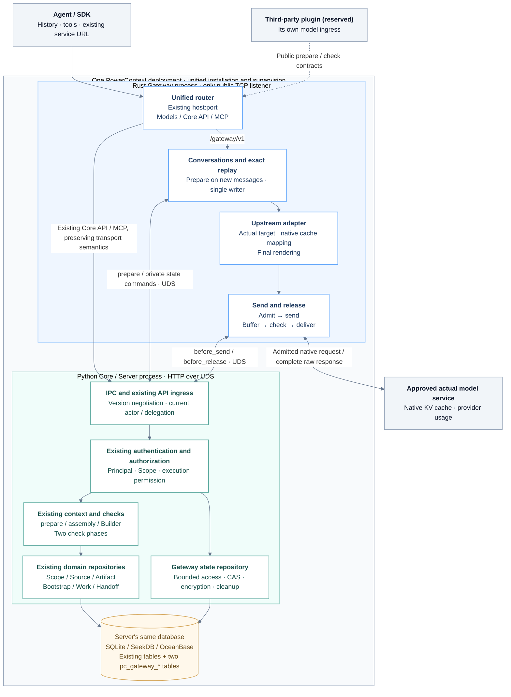
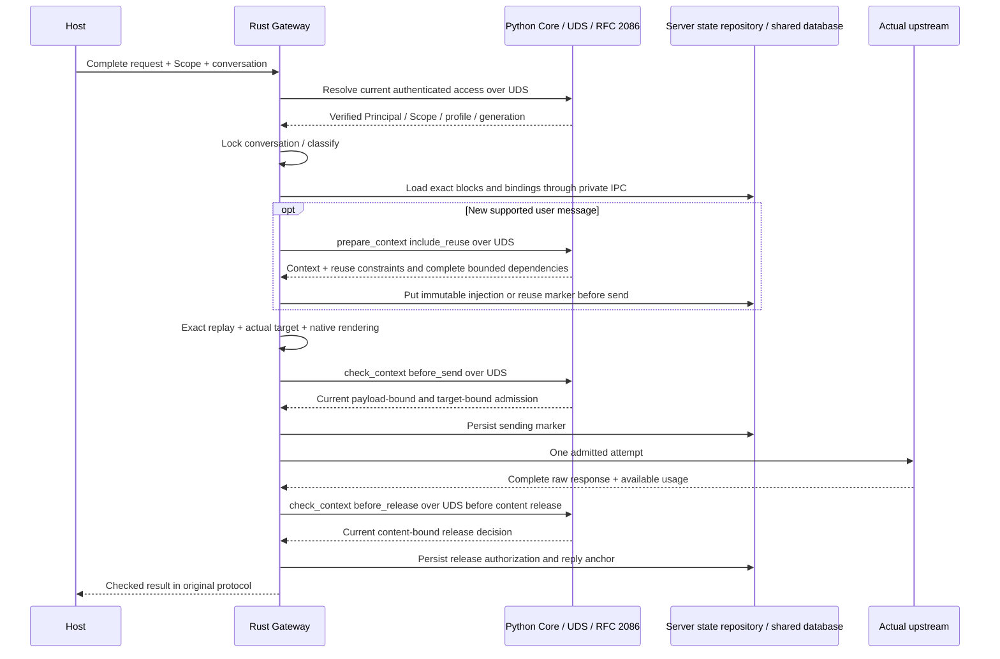
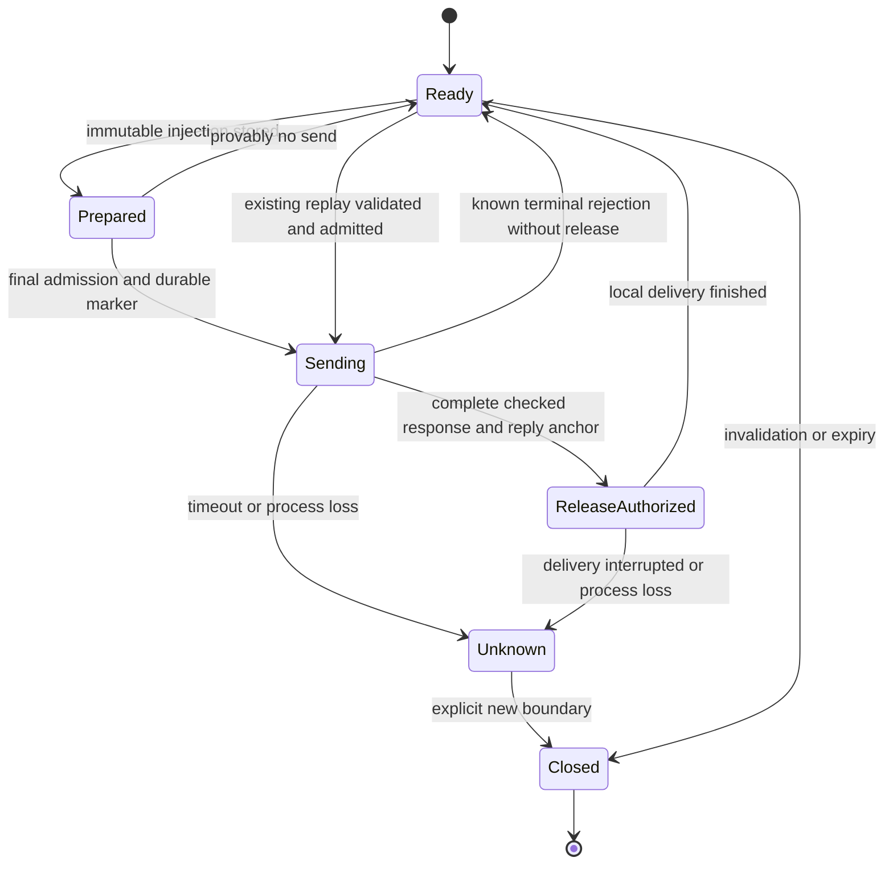

- Proposal Name: `powercontext_gateway`
- Start Date: 2026-10-22
- RFC PR: [oceanbase/powercontext#2199](https://github.com/oceanbase/powercontext/pull/2199)
- Related RFCs: [RFC 2086](https://github.com/oceanbase/powercontext/pull/2086),
  [RFC 0016](0016_pydantic_ai_inference_integration.md), [RFC 0046](0046_observability_foundations.md),
  [RFC 1345](1345_scope_organization_and_agent_integration.md), [RFC 1396](1396_handoff_access_control.md),
  [RFC 1429](1429_project_bootstrap_context.md), [RFC 1770](1770-decision-policy-governance.md),
  [RFC 1783](1783-handoff-session-rollover.md), [Working Note design](1790_source_backed_working_notes.md)

# Summary

PowerContext Gateway is an optional model-call entry point. It connects existing PowerContext organization to Agent
model traffic while clients retain their history and tool execution. It owns Scope binding, preparation at supported
boundaries, exact replay, actual-target selection, native cache adaptation, and controlled sends.
Its product goals are the same as [RFC 2086](https://github.com/oceanbase/powercontext/pull/2086):
**privacy interception and token efficiency at the context layer**.

The two RFCs describe one execution path. #2086 defines Core selection, representation strategies, privacy and budget
checks, reuse constraints, and check interfaces. This RFC defines how the gateway consumes those contracts and controls
the final request, every actual send, and the first release of response content.
It adds no second ContextRuntime, GateRuntime, memory algorithm, or policy database, and does not replace Core commits.

PowerContext Gateway is implemented in Rust, installed and supervised with PowerContext, and disabled by default.
When enabled, Rust owns the existing public port while Python Core listens only on a local Unix Domain Socket (UDS).
Rust forwards existing Core API/MCP routes and mounts model ingress at `/gateway/v1`, without another TCP listener.
It supports full-history Chat Completions and Responses without hidden provider conversation state; enhancement requires
trusted conversation association.

Gateway state inherits Server's `database` configuration and exact database, supporting SQLite, SeekDB and OceanBase.
Persistent replay adds only two optional `pc_gateway_*` tables through unified migrations.
Python Server owns connections, repositories and migrations; Rust accesses Gateway state through private IPC.
There is no separate database file/service or Rust reimplementation of Core repositories.
The initial release excludes a separate administration UI, automatic tool loops/transcript ingestion/summarization,
billing ledgers and semantic response caching.

Both this RFC and #2086 are proposals. The source baseline is `0bc42d0b`, and the coordination baseline is #2086. The Rust process, IPC, routes, permissions, three-backend Gateway tables and plugin contracts below are not shipped capabilities in that baseline.

| Decision | Contract |
| --- | --- |
| Core authority | Context selection, resource eligibility, representation algorithms, privacy decisions, reuse constraints, and domain writes. |
| Gateway authority | Protocols, trusted conversations, injection positions, immutable replay, actual targets, final rendering, sends, buffering, and release. |
| Host authority | User history, response acceptance, client tools and side effects, task completion, and Handoff timing. |
| Model-service authority | Native KV storage, reuse, eviction, and provider-defined usage. |
| API additions | Model-protocol ingress and two conversation-metadata operations; Core checks reuse one #2086 operation with two phases. |
| Storage additions | Two optional pc_gateway_* tables in Server's same SQLite / SeekDB / OceanBase database; no separate state database. |
| Default deployment | Rust + Python on one host, disabled by default; one existing public TCP listener and internal UDS when enabled. |
| Safety default | Withhold when required checks are unavailable; strict mode releases no model content before approval. |

# Motivation

Calling `/v1/context/prepare` lets PowerContext establish what it delivered, but does not reveal subsequent host
instructions, tool results, or the final model target. Preparing again every turn can also change historical prefixes,
increase retrieval work, and reduce opportunities for native model-cache reuse.

The gateway supplies execution-side visibility and ownership:

1. Inspect complete requests at the actual model boundary, including host history and tools outside PowerContext.
2. Prepare at supported new-user-message boundaries and preserve injections through ordinary tool rounds.
3. Replay adopted context at its original positions with unchanged content, avoiding unnecessary representation changes.
4. Adapt native caching after the actual model/API/account/region is resolved, measuring real usage and complete-task cost.
5. Reuse deployment and domain APIs so each Agent does not rebuild retrieval, cache settings, and failure handling.

Cache stability follows authorization, resource eligibility, privacy, and correctness. The promise is improved reuse
conditions, not guaranteed hits, savings percentages, or model-quality improvement.

# Guide-level explanation

## One coding Agent

The user has registered `project:powercontext`. The deployment permits selected Principals and model profiles for this
Scope. The client points its model base URL at the gateway and uses a credential accepted by PowerContext.
A supported host also sends a stable conversation ID through extra headers, using different conversations for different
work.

This full-history example uses **proposed interfaces**. `coding-default` is a deployment model alias, not a provider:

```bash
curl https://pc.example/gateway/v1/chat/completions \
  -H "Authorization: Bearer $POWERCONTEXT_TOKEN" \
  -H "X-PowerContext-Scope-ID: project:powercontext" \
  -H "X-PowerContext-Conversation-ID: coding-client-001" \
  -H "Content-Type: application/json" \
  -d '{
    "model": "coding-default",
    "messages": [
      {"role": "user", "content": "Fix the API client and preserve contract-generation requirements"}
    ],
    "stream": false,
    "max_tokens": 2048
  }'
```

1. The gateway authenticates the caller and checks current Scope read access, paid execution permission, and profile use.
2. Core selects cited context through existing prepare/assembly. The gateway does not search databases or rank Memory.
3. The gateway appends the complete PreparedContext to the latest user content where the protocol permits, retaining
   its historical-material trust wrapper. A Core-approved exact whole-value duplicate may instead reuse the historical injection.
4. It persists the exact injection, position, and reuse dependencies before rendering, obtaining #2086 final admission,
   and sending the actual request.
5. After the complete raw response passes output-release checks, it delivers through the client's protocol.
6. The client executes tools and submits its history and results. The gateway restores existing injections exactly,
   performs no new retrieval for this round, and still checks the complete input.
7. A new user message can trigger one new bounded preparation. Refresh, revocation, or resource invalidation establishes
   a new boundary; invalid content is not retained for caching.

An empty preparation is normal. Privacy rejection, invalid reuse eligibility, and unavailable policy have explicit
states. A delivered answer does not mean tools executed, Memory was written, or the task completed.

## Three integration modes

| Mode | Usage | Boundary |
| --- | --- | --- |
| Same-port Rust gateway | Unified startup; models use `/gateway/v1`, the initial default deployment. | UDS to Core and Server's Gateway repository, preserving current authentication/authorization. |
| Explicit remote Gateway | Later HTTPS access to the same public contracts. | Trusted delegation, bindings, remote state access and lifecycle require separate acceptance. |
| Third-party plugin (reserved) | Public prepare/check at its actual send/release boundary, without Rust Gateway. | No private IPC/repository access; validate concrete versions, initially reserving contracts only. |

Changing only a base URL does not necessarily enable reliable conversation enhancement. Clients without stable
conversation association initially use `check_only`: complete input/output inspection remains, but no project inference,
old-conversation inheritance, or automatic injection occurs.
The supported-client list must record actual versions, extra-header support, full history, cancellation, streaming
timeouts, and native signature behavior.

## How the two RFCs work together

| Question | #2086 contract | This RFC's implementation responsibility |
| --- | --- | --- |
| Which context to include | Existing Scoped prepare, assembly, Builder, resource eligibility, and approved representation. | Call once at a new-message boundary and preserve the result; do not duplicate selection. |
| Whether reuse remains valid | Authorization, freshness, retention, complete provenance dependencies, and reuse restrictions. | Verify before sending; persist exact blocks and stop an invalid replay epoch. |
| How to inspect | The same input/output algorithms, modes, failure actions, and transient bindings. | Call after final rendering, re-admit every actual attempt, and check before first strict release. |
| How to use native caching | Core supplies reusable boundaries; actual hits belong to the model service. | Native adapter maps target capabilities, breakpoints, TTL, and routing hints and parses available usage. |
| Who stores execution state | Core adds no inference database; Source/Artifact retain their domain contracts. | Server persists Gateway's two dedicated tables in the shared database, without a general model transcript. |
| How knowledge is written | Existing Source/Artifact, Work/Handoff, and their validation. | No automatic capture initially; later explicit workflows use existing APIs and commits. |

# Reference-level explanation

## 1. Scope, layers, and non-goals

A Rust crate owns the gateway request pipeline, protocol adapters, exact replay, native cache settings and actual sends;
the proposed source location is `crates/powercontext-gateway/`.
Python Server continues to own context algorithms, authentication/authorization, three-backend database connections,
Gateway state repositories and unified migrations. Rust consumes stable DTOs, without importing Python objects,
duplicating selection/privacy rules, directly accessing Source/Artifact, or starting another embedded SeekDB instance.
Existing Runtime code does not depend on Gateway. Disabling Gateway retains the original Python Server execution path.

The initial scope is one host, one gateway process, a single Scope without context references, full text, and validated
structured-tool carriers. Enhancement explicitly selects
`assembly.sections=[{"family":"memory","limit":6},{"family":"experience","limit":2}]` and `include_code=false`.
Other families, code, and cross-Scope content enter persistent replay only after complete reuse dependencies and
acceptance exist. Existing prepare users keep their defaults.

The initial release excludes arbitrary protocol conversion, dynamic cheap-model escalation, load balancing, a general
reverse proxy, global hard cost reservations, shared multi-host SQLite, automatic lossy compaction, response/semantic
caches, secret restoration, and arbitrary Agent tool execution.
Core background Embedding/rerank/extraction retain their own inference boundaries; they are not forced through this
gateway or automatically given Agent context.

## 2. Components and calls



Blue groups contain Rust execution; green groups contain Python Server. Gateway tables in the shared database remain
owned by the Gateway component. Third-party plugins use public contracts, without private state or database access.
Split protocol, upstream, replay and pipeline responsibilities without a generic plugin framework or runtime facade.
Native adapters must control the final actual send; a high-level SDK callback cannot establish final-byte/per-attempt coverage.

### 2.1 One public port and local IPC

| Mode | Public listener | Core communication |
| --- | --- | --- |
| Gateway disabled | Python retains existing `http.host:http.port`. | No Rust child or Gateway private IPC. |
| Default combined deployment | Rust exclusively owns the same `http.host:http.port`; Python opens no additional TCP port. | HTTP over UDS, with identical DTOs, authorization and algorithms. |
| Explicit remote deployment | Operator selects an existing service ingress, with separate acceptance. | Public prepare/check use HTTPS; remote Gateway state service is outside initial scope. |

`/gateway` is a configurable mount prefix; the default model Base URL is `http://localhost:8000/gateway/v1`.
Define model-relative `/v1/...` separately from the mount. Combined deployment rejects mounts conflicting with Core/MCP/
static routes. Health, management and Gateway metrics reuse the existing ingress, without extra admin/metrics TCP ports.
Forward registered existing `/v1/...`, MCP, health, Dashboard and static routes to Python, preserving paths, queries,
authentication, status codes, SSE/streaming backpressure and cancellation. Forwarding is not model admission of Core API
content. Reject unknown model paths rather than proxying arbitrary upstreams; private Gateway routes are unreachable
through public routing. External origin, proxy headers and correlation come only from trusted ingress, never forged
client internal headers. Existing service addresses/ports remain unchanged; changing the listener owner requires
controlled restart, not a promised hot switch.

Linux/macOS initially use UDS. The launcher selects a short private runtime directory and checks path length and
directory/socket ownership and permissions; remove only stale sockets confirmed to belong to this instance.
Windows local IPC needs its own transport and acceptance. Unsupported platforms reject enablement instead of silently
opening a new TCP port. UDS changes transport, not user authentication. Private calls include both an instance channel
credential and current user authentication/supported delegation. Deliver channel credentials through controlled handles,
never logs, URLs or model requests.

### 2.2 IPC capabilities and process lifecycle

| Contract | Responsibility and constraints |
| --- | --- |
| prepare / check | Use #2086 public schemas and strict phases; UDS and HTTPS decisions match. Core issues/validates `reuse.binding`; Rust retains it unchanged. |
| Private access resolution | Core resolves Principal, actor, Scope, `gateway.invoke` and profile permission from current authentication. Bind results to request/instance generation; Rust-supplied identity strings are not authority. |
| Private state commands | Strict bounded load, put-if-absent and CAS transition variants, limited to the two Gateway tables. No arbitrary SQL, table names or generic database proxy. Public GET/DELETE reuse the repository. |
| Version and budgets | Negotiate wire/schema, carriers, required features and byte/time/concurrency limits. Incompatibility fails readiness; never silently ignore unknown required fields. |
| Identity and expiry | Core checks current authorization on each protected operation; short-lived access resolution grants no permanent read/write/send permission. |

Before every actual send/release, Core's trusted Gateway call context revalidates current `gateway.invoke` and profile
permission. Initial access resolution does not replace execution authorization or enlarge ordinary check_only read rights.

Implementation registers private IPC operations in authoritative `openapi/powercontext.yaml` with internal markers.
Assemble them only in Gateway's local UDS mode, requiring channel authentication. Generation/routing tests must prove
they appear in no public SDK/MCP surface, capability list or public listener. They are not new third-party management
APIs. Existing public Core operations stay unchanged; checks do not perform state writes, and state commands cannot
authorize a model send.

Python Server remains the database/lifecycle owner and supervises the Rust child. Validate configuration/database
identity/schema readiness, establish UDS and negotiate versions before Rust claims the existing port.
Ship a matching platform Rust executable in the installation; normal startup neither compiles nor downloads code.
Disabled Gateway needs no child executable. Version mismatch, occupied original port or handshake failure stops
enablement, without selecting a random port or falling back to unchecked model forwarding.

Shutdown stops admission, bounds cancellation/draining, persists known/uncertain outcomes, stops Rust, then closes UDS
and the database. Core unavailability stops new sends/content release; channel loss propagates cancellation.
The parent confirms the old Rust PID exited before bounded restart. Core restart changes generation, invalidates old
channel credentials/state commands, and leaves unresolved sends Unknown without automatic paid resend.
Declare measured/configured policy-revocation, process-loss and cancellation delays rather than absolute immediacy.

The main model call usually needs two complete check RPCs; a new user message adds prepare.
Batch state reads by conversation; writes carry only injected blocks or bounded state, not another complete transcript/
response copy. Include IPC queues, serialization, database wait and connection reuse in total deadlines and CPU/RSS,
P95/P99 acceptance. Rust alone does not prove the complete path is faster.

## 3. Identity, Scope, and execution permission

Python Core reuses `AuthenticationProvider`, `AuthenticationResult`, the current Scope catalog and `AuthorizationProvider`.
Rust obtains verified Principal/actor/credential identity through private access resolution, without duplicating Python
authentication. Add no gateway user database, separate tenant hierarchy or gateway-key table.
The existing static Bearer maps to one fixed Principal and is not multi-user isolation.

| Constraint | Design |
| --- | --- |
| Scope selection | `X-PowerContext-Scope-ID`, or a trusted deployment binding from a credential to exactly one Scope; reject ambiguity. |
| Scope access | Check current `scope.read` on every request and required replay validation; resources retain their own access profiles. |
| Paid execution | Propose Scope action `gateway.invoke` and minimal role `gateway.user` in existing authorization vocabulary; read access does not imply model spending. |
| Profile permission | Only deployment-approved profiles/model aliases are usable by the authenticated caller; client model values request selection. |
| State partition | Complete `deployment + principal + scope_id + conversation_id + epoch` partition; another caller's IDs cannot be read or adopted. |
| Management | Reuse operational configuration and `server.admin`; conversation read/delete also require owner checks. |
| Credentials | Never forward PowerContext credentials to models; approved profiles resolve provider credentials through secret references. |

`gateway.invoke` and `gateway.user` are proposed additions, not existing enum values. Existing roles do not silently gain
execution permission. Any administrator execution grant is an explicit role mapping documented for upgrades.
A conversation cannot change Scope in place; changing projects creates a new conversation. Client user/metadata fields,
prompt tags, and provider session IDs confer no authority. `for_scope` only binds a partition, not authorization.

Standalone deployment forwards accepted user authentication or supported trusted delegation, allowing Core to identify
subject and actor. One privileged service token plus caller-controlled principal/scope is insufficient. PDP unavailability
must not allow reads or paid sends. The initial release shares no replay between users; even same-Scope collaborators
cannot read another Principal's injection copies.

## 4. Configuration, routing, and target profiles

Extend existing Server configuration with an optional `gateway` section. The following values are proposed; acceptance
must fix the measured thresholds:

```yaml
http:
  host: 127.0.0.1
  port: 8000
database:
  kind: sqlite
  url: sqlite+aiosqlite:///./powercontext.db
gateway:
  enabled: false
  mount_path: /gateway
  context_owner: gateway
  privacy_mode: enforcing
  output_mode: strict
  replay:
    enabled: true
    idle_ttl_seconds: 3600
    max_age_seconds: 86400
    max_context_blocks: 128
    max_context_bytes: 262144
    max_reuse_dependencies: 64
  limits:
    max_request_bytes: 8388608
    max_response_bytes: 2097152
    max_inflight: 16
  upstream_profiles:
    coding-default:
      protocol: openai-chat
      model: deployment-model-id
      base_url: https://approved-model.example/v1
      credential_ref: env:MODEL_API_KEY
      cache_adapter: validated-deployment-profile
```

The database example only illustrates shared SQLite storage; use the existing SeekDB/OceanBase configuration to select
those backends. Gateway has no second database URL; the launcher manages UDS paths/channel credentials.

Trusted configuration selects `gateway` or `host` as `context_owner`. When the host already manages
prepare/bootstrap/Handoff, the gateway neither prepares again nor injects a second copy; complete-request checks still
apply. A matching prompt tag does not prove host ownership or disable checks.

`UpstreamProfile` is the same contract as #2086, not a second cache-capability model: exact target, API/protocol and renderer
versions, account/region, permitted data processing and retention, model window/output limits, tool/schema/reasoning
capabilities, native cache modes/boundaries/TTL semantics, and usage mappings.
Profiles and configuration snapshots are versioned. Ordinary changes apply to new epochs; revocation/security changes
apply through current checks immediately.

Routing resolves one target from the trusted profile, requested protocol, and allowed model alias, remaining stable
within an epoch. Equal-priority ambiguity fails configuration loading; no automatic fallback is provided initially.
A disabled target or invalid credential fails explicitly without switching accounts, regions, models, or protocols.
Future target switches require new planning, history-compatibility checks, and complete admission, not old cache bindings.

Disallow provider redirects, caller-supplied base URLs, arbitrary forwarded authorization/cookies, unknown query
parameters, and credentials embedded in URLs. Endpoint resolution, DNS/IP checks, and egress policies must keep
configuration changes within approved targets; string-prefix matching is not destination proof.
Third-party upstream profiles also require validation of hidden routing/retries. Unknown actual targets are not covered.

## 5. Protocols, carriers, and conversations

| Path/protocol | Initial behavior |
| --- | --- |
| `POST /gateway/v1/chat/completions` | Complete history and validated text/tool requests; same-protocol output. |
| `POST /gateway/v1/responses` | Complete input, `store:false`, and no hidden provider history; same-protocol output. |
| `GET /gateway/v1/models` | Only configured model aliases the caller may execute; no broad probing of arbitrary upstreams. |
| `POST /gateway/v1/messages` | Later independent adaptation and acceptance, not an initial supported route. |
| Embeddings, batch jobs, files, WebSockets, audiovisual carriers, and unknown routes | Reject initially; never become an unchecked general proxy. |

Responses `previous_response_id`, `conversation`, `background`, item references, and opaque reasoning/signature blocks
require a profile that can supply inspection visibility while preserving native constraints.
The initial enforcing path rejects hidden history it cannot inspect. It must not silently pass it through and claim
complete protection. Chat and Responses are not converted. Native signed/reasoning content is neither migrated between
models nor automatically modified or discarded.

A supported host supplies the stable conversation ID; the gateway creates the epoch. Clients cannot select an old epoch
to evade validation. Even with an ID, validate history prefixes, roles, tool call/result pairing, and complete association
with previous replies. Matching opening text or query hashes do not establish conversation identity.
The initial implementation performs no fuzzy history lookup or cross-conversation ancestry inference. Unbound requests
use `check_only`.

Request classification affects optional enhancement only:

| Type | Prepare | Replay existing injection | Input/output checks |
| --- | --- | --- | --- |
| Initial/new user message | At most one bounded preparation | After validation | Required |
| Tool result, continuation, or provably unsent retry | No new preparation | Exact validated replay | Required for every actual attempt |
| Recognized title/housekeeping requests | No enhancement or automatic capture | Only as required by a validated protocol | Separate complete checks |
| No trusted conversation or host ownership | No automatic preparation | No inherited gateway blocks | Required |
| Unrecognized history edit, client compaction, or deletion | Stop the old epoch | Do not guess missing history | Explicit conflict or new-boundary requirement |

Unknown classification may stop enhancement, but not weaken safety. Reject if signatures or history integrity cannot be
preserved. Tool definitions, arguments, results, error text, and new host material remain in the complete check.

## 6. Preparation, exact injection, and trusted reuse dependencies

New messages obtain one PreparedContext through existing `ScopedContextApplication.prepare`, retaining assembly and
Builder citations, trust wrapping, UTF-8 limits, and omissions.
Do not assemble a separate gateway Memory catalog or call prepare again as a safety preflight.
Read existing blocks by the same anchor first; validate and reuse an existing block without another preparation.
Persist a content-free marker for empty results to avoid repeated retrieval on retry.
An uncommitted candidate can be recomputed after a crash: the guarantee is one exact committed representation, not
exactly-once preparation computation.

Append the complete context block to the **latest user content** where the protocol permits, without raising its
instruction priority. Do not modify historical system/developer/tools or insert random IDs, timestamps, or diagnostics
into stable segments. Do not truncate completed citation wrappers to make space. Disable this enhancement capability or
reject a profile requiring it when safe append is unsupported.

A replay record contains exact prepared text, position, native block and renderer version, content digest, message anchor,
provenance/reuse binding, retention constraints, and creation/expiry times. Persist it with put-if-absent before the first
send. Different values for one partition/epoch/anchor stop the send; never overwrite or re-retrieve to repair an old block.
Storage failure prevents that enhanced send. If release-state persistence fails after sending, withhold content and
retain Unknown semantics.
Client history remains authoritative. The gateway stores its own derived additions, not the full user transcript.

Anchors use a versioned protocol canonicalizer and an incremental HMAC chain over ordered original client messages,
including message ordinal, role, supported content, and tool IDs, without gateway injections.
Identical text at different positions, edited history, and changed tool association cannot accidentally share an anchor.
Compute the chain linearly over a complete request rather than rescanning history for every block.

New user messages can still select existing content. Core's optional whole-value delivery-reuse strategy may omit a
duplicate append only when exact prepared text, complete dependencies/versions, and trust/placement constraints match,
and the old block is actually present in this outbound history and currently eligible.
Keep the original block in place and persist a bounded reuse marker at the new anchor.
Existing context/inference reuse constraints own this decision; Gateway cannot infer it from a hash alone.
Initially, partial overlap never permits splitting blocks, deleting Memory items, or rewriting wrappers.
Deliver the complete new block or withhold if the full budget does not fit.
This optional strategy follows #2086 off/shadow/active modes and independent quality acceptance.
A disabled strategy or unproven equivalence cannot be reported as deduplication.

### 6.1 Preparation results and complete dependencies

Ordinary four-field `PreparedContext`, rendered citations, `PreparedContextBuild.lineages` and Bootstrap receipts alone
do not authorize persistent replay. After actual select/render/fit, Core creates complete bounded dependencies: exact
resources/versions, owning Scopes, content digests, eligibility/freshness, maximum retention and output binding.
Initial enhancement remains memory/experience; other families, code and references need complete dependencies and acceptance.

Rust calls existing `prepare_context(include_reuse=true)` over UDS and receives #2086's versioned `context + reuse`,
without private Python objects. Unrequested calls retain the strict default four fields.
Use `get_capabilities` and local negotiation to confirm schemas, carriers, families and bounds; reject unsupported
enhancement. `reuse.constraints` feeds Rust's native adapter; state IPC persists `reuse.binding` with exact injection
in Server's database. Preparation, state persistence and actual sending are separate boundaries; prepare does not
atomically execute a model.

### 6.2 Current eligibility and bindings on every replay

Every `check_context(phase=before_send)` includes all historical blocks' bindings and exact locations in the payload.
Core authenticates again and validates current Scope/resource access, exact-version eligibility, active/retired status,
required head/freshness, privacy and retention. Validation does not repeat semantic search or Embedding.
Readable Scope does not authorize indefinite egress of revoked content; validating only the newest prepare is insufficient.

`reuse.binding` uses #2086's bounded authenticated encrypted format, binding actor/delegation, Scope, exact content
digest, complete private dependencies, policy and expiry. Rust holds no Core issuance key and cannot extend eligibility.
Verify tampering, expiry, audience/subject/Scope, key versions, rotation and revocation latency.
Response checking uses `before_release` with this attempt's `request_binding`; preparation, sending and release
approvals are not interchangeable.

Invalid, expired or unverifiable dependencies yield `context_refresh_required` / withhold, stopping the old epoch.
The host creates a new conversation or explicit Handoff boundary; do not replace old blocks, splice semantic windows
or break signatures. Profiles define maximum freshness and new-message/explicit-refresh boundaries without re-running
all historical queries every round. Missing capabilities permit only explicit check_only integration; an enhanced
conversation cannot silently discard required bindings and continue.

## 7. Native caching and complete budgets

Gateway state reconstructs exact injected model input; provider KV is separate state. Every actual call still generates
a new answer. The initial release caches neither answers, semantic results, nor tool side effects.

```text
Request 1: unchanged instructions/tools | user-1 + exact context-A
Request 2: same native prefix           | accepted answer-1 | tool results
Request 3: same historical placement    | user-2 + context-B
```

This is a logical illustration. Target roles, content blocks, token boundaries, and deployment rules determine actual
native qualification.

Native adapters consume #2086 `reuse.constraints` to choose supported automatic/explicit modes, eligible breakpoints,
TTL, and routing hints within approved profiles. Core does not emit universal `cache_control`, and Gateway does not
decide independently that invalid resources remain usable.
Cache settings precede final rendering; checks then cover the exact body, relevant headers, target, and output limits.

| Deployment cache capability | Native adapter behavior | Support boundary |
| --- | --- | --- |
| Implicit prefix caching | Preserve the exact native prefix, provide stable routing hints only where supported, and map actual cached-input usage. | No explicit breakpoint does not remove history/target validation or guarantee a hit. |
| Explicit breakpoints | Set native breakpoints and retention parameters on profile-approved tools/system/message blocks. | Breakpoints are not universal cross-protocol fields; preserve corresponding native boundaries. |
| Separate remote cache resource | Requires additional create/reference/delete operations, cost, and retention lifecycle. | Excluded initially; independently validate full-input visibility and resource governance without advance storage approval. |

Model aliases do not imply these capabilities. Each approved profile fixes measured support, minimum prefix conditions,
and usage definitions. Where routing hints are needed, derive them from stable deployment/Principal/Scope/epoch/target
profile partitions rather than the growing full-request digest, without exposing raw business identity.
Hints affect only routing mechanisms supported by the target.

| Change | Required behavior |
| --- | --- |
| Ordinary new tool results/user messages | Preserve exact historical blocks and native positions; recheck the complete extended request. |
| Tools/schema, system, or reasoning settings change | Validate protocol continuation; do not present new cache qualification as an old binding. |
| Model/API/account/region/renderer changes | Replan and re-admit, creating a new epoch where needed; no private KV migration. |
| Access revocation, resource invalidation, or required policy change | Stop invalid reuse even when cache eligibility is lost. |
| Optional cache parameter unsupported | Omit only when the original request remains approved and within budget, then recheck the changed final payload. |
| Cache miss | Generate normally, without retries or default padding to reach a cache minimum. |

Omitting cache parameters does not establish that provider implicit caching is disabled. Reject profiles that cannot meet
required retention, regional, or isolation constraints. Scope/route keys are not physical cache isolation; cache TTL is not
a deletion deadline. Stable request bytes are a locally testable invariant, not proof of identical provider token/KV
rendering. Validate native compatibility, actual usage, and latency separately.

Complete token admission includes instructions, original history, replayed blocks, tools/schema, protocol overhead, and
output reserve using a target estimator/profile with stated uncertainty. `prepare.max_bytes` bounds supplementary text
only. Withhold when the request does not fit; the host explicitly prepares less context or creates a Handoff.
Do not silently trim history or approved context. Core representation strategies run during preparation; Gateway must not
compress already frozen prepared text a second time.

## 8. Sends, output, and failure states



Checks retain #2086 `allow/block/withhold`, current authorization, trusted stage/profile, coverage, final content/target
binding, and expiry. A check-only operation does not prove what an executor actually sent.
Use the same rules and conformance samples for local IPC/remote execution, not a more permissive gateway privacy engine.

First bound raw bytes, strictly parse UTF-8/JSON, and reject duplicate keys and unsupported structures before optional
enhancement. Retain original carriers until checks finish and inspect them alongside final payloads so serialization
normalization cannot hide prohibited values. Target token budgets apply only to the actual final outbound payload.
Embedding/rerank needed by prepare retain their own Core pre-send checks, rather than waiting for primary-model admission.

Required inspection covers instructions, history, context, tool definitions/arguments/results, supported structured
content, raw output, exposable errors, and completion state. Duplicate JSON keys, escaped/numeric representations, and
unknown fields cannot hide sensitive data.
Do not send prohibited material to a hosted classifier/summarizer before deciding whether egress is allowed.
Disabling optional optimization cannot disable required rules.

### 8.1 Strict output and streaming

`strict` buffers complete supported output and assembles ordinary responses or SSE only after approval.
Before approval, protocol heartbeats may contain no model content. Never release answer fragments, tool arguments, or
raw provider errors. This is not real-time token relay; it increases first-content-release latency and requires client and
reverse-proxy timeout validation.
`observe` measures behavior without claiming disclosure prevention. No enforcing bounded-streaming claim is made before
independent acceptance.

Limits cover response bytes, time, concurrency, parse depth, and total memory. 2 MiB × 16 is only the body lower bound,
not an RSS cap. Overflow, incomplete JSON/tool arguments, interrupted upstream streams, failed checks, or unavailable
release decisions stop content release and trigger best-effort cancellation.
Do not spill sensitive responses to any database or temporary file.
Check current policy before send and release; measure revocation latency at the actual boundaries.
After SSE headers have been sent, terminate through supported error events rather than claiming an HTTP-status change.

### 8.2 Bounded sending and restart

Connection-pool and storage waits count against admission expiry. Revalidate binding validity immediately before network
write and check again after expiry. A durable sending marker cannot extend permission, policy, or target binding or
become permanent send permission.

One owner controls retries. Disable hidden SDK retries or integrate every actual attempt at the final boundary.
Only provably unsent connection failures permit bounded retries, with new admission.
Timeouts, lost connections, and crashes that may have reached the upstream yield `outcome_unknown`; do not automatically
pay to resend or fall back.

Allow one in-flight request per conversation, with Rust locks and Server repository version/generation CAS.
Lease expiry does not imply that the upstream did not execute. No distributed exactly-once claim is made.
Return 409 on conversation concurrency conflicts; clients retry after the original call resolves.
Cancellation preserves known/uncertain send state.
Pre-send block/withhold does not advance sent state. A complete known terminal result whose release is rejected is a
known failure, not an uncertain send, and never triggers another automatic model call.



After restart, `Sending` and unconfirmed `ReleaseAuthorized` become Unknown, not replayed model calls.
There is no persisted response body, so an identical input cannot recover the previous answer.
`release authorized` means local checks approved release, not client acceptance, network delivery, or task completion.

The initial release does not promise model idempotency for client duplicates. Regeneration can incur another charge.
An unresolved call in Unknown returns 409; the host explicitly opens a new boundary and decides whether to execute again.
#2086's lack of durable response recovery remains. Gateway state prevents its own blind resends after restart only.

## 9. Minimal API inventory

Core requests retain `scope_id` and existing flat operation IDs. Model-protocol bodies do not acquire vendor-incompatible
domain fields.

| Category | Interface/operation | Status and ownership |
| --- | --- | --- |
| Context | `prepare_context`, with Bootstrap/Work/Handoff under host workflows | Existing Core APIs; no duplicate preparation algorithm. |
| Sending/release checks | `POST /v1/context/check` / `check_context`; `phase=before_send / before_release` | One proposed #2086 operation at two checkpoints; no replacement checks here. |
| Model ingress | `/gateway/v1/chat/completions`, `/gateway/v1/responses`, `/gateway/v1/models` | Initially proposed here; protocol-native success responses. |
| Conversation status | `GET /v1/scopes/{scope_id}/gateway/conversations/{conversation_id}` / `get_gateway_conversation` | Proposed here; owner-visible metadata only. |
| Delete derived copies | `DELETE /v1/scopes/{scope_id}/gateway/conversations/{conversation_id}` / `delete_gateway_conversation` | Proposed here; close epoch, prevent further use, and delete gateway replay blocks. |
| Capability discovery | Existing `get_capabilities` | Extend declarations for protocol, carrier, strict mode, enhancement, replay, remote binding, and versions. |
| Preparation reuse metadata | Existing `prepare_context(include_reuse=true)` returns `context + reuse` | Shared #2086 contract; default four fields unchanged, explicit opt-in uses a new schema and no new operation. |

The first valid enhanced request creates a conversation; no start/plan/prepare/finalize gateway CRUD family is needed.
GET returns no context/response content, credentials, or matched secrets. Missing resources retain non-disclosure behavior
without revealing another owner's state.
DELETE acts on gateway-derived copies, not Source/Artifact, and cannot recall material already sent to models.
Order deletion with in-flight send/release in the same conversation state machine. Return 409/retry-later while a request
is being cancelled. Confirm success only after preventing subsequent local use and deleting visible rows, without
promising physical erasure from database pages, backups or providers.

`X-PowerContext-Scope-ID` must match trusted bindings. Domain conversation routes use the path Scope; conflicting inputs
cannot change resource ownership. When clients cannot send the header, a trusted one-credential/one-Scope binding may
supply it. A global default Scope is not isolation.

Model paths preserve native envelopes. Errors use protocol-supported shapes with stable content-free reasons and request
correlation. Use `401/403` for authentication/authorization, `409` for history/in-flight/Unknown conflicts, `422` for
unsupported carriers or windows, `429` for gateway admission capacity, `503` for required policy/dependency unavailability,
and 403 for explicit policy prohibition. Do not collapse withhold, empty, upstream errors, and local rejection into success.
Strip all PowerContext control headers, reuse bindings, and caller credentials from final upstream requests; send only
approved provider headers.

Public management retains its Scope paths. Authorized Server repositories can query/clean retained state after Gateway
is disabled; in-flight states return 409 and preserve release ordering. Private IPC is no third-party surface.

These are proposals; this RFC does not change `openapi/powercontext.yaml`.
Implement Core checks, management metadata and internally marked IPC operations in that source contract, regenerate clients, and run `make api-generate` /
`make contract-test`. Version model wire schemas separately, document their OpenAPI entry points and conformance fixtures,
and do not present ordinary Core ErrorResponse as the provider protocol.

## 10. Persistence, costs, and lifecycle

### 10.1 Two Gateway tables in Server's database

Exact injections must survive retries/restart. Source is domain evidence, Artifact is versioned knowledge, Bootstrap
receipts deduplicate specific deliveries, and usage permits loss; none owns Gateway send/replay state.
Reuse database/migration infrastructure without storing private copies as Source/Artifact or triggering extraction.

Persistent replay registers two optional component tables through Server's unified migrations:

| Table | Key and required contents | Mutation contract |
| --- | --- | --- |
| `pc_gateway_conversations` | deployment/Principal/Scope/conversation/epoch; config/renderer/target profiles; history digest/latest reply anchor; latest attempt state, last transition identity/hash, version and expiry. | CAS updates; no complete transcript/response or full attempt ledger. |
| `pc_gateway_replay_blocks` | Complete conversation partition plus message anchor; exact injection/native position, reuse binding, content digest and expiry. | Put-if-absent, exact same-value readback, conflicting values fail; this gateway's injections only. |

The same database means Server's exact configured identity: the same SQLite file, embedded SeekDB instance/database,
or OceanBase tenant/database. No Gateway database URL, second SQLite file, separate schema service or migration history.
These two tables belong to #2199; #2086's algorithms/checks still add no tables.
Add no profile/key/log/response/capture/tool/summary tables.

### 10.2 Server-owned repositories accessed through IPC

Python Server reuses existing `AsyncDatabase`, backend profiles, table definitions and transaction boundaries for a
repository restricted to Gateway state. Rust receives no database credentials and directly accesses no tables.
Private state operations validate current actor/Scope, process generation, epoch, expected version and legal transitions.
This persistence boundary owns encryption, exact readback, quotas and same-value put-if-absent.
It is Gateway state capability, not another memory algorithm or arbitrary database RPC.

| Server backend | Shared destination and reuse | Required acceptance |
| --- | --- | --- |
| SQLite | Same file and existing Python engine/transactions, WAL/busy timeout; Gateway and Core tables coexist. | Concurrent Core writes, lock wait, cancellation/rollback, process restart and exact-byte readback. Memory databases cannot claim durable replay. |
| SeekDB | Same embedded profile/database held by Python; no second embedded instance. | Real embedded execution, transactions/CAS, conflict rollback, restart readback and complete cleanup. |
| OceanBase | Existing official async dialect, same tenant/database and connection policy. | Real-service commit, rollback, disconnect/uncertain commit, binary/JSON fidelity and index compatibility; MySQL mocks are insufficient. |

Use existing dialect-neutral types/backend variants, without vector indexes or vendor-specific JSON mutation semantics.
Verify key lengths, case/collation, uniqueness, ciphertext size and expiry indexes on all three backends; never truncate
identities or omit constraints to make DDL succeed. Core and Gateway share a database but commit separate transactions;
domain writes and remote model execution are not one transaction.

Same-value puts compare complete identity, exact content/bindings and digests, not randomized ciphertext bytes.
Persist the latest transition identity/hash atomically with version; unverifiable or invalidated readback withholds instead
of creating a complete event ledger.

If a put/transition IPC reply is lost, read back by the same partition/anchor or transition identity.
Continue only when exact values/expected versions establish the commit; do not create new IDs after uncertain writes.
Do not wait for model network calls inside a database transaction. Bound repository wait/concurrency on all backends
to protect Core work.

Initially, each deployment has one active Rust sender, controlled by its local supervisor/lifetime lock.
A shared remote database is not multi-host send coordination: deployment tooling must stop or fence the old sender
before another host takes over the same deployment. Without confirmation, refuse takeover rather than infer no model
execution from lease expiry/CAS. Restart retains Unknown semantics for Sending/unconfirmed delivery, without paid resend.
Automatic multi-host failover and distributed exactly-once execution are outside initial scope.

### 10.3 Unified migration and compatibility

Reuse [RFC 1771](1771-unified-database-migrations.md) and the existing migration entry point.
Register optional component bundle `gateway-state`; this is a proposed addition, not an existing CLI choice.
SQLite, SeekDB and OceanBase need verified migration resources/adapters. Rust starts no second migrator.
Existing database upgrades use explicit plan/apply/verify and existing control tables; unknown versions/missing required
structure fail enhancement readiness. Coordinate shared-database writers through the existing deployment contract;
stopping Rust does not establish that all Core writers stopped.

Both new installations and upgrades verify schema before model traffic. Ordinary requests perform no DDL, whole-database
backfills or silent repair. Disabled Gateway/check_only creates no Gateway tables; existing tables retain policy-based
retention/cleanup, and disabling never deletes Core data. Reject durable enhancement on memory databases rather than
silently create a replacement file.
Do not assign current provenance/permissions to historical blocks; missing required dependencies close their epoch.
Backup/restore, retention and capacity cover the shared database. Restore first validates current authorization/bindings,
without reviving historical sending permission.

### 10.4 Bounds, expiry, and cleanup

Persist content only within deployment retention policy, using authenticated encryption with managed keys.
Unavailable keys prevent sensitive writes. Keys are not stored in the database. Encryption does not replace Scope/owner
authorization, backup protection, or current policy.
Conversation/message digests use deployment HMAC; low-entropy content hashes are not public diagnostics.

Proposed defaults are one-hour idle expiry, 24-hour absolute expiry, 128 blocks, and 256 KiB total payload per conversation.
Effective expiry is the minimum of configuration, Core binding, and permitted resource retention.
Stop reads/sends on expiry before asynchronous cleanup; delayed cleanup never extends eligibility.

128 is a record-count bound; 256 KiB is cumulative, not per block.
At 100 active enhanced conversations per Principal, content alone can reach approximately 25 MiB, or 25 GiB for 1,000
Principals, before indexes, encryption, WAL/redo and backups; shared-database capacity includes these Gateway copies.
Deployments must bound per-Principal and global bytes/conversation admission, not rely on TTL alone.
At capacity, reject new enhancement instead of evicting required blocks and continuing with broken replay.

Batch reads/writes by complete conversation keys and bounded anchors; each preparation retains its original entry
limit. Bound the deduplicated dependencies for the entire conversation to 64, not merely this turn's eight candidates.
At that limit, withhold and require a new boundary rather than truncating the dependency list.
A new message must not scan all conversations, Sources, or Memory.
Conversation rows track stored bytes/block counts in their state transactions. A single-active deployment may restore
admission counters through an indexed readiness aggregation, measuring this startup work rather than repeating a whole-
database SUM on incremental requests. Uncertain counts/commits withhold admission until exact readback/reconstruction.
Cleanup uses indexed bounded batches. Measure hot-conversation concurrency, lock wait, WAL/redo growth, restart and cleanup on all three backends.

Although client history is not persisted, each request still requires parsing/scanning with linear cost in request size.
Complete privacy inspection and strict buffering remain real CPU/memory costs despite retrieval occurring only on new
messages.

## 11. Usage, operational controls, and observations

Retain existing typed usage/content-free observation contracts across languages: Rust emits bounded events and Server
reuses existing sinks. Python uses `log_safely`; Rust's safe logging adapter follows the same field allowlists and
observation-failure rules.
Register new operation/unit/outcome fields, protocol values, finite reasons, and coverage; update both language guides.
Use `log_safely` on Python and the equivalent safe adapter on Rust, with existing request/trace identity and no prompts,
cited content, responses, credentials or
sensitive paths. Logs and lossy usage are not response recovery, audit, or billing ledgers.

Gateway emits typed attempt metadata: actual target/profile, preparation/check/send/buffer/release latency,
available ordinary-input/cache-read/cache-write/output/reasoning usage, known/estimated/unknown coverage, and incomplete
reasons. Reuse #2086's optional inference/usage metadata rather than introducing another usage model.
Daily aggregates cannot reconstruct missing cache or failed-attempt fields. Unknown is not zero.
Rust does not directly call Python log functions; cross-process events still require typed/allowlisted acceptance.
A task correlation ID is observation, not proof of host task success.

Initial execution controls are bounded concurrency, input/output sizes, timeouts, cancellation, and backpressure, not
complex rate limiting or hard cost reservations. Distinguish upstream first token, first approved content release, and
delivery completion. Cancel on client disconnect where possible without assuming upstream billing stops immediately.
Required dependency failures surface through readiness/operations; safety failure cannot degrade into bare forwarding.

## 12. Later features and domain composition

| Capability | Composition | Required independent acceptance |
| --- | --- | --- |
| Explicit remote deployment | Same public Core prepare/check, trusted delegation/bindings; separately accepted state access. | HTTPS, actual target, rotation/expiry, cancellation, faults and remote state ownership; private UDS stays private. |
| Read-only memory tools | Explicitly allowed MCP/HTTP tools retaining evidence/permissions; tool rounds enter complete checks and exact replay. | Model-visible catalog, host-visible behavior, round/cost bounds, native tool/reasoning pairing. |
| Write tools/side effects | Disabled by default; explicit user permission with domain approval, idempotency, and commits. | Execution permission is not tool authorization; hidden loops never approve writes by default. |
| Explicit conversation-fragment capture | User/host-requested `/v1/sources/content` or working-notes with stable source_id and exact-value retries. | Strip injected blocks only from trusted injection records; verify privacy/retention, receipts, conflicts, and readback. |
| Long-task continuity | Prefer explicit host Handoff/rollover through existing prepare/finalize/commit/continue. | Real persistence/readback; temporary summaries are not Handoffs or evidence of acceptance/completion. |
| Automatic compaction | Define new windows, summary evidence, and signature compatibility only with independent quality and complete-cost evidence. | Check and bill summarizer calls, account for lost cache qualification and irreversible information loss. |

### 12.1 Third-party gateway plugin contract

Plugins are optional integrations, not a generic plugin platform required alongside Rust Gateway's initial release.
Users of another gateway can consume Core directly without PowerContext Gateway. Keep that gateway's own model URL;
it need not implement `/gateway/v1` and receives no Gateway-private state interface.

| Plugin phase | Shared contract |
| --- | --- |
| Capability/identity | Public get_capabilities plus supported user authentication/restricted delegation, Scope, target profile and version; self-reported Principals are not authority. |
| Preparation | `prepare_context(include_reuse=true)` at an eligible new-message boundary, one injection owner, exact values/bindings retained. |
| Native adaptation/send | The final executor maps `reuse.constraints` to the actual target's native cache settings and final rendering; each attempt calls `check_context(before_send)`. |
| Response delivery | Bound and buffer the complete supported response, correlate this request_binding, call `check_context(before_release)`, then release if allowed. |
| Conversation/invalidation | Reuse reliable third-party state facilities. Exact replay needs complete dependencies/stable conversation identity; invalidation starts a new boundary. Same Scope is not a shared session. |

Brand-specific adapters translate protocol, identity and lifecycle; selection/privacy rules stay in Core.
A request-level pre-hook is not automatically the final outbound boundary. Cover exact post-mapping bytes, every retry/
fallback, cache replies, error bodies and first streamed content. Parallel moderation/asynchronous logs cannot enforce
blocking. The first enforcing profile disables third-party answer/semantic caches; validate native KV independently.
Later cached replies need separate current-authorization/release contracts.

The third-party gateway must be an approved data processor. If privacy includes preventing egress to an external SaaS
gateway, check at the host/self-hosted ingress before that egress; a remote plugin cannot undo receipt.
As a Rust Gateway upstream, enable only verified transparent target/content/cache-field-preserving profiles.
Later opaque transformations require integration at that third party's final boundary; reject missing mandatory coverage.

Initially deliver versioned specifications/conformance fixtures and reserve plugin package integration.
Develop, validate and publish supported versions of concrete plugins only for explicit demand.
Do not claim existing LiteLLM, Portkey or other product compatibility; add no brand-specific Core APIs or plugin tables.

A completed model response is not user acceptance; repetition in the next turn is not knowledge-capture authorization.
The initial gateway does not automatically ingest based on these heuristics.
Future explicit capture uses the existing identical-value contract: one complete Source identity and exact
content/metadata return the same receipt, while different values conflict.
Do not generate a new ID after timeout to hide uncertain writes or treat Source 202 as extracted Memory.
Working Notes are explicit temporary evidence, not automatic Memory promotion.

Gateway does not reimplement background write gates. Required privacy failure/unknown cannot become write HOLD or empty
extraction success and must not advance unprocessed Source cursors.
Existing domain consumers retain recovery permissions and retry budgets.

## 13. Phases and acceptance

### P0: Rust Gateway with one public port

First deliver the platform executable, unified supervision, UDS negotiation/channel authentication, current identity/
Scope resolution, Core API/MCP proxy compatibility and bounded state IPC. One listener owns the existing port; disabled
Gateway retains Server behavior.
Local enhancement uses #2086's versioned prepare/check, complete dependencies and bindings from the initial release.
These cross-process contracts are Gateway P0 prerequisites, not deferred remote-deployment work.

Deliver one Scope, explicit conversations, memory/experience, Chat/full-history Responses, one approved target,
strict text/tool responses, exact replay and bounded execution.
Shared-database tables, migrations, transactions and restart readback require real SQLite, SeekDB and OceanBase acceptance.
Declare only backends actually accepted; interfaces or SQLite tests do not establish all three.
Check_only leaves replay disabled and needs no two tables. Third-party scope is specifications/conformance fixtures,
without mandatory brand-specific plugin implementation.

### P1: selected plugins, remote access and more protocols

Select actual third-party versions on demand, validate final sends/releases, native cache preservation, trusted delegation,
errors/cancellation, then ship the corresponding small adapter. Do not build a generic plugin platform first.
Separately validate explicit remote HTTPS/state access rather than expose private UDS state operations publicly.
Add Messages, native signatures and more carriers/families with real client/deployment versions.
Validate Windows local IPC separately when implemented; default operation still opens no additional TCP port.

### P2: evidence-driven extensions

Add read-only tools, explicit capture, larger deployments, or quality-validated compaction only after demonstrated demand
and independent review. They are not P0 requirements or advance approval for tables, automatic knowledge writes, or
dynamic model scheduling.

### Required validation

| Dimension | Reproducible acceptance |
| --- | --- |
| Coordination between RFCs | Identical Python in-process, Rust UDS and HTTPS samples, schemas/bindings, current authorization, actual targets and deadlines. |
| Check contract | Reject wrong-phase DTOs, missing/expired/cross-request bindings and mislocated historical blocks; HTTP 200 block/withhold never sends/releases, and checks do not repeat prepare. |
| Port/IPC | Enabled/disabled use the existing TCP port only; real two-process tests cover private-route isolation, forged channel/actor, incompatible versions, parent/child exits, Core/MCP/SSE proxy compatibility and cancellation. |
| Three-backend shared state | Real SQLite, SeekDB and OceanBase acceptance for same-database tables, transactions/CAS, constraints, Unicode/ciphertext readback, migrations, isolated deletion and concurrent Core writes. |
| Reserved plugins | Conformance covers per-attempt retry/fallback, final post-mapping payload and first response release; no brand compatibility claim without actual acceptance. |
| Privacy | Seed prohibited values in host history, context, tool structures, escaping/duplicate keys, and raw errors; prove controlled upstreams/hosts do not receive blocked content. |
| Reuse and access | Scope denial, retired/deleted Artifacts, head/freshness changes, tampered/expired bindings, and another user/Scope ID cannot preserve invalid replay. |
| History integrity | Initial/new messages, tool rounds, exact whole-value duplicates versus partial overlap, regeneration, client edits/compaction, identical questions in different conversations, and host/gateway integration together. |
| Native carriers | Stable roles/tool IDs/order/content blocks, explicit renderer changes, and rejection of unsupported signatures/hidden history. |
| State and restart | Three-backend conflicts/unavailable storage prevent sends; lost IPC replies require exact same-identity readback; real two-process crashes retain Unknown. |
| Concurrency/cancellation | One in-flight call per conversation; PDP/policy failure, disconnect, SSE backpressure, limits, and cleanup do not leak. |
| Deployment/migration | Disabled creates no Gateway tables; enablement adds UDS only, registered bundles read back on all three backends, unknown schemas/keys fail. |
| Domain reuse | Strict default four-field/opt-in envelope separation, no duplicate injection, no automatic Source/Memory/Handoff, and no successful Source-window consumption after privacy failure. |

Validate actual protocol support with supported clients and real providers. Mock upstreams establish local bytes and
failure behavior, not real cache hits, signature compatibility, or host acceptance.

### Efficiency experiments and launch criteria

Fix task/repository/model/protocol/tools/schema, evidence, policy, output budget, and quality criteria, then compare:

1. Current direct execution with the same required privacy checks.
2. Gateway execution without optional enhancement, measuring gateway/strict overhead.
3. The same prepared content with exact replay, measuring preparation frequency, final native prefixes, and actual cache usage.
4. The same reuse with validated representation/native-cache strategies, isolating their incremental value.

Separate cold/warm/multi-turn conditions, context refresh, parameter changes, revocation, and window boundaries.
Providers may cache by default; absence of cache parameters is not an uncached baseline.
Preserve existing Core deduplication and recall optimizations in every group instead of manufacturing repeated retrieval.

Measure complete-task quality, failures/repairs/retries, primary/auxiliary model cost, retrieval/Embedding/rerank/decisions,
cache writes/reads, unknown coverage, CPU/RSS/disk, upstream first token/first release/total time, and P95/P99.
Paid paired experiments require a separate experiment budget; shadow candidates do not add model calls by default.
Enable an optimization by default only when privacy, quality, resource constraints, and measured gains meet
predeclared thresholds. Publish no savings numbers without experiments.

# Drawbacks

A gateway on the critical model path adds failure modes, authorization/scanning cost, strict-release latency, and
responsibility for retained private copies.
Rust/Python IPC adds negotiation, serialization, cancellation and supervision work. Replay adds private copies, indexes,
lock contention, keys, cleanup and migrations to Server's database. Three backends do not establish multi-host failover.
Reliable enhancement requires conversation/full-history/protocol capabilities and cannot cover every base-URL-only client.

Cache stability, real-time streaming, immediate resource changes, and automatic summarization have tradeoffs.
Current authorization, safety, and accurate history take priority, so refresh can reduce reuse and strict mode can delay
content delivery substantially.

# Rationale and alternatives

| Alternative | Decision |
| --- | --- |
| Put all algorithms in Gateway | Duplicates #2086/Core and forces background/embedded users through a gateway; shared domain algorithms stay in Core. |
| Stateless prepare proxy only | Cannot restore client-invisible historical injections; suitable for check_only, not stable enhancement. |
| Repeat all retrieval each turn | Adds calls and changes historical prefixes; prepare only for new messages and validate eligibility without semantic search. |
| Put full prompts in Source/Artifact | Confuses evidence with private derived copies and changes retention/extraction behavior; use two bounded dedicated tables. |
| Full transcripts plus response/attempt ledger | No initial recovery/financial guarantee requires them; retain only injections and the latest unresolved state. |
| New gateway identity/tenant/policy platform | Duplicates Principal/Scope/Access/Policy; reuse existing boundaries and trusted configuration. |
| Claim complete safety through opaque downstreams | Actual targets/mutations/retries are unknown; require a final-boundary plugin or validated transparent path. |
| Rust owns database connections/migrations directly | Initially reuse Server's engine, embedded SeekDB lifecycle and migrations; bounded state IPC has an explicit measured cost. |
| Prefer cache stability over current eligibility | Risks sending revoked content; current safety and resource eligibility take priority. |

# Prior art

Existing scoped context/assembly/Builder, Source/Artifact, Bootstrap/Work/Handoff, Server authentication/authorization,
DecisionPolicy, inference adapters, and usage wrappers provide the foundation.
[RFC 2086](https://github.com/oceanbase/powercontext/pull/2086) supplies the context-protection and efficiency contracts
consumed here, not a separate algorithm design to reimplement in Gateway.
Concrete deployment adapters and acceptance fixtures describe model protocols and native provider caching.

# Unresolved questions

Before merge, fix the initial real client/provider/SDK combinations, configuration entry point, deployment retention
requirements, family-specific complete dependencies, key facilities, and resource/SLO thresholds.
Rust execution, same-port UDS, Server-owned shared storage, three backends, two pc_gateway_* tables, current
authorization and no uncertain-send retry are explicit decisions.

Public binding wire/key rotation, private IPC schemas/internal filtering and three-backend gateway-state resources
must be fixed and accepted before Gateway P0 enablement. Names or single-backend examples do not establish delivery.
Multi-host execution, financial ledgers, automatic compaction, and write tools are not unfinished initial requirements.

# Future possibilities

Extend the validated vertical slice with more protocols, controlled read-only tools, explicit knowledge capture, and host
continuity. Multi-host or durable response recovery requires a separate justification for shared state, single execution
and delivery, uncertain results, and data deletion. Two Gateway tables in the shared database do not establish distributed execution guarantees.
