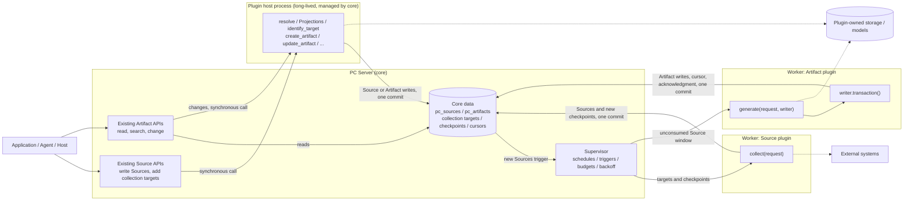

- Proposal Name: `plugin_interfaces`
- Start Date: 2026-11-08
- RFC PR: [oceanbase/powercontext#2549](https://github.com/oceanbase/powercontext/pull/2549)

# Summary

This proposal redefines PowerContext's third-party plugin model: plugins implement only a few fixed interfaces, and
PC Server calls them when it needs them. Callers never call plugins directly; they use the existing Source and Artifact
APIs exactly as they do for built-in capabilities.

- **Two plugin kinds**:
  - **Source plugins** provide Source definitions, and implement `identify_target` and `collect` when they need to
    collect continuously.
  - **Artifact plugins** implement `generate`, which turns unconsumed Sources into Artifacts.
- **Plugin shape**: a plugin is a directory containing `plugin.py`, which assigns a declaration object (`SourcePlugin`
  or `ArtifactPlugin`) to `plugin`. The declaration lives in code; there is no separate manifest file. The plugin reads
  deployment-specific settings from environment variables.
- **How callers use plugins**:
  - Writing Sources and adding collection targets use the existing Source APIs.
  - Reading and searching Artifacts use the existing Artifact APIs.
  - Creating, editing, merging, forgetting, and restoring plugin Artifacts also use the existing Artifact APIs. Core
    handles authorization, version checks, and provenance, then synchronously calls the matching plugin method; the plugin
    validates the content, maintains its own storage, and writes through the writer. An operation the plugin does not
    implement returns 422.
- **Execution**:
  - `collect` and `generate` are background calls. They run in Worker child processes managed by the Supervisor,
    reusing its existing isolation, timeouts, concurrency budgets, leader lease, and failure backoff.
  - `resolve` and Projections during Source writes, `identify_target` when adding a collection target, and user changes
    to plugin Artifacts are synchronous calls. They run in a long-lived **plugin host process** that core manages: each
    Server process starts one host process per plugin on demand, and deployers do not manage it.
- **Writes**: an Artifact plugin performs its writes inside an `async with writer.transaction()` block. When the block
  ends, core commits the writes, the consumption cursor, and the completion acknowledgment together; an exception rolls
  everything back. Plugins can neither read nor change the cursor.
- **What core owns**: only `pc_sources`, `pc_artifacts` (including heads, lineage, merge records, lifecycle, handles, and
  tags), and their consumption progress. Plugins may have their own indexes and storage and manage them themselves. Core
  gives each plugin a dedicated storage area on the database backend the deployment uses, and lets plugins use the models
  Server has configured.
- **Edge collection**: Server can start in `source-agent` mode, which only runs Source plugin collection and submits
  Sources and checkpoints to a remote central Server. This serves scenarios such as embodied AI, where data is collected
  on the device.
- **Lifecycle**: plugins load from a directory at Server startup, and changes require a restart. Each Server process
  records its active plugins only in memory and persists no plugin enabled state, registration generation, or
  management phase.

This proposal replaces the plugin contracts and management mechanisms of the
[Source plugin framework RFC #2012](2012-source-plugin-system.md) and the
[Artifact plugin framework RFC #2175](2175-artifact-plugin-system.md). The old Source plugin framework shipped in v1.5,
but no plugins for it have been published, so this proposal keeps no compatibility: the old plugin manifests, management
APIs, management service, and plugin-management tables are removed, and custom Artifact data written by old Artifact
plugins is not migrated. Parts of the old design that work well are kept, including the Source management APIs
(`pc_source_add` and others) and their collection target identity rules, and core's existing remote ingestion APIs.

This document describes the target design; it does not mean the mainline or a release already provides it. Interface
names and code examples illustrate the contract; the implementation determines the final syntax.

# Motivation

Both existing plugin frameworks make PowerContext carry a large amount of lifecycle management for third-party plugins:

| Framework | Work Server carries for plugins |
| --- | --- |
| Artifact plugins (#2175) | `desired_state`, `phase`, `binding_generation`, and `last_error` in `pc_artifact_processing_binding_states`; seven management states and their transitions; the `enable-all / reload / enable / disable / unload` management APIs with `expected_generation` concurrency checks; registration generations that fence old Worker commits; content schemas and index definitions pinned in `pc_artifact_family_schemas`, with 409 on change; the framework builds, rebuilds, and tracks availability of custom declarative indexes |
| Source plugins (#2012) | A separate plugin management service with its own SQLite (instances, capabilities, targets, desired state, commit records); one Runtime process per plugin instance; poll / reply channels and capability catalog sync between the service and Server; the `source load` deployment command; MCP tools for starting and stopping instances |

Everyone pays for these mechanisms:

- **Plugin authors** must understand framework concepts such as bindings, generations, schema pinning rules, index
  declarations, and management channels before they can write a plugin.
- **Deployers** must run several processes, maintain two databases, write manifest files, and use management APIs to get
  plugins into a runnable state.
- **Callers** must tell built-in capabilities from plugin capabilities and use different APIs for them.
- **Maintainers** must maintain state machines, concurrency fencing, schema and index governance, and recovery paths for
  third-party code; this code and its test surface are already larger than the plugins' own business logic.

What a plugin actually needs is to be called at the right time, receive the input it needs, and hand its results back to
core. Scheduling, isolation, consumption progress, and transactional commits are capabilities core already has; the
Supervisor already provides them for built-in Artifacts. Plugin models such as Dify's also show that letting the host
define the interfaces and when to call them, while plugins only implement the interfaces, is enough to support a large
number of third-party extensions.

Goals:

1. A plugin author writes only `plugin.py`: one declaration object and a few methods, without learning the internals of
   plugin management.
2. Callers are unaware of plugins: the existing Source and Artifact APIs apply equally to data plugins produce.
3. Plugin code runs only in child processes core manages (Workers or plugin host processes), so a plugin failure does
   not affect Server or other plugins.
4. Plugin results go into `pc_sources` / `pc_artifacts` and commit atomically with consumption progress.
5. Core manages only these two core data kinds and their consumption progress; content structure, indexes, and other
   storage belong to the plugin.
6. Plugin writes to core data go only through a writer core provides, which covers every generic Artifact write
   operation and keeps core's existing validation rules.
7. User changes to plugin Artifacts go through the plugin, so plugin-owned storage is updated together with the change.
8. Artifact generation can run on a schedule or be triggered by new Sources; collection targets can be added and removed
   at runtime.
9. Users deploy a single Server; plugins load when Server starts. When data must be collected on a device, the same
   program runs in edge mode.

# Guide-level explanation

## 1. Overall design



The diagram has three paths, and one call runs only one plugin:

- **Collection path**: the Supervisor dispatches a Source plugin's Worker on schedule with the Scope's enabled collection
  targets and their checkpoints. The plugin reads from the external system and returns Sources; core validates them and
  saves the Sources and the new checkpoints in one transaction.
- **Generation path**: when new Sources enter the journal, Artifact plugins that consume them are marked as pending. The
  Supervisor dispatches a Worker with the Scope's unconsumed Source window and a writer; the plugin writes Artifacts in a
  write transaction block, and core commits them together with the cursor and the acknowledgment.
- **Synchronous path**: when a caller writes a Source, adds a collection target, or changes a plugin Artifact, Server
  checks authorization and versions and then hands the request to the plugin's host process. The plugin performs the
  conversion or write there, and the result is committed in one transaction and returned to the caller.

Callers deal only with core's existing APIs:

| What the caller does | API | How the plugin takes part |
| --- | --- | --- |
| Submit a Source | Existing Source write API | The host process runs the plugin's `resolve` and Projections |
| Add, view, or disable a collection target | Existing Source management APIs | On add, the host process runs the plugin's `identify_target` |
| Browse, read, or search Artifacts | Existing Artifact read and search APIs | Not involved |
| Create, edit, merge, forget, restore, undo a merge | Existing Artifact create and edit APIs, and the generic merge APIs | The host process runs the matching plugin method; an unimplemented one returns 422 |
| Tag, query by tag | Existing tag APIs | Not involved; tags are core data |

Responsibilities:

| Responsibility | Owner |
| --- | --- |
| Authentication, Scope authorization, public HTTP / MCP APIs, storing collection targets and checkpoints, version checks and provenance for user changes | Core |
| When to call: schedules, trigger coalescing, Worker budgets, timeouts, backoff, leader lease | Core (the existing Supervisor) |
| Starting, reusing, terminating on timeout, and restarting host processes | Core |
| Reading inputs, providing the constrained write transaction, committing core data / cursor / checkpoints / acknowledgment in one transaction | Core (the plugin executor in the Worker or host process) |
| Allocating dedicated plugin storage, wrapping the models Server has configured | Core |
| Source definitions and Projection computation, identifying and normalizing collection targets, reading external data | Source plugin |
| Artifact content structure, generation algorithm, validating user-submitted content, plugin-owned indexes and storage and their consistency | Artifact plugin |
| Deploying plugin code, dependencies, and environment variables | Deployer |

Plugin code does one thing: given an input, produce a result or raise. Raising means failure and core commits no core
data; a background call retries the same input next time, and a synchronous call returns the error to the caller.

## 2. Plugin shape

Server loads plugins from `POWERCONTEXT_SERVER_PLUGINS_DIR`. Each direct subdirectory is one plugin, and the directory name
is the plugin name. The directory must contain `plugin.py` and may contain other modules:

```text
/opt/powercontext/plugins/
├── x-posts/
│   ├── plugin.py
│   └── definition.py
└── incident-report/
    └── plugin.py
```

`plugin.py` assigns a declaration object to the module-level variable `plugin`:

```python
plugin = ArtifactPlugin(family="incident-report", ..., create=create)   # or SourcePlugin(...)
```

The declaration answers what core needs to know before it runs any plugin code: what the plugin provides (Source types or
an Artifact family), what it consumes, when to call it, and its resource limits. It is an ordinary Python object validated
by Pydantic; there is no YAML or other manifest file.

- **Deployment settings**: the plugin's own values that vary by deployment, such as credentials and external service
  addresses, are read by the plugin from environment variables in `create`. Server neither stores, passes, nor logs them.
- **Resources core provides**: a plugin that needs a database or models does not configure them separately; it uses
  objects core wraps for it through the context (see reference 1.2):
  - `ctx.storage`: a dedicated area for the plugin on the database backend the deployment uses. On SQLite it is a
    separate file in the data directory; on OceanBase and seekdb it is a separate database. The connection the plugin
    gets points only to this area, not to core's tables.
  - `ctx.models`: the generation and embedding models Server has configured. The plugin can only call them; it never
    sees model addresses or credentials. Calls count toward the existing model usage statistics.
- **Enabling and disabling**: if the directory exists and passes the check, the plugin is available; to disable it, move
  it out of the directory and restart Server.
- **Check**: at startup, Server imports `plugin.py` in a time-limited child process and validates the declaration without
  calling `create`. A failed check affects only that plugin.

## 3. Source plugins

### 3.1 Interfaces to implement

| Interface | Required | Description |
| --- | --- | --- |
| `definitions` | Yes | A sequence of `SourceDefinition`, the existing Source definition: `input_class`, `resolve`, and its Projections |
| `target_input` | For collection | A Pydantic model validating the input a caller submits when adding a target |
| `identify_target(value) -> TargetIdentity` | For collection | A pure function that normalizes the input into a stable target key and normalized input |
| `create(ctx) -> SourceCollector` | For collection | A factory run once per invocation in the Worker, returning an object that implements `collect` |
| `collect(request) -> CollectResult` | For collection | Reads external data per target and checkpoint, returning Sources and new checkpoints |

A plugin that provides only `definitions` only extends Source types: callers submit content through the existing Source
write APIs, and core uses the definitions to validate, convert, and save it. `resolve`, Projections, and
`identify_target` all run in the plugin host process; `collect` runs in a Worker.

Sources, like all built-in Sources, are append-only and cannot be changed or deleted; to correct content, submit a new
Source. Large content such as files and images goes into the plugin's own storage, and the Source records only
metadata such as its location, digest, and media type.

### 3.2 Declaration

| Field | Default | Description |
| --- | --- | --- |
| `definitions` | Required | See the table above |
| `collect` | `None` | Collection settings; empty means the plugin only provides definitions |
| `collect.schedule` | Required | `Interval(seconds=...)` or `Cron(expression=..., timezone=...)` |
| `collect.max_targets` | 50 | Maximum targets per invocation |
| `collect.max_items` | 200 | Maximum Sources returned per invocation |
| `collect.timeout_seconds` | 120 | Total Worker time limit |
| `collect.max_workers` | 1 | Concurrency limit across Scopes |
| `target_input`, `identify_target`, `create` | Required for collection | See the table above |
| `scopes` | `None` | Scopes the plugin may serve; empty means every Scope |

### 3.3 Example

The plugin below collects new posts from each target account on X every 5 minutes:

```python
import os

from pydantic import BaseModel

from powercontext.plugins import (
    Collect, CollectedItem, CollectRequest, CollectResult, Interval, PluginContext, SourcePlugin, TargetIdentity,
)

from definition import PostCapture, XPostDefinition


class TargetInput(BaseModel):
    account: str


def identify_target(value: TargetInput) -> TargetIdentity:
    account = value.account.strip().removeprefix("@").lower()
    if not account:
        raise ValueError("account must not be blank")
    return TargetIdentity(key=f"account:{account}", input={"account": account})


class XCollector:
    def __init__(self, client: XClient) -> None:
        self.client = client

    async def collect(self, request: CollectRequest) -> CollectResult:
        result = CollectResult()
        for target in request.targets:
            since = (target.checkpoint or {}).get("since_id")
            page = await self.client.user_posts(target.input["account"], since_id=since)
            result.add(target, [CollectedItem(definition="x-post", value=PostCapture(**p)) for p in page.posts],
                       checkpoint={"since_id": page.newest_id or since})
        return result


async def create(ctx: PluginContext) -> XCollector:
    client = await ctx.enter_async_context(XClient(os.environ["X_BEARER_TOKEN"]))
    return XCollector(client)


plugin = SourcePlugin(
    definitions=(XPostDefinition(),),
    collect=Collect(schedule=Interval(seconds=300), timeout_seconds=120),
    target_input=TargetInput,
    identify_target=identify_target,
    create=create,
)
```

### 3.4 How callers use it

Callers use the existing Source management APIs and do not need to know a plugin provides the capability:

```text
pc_source_add(scope_id="team-a", capability="x-posts", input={"account": "@PowerContextAI"})
pc_source_status(scope_id="team-a", target_id="...")
pc_source_target_set_enabled(scope_id="team-a", target_id="...", enabled=false)
```

- **Adding**: core validates the input with `target_input` and calls `identify_target` to get the key and normalized
  input. The same account yields the same key and reuses the existing target. A new target is saved as enabled and one
  collection is requested immediately, with no restart.
- **Checkpoints**: each target's checkpoint is a read-only input, and the plugin proposes a new checkpoint through its
  return value. Core commits all returned Sources and every target's new checkpoint in one transaction; if `collect`
  raises or times out, nothing is committed and the next invocation still receives the old checkpoint.
- **Format validation**: `pc_source_capabilities` publishes the JSON Schema of `target_input`, so callers know the format
  before they submit. On add, core first validates with `target_input` and returns 422 naming the field on failure; a
  `ValueError` from `identify_target` also returns 422. Whether the external resource exists or is readable can only be
  known during `collect`, and the result shows up as the latest failure in `pc_source_status`.

### 3.5 Edge collection

Scenarios such as embodied AI collect data on the device and submit it to a central PowerContext Server. The same
program starts in edge mode:

```text
powercontext source-agent --server https://memory.example.com
```

- The edge loads only the Source plugins in the plugin directory that declare `collect`, and runs the Supervisor to
  schedule `collect`. It loads no Artifact plugins and serves no Artifact APIs.
- Collection targets are stored in a local SQLite database on the edge and managed through the edge's local
  `pc_source_add`, `pc_source_status`, and `pc_source_target_set_enabled`. The central Server does not see edge targets;
  it sees only the submitted Sources and checkpoints.
- Results are submitted to the central Server through core's existing remote ingestion APIs: Sources through
  `POST /v1/source-observations`, and checkpoints through `POST /v1/connector-checkpoints/commit`. `resolve` and
  Projections run on the edge; the central Server validates against the registered definition manifests and does not
  need to load plugin code.
- Disconnects, restarts, and resubmission are idempotent: Sources are submitted first, then the new checkpoint is
  committed with the old checkpoint as the expected value. If anything fails midway, the checkpoint does not advance and
  the next call collects again from the old checkpoint; resubmitted Sources have the same identity and content, and the
  central Server deduplicates them.
- The plugin handles any backlog that builds up while offline. When a submission fails, the call fails and the
  checkpoint does not advance. For data the external system cannot replay, such as sensor streams, the plugin first
  keeps it in its own local storage and provides it again by checkpoint.

## 4. Artifact plugins

### 4.1 Interfaces to implement

| Interface | Required | Description |
| --- | --- | --- |
| `create(ctx) -> ArtifactGenerator` | Yes | A factory; run once per invocation in a Worker, and once per Scope and then reused in the host process |
| `generate(request, writer) -> None` | Yes | Reads `request.sources` (the unconsumed Source window) and writes Artifacts in the write transaction block |
| `create_artifact(request, writer) -> None` | No | A user create; core allocates `request.artifact_id` |
| `update_artifact(request, writer) -> None` | No | A user edit of the given Artifact; `request.expected_revision` is the revision the caller saw |
| `merge_artifacts(request, writer) -> None` | No | A user merge; core allocates the result ID |
| `forget_artifact(request, writer) -> None` | No | A user forget |
| `restore_artifact(request, writer) -> None` | No | A user restore, restore to an earlier revision, or undo of a merge |

The last five methods handle user changes (see 4.4), and each is optional: for an operation the plugin does not
implement, the matching API returns 422, meaning the family does not support it. In these methods the plugin validates
the content the user submitted, updates its own storage, and performs through the writer the one write operation core
requires.

### 4.2 Declaration

| Field | Default | Description |
| --- | --- | --- |
| `family` | Required | The Artifact family the plugin owns; must not duplicate a built-in family or another plugin's |
| `inputs` | `None` | `Inputs(source_types=..., projection=..., max_sources=50)`: the Source types consumed, the Projection each Source is delivered in, and the maximum Sources per window; empty means the plugin consumes no Sources |
| `on_sources` | `False` | Trigger after new Sources arrive; requires `inputs` |
| `schedule` | `None` | `Interval(seconds=...)` or `Cron(expression=..., timezone=...)`; declare at least one of this and `on_sources` |
| `scopes` | `None` | Scopes the plugin may serve; required for plugins that consume no Sources |
| `search_fields` | `None` | Top-level content fields indexed for full-text search; empty means every top-level string field |
| `timeout_seconds` | 300 | Time limit for the whole invocation |
| `transaction_timeout_seconds` | 30 | Time limit for the write transaction block, at most `timeout_seconds` |
| `max_workers` | 1 | Concurrency limit across Scopes |
| `change_timeout_seconds` | 30 | Time limit for one user-change call, including its write transaction block |
| `create` | Required | See the table above |

### 4.3 Example

The plugin below generates one report per ticket Source: it first uses its own vector index to find a similar existing
report and revises it on a match, otherwise it creates a new one; it also writes the report into its own vector index.
It also supports user edits of reports; create, merge, forget, and restore are not implemented and return 422 for this
family. The vector index lives in the dedicated storage core allocates, and the models are the ones Server has
configured.

```python
from powercontext.plugins import (
    ArtifactPlugin, ArtifactWriter, GenerateRequest, Inputs, InvalidContent, PluginContext, UpdateRequest,
)
from powercontext.sources import TextEvidence


class IncidentReports:
    def __init__(self, index: VectorIndex, model: Summarizer) -> None:
        self.index, self.model = index, model

    async def generate(self, request: GenerateRequest, writer: ArtifactWriter) -> None:
        # 1. Slow work outside the write transaction: model calls, vector computation
        planned = []
        for source in request.sources:
            evidence = TextEvidence.model_validate(source.projection)
            summary = await self.model.summarize(evidence.content)
            planned.append((source, summary, await self.model.embed(summary)))

        # 2. A short write transaction: reads inside the block see what the block has written
        async with writer.transaction() as tx:
            for source, summary, vector in planned:
                match = await self.index.nearest(request.scope_id, vector, threshold=0.92)
                current = await tx.get(match.artifact_id) if match else None
                artifact_id = current.ref.artifact_id if current else writer.stable_id(
                    "report", source.ref.source_type, source.ref.source_id)
                written = await tx.put(artifact_id, content={"title": "Incident report", "summary": summary},
                                       source_refs=[source.ref])
                # Write the owned index once the real artifact_id and revision are known; upsert by ID
                await self.index.upsert(request.scope_id, written.ref.artifact_id, written.ref.revision, vector)
        # The block ended normally: core commits the Artifact writes, the cursor advance, and the acknowledgment

    async def update_artifact(self, request: UpdateRequest, writer: ArtifactWriter) -> None:
        # A user edit: validate the content, recompute the vector, then write to core and the owned index
        report = Report.model_validate(request.content)          # raise InvalidContent on bad input; the API returns 422
        vector = await self.model.embed(report.summary)
        async with writer.transaction() as tx:
            written = await tx.put(request.artifact_id, content=report.model_dump(),
                                   expected_revision=request.expected_revision)
            await self.index.upsert(request.scope_id, written.ref.artifact_id, written.ref.revision, vector)


async def create(ctx: PluginContext) -> IncidentReports:
    index = await ctx.enter_async_context(VectorIndex.connect(ctx.storage.engine()))
    return IncidentReports(index, Summarizer(ctx.models))


plugin = ArtifactPlugin(
    family="incident-report",
    inputs=Inputs(source_types=("example-ticket",), projection="powercontext.text-evidence@1"),
    on_sources=True,
    search_fields=("title", "summary"),
    create=create,
)
```

If the block raises, core rolls back every Artifact write in it, the cursor stays put, and the same window is retried.
The plugin's own index is not part of core's transaction: the plugin upserts by stable ID, so a retry overwrites entries
left by the previous attempt, and reads from the owned index defer to core's current data (see reference 3.5).

### 4.4 How callers use it

Callers access plugin families through the existing Artifact APIs. Read APIs read `pc_artifacts` directly and run no
plugin code; for change APIs, core checks authorization and versions and then synchronously calls the matching plugin
method:

| Purpose | API | Plugin method |
| --- | --- | --- |
| Browse | `GET /v1/scopes/{scope_id}/artifacts/{family}` | None |
| Read the current content, a given revision, revision history, tags | `GET .../{artifact_id}`, `GET .../{artifact_id}/revisions/{revision}`, `GET .../{artifact_id}/revisions`, `GET .../{artifact_id}/tags` | None |
| Text search | `POST /v1/scopes/{scope_id}/artifacts/{family}/search` | None |
| Create (submit only content; core allocates the ID) | `POST /v1/scopes/{scope_id}/artifacts` with body `{"family": ..., "content": {...}}` | `create_artifact` |
| Edit (submit complete content; `If-Match` checks the current revision) | `PUT /v1/scopes/{scope_id}/artifacts/{family}/{artifact_id}` | `update_artifact` |
| Read the governance state (the `state_version` needed to forget or merge) | `GET .../{artifact_id}/governance` | None |
| Merge | `POST /v1/scopes/{scope_id}/artifacts/{family}/merges` | `merge_artifacts` |
| Forget | `POST .../{artifact_id}/forget` | `forget_artifact` |
| Restore, restore an earlier revision, undo a merge | `POST .../{artifact_id}/restorations` | `restore_artifact` |
| Change tags | `PUT .../{artifact_id}/tags`; query by tag with `POST /v1/scopes/{scope_id}/artifact-tags/query` | None; handled by core |

Changes return their result synchronously. A plugin rejecting the content returns 422, a plugin that does not implement
the method also returns 422, and a host process that times out or is unavailable returns 503.

## 5. Scheduling and triggers

Scheduling and triggering of plugins' background calls (`collect`, `generate`) are delegated to the existing Artifact
processing Supervisor; synchronous calls are triggered by requests and do not go through the Supervisor. At startup each
plugin registers as one Supervisor binding named `plugin:<name>`, and the scheduling key is `(binding, Scope)`.

Artifact plugins:

| Declaration | When a Worker is dispatched | `request.reason` |
| --- | --- | --- |
| `schedule=Interval(...)` or `schedule=Cron(...)` | When due, for Scopes with pending work | `sources` when there are new Sources, otherwise `schedule` |
| `on_sources=True` | When the Scope's Source journal passes the plugin's cursor, within about 2 seconds | `sources` |

- A plugin with `inputs` receives the Scope's unconsumed Source window in every invocation; when the window has no matching
  Source, the plugin is not called and the cursor is advanced and acknowledged directly.
- A plugin without `inputs` (for example, one that tidies existing Artifacts once a day) consumes no Sources and is called
  once for each Scope in `scopes` when due; the first version supports only `Interval`.
- `Cron` is allowed only for plugins with `inputs` and cannot be combined with `on_sources`: each Supervisor binding
  accepts a single interval or cron policy.

A Source plugin's `collect` is called on `collect.schedule`; adding or resuming a target also requests one collection.

At most one Worker runs per plugin per Scope. Triggers that arrive during a run are coalesced by the Supervisor into one
invocation after it finishes.

## 6. Operations

- **Startup**: Server checks each plugin directory in turn. A failed check (no `plugin.py`, import failure, an invalid
  declaration, or a family or Source type that conflicts with a built-in or another plugin) affects only that plugin;
  Server and the other plugins start normally.
- **Inspection** (all require `server.admin`, are read-only, and come from the startup check or the database, so every
  Server role returns the same answer):
  - `GET /v1/plugins`, `GET /v1/plugins/{name}`: each plugin's check result, kind, family or Source types, consumed Source
    types, triggers, and Scope range.
  - `GET /v1/plugins/{name}/scopes`: for each Scope, whether work is pending, the journal position consumed through, and
    the current journal position.
  - Reasons for failed calls are diagnosed through logs and metrics; the API does not store them.
- **Changes**: restart Server after changing code. Server does not watch files or reload plugins at runtime. Collection
  targets are business data, so adding or removing them needs no restart.
- **Disabling**: move the plugin out of the directory and restart. Saved Sources, Artifacts, collection targets, cursors,
  and checkpoints remain readable; redeploying a plugin with the same name continues where it left off. The plugin's
  dedicated storage is not deleted with it; the deployer keeps or cleans it up.
- **Host processes**: core starts, reuses, and restarts them on demand; deployers neither configure nor manage them.
  Host process starts, terminations, and restarts appear only in logs and metrics.

# Reference-level explanation

## 1. Shared contract

The public interfaces live in a new module, `powercontext.plugins`, replacing the plugin-author-facing parts of the existing
`powercontext.artifact_plugins` and `powercontext.source_management`. Interfaces are expressed as `typing.Protocol` and
Pydantic models.

### 1.1 Declarations and loading

```python
class Interval(BaseModel):
    seconds: float                        # > 0

class Cron(BaseModel):
    expression: str
    timezone: str = "Asia/Shanghai"

class ArtifactPlugin(BaseModel):          # fields in guide 4.2
    family: str
    inputs: Inputs | None = None
    ...
    create: Callable[[PluginContext], Awaitable[ArtifactGenerator]]

class SourcePlugin(BaseModel):            # fields in guide 3.2
    definitions: Sequence[SourceDefinition]
    collect: Collect | None = None
    ...
```

- The plugin name comes from the directory name and must match `^[a-z][a-z0-9-]{0,63}$`.
- A declaration is validated when constructed, including schedule combinations, the dependency between `inputs` and
  `scopes`, time-limit relations, and family naming. `create` must be an async function.
- The parts of a declaration other than code objects such as `create`, `identify_target`, and `definitions` are
  serializable. Server obtains them from the check child process to register bindings and answer operational queries.
  A Worker re-imports `plugin.py` on every invocation; if the declaration differs from the one checked at startup, the call
  fails and asks for a Server restart.

### 1.2 Context

```python
class PluginContext:
    name: str                          # plugin name
    scope_id: str                      # Scope of this invocation
    plugin_dir: Path                   # plugin directory (read-only by convention)
    logger: logging.Logger             # logger bound to the plugin name
    storage: PluginStorage             # the plugin's dedicated storage
    models: PluginModels | None        # models Server has configured; None when none are configured

    async def enter_async_context(self, cm: AbstractAsyncContextManager[T]) -> T: ...

class PluginStorage(Protocol):
    backend: Literal["sqlite", "oceanbase", "seekdb"]
    def engine(self) -> AsyncEngine: ...   # points only to this plugin's dedicated area

class PluginModels(Protocol):
    embedding_profile: EmbeddingProfile | None    # profile ID and vector dimension; None without an embedding model
    async def embed(self, texts: Sequence[str], /) -> Sequence[Sequence[float]]: ...
    async def generate(self, messages: Sequence[ChatMessage], /, *, max_tokens: int | None = None) -> str: ...
```

- The factory runs once per Worker invocation, and instances are not reused across invocations; in the host process it
  runs once per Scope, and the instance is reused for as long as the host process lives. Resources that need closing
  (including connections to plugin-owned storage) are registered through `ctx.enter_async_context` and released by the
  executor when the Worker invocation ends or the host process stops.
- **Dedicated storage**: core uses Server's existing database connection settings to allocate an area for the plugin on
  the same backend, with no additional database login:
  - SQLite: `plugins/<plugin name>.sqlite3` in the data directory.
  - OceanBase / seekdb: a database named `powercontext_plugin_<plugin name>` (with `-` replaced by `_`), created by core on
    first use. When Server's database login cannot create databases, the deployer creates it in advance.
  - The plugin manages its own tables and migrations; core does not read, migrate, or back up this area. It is not part
    of core's transactions, and its consistency with core data follows 3.5.
  - The plugin and Server use the same database login, so this split prevents a plugin from writing core's tables by
    mistake but does not stop a malicious plugin; the plugin directory is treated as trusted code.
- **Models**: `models` wraps Server's inference configuration; the plugin never sees model addresses, headers, or
  credentials. `embedding_profile` lets the plugin use the same embedding configuration for indexing and queries. Calls
  follow Server's timeout settings and count toward the existing model usage statistics. A plugin may also read its own
  model configuration from environment variables and create its own clients.
- Plugins get no connection to core's database and no interface for writing cursors or checkpoints. Plugins write core
  data through exactly three paths: a Source plugin's `collect` return value, the return value of `resolve` in the host
  process, and an Artifact plugin's `ArtifactWriter`.

## 2. Source plugin contract

```python
class TargetIdentity(BaseModel):
    key: str                          # stable target key, always the same for the same external resource
    input: dict[str, JsonValue]       # normalized input keeping every parameter that affects collection

class CollectTarget(BaseModel):
    key: str
    input: dict[str, JsonValue]
    checkpoint: JsonValue | None      # the target's last committed checkpoint; None the first time; read-only

class CollectRequest(BaseModel):
    scope_id: str
    reason: Literal["schedule", "target_added"]
    targets: Sequence[CollectTarget]  # enabled targets to collect in this invocation
    max_items: int

class CollectedItem(BaseModel):
    definition: str                   # name of one of the definitions
    value: BaseModel                  # an instance of that definition's input_class

class TargetResult(BaseModel):
    items: Sequence[CollectedItem]
    checkpoint: JsonValue | None
    has_more: bool = False

class CollectResult(BaseModel):
    targets: dict[str, TargetResult] = {}       # keyed by target key
    def add(self, target: CollectTarget, items: Sequence[CollectedItem], *, checkpoint: JsonValue | None) -> None: ...

class SourceCollector(Protocol):
    async def collect(self, request: CollectRequest, /) -> CollectResult: ...
```

- **Definition registration**: the Source types and Projections in `definitions` are registered in the existing Source
  definition registry at startup; a conflict with a built-in type or another plugin fails the check.
- **Writes**: callers submit content through the existing Source write APIs (`POST /v1/scopes/{scope_id}/sources`, or the
  write usage of MCP `pc_source_add`). Core validates the input with `definition.input_class`, calls `resolve` to obtain
  the Source, computes each Projection, and saves it, with the same semantics as built-in Source writes. Validation,
  `resolve`, and Projections run synchronously in the plugin's host process with a timeout. `resolve` must be a pure
  function with no side effects such as copying files; to bring external files into plugin storage, use `collect`.
- **collect**: each invocation covers one Scope and carries at most `max_targets` enabled targets; when there are more,
  targets rotate by key, and targets that returned `has_more` go first in the next invocation. The executor applies the
  same validation, `resolve`, and Projections as writes to every returned Source, then in one transaction saves all
  Sources, writes each target's checkpoint and last collection time, and acknowledges the invocation. If any item fails,
  nothing is committed. Exceeding `max_items` in total, or returning a target key absent from the request, is a failure;
  nothing is truncated. Targets absent from the result keep their checkpoint.
- **Source identity**: determined by `resolve`. When repeated collection of the same external state yields the same
  identity, existing deduplication rules apply and no duplicate Source is created.

**Collection targets** are business data stored by core and, like Sources, are not plugin lifecycle state. Management reuses
the existing Source management APIs:

| Operation | API | Description |
| --- | --- | --- |
| Add | MCP / HTTP `pc_source_add` (`capability` is the plugin name) | Validates the input with `target_input` and calls `identify_target` to get the key and normalized input. The same key with the same normalized input returns the existing target; the same key with a different input is a conflict. A new target is saved as enabled and one collection is requested |
| View | MCP / HTTP `pc_source_status` | Target key, normalized input, enabled state, last successful collection time, last failure category |
| Disable / resume | MCP / HTTP `pc_source_target_set_enabled` | A disabled target is left out of collect requests, and its checkpoint and collected Sources are kept; resuming continues from the saved checkpoint |

- Adding and changing targets require Source write permission on the Scope, and the Scope must be within the plugin's
  `scopes`.
- `identify_target` must be a pure function: it only validates and normalizes, without contacting external systems or
  checking external authorization. Whether an external resource exists or is readable is decided by the plugin during
  collect and expressed as an exception or an empty result. Like writes, it runs synchronously in the host process with a
  timeout.
- `pc_source_capabilities` lists the Source types plugins provide and the JSON Schema of their target inputs.

**Edge mode** (`powercontext source-agent`) keeps the same Source plugin contract and only replaces where results are
committed:

| Item | Handling in edge mode |
| --- | --- |
| Configuration | `--server` names the central Server; `POWERCONTEXT_SOURCE_AGENT_ID` is the edge's stable identifier; `POWERCONTEXT_SOURCE_AGENT_TOKEN` is a credential with `scope.contribute` on the target Scopes |
| Local data | A SQLite database in the edge's data directory holds collection targets (with the structure of `pc_source_collect_targets`) and Supervisor scheduling state; it holds no Sources |
| Definition manifests | At startup, the declarative manifest of each Source definition is registered with the central Server (`POST /v1/source-definitions/register`, which requires `server.admin`); if the credential lacks that permission, the deployer registers them in advance |
| Each `collect` | Reads each target's checkpoint from the central Server (`/v1/connector-checkpoints/get`), calls the plugin, runs `resolve` and Projections on the edge, submits the Sources one by one (`/v1/source-observations`), and after all succeed commits the new checkpoint with the old one as the expected value (`/v1/connector-checkpoints/commit`) |
| Target binding ID | Derived deterministically from the edge identifier, the plugin name, and the target key, so two edges collecting the same external resource do not overwrite each other's checkpoints |
| Failure | Any failed step fails the call, which enters the Supervisor's backoff; already submitted Sources are kept, the checkpoint does not advance, and the central Server deduplicates the next collection |

The edge and the central Server do not share a transaction: a Source can be saved while the checkpoint has not advanced,
and Source identity deduplication prevents duplicates. This requires the plugin's `resolve` to give the same identity and
content for the same external state; when the identity matches but the content differs, the central Server returns a
conflict and the call fails.

## 3. Artifact plugin contract

### 3.1 Request

```python
class ArtifactGenerator(Protocol):
    async def generate(self, request: GenerateRequest, writer: ArtifactWriter, /) -> None: ...

class GenerateRequest(BaseModel):
    scope_id: str
    reason: Literal["schedule", "sources"]
    sources: Sequence[GenerationSource]   # this window; empty when inputs is not declared

class GenerationSource(BaseModel):
    ref: SourceRef                        # exact Source reference
    position: int                         # the Source's journal position, for processing in collection order
    projection: JsonValue                 # the Projection named by inputs.projection
```

### 3.2 Writer and write transaction

```python
class ArtifactWriter(ArtifactReads):
    family: str                           # fixed to the declared family
    def stable_id(self, *parts: str) -> str: ...
    def transaction(self) -> AbstractAsyncContextManager[ArtifactTransaction]: ...

class ArtifactTransaction(ArtifactReads):
    ...                                   # reads (see 3.4) plus write operations (see the table below)
```

`generate` runs in two parts:

- **Outside the transaction**: the plugin reads committed data through `writer` (each read uses its own short read-only
  transaction) and does slow work such as model calls and vector computation.
- **The write transaction block**: `async with writer.transaction() as tx:`.
  - When the block starts, core opens a write transaction and re-checks the Supervisor lease and the invocation intent.
  - Writes inside the block execute directly in that transaction and immediately return the written `ArtifactSnapshot`
    (with the exact revision); reads inside the block see what the block has written.
  - When the block ends normally, core advances the cursor by CAS, acknowledges the invocation, and commits, all in the
    same transaction.
  - If the block raises, exceeds `transaction_timeout_seconds`, or hits a commit conflict, the whole transaction rolls back
    and the invocation fails.

Rules:

- Each invocation opens at most one write transaction block; opening a second one raises. The cursor and the
  acknowledgment commit only with this transaction, so a window's core data is never partially committed.
- If the plugin returns normally without opening a write transaction block, the window produces nothing, and the executor
  commits the cursor advance and the acknowledgment on its own.
- Once the write transaction block has committed, exceptions raised by later code in `generate` no longer affect the
  committed result; the executor records them as post-commit errors and does not retry the window. Plugins should make the
  write transaction block the last step of `generate`.
- The block's time limit counts toward the invocation's `timeout_seconds`. Inside the block, plugins should only read,
  write, and write their own storage, never call a model.

### 3.3 Write operations

The write transaction covers every generic Artifact write operation. Each reuses core's existing implementation and
validation and raises immediately when a rule is violated:

| Operation | Core implementation reused | Semantics |
| --- | --- | --- |
| `put(artifact_id, *, content, source_refs=(), artifact_refs=(), expected_revision=None)` | The change path of the shared merge methods | Creates revision 1 if absent; otherwise appends a revision on the current head. With `expected_revision`, a different current revision is a conflict, enabling optimistic concurrency for reading outside the transaction and writing inside it. Identical content to the current revision is a no-op that returns the current snapshot |
| `revert(artifact_id, *, to_revision)` | The shared restoration method (selected revision) | Appends a new revision with a historical revision's content and records `restored_from_revision`; a forgotten or merge-frozen target is restored as well |
| `set_lifecycle(artifact_id, state, *, replacement_artifact_id=None)` | The shared forget and restore methods; `ArtifactGovernanceRepository.transition` for a replacement or retirement | `deprecated` forgets, `active` restores, and `retired` is irreversible. Restoring uses shared restoration: it records a new revision with the same content, and an input frozen by a merge undoes that merge as one group. Forgetting and retiring append no revision |
| `merge(inputs, *, into, content, source_refs=(), artifact_refs=())` | The shared merge method ([RFC #1859](1859_artifact_merge.md)) | Takes the current revisions of `inputs`, creates `into`, records the merge, and freezes the inputs. `into` must be a new ID; when the same inputs are merged again after an undo, the plugin should include the input revisions in `stable_id` to avoid colliding with the retired result |
| `preview_undo_merge(artifact_id)` / `undo_merge(artifact_id)` | Preview and restoration of the shared merge methods | Undoes the merge that produced the Artifact, restoring its inputs and retiring the result, and returns exact references to what was restored and retired |
| `bind_handle(handle_key, ref)` | Artifact handle binding | Binds a stable handle to the given revision |
| `set_tags(artifact_id, tags)` | Artifact tag replacement | Replaces the Artifact's tags as a whole |

Write constraints:

- Writes apply only to Artifacts of the declared `family` in this Scope; plugins cannot write another family or Scope.
- In `generate`, `source_refs` may only reference Sources in this invocation's window; in user changes they may only
  reference Sources already in the target Artifact's current lineage (to keep the original inputs). `artifact_refs` may
  reference existing revisions of any family in this Scope; `to_revision` and the target of `bind_handle` must be
  revisions that exist in this family.
- Core extracts search text from the content according to the declared `search_fields`; plugins do not supply it
  separately. The same content yields the same search text whether a plugin or a user wrote it.
- Each write transaction block has limits on operations (1000), single content size (256 KiB), and total bytes (8 MiB);
  exceeding one raises and rolls back, with no truncation or partial commit.
- Core does not validate the business structure of `content`, nor store or pin a schema. The plugin owns how its content
  structure evolves and may keep a version field in `content`.

### 3.4 Reads

`ArtifactWriter` (outside the transaction, committed data only) and `ArtifactTransaction` (inside the transaction, also
seeing what the block has written) offer the same read methods, scoped by default to this Scope and this family.
`reads(family)` returns a read-only view of another family in the same Scope with the same methods; it can read built-in
families and other plugins' families (content is returned as JSON, as is) but cannot write. This lets one plugin work
from another plugin's results, for example a knowledge base plugin reading the Artifacts a document plugin writes:

```python
class ArtifactSnapshot(BaseModel):
    ref: ArtifactRef                      # exact revision
    content: dict[str, JsonValue]
    lineage: ArtifactLineage              # directly referenced Sources and Artifacts
    lifecycle_state: LifecycleState       # active / deprecated / retired
    merged_into_id: str | None            # the merge result when frozen by a merge
    replacement_artifact_id: str | None
    governance_generation: int            # governance state version, to detect changes after a read

class ArtifactReads(Protocol):
    async def get(self, artifact_id: str, *, revision: int | None = None) -> ArtifactSnapshot | None: ...
    async def revisions(self, artifact_id: str, *, cursor: str | None = None, limit: int = 50) -> ArtifactPage: ...
    async def list(self, *, states: Collection[LifecycleState] = ("active",), tags: Collection[str] = (),
                   cursor: str | None = None, limit: int = 50) -> ArtifactPage: ...
    async def search(self, query: str, *, limit: int = 10) -> Sequence[ArtifactSnapshot]: ...
    async def by_source(self, ref: SourceRef) -> Sequence[ArtifactSnapshot]: ...
    async def merge_inputs(self, artifact_id: str) -> Sequence[ArtifactRef]: ...
    async def tags(self, artifact_id: str) -> Sequence[str]: ...
    async def resolve_handle(self, handle_key: str) -> ArtifactRef | None: ...
    def reads(self, family: str) -> ArtifactReads: ...   # read-only view of another family in the same Scope
```

- A snapshot carries the exact revision, lineage, and current governance state together, so plugins need not read lineage
  and lifecycle separately.
- `get` reads the current content or a given revision; `revisions` lists the full history; `merge_inputs` reads the exact
  inputs of a merge result.
- `list` filters by lifecycle state and tags, including deprecated, retired, and merge-frozen Artifacts, for finding data
  that already existed.
- `search` is core's text search (see section 7) and covers only active current revisions; inside the write transaction it
  also finds content the block has written but not yet committed.
- `by_source` finds the Artifacts whose lineage references a given Source, for locating Artifacts to revise after a Source
  changes.
- Every returned snapshot carries an exact revision and can be used directly as `artifact_refs` or `to_revision` in writes.

### 3.5 Consistency and idempotency

- **Core data**: each window's Artifact writes, cursor advance, and invocation acknowledgment commit in one transaction. On
  failure core data is unchanged and the retry starts clean; on success the cursor has passed the window, so the same
  window is never delivered again. Conflicts (for example, a head changed by a user after it was read) are reported when
  the operation runs or at commit; the whole transaction rolls back, the Supervisor reschedules, and the next invocation
  reads the changed state.
- **Processing the same business object again**: scenarios such as scheduled tidying without Source inputs process objects
  that were already processed. Plugins derive Artifact IDs from business identity with `writer.stable_id(...)`; `put` is a
  no-op for identical content, `set_lifecycle` is a no-op when the target state equals the current one, and `merge` is a
  no-op when every input is already merged into the same result. No duplicate Artifacts or meaningless revisions result.
- **Plugin-owned storage**: the plugin's indexes and other storage (including the dedicated storage core allocates) are
  outside core's transaction.
  Core does not guarantee their consistency with core data; the plugin does. Recommended practice:
  1. Write owned storage inside the write transaction block after receiving the `ArtifactSnapshot`, upserting by
     `artifact_id`. A failed write to owned storage then rolls back the core writes too.
  2. If the write transaction fails to commit, owned storage may keep entries from that attempt. The retry processes the
     same window, derives the same stable IDs, and overwrites them.
  3. Treat the owned index as a source of candidates: read each hit's current snapshot from core with `get`, and use that
     snapshot's content and state. Entries left by rollbacks then cannot make the plugin read stale content. Plugins may
     also rebuild their index from core data periodically.
  4. Store large content (bodies, chunks, file bytes) as immutable records keyed by `(artifact_id, revision)`: write them
     to owned storage first, then commit Artifact content that carries their digest in the write transaction block.
     Records that were never committed are referenced by no revision, and reads verify them against the digest in the
     Artifact content.
- `generate` itself may run several times because of retries; model calls and external requests a plugin makes are not
  exactly-once.

## 4. User changes to plugin Artifacts

Users change plugin Artifacts through core's generic Artifact APIs. After authorization and a version precheck, Server
hands the request to the plugin's host process; the plugin method runs there and writes through the writer, and the
result is committed in a short transaction and returned synchronously. User changes neither go through the Supervisor
nor wait in a queue.

### 4.1 Requests and methods

```python
class CreateRequest(BaseModel):
    scope_id: str
    artifact_id: str                      # allocated by core; the caller does not submit it
    content: dict[str, JsonValue]

class UpdateRequest(BaseModel):
    scope_id: str
    artifact_id: str
    expected_revision: int
    content: dict[str, JsonValue]

class MergeRequest(BaseModel):
    scope_id: str
    inputs: Sequence[MergeInput]          # each is artifact_id, revision, state_version
    into: str                             # result ID allocated by core
    content: dict[str, JsonValue]

class ForgetRequest(BaseModel):
    scope_id: str
    artifact_id: str
    expected_revision: int
    expected_state_version: int

class RestoreRequest(BaseModel):
    scope_id: str
    artifact_id: str
    operation: Literal["restore", "undo_merge"]
    revision: int | None = None           # for restore, the revision to restore to

class InvalidContent(Exception):          # the plugin rejects the content; the API returns 422 with the message and field
    def __init__(self, message: str, *, field: str | None = None) -> None: ...
```

| Method | Write operation the plugin must perform |
| --- | --- |
| `create_artifact(request, writer)` | Exactly one `put(request.artifact_id, ...)` on an Artifact that did not exist |
| `update_artifact(request, writer)` | Exactly one `put(request.artifact_id, ..., expected_revision=request.expected_revision)` |
| `merge_artifacts(request, writer)` | Exactly one `merge(input IDs, into=request.into, ...)` with the inputs from the request |
| `forget_artifact(request, writer)` | Exactly one `set_lifecycle(request.artifact_id, "deprecated")` |
| `restore_artifact(request, writer)` | For `restore`, exactly one `revert` or `set_lifecycle(..., "active")`; for `undo_merge`, exactly one `undo_merge(request.artifact_id)` |

- The write transaction in these calls allows only the matching write operation from the table, plus `set_tags` on the
  same Artifact; writing any other Artifact raises immediately. If the method returns normally without performing the
  required write, core rolls back and returns 502, meaning the plugin did not complete the contract.
- The plugin may normalize the content (for example, by filling default fields); the written content is what the plugin
  submits.
- The plugin should update its own storage inside the write transaction block after receiving the snapshot, as in 3.5.

### 4.2 What core does

- **Authorization**: the same as for built-in families. Creating an Artifact or a merge result needs the Scope contribute
  permission, and the caller owns the result; changing an existing Artifact needs write permission on it
  (`artifact.write`). In these calls the plugin gets only the write scope the request needs.
- **Version checks**: before calling the plugin, core checks `If-Match`, `revision`, and `state_version`, and returns 412
  or 409 without calling the plugin when they differ. At commit it checks again inside the write transaction; if another
  write changed the state in the meantime, it rolls back and returns 409.
- **Provenance**: as for built-in families, on create, edit, restore, and undo merge core stores the submitted content as
  an internal Content Source in the same transaction (`lineage_only`, with operation `artifact_create`,
  `artifact_replace`, `artifact_restore`, or `artifact_undo_merge`) and records it in lineage as the new revision's
  direct source. Core writes these Sources, and they never enter a plugin's input window.
- **Merge registry**: the generic merge, forget, and restoration APIs sit on the registry of the shared merge engine
  (`ArtifactMergeApplication`, [RFC #1859](1859_artifact_merge.md)) and work for every registered family. Experience and
  Atomic Memory are the registered built-in families and use their own adapters; a plugin family is registered at load
  and handed to the matching plugin method. Unregistered families return 422.
- **No preview**: Atomic Memory's dedicated APIs can preview a restoration's effect and then execute it with a signed
  token. The generic APIs offer no preview and therefore need no signing key; restoration and undo merge act on the state
  at execution time, while merge and forget are checked by `revision` and `state_version`.
- **Tags**: `GET` / `PUT .../{artifact_id}/tags` and `POST /v1/scopes/{scope_id}/artifact-tags/query` behave the same for
  plugin and built-in families. Core handles them directly, without calling the plugin and without creating a content
  revision.

### 4.3 APIs

| API | Rules |
| --- | --- |
| `POST /v1/scopes/{scope_id}/artifacts` | The body gains a plugin branch `{"family": "<plugin family>", "content": {...}}`, where family must not be a built-in family name; core allocates the ID; the response matches built-in creation, including `Location` and `ETag` |
| `PUT /v1/scopes/{scope_id}/artifacts/{family}/{artifact_id}` | The body is `{"content": {...}}`; `If-Match` that differs from the current revision returns 412; the Artifact must exist |
| `GET .../{artifact_id}/governance` | Returns the current revision, lifecycle state, `state_version`, and merge target; handled by core |
| `POST /v1/scopes/{scope_id}/artifacts/{family}/merges` | Takes at least two current Artifacts as `artifact_id`, `revision`, and `state_version`, plus the result's complete content; creates the result Artifact and freezes every input |
| `POST .../{artifact_id}/forget` | Takes `revision` and `state_version`; marks the Artifact deprecated with no replacement, appends no revision, and removes it from search |
| `POST .../{artifact_id}/restorations` | `operation` is `restore` (default; `revision` restores earlier content) or `undo_merge`; restores and retires as one group |

| Situation | Response |
| --- | --- |
| The plugin does not implement the method | 422, saying the family does not support the operation |
| The plugin raises `InvalidContent` | 422, with the plugin's message and field |
| A version mismatch | 412 (`If-Match`) or 409 (`revision`, `state_version`) |
| The plugin raises any other exception | 500; only the exception type is logged, and its message is not returned |
| The plugin did not perform the required write | 502 |
| `change_timeout_seconds` is exceeded, or the host process is unavailable or in restart backoff | 503 |

- The plugin branch of the create request has no discriminator mapping: OpenAPI cannot map arbitrary plugin families, so
  generated clients type this branch loosely. This matches the tag APIs, whose family became a string.
- A need that only means removal (for example, taking down a document) uses forget; core provides no physical delete. In
  `forget_artifact` the plugin can clean the body and indexes out of its own storage, while the revisions and Sources in
  core are kept.
- **Concurrency**: user changes and background `generate` calls can overlap. A `generate` that reads outside the
  transaction and writes with `expected_revision` inside it detects the conflict and rolls back; its next invocation
  decides again from the changed state, so a user change is never silently overwritten by the plugin.

## 5. Plugin executor and consumption cursor

The plugin executor is core code in the Worker that implements the Supervisor's Worker entry point, replacing the old
`run_artifact_plugin_worker`. One Artifact plugin invocation looks like this:

```text
Worker receives (plugin:<name>, scope_id, request_generation)
  -> short transaction: ScopeInvocation.start; read the cursor for (scope_id, plugin:<name>) in pc_source_cursors
     -> read the journal high watermark and choose the window (after, through], through ≤ after + max_sources
     -> list_window_for_generation reads the window, filters by inputs.source_types, computes inputs.projection
  -> empty window with inputs declared: a short transaction does the cursor CAS and acknowledge; the plugin is not loaded
  -> import plugin.py, compare the declaration, call create, build the writer, call generate (bounded by timeout_seconds)
     -> reads outside the transaction: separate short read-only transactions
     -> the write transaction block starts: open a transaction; guard (lease and invocation intent)
        writes inside the block run in that transaction
        the block ends: cursor CAS to through; acknowledge; commit
  -> generate returns without opening a write transaction block: a short transaction does the cursor CAS and acknowledge
```

- Sources in the window whose type does not match are filtered out, but the cursor still advances past the whole window;
  a matching Source that lacks the required Projection fails the invocation instead of being skipped.
- The cursor advances only in the executor's commit transaction; plugins never see its value and have no way to write it.
  The cursor CAS ensures that even if leadership changes or the invocation is dispatched twice between reading the window
  and committing, the same window commits only once.
- Pending work is discovered in two ways: a Source write in the Server process marks the plugin bindings that watch the
  Scope as pending, and at startup the existing `SourceProcessingPendingProvider` fills in Sources written by other
  processes from the gap between the journal high watermark and the cursor. The Supervisor admits pending Scopes only when
  a binding's interval or cron is due, so `on_sources` maps to an admission interval of about 2 seconds. These decisions
  rest on persisted data, so pending input is not lost when Server restarts.
- Without `scopes`, automatic scheduling covers every Scope whose journal is past the cursor; with `scopes`, only Scopes
  on the list are accepted.

A collect invocation has the same structure: its input is the Scope's enabled targets and their checkpoints, and its
commit is the Sources and every target's new checkpoint. Collect needs no write transaction block; the executor commits
the return value at once. Adding a collection target requests one collection through the existing invocation intent
(`ArtifactProcessingIntentRepository.request`).

## 6. Plugin host process

Synchronous calls must return within the request's time limit, so they cannot start a Worker each time: a Worker starts a
fresh Python process with `spawn`, and on a 2-core development machine importing core's execution modules alone takes
about 5.5 seconds and 150 MB of memory. Synchronous calls therefore go to a long-lived host process:

| Call | Where it runs |
| --- | --- |
| Input validation, `resolve`, and Projections for Source writes | Host process |
| `identify_target` when adding a collection target | Host process |
| `create_artifact`, `update_artifact`, `merge_artifacts`, `forget_artifact`, `restore_artifact` | Host process |
| `collect`, `generate` | Supervisor Worker |

- **Count and startup**: each Server process keeps at most one host process for each plugin that needs synchronous calls,
  starts it on the first synchronous call, and reuses it afterward. An Artifact plugin that provides only `generate`
  starts no host process. In edge mode, `resolve` and Projections run inside the collection Worker, and no host process
  starts.
- **Execution**: the host process imports `plugin.py` once at startup and compares the declaration. As in a Worker, core
  code opens the database connection, and the writer runs inside the host process. One host process can serve several
  requests concurrently, up to a limit set in the Server configuration.
- **Timeouts and failures**: each call has its own time limit (Source writes and `identify_target` use Server's
  synchronous call limit; user changes use `change_timeout_seconds`). On a timeout, crash, or loss of response, core
  terminates the process, in-flight requests return 503, and the process restarts after a backoff. During the backoff
  the plugin's synchronous calls return 503; background calls are unaffected.
- **Code changes**: a host process does not re-import the plugin while it lives. Restart Server after changing a plugin,
  the same rule as for Workers.
- **Isolation**: as with Workers, the host process isolates ordinary failures and is not a sandbox for untrusted code.

**In-memory record of active plugins**: each Server process records in memory the plugins it has loaded: name,
directory, kind, declaration digest, check result, and the current host process state (not started, running, or in
restart backoff). Routing user requests, starting host processes, and dispatching Workers all use this record. It is not
persisted or synchronized across processes, and is rebuilt from the plugin directory when Server restarts. The
operational APIs return only the check results and declarations, which are the same on every process; host process state
is visible through logs and metrics.

## 7. Public reads and search

Core serves all public reads of plugin families without running plugin code:

- list / get / revisions / tags reuse the existing generic Artifact read paths. Plugin family `content` is returned as JSON
  as is, without a schema in `pc_artifact_family_schemas`. Merge-frozen, deprecated, and retired Artifacts are presented
  under the shared merge and lifecycle rules.
- List items carry only metadata; `title` and `summary` are empty for plugin families, and content is read with get.
- Search is core's generic text search for plugin families and, like the existing search APIs, accepts only text queries:
  - On write, core takes the text of the `search_fields` from the content, analyzes it with the existing lexical analysis,
    writes it to `pc_artifact_heads.searchable_text`, and keeps it with the revision, so restoring an old revision restores
    its search text with its content.
  - On search, core matches that column and returns only active current revisions the caller may read in the requested
    Scope. Artifacts without searchable text do not take part.
  - The writer's `search` uses the same implementation.
  - On SQLite, plugin families share `pc_artifact_fts` with Experience and Skill: rebuilding that helper table backfills
    every head with search text, and the readiness check compares only built-in family rows. The implementation PR must
    present how search works on OceanBase and validate it at scale.
- Review, Recall, and Prepared Context are not open to plugin families in the first version; those APIs return an explicit
  "not supported" error, and `GET /v1/capabilities` lists plugin families.

## 8. Loading and lifecycle

```text
Server starts
  -> scan the direct subdirectories of POWERCONTEXT_SERVER_PLUGINS_DIR (no plugins load if it is unset)
  -> for each directory: import plugin.py in a time-limited check child process and validate the declaration, without calling create
     -> the check child process returns a serializable declaration: Source types and the JSON Schema of their inputs,
        the JSON Schema of target inputs, the family, and which user-change methods are implemented
     -> Source plugins: register Source types; plugin code is not imported into the Server process
     -> Artifact plugins: register the family for reads and search and in the merge registry; register a Supervisor
        binding when there is a schedule or trigger
     -> add the plugin to this process's record of active plugins
  -> any step fails: record the error, mark the plugin failed, and continue with the next one
Server stops
  -> stop accepting synchronous calls, wait for in-flight calls to finish or time out, then terminate host processes
  -> stop dispatching and reclaim Workers through the existing Supervisor shutdown
```

- A plugin has only two outcomes, `loaded` and `failed`, kept only in process memory. Server persists no plugin enabled
  state, registration generation, or configuration snapshot; each startup re-checks the directory as it is. Plugin code
  is imported only in the check child process, host processes, and Workers, never in the Server process.
- With no hot reload, no registration generation is needed to fence old Workers; the existing Supervisor lease fence is
  enough to fence stale commits after a leadership change.
- A Worker re-imports plugin code and compares the declaration on every invocation. If the plugin directory is modified
  while Server runs and the declaration changes, the call fails and asks for a restart; if only implementation code changes,
  newly dispatched Workers use the new code. Deployers should restart Server after a change.
- Server instances in the read-only API role also check plugins and register families and Source types for reads, search,
  Source writes, and user changes; they start host processes on demand but do not dispatch Workers.
- Adding or removing plugins at runtime (hot reload) and plugin-defined APIs are left to a separate proposal built on
  host processes.

## 9. Execution constraints

- **Isolation**: `collect` / `generate` run in Worker child processes started by the Supervisor and synchronous calls run in
  host processes, so crashes, memory leaks, and blocking do not affect Server. Child processes isolate ordinary failures;
  they are not a sandbox for untrusted code: a plugin runs with the child process's operating-system privileges and can
  access its files, network, and environment variables.
- **Timeouts and budgets**: `timeout_seconds` is the total Worker limit, `transaction_timeout_seconds` is the write
  transaction block limit, and `max_workers` is the plugin's concurrency limit across Scopes; each maps to an existing
  Supervisor binding parameter or is enforced by the executor.
- **Lock impact of the write transaction**: while the block is open it locks the heads and cursor rows involved; on SQLite a
  write transaction blocks all other writes to the database. The block must therefore be short, and exceeding its limit
  rolls it back.
- **Database access**: Workers open the database without creating tables; Server prepares the schema. The existing
  database readiness check verifies that every pending invocation intent has a persistently registered binding; bindings
  prefixed with `plugin:` are determined by the plugin directory at startup, so the check admits them, and intents left
  behind by a removed plugin are no longer processed.
- **Failure and backoff**: a failed call commits no core data, and that plugin in that Scope enters the Supervisor's
  existing backoff without affecting other Scopes or plugins. Core never skips input automatically because of repeated
  failures; persistent failures require fixing the plugin or the data and restarting. A target that keeps failing in
  collect blocks the other targets in the same Scope; disable it first.
- **Multi-instance deployments**: with several Server instances on OceanBase, dispatch happens only on the instance holding
  the Supervisor leader lease; Source writes, target management, reads, and user changes can run on any instance, each using
  its own host processes. Plugin-owned storage must be reachable from every instance; the dedicated storage core allocates
  lives on the shared database backend and meets this naturally. A SQLite deployment has a single Server process.

## 10. Persistence

| Data | Handling |
| --- | --- |
| `pc_sources`, Projections, the Source journal, `pc_source_definition_manifests` | Kept; Source plugin results |
| `pc_artifacts`, `pc_artifact_heads`, `pc_artifact_lineage_*`, merge records, handles, tags | Kept; Artifact plugin results |
| `pc_source_cursors` | Kept; Artifact plugin consumption cursors, keyed by `(scope_id, plugin:<name>)` |
| `pc_connector_checkpoints` | Kept; each collection target's checkpoint, keyed by `(scope_id, the target's binding ID)` |
| `pc_source_collect_targets` | Added; collection targets: Scope, plugin name, target key, normalized input, enabled state, creation and update times, last successful collection time, last failure category |
| Supervisor invocation intent, pending, and lease tables | Kept; plugin bindings share them with built-in bindings, and they back `GET /v1/plugins/{name}/scopes` |
| Plugin columns added to `pc_artifact_processing_binding_states` (`plugin_id`, `plugin_family`, `binding_generation`, `desired_state`, `phase`, `last_error`) | Removed |
| `pc_artifact_family_schemas` | Removed |
| Search state and vector index data for custom family declarative indexes | Removed; the implementation PR confirms built-in families do not depend on them before dropping the tables |
| Artifacts, heads, and lineage written by old Artifact plugins | Deleted, not migrated |
| `pc_source_write_plugins` | Removed; Source definitions come from the plugin directory at startup |
| The Source plugin management service's SQLite | Removed with the management service |
| Dedicated plugin storage (`plugins/<plugin name>.sqlite3` or the `powercontext_plugin_<plugin name>` database) | Not part of core's schema; core only allocates it, and the plugin and the deployer own its tables, migrations, and cleanup |
| Other plugin-owned indexes and storage | Not part of core; managed by the plugin and the deployer |
| The local SQLite of edge mode | Holds only the edge's collection targets and scheduling state, no Sources; Sources and checkpoints live on the central Server |

A target's binding ID is derived deterministically from the plugin name and the target key, using a digest when it exceeds
the column width. Additions and removals ship as one new database migration whose notes list the tables, columns, and data
ranges added and removed.

## 11. API changes

| Change | Content |
| --- | --- |
| Removed | `/v1/admin/artifact-plugins` and its subpaths; the Source plugin management service, plugin instance Runtimes, and poll / reply channels; the `source load` command; MCP `pc_source_instances` and `pc_source_instance_set_enabled`; the `plugin.yml` and `powercontext.yml` manifests |
| Removed | Custom family declarative indexes (`ArtifactSearchDeclaration`, `TextIndex`, and so on), `ArtifactFamily` schema declarations, `ArtifactDraft`, and the old Worker plugin executor |
| Added | `powercontext.plugins`: `SourcePlugin`, `ArtifactPlugin`, `Inputs`, `Interval`, `Cron`, `PluginContext`, `PluginStorage`, `PluginModels`, the writer and read interfaces, and the user-change request models and `InvalidContent` |
| Added | The `powercontext source-agent` edge collection mode, with `POWERCONTEXT_SOURCE_AGENT_ID` and `POWERCONTEXT_SOURCE_AGENT_TOKEN` |
| Changed | The body of `POST /v1/scopes/{scope_id}/artifacts` gains a plugin branch `{"family", "content"}`; core allocates the ID, and the plugin's `create_artifact` handles it |
| Added | `GET /v1/plugins`, `GET /v1/plugins/{name}`, `GET /v1/plugins/{name}/scopes` (`server.admin`, read-only) |
| Added | `GET .../{artifact_id}/governance`, `POST /v1/scopes/{scope_id}/artifacts/{family}/merges`, `POST .../{artifact_id}/forget`, `POST .../{artifact_id}/restorations`: generic APIs on the shared merge engine registry that work for every registered family (Experience and Atomic Memory among built-ins, plus loaded plugin families, which the matching plugin methods handle). Atomic Memory's dedicated APIs are unchanged |
| Changed | `PUT /v1/scopes/{scope_id}/artifacts/{family}/{artifact_id}` accepts plugin families with a `{"content": {...}}` body, handled by the plugin's `update_artifact` |
| Changed | The tag APIs accept plugin families: `TaggableArtifactFamily` changes from an enum to a string in the `ArtifactReadFamily` format, and Server accepts built-in families or loaded plugin families. The wire format is unchanged; generated clients lose the enum type |
| Changed | The generic Artifact read and search APIs support plugin families; `GET /v1/capabilities` lists plugin families |
| Changed | The write usage of `pc_source_add` uses plugin definitions, and its collect usage adds collection targets; `pc_source_capabilities` lists plugin Source types and target inputs; `pc_source_status` reports targets and their latest collection result; `pc_source_target_set_enabled` acts on targets stored by core |
| Changed | The environment variable `POWERCONTEXT_SERVER_PLUGINS_DIR` replaces `POWERCONTEXT_SERVER_ARTIFACT_PLUGINS_DIR` and the Source plugin directory setting |

After `openapi/powercontext.yaml` is updated per the table, `src/powercontext/http/_generated/` and each integration's
operation table are regenerated.

## 12. Observability

Plugin calls reuse the Supervisor's and Worker's existing operation vocabulary, execution identities, and outcome fields,
and no request ID is generated for scheduled calls. New fields:

| Field | Meaning |
| --- | --- |
| `plugin_name` | Plugin name |
| `plugin_method` | `collect`, `generate`, `resolve`, `identify_target`, `create_artifact`, `update_artifact`, `merge_artifacts`, `forget_artifact`, `restore_artifact` |
| `plugin_process` | `worker` or `host` |
| `trigger` | `schedule`, `sources`, `target_added`; `request` for synchronous calls |
| `operation_count` | Write operations committed (Artifact) or Sources committed (collect) in this invocation |
| `target_count` | Targets carried by this collect invocation |
| `transaction_ms` | Time from the start of the write transaction block to commit or rollback, in milliseconds |

Host process starts, terminations, and restarts each record one event with `plugin_name` and the termination reason
(timeout, crash, Server stop). Metric labels may use `plugin_name`, `plugin_method`, and `plugin_process`, never Scope IDs
or target keys. Logs go through `log_safely` and
exclude Source content, Projections, Artifact content, target inputs, and environment variable values; plugin exceptions
are logged only by type and known error category, never by message. New fields are registered in the allowlists per the
developer guide and documented in both locales' observability docs. Call outcomes go only to logs and metrics and are not
persisted, so the operational APIs report no "last call result".

# Drawbacks

- **Host processes hold resources**: each Server process gets one more long-lived process for each plugin that needs
  synchronous calls, and the count grows with instances in multi-instance deployments. Synchronous calls add one
  inter-process round trip and serialization.
- **Synchronous calls depend on the plugin being available**: while a host process is crashed or in restart backoff, the
  plugin's Source writes and user changes return 503; defects in plugin code show up directly as failed user requests.
- **The write transaction holds locks**: the block holds database locks, which on SQLite block other writes. A plugin that
  does slow work in the block slows every write in Server until the block times out and rolls back.
- **Plugin-owned storage is not guaranteed consistent with core data**: they are not in the same transaction, so a failed
  commit can leave entries in owned storage. Plugins must overwrite by stable ID, keep immutable records per revision,
  and defer to core's current data.
- **Every background call starts a Worker and loads the plugin**: process startup and factory initialization have a fixed
  cost that rules out second-level high-frequency background calls, and plugins cannot reuse connections or caches across
  Worker calls.
- **Dedicated storage is isolated only by convention**: the plugin and Server use the same database login, so a plugin can
  technically reach core's tables.
- **The edge and the central Server do not share a transaction**: Source identity deduplication prevents duplicates, and a
  plugin whose `resolve` is unstable produces conflicts in edge mode.
- **Not a security sandbox**: Workers isolate ordinary failures but do not restrict a plugin's access to files, network, or
  credentials, nor impose hard memory or CPU quotas.
- **Dependencies must be compatible**: every plugin shares one Python environment with Server, and deployers resolve
  dependency conflicts.
- **Deploying the same code twice takes extra care**: the family is part of the declaration, so copying the same code into
  two directories fails the check with a family conflict. A plugin that needs several deployments should read identifiers
  such as its family from environment variables.
- **Content structure is not governed by core**: core does not validate a `content` schema, and plugins validate
  user-submitted content; plugins and applications must keep historical revisions interpretable.
- **Core search is limited**: core provides only generic text search over declared fields; vector and other search requires
  a plugin-owned index, which the public search APIs cannot use yet.
- **Code changes require a restart**: without hot reload, Server is briefly unavailable while plugins update.

# Rationale and alternatives

| Option | Trade-off |
| --- | --- |
| Keep the current design and only simplify the interfaces | Limited improvement for plugin authors; the cost of maintaining lifecycle state machines, the management service, and schema pinning remains |
| Describe plugins in a manifest file (YAML) | Plugins must maintain a manifest alongside code and keep their fields in sync, and variable substitution, config models, and export conventions in the manifest are another set of rules. Declarations in code are validated by the same Pydantic model, and plugin authors write only Python |
| Run plugins in the Server process | Simplest to deploy and call, but a plugin failure can take Server down; the Supervisor already provides isolation and scheduling, so there is no reason to build another |
| Plugins manage their own storage and cursors entirely | Core's read APIs could not be used directly, every plugin would reimplement window reads and idempotency, and cursors would be hard to commit atomically with results |
| Plugins return drafts, or the writer stages operations in memory and commits at the end | Atomic, but plugins cannot see real revisions before the commit and struggle to write their own index; merge, undo merge, and lifecycle semantics would need reimplementing in memory; search would not see staged content |
| Wrap the whole `generate` in one transaction | Model calls can take minutes, and holding locks that long blocks other writes, the whole database on SQLite; plugin-owned storage is another database that one transaction cannot cover anyway |
| A short write transaction block inside `generate` (this proposal) | Slow work stays outside the block; inside it, core's write operations and validation are reused directly, real revisions are returned, and reads see the block's writes; at the end it commits with the cursor and acknowledgment, and an exception rolls back. The cost is holding locks inside the block, bounded by a time limit |
| Queue user changes for the plugin's next background call | Callers can only wait asynchronously; a change that always fails blocks later generation in the Scope; and the request queue must be persisted, while core has no task management today |
| Core executes user changes directly, without the plugin | Simple to implement, but the plugin never sees the submitted content: it cannot validate it, and its own storage and indexes catch up only after a later rebuild. Storage belongs to the plugin, so changes should go through the plugin too; built-in families likewise create and edit through their own family code |
| One `write` method for both create and edit | A create carries no ID and core allocates one, while an edit must name the ID and the expected revision; the inputs and checks differ, and one method would make the plugin tell them apart itself |
| Dispatch a Worker for each synchronous call | Reuses the existing mechanism, but each Worker starts a new Python process, and importing core modules alone takes seconds, which cannot sit on a user request path |
| Run Source `resolve` and similar code in the Server process | Saves an inter-process round trip, but a blocking or crashing plugin affects Server; a plugin's sibling modules enter `sys.modules` under top-level names, so same-named modules of different plugins collide and cannot later be reloaded reliably |
| A long-lived host process for synchronous calls and Workers for background calls (this proposal) | Synchronous calls need no process start each time, and the Server process imports no plugin code; background calls keep the Worker's per-call isolation and budgets. The cost is the resources and management of long-lived processes |
| Plugin storage inside core's transactions (plugins create tables in core's database) | Atomic commits, but core would manage plugin migrations, upgrades, and permissions on three backends, and plugin data would mix into core's schema. Plugin storage belongs to the plugin and stays out of core |
| One plugin declaring several families | Could write several families in one transaction, but declarations, permissions, and merge registration would all need a multi-family design. Cooperating cases are served by two plugins plus cross-family reads |
| Hand core's environment variables or database settings to plugins | Core's configuration does not all come from environment variables, and a plugin with core's database credentials could bypass the writer. Core provides the wrapped `ctx.storage` and `ctx.models` instead |
| Compile a separate binary for the edge | A plugin is a Python directory with dependencies; a frozen binary cannot import arbitrary plugin dependencies and would need packaging per plugin and platform. Starting the same program in `source-agent` mode is enough |
| Plugin-specific trigger and management APIs | Callers would have to tell plugins from built-ins; the existing Source and Artifact APIs already cover the operations callers need |
| Generic merge APIs for plugin families only | Needs a separate family allowlist in the APIs. The registry already decides which families can be changed, and a family without an adapter cannot register; built-in permission checks live in the engine, so both entry points apply the same checks |
| Hot reload in this proposal | Requires each instance to rescan on its own, fencing commits from old Workers, and switching host processes; a separate proposal is clearer |

Reasons for this choice:

- A plugin author writes only `plugin.py`: one declaration, one factory, and one or two methods.
- Callers use only the existing Source and Artifact APIs and are unaware of plugins.
- Isolation, scheduling, triggers, backoff, and leadership all reuse the Supervisor already in production.
- Writes reuse core's existing implementation, so plugin writes and user changes follow the same semantics; user changes
  go through the plugin, so plugin storage stays in step.
- Sources and Artifacts stay in core's unified storage, so the existing read APIs, lineage, merge records, and access
  control apply directly.
- Core manages only the two core data kinds and their progress and leaves everything else to plugins.

# Prior art

- **Dify plugins**: interfaces are defined per plugin type, plugins implement the matching methods, and Dify calls them
  when a workflow or application needs them; plugins run in a separate plugin daemon. This proposal keeps the idea that the
  host defines the interfaces and when to call them: synchronous calls use long-lived host processes that core manages,
  and background calls reuse PowerContext's existing Supervisor Workers.
- **The Airbyte connector protocol**: a Source connector's `read` receives the previous state and emits records and a new
  state, which the platform persists. The collection checkpoints in this proposal split the work the same way and keep a
  checkpoint per target.
- **pytest plugins and setuptools entry points**: plugins declare what they provide as Python objects that the host reads
  after importing them, with no separate manifest file.
- **Transaction context managers**: interfaces such as SQLAlchemy's `async with engine.begin()` open a transaction when the
  block starts, commit when it ends normally, and roll back on an exception. `writer.transaction()` follows the same usage
  and also commits the cursor and acknowledgment.
- **Existing PowerContext foundations**: scheduling, invocation intents, Workers, and lease fences of the
  [Artifact processing Supervisor](1515_artifact_processing_supervisor.md); the [shared merge methods](1859_artifact_merge.md);
  the write implementations of `ArtifactRepository`, `ArtifactGovernanceRepository`, handles, and tags; the generic Artifact
  read and write APIs; `SourceDefinition` / `SourceProjection`; the Source journal, `pc_source_cursors`, and
  `list_window_for_generation`; `pc_connector_checkpoints`; the remote ingestion APIs (`source-observations`,
  `connector-checkpoints`, `source-definitions/register`); the `lineage_only` Content Source built-in families record on
  edits; and the Source management APIs with the `identify_target` target identification rule.

# Unresolved questions

| Question | Notes |
| --- | --- |
| Plugin-defined search | The existing search APIs accept only text queries, so the first version provides generic text search in core. Search a plugin provides (for example vector or hybrid search) is left to the separate proposal for plugin-defined APIs and runs in the host process |
| Default limits for the write transaction block | Whether 30 seconds is right; whether SQLite and OceanBase need different defaults; per-block operation and byte limits |
| Host process defaults | Default synchronous call limit, per-host-process concurrency limit, and restart backoff |
| Permission to create the dedicated database | When Server's database login cannot create databases, whether to allow falling back to tables prefixed by plugin name in core's database, besides the deployer creating the database in advance |
| Deleting collection targets | The first version supports only disabling and resuming. Whether targets and their checkpoints should be deletable, and what happens to Sources already collected |
| Plugin families in Recall / Prepared Context | Requires defining candidate content and budget constraints; a separate proposal is recommended |
| Shrinking the window | Built-in Atomic Memory shrinks the next Source window when the model times out. Plugins cannot affect the window size, so an oversized window keeps timing out. Whether plugins may request a smaller window for the Scope with an agreed exception |
| Windows that keep failing | A Source window that always fails blocks later invocations in the Scope. Whether to offer an operation that skips it or moves it to a dead letter, and how to record skipped input |
| Consuming every Source type | `inputs.source_types` must list each type; built-in Atomic Memory consumes every Source usable for generation. Whether to support `"*"` for all types |
| Built-in-only capabilities | Scope Prompt management, the write gate with decision observations, and model usage statistics serve only built-in families today, and plugins cannot use them. Whether and how to open them to plugins |
| Atomic Memory's dedicated APIs | With the generic merge APIs, Atomic Memory merge, forget, and restoration have a dedicated and a generic entry point that behave the same. Whether to keep the dedicated APIs or make them aliases of the generic ones |

# Future possibilities

- Hot reload and plugin-defined APIs (including plugin pages): built on host processes, in a separate proposal.
- Long-lived processes for background calls too, reusing connections and initialization while keeping the interfaces
  unchanged.
- More plugin types, such as candidate content for Recall or text fragments for Prepared Context.
- Plugin packaging and installation tools, such as installing into the plugin directory from a Git URL or a wheel.
