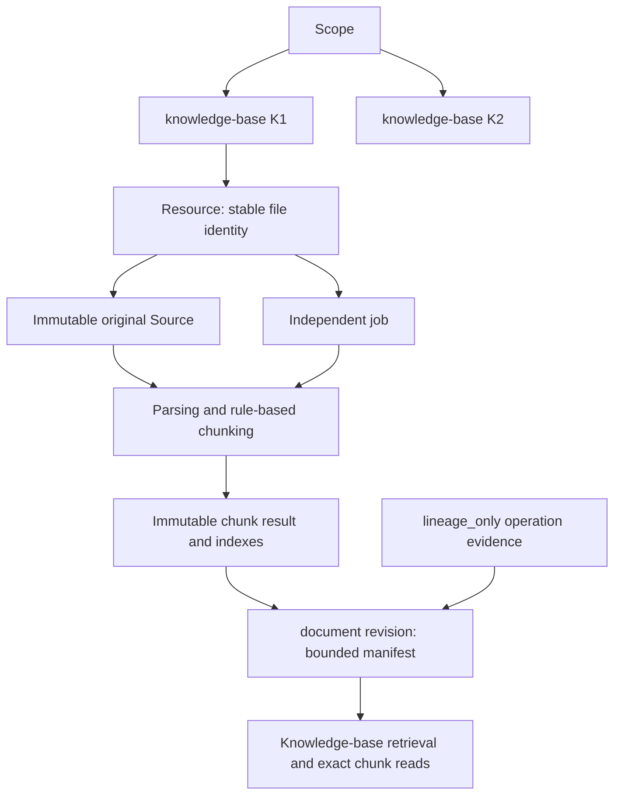
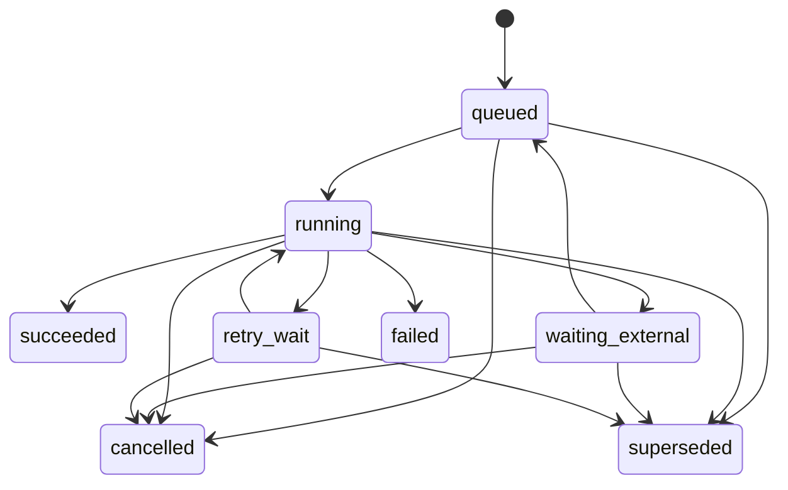

- Proposal Name: `knowledge_base_plugin`
- Start Date: 2026-11-10
- RFC PR: [#2570](https://github.com/oceanbase/powercontext/pull/2570)
- Tracking Issue: [#2440](https://github.com/oceanbase/powercontext/issues/2440)
- Related Issues: [#2441](https://github.com/oceanbase/powercontext/issues/2441), [#2442](https://github.com/oceanbase/powercontext/issues/2442), [#2443](https://github.com/oceanbase/powercontext/issues/2443), [#2444](https://github.com/oceanbase/powercontext/issues/2444)

# Summary

One `knowledge-base` business plugin provides local ingestion, parsing, chunking, version management, and hybrid retrieval.
A Scope may contain multiple user-created `knowledge-base` Artifacts. Each original Source and whole-file `document` Artifact
belongs exclusively to one knowledge base. Existing Source, Artifact, head, and lineage schemas remain unchanged; the plugin
adds resource, job, and chunk tables. Background processing does not use the existing Source consumption cursor. This is a
target design dependent on plugin framework extensions, not a statement of released functionality.

# Motivation

Business descriptions and SOPs need faithful originals, passage retrieval, predictable updates, and deletion. Parsing may be
slow or depend on external services, requiring durable work and per-file recovery. A business plugin should own these states
without adding knowledge-base fields to the shared Source model or blocking unrelated files behind one consumption cursor.
Artifacts continue to manage whole-document versions; separate chunks and indexes avoid reading large body JSON values.

# Guide-level explanation

1. Create an empty `knowledge-base` through the generic Artifact API, then import a local directory or files into it.
2. Ingestion returns a durable job ID. A UI can show queue state, processing stage, failure, completion, and the currently
   available version; percentage progress is not required.
3. Markdown and independently imported text images use Markdown parsing and RapidOCR respectively, followed by shared
   chunking, full-text/vector indexing, and document publication.
4. Changed originals or explicit reprocessing retain the document ID and publish a new revision on success. Failure keeps
   the previous version available.
5. Manual chunk edits and removals also create document revisions and preserve history. Retrieval can select multiple
   knowledge bases in the same Scope.
6. Deletion changes logical visibility while retaining business content, snapshots, and history. Ordinary, exact, historical,
   evidence, and retrieval paths all enforce deletion.

The first phase covers SQLite, SeekDB, and OceanBase; local OpenDAL fs; Markdown; RapidOCR with ONNX Runtime; rule-based
chunking; and manual editing. Embedded Markdown images retain their references without automatic fetching or OCR. A
large-corpus benchmark is not required. PDF/Office, scene-image understanding, remote uploads/original storage, periodic
directory synchronization, semantic/LLM chunking, restoration/permanent erasure, per-knowledge-base embedding spaces, and
uninterrupted index switching are outside this phase. Job status APIs are included; a complete management UI can build on
the same contract, and a scheduling mockup is not evidence of implementation.

# Reference-level explanation

## 1. One business plugin and naming

The plugin registers dedicated document Source types, the `knowledge-base` and `document` families, background task entry
points, its storage migrations, and APIs. Ingestion, parsing, chunking, and retrieval are internal modules, not separately
installed plugins. The design assumes that [#2549](https://github.com/oceanbase/powercontext/pull/2549) and
[#2579](https://github.com/oceanbase/powercontext/pull/2579) will provide the required composite registration, constrained
writes, and API extensions; their proposed contracts are not treated as released interfaces.

| Location | Identifier |
| --- | --- |
| Display name | Knowledge Base |
| Plugin and knowledge-base family | knowledge-base |
| Whole-document family | document |
| Ownership / multi-base selection fields | knowledge_base_id / knowledge_base_ids |
| Module and configuration prefix | knowledge_base |
| Plugin table prefix | pc_knowledge_base_ |



Scope remains the authorization boundary. A knowledge-base Scope contains document Sources, documents, and knowledge bases;
operation evidence is internal. Ownership is explicit and validated rather than inferred from tags or lineage. Only the
document pipeline may consume original document Sources; originals are not lineage_only. Framework admission must cover
write notifications, startup reconciliation, automatic consumers, and manual generation. A Source type name or suppressed
notification is not isolation. Shared-database deployment relies on those generic extensions and does not require a separate
PC Server by default; isolation cannot be claimed before admission is implemented.

The plugin owns its embedding/index profile. Installation may initialize compatible defaults from the main configuration,
without following subsequent changes. Credentials remain deployment configuration. Initially, documents in a Scope share
the plugin profile; parsing/chunking may vary by knowledge base. Jobs and result metadata pin the relevant profiles.
Active profile references live in knowledge-base Artifact configuration and must agree across active knowledge bases in a
Scope; new bases inherit that reference. Environment settings are initial defaults, not overrides for existing data. Model
changes require switch_model_and_rebuild for the entire shared Scope, as specified in 8.1.

## 2. OpenDAL, identity, and deduplication

The first phase accepts only directories accessible to the plugin runtime. Importer, Server, and Worker use the same storage
alias to access a managed immutable snapshot directory, including local container volume mappings. OpenDAL fs does not make
a remote client's path accessible. Enforce root containment and a fixed symbolic-link policy.

A Source records `original_path` for provenance and `snapshot_ref` with store_id, object_key, and digest for reading. Save the
snapshot and calculate SHA256 from its actual bytes before durable job acceptance. Parse the snapshot, not a mutable original.
mtime/size are hints, not content identity.

```text
file_key       = (scope_id, knowledge_base_id, collection_id, normalized_relative_path)
document_id    = stable_hash(identity_version, file_key)
source_key     = stable_hash(source_schema_version, file_key, raw_content_digest)
processing_key = hash(parser/OCR/model/normalizer/chunker versions and settings)
index_key      = hash(complete embedding inputs, plugin profile and projection versions)
```

Collection identity comes from the storage instance and normalized root, independent of scan/job IDs. Compare complete
identities on hash matches and never truncate paths. A Source payload pins ownership, document ID, file identity, media type,
digest, and snapshot. Replay preserves canonical capture metadata, including the original capture time.

| Case | Behavior |
| --- | --- |
| Same request key and parameters | Return the same job/determined result; different parameters under that key conflict |
| Same file bytes/profile with an available result | Reuse Source/document, verify index availability, skip parsing |
| Different request key matching an active target | Return 409 with the existing job reference; do not duplicate execution |
| Changed original bytes | New Source, same document ID, new target generation and job |
| Explicit reprocessing / changed chunking profile | Reuse Source and document ID; publish a new revision on success |
| Only embedding/index configuration changes | Rebuild from committed chunks without repeating OCR |
| Same bytes at a different path / knowledge base | Separate logical Sources/documents; physical snapshots may be shared |
| Manual edits exist | Ordinary duplicate import preserves them; reprocessing requires manual_edits_policy=discard |

An existing Source does not prove processing succeeded. Reverting file bytes may reuse an older Source; the resource's latest
target, not journal order, defines desired input. Renaming initially means a new file; disappearance does not automatically
delete it. Reimport never silently restores a deleted identity. Explicit reprocess is not skipped as ordinary import merely
because its output might be identical.

## 3. Lightweight parsing and chunking

A parser accepts a snapshot reference and pinned configuration, returning Markdown, source locators, and optional warnings.
An internal format registry selects Markdown or image parsing. Future formats add a parser and fixtures without requiring a
universal document AST, capability negotiation, or a separate parser plugin system. Parsers do not write Artifacts, job state,
or indexes. An external adapter may return a pending reference that the execution layer persists and resumes.

Markdown uses markdown-it-py for structure and source mapping. Images use RapidOCR with ONNX Runtime, retaining boxes, order,
confidence, and preprocessing coordinate transforms. Normalization produces Markdown without inventing complex headings,
tables, or diagram semantics. Map normalized spans back to the image and declare locator precision. Derived Markdown never
replaces the original Source.

- Group by headings/content blocks, recursively splitting oversized blocks. Without reliable headings, recursively split
  paragraphs and sentences.
- Preserve code, tables, and list steps where possible. Split oversized tables by rows with headers and oversized code with
  language/continuation metadata; hard limits still apply.
- Apply overlap to split long passages rather than mechanically across sections. Include Chinese punctuation boundaries.
- Preserve heading paths and original locators. Validate the complete embedding input, including heading prefixes, against
  the model token budget; character counts are not token counts and silent truncation is forbidden.
- Parameters include max_chunk_chars and overlap_chars; 1200/100 are examples to validate, not quality claims.
- Validate UTF-8, image decoding/pixel limits, model versions, and resource limits. No-text OCR is an explicit failure, not a
  successful empty document.

Rules remain deterministic and testable. Changed chunking configuration may reuse validated parsing output; a complex stage
cache is not required initially.

## 4. Persistence and relationships

### 4.1 Reuse existing schemas unchanged

| Table | Responsibility |
| --- | --- |
| pc_sources | Immutable original references and lineage_only evidence for successful user/deletion operations; no new columns |
| pc_artifacts | Knowledge-base configuration, document manifests, immutable revisions |
| pc_artifact_heads | Current revision, lifecycle_state, governance_generation |
| pc_scopes | Reuse the existing Scope row for short core transaction serialization; no schema change or task counter in version |
| pc_artifact_lineage_sources / pc_artifact_lineage_artifacts | Exact-revision input/operation evidence and base references |
| Existing permissions, tags, and references | Shared semantics, without unbounded jobs or member JSON |

Existing processing intent, cursor, lease, and binding-state tables are not used by this queue and receive no knowledge-base
fields or records. Source journals may remain part of existing storage constraints but never drive job discovery/completion.

### 4.2 Three plugin domain tables

Tables belong to plugin-owned storage and migrations, reusing SQLite/SeekDB/OceanBase connection and adapter capabilities.
Full-text/vector auxiliary structures are not included in the domain-table count.

| Table | Key fields and constraints |
| --- | --- |
| pc_knowledge_base_resources | scope_id, knowledge_base_id, resource_kind, resource_key, document_id, source_ref, identity_payload, lifecycle_state, deleted_at, target_generation, current_job_id |
| pc_knowledge_base_jobs | job_id, scope_id, knowledge_base_id, document_id, operation, idempotency_key, request_digest, input_snapshot, target_generation, base_revision, state, stage, attempt, next_run_at, execution_token, lease_owner, lease_expires_at, error_code/summary, external_task_ref, result_id, result_revision, result_kind, parent_job_id, checkpoint, cleanup_cursor |
| pc_knowledge_base_chunks | scope_id, knowledge_base_id, document_id, result_id, chunk_id, ordinal, text, text_length, content_digest, heading_path, source_locator, origin, edit_metadata |

Resources has exactly two record kinds, not an open-ended object platform:

- `document`: one row per stable logical file, created before the first parse; path identity, current target, and deletion
  marker, without precreating an empty document Artifact.
- `source`: one row per original Source with ownership and its independent deletion marker; no growing JSON array of versions.
  Successful operation evidence inherits visibility from its target Artifact.

The primary key is `(scope_id, knowledge_base_id, resource_kind, resource_key)`. Document keys derive from file_key; Source
keys include a hash of the complete SourceRef identity. Preserve/compare complete identities and prohibit cross-base Source
ownership. SourceRef includes both source_type and source_id. Only document rows use target generation/current job fields.
Deletion markers are one-way. The published revision comes only from the Artifact head, without a second publication pointer.
Implementation fixes common timestamps and bounded error/JSON storage types.

Jobs has a unique constraint on `(scope_id, knowledge_base_id, operation, idempotency_key)`. Its request digest covers all
business parameters and preconditions. Index due jobs, expired leases, document references, and knowledge-base ownership.
The target row serializes requests per document rather than relying on backend-specific partial unique indexes. Terminal jobs
retain idempotent receipts; bounded errors and attempt counters avoid separate receipt/attempt tables.

Chunks uses primary key `(scope_id, knowledge_base_id, document_id, result_id, chunk_id)` and unique ordinal within a result.
`result_id` identifies immutable output before core allocates the actual revision; never guess the next revision when writing.
Each complete result has its own chunk snapshot; vectors are derived indexes. `text_length` counts Unicode code points.

The bounded document manifest contains title, knowledge_base_id, file identity, root SourceRef, result_id, chunk count/digest,
processing/index fingerprints, manual-edit marker, applied_job_id, and necessary operation summaries. It contains neither
body text nor an unbounded chunk ID list. Exact revisions resolve results through their manifests, independently of current
search indexes.

## 5. Independent queue and state machine



`stage` is independent of state: ingest, parse, chunk, index, publish, cleanup. External waits persist a remote reference and
next_run_at, then release the Worker. A later poll resumes work without holding a process or transaction. Remote submissions
use stable idempotency keys; services without idempotency need reconciliation, not a promise of exactly-once external calls.

KnowledgeBaseTaskSupervisor scans only plugin jobs and owns claim, heartbeat, expiry recovery, and completion. Reuse separable
process-launch/termination, budget, and shutdown tools. Do not attach to existing Scope/binding discovery, intents, or Source
cursors. If the existing Supervisor is coupled to those mechanisms, implement a lightweight plugin scheduler rather than
putting per-file jobs into its tables. Publication is serial per document, with bounded concurrency across documents.

`target_generation` identifies the desired result; `execution_token` identifies the currently authorized attempt. Claims,
heartbeats, and updates check the token. New targets supersede old targets; lease recovery rotates the token. SQLite uses its
actual transaction/CAS capabilities rather than assuming every backend supports SKIP LOCKED.

For ordinary requests, authorization/lifecycle checks precede replay recognition, which precedes current-base checks for new
requests. A successful network retry must not fail solely because its original ETag is stale. The deletion entry point allows
authorized inspection of bounded deleted-target state to finish cleanup instead of rejecting it with generic 410 first.
Terminal jobs never revive. Automatic bounded retries remain within a job; ordinary user retries use a new key/job. Repeated
deletion automatically creates successor cleanup jobs as specified in section 7. Cancellation cannot undo publication or any
committed deletion tombstone/retirement; cancelled edges in the state machine are conditional on this cutoff.
Edits/removals pin their base and reject conflicting active changes rather than silently queue or rebase. A failed file does
not block the whole Scope.

## 6. Acceptance, publication, and cross-store recovery

Core and plugin storage do not share a transaction. Source, job, chunks, indexes, and Artifact cannot be described as one atomic
commit.

| Boundary | Behavior and recovery |
| --- | --- |
| Snapshot | Save immutable original bytes; unaccepted orphan snapshots are invisible, with permanent cleanup specified separately |
| Plugin acceptance transaction | Validate/lock the resource target, check idempotency, persist fixed inputs and job; recoverable after 202 |
| Source registration | Worker idempotently saves/reuses the Source in the ingest stage; retry if Source succeeded but job acknowledgement did not |
| Computation outside transactions | Parse/OCR/chunk/embed pinned snapshots and settings without database locks |
| Plugin result preparation | Store complete immutable chunks and usable indexes under result_id; verify count/digest; unreferenced output is invisible |
| Short core publication transaction | Check base, ownership, and execution eligibility; write document revision, required operation evidence Source, lineage, and head |
| Plugin completion transaction | Record actual result_revision and succeeded; reconcile applied_job_id/result_id after lost acknowledgement rather than republish |

Core provides the commit gate using the existing `pc_scopes` row. OceanBase/SeekDB use a row lock in the same core transaction;
SQLite uses a core-database `BEGIN IMMEDIATE` write transaction. No lock table or Scope field is added. Publication, deletion,
new-target acceptance, cancellation, execution-token claim/replacement, lease recovery, and model-switch control all acquire
this gate before plugin resource/job locks and then Artifact heads. Ordinary heartbeats only renew the matching token without
transferring ownership. Ingestion and synchronous Artifact mutation entry points must obey the gate too.

After obtaining both sides' locks, reread target, token, lease, Source markers, parent lifecycle, and already-published core
results. Publication uses the very same core connection/transaction holding the Scope lock, never another unlocked connection.
Cancellation/target replacement/reclaim reconcile inside the gate, commit plugin state, then release the core lock. Publication
commits core first and records plugin success afterward; missing acknowledgement is reconciled. These are separate commits,
not a cross-store atomic transaction.

Losing the plugin database connection does not release the core lock, so another executor cannot cancel or reclaim meanwhile.
Losing the core connection prevents that transaction from publishing. Any connection error or uncertain commit outcome ends
the attempt; automatic reconnect must not reuse old eligibility. Recovery obtains a fresh core gate before reconciliation and
plugin-state validation. Every control path follows core-before-plugin lock order; never wait for core while holding plugin locks.

Only short commits within a Scope are serialized. Parsing, OCR, embedding, index construction, and directory enumeration run
concurrently outside the gate; no model calls, DDL, or long computation occurs inside it. Verify actual backend locks,
connection failures, and timeouts rather than substituting memory locks or a one-time token check. Prepared output is immutable;
different recomputation uses a new result_id. Ordinary publication failures retain the old head and usable old index.

## 7. Operation evidence, editing, and soft deletion

Successful Artifact creation, modification, and deletion require a system `lineage_only` Source associated with the actual
output revision. Queued requests are not evidence of successful mutation. Reuse existing create/replace evidence semantics;
a bounded operation summary records specific delete/remove actions and reasons without assuming a new core operation enum.
Jobs record intent/execution; operation Sources record success, linked through job/operation IDs.

| Operation | Version and visibility |
| --- | --- |
| Create/configure knowledge-base | Create or add a configuration revision with operation evidence |
| Parse/reprocess document | Publish a revision under the same document ID with original lineage; retain evidence for user-triggered changes |
| Edit/remove chunk | Increment document revision, produce a complete result, link successful operation evidence, retain previous rows |
| Delete document/knowledge-base | Create a deletion revision with a bounded deletion summary and retire the head in the same core transaction; link deletion evidence |
| Delete original Source | Mark the source resource and immediately deny original/derived reads; finish document retirement, deletion evidence, and index cleanup asynchronously |

Deletion revisions are a plugin convention, not a change to other families' governance. A deletion revision may reuse the
previous result_id without copying chunk bodies. Its operation summary must actually create a revision rather than be skipped
by an identical-content put no-op. Evidence, lineage, revision, and head commit together in core; failure creates no success
evidence, and replaying the same accepted operation does not add revisions.

Manual text replacement may retain a logical chunk ID, but references include a revision. Rechunking may create new IDs.
Edited text is marked non-verbatim with original locators and edit provenance. Removing the last chunk permits a zero-chunk
result with no current retrieval hits. Duplicate import cannot overwrite manual edits; explicit reprocessing requires discard.

Knowledge-base deletion first commits its deletion revision/retirement, immediately hiding all children. An accepted cleanup
job survives restart, marks Sources, deletes documents, and cancels processing in batches. Each changed Artifact gets its own
evidence, sharing an operation ID for the cascade. Cleanup is allowed under a deleted parent and is not cancelled by ordinary
processing parent checks. Its cursor is plugin batch progress only. Persist the deletion/cleanup job before the first deletion
effect. Once a Source tombstone or Artifact retirement commits, deletion is non-cancellable: failures require completion or
recovery rather than reporting cancellation with unfinished side effects. Queued deletion without effects remains cancellable.

Deleting a document leaves its original Source readable. Deleting an unpublished replacement Source preserves an old result
based on another original. If S1 supplied an old revision and S2 supplied a complete reparse, deleting S1 preserves the current
version based only on S2 but blocks history that depends on S1. A Source deletion response acknowledging an effective deletion,
including 202 cleanup pending, requires a committed tombstone; job acceptance alone is not deletion. That tombstone is the visibility cutoff for
that original and its derived content. Reads/retrieval starting afterward must check it even when the document head is still
active or index entries remain. Content already returned before deletion is not recalled. Only document retirement,
deletion revision/evidence, and index maintenance may be eventually consistent; content must not remain readable while cleanup
is pending. Fail closed when visibility checks are unavailable. Resource markers and retirement may finish in stages, with
reads checking applicable parent, document, exact root, and Source markers. Generic Source,
exact/historical Artifact, and evidence reads require framework visibility extension points; plugin search filtering alone
does not satisfy deletion. Missing ownership registration fails closed rather than returning unguarded content.
Controlled internal recovery may inspect retired history for reconciliation; an authorized management route may expose bounded
cleanup status after deletion without exposing bodies or a public bypass parameter.

Repeated deletion uses the same deletion entry point/operation, without a repair/retry API. After authorization, inspect the
original deletion and cleanup state even for a deleted target. A deletion marker or the original stale ETag does not prevent
cleanup; still-active targets retain ordinary preconditions. Conflicting parameters under an idempotency key still return 409.

The cleanup rules below apply after deletion effects exist. If the initial deletion failed or was cancelled before taking effect,
a repeated deletion accepts a new deletion job under ordinary preconditions; the same idempotency key still replays its original receipt.

| State when deletion is repeated | Result and action |
| --- | --- |
| Initial deletion or cleanup job remains active | Return the same deletion-operation identity and current job, 202; no duplicate |
| Cleanup incomplete and previous job failed/terminated | Create a new background cleanup job with parent_job_id referring to the original deletion job, 202; never revive the old job |
| Cleanup complete | Return 200 already_deleted; no new job, revision, or evidence |

Serialize this check and successor creation under the core Scope gate so concurrent repeated deletes cannot create multiple
active cleanup jobs. The internal job uses a fresh derived idempotency key while the client's deletion identity/input remains
unchanged. Responses may refresh cleanup_job_id/status while referring to the same deletion operation. Reconcile tombstones,
Artifact deletion summaries, and the original operation ID; skip completed objects and generate revisions/evidence only for
Artifacts not yet changed. This applies to Sources, documents, and knowledge bases. A deleted parent permits authorized cleanup,
not ordinary writes or content reads.

## 8. APIs and retrieval

Reuse Source encoding/identity/validation; Artifact CRUD/history/tags; authentication; permissions; ETags; pagination;
references; and error envelopes. File ingestion uses the plugin's Source acceptance capability, not a write path that triggers
old consumers. Expensive edits return 202 through job APIs rather than silently changing synchronous Artifact PUT into an
asynchronous success. Generic writes must not bypass job, version, evidence, or deletion rules.

Routes are proposed contracts. Plugin APIs follow #2579; registration syntax follows the framework implementation:
`P=/v1/plugins/knowledge-base/api/scopes/{s}`, `D=/v1/scopes/{s}/artifacts/document/{d}`.

| Operation | API / result |
| --- | --- |
| Create knowledge base | POST `/v1/scopes/{s}/artifacts`, family=knowledge-base |
| Knowledge-base/document overview and history | Generic Artifact GET/revisions, bounded manifest |
| Import local files/directory | POST `P/imports`, explicit knowledge_base_id, root/paths, idempotency_key; 202 job receipt |
| Reprocess/edit/delete | POST `P/jobs`, typed operation, pinned target and preconditions; repeating delete_source/delete_document/delete_knowledge_base repairs cleanup automatically; cleanup is internal-only |
| Change model and rebuild index | POST `P/jobs`, operation=switch_model_and_rebuild, explicit confirmation of Scope-wide impact; existing job status APIs |
| Job list/detail | GET `P/jobs`, GET `P/jobs/{job_id}`, pagination, stage, state, bounded error, successful revision |
| Cancel | POST `P/jobs/{job_id}/cancel`, nonterminal work without publication or committed deletion effects; model switching is also non-cancellable after publication starts |
| Chunk directory | GET `P/documents/{d}/revisions/{rev}/chunks`, paged metadata without body |
| Single chunk | Append `/{chunk_id}`, body, provenance, edit metadata |
| Batch chunks | Append `/batch-get`, POST bounded chunk_ids |
| Hybrid retrieval | POST `P/retrieve`, knowledge_base_ids, query, mode, limit; chunk hits |

Plugin chunk routes retain Artifact document IDs/revisions. Their paths are separate from generic Artifact routes while
preserving exact-revision semantics: resolve result_id through that revision's manifest, never fall back to the current head.
Directory cursors bind Scope/document/revision and order by ordinal. Batch-get requires nonempty, unique IDs and preserves
request order. Authorize the parent first; any missing ID fails the whole batch with 404. Bound ID count and response bytes;
reject over-limit requests without truncating bodies. Authorized deleted reads return 410; zero-chunk directories are empty.

Create a knowledge base:

```json
{"family":"knowledge-base","content":{"title":"Operations SOPs","parser":"markdown-v1","ocr":"rapidocr-local-v1","chunker":{"max_chunk_chars":1200,"overlap_chars":100}}}
```

Import a directory. Enumeration creates per-file jobs in bounded batches using parent_job_id. Directory completion means
enumeration/child acceptance finished, not that every file succeeded:

```json
{"knowledge_base_id":"ops","root":"/work/docs","idempotency_key":"import-01"}
```

Remove a chunk. Existing documents require current If-Match; first generation uses an explicit no-head precondition rather
than guessing a future revision:

```json
{"knowledge_base_id":"ops","document_id":"doc-1","operation":"remove_chunk","idempotency_key":"edit-03","base_revision":2,"input":{"chunk_id":"chunk-3"}}
```

```json
{"job_id":"job-03","state":"queued","document_id":"doc-1","target_generation":5}
```

```json
{"job_id":"job-03","state":"succeeded","result":{"document_id":"doc-1","revision":3,"kind":"created"}}
```

Exact-revision directory and batch reads:

```json
{"document_ref":{"family":"document","artifact_id":"doc-1","revision":3},"items":[{"chunk_id":"chunk-1","ordinal":0,"heading_path":["Operations","Restart"],"text_length":128}],"next_cursor":null}
```

```json
{"chunk_ids":["chunk-1","chunk-2"]}
```

```json
{"knowledge_base_ids":["ops"],"query":"How should I restart a follower?","mode":"hybrid","limit":10}
```

```json
{"hits":[{"knowledge_base_id":"ops","document_ref":{"family":"document","artifact_id":"doc-1","revision":3},"chunk_id":"chunk-1","score":0.82,"source_ref":{"source_type":"document_file","source_id":"source-1"},"locator":{"heading_path":["Operations","Restart"]}}]}
```

Retrieval limit counts chunks; optional snippets are bounded and bodies use chunk APIs. Generic Artifact search still returns
Artifacts rather than chunk responses. Index candidates must match the current manifest result_id and index profile and pass
ownership, authorization, and deletion checks. Refill after filtering so invalid candidates do not consume top-k. The adapter
covers initial writes, revision replacement, rebuild, coverage/digest validation, zero chunks, deletion filtering, and locators.
Historical bodies do not require every historical search index. Same-profile rebuild retains the usable old index and cannot
publish content missing its required index. Model changes use the controlled maintenance procedure in 8.1.

Same-Scope retrieval may select multiple knowledge bases. Cross-Scope helpers authorize each explicit target, call the same
per-Scope API, fuse ranks, and preserve target identity/errors rather than compare incompatible vector-space scores. Reject
unsupported filters/rerank options. Python/MCP use the same service. Reuse Scope read/contribute and Artifact write/governance
permissions, checking every affected object. Acceptance uses 428/412 preconditions, 409 conflicts, 410 deletion, 422 validation,
413 limits, and 503 unavailability. After 202, failures are durable job states rather than conclusions inferred from logs.

### 8.1 Change model and rebuild the index

Existing data's active model, dimensions, and embedding parameters cannot be overwritten through configuration PUT, environment
refresh, or restart. Use `switch_model_and_rebuild` with a pinned target_profile identifying model/version, dimensions, complete
embedding-input rules, and index configuration; credentials remain configuration references. Because a Scope shares one profile,
the operation requires Scope administration and explicit confirmation of all its knowledge bases, not merely the initiating base.

```json
{"knowledge_base_id":"ops","operation":"switch_model_and_rebuild","idempotency_key":"model-switch-01","input":{"expected_profile_id":"embedding-v1","target_profile_id":"embedding-v2","confirm_scope_wide":true}}
```

Reuse jobs' input_snapshot, checkpoint, parent_job_id, and document child jobs for old/target profiles, phase, and rebuild progress;
no control table is added. The Scope gate permits one unfinished switch operation per Scope. Durable checkpoint phases are
preparing, rebuilding, publishing, completed, aborted. Failure/process exit does not automatically clear maintenance; running job state
alone must not decide whether service is paused. Resolve maintenance from the latest effective checkpoint in the original switch
and successor chain: successor completed/aborted closes the operation while old failed records remain as history, not blockers.

| Phase | Behavior |
| --- | --- |
| Acceptance/preparing | Persist switch job and old/target profiles; pause Scope retrieval and ordinary writes/publication, retain management status and exact content reads; finish cleanup for deletions already in effect |
| rebuilding | Pin current valid document revisions, build isolated target-profile indexes from committed chunks without OCR, validate counts/digests, dimensions, and complete-input token limits |
| publishing | Publish document revisions changing only index-profile references, reusing body result_id where appropriate, with success evidence; update all active knowledge-base configuration revisions |
| completed | Verify all valid documents, knowledge-base configuration, and target indexes agree; complete under the gate and release maintenance so queries and subsequent jobs use the target profile together |

Retrieval/ordinary writes return explicit 503 with the switch job reference during maintenance, never mixed-model results or
silent empty results. Knowledge-base creation also checks maintenance. Repeated deletion/cleanup for effects already committed
remains allowed so failed cleanup cannot deadlock preparation; new deletion requests are paused ordinary writes.
Old-profile unpublished jobs cannot commit: freeze their
eligibility and reconcile; mark unpublished old targets superseded without rewriting their inputs, and let callers submit new
requests when needed. Queries pin their profile and recheck maintenance/active profile before returning; a change yields 503
rather than an in-flight old-model result. Exact chunk/history reads still use fixed result_id and deletion guards. Retain old indexes at least until
switch success.

In preparing/rebuilding, cancellation/failure restores old-profile service only after verifying under the gate that no profile
revision was published and persisting aborted. Failed job state alone never releases maintenance; superseded jobs do not revive. Once publication starts, cancellation/automatic rollback is forbidden because
some objects may already use the target. Maintain the pause and complete forward recovery. Repeating switch_model_and_rebuild
with the same target and a new request key may create a successor job linked to the original switch, skipping already-published
revisions without reviving failed jobs or duplicating evidence. The same request key returns its existing job. Reject a different
target while a switch remains unfinished. Insufficient input budget in the new model fails explicitly and requires rechunking
first; never silently truncate. Neither distributed atomic commits nor uninterrupted switching are required.

## 9. Implementation and acceptance

Only plugin storage needs new migrations; existing core tables receive no new fields/migrations. The plugin framework must
provide registration, consumption admission, constrained publication, and visibility checks. Unchanged table schemas do not
mean zero framework adaptation. Generate bindings under the appropriate core or plugin OpenAPI ownership.

Verify on SQLite, SeekDB, and OceanBase:

- Multiple knowledge bases per Scope, cross-base authorization, exclusive ownership, and original-only consumption including
  recovery scans and manual entry points.
- Build/run, debugging, and Wait Event Markdown from a pinned oceanbase/oceanbase commit; real text-image OCR and provenance.
- Request replay, payload conflicts, active-target conflicts, deduplication, configuration reprocessing, and edit preservation.
- Exit after acceptance, Source registration before acknowledgement, lease recovery, stale tokens, superseding, bounded retries,
  and cancellation.
- Prepared output followed by core rollback; core success followed by lost task acknowledgement; old content availability,
  invisible uncommitted results, and no duplicate publication.
- Loss of only the plugin connection, loss of only the core connection, uncertain commit outcomes, cancellation/reclaim races,
  and the core Scope gate preventing old-transaction reconnect/publication.
- Creation/modification/deletion evidence tied to actual revisions; increment on chunk removal, readable zero chunks, history.
- Source/document/knowledge-base deletion racing publication; tombstones deny derived reads before head/index cleanup.
- Cancellation rejected after deletion effects; repeated deletes repair failed cleanup, concurrent retries share one active
  successor, and completed objects do not get duplicate revisions/evidence.
- Direct active-model configuration edits rejected, Scope-wide switch/rebuild, partial-publication recovery, failed maintenance,
  and old-profile job invalidation.
- Directory/single/batch chunk boundaries, complete index lifecycle, rebuild, and valid-candidate refill.
- OpenDAL snapshots accessible to Server/Worker; later original changes do not change accepted inputs.

Mocks do not establish real backend/OCR support. Compare the two rules on a small corpus for answer-passage recall, SOP
integrity, and provenance without claiming measured quality or scale in this RFC. #2441 owns ingestion/resources, #2442 owns
queue/processing/publication, #2443 owns retrieval/APIs, and #2444 owns operation/acceptance. No new issues are required.

# Drawbacks

The plugin owns migrations, backup, and recovery for three domain tables and indexes. Separate storage requires reconciliation
and short commit gates. Complete chunk snapshots, successful operation evidence, soft deletion, and terminal jobs consume
storage. Resource kinds need explicit constraints. The first phase offers neither distributed transactions nor large-scale
performance guarantees, and index rebuild may affect multiple knowledge bases within a Scope.

# Rationale and alternatives

- One business plugin owns membership, work, and configuration, while internal parsers remain independently extensible.
- Three plugin tables provide per-Source deletion and per-file jobs without changing core models. Two fixed resource kinds
  avoid separate document-state/receipt tables.
- Sources hold immutable inputs/success evidence; jobs hold mutable execution state. Pending commands are not success Sources.
- Artifacts manage whole-document revisions and chunk rows support exact reads; editing old rows would destroy history.
- An independent queue supports slow parsing/external waits without existing consumption cursors, reusing only separable
  Supervisor runtime tools.
- Prepare immutable results, publish core, then acknowledge the job to respect storage isolation; cross-store atomicity is not
  a default capability.
- Deletion revisions provide stable operation evidence; head retirement and guards control visibility. Removing search entries
  alone cannot delete content.

# Prior art

Builds on [plugin interfaces #2549](https://github.com/oceanbase/powercontext/pull/2549),
[plugin APIs #2579](https://github.com/oceanbase/powercontext/pull/2579),
[Source identity](1400_source_definition_and_observation_model.md),
[processing supervision](1515_artifact_processing_supervisor.md), and
[Source/Artifact APIs](1437_source_artifact_rest_api.md). Reuse original identity, Artifact revisions, successful operation
evidence, and governance while implementing independent knowledge-base jobs and chunk projections. Atomic Memory retirement
does not automatically provide Source cascades or plugin lifecycle guards.

# Unresolved questions

Before implementation, fix composite registration/constrained writer interfaces for the core Scope gate, generic read guards,
and exclusive Source consumption admission. Lock order is core Scope, plugin resources/jobs, then Artifact heads; backend
adapters must verify connection failures and compatibility with existing generic mutation paths. Implementation fixes OCR models, chunking defaults,
lease/concurrency/retry limits, API count/byte bounds, and concrete schema types without changing ownership or commit semantics.
Restoration/erasure, job archival and idempotency retention, rename identity, per-base vector spaces, and full edited-document
export require separate contracts.

# Future possibilities

Word/PDF/scene-image parsers reuse jobs, chunking, publication, and retrieval. External parsing persists a remote reference and
resumes by polling, without requiring a full parser framework initially. Further extensions include OpenDAL providers, rerank,
neighbor/parent-section context, and bounded multi-step retrieval. Their quality and costs require measurement rather than
being prerequisites for the first phase.
