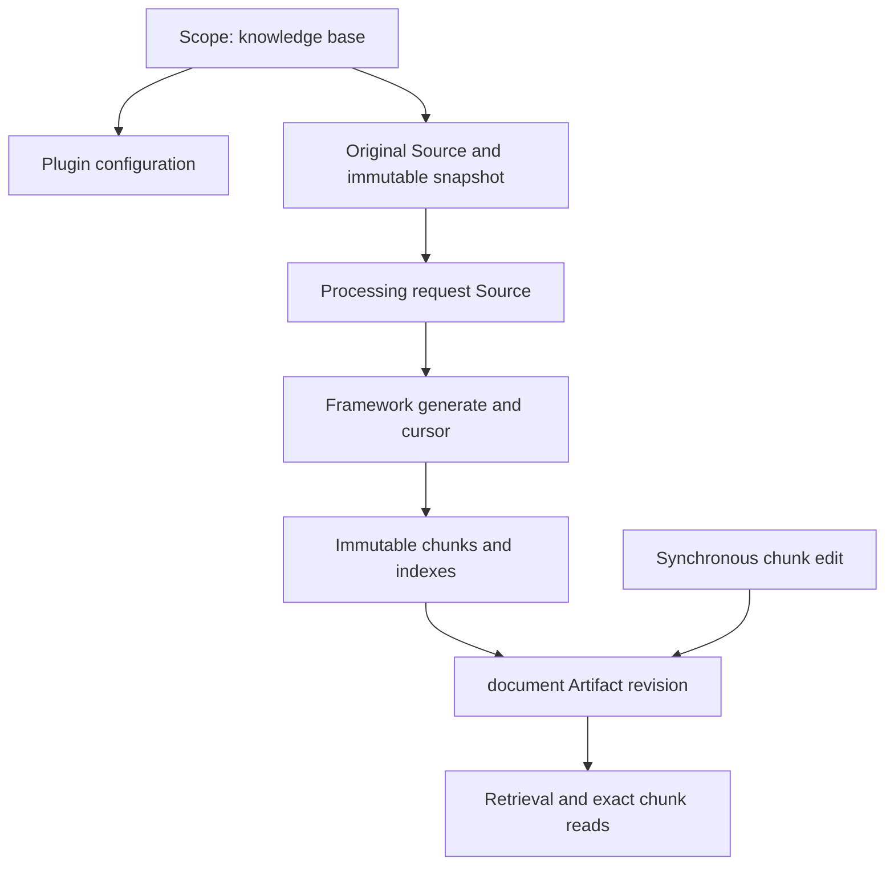

- Proposal Name: `knowledge_base_plugin`
- Start Date: 2026-11-10
- RFC PR: [#2570](https://github.com/oceanbase/powercontext/pull/2570)
- Tracking Issue: [#2440](https://github.com/oceanbase/powercontext/issues/2440)
- Related Issues: [#2441](https://github.com/oceanbase/powercontext/issues/2441), [#2442](https://github.com/oceanbase/powercontext/issues/2442), [#2443](https://github.com/oceanbase/powercontext/issues/2443), [#2444](https://github.com/oceanbase/powercontext/issues/2444)

# Summary

One `knowledge-base` business plugin provides local ingestion, parsing, chunking, versioning, and hybrid retrieval. Each
ordinary Scope is one knowledge base. The plugin declares only the `document` family, with one Artifact per complete file.
The knowledge base itself is not an Artifact; plugin storage holds its configuration by scope_id. The plugin supplies original
and processing-request Source definitions and reuses framework generate, Supervisor, and consumption cursors rather than
implementing an independent task scheduler.

The first phase supports SQLite, SeekDB, OceanBase, Markdown, standalone-image RapidOCR, rule-based chunking, synchronous
chunk edits/removals, and document forget. This is a target design dependent on framework contracts, not a claim that the
current implementation PR provides every capability.

# Motivation

Business descriptions and SOPs need searchable passages, original provenance, and manual changes that preserve history.
Scope provides the authorization and organizational boundary, Artifacts manage whole-document revisions, and plugin storage
holds bodies and indexes. Existing scheduling, revision preconditions, and lifecycle rules reduce domain-specific machinery.

# Guide-level explanation

1. An administrator creates a knowledge-base Scope and saves parsing/chunking configuration, then imports local files or a
   directory accessible to the Server.
2. The plugin saves immutable snapshots, registers Sources, and submits processing-request Sources. Acceptance is not parsing success.
3. Framework generate asynchronously processes Markdown/images, prepares complete chunks and indexes, then publishes a document.
4. Changed content and explicit reprocessing retain the document ID. Failures preserve existing revisions. Status distinguishes
   pending, latest failure, published, and conflict/skipped.
5. Synchronous chunk edits/removals increment the document revision; core records a lineage_only success Source in the same transaction.
6. Whole-document soft deletion uses generic forget: deprecated, excluded from normal retrieval, with no new revision. Bodies,
   originals, and history remain stored.

The first phase does not promise in-flight cancellation, Source deletion, knowledge-base cascades, physical erasure, an
independent queue, online model switching, cross-base aggregate retrieval, continuous directory sync, or remote runners.
PDF/Office, scene-image understanding, OCR of embedded Markdown images, semantic/LLM chunking, and large-corpus benchmarks
are out of scope. Restore/merge methods are not implemented initially; generic routes report unsupported. Import is not restoration.

# Reference-level explanation

## 1. Plugin, Scope, and framework dependencies

Follow [#2549](https://github.com/oceanbase/powercontext/pull/2549) for single-family plugins, Source definitions, writers,
models, and storage, and [#2579](https://github.com/oceanbase/powercontext/pull/2579) for routes, Scope management, and upgrades.
[#2616](https://github.com/oceanbase/powercontext/pull/2616) is an implementation dependency; capabilities such as dedicated
storage on all three backends require actual implementation and validation. [#2617](https://github.com/oceanbase/powercontext/pull/2617)
is a future collection integration, not a prerequisite for explicit local imports.

| Object | Model |
| --- | --- |
| Knowledge base | Ordinary Scope; scope_id is its identity |
| Plugin | knowledge-base, one installed directory, one document family |
| Original | knowledge-base-file Source, pinned snapshot and original path |
| Processing request | knowledge-base-process Source, pinned original reference, configuration, base, and request identity |
| Document | document Artifact, bounded whole-document manifest |
| Chunk | Immutable result in plugin storage, not a separate Artifact |



Create through ctx.scopes.create with the existing server.admin requirement; the same idempotency key returns the same Scope.
The framework's plugin external reference identifies creator ownership. Scope fields hold title/summary; plugin tables hold
business configuration. Retry configuration after a successful Scope creation if its separate write fails; reject imports
until configuration is ready. Reuse Scope read/contribute, Artifact write, and framework preconditions. Plugin routes must not
treat Scope contribution as permission to modify every document.

Plugin inputs subscribe only to processing requests, so originals do not independently trigger this plugin again. Deployment
reserves knowledge-base Scopes for this use and does not enable other content consumers. A Source type name is not framework
enforced exclusive admission; isolation from arbitrary other consumers is not a guarantee of this plugin.

## 2. Local storage, identity, and request acceptance

OpenDAL fs manages snapshot directories accessible to the importer, Server, and Workers. Original paths are provenance;
parsing reads snapshots only. Enforce root containment and a fixed symlink policy. Save bytes and compute SHA256 before
Source registration; mtime/size cannot replace the content hash.

```text
file_key    = (scope_id, collection_id, normalized_relative_path)
document_id = stable_hash(identity_version, file_key)
source_key  = stable_hash(source_schema_version, file_key, raw_content_digest)
request_key = (scope_id, idempotency_key)
result_id   = digest(canonical complete chunk result and provenance)
```

Collection derives from the storage alias and normalized root, not a scan batch. Compare full identities on hash matches.
The same file in different Scopes is independent. Same path/bytes reuse the original Source; changed bytes create a new Source
but retain the document ID. Renames are new files; disappearance does not automatically forget a document.

Each processing request pins original_source_ref, snapshot_ref, processing settings, independent model fingerprint,
base_revision, manual_edits_policy, and request digest. Existing documents pin the accepted revision; first publication has an
explicit no-head precondition. Ordinary duplicate imports reuse available matching content/configuration. Explicit reprocessing
and user retries use new request keys, producing new request Sources even for unchanged originals. Ordinary imports preserve
manual edits; discarding them requires explicit discard authorization.

First persist bounded immutable acceptance parameters in a plugin resource row, then idempotently register the original and
request Sources, and finally record their actual SourceRefs. Framework generate can start before the plugin acknowledgement
fields are saved: execution uses the committed request Source and pinned acceptance parameters, not another ready flag.
Return accepted only after the request Source is durably confirmed. After a lost response, replay the same key/parameters to
complete registration; a key reused with different parameters conflicts. This register is not a queue: requests without a
successfully registered Source have no background-execution promise and callers can retry. Unreferenced snapshots are not searchable.

Directory ingestion uses bounded file batches through this same acceptance path and returns per-item receipts. Enumeration
completion does not mean parsing completion. No independent directory-scan job is persisted initially; clients submit large
directories in batches, and repeated enumeration deduplicates by file identities and request keys.

## 3. Parsing, chunking, and original provenance

Markdown uses markdown-it-py for headings, blocks, and source mappings. Standalone images use RapidOCR with ONNX Runtime,
retaining boxes, order, confidence, and coordinate transforms; normalized Markdown enters the same chunker. Do not infer
complex tables or flowcharts. Embedded Markdown images remain references.

Split by heading/content blocks, recursively splitting oversized blocks at paragraphs/sentences. Preserve code, tables, and
SOP steps where possible; split oversized tables with repeated headers. Overlap applies to split long paragraphs. Configure
max_chunk_chars/overlap_chars; 1200/100 is an initial test value. Validate the complete embedding input, including heading text,
against model token limits without silent truncation. Report invalid UTF-8, image dimensions/decoding, and OCR with no text.

Parsers return Markdown, locators, and warnings, not cursor or Artifact changes. New formats use an internal parser registry,
not additional plugin types.

A request records the original SourceRef and snapshot. Generate directly references only request Sources in its current window;
a previously consumed original may be outside that window and cannot bypass writer restrictions. The document manifest retains
original provenance, providing a verifiable document → request Source → original Source chain without claiming that the original
is always direct lineage. Synchronous edits preserve current lineage and original locators and add core's success Source.

## 4. Plugin storage and models

ctx.storage uses the Server backend: a dedicated SQLite file or a dedicated SeekDB/OceanBase database, precreated by the deployer
when database-creation permission is unavailable. The plugin selects migrations and full-text/vector implementations by backend,
without changing existing core schemas. Originals stay in local OpenDAL directories rather than SQL body columns.

| Plugin domain table | Fields and constraints |
| --- | --- |
| pc_knowledge_base_resources | Primary key (scope_id, resource_kind, resource_key); fixed scope/document/request kinds; bounded payload, request_digest, source_ref, document_id, latest processing observations and timestamps |
| pc_knowledge_base_chunks | Primary key (scope_id, document_id, result_id, chunk_id); ordinal unique within a result; text, text_length, content_digest, heading_path, source_locator, origin, edit_metadata |

Resources is a fixed-purpose register, not a generic task framework: scope rows hold configuration/version, document rows stable
file identities, and request rows immutable accepted inputs, receipts, and latest attempt observations. No leases, execution
tokens, claiming queue, or cleanup cursors; do not copy the Artifact publication pointer or lifecycle. Request results may refer
to exact revisions for reconciliation, but core determines success. Full-text/vector auxiliary structures are derived indexes,
not additional domain tables.

Document content holds only title, original SourceRef, file identity, result_id, chunk count/digest, configuration fingerprints,
manual-edit markers, and applied_request_ref. Neither bodies nor unbounded chunk-ID lists belong in the manifest. Result IDs
derive from canonical complete results, never from a predicted uncommitted revision number.

The plugin independently configures and creates model clients. Deployment supplies credentials; Sources/Artifacts do not store
them. Do not automatically follow ctx.models or Server model changes. Initially one fixed embedding profile serves the plugin,
including model identity/version, dimensions, complete input rules, and normalization version. Equal dimensions do not establish
model compatibility. If existing indexes disagree with deployment configuration, reject vector queries and new publication and
require controlled migration; do not silently replace configuration or mix spaces. Online model switching is not included.
Same-profile index repair reads committed chunks. Parsing/chunking configuration may vary by Scope and is pinned in each request.

## 5. Framework consumption, status, and failure handling

Declare on_sources and processing-request inputs; reuse framework generate/Supervisor, Scope bindings, consumption cursors,
lease fencing, and failure backoff. No independent jobs table or plugin Worker scheduler. Each invocation opens at most one
writer.transaction; core atomically commits Artifacts, the cursor, and invocation acknowledgement. Use a small max_sources and
bounded file sizes to keep OCR/model windows within limits; arbitrary files are not guaranteed to fit framework timeouts.

| Event | Behavior |
| --- | --- |
| Request submitted without a result | Report pending, without invented percentages |
| Deterministic input error such as invalid format or no OCR text | Persist a bounded failure observation and skip that input; normal window acknowledgement permits subsequent requests |
| Database, model service, or durable index failure | Raise; core rolls back and the cursor does not advance; framework retries with backoff |
| Pinned base changed or document no longer active | Record conflict/skipped, never automatically replace the base; caller submits a new request |
| Core publication completed | Derive published state and exact revision from manifest/history applied_request_ref |
| Core succeeded but plugin status acknowledgement failed | Reconcile core, not failure or duplicate publication inferred from a missing status |

Failure observations describe the latest attempt, not proof of cursor acknowledgement. Plugin status cannot advance consumption
or justify skipping unproven core writes. Persistent infrastructure failure may block subsequent windows in the Scope; independent
unlimited per-file concurrency and a dead-letter queue are not promised. User retries of deterministic failures use new requests;
old Sources remain unchanged. Processing requests express intent, not lineage_only success.

Require no head for first publication. Updates validate the pinned base, original, manual-edit policy, and lifecycle. Framework
retries cannot rewrite the request's base or discard policy. If an edit/forget occurs after preparation, publication uses framework
revision/governance concurrency checks and must not reactivate deprecated documents. An implementation unable to protect lifecycle
under races must fix and test its framework adapter; an in-memory plugin lock is not a substitute or evidence of support.

## 6. Publication and index consistency

1. Parse and calculate vectors outside the core transaction; durably store immutable chunks and their full-text/vector indexes,
   validating counts, digests, and readability.
2. Validate preconditions and put a manifest referencing result_id and index fingerprints in writer.transaction. Generate commits
   its cursor with the revision; user edits commit success evidence with the revision.
3. A failed core commit leaves prepared results invisible and the previous manifest/index usable. Retries do not overwrite old results.
4. Retrieval candidates must match the active current document's result_id/profile. Refill after filtering; unpublished results
   must not consume the effective top-k.

Isolate indexes by result rather than overwriting current candidates under document_id alone. Model/file computation stays outside
short transactions. No additional core Scope-row gate or distributed transaction protocol is introduced. Exact historical chunks
resolve through their revision's manifest, independently of current search indexes. Unreferenced prepared data does not change
visible results; permanent cleanup is a separate contract.

## 7. Synchronous chunk editing and soft deletion

Generic Artifact PUT invokes update_artifact synchronously for chunk edits/removals; these are not plugin-route writes or queued
commands. The plugin editing payload is a bounded chunk-change description containing a chunk ID/new text or removal action.
The service reads the base revision and composes the complete result. Only the service creates manifests; reject caller-supplied
arbitrary result IDs or original ownership. Core permits plugin normalization of submitted content; arbitrary manifest replacement
is not exposed.

Require If-Match, prepare the new result/indexes, then perform exactly one put(expected_revision=...). Core stores the submitted
edit payload as a lineage_only Content Source in the same transaction and increments the document revision. Edits retain logical
chunk identity and original locators, marking non-verbatim manual text. Removing the final chunk permits a zero-chunk revision.
Edit evidence can contain the new text; existing permissions apply, and forget does not erase that evidence.

Model calls obey synchronous time and edit-size limits; failures publish no partial result. After an uncertain response, read
current revision/lineage before retrying. An old If-Match cannot be reused blindly. Generic PUT does not add an idempotency-key
or exactly-once HTTP guarantee.

Whole-document soft deletion uses generic forget, invoking forget_artifact with exactly one set_lifecycle(deprecated). This is
only a lifecycle transition: no new content revision, no plugin-specific deletion evidence, and no physical removal of bodies,
indexes, or snapshots. Normal retrieval and Prepared Context exclude deprecated documents. Generic get/history/evidence retain
framework visibility; authorized exact chunk reads and rendering can show retained versions. Do not promise all content becomes
unreadable. Core owns lifecycle; no duplicate document tombstone in plugin storage. Index cleanup is not a prerequisite for forget.

Reimport, reprocessing, and late work never automatically restore forgotten documents; synchronous edits require active documents.
Before a document exists there is no forget target. In-flight import cancellation is not supported; do not create empty Artifacts
or deletion revisions. No Source deletion or knowledge-base cascade API; physical Scope deletion is not soft deletion. Repeated
forget follows framework preconditions/no-op behavior without scheduling cleanup work.

## 8. APIs, retrieval, and authorization

Let `P=/v1/plugins/knowledge-base/api` and `D=/v1/scopes/{s}/artifacts/document/{d}`. Declare plugin routes through PluginApi/Route
using supported response facilities. Accepted below is a business state, not an assumption that custom HTTP 202 is available;
default successful JSON responses may use 200.

| Operation | API and response |
| --- | --- |
| Create knowledge base | POST `P/knowledge-bases`, ctx.scopes.create plus configuration; returns scope_id |
| Import files | POST `P/scopes/{s}/imports`, bounded paths and idempotency_key; per-file request SourceRefs |
| Reprocess/retry | POST `P/scopes/{s}/documents/{d}/reprocess`, base, pinned configuration, original reference, new request key |
| Processing status | GET `P/scopes/{s}/imports/{request_id}`, acceptance, latest attempt, and verifiable publication |
| Document overview/history | Generic Artifact GET/revisions, bounded manifest |
| Edit/remove chunk | PUT `D`, If-Match, synchronous new document revision |
| Soft-delete document | POST `D/forget`, revision and state_version; framework response |
| Chunk directory/body | GET `P/scopes/{s}/documents/{d}/revisions/{rev}/chunks`; append `/{chunk_id}` for body |
| Batch chunks | POST directory path plus `/batch-get`, bounded chunk_ids |
| Chunk hybrid retrieval | POST `P/scopes/{s}/retrieve`, exact revision, chunk ID, score, provenance |
| Rendering/generic search | render_artifact/search_artifacts; generic search and Prepared Context integration |

Examples for knowledge-base creation, import, editing, forget, and retrieval:

```json
{"title":"Operations SOPs","summary":"Runbooks","idempotency_key":"kb-01","chunker":{"max_chunk_chars":1200,"overlap_chars":100}}
```

```json
{"root":"/work/docs","paths":["restart.md"],"idempotency_key":"import-01"}
```

```json
{"scope_id":"scope-ops","items":[{"document_id":"doc-1","request_ref":{"source_type":"knowledge-base-process","source_id":"request-01"},"status":"accepted"}]}
```

```json
{"content":{"operation":"edit_chunk","chunk_id":"chunk-1","text":"Check replica health before restarting."}}
```

```json
{"content":{"operation":"remove_chunk","chunk_id":"chunk-2"}}
```

```json
{"revision":3,"state_version":0}
```

```json
{"query":"How should I restart a follower?","mode":"hybrid","limit":10}
```

```json
{"hits":[{"document_ref":{"family":"document","artifact_id":"doc-1","revision":3},"chunk_id":"chunk-1","score":0.82,"source_ref":{"source_type":"knowledge-base-file","source_id":"original-1"},"locator":{"heading_path":["Operations","Restart"]}}]}
```

Chunk APIs read the requested exact revision without current-version fallback. Directory pagination omits bodies; single/batch
reads return bounded bodies and provenance. Reject duplicate/missing IDs and excessive responses without silent truncation.
Check Scope/document permissions and ownership first; plugin storage spans Scopes, so chunk IDs alone never authorize reads.

Generic search retains the framework's Artifact-reference response; plugin retrieve returns chunk structures. Prepared Context
uses SearchHit text/locators within its byte budget. Normal search excludes non-active, stale, and unauthorized candidates before
refilling. Unsupported filter/rerank parameters fail explicitly. Different Scopes are authorized separately; no aggregate API
initially. Python/HTTP share business handling; MCP and Dashboard integration follows actually available framework capabilities.

## 9. Upgrade, implementation, and acceptance

upgrade(ctx) manages plugin schema/index metadata migrations and a plugin-owned schema version. Upgrades are repeatable and
coordinate in plugin storage across instances. Keep changes compatible with overlapping code versions and retain historical
manifest/Source decoding. Initial deployments may restart for upgrades; completed hot reload is not a knowledge-base prerequisite.
Backups must include core, plugin storage, and OpenDAL snapshots; core backups do not automatically cover plugin data.

Framework implementation must supply three-backend ctx.storage, single-family writers, synchronous modification evidence,
governance concurrency checks, Source definitions, and routes. Missing RFC features are implementation dependencies, not grounds
for additional knowledge-base lock tables, read guards, or an independent queue. Necessary adapters must preserve core contracts.

Validate on SQLite, SeekDB, and OceanBase:

- Administrator-only Scope creation, configuration retry, multi-Scope isolation, immutable snapshots.
- Retries across import acceptance boundaries, key conflicts, content deduplication, repeated handling, and deterministic failures
  that do not block later files.
- Window rollback/redelivery, failure observations versus committed core success, and pinned-base conflicts without automatic rebasing.
- Markdown, real RapidOCR, oversized blocks, complete embedding-input limits, provenance, and manual-text markers.
- Synchronous edit/removal revisions and lineage_only evidence, zero chunks, model failures, and lost responses.
- Edit/forget racing generate without overwriting edits or restoring deprecated documents; retained originals/history.
- Core rollback after index preparation while old retrieval remains usable, candidate filtering, exact reads, generic search, and Prepared Context.
- Explicit model-fingerprint mismatch failures; Server model changes do not alter the plugin vector space.

Use Markdown from a pinned oceanbase/oceanbase commit and real text images. Mocks cannot establish real OCR or backend support.
#2441 covers ingestion/configuration; #2442 framework consumption/parsing/publication; #2443 retrieval/edit APIs; #2444 operation
and acceptance; #2440 tracks the whole feature. Implementation may use one PR with staged commits and validation. No new issues.

# Drawbacks

Persistent infrastructure failures can block a Scope window; synchronous editing has request time limits. The plugin owns
three-backend indexes, migrations, and backups. Immutable results/history consume storage. Forget removes normal retrieval,
not history access or stored evidence; Sources remain immutable and readable.

# Rationale and alternatives

- Scope is the knowledge base, matching a single-family plugin without another Artifact or cross-family writes.
- Framework generate/cursor atomically commits Artifacts and consumption progress; the plugin records acceptance/observations
  rather than duplicating scheduling.
- Generic synchronous PUT supplies preconditions and success evidence; plugin-route writes do not automatically have those semantics.
- Original and request Sources separate immutable facts from reprocessing; direct lineage and original provenance have explicit roles.
- Immutable chunk references preserve history and failure recovery; in-place body replacement cannot implement versioned editing.
- Forget follows framework lifecycle without Source tombstones, deletion revisions, or global read interception.

# Prior art

Builds on [plugin interfaces #2549](https://github.com/oceanbase/powercontext/pull/2549),
[plugin APIs #2579](https://github.com/oceanbase/powercontext/pull/2579),
[Source identity](1400_source_definition_and_observation_model.md),
[processing supervision](1515_artifact_processing_supervisor.md), and [Source/Artifact APIs](1437_source_artifact_rest_api.md).
Future collection can integrate [#2617](https://github.com/oceanbase/powercontext/pull/2617). Collection checkpoints describe
acceptance, not completed parsing; deleting a collection target does not delete its Sources or documents.

# Unresolved questions

Implementation fixes SQL/index details, OCR model versions, window/file sizes, synchronous editing limits, and API byte bounds.
Validate revision/lifecycle races on real backends. Check gaps between framework RFCs and implementations, including dedicated
storage and upgrades; proposals are not released capabilities. These choices do not change append-only Sources, forget without
new revisions, synchronous edits, pinned request bases, or independent models.

# Future possibilities

Word/PDF parsing, continuous collection, cross-base queries, rerank, adjacent context, in-flight cancellation, and controlled model
migration. Complete Source deletion, revoking historical access, knowledge-base cascades, and independent long tasks require
separate contracts rather than implicit first-phase promises.
