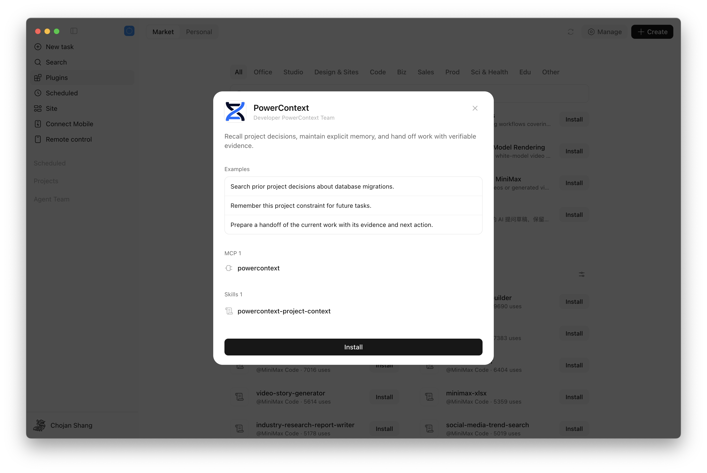
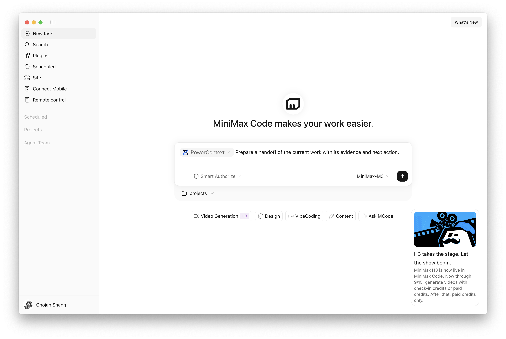

## 要点

- 将原始截图、代码和日志与检索所用的文本、向量关联起来。seekdb 可以在同一数据库中组合关键词检索、向量检索和结构化过滤。
- 为约束、任务状态、证据和长期记忆分别制定更新规则。压缩后的摘要仍须保留下一步行动依赖的依据。
- 用 PowerContext Memory 保存项目决策，用 Handoff 将未完成的工作带入下一次会话。需要持久检查点时，必须明确提交交接。

一张截图里，底部导航挡住了结算按钮；一段日志里，请求正在失败。你把截图、日志和代码仓库一起交给 Coding Agent，让它帮忙排查。

材料齐了，Agent 还需要弄清它们的含义：截图来自哪次提交，请求失败由什么触发，两个症状是否出于同一个原因。

随着 Agent 读取文件、修改代码、运行测试，新的信息不断产生。有些发现经过验证，有些仍是假设，还有些检查尚未完成。任务暂停时，下一次会话需要清楚了解这三种状态。

这就是本文围绕 MiniMax Code 展开的上下文管理问题：怎样把不同形式的输入变成证据，让当前上下文保持有用，并留下足够的已验证状态，让工作能够继续。seekdb 提供检索基础，PowerContext 提供跨会话的项目记忆与工作交接。

<figure class="fig" id="fig-figure-1">

<svg viewBox="0 0 960 340">
<path class="fig-wire" d="M300 50 L654 50" marker-end="url(#fig-arrow)"/>
<path class="fig-wire" d="M810 100 L810 234" marker-end="url(#fig-arrow)"/>
<path class="fig-wire" d="M660 290 L306 290" marker-end="url(#fig-arrow)"/>
<path class="fig-wire dashed" d="M150 240 L150 106" marker-end="url(#fig-arrow)"/>
</svg>

<b>输入上下文</b>截图、文档、代码与日志描述同一个待解决的问题

<b>项目范围</b>工作区与相关文件限定当前任务的范围

<b>工具执行</b>编辑文件、运行命令在浏览器中检查页面状态

<b>结果验证</b>检查 diff、测试与输出迭代修复

<b>MiniMax Code 中的一次闭环</b>一张底部导航遮住结算按钮的截图、请求错误日志和代码仓库

迭代

<figcaption>图 1｜排查任务从截图、日志和代码出发，经历调查、实现与验证。</figcaption>
</figure>

## 让检索结果始终关联原始材料

对开发者来说，截图、日志和仓库属于同一份问题报告。对 Agent 来说，它们之间的联系仍然需要建立。

截图中受影响的区域要能对应到页面和组件。代码片段要带着文件路径和提交信息。日志记录要包含时间、足够解释故障的上下文，以及相关请求或工具调用的引用。

因此，来源可追溯应当成为检索设计的一部分。每条有用的命中结果，都应当告诉 Agent 下一步可以去哪里核对。

将原始材料与用于查找它们的检索表示分开管理：

| 输入 | 检索表示 | 需要保留的来源信息 |
| --- | --- | --- |
| 截图 | OCR 文本、布局描述、向量 | 原图及问题区域坐标 |
| 代码 | 可检索的代码片段 | 仓库、文件路径和提交 |
| 日志 | 错误码与提取的信息 | 原始记录、时间戳、请求或工具调用的引用 |

原件记录发生过什么，检索表示帮助 Agent 找到它。解析器改进后，可以重新生成文本或向量，记录解析器版本，并保留原件供比较。

<figure class="fig" id="fig-figure-2">

<svg viewBox="0 0 960 350">
<path class="fig-wire" d="M210 68 L244 68" marker-end="url(#fig-arrow)"/>
<path class="fig-wire" d="M460 68 L494 68" marker-end="url(#fig-arrow)"/>
<path class="fig-wire" d="M710 68 L744 68" marker-end="url(#fig-arrow)"/>
<path class="fig-wire accent" d="M176 256 L201 256" marker-end="url(#fig-arrow-accent)"/>
<path class="fig-wire accent" d="M366 256 L391 256" marker-end="url(#fig-arrow-accent)"/>
<path class="fig-wire accent" d="M556 256 L581 256" marker-end="url(#fig-arrow-accent)"/>
<path class="fig-wire accent" d="M746 256 L771 256" marker-end="url(#fig-arrow-accent)"/>
</svg>

<b>1 采集</b>截图、文档、日志、代码记录任务与来源标识

<b>2 解析</b>OCR、ASR、视觉理解切分并抽取结构化信息

<b>3 治理</b>去重、版本、敏感字段权限映射与有效期

<b>4 索引</b>元数据、全文、向量构建可检索的表示

<header><b>端到端数据血缘</b></header>

<b>Source</b>

<b>解析版本</b>

<b>分块与向量</b>

<b>检索命中</b>

<b>输出引用</b>

更新或删除时，同步全文、向量、缓存与访问权限。

<figcaption>图 2｜来源引用将每份索引表示关联回原始材料。</figcaption>
</figure>

更新也要沿着同一条链路传播。替换后的截图应当与上一版有明确关系。材料被删除或失效时，需要更新其检索索引与缓存，避免它继续以当前证据的身份出现。

在共享环境中，筛选候选材料时就要应用访问规则。Agent 应当在当前用户有权访问的资源范围内检索。命中之后，仍须检查结果是否适用于正在调查的代码和环境。

## 用 seekdb 同时检索精确线索与语义线索

排查涉及多种检索。错误码、接口名和函数名是明确的关键词线索。“底部导航挡住了结算按钮”这样的描述，则可以通过语义检索找到相关组件或历史问题。

两类检索需要相同的范围约束：正确的项目、相关版本，以及允许访问的资源。

OceanBase seekdb 在同一引擎中支持向量、全文、关系和 JSON 数据，并提供嵌入式与服务端部署方式，因此可以作为这一检索层的候选底座。结构化过滤限定范围，关键词与向量检索负责寻找线索。

[seekdb 项目](https://github.com/oceanbase/seekdb)

针对结算页面的排查，可以围绕三项工作组织检索：

1. 限定范围：选择项目、版本，以及当前用户能够访问的资源。
2. 搜索线索：匹配精确错误和标识符，再查找语义相关的页面、组件或问题。
3. 返回来源：附上核对结果所需的图片区域、日志位置、代码路径和版本。

<figure class="fig" id="fig-figure-3">

<svg viewBox="0 0 960 330">
<path class="fig-wire" d="M250 90 L280 90 Q290 90 290 80 L290 42 Q290 32 300 32 L324 32" marker-end="url(#fig-arrow)"/>
<path class="fig-wire" d="M250 160 L280 160 Q290 160 290 170 L290 198 Q290 208 300 208 L324 208" marker-end="url(#fig-arrow)"/>
<path class="fig-wire accent" d="M580 32 L810 32 Q820 32 820 42 L820 64" marker-end="url(#fig-arrow-accent)"/>
<path class="fig-wire accent" d="M580 208 L810 208 Q820 208 820 198 L820 176" marker-end="url(#fig-arrow-accent)"/>
</svg>

<b>身份授权、项目、有效版本</b>关系与 JSON 元数据：租户、资源、时间、类型

<b>全文 · BM25</b>

函数名、错误码、API 名称

<b>向量检索</b>

页面语义、相似需求

<b>融合与重排</b>证据分块 + 来源引用

seekdb 统一存储元数据、文本与向量；解析、授权策略与任务相关性由应用负责。

<figcaption>图 3｜结构化过滤限定范围，关键词与向量检索分别寻找精确和语义匹配。</figcaption>
</figure>

在这一设计中，解析环节生成待索引的文本或向量，seekdb 负责存储和检索这些表示。应用还需要定义材料与版本、项目、访问规则之间的关系。

要结合任务检查检索结果：错误码是否指向相关接口，布局描述是否找到了受影响的组件，证据是否与当前代码一致？这些检查决定 Agent 是否已经获得足够的信息来实施修改。

## 让当前上下文聚焦于眼前的工作

找到一份文档，不代表下一次提示中需要包含整份文档。一份长日志可能只有一处故障与当前任务有关。历史决策可以解释现有实现，但今天的新要求可能改变下一步应该做什么。

可以将上下文分为四类信息：

- **约束**：支配这项工作的目标、项目规则和权限边界。
- **任务状态**：已验证进展、开放问题、阻塞和下一步。
- **检索证据**：当前需要的片段，以及来源引用和版本。
- **长期记忆**：项目决策、稳定偏好，以及值得复用的经验。

<figure class="fig" id="fig-figure-4">

<b>持久约束</b>用户目标、项目规则与权限边界；始终遵循当前有效的指令。

<b>任务状态</b>计划、已验证进展、阻塞与下一步；随任务推进更新，支持交接。

<b>检索证据</b>本轮所需的分块、引用与版本；在上下文预算内按相关性选取。

<b>长期记忆</b>稳定偏好、项目决策与排障经验；可追溯、可修订，过时即退役。

<figcaption>图 4｜约束、任务状态、证据和记忆具有不同的更新与保留规则。</figcaption>
</figure>

各类信息变化的节奏不同。任务状态需要随着工作推进而更新。证据需要来源和适用版本。项目发生变化时，长期记忆也需要修订或退役。

MiniMax Code 的上下文管理方式包括记忆控制、上下文使用情况展示，以及 CLI 中的输出预算、工具结果裁剪和压缩等机制。它们服务于一个具体目标：保留下一步所需的信息，同时让较大的输出能够从外部取回。

将完整日志和报告留在文件中，把相关摘录和回读路径放入上下文。到达检查点时，记录目标、决定、已验证进展、阻塞和下一步行动。

压缩是否有用，取决于 Agent 能否继续分清已知事实和待检查事项。如果已经将按钮遮挡定位为布局问题，但请求失败的原因还没解释，摘要就应当保留这两个独立状态。它们同时出现，并不能证明存在共同原因。

同样的原则也适用于 Agent Team 协作。协调、执行和验证分别需要与自身职责匹配的上下文。文件、聚焦的摘要和来源路径，让 Agent 能够交换有效结果，无须将整个调查过程带入每个上下文。声称工作完成，仍然需要相应检查的支持。

[MiniMax Code Agent Team](https://agent.minimax.io/docs/code/agents/team)

## 让项目知识与未完成的工作跨越会话

会话内，检索和压缩帮助 Agent 继续推进。跨会话时，接手的人或 Agent 则需要知道：项目为什么采用当前做法，这项任务又停在了哪里。

PowerContext 将这两类需求分为 Memory 和 Handoff。Memory 保留可复用的项目知识，Handoff 组织某项具体任务的状态，让其他人能够继续。

<figure class="fig" id="fig-figure-5">

<svg viewBox="0 0 960 330">
<path class="fig-wire" d="M300 165 L320 165 Q330 165 330 155 L330 59 Q330 49 340 49 L354 49" marker-end="url(#fig-arrow)"/>
<path class="fig-wire" d="M300 165 L354 165" marker-end="url(#fig-arrow)"/>
<path class="fig-wire" d="M300 165 L320 165 Q330 165 330 175 L330 271 Q330 281 340 281 L354 281" marker-end="url(#fig-arrow)"/>
</svg>

<b>PowerContext</b>在 harness 之外保留可追溯的项目上下文与交接状态。当前代码、实时工具状态与上下文压缩仍由宿主负责。

<b>Source · Memory</b>Source 保存证据；Memory 管理可复用的事实、决策及其修订。

<b>准备的上下文</b>为每次请求检索并挑选历史，限制条目数与总预算，保留精确引用。

<b>Handoff · Outcome</b>交接目标、进展、阻塞与下一步；记录结果以便评审和复用经验。

<figcaption>图 5｜Memory 延续项目知识，Handoff 延续未完成工作的状态。</figcaption>
</figure>

MiniMax Code 插件由 Skill 和原生 MCP 配置组成。Skill 指引 Agent 使用 PowerContext，MCP 负责连接 PowerContext Server。插件按照请求保存上下文，不会自动采集每一段对话。

Server 默认使用本地 SQLite 数据库。持久存储独立于 MiniMax Code 会话，因此关闭应用后，已保存的上下文仍然可用。如果启用了生成或向量服务，相关内容可能会发送到配置的模型端点。

[插件文档](https://github.com/oceanbase/powercontext/tree/master/integrations/minimax/plugins/powercontext)

## Memory：保留决策及其原因

仓库呈现了功能如何实现。要理解为什么这样实现，经常需要查看项目历史：兼容性要求、被放弃的方案，或者当时成立的限制。

接入 PowerContext 后，可以提出：

> 查找我们之前关于数据库迁移的决策，并展示来源。

这些引用让你能够检查原始推理，并与当前代码进行比较。

确认一条值得保留的约束后，可以明确保存：

> 记住：这个项目必须支持 Python 3.11。

适合保存的内容包括已确认的技术决策、稳定约束，以及经过验证的排查经验。保存结论时，也保留原因和适用范围。要求发生变化后，应当修订或退役对应记忆。

检索到的记忆为下一项任务提供背景。Agent 在行动前，仍须将它与当前工作区及有效指令进行核对。

## Handoff：让未完成的工作便于恢复

假设结算页面的排查已经定位了布局原因，部分修复也已完成。小屏幕下的表现还需要测试，请求失败仍然没有解释。

如果交接只写“结算页已修复”，下一次会话就会丢失所需信息。一份有用的交接应当区分四件事：

- **已确认**：遮挡如何发生，以及对应截图和代码位置。
- **已修改与已检查**：修改了什么，运行了哪些检查，结果如何。
- **仍然开放**：尚未测试的屏幕尺寸，以及请求失败的待解线索。
- **下一步行动**：检查当前差异，完成布局验证，并继续排查请求。

<figure class="fig" id="fig-figure-6">

<svg viewBox="0 0 960 326">
<path class="fig-wire accent" d="M240 92 L314 92" marker-end="url(#fig-arrow-accent)"/>
<path class="fig-wire accent" d="M640 92 L714 92" marker-end="url(#fig-arrow-accent)"/>
<path class="fig-wire" d="M168 282 L192 282" marker-end="url(#fig-arrow)"/>
<path class="fig-wire" d="M366 282 L390 282" marker-end="url(#fig-arrow)"/>
<path class="fig-wire" d="M564 282 L588 282" marker-end="url(#fig-arrow)"/>
<path class="fig-wire" d="M762 282 L786 282" marker-end="url(#fig-arrow)"/>
</svg>

<b>调查 Agent</b>

整理证据与观察，确认交接

<b>可检查的交接记录</b>目标与范围已验证的进展与代码状态阻塞、风险与下一步证据引用与精确版本

<b>执行与验证 Agent</b>

先复核当前工作区，再执行、测试与确认

<b>结果</b>

<b>候选经验</b>

<b>人工评审</b>

<b>可复用经验</b>

<b>显式导出 Skill</b>

<figcaption>图 6｜交接记录目标、已验证进展、证据、开放问题和下一步行动。</figcaption>
</figure>

先准备一份临时交接：

> 使用 PowerContext 为这项任务准备交接，包含已验证进展、关键证据、剩余检查和下一步。提交前先给我查看。

检查内容。需要一个后续会话能够取回的检查点时，再要求持久保存：

> 将这份交接提交为持久检查点，并返回对应版本。

然后，在下一次会话中提出：

> 恢复这个项目最近一次已提交的交接，检查当前工作区，再继续剩余工作。

准备交接和提交交接是两个操作。依赖它恢复后续会话前，应当确认提交成功。恢复时，将检查点与当前文件、差异和指令进行比较；记录交接之后，工作区可能已经变化。

这样，接手者拿到的结论可以核对，尚未解决的问题仍然开放，并且有一个明确的起点。任务完成后，可复用的发现可以在用户要求时保存到 Memory。

[Handoff 文档](https://github.com/oceanbase/powercontext/blob/master/integrations/minimax/plugins/powercontext/README.md#pick-up-where-the-work-left-off)

## 从一个真实的排查任务开始

这套流程连接了三项职责：检索相关证据，选择 Agent 当前需要的内容，以及保留足够的状态，让下一次会话能够继续。

可以选一个用到截图或日志、需要跨会话完成的任务来尝试。检查检索是否指向正确来源、修改是否通过验收，以及恢复工作时是否避免了重复调查已经验证的事项。

<figure class="fig" id="fig-figure-7">

<svg viewBox="0 0 960 330">
<path class="fig-wire" d="M300 165 L320 165 Q330 165 330 155 L330 59 Q330 49 340 49 L354 49" marker-end="url(#fig-arrow)"/>
<path class="fig-wire" d="M300 165 L354 165" marker-end="url(#fig-arrow)"/>
<path class="fig-wire" d="M300 165 L320 165 Q330 165 330 175 L330 271 Q330 281 340 281 L354 281" marker-end="url(#fig-arrow)"/>
</svg>

<b>用真实任务验证收益</b>固定模型、任务集、环境与预算。对比四种配置：基线、检索增强、上下文增强、两者结合。

<b>任务质量</b>任务成功率、测试结果与人工修正，失败、超时与重跑都计入指标。

<b>证据质量</b>引用准确性、过期结果与越权检索；检查来源可追溯与版本一致性。

<b>连续性与成本</b>恢复时间、重复排查与输入 token；同时跟踪 p95 端到端延迟与工具错误。

<figcaption>图 7｜通过证据质量、验证结果和恢复所需的工作量评估流程。</figcaption>
</figure>

PowerContext 插件已经上架 MiniMax 官方插件市场。使用前需要准备 MiniMax Code、Python 3.11 或更新版本，以及 `uv`：

1. 按照[安装文档](https://powercontext.oceanbase.io/zh/docs/get-started/install-and-run/)，在运行 MiniMax Code 的机器上安装并启动 PowerContext Server。
2. 在 MiniMax 插件市场启用 PowerContext。默认 MCP 端点为 `http://127.0.0.1:8000/mcp`。[插件文档](https://github.com/oceanbase/powercontext/tree/master/integrations/minimax/plugins/powercontext)介绍了连接检查和受保护 Server 的配置。
3. 在 MiniMax Code 会话中使用 `@` 选择 PowerContext，再让它查找项目决策、保存已确认的约束，或准备交接。

*图 8｜在 MiniMax 插件市场启用 PowerContext 插件。截图保留产品原始界面语言。*

显式读写 Memory，以及交接当前工作，不要求额外配置 PowerContext 的生成模型。向量搜索需要向量服务，模型生成内容需要相应的 Server 端模型配置。MiniMax Code 自身的账号和模型设置单独管理。

*图 9｜让 MiniMax Code 使用 PowerContext 管理项目记忆与交接。截图保留产品原始界面语言。*

围绕工作建立一个简单习惯：开始前检索相关决策，确认后保存可复用的结论，需要持久检查点时提交交接，恢复时再与工作区核对。

回到结算页面，下一次会话应当知道哪些布局修改已经完成、哪些屏幕尺寸尚未测试，以及请求失败还缺少什么证据。它可以检查当前代码，并从这里继续。

这就是上下文管理带来的价值：每一轮工作，都为下一轮留下一个可以核对的起点。
