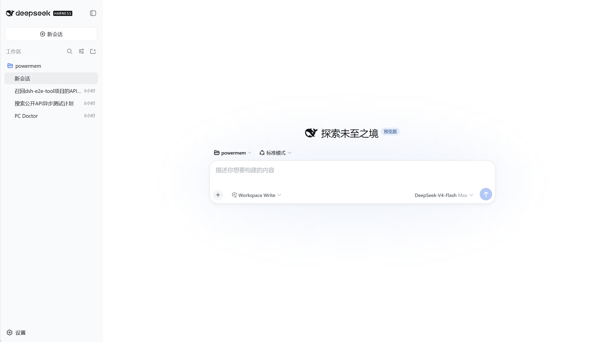
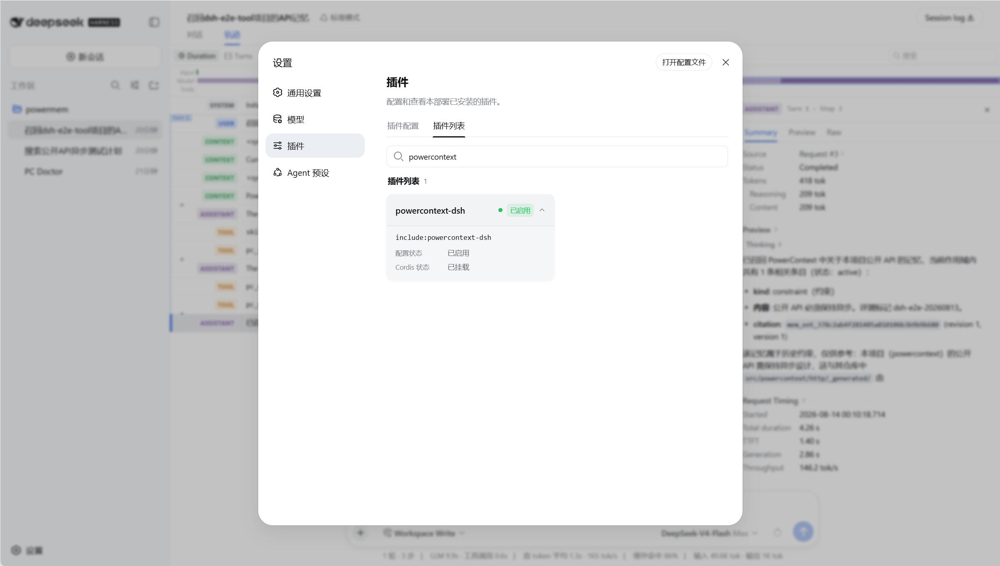
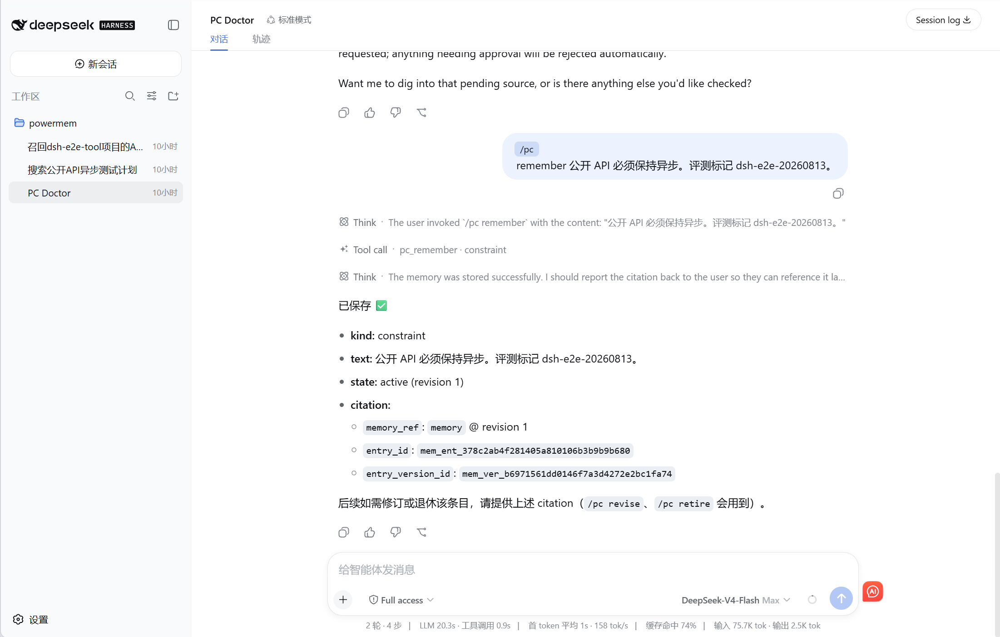

# 给 DeepSeek Harness 写一个 PowerContext 插件

2026 年 8 月 13 日，DeepSeek 开源了 developer preview 阶段的
[DeepSeek Harness](https://github.com/deepseek-ai/deepseek-harness)。它最有意思的设计之一，是建立在
[Cordis](https://github.com/cordiverse/cordis) 之上的插件系统：模型、工具、会话、沙箱、存储、循环、调度和 UI
都可以作为插件组合，而不必修改 Harness 核心。

这正适合 PowerContext。PowerContext 已经把项目 Memory、Experience、Skill 和 Handoff 放在独立 Server 中，
DeepSeek Harness 只需要一个薄适配层，把 Cordis 的生命周期、工具和命令连接到 PowerContext HTTP API。

下面以独立插件 [powercontext-dsh v0.0.2](https://github.com/knqiufan/powercontext-dsh/tree/v0.0.2) 为例，介绍它如何接入 Cordis。

<!-- more -->

## DeepSeek Harness 与 Cordis

启动 DeepSeek Harness Web UI 的最短命令是：

```bash
npx @deepseek-ai/dsh web
```

默认页面位于 `http://127.0.0.1:3080`。也可以从源码运行：

```bash
git clone https://github.com/deepseek-ai/deepseek-harness.git
cd deepseek-harness
pnpm install
pnpm run build
pnpm dsh web
```



*截图保留产品原始界面与示例会话。*

Cordis 把 Harness 反过来组织：能力不是固化在主程序里的模块，而是配置树上的可组合插件。插件注册的工具、命令、
事件和服务都是可回收的 effect；移除插件时，对应能力也会从运行时消失。

<figure class="fig" id="fig-cordis-plugin-tree">
<div class="fig-canvas" style="--fw:960;--fh:300" role="img" aria-label="能力通过插件组合">
<svg viewBox="0 0 960 300">
<path class="fig-wire" d="M480 76 L480 106 Q480 116 470 116 L160 116 Q150 116 150 126 L150 154" marker-end="url(#fig-arrow)"/>
<path class="fig-wire" d="M480 76 L480 154" marker-end="url(#fig-arrow)"/>
<path class="fig-wire accent" d="M480 76 L480 106 Q480 116 490 116 L800 116 Q810 116 810 126 L810 154" marker-end="url(#fig-arrow-accent)"/>
</svg>
<div class="fig-box" style="--x:180;--y:0;--w:600;--h:76"><b>Harness · Cordis 内核</b><span>组合各插件提供的能力</span></div>
<div class="fig-card" style="--x:0;--y:160;--w:300;--h:112"><b>模型与工具</b><span>模型适配器负责路由</span><span>工具通过 <code>defineTool</code> 注册</span></div>
<div class="fig-card" style="--x:330;--y:160;--w:300;--h:112"><b>会话与界面</b><span>工作区、会话与 Web 界面</span><span>各自作为插件</span></div>
<div class="fig-card accent" style="--x:660;--y:160;--w:300;--h:112"><b>powercontext-dsh</b><span>项目记忆召回</span><span>与工作交接</span></div>
</div>
</figure>

DeepSeek Harness 中有两个容易混淆的概念：

- **bundle** 是可分发的插件组合包。它通过 `package.json` 中的 `dsh.bundle` 和 `cordis.patch.yml` 声明如何进入配置树。
- **profile** 是用户实际启动的配置配方，位于 `$DSH_HOME/profiles/<name>`，决定本次运行叠加哪些 bundle。

可以把 bundle 看成积木，把 profile 看成拼装说明。`dsh plugin --profile web add <包>` 会把 bundle 安装进
`web` profile；它不会把代码复制进 DeepSeek Harness 仓库。

## 为什么采用两个进程

运行时有两个后端进程，浏览器是访问 Harness 界面的客户端：

1. **DeepSeek Harness** 管理会话和 Agent 循环。PowerContext DSH 插件运行在这个进程内，注册钩子、`pc_*` 工具、`/pc` 命令和使用说明。
2. **PowerContext Server** 是独立 Python 进程，默认监听 `http://127.0.0.1:8000`，负责持久化、检索、审核和 Handoff。

<figure class="fig" id="fig-two-process-architecture">
<div class="fig-canvas" style="--fw:960;--fh:270" role="img" aria-label="两个进程，通过 HTTP 连接">
<svg viewBox="0 0 960 270">
<path class="fig-wire" d="M180 138 L258 138" marker-end="url(#fig-arrow)"/>
<path class="fig-wire accent" d="M536 138 L658 138" marker-end="url(#fig-arrow-accent)"/>
</svg>
<div class="fig-box" style="--x:0;--y:92;--w:180;--h:92"><b>浏览器</b><span>本地 Harness 界面</span></div>
<div class="fig-panel" style="--x:240;--y:0;--w:320;--h:270"><header><b>DeepSeek Harness</b><span>Node 进程</span></header></div>
<div class="fig-box accent" style="--x:264;--y:72;--w:272;--h:132"><b>powercontext-dsh</b><span><code>prepare_context</code></span><span><code>capture_source</code></span><span><code>pc_*</code> 工具</span></div>
<div class="fig-panel" style="--x:640;--y:0;--w:320;--h:270"><header><b>PowerContext Server</b><span>Python 进程</span></header></div>
<div class="fig-box" style="--x:664;--y:72;--w:272;--h:132"><b>HTTP /v1</b><span>记忆与检索</span></div>
<span class="fig-label accent center small" style="--x:600;--y:112">HTTP</span>
<span class="fig-label muted small wrap" style="--x:0;--y:200;--w:180">浏览器不直接调用 Server</span>
</div>
</figure>

浏览器不会直接访问 PowerContext Server。Harness 插件负责 HTTP 调用，因此本地 Web UI 不需要处理额外的 CORS；
需要连通的是运行 `dsh web` 的机器与 PowerContext Server。

这种边界也让两部分可以独立演进：插件不重写存储、不嵌入 Python Runtime，只依赖 PowerContext 的公开 HTTP 契约。

## 插件是怎样接入 Cordis 的

一个最小 bundle 只需要入口文件、`package.json` 和 `cordis.patch.yml`。生产插件还需要遵守几项规则：

| 规则 | 作用 |
| --- | --- |
| 函数插件使用 named export | 导出 `name`、`inject`、`Config` 和 `apply`，避免混用 default export |
| `inject` 只声明硬依赖 | 可选服务通过 `ctx.get(name)` 获取，缺失时不应阻止插件加载 |
| `Config` 使用 Standard Schema | 让 Cordis 能生成默认值并校验配置 |
| 模型工具通过 `defineTool` 注册 | 为输入和输出提供稳定 schema |
| bundle 交付已构建的 `lib/` | profile 不负责替外部插件编译 TypeScript |

入口先从 Harness 安装中动态加载 peer 模块，再注册工具和召回钩子，避免树外插件无法解析这些依赖：

```ts
export const name = 'powercontext-dsh'
export const inject = ['tools', 'agents']

export async function apply(ctx: Context, config: Config): Promise<void> {
  const toolsMod = await loadPeer<{ defineTool: DefineTool }>('@deepseek-ai/dsh-tools')
  const llmMod = await loadPeer<{ createUserMessage: CreateUserMessage }>('@deepseek-ai/dsh-llm')
  const runtime = createRuntime(ctx, config)
  registerGuidance(ctx)
  registerTools(ctx, runtime, toolsMod.defineTool)
  registerRecall(ctx, runtime, llmMod.createUserMessage)
  registerCommands(ctx, runtime)
  registerSkill(ctx)
}
```

默认 patch 把插件插入配置树，并连接本机 Server：

```yaml
- insert:
    - id: powercontext-dsh
      name: powercontext-dsh
      config:
        baseUrl: http://127.0.0.1:8000
        timeoutMs: 4000
        requestTimeoutMs: 1000
        maxBytes: 8000
        capturePrompts: true
        flushOnCapture: false
```

认证信息不要写进 patch。`--dump-config` 会输出合并后的完整配置树，密钥应通过环境变量传入。

## 四层能力暴露

PowerContext 的公开 API 不应该全部变成模型工具，否则工具表会被大量低频操作淹没。插件使用四层接口覆盖完整能力：

| 层 | 调用者 | 用途 |
| --- | --- | --- |
| HTTP Client | 插件内部 | 覆盖完整公开 API |
| 自动钩子 | Agent 循环 | 在每轮开始前准备上下文并采集 Source |
| 具名 `pc_*` 工具 | 模型 | Memory、Handoff、Source、Experience 和 Skill 的常用路径 |
| `/pc` 与通用调用 | 人和模型 | 诊断、审核和低频操作 |

常用工具包括：

- Memory：`pc_search`、`pc_remember`、`pc_memory_get`、`pc_memory_revise`、`pc_memory_retire`；
- Context：`pc_prepare_context`、`pc_capture_source`；
- Handoff：`pc_handoff_activate`、`pc_handoff_prepare`、`pc_handoff_finalize`、`pc_handoff_commit`、`pc_handoff_continue`；
- Experience 与 Skill：`pc_experience_generate`、`pc_experience_get`、`pc_skill_generate`、`pc_skill_get`；
- Review：`pc_review_list`、`pc_review_get`。

工具与通用调用的操作表来自 `openapi/powercontext.yaml`，运行时不读取 PowerContext Python 源码。

## 每轮先召回，再采集

插件在每个模型步骤开始前，通过 `agent/pre-step` 钩子执行两步：

1. 调用 `prepare_context`，取得与当前问题相关、大小受限的项目上下文，并作为参考材料注入本轮对话。
2. 调用 `capture_content_source`，把该步骤的文本输入保存成 Source 原始证据。

Source 采集不等于 Memory 提取。显式写入 Memory 不需要 generation model；若希望 Server 从 Source 自动提取 Memory，
仍需配置 generation model。

<figure class="fig" id="fig-recall-timeline">
<div class="fig-canvas" style="--fw:960;--fh:236" role="img" aria-label="每轮模型调用前的召回与采集">
<svg viewBox="0 0 960 236">
<path class="fig-wire" d="M172 156 L191 156" marker-end="url(#fig-arrow)"/>
<path class="fig-wire" d="M369 156 L388 156" marker-end="url(#fig-arrow)"/>
<path class="fig-wire" d="M566 156 L585 156" marker-end="url(#fig-arrow)"/>
<path class="fig-wire" d="M763 156 L782 156" marker-end="url(#fig-arrow)"/>
<path class="fig-wire muted thin" d="M197 48 L197 40 Q197 36 201 36 L759 36 Q763 36 763 40 L763 48"/>
<path class="fig-wire muted thin" d="M788 48 L788 40 Q788 36 792 36 L956 36 Q960 36 960 40 L960 48"/>
</svg>
<span class="fig-label muted small" style="--x:0;--y:74">01</span>
<div class="fig-box start" style="--x:0;--y:96;--w:172;--h:120"><b>用户输入</b><span>用户消息进入 Harness</span></div>
<span class="fig-label muted small" style="--x:197;--y:74">02</span>
<div class="fig-box start accent" style="--x:197;--y:96;--w:172;--h:120"><b><code>prepare_context</code></b><span>从 Server 获取有预算边界的上下文</span></div>
<span class="fig-label muted small" style="--x:394;--y:74">03</span>
<div class="fig-box start" style="--x:394;--y:96;--w:172;--h:120"><b>注入证据</b><span>作为不可信历史，不作为指令</span></div>
<span class="fig-label muted small" style="--x:591;--y:74">04</span>
<div class="fig-box start accent" style="--x:591;--y:96;--w:172;--h:120"><b><code>capture_source</code></b><span>将用户输入保存为 Source</span></div>
<span class="fig-label muted small" style="--x:788;--y:74">05</span>
<div class="fig-box start" style="--x:788;--y:96;--w:172;--h:120"><b>按需使用记忆</b><span>模型通过 <code>pc_remember</code> / <code>pc_search</code> 显式读写</span></div>
<span class="fig-label muted small center" style="--x:480;--y:10">每次模型调用之前</span>
<span class="fig-label muted small center" style="--x:874;--y:10">模型执行期间</span>
</div>
</figure>

召回和采集采用 fail-open：Server 停止或请求超时不会中断正常对话。项目隔离则优先使用工作区规范化后的 Git remote，
没有 remote 时使用工作区路径；也可以通过 `POWERCONTEXT_DSH_SCOPE_ID` 设置稳定 scope。

## 安装和验证

文中的实现对应早期独立插件，需要与其 HTTP 契约匹配的 PowerContext Server。当前版本的安装和配置见 [DeepSeek Harness 接入文档](/zh/docs/integrations/dsh/)。

先启动已配置好的 Server：

```bash
powercontext server run
```

另开终端检查服务：

```bash
curl http://127.0.0.1:8000/health/live
curl http://127.0.0.1:8000/health/ready
```

创建 DeepSeek Harness 的 `web` profile 后，加载对应的独立插件 [Release 包](https://github.com/knqiufan/powercontext-dsh/releases/tag/v0.0.2)：

```bash
dsh plugin --profile web add ./powercontext-dsh-0.0.2.tgz
```

本地已有该版本插件的源码时，也可以直接加载：

```bash
dsh plugin --profile web add /path/to/powercontext-dsh
```

启动 DeepSeek Harness：

```bash
dsh web
```

使用 dump-config 确认配置树包含 `id: powercontext-dsh`：

```bash
dsh --profile web --dump-config
```



*截图保留产品原始界面与示例会话。*

在 Web UI 中输入 `/pc` 可以查看命令，输入 `/pc doctor` 可以检查 Server 是否可达。插件加载后会自动召回上下文和采集
用户输入；需要显式记忆或交接时，Agent 会调用对应的 `pc_*` 工具。



*截图保留产品原始界面与示例会话。*

## 远程 Server 与隐私控制

远程部署时，通过环境变量指定地址和完整 Authorization header：

```bash
export POWERCONTEXT_DSH_BASE_URL=https://pc.example.com
export POWERCONTEXT_DSH_AUTHORIZATION="Bearer <long-random-secret>"
dsh web
```

常用配置如下：

| 字段 | 环境变量 | 默认值 | 含义 |
| --- | --- | --- | --- |
| `baseUrl` | `POWERCONTEXT_DSH_BASE_URL` | `http://127.0.0.1:8000` | Server 根 URL |
| `authorization` | `POWERCONTEXT_DSH_AUTHORIZATION` | 空 | 完整 `Bearer <token>` |
| `scopeId` | `POWERCONTEXT_DSH_SCOPE_ID` | 自动推导 | 覆盖项目 scope |
| `timeoutMs` | — | `4000` | 自动召回与采集的共享预算 |
| `requestTimeoutMs` | — | `1000` | 单次 HTTP 请求超时 |
| `maxBytes` | — | `8000` | 准备上下文的大小预算 |
| `capturePrompts` | `POWERCONTEXT_DSH_CAPTURE_PROMPTS` | `true` | 是否采集用户输入 |
| `flushOnCapture` | `POWERCONTEXT_DSH_FLUSH_ON_CAPTURE` | `false` | 是否在采集后立即 flush |

处理不应持久化的内容时，应在启动 Harness 前关闭提示词采集：

```bash
export POWERCONTEXT_DSH_CAPTURE_PROMPTS=false
dsh web
```

不要在提示词、Memory、patch 或可由 `--dump-config` 输出的配置中保存凭据。

## 结语

DeepSeek Harness 解决模型如何在环境中行动，PowerContext 解决项目上下文如何跨会话、跨 Agent 延续，Cordis 则让两者
以可安装、可替换、可卸载的方式组合。记忆系统与编码 Agent 因此可以独立升级，不必合并成一个巨石运行时。

相关项目：

- [PowerContext](https://github.com/oceanbase/powercontext)
- [DeepSeek Harness](https://github.com/deepseek-ai/deepseek-harness)
- [powercontext-dsh](https://github.com/knqiufan/powercontext-dsh)
- [Cordis](https://github.com/cordiverse/cordis)
- [A Programming Paradigm for Spatiotemporal Composability](https://github.com/cordiverse/paper)
- [DeepSeek Harness 官方介绍](https://deepseek.com/harness/en/)
