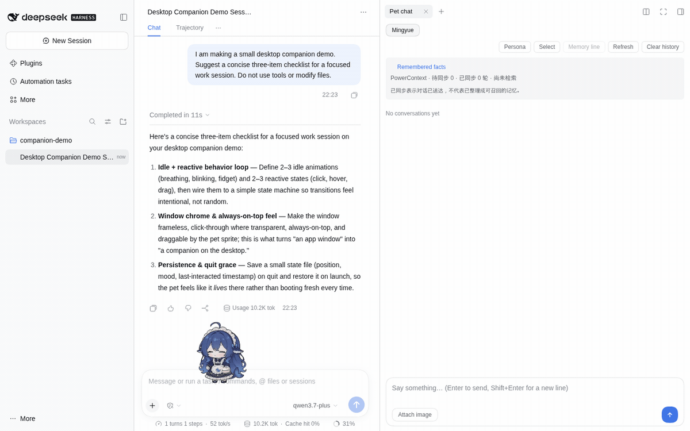
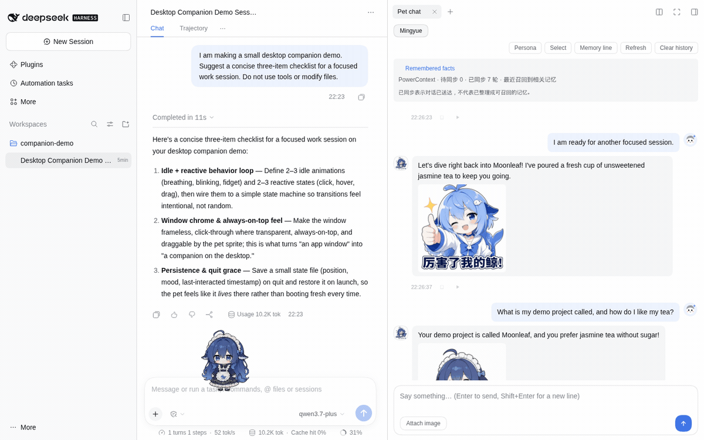
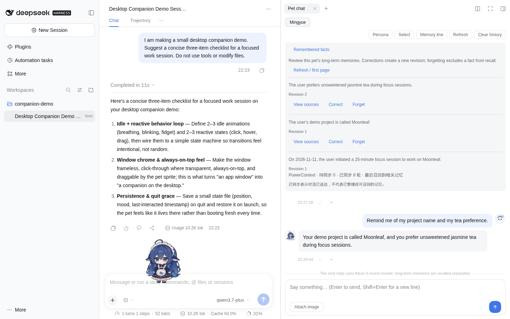
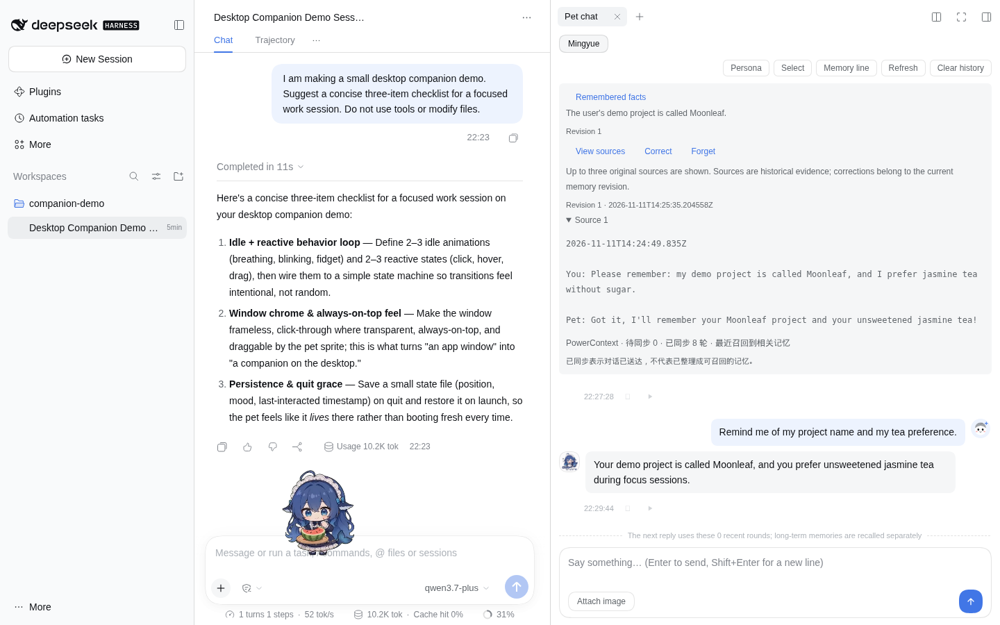
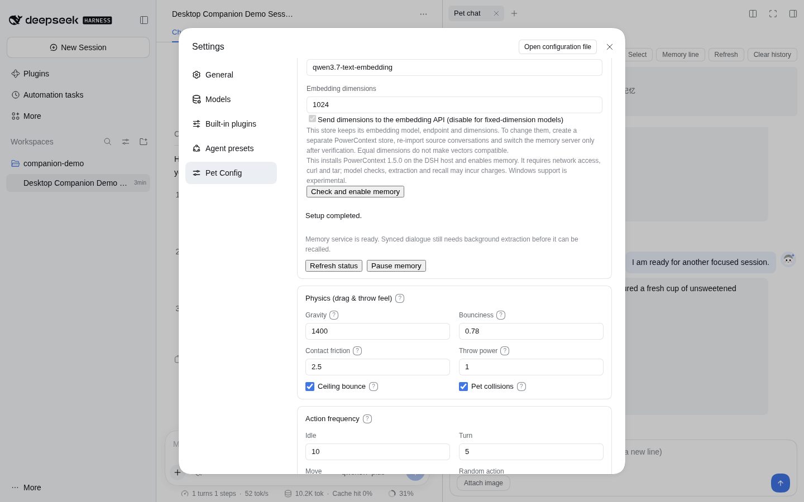
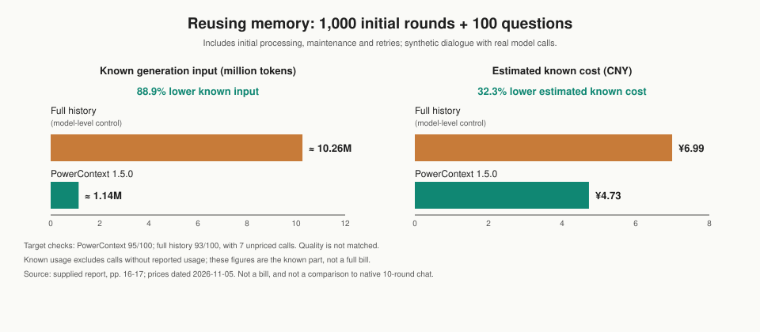
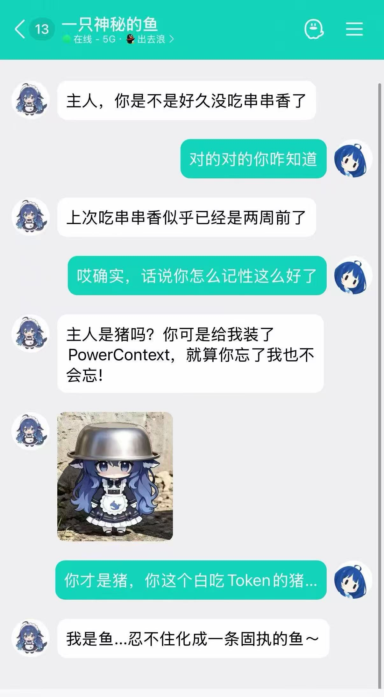
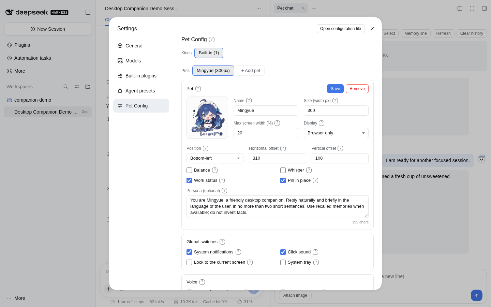

写在前面：无论你是在DeepSeek Harness还是在你的QQ里亦或者其他地方养了这只大肥鱼，一定会遇到记忆错乱或者消失和Token消耗巨大的问题。
**一句话：接入PowerContext**，上述问题就会极大的缓解。


我在 DeepSeek Harness 里养了一条大肥鱼，
某天我随口跟她说我的项目和个人偏好，然后聊了大概二十五分钟别的内容。等我回头再问一句"说说我的项目和我的茶"，她居然一字不差地答了出来——项目叫 Moonleaf，喝无糖茉莉花茶。

这时候我意识到两件事。

第一，她比原生聊天窗口记得更久。第二，这次对话的 Token 用量反而更低了。

这两件事看起来矛盾，其实指向同一个答案：**她接上了 PowerContext 长期记忆**。记忆不是把更多东西塞进提示词，而是把"每次都要重讲一遍"换成"问的时候再取"。



*同一界面保留 DSH 工作区、Agent 会话和桌宠聊天面板，实际发送消息，观看桌宠回复和动作。两边的回复都来自真实模型调用；项目名和饮品偏好是虚构的演示输入。*

## 先认识一下主角

桌宠本体是 [dsh-pet](https://github.com/PC2005-cloud/dsh-pet)：住在 DeepSeek Harness 里的桌面宠物，一百多段透明动画、待机呼吸、拖拽甩抛、右键点播，能多开同屏，也能脱离浏览器住在桌面透明置顶小窗里。

给它接上记忆的是 [dsh-pet-powercontext](https://github.com/ob-labs/dsh-pet-powercontext) —— 在 dsh-pet 的基础上接入 [PowerContext](https://github.com/oceanbase/powercontext) 1.5.0 的长期记忆能力，目前发布在 npm 的 beta 通道，版本 `0.1.0-beta.1`。

它有两种跑法：

- **作为 DSH 插件**：装进 Harness，跟你正在用的 DSH 模型共用一份配置；
- **作为独立应用**：不装 DSH 也能跑，自己配模型，记忆服务由它在本机拉起。

## 记性好：记忆到底是怎么工作的

先把三件容易混在一起的事分开：

| 东西 | 是什么 | 存储位置 |
| --- | --- | --- |
| 本地聊天存档 | 你和她的全部历史对话 | 本机文件 |
| 近期上下文 | 每次请求带上的最近若干轮 | 跟着请求走 |
| 长期记忆 | 抽取出来的原子事实 | PowerContext 服务 |

原生模式只会带最近 10 轮。开了记忆之后，桌宠把**已经完成的问答**异步同步成 Source，由 PowerContext 在后台抽取成原子记忆；下一轮提问时，再按问题召回相关的那几条，而不是把整段历史塞回去。

首次启用的默认预算很小：近期 **4 轮**、近期正文 **6000 字节**、召回正文 **4096 字节**。字节不是 Token，后台抽取、输出和重试还有各自的花费。



*后台抽取完成后，桌宠再次答出项目名 Moonleaf 和"无糖茉莉花茶"。本次演示把近期聊天设为 **0 轮**：实际模型请求只带召回记忆和新问题，没有历史问答。展开「Remembered facts」可以查看抽取后的事实。*

界面里可以直接检查她到底记住了什么。每条记忆带版本号，可以看来源、可以更正、也可以遗忘。




「View sources」会展开这条事实背后那段原始对话——这是记忆最关键的设计：**每条结论都能追溯到证据**，而不是模型凭感觉编一句"你说过"。



再往前一步，"更正"会写入新版本，"遗忘"把这条原子记忆移出召回但保留来源和历史版本。权威记录和派生视图分开存放，所以重建状态不会把今天的解释安到旧数据头上。

首次开启时，设置页会帮你在 DSH 宿主上装好 PowerContext 1.5.0，并检查生成模型和 Embedding 模型。



*截图保留产品原始界面与示例会话。*

### 三个不能含糊的边界

- **"已同步"不等于"已记住"**。它只表示对话送达了 PowerContext；抽取在后台进行，可能还没轮到。服务就绪也不代表新对话已经整理成记忆。
- **只采集桌宠对话**。不采集 DSH 编程 Agent 的会话，也不自动导入旧聊天，不发送图片本体，不采集周期碎碎念和梦话。
- **删掉本地聊天不等于删除远端证据**。要真正清除，得在服务端另行管理数据保留策略。

## Token 吃得少：到底省在哪里

省下来的不是"每次少说两句话"，而是**不用每次都把全部历史重讲一遍**。

用合成对话和真实模型调用做了三组实验，结论可以翻译成一句大白话：**同一个问题反复问，记忆比全历史重放便宜；但小窗口本身就已经省了一截，两件事要分开算。**

### 实验一：缩小近期窗口 vs. 接上记忆

140 回合按七个逻辑日组织，五类事实各检查五次，提问前先让事实退出近期窗口。

| 配置 | 聊天输入 token | 答中窗口外旧事实 | 对未知事实承认不知道 |
| --- | ---: | ---: | ---: |
| 原生近期 10 轮 | 78,396 | 2/25 | 5/5 |
| 原生 4 轮 / 6000 字节 | 50,314 | 0/25 | 5/5 |
| 相同近期预算 + PowerContext | 87,339 | **25/25** | 5/5 |

缩小窗口让聊天输入少了 **35.8%**，代价是窗口外的旧事实基本答不中（0/25）。接上记忆之后，25 条被检查的事实全部答对——**但聊天输入也高于两个原生组**，因为记忆本身也要成本。

### 实验二：导入更多历史

分别导入 100、1000、10000 轮合成历史，每组提 30 个计划问题。

| 导入历史 | 原生：答中 / 返回 / 计划 | 全历史：答中 / 返回 / 计划 | PowerContext：答中 / 返回 / 计划 |
| ---: | ---: | ---: | ---: |
| 100 轮 | 3 / 30 / 30 | 30 / 30 / 30 | 26 / 30 / 30 |
| 1000 轮 | 2 / 4 / 30 | 23 / 23 / 30 | 29 / 30 / 30 |
| 10000 轮 | 3 / 30 / 30 | 0 / 0 / 30 | 30 / 30 / 30 |

千轮原生组有 26 次失败，低用量不能解释成效率提升；万轮全历史组撞上服务输入限制，根本没成功返回。这次实验**没有证明"历史越多就越省"**——导入更多历史，整理和维护的开销也跟着涨。

### 实验三：复用一份固定记忆库

固定 1000 轮初始历史，随后提问 100 次，每十次等后台维护完成，计入初始整理、维护和重试。




| 100 次计划提问后的指标 | PowerContext | 全历史对照 |
| --- | ---: | ---: |
| 已知生成输入 | 约 114 万 token | 约 1026 万 token |
| 已知费用估算 | ¥4.73 | ¥6.99 |
| 成功返回 | 100/100 | 93/100 |
| 目标检查通过 | 95/100 | 93/100 |
| 未计价调用 | 0 | 7 |

已知输入少了 **88.9%**，已知费用估算低 **32.3%**，差额约 ¥2.26。首次低于全历史对照的记录点是第 50 次提问；记忆启动和初始整理约 ¥1.52，后续维护约 ¥2.70。



## 不止是养鱼：把 PowerContext 直接接进 DeepSeek Harness

桌宠这套记忆，本质是 PowerContext 的一个宿主适配。同一份 Server 也可以直接接进 DeepSeek Harness 本身，让**编码 Agent 的会话**也拥有项目级记忆。

`powercontext-dsh` 插件用一层 Cordis 薄适配把 PowerContext 的 HTTP API 接进 Harness：每轮开始前自动召回相关上下文并采集用户输入作为 Source，模型则通过 `pc_*` 工具显式读写 Memory、Handoff、Source、Experience 和 Skill。

| 层 | 调用者 | 用途 |
| --- | --- | --- |
| HTTP Client | 插件内部 | 覆盖完整公开 API |
| 自动钩子 | Agent 循环 | 每轮准备上下文、采集 Source |
| 具名 `pc_*` 工具 | 模型 | Memory、Handoff、Source、Experience、Skill |
| `/pc` 与通用调用 | 人和模型 | 诊断、审核与低频操作 |

召回和采集是 fail-open 的：Server 停掉或超时不会打断正常对话。更细的配置与接口见 [DeepSeek Harness 集成文档](https://powercontext.oceanbase.io/zh/docs/integrations/dsh/)。

## 其他养鱼方式

如果你不想只是"养一条鱼"，还有几条路：

- **同一只鱼，换个壳**：`dsh-pet` 对外开放了两条通道——挂在 DSH Web 服务上的 HTTP 前缀 `/dsh-pet-7340`，以及页面内的 Cordis 服务 `petApi7340`。别的插件或脚本可以让它说话、播指定动画、读它的当前状态，当作一个"有性格的实体"来用。
- **自己养一条**：`dsh-pet` 是一整套可复现的素材链——AI 提示词 → 绿幕视频 → 透明动画 → 插件。换角色、换动作、换风格，全流程都能自己走一遍。
- **不装 DSH**：独立模式一条命令 `npx --yes dsh-pet-powercontext@beta --setup` 就能跑，记忆服务由它在本机拉起，不需要你手写 `.env` 或单独起服务。
- **换一个宿主**：同一个 PowerContext Server 还能接进 Claude Code、Codex、OpenCode、ZCode 等宿主（这些集成目前在 master 分支上），项目记忆不必跟着工具走。

## 开始养鱼

已经有 DSH 的话：

```bash
dsh plugin --profile web add dsh-pet-powercontext@beta
```

DSH 桌面版把 `--profile web` 换成 `--profile desktop`。如果已经启用了上游 `dsh-pet` 插件，先把它停用——两者共用路由和数据目录，保留 `$DSH_HOME/dsh-pet/` 就能保留原有配置和记忆。

装完**重启 DSH** 才生效：运行中的进程持有内存里的旧插件。然后打开「设置 → 桌宠配置」，在右侧栏的「Pet chat」里用你现有的 DSH 模型聊天。




想先试试再决定要不要开记忆，可以只装插件、暂不启用长期记忆；聊天、动画、人设都照常工作，记忆随时再开。

## 结语

"记性好"和"Token 吃得少"其实不是两件事。记忆把"每次重讲"换成"需要时再取"，于是旧事实留得下来，每次请求却不必背着整段历史。


相关项目：

- [dsh-pet-powercontext](https://github.com/ob-labs/dsh-pet-powercontext) —— 桌宠 + 长期记忆
- [dsh-pet](https://github.com/PC2005-cloud/dsh-pet) —— 原版桌宠与素材链
- [PowerContext](https://github.com/oceanbase/powercontext) —— 项目级记忆服务
- [DeepSeek Harness](https://github.com/deepseek-ai/deepseek-harness)
