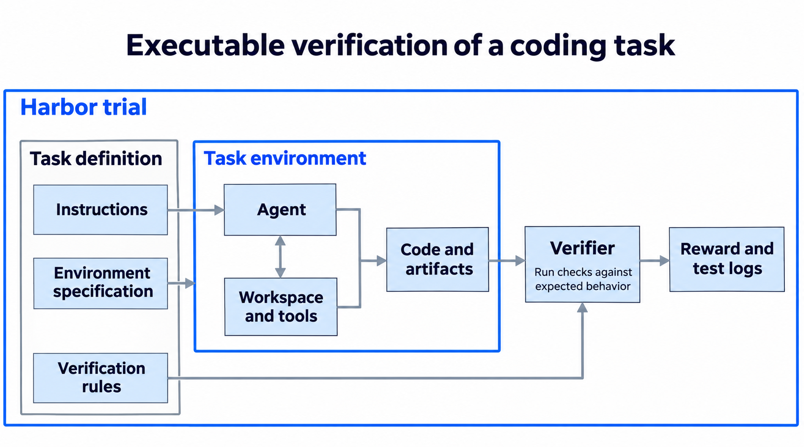
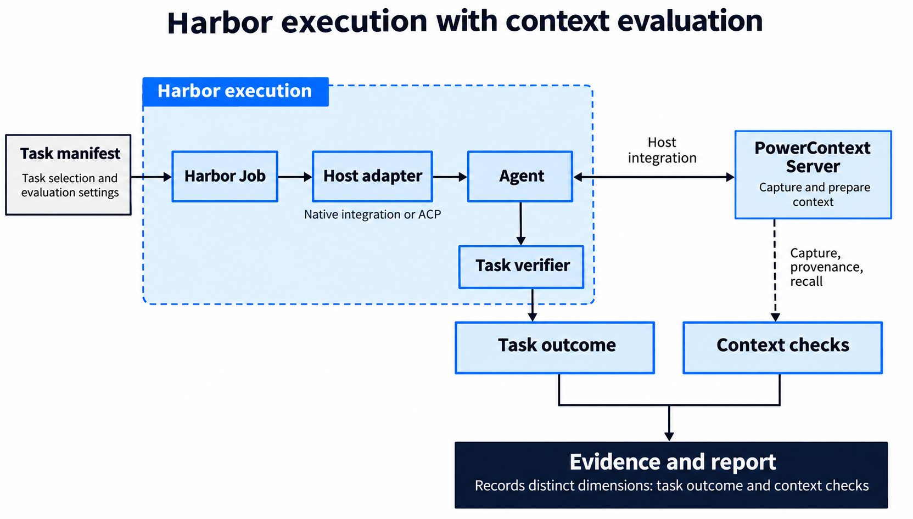
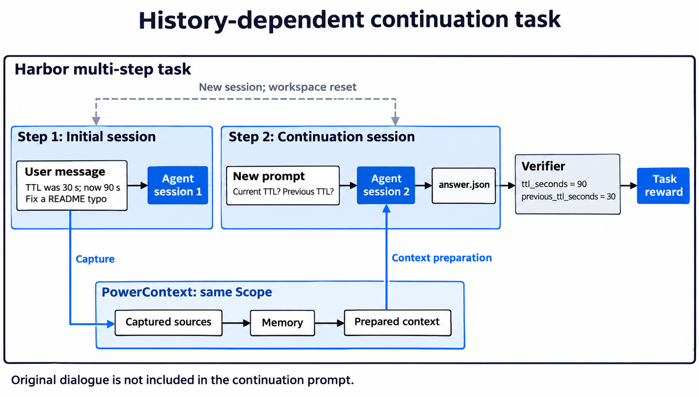
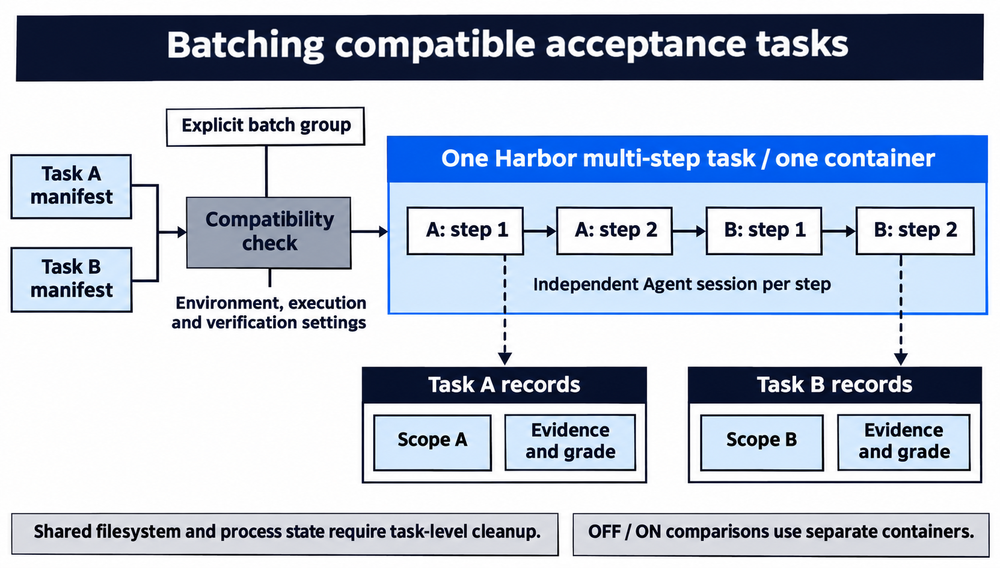

开发者在一次交流中确定了接口约定，几天后让 Agent 继续实现；排查故障时找到了一条线索，换个会话后还要接着调查。这些工作都依赖此前积累的信息。对于 PowerContext，我们关心的是：Agent 能否依据历史信息继续推进并交付有效的任务结果。

围绕这个目标，可以设计出不同层次的测评。一次检索能检查信息是否被找到，一段续接对话能检查约定是否被保留，完整的编程任务则能观察这些信息有没有对结果交付产生积极影响。这些测评各有评价方法，但环境准备、Agent 调用和结果收集有共同之处，E2E harness 的建设就从这部分共同需求开始。

## 从编程任务找到执行框架

编程任务接近开发人员实际使用 Agent 的方式，也是我们最开始构建 PowerContext 的一个预设场景。上下文系统可以帮助 Agent 在切换会话后继续遵循已经确定的要求。

而从测评的视角看，编程任务通常有明确的交付物，许多验收目标也能通过可执行测试验证。通过观察 Agent 完成编程任务的轨迹，也可以检查上下文系统是如何介入整个开发流程、是否召回了有效信息，以及任务步数、Token 开销和耗时上是否有可见收益。

在调研 Terminal-Bench 的过程中，我们开始关注 [Harbor](https://harborframework.com/)。它已经提供了一套组织任务的方式：任务描述说明工作要求，环境提供文件和依赖，Agent 执行操作，Verifier 检查结果。对于采用可执行测试评分的任务，验证器运行预先定义的检查，并根据实际结果产生评分。[Harbor 的任务结构](https://docs.harborframework.com/tasks/overview)

*图 1：代码提交后，还要经过运行和检查。预设测试让不同运行采用相同的验收标准。*

以数据库 WAL 恢复任务为例，其中包含数据库文件、运行环境和验证脚本。为了避免重复建设，我们决定复用这些原生任务，并沿着 Harbor 的任务模型扩展测评。在此基础上，我们把 PowerContext 接入执行流程，并收集运行证据，比较接入与未接入时 Agent 的表现。

## 定制放在 Harbor 的哪些接口上

编程任务的最终分数反映任务是否达到验收要求，并不能充分解释上下文系统的功用。因此，需要依据采集和召回记录来判断 PowerContext 实际参与了哪些环节的运行。

相比实现另一套执行框架，直接复用原生的执行流程是更简单的方式：任务仍采用 Harbor 的环境和 Agent 接口，由 Harbor Job 执行，Verifier 按原来的方式检查产出。任务清单声明要观察的上下文行为，定制层负责 PowerContext 接入和额外的上下文评价。

*图 2：上下文集成沿着 Harbor 的接口接入，原生任务继续使用自己的环境和验收方式。*

原生评分和上下文评价分别保存。例如，Terminal-Bench 的 Verifier 判断工作是否完成，附加评价检查输入是否被采集、记忆来源是否属于本次输入，以及查询是否返回了预期内容。[执行与评价约定](https://github.com/oceanbase/powercontext/blob/20f64d72b13594ad834fcd342f5927d0d0102abb/e2e/bub/README.md)

使用 Harbor 还有另外一个好处，它已经提供了对 Codex 等常见 Agent 的集成，支持 ACP 的其他宿主也可以通过该协议接入。整个执行过程由 Harbor 统一管理，宿主适配层补充上下文集成所需的准备工作。

## 让历史信息成为任务的一部分

如果把全部要求都写在当前提示中，就很难观察上下文系统能否帮助 Agent 延续此前的工作。为此，任务还要表达信息在不同会话之间的依赖。

Harbor 的多步骤任务适合承载这类场景。前面的步骤提供信息，后面的步骤在新会话中提出相关要求，最后检查交付物。同一条续接链路共用 PowerContext 中的一个 Scope，也就是存放这次实验上下文的空间。在这些续接任务里，原始对话不会直接带入后续会话。

例如，一个任务在前置会话中明确说明：搜索结果缓存时间原为 30 秒，现已调整为 90 秒。后续会话询问当前值和旧值，要求写出结构化答案。Verifier 分别检查两个字段，避免把提到了两个数字、却混淆新旧关系的回答判为正确。

*图 3：新会话通过同一 Scope 准备上下文，最终由任务的验证器检查答案是否分清了新旧值。*

为了扩展持续编程协作的场景，我们也适配了 MemoryCode。数据中的指导交流包含编码约定、规则更新和无关内容。每次交流对应一个独立会话，最终会话按此前约定编写代码，再通过上游的对象提取与规则检查评价产出。与原始论文的约定不同，在我们的测试中，最终会话不再提供原始对话。因此，这些任务考察的是 Agent 能否借助跨会话上下文遵循此前的约定。前置阶段结束后，任务会重置工作区，减少 Agent 通过工作区笔记恢复要求的机会。[MemoryCode 任务设计](https://github.com/oceanbase/powercontext/blob/20f64d72b13594ad834fcd342f5927d0d0102abb/e2e/bub/README.md#memorycode-workloads)

这些任务还能用于 OFF／ON 对照，比较接入 PowerContext 前后 Agent 的表现。OFF 组运行未接入 PowerContext 的原生 Agent；ON 组启用对应宿主的 PowerContext 集成，采集前置会话的信息，并在续接时准备相关上下文。两组使用相同的任务、宿主和模型配置，分别在独立容器中运行。

## 把重复的准备工作合在一起

任务集合扩展后，重复启动环境和安装依赖会增加运行成本。一个很短的验收任务，也可能花费不少时间准备环境。对于环境一致、状态干扰能够控制的任务，可以合并这部分准备工作。

Runner 支持将显式分组、配置兼容的本地验收任务组合成一个 Harbor 多步骤任务，在同一容器中顺序执行。这种复用仍会共享文件系统和进程状态，只是使用独立 Scope 区分上下文数据。加入分组前，需要明确任务允许保留哪些状态，并由任务与宿主适配层处理会话记录、临时文件等残留。能够控制相互影响的任务可以合并，要求独立环境的任务则继续单独运行。[Runner 的任务分组实现](https://github.com/oceanbase/powercontext/blob/20f64d72b13594ad834fcd342f5927d0d0102abb/e2e/bub/src/powercontext_e2e/runner.py)

*图 4：兼容任务共用一次环境准备，按顺序执行，每个任务分别保存上下文、证据和评分。*

PowerContext 的记忆质量、性能等专项测评仍有各自的执行流程。适合实际 Agent 工作过程的场景，可以逐步组织为 Harbor 任务；依赖专门数据处理和评价协议的实验，继续由相应套件负责。共同底座承担重复的执行工作，任务本身则明确规定要验证什么，以及什么样的结果才算完成。

## 总结

我们最初想验证的是，上下文系统能否帮助 Agent 延续较长的编程工作。随着任务和接入方式增加，Harbor 提供的执行机制让这些尝试有了共同的基础。我们沿着它已有的接口补充上下文评价和运行支持，也保留了继续使用原生任务的方式。

这套 harness 让我们更容易组织实验，但具体结果仍要放回任务条件中理解。我们因此分别记录任务评分和上下文行为，并保留运行配置与证据，方便回看一次成功或失败是怎样发生的。

感谢 [Fengzdadi](https://github.com/Fengzdadi)、[knqiufan](https://github.com/knqiufan)、[Russell Lin](https://github.com/russell001209-ai)、[ThunGuo](https://github.com/thunguo)，以及参与 E2E harness 设计、实现和验证的贡献者。
