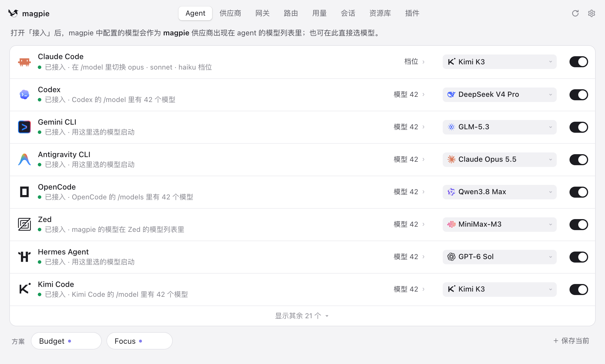
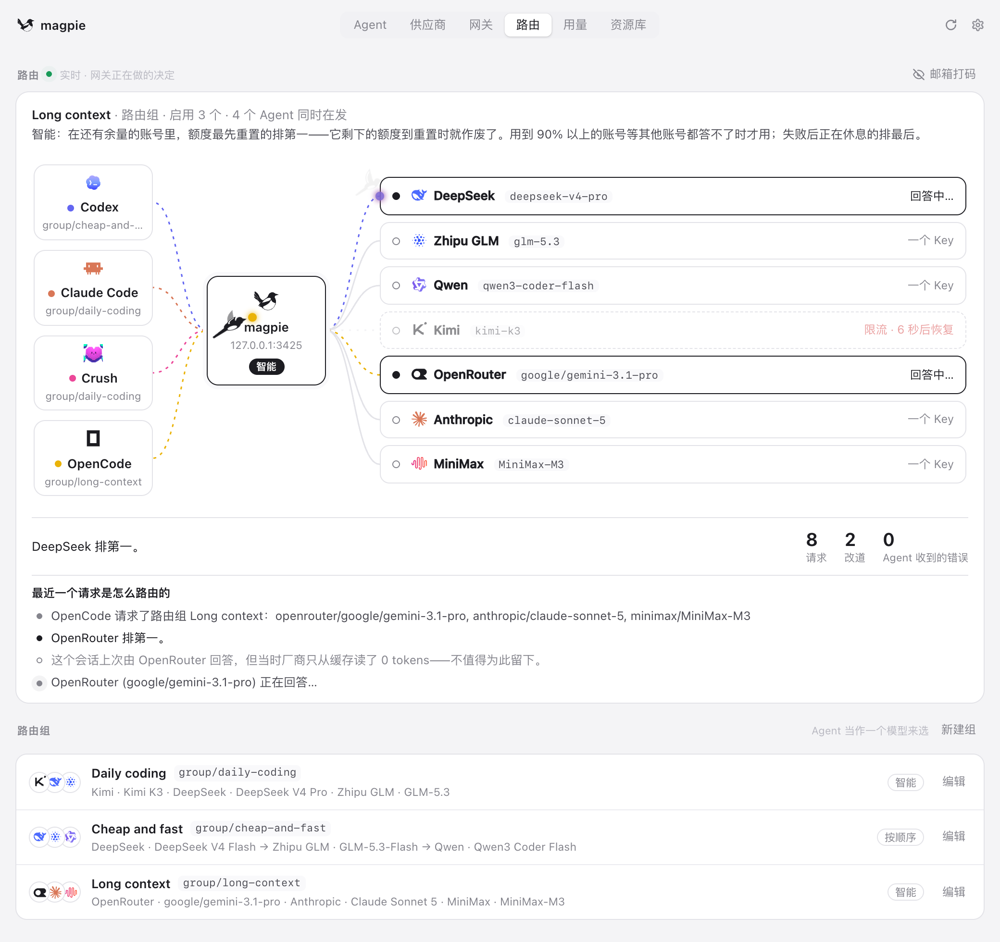
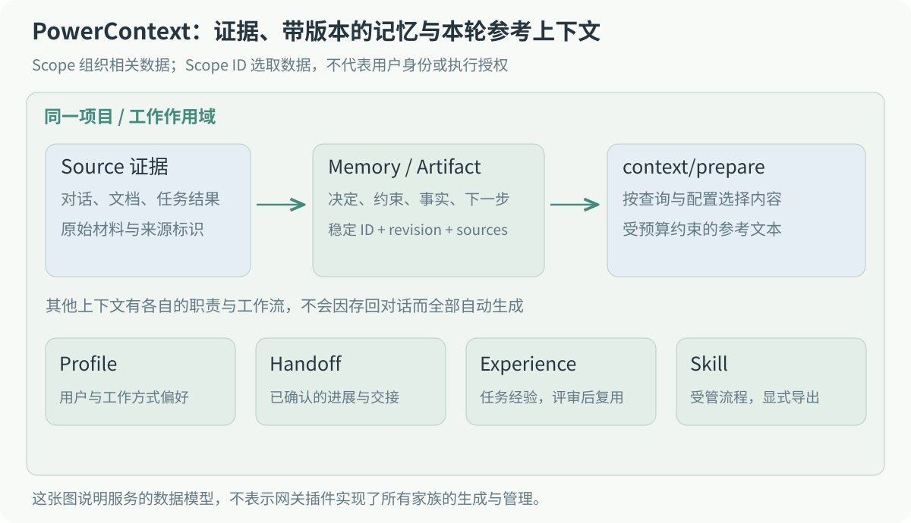
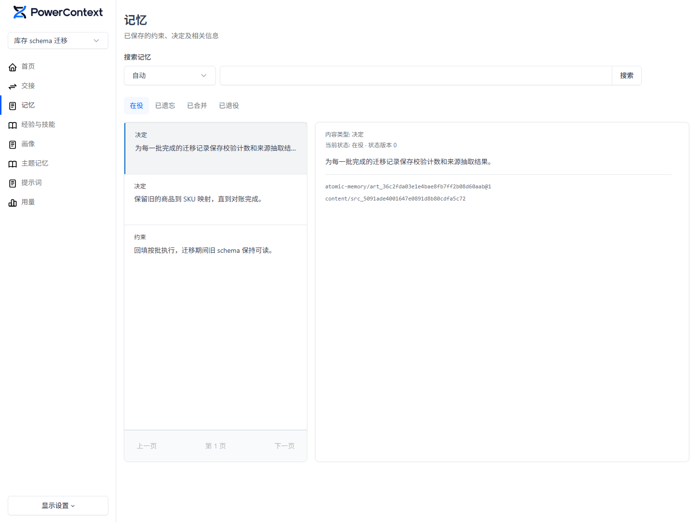
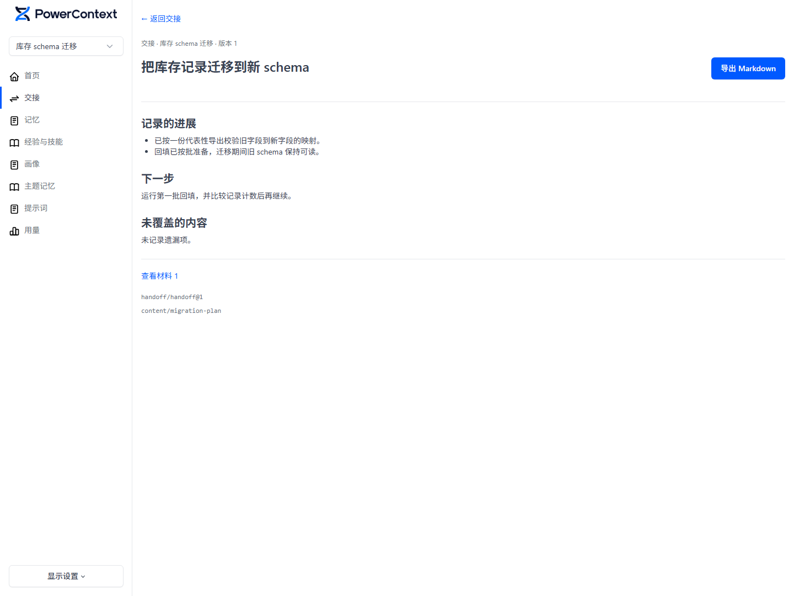
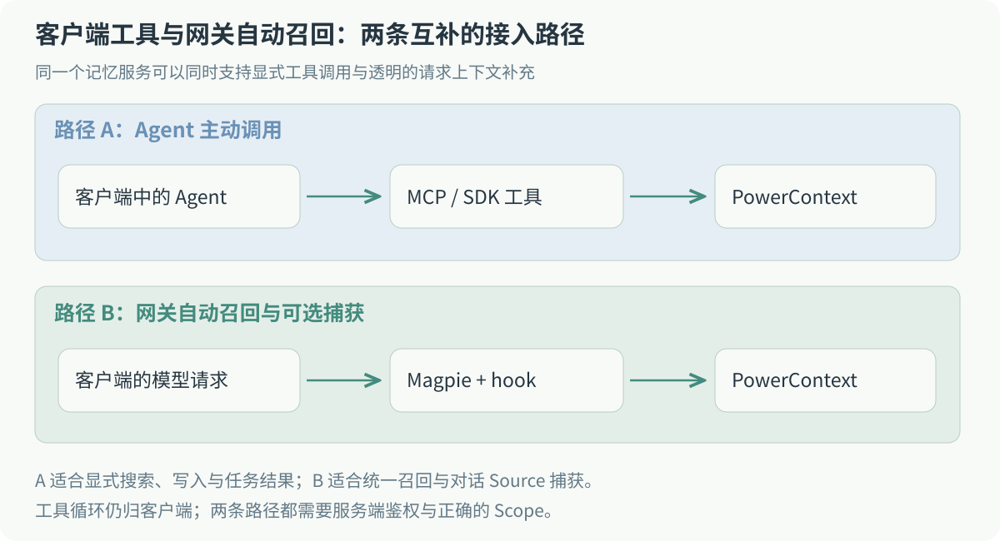
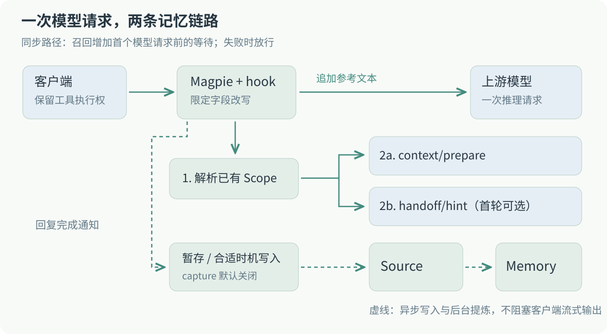
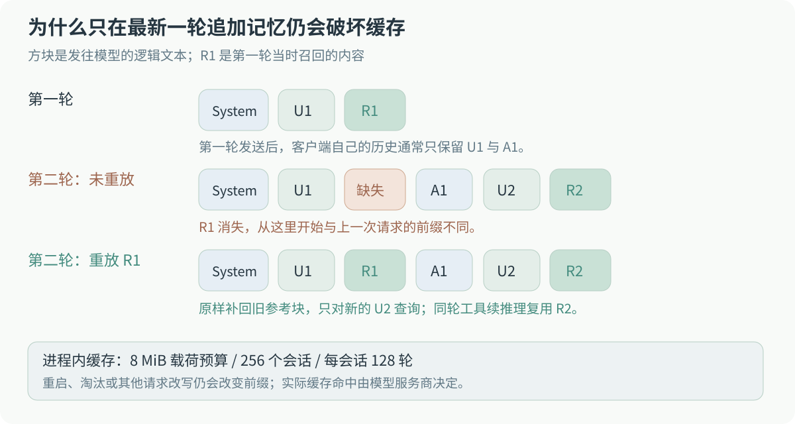
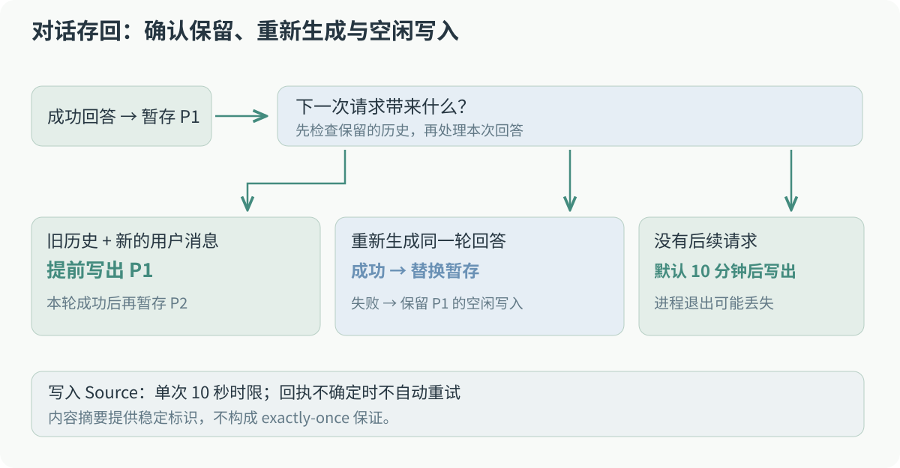
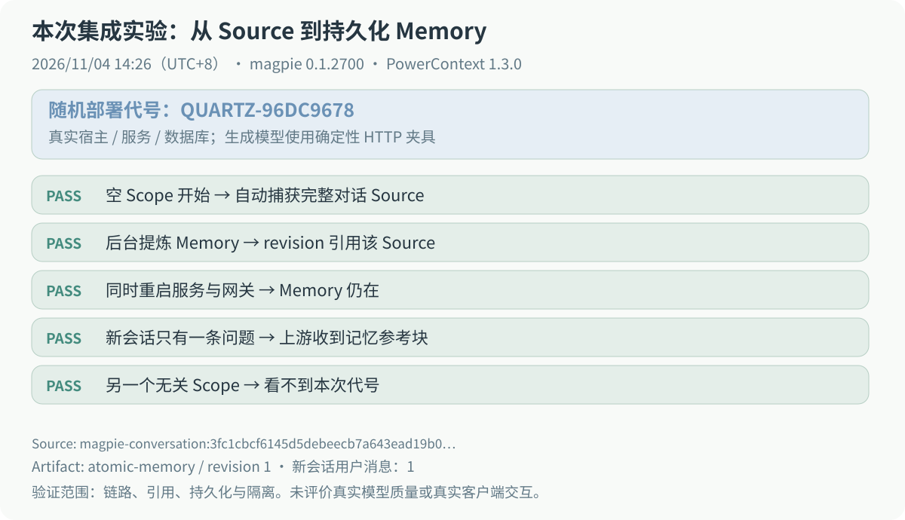

我平时会换着用 Claude Code 和 Codex。有些项目约定已经在一个会话里解释过，换个工具，又得重新说一遍：部署用 Helm，测试要准备临时 HOME，某些目录里的生成文件不能手改。会话一长，这些约定也容易被埋在历史里。

我想让几个工具共用一份项目记忆。当时已经在用 Magpie，模型请求都从它那里经过，便有了一个想法：能不能在请求发给模型之前，先查一下记忆服务，把有用的内容补进去？

后来这个想法做成了 [PowerContext 插件](https://github.com/magpie-community/plugins/tree/main/packages/powercontext)，包名是 `@magpie-community/gateway-powercontext`，已经合进 Magpie 社区插件仓库。用起来，客户端还是原来的客户端，工具调用也照常执行。多出来的事情发生在网关里：推理前查记忆；如果打开了存回，再把对话交给 PowerContext 处理。

## Magpie 把模型配置集中到了一处

如果没用过 [Magpie](https://github.com/yetone/magpie/blob/main/README.zh-CN.md)，可以先把它理解成运行在本机的模型网关。Claude Code、Codex、Gemini CLI 连接到它，再由它把请求发给你配置的模型提供方。

这解决了我在几个 Agent 之间切换时的一部分麻烦。原本各个客户端有自己的模型名称、服务地址和凭证配置；接入 Magpie 后，可以在一个地方管理提供方和账号，再给每个客户端选模型。比如保留 Claude Code 的操作方式，背后用另一家提供方的模型；或者让 Codex 使用一个包含多个候选模型的路由组。

[](../../../assets/blog/magpie-gateway-powercontext-memory/magpie-agents.zh.png)

图 1：在 Magpie 的 Agents 页面为客户端选择模型。[官方 README 演示截图](https://github.com/yetone/magpie/blob/main/README.zh-CN.md)。

这里容易混淆的是 Agent 和模型。客户端负责看文件、执行命令、组织工具调用，再决定要不要继续请求模型；Magpie 负责接住这些模型请求，处理路由和协议适配。换了上游模型，客户端的这部分工作仍然保留着。

Magpie 的入口支持 OpenAI Chat Completions、Responses、Anthropic Messages 和 Gemini 四种协议，所以几个客户端可以用各自熟悉的协议访问它。提供方只支持其中一种协议时，网关负责转换，插件不用要求客户端先改成统一格式。

路由组则把多个模型或账号放在同一个选择下。下图能看到，一个 Agent 的请求如何经过 Magpie，到达某个提供方。配好备用账号或路由后，上游额度耗尽或不可用时才有别的候选可用；只配一个账号，当然还是会遇到它本身的限制。

[](../../../assets/blog/magpie-gateway-powercontext-memory/magpie-routing.zh.png)

图 2：Magpie 的 Routing 页面。[官方 README 演示截图](https://github.com/yetone/magpie/blob/main/README.zh-CN.md)，其中的模型、耗时和计数是原图里的示例配置。

这个统一入口正好适合接入记忆。Claude Code 查一次、Codex 再查一次，查询方式和连接配置可以复用。至于记忆该保存在哪里、以后怎么检索，我希望交给已经在做这件事的服务。

## PowerContext 保存的是以后还要用的工作上下文

[PowerContext](https://github.com/oceanbase/powercontext/blob/master/README_CN.md) 是 OceanBase 开源的 Agent 上下文服务。它可以独立部署，通过 HTTP、MCP 或 SDK 接入，也可以嵌入应用。本文用的是独立 Server，Magpie 插件只负责连接。

“记忆服务”听起来像是把聊天记录存进数据库，但仅有记录还不够。一次迁移讨论里，可能同时有尝试过的方案、已经否决的建议、最后确认的约束，以及还没做完的事情。下次换个 Agent 接手，最需要的通常是后面两项，而不是把整场讨论重新读一遍。

PowerContext 里有几个名字需要先交代一下，后面的代码会用到。

插件存进去的对话叫 **Source**，也就是原始材料。服务端可以从这些材料里提炼 Memory，保存项目中的决定、约束、事实和下一步。提炼出来的结果属于 **Artifact**，有自己的 ID 和 revision，还可以引用来源 Source。因此，查到一条记忆后，可以继续看它出自哪份材料。

到了召回时，插件调用 `context/prepare`，拿到本次查询相关的 **PreparedContext**。它是这次要补给模型的参考文本，有字节预算；服务里保存的内容再多，也不必每次全部发给模型。

[](../../../assets/blog/magpie-gateway-powercontext-memory/context-model.zh.svg)

图 3：从原始材料到本轮参考上下文。图里的其他家族属于 PowerContext 的能力，本文插件主要用到召回和对话 Source 写入。

这些内容归在一个 Scope 里，可以按项目或工作范围组织。几个客户端要读同一份项目记忆，就需要解析到同一个有权访问的 Scope。Scope ID 用来选数据，具体能不能访问，还要由服务端鉴权决定。

下面是官方文档里的 Memory 页面，使用的是演示数据。左边是整理好的决定和约束，右边能看到选中条目的内容、状态，以及 Artifact 和 Source 引用。

[](../../../assets/blog/magpie-gateway-powercontext-memory/powercontext-memory.zh.png)

图 4：PowerContext Memory 页面，使用合成演示记录。[图片来源](https://github.com/oceanbase/powercontext/blob/master/README_CN.md)。

除了 Memory，PowerContext 还有 Handoff、Profile、Topic Memory、Experience 和 Skill。它们没有都塞进这个插件里，不过有两个区别会直接影响插件的设计。

一个是 **Memory 和 Handoff 的区别**。仍以迁移任务为例，“迁移期间旧 schema 必须可读”是一条应该持续遵守的约束，适合留在 Memory 里；“映射已经核对，接下来跑第一批回填”则描述当前工作进度，适合放进 Handoff。新会话既需要知道项目约定，也可能需要接上某个具体任务。

[](../../../assets/blog/magpie-gateway-powercontext-memory/powercontext-handoff.zh.png)

图 5：一份 Handoff 记录的进展、下一步和材料引用，使用合成演示记录。[图片来源](https://github.com/oceanbase/powercontext/blob/master/README_CN.md)。

另一个是 **聊天内容和任务结果的区别**。助手回复“完成了”，任务未必就成功了。Experience 需要有任务结果作为材料，再经过评审，才能作为经验复用。这个插件只存回可见对话，不会据此推断任务成功，也不会自动提交 Handoff。

其余几项可以先记住用途：Profile 放用户或工作方式的偏好；Topic Memory 按主题整理材料；Skill 管理可以导出给宿主使用的流程和校验项。如果需要这些能力的具体操作，可以再看 [PowerContext 文档](https://powercontext.oceanbase.io/zh/docs/)。

对我来说，这套服务也能和仓库里的 `AGENTS.md` 一起用。稳定的项目规则仍然放在仓库里，跟着代码评审；工作中形成、以后还要追溯来源的决定，可以交给上下文服务。Agent 拿到旧记忆之后，依然要检查现在的仓库和任务状态。

## 先让网关能等一次外部请求

接入 PowerContext，可以给客户端配置 MCP，让 Agent 自己决定什么时候查询、写入，或者记录任务结果。我想补的是自动召回：只要模型请求经过 Magpie，就先查一次相关上下文，客户端不用再单独安装记忆 MCP 或 Skill。

这两种接法可以同时使用。比如每轮自动补充项目约定，而任务真正完成后，再由 Agent 显式记录结果。

PowerContext 现在也有[官方 Rust Gateway](https://github.com/oceanbase/powercontext/blob/master/gateway/README.md)，可以作为另一种接入方式。我这里保留 Magpie 作为入口，是因为几个客户端的模型配置、路由和协议适配已经在它那里管理。下文记录的是这次插件开发，后面的独立实验固定使用 PowerContext 1.3.0。

[](../../../assets/blog/magpie-gateway-powercontext-memory/integration-choices.zh.svg)

图 6：Agent 主动调用工具，以及网关自动召回，分别适合不同的操作。

第一个问题出在 Magpie 当时的插件入口上。原有网关中间件是同步执行的，适合改请求字段；我要做的召回却需要发 HTTP 请求，等 PowerContext 返回以后，才能继续请求模型。

所以我先提了 [yetone/magpie#2118](https://github.com/yetone/magpie/issues/2118)，在 fork 里实现了推理前的异步 hook 和回复完成后的通知。后来维护者把这套实现移植进主线，正式入口叫 `magpie.hooks`，由 Bun 插件宿主执行。

```json
{
  "magpie": {
    "hooks": "./powercontext.hooks.mjs"
  }
}
```

插件导出 `onRequest(body, ctx)`，宿主会等待它返回；可选的 `onResponse(reply, ctx)` 则在回复完成后收到通知。协议、会话、工作目录、请求来源、插件配置和取消信号都从 `ctx` 传进来，客户端的请求头与凭证不会直接转交给 hook。

开发时有一条约定一直没变：网关里的这次召回不再发起另一轮模型推理，也不给客户端添加记忆工具。客户端发来一次请求，hook 补充参考文本，然后继续原来的推理。工具执行和后面的请求，还是由客户端自己安排。

宿主也会检查插件的改写。如果 hook 改了工具声明、tool choice、`model` 或 `stream`，或者抛错、超时、返回非法数据，这次改写就不接受。多个 hook 串起来时，保留此前已经接受的请求状态。回滚的 hook 也不会收到本次 `onResponse`。具体规则在 [hook 文档](https://github.com/yetone/magpie/blob/main/docs/subsystems/gateway-request-hooks.md)里。

插件最终的请求过程如下。先解析已有 Scope，再取上下文；第一轮还会并行取一份最近已提交的 Handoff 提示。结果被追加到最新用户消息后，才发给模型。

[](../../../assets/blog/magpie-gateway-powercontext-memory/architecture.zh.svg)

图 7：请求前的召回和回复后的存回。配图均可点击查看原图。

## 第一轮补进去的记忆，第二轮会消失

把召回文本追加到用户消息之后，还有一个不太直观的问题。

第一轮客户端发来 `U1`，插件查到 `R1`，模型实际看到的是 `U1 + R1`，然后生成 `A1`。但 `R1` 是网关加的，客户端通常不知道它的存在，自己的会话历史仍然只有 `U1` 和 `A1`。

第二轮客户端发来 `U1、A1、U2`。如果插件只给最新一轮加上 `R2`，模型收到的就是 `U1、A1、U2 + R2`。上一轮明明有的 `R1`，这一次没了。

这会改变发给模型的历史前缀，影响服务商的 prompt cache。再查询一次 `U1` 也不稳妥：记忆库可能更新了，返回顺序也可能变，查出来的 `R1'` 未必和原来完全一样。

[](../../../assets/blog/magpie-gateway-powercontext-memory/prompt-prefix.zh.svg)

图 8：第二轮要补回当时发过的 R1，而不只是再查一遍。

我的处理是在进程内为每个会话保留当时注入的参考块。新请求到来，先把旧用户消息对应的块原样补回，再查询最新一轮。下面是省略来源检查、Scope 解析和预算计算后的伪代码：

```js
for (const oldTurn of historicalUserTurns) {
  replayExactReference(oldTurn, cache.get(turnKey(oldTurn)));
}

const key = turnKey(latestUserTurn);
if (cache.has(key)) {
  appendReference(latestUserTurn, cache.get(key));
} else {
  const reference = await recall(latestUserTurn);
  cache.set(key, reference);
  appendReference(latestUserTurn, reference);
}
```

同一轮消息也可能请求模型多次。Agent 发起工具调用，拿到结果以后继续推理，用户并没有输入新问题。这时候直接复用该轮参考块，不再查询 PowerContext，既减少了请求，也避免上下文在工具执行到一半时发生变化。

缓存不能无限留。现在的上限是所有会话合计 8 MiB 的载荷，最多 256 个会话，每会话 128 轮；总预算不足时，先淘汰最久未使用的会话。缓存键还包含来源、协议和会话信息，避免不同请求共用参考块。

这里保存的是参考文本，不是服务商的缓存。网关重启、条目被淘汰、客户端压缩历史，仍然会改变请求前缀。这个实现只是尽量保留已经发过的内容，本文也没有测真实服务商的缓存命中率和费用变化。

### 查询词也不能直接拿整条消息

Codex 等客户端可能把环境块、指令文件内容和用户输入一起放进消息。全部拿去检索，真正的问题反而容易被淹没。宿主因此提供了 `ctx.query`，插件优先用提取后的用户输入查询，原有消息继续保留在模型请求里。

返回的内容被放进 `<powercontext-reference>` 块，并标成参考资料。内容里如果出现同名开闭标签，会先转义，防止它自己把块提前闭合。不过，这些标签只能帮助标记文本来源，工具权限和 Scope 访问仍要靠各自的鉴权处理。

### 召回会增加等待，所以要给它截止时间

插件每次服务请求默认有 1000 毫秒时限，包括响应体读取；请求 hook 的默认预算是 5000 毫秒，还受宿主总时限约束。因为先解析 Scope、再并行查上下文和 Handoff，整次召回可能经过两个服务请求时限。

PowerContext 连不上或查询超时，这一轮就不补记忆，继续请求模型。随后默认退避 30 秒，避免接下来的每次请求都先等一次超时。客户端取消请求时，查询也跟着取消，这种情况不触发退避。

Handoff 是可选的，因此单独处理。没有已提交的 Handoff，404 或 503 是正常返回；即使这个接口连接失败，也只对它退避，正常的 Memory 召回继续工作。做完这些之后，记忆服务出故障，影响的主要就是这一轮有没有参考上下文，以及已经花掉的查询等待。

## 什么时候把对话存回去

存回的入口是 `onResponse`。宿主一边把流式输出发给客户端，一边收集完成回调需要的回复，捕获不会让用户等服务端写入后才收到流的结束。失败、不完整或被截断的回复会跳过。

成功回复到了插件这里，先暂存。原因是客户端可能还会重新生成这一轮回答，上一份结果未必会被保留。

如果下一次请求带着完整的旧历史，又增加了一条用户消息，插件便把此前暂存的对话写出去。如果是重新生成同一轮，成功的新回答替换暂存；重新生成失败或被取消，则继续保留上一份成功回答的空闲写入机会。没有后续请求，默认十分钟后写入。历史分叉和容量回收也可能让暂存提前写出。

[](../../../assets/blog/magpie-gateway-powercontext-memory/capture-lifecycle.zh.svg)

图 9：续聊、重新生成和空闲等待，分别怎样处理已暂存的回答。

写入走的是 `POST v1/sources/content`。Source 中保存用户消息、助手回复，以及客户端传来的工具调用和结果，网关注入的参考块会移除。PowerContext 后台再根据服务端配置提炼 Memory，所以回复结束后，管理面板里未必马上就有新记忆。

### Responses 的上一轮，可能只有一个 ID

Responses 支持 `previous_response_id`。客户端可以只发增量，引用服务端保留的上一轮。模型知道旧历史，当前请求体里的插件却不一定知道。

直接存这次看到的输入和输出，会漏掉前面的对话。因此在开启存回时，插件会缓存自己经手的 Responses 输入和输出，按响应 ID 找回前缀，用于还原存档。发给模型的请求保持原来的增量形式。

如果某个 ID 没有被当前进程观察过，比如 Magpie 重启后客户端又引用旧响应，就跳过这次捕获。缺失的部分没有办法从眼前的请求里还原，存下一份看起来完整的记录，后面反而难查。

### 一次写入没有收到回执，该怎么办

Source 写入有独立的十秒超时，大对话会分片发送。插件为内容生成稳定标识，但仍然没有自动重试：服务端可能已经提交，只是回执没有回来。客户端看到的超时，无法区分“没写进去”和“写进去了但不知道”。

现在的做法是每个分片尝试一次，某片失败就停止后续分片。进程退出也可能丢掉还在暂存的内容。这部分没有持久队列，因此只能尽力交付，可能丢失或部分写入；仅有内容摘要，还不足以承诺 exactly-once。

写入接口返回成功，也不能说明对话中的工作已经完成。插件看到的是对话，不会把助手的一句“完成了”转换成成功的任务结果。需要把任务经验交给 Experience 的话，还是应由 Agent 在实际完成或中断时，通过 `record_task_outcome` 记录状态和检查。

## review 里补上的一处权限检查

[插件 PR #117](https://github.com/magpie-community/plugins/pull/117) 中有一次修改，我觉得值得单独记下来。

我先限制了存回：共享网关的其他调用者，不能默认把对话写进我的记忆库。维护者随后指出，召回也有同样的问题。只限制写入，别人仍然可以通过共享密钥发一个问题，读到我的记忆。

后来召回和存回分别检查来源，检查还要放在 Scope 解析、服务查询和缓存重放之前。否则网络查询虽然挡住了，内存里已有的参考块仍可能被复用。

现在有三个独立选项：

| 选项            | 默认值  | 作用                                  |
| --------------- | ------- | ------------------------------------- |
| `capture`       | `false` | 开启对话存回                          |
| `recallRemote`  | `false` | 允许非 `local` 来源召回               |
| `captureRemote` | `false` | 已开启存回时，允许非 `local` 来源捕获 |

`captureRemote` 不会顺便开启读取，`recallRemote` 也不会开启写入。请求来源由 Magpie 根据连接和密钥类别判断，插件默认只处理 `local`。本机使用命名网关密钥，或者经过代理的请求，也可能被分到其他类别。

不过来源类别还不是用户身份。开启远程召回，只是允许这些调用者访问所配置的服务与 Scope，并没有自动为每个人分配独立记忆。如果要拿来做多人共享，需要另外设计身份、Scope 和权限的对应关系。

对话里可能带出的东西也比普通聊天多。Agent 读过的文件、执行过的命令输出，都可能出现在工具结果里。所以捕获前会检查常见凭证格式，一旦命中，整段跳过。规则总会有漏掉的写法，存回便保持默认关闭，由使用者决定哪些对话可以发到服务端。

还有一个需要准确说清的细节：Scope 解析会发送原始会话 ID 作为绑定键，工作区路径则规范化后取 SHA-256；Source 元数据里的两者都使用摘要。对话正文中本来出现的路径仍然会被保存，不能因为元数据做了哈希，就认为整份对话已经匿名化。

早期版本还做过自动安装：下载 uv、安装 Python 和 PowerContext，再由插件启动和看护服务。review 后这部分全部删掉了。现在插件只有连接服务需要的代码，PowerContext 单独部署；Python 环境、模型配置和服务生命周期，也留给它自己的部署流程处理。

## 用一次独立实验检查整条链路

单元测试能覆盖超时、缓存和权限判断，但我还想确认一件事：对话真的被存成 Source，经服务端提炼以后，能不能在新会话里读回来。

为此整理了一个[独立服务实验脚本](https://tsukikage7.com/examples/magpie-powercontext/extraction.mjs)。它创建临时 HOME、临时数据库和独立端口，启动真实的 Magpie、PowerContext 和 SQLite。模型端用本地确定性 HTTP 夹具，以便把服务调用和数据流检查清楚；真实模型的语义效果需要另测。

实验给每次运行生成一个随机部署代号。会话 A 告诉 Agent 这个代号，助手给出确认回复，插件自动捕获这两条消息。开始时 Scope 里没有 Source 和 Memory，也没有通过记忆写入接口预先塞入答案。

接着等待后台调度。模型夹具只有在服务端给出的 Source 证据里找到本轮代号时，才返回对应的候选记忆。生成 Memory 后，脚本继续读取它的 Artifact revision，核对 `sources` 中是否引用了刚才捕获的对话。

然后把 Magpie 和 PowerContext 都重启，换一个新会话，只发送一条询问代号的问题。这一步要检查发往上游的请求里确实出现了参考块和代号，也要确认请求没有夹带旧会话的提示与回复。最后再换一个无关 Scope，确认查不到同一个代号。

[](../../../assets/blog/magpie-gateway-powercontext-memory/experiment-result.zh.svg)

图 10：2026 年 11 月 4 日运行记录的摘要，原始数据在 [result.json](https://tsukikage7.com/examples/magpie-powercontext/result.json) 中。

这次跑的是 Magpie 0.1.2700、Bun 1.4.3、PowerContext 1.3.0，以及插件 0.2.1。为了缩短等待，实验把空闲存回和 Memory 调度都调成了一秒。报告里记录的 Memory 原文如下：

```text
The Quartz application deployment codename is QUARTZ-96DC9678.
```

它所在的 `atomic-memory` revision 1 引用了捕获的 Source。重启之后，新会话只有一条用户消息，上游仍收到了包含 `QUARTZ-96DC9678` 的参考块；另一个 Scope 的查询没有带出这个代号。

这样能排除两种容易看错的情况：答案来自旧对话历史，或者来自尚未清空的进程内缓存。实验中也没有调用 flush 强制提炼，等待的是服务端调度。至于 Claude Code 和 Codex 两个真实客户端的交互、生成模型能提炼出多好的记忆，这次实验没有覆盖，不能仅凭这几项通过就下结论。

复现步骤和环境配置见[运行说明](https://tsukikage7.com/examples/magpie-powercontext/README.md)。想复现的话，检出插件源码，设置绝对路径后运行：

```sh
export POWERCONTEXT_PLUGIN_DIR="/absolute/path/to/plugins/packages/powercontext"
bun "extraction.mjs" \
  --magpie "/absolute/path/to/magpie" \
  --report "result.json"
```

脚本固定了 PowerContext 1.3.0，报告也保留了被测 hook 文件的 SHA-256，可以对应到[当时的插件源码](https://github.com/magpie-community/plugins/tree/1a05a77431c5d6c64a43c3a80a2cc2562048e666/packages/powercontext)。换用其他版本时，需要重新核对服务接口和实验结果。

## 自己试一下

本文验证使用 PowerContext 1.3.0 和插件 0.2.1。以下是基本接入方式；使用其他服务版本时，请先核对插件兼容性。快速开始文档会随项目更新，不能把其中的当前版本视为本次实验已验证的版本。

先按 [PowerContext 快速开始](https://powercontext.oceanbase.io/zh/docs/get-started/quickstart/)部署 Server。自动提炼需要在服务端配置生成模型与 Memory 调度，语义检索还需要相应的 Embedding 配置。这些用的是服务端自己的模型和凭证。

再从 Magpie 的插件发现页安装 PowerContext，或者使用命令行：

```sh
magpie plugin add @magpie-community/gateway-powercontext
magpie plugin options @magpie-community/gateway-powercontext \
  '{"serverUrl":"http://127.0.0.1:8000"}'
```

插件需要 Magpie 0.1.1273 或更新版本，建议至少用 0.1.1531，配置页保存的设置才可以在后续请求生效。填好 Server 地址、可选的 Scope ID 和服务密钥，客户端照常通过 Magpie 发请求即可。密钥保存在 Magpie 本地插件配置中，不在系统钥匙串里。

Scope ID 留空时，由服务端根据会话、工作区绑定或默认 Scope 解析；解析失败，插件就跳过，不会自动创建。如果看到 `skipped`，可以先检查来源类别和 Scope。填写配置本身不会探测服务是否连通，实际召回结果要看 Magpie 的插件诊断。

先试召回，再决定是否打开存回，会比较容易看出每一步在做什么。开启存回后，依次看 Source 有没有保存、后台有没有生成 Memory，以及 Memory 引用的来源是否正确，再换新会话验证。十分钟空闲捕获和后台调度都需要时间，回复刚结束就去看记忆列表，可能什么也没有。

这个插件的 PR 从 10 月 14 日提交，到 10 月 29 日合并。review 中改动比较大的几处是：服务安装被拆出去，召回补了来源限制，对话捕获保留了更多失败处理。我也修过测试本身的问题，原先把所有 HTTP 请求的时限设成 50 毫秒，在机器负载高时就容易误报。后来健康请求保持正常时限，只有故意挂起的请求才在到达夹具之后缩短截止时间，退避则用受控时钟推进。

感谢 Magpie 的维护者对这些细节的 review，以及把异步 hook 移植进主线。实现和讨论都留在下面的链接里，想接别的上下文服务，也可以从这套 hook 开始看。

## 相关链接

- [PowerContext 插件源码与选项](https://github.com/magpie-community/plugins/tree/main/packages/powercontext)
- [插件 PR #117](https://github.com/magpie-community/plugins/pull/117)
- [异步 hook 提案 #2118](https://github.com/yetone/magpie/issues/2118)
- [Magpie 请求 hook 文档](https://github.com/yetone/magpie/blob/main/docs/subsystems/gateway-request-hooks.md)
- [PowerContext 中文文档](https://powercontext.oceanbase.io/zh/docs/)
- [独立服务实验与运行说明](https://tsukikage7.com/examples/magpie-powercontext/README.md)
