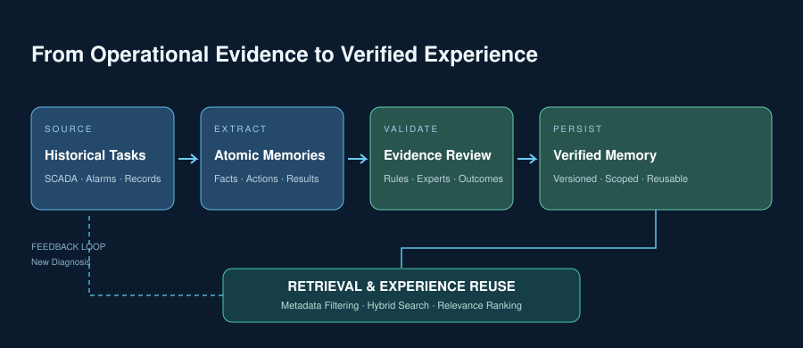
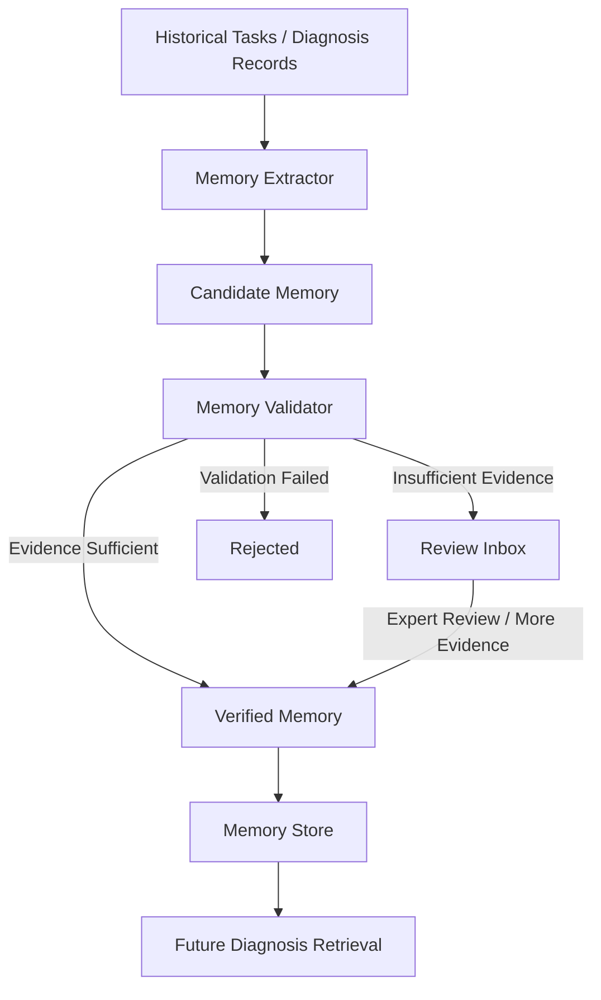
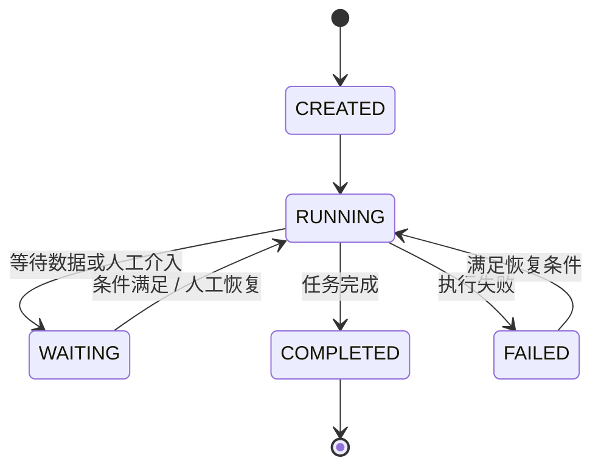
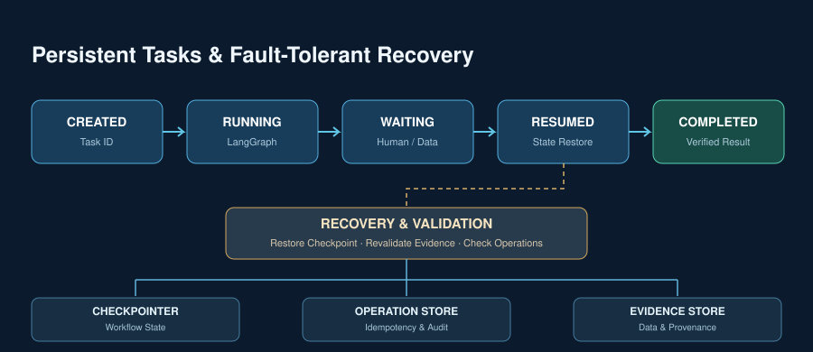
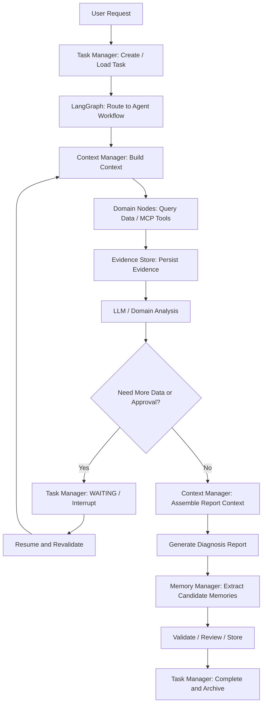

> 电力系统智能体不能只完成一次问答或一次诊断。面对持续变化的运行数据、复杂的故障分析过程和跨班次的任务执行，我们围绕 LangGraph 构建了一套 Agent Runtime：由 LangGraph 统一编排工作流，Context Manager 管理当前推理上下文，Memory Manager 沉淀跨任务经验，Task Manager 管理任务状态与恢复。

---

## 01 为什么电力智能体需要 Memory？

我们正在做的电力智能诊断平台，面向某地港口电力系统的运行分析与故障诊断。用户选择一个智能体后，系统会调用大模型、知识库、数据库和领域算法，执行多步分析，最后生成诊断结论、图表和报告。

这类任务和普通聊天不太一样。

一次故障诊断可能要先读取遥测、遥信数据，再查询设备拓扑、历史告警和相关规程；分析过程中还会产生候选故障原因、排除结论和新的数据需求。任务结束后，诊断结果和检修情况又可能成为下一次分析的重要参考。

如果每次任务都从零开始，历史案例就只能留在日志里；如果把所有历史内容都塞进 Prompt，又容易带来上下文冗余、数据过期和事实混淆。任务执行到一半遇到服务重启，也不能简单地从头再跑一遍。

所以，我们把 Agent Memory 放在整个 Agent Runtime 中考虑，重点解决三个问题：

- **Context：** 当前这次推理应该看到什么？
- **Memory：** 过去哪些事实和经验值得保留，并在新任务中复用？
- **Task：** 当前任务执行到哪里了，中断后如何准确地继续？

这三个部分职责不同，但会在一次诊断任务中协同工作。整体上，我们使用 LangGraph 负责工作流编排，在 LangGraph 周围组织 Context Manager、Memory Manager 和 Task Manager。

## 02 先看现有系统：LangGraph 编排六类电力智能体

目前平台包含六类业务智能体：

| 智能体 | 主要职责 |
|---|---|
| 风险分析智能体 | 面向电力系统的通用风险分析 |
| 电流类故障诊断智能体 | 读取遥测、遥信数据，完成聚类、证据整理、故障判型与报告生成 |
| 电能质量风险分析智能体 | 分析电能质量事件、功率关联与谐波问题 |
| 谐振风险分析智能体 | 开展谐波谐振校核 |
| 电缆绝缘风险分析智能体 | 结合局放、温度、绝缘电阻等信息评估绝缘风险 |
| 系统运行风险分析智能体 | 结合运行快照、告警和拓扑分析系统运行风险并给出处置建议 |

现有诊断后端使用 LangGraph 组织多节点流程。每个智能体由 State、Graph 和 Nodes 等部分组成：

- **State** 定义贯穿流程的数据结构；
- **Graph** 负责组装节点、边和条件路由；
- **Nodes** 执行数据读取、分析判断、知识检索和报告生成等具体工作。

数据访问通过 MCP 子服务完成，覆盖数据库、RAGFlow 知识库、标准规程、电缆数据和谐振校核等能力。模型侧使用本地部署的 Qwen，嵌入侧使用 BGE-M3；知识服务包括 RAGFlow 和本地 Wiki；负荷预测、电缆局放识别等数值分析则由独立的领域算法服务提供。后端通过 SSE 将工作流步骤、诊断结果、图表和报告内容持续推送给 Vue 前端。

这套技术栈已经覆盖了业务智能体运行所需的主要能力。我们没有另起一套编排框架，而是保留 LangGraph 作为工作流核心，把 Memory 能力组织在现有架构之上。

## 03 整体架构：LangGraph 做编排，Runtime 管上下文、记忆和任务

先看整体结构：


*图 1：面向电力系统的 Agent Runtime。LangGraph 统一编排业务智能体，并调用上下文、记忆和任务管理能力；底层连接本地模型、知识服务、数据与领域算法。*

整个架构分成四层：

**第一层：业务智能体。** 风险分析、电流故障、电能质量、谐振、电缆绝缘和系统运行六类智能体承载具体业务任务。

**第二层：工作流编排。** LangGraph 负责节点执行、条件路由和工作流状态流转。MCP 将数据库、知识库、标准规程和领域工具统一接入；SSE 将执行进度和结果推送到前端。

**第三层：Agent Runtime。** Context Manager、Memory Manager 和 Task Manager 分别负责当前推理上下文、跨任务记忆和业务任务生命周期。

**第四层：基础设施。** 本地 Qwen 提供模型推理，BGE-M3 提供向量表示，RAGFlow 和 Wiki 提供知识检索，数据库保存业务数据，领域算法服务承担专业数值计算。

这里有一个很重要的边界：**LangGraph 管流程，三个 Manager 管领域状态和数据。** LangGraph 决定下一步执行哪个节点；Context Manager 决定本轮模型调用需要哪些信息；Memory Manager 决定哪些历史经验可以复用；Task Manager 维护任务生命周期、执行结果和恢复过程。

它们不是互相替代的关系，而是由 LangGraph 在工作流节点中调用和协同。

## 04 Context Manager：每次推理前，先把上下文准备好

电力诊断任务的数据来源很多：实时遥测、遥信、告警、设备台账、拓扑、历史案例、规程知识，以及模型在分析过程中产生的假设。如果把这些内容直接拼成一大段 Prompt，模型很难区分哪些是当前事实、哪些是历史信息、哪些只是推断。

因此，我们把上下文设计成结构化对象，而不是一段不断增长的聊天记录。

### 4.1 上下文里保存什么？

一次诊断任务的上下文主要包含：

- 任务目标、任务标识和当前执行阶段；
- 当前已确认的事实；
- 尚待验证的诊断假设；
- 关键证据及其引用 ID；
- 已完成步骤和待处理事项；
- 相关知识、历史记忆和任务约束；
- 当前模型调用的 Token 预算。

例如，Context Manager 维护的上下文可以抽象成下面的结构：

```python
class AgentContext(TypedDict):
    task_id: str
    task_goal: str
    task_status: str

    conversation_summary: str
    current_step: str

    confirmed_facts: list
    diagnosis_hypotheses: list
    evidence_refs: list

    completed_steps: list
    pending_steps: list

    knowledge_refs: list
    constraints: list
    token_budget: int
```

这里最关键的是把**事实和推断分开**。例如，“某测点温度为 85.2℃”是带有数据来源和时间戳的观测事实；“设备可能存在散热异常”是需要进一步验证的诊断假设。二者在上下文中有不同的位置和状态，不会因为经过多轮模型推理就混为一谈。

### 4.2 用 evidence_id 把结论和原始数据连起来

我们不只保存模型生成的自然语言描述，而是通过 `evidence_id` 关联原始数据。证据对象包含来源、设备、采集时间、数据类型、数值、质量和有效期等信息：

```json
{
  "evidence_id": "EV-001",
  "source": "SCADA",
  "equipment_id": "TRANSFORMER-01",
  "timestamp": "2026-10-30T10:30:00+08:00",
  "data_type": "temperature",
  "value": 85.2,
  "unit": "℃",
  "quality": "valid",
  "valid_until": "2026-10-30T10:35:00+08:00"
}
```

模型上下文中保存证据摘要和引用 ID，完整原始数据保存在外部存储中。生成报告时，可以根据引用 ID 找回证据；任务恢复时，也可以检查证据对应的时间范围和有效状态。

这对电力场景尤其重要：运行数据具有时效性，昨天有效的数据不一定能支撑今天的判断。

### 4.3 上下文如何筛选和压缩？

上下文不是越多越好。我们在构建上下文时综合考虑四个维度：

1. **任务相关性：** 是否直接服务于当前诊断目标；
2. **时间有效性：** 数据是否仍处于有效时间范围；
3. **可信度：** 来源是否可靠，记忆是否经过验证；
4. **诊断价值：** 是否有助于区分候选故障原因或决定下一步动作。

信息召回结合元数据规则、关键词检索和向量检索完成。组装时再按照重要程度分配 Token 预算，避免简单截断导致关键证据丢失。

上下文压缩采用结构化摘要：保留阶段性结论、关键证据引用、已排除原因和待解决问题，同时保留原始证据的索引。**摘要保存的是结论和过程索引，不能代替原始证据。**

LangGraph State 只保存当前工作流需要的状态、摘要和外部数据引用，不无限堆积历史工具返回结果。每次 LLM 节点执行前，由 Context Manager 根据当前任务状态重新组装模型输入。

## 05 Memory Manager：把一次次诊断变成可复用经验

Context Manager 解决的是“本轮推理看什么”，Memory Manager 解决的是“哪些信息值得跨任务保存，以及下一次如何用起来”。

我们不把 Memory 理解成完整日志，也不保存所有聊天记录。真正值得沉淀的是经过整理、能够追溯来源，并且在相似任务中有复用价值的事实和经验。



### 5.1 短期记忆与长期记忆

**短期记忆**服务于当前任务，记录任务目标、执行进度、已经采集的数据引用、当前诊断假设、验证结果、已排除原因和待处理事项。它随着任务推进不断更新，与 LangGraph State 和 Checkpointer 配合，支撑当前工作流连续执行。

**长期记忆**面向不同任务之间的复用，保存历史故障案例及检修结果、设备异常特征、典型故障模式、经验证的诊断路径，以及专家规则和专业处置经验。

二者的边界很清楚：短期记忆跟着当前任务走，长期记忆能够被其他任务检索和复用。

### 5.2 Fact Memory 与 Experience Memory

长期记忆中，我们区分事实记忆和经验记忆：

| 类型 | 保存内容 | 示例 |
|---|---|---|
| Fact Memory | 已确认的客观事实 | 某次检修确认冷却风机故障 |
| Experience Memory | 场景、行动、结果和可复用经验 | 某类温升与振动组合出现时，优先检查冷却系统 |

经验记忆采用“场景—行动—结果—经验”的方式组织：

```json
{
  "memory_id": "MEM-001",
  "type": "experience",
  "scenario": "特定负荷下温升与振动同时异常",
  "action": "检查冷却系统及相关告警",
  "result": "检修确认冷却风机故障",
  "lesson": "该类异常组合可作为冷却系统故障的排查线索",
  "source_ids": ["EV-001", "WORKORDER-009"],
  "confidence": 0.92,
  "status": "Verified"
}
```

每条记忆都是独立的原子单元，可以单独检索、更新、合并和失效。记忆保留 `source_ids`，让它始终能够关联到原始证据或检修记录。

### 5.3 记忆提取与验证

一条诊断任务完成后，Memory Extractor 从任务记录、诊断结论和检修结果中提取候选记忆。候选记忆进入 Memory Validator，结合数据、规则、历史案例和最终结果进行验证；无法自动确认的内容进入 Review Inbox，由专业人员补充证据或审核。



记忆在生命周期中有明确状态：

| 状态 | 含义 | 是否参与正常诊断检索 |
|---|---|---|
| Candidate | 刚提取出的候选记忆 | 否 |
| Pending | 等待验证或审核 | 默认否 |
| Verified | 已通过验证，可作为可信经验复用 | 是 |
| Rejected | 验证不通过或被审核拒绝 | 否 |
| Retired | 已过期、被新知识替代或不再适用 | 否 |

验证不是让提取记忆的 LLM 自己宣布“正确”。Memory Validator 会检查记忆是否有真实运行数据支撑、是否符合设备逻辑和专业规则、是否有相似案例，以及是否得到后续检修结果确认。每次验证都记录依据、规则版本、验证时间和验证结果。对于高风险知识，专业人员审核和权威业务结果是可信记忆的重要依据。

### 5.4 记忆怎么检索？

新任务到来时，Memory Manager 根据设备类型、设备 ID、故障类型、区域、运行工况和时间等元数据缩小范围，再结合关键词和向量相似度召回相关记忆。

排序时综合考虑语义相关性、证据完整度、验证状态和有效期。正常诊断上下文只注入 Verified 且仍然有效的记忆；Pending 内容保留在审核流程中，不与可信经验混用。

### 5.5 PowerContext 给我们的启发

PowerContext 的价值在于把 Agent 的上下文和记忆作为独立的工程对象来管理，而不是把它们混在对话历史里。结合电力诊断业务，我们重点吸收了这些设计思想：

| PowerContext 思想 | 在电力智能体中的对应设计 |
|---|---|
| Source 与 Memory 分离 | 原始运行数据、告警和检修记录作为来源；提炼后的记忆独立存储 |
| Atomic Memory | 每条记忆独立检索、更新、合并和失效 |
| Memory / Experience | 区分已确认事实与场景—行动—结果经验 |
| Review Inbox | 候选记忆经验证或人工审核后进入可信记忆库 |
| Prepared Context | 记忆召回后经过过滤、排序和预算控制，再交给模型 |
| Scope | 按全局、区域、变电站、设备等范围组织记忆 |
| Handoff | 保存跨班次、跨 Agent 的任务交接信息 |

其中，Scope 负责记忆的组织和检索范围，不代替系统本身的身份认证和权限控制。

## 06 Task Manager：让任务中断后还能接着跑

电力诊断不一定是一个短请求。比如“某变电站 110kV 母线出现电压异常，请分析故障原因并生成诊断报告”，执行过程可能包括数据采集、拓扑查询、告警关联、故障假设分析、补充数据等待、结果验证和报告生成，整个过程可能持续几分钟、几小时，甚至跨越多个班次。
因此，我们把任务管理独立出来，由 Task Manager 维护业务任务生命周期，并与 LangGraph 的工作流状态配合。

### 6.1 任务生命周期状态机

任务生命周期使用状态机描述：



这里区分两种状态：

- **任务生命周期状态：** CREATED、RUNNING、WAITING、COMPLETED、FAILED，描述整个业务任务处于什么阶段；
- **工作流执行状态：** 当前运行到 `collect_data`、`analyze_fault` 还是 `verify_hypothesis`，描述 LangGraph 图执行到哪个节点。

一个任务处于 RUNNING，不代表它一定正在执行 LLM 节点，也可能正在等待外部数据接口返回。两类状态分别维护，避免业务状态和图执行状态混在一起。

### 6.2 LangGraph 负责工作流状态流转

LangGraph 的 State、Checkpointer、Interrupt 和 Conditional Edge 组成任务执行的核心机制：

- **State：** 在节点之间传递任务目标、当前阶段、诊断假设、证据引用和待执行事项；
- **Checkpointer：** 持久化工作流状态，通过 `thread_id` 找回对应执行线程；
- **Interrupt：** 在需要补充信息或人工审批时暂停工作流，条件满足后再恢复；
- **Conditional Edge：** 根据数据完整性、诊断结果和审批状态决定下一步执行路径。

`task_id` 和 `thread_id` 分别承担不同职责：`task_id` 标识业务层面的诊断任务，`thread_id` 标识 LangGraph 的工作流线程。两者建立映射，但不混为一个概念。

State 中保存当前流程真正需要的信息，例如任务目标、当前步骤、诊断假设、关键结果和证据 ID。大量原始电力数据与完整工具返回结果保存在外部存储中，避免 State 无限膨胀。

### 6.3 Checkpoint、Task Store、Evidence Store、Operation Store

工作流恢复不仅需要知道“执行到哪一步”，还需要知道“这一步具体产生了什么结果”。因此，任务相关的数据分开保存：

| 存储 | 保存内容 | 作用 |
|---|---|---|
| Checkpointer | LangGraph State 与节点执行位置 | 恢复工作流 |
| Task Store | 任务 ID、生命周期状态、进度、时间和异常信息 | 管理业务任务 |
| Evidence Store | 原始证据、采集结果及其元数据 | 还原任务依据 |
| Operation Store | 外部操作、执行状态、结果和幂等键 | 避免重复执行 |

例如，数据采集节点已经完成，但服务在后续分析时崩溃。恢复时不仅要知道“数据采集已完成”，还要知道采集结果对应哪个 `evidence_id`、数据时间范围是什么、来源是什么。

### 6.4 为什么还要 Operation Store？

这里有一个容易被忽略的问题：Checkpoint 和外部操作并不是天然一致的。

假设智能体调用外部系统发送告警，外部系统已经成功执行，但智能体还没来得及保存新的 Checkpoint，服务就崩溃了。恢复后，工作流可能再次执行发送告警节点，造成重复操作。

因此，对具有外部副作用的工具调用，我们通过 Operation Store 记录操作状态和幂等键。任务恢复时，先检查操作记录，再决定是否重试。涉及业务影响的操作同时经过权限校验和必要的人工审批，执行过程保留审计记录。

这套机制把工作流状态和外部操作结果关联起来，避免仅凭 Checkpoint 判断外部操作是否执行成功。

### 6.5 恢复时还要重新检查数据时效

电网运行数据会持续变化。假设智能体昨天查询到某条线路的电流数据，今天服务恢复后继续分析，昨天的数据可能已经不能代表当前运行状态。

所以任务恢复时，会重新检查原始数据是否仍然有效、设备状态是否变化、拓扑和运行方式是否改变，以及原来的诊断假设是否仍然成立。必要时重新采集数据，再继续后续分析。

**任务恢复不只是恢复程序执行位置，还要恢复任务的业务语义和当前有效依据。**




## 07 三个 Manager 如何在一次诊断中协同？

把前面的设计放到一次完整诊断里，整体流程如下：



一次诊断请求从 Task Manager 创建任务开始，LangGraph 根据业务类型路由到对应智能体图。每次进入模型节点前，Context Manager 组装当前任务上下文；节点通过 MCP 调用数据库、知识库和领域工具，产生的证据进入 Evidence Store。

当数据不足或需要人工介入时，Task Manager 将业务任务置为 WAITING，LangGraph 通过 Interrupt 暂停执行。条件满足后，任务恢复并重新校验关键证据，再继续分析。诊断完成后，系统生成报告，Memory Manager 从任务结果中提取候选记忆，经过验证或审核后保存到 Memory Store，Task Manager 最后完成任务归档。

这样，LangGraph 负责把流程串起来，三个 Manager 分别处理上下文、记忆和任务状态，底层技术服务继续提供模型、数据、知识和算法能力。


## 08 写在最后
本地部署环境下，性能评价也不只看 Token 数量。我们同时关注诊断准确性、证据覆盖率、记忆检索质量、检索延迟、端到端响应时间、模型推理效率和本地算力利用率。

面向电力系统的 Agent Memory，不是简单增加一个向量数据库，也不是把所有历史对话都保存下来。它需要把当前推理、跨任务经验和长周期任务执行组织成一套完整的运行机制。

我们希望电力智能体不只是完成一次诊断，而是能够在连续任务中积累经验、追溯依据、处理中断，并在运行数据变化时及时更新判断。这正是 Agent Memory 在垂直行业工程实践中的价值。
