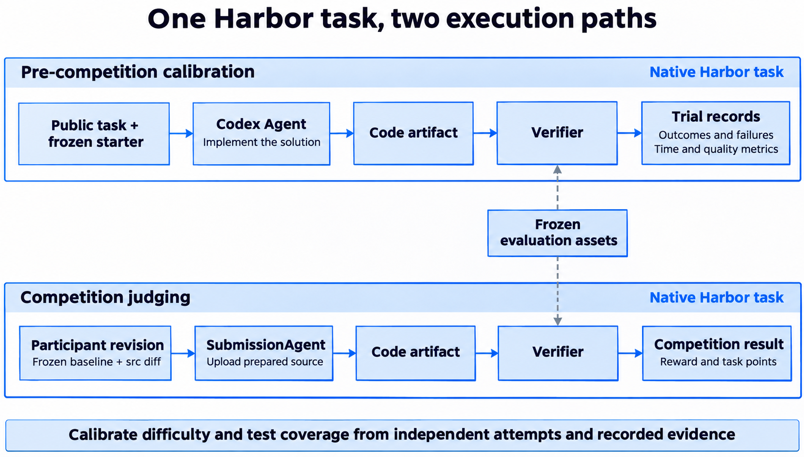
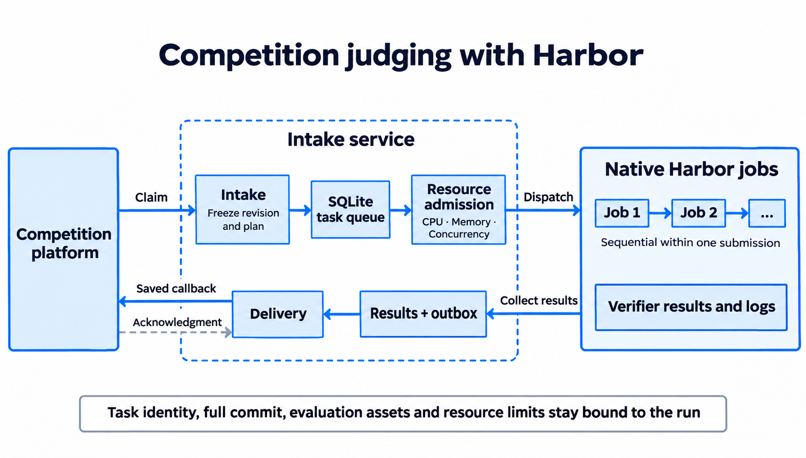
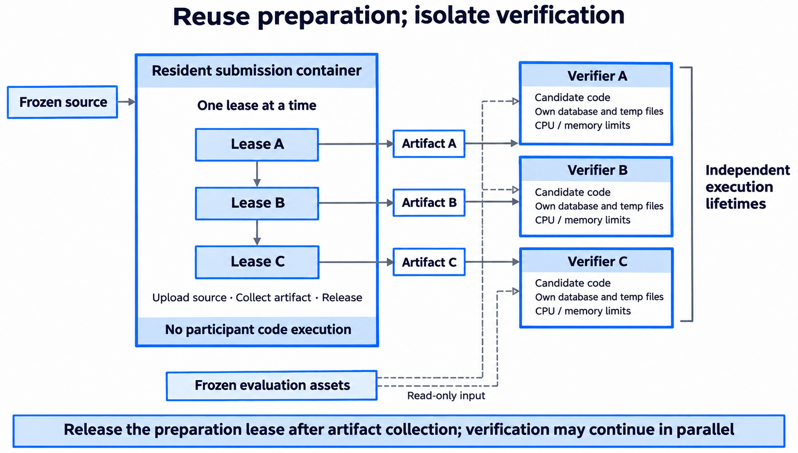
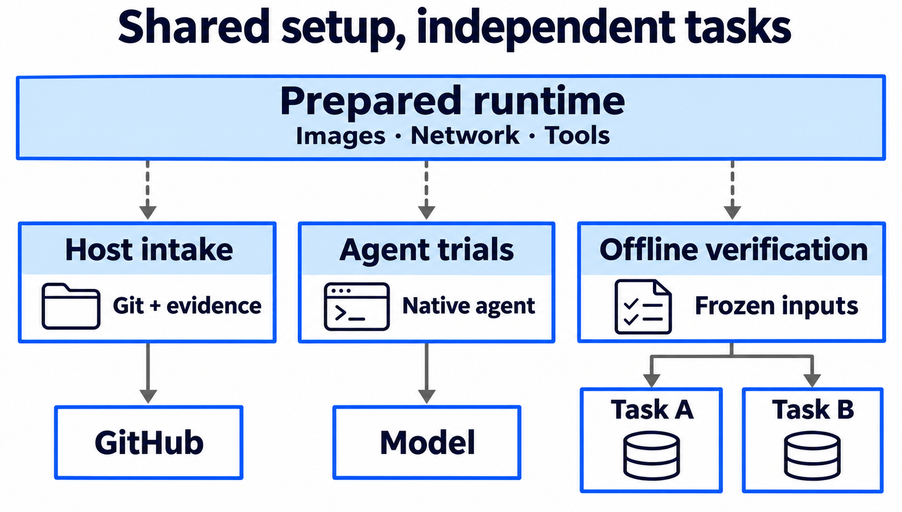
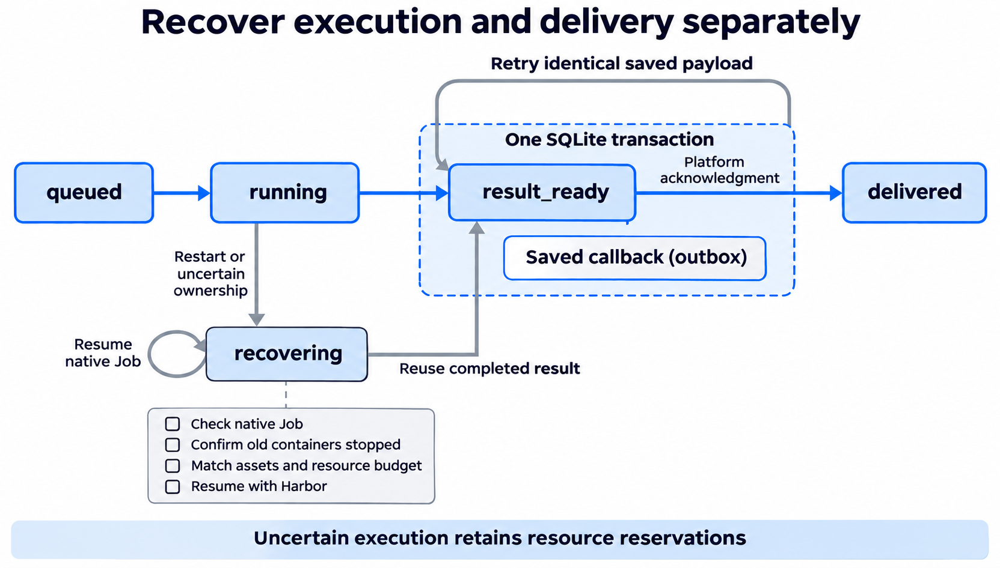

[第六届 OceanBase 数据库大赛](https://open.oceanbase.com/competition) 开赛的前三天，PowerContext 的判题服务就处理了超过 4000 次判题。这组赛题共有 11 题、240 分，覆盖数据采集、记忆状态、检索和上下文构建。

我们为比赛单独搭建了判题服务，由 [Harbor](https://harborframework.com/) 管理执行环境、运行测试并保存结果。赛前，我们让 Agent 独立试做，用试做结果检查题目难度和测试是否充分；正式比赛则按照相同的验收条件检查选手代码。

## 从题面到验收测试

我们先冻结产品题使用的 PowerContext 版本，让后续提交和重判都基于同一个产品版本。选手要在这个基础上完成题目要求的功能。例如，[CSV 采集题](https://github.com/oceanbase/powercontext/blob/2026-competition/competition/challenges/source-01-table-evidence/instruction.md)要求保留原始记录的身份，即使数据已经持久化、进程已经重启，引用仍能回查到原始记录。[混合检索题](https://github.com/oceanbase/powercontext/blob/2026-competition/competition/challenges/retrieval-02-hybrid-search/instruction.md)则要求减少数据库查询次数，同时保持过滤行为、引用身份和检索质量。这些行为和通过条件写在题面里，测试通过公开接口检查，具体算法和内部数据结构留给选手决定。

每道题按 [Harbor 的任务结构](https://docs.harborframework.com/tasks/overview)组织：`task.toml` 配置环境和时限，`instruction.md` 说明要求，测试入口负责调用验收逻辑。有性能要求的题目需要先通过必测的功能组，才能进入 benchmark，最终结果写入 Harbor 原生的 `reward.txt`。这样，赛前试做、正式判题和后续重判可以使用同一份任务定义。

选手本地使用的是从题库中拆出的公开自测部分，放在 [2026-competition 分支的 competition/ 目录](https://github.com/oceanbase/powercontext/tree/2026-competition/competition)。该分支保留冻结的产品基线，`competition/` 提供题面、公开样例、行为测试和固定的运行依赖。选手在产品的 `src/` 中实现功能后，就可以用 `make -C competition test-csv` 这类命令检查代码。测试直接从指定的产品目录加载源码，不依赖判题服务，也不需要模型 API Key 或平台 Token；如果本机不便配置依赖，还可以使用随包提供的离线 Docker 自测环境。

公开自测覆盖了部分输入和行为，正式判题还会用未公开的测试和数据检查其他输入、边界情况，以及题面声明的质量、成本和性能要求。两者遵循同一份题面，正式测试不会另加隐藏需求，但通过公开测试仍不等于通过全部验收。本地自测结果也不会上报为比赛成绩。

## 用 Agent 检查题目和测试

出题人熟悉参考解法，阅读题面时容易把自己知道、却没有写出来的条件也带进去。我们先用参考实现、起始代码（starter）和有意写错的实现检查测试，确认参考实现能够通过，starter 不能通过，针对性的错误也能被检出。随后再让 Agent 只根据公开材料独立解题，观察它在哪里遇到困难、怎样理解题目，以及是否采用了出题人没有考虑过的做法。

Harbor 已经[集成 Codex 等 Agent](https://docs.harborframework.com/agents/pre-integrated-agents)，所以我们直接使用它的原生 Codex Agent 试做产品题。每次尝试都从相同的干净基线开始，我们只提供公开题面和允许读取的材料，不提供参考解法，也不带入上一次尝试的修改。我们记录本次使用的模型、reasoning 设置、时限和容器资源；解题结束后，再由独立的 Verifier 验收留下的源码制品。测试组的通过情况、质量与成本指标和 Agent 执行轨迹一同保存，后续分析失败时可以相互对照。

*图 1：试做时由 Codex Agent 编写实现，正式判题时由 SubmissionAgent 装载选手代码。两种情况下，都由独立的 Verifier 验收源码制品。*

我们为每题安排了三次独立试做。其中，财报 PDF 题的有些实现能够通过解析检查，却没有达到证据页检索的召回要求；混合检索题也出现过 SQL 数量和延迟已经达标，部分查询的检索质量仍然下降的情况。

自动处理题还暴露了测试本身的遗漏。题目要求新增来源达到数量门槛后触发后台工作，有些实现只在普通采集结束后唤醒处理。当最后一条记录通过另一条合法写入路径进入时，数量已经达标，后台工作却没有启动。题面已经包含这项要求，早期测试没有覆盖到这种写入顺序。我们补齐测试后，使用 Harbor 的[重判能力](https://docs.harborframework.com/jobs/regrade)检查保存的原始制品，确认同一份实现能否通过补充后的验收。这一步无需 Agent 重新解题，也不计为新的独立尝试。

这些试做能帮助我们发现问题，但每题三次的样本不足以估计稳定通过率，更不能换算成人类开发所需的时间。记录结果时，我们也区分功能或质量不达标、到达时限仍未完成，以及已经确认的模型或基础设施故障，避免把不同原因都归为解题失败。

## 固定每次提交的代码版本

正式判题时，`SubmissionAgent` 只负责上传准备好的选手源码，验收和判分由 Verifier 完成。平台上的一次提交对应一个任务 ID，11 道题在这个任务内顺序执行，不同提交之间可以并发。只要验收完整结束，无论某题的 reward 是 0 还是 1，服务都会接受这个结果，再按各题分值汇总比赛积分。

排队期间，选手可能继续更新分支。如果接入服务只保存分支名，最后判到的代码就可能与原先接受的提交不同，重启后也难以找回当时的版本。因此，我们保留平台给出的版本约束，在执行代码题之前解析实际分支和完整 commit，写入本次验收计划。准备 Hook 据此提取相对冻结产品基线的 `src/` 差异，检查修改路径是否在允许范围内，再把补丁应用到干净基线上。依赖和测试材料由组织方独立提供，评分条件随验收计划固定，选手仓库中的文件变化不会改变这些条件。

仓库准备题还需要检查官方 Fork 关联，或任一分支是否保留了冻结基线的历史。由于这些信息会随仓库变化，我们由可信的接入服务采集并保存 GitHub 元数据，交给离线验证器检查，复查时也使用这份已保存的证据。如果指定版本不存在、采集服务不可用，或保存的材料已经损坏，服务会记录具体原因，同时保留原来的版本约束，供后续核查。

*图 2：接入服务先固定提交版本和验收计划，再由 Harbor 逐题执行，最后汇总成绩并回传平台。*

## 复用准备容器，隔离代码执行

同一份源码要接受多道题的验收。若每道题都启动一个提交容器，容器启动和源码传输的开销就会重复发生，在测试本身耗时较短时尤其明显。我们把这部分准备工作放进一个常驻提交容器，每次只租给一个 Harbor 任务，用于上传准备好的源码和收集制品，不在其中执行选手代码。制品收集完成后，任务立即归还租约，其他提交便可以开始准备；已经收集的源码则交给独立的 Verifier 容器执行。

容器复用后，上一次任务的残留就需要显式处理。每次取得租约，任务都会先清理旧源码和日志。如果文件传输被取消，或子进程异常退出留下未完成标记，我们会在下次租用前重启容器，终止可能还在运行的传输。执行代码的 Verifier 则各自拥有源码、数据库和临时目录，并按验收计划限制 CPU 和内存。平台 Token、仓库凭据和接入服务配置始终留在宿主侧。

*图 3：准备制品时串行租用常驻容器，完成后释放租约。各提交的 Verifier 可以在资源预算内并行执行。*

调度时，常驻容器的资源开销只计算一次，每个正在运行或恢复中的 Verifier 则分别占用并发名额、CPU 和内存预算。由于同一提交中的题目顺序执行，一份提交同时最多使用一个 Verifier。接入服务据此限制平台任务的领取数量和本地预取数量：资源不足时，任务继续留在平台队列中，以免领取后在本地长时间等待，白白消耗平台任务的租约。

性能测试的调度还要考虑其他任务的干扰。没有专用 CPU 集合时，性能 Job 会等其他 Job 退出后独占执行，这段时间不允许普通任务进入。如果为普通任务和性能任务划分了互不重叠的 CPU 集合，两类任务就可以同时运行，各性能 Job 再按配额租用互不重叠的 CPU。我们把隔离锁的持有范围限制在当前题目，题目结束就释放；若锁住整份提交，其中的普通功能题也会阻挡其他提交，延长不必要的等待。

这些限制也决定了该如何估算容量。完整跑完和提前失败的提交占用资源的时间不同，常驻准备容器、性能测试可用的 CPU 或内存，都可能先于并发名额成为瓶颈。提交往往又集中到达，几天的判题总量即使摊成小时平均值，也无法说明高峰时为何排队。为此，需要分别统计执行耗时和各项资源的等待时间。

## 把公共依赖准备好，再开始判题

容器之间可以共用的，是提前准备好的运行依赖。我们把固定依赖构建进共享镜像，启动服务前检查本地镜像、Harbor 运行时、Docker 和 Git，后续判题直接使用这份镜像，不再逐次构建和安装。数据库运行库也随镜像固定，但每次验收使用独立的临时数据库目录，通过真实 Runtime 检查写入、读回和重新打开后的状态。

网络依赖则分布在不同阶段：宿主需要获取仓库、采集 GitHub 证据，试做中的 Agent 需要访问模型。我们分别为它们配置网络，因为服务进程未必继承交互终端的代理设置，宿主可用的回环代理地址也无法直接用于容器。仓库凭据只留在宿主侧，模型认证通过原生 Agent 适配器临时注入。到了 PowerContext 的确定性验收阶段，Verifier 只读取准备好的源码和验收材料，全程离线运行。

*图 4：虚线表示共用已准备的运行依赖，实线表示各阶段的访问或执行关系。离线验收不访问仓库和模型，每个任务使用独立数据。*

如果某个阶段缺少所需镜像、网络出口或认证，本次运行就没有满足预定条件，不能据此认定选手实现有错。我们会保留故障原因和原提交版本，修复环境后仍可检查同一份代码。在规定条件下执行后得到的功能、质量或性能失败，则正常计入任务结果。

## 服务重启后，从哪里继续

服务重启时，一份提交可能已经完成了几道题，当前题目的容器也可能仍在运行。成绩回传超时带来的不确定性又不同：平台可能已经收到了成绩，只是接入服务没有收到确认。这些情况都不能简单地从头判题，否则既会重复占用执行资源，也可能让同一次提交产生不同的结果。

服务通过定时调度领取任务、协调执行和回传成绩，并将任务进度和结果保存在数据库中。并发检查和状态变更放在短事务里，耗时的 Git、HTTP 和 Harbor 操作在事务外执行，避免长时间占用事务。服务重启后会重新建立周期调度，再结合数据库记录和 Harbor 原生 Job 状态，判断哪些工作已经完成、哪些还需要继续。

恢复执行时，服务先核对 Job 身份、完成状态、异常信息和 reward。如果结果完整，就直接复用；如果 Job 尚未完成，则要确认旧容器已经退出、验收材料与原计划一致，并且有足够的资源预算，才能通过 Harbor 原生 resume 继续。这里还要处理接入进程已经退出、执行却尚未结束的情况：原生子进程会继承执行锁，资源释放前也必须确认容器退出。核查完成之前，任务一直处于 `recovering`，原先预留的预算不能分配给其他任务。

判题结束后，服务在同一个数据库事务中保存终态结果和待回传请求，并把任务标记为等待回传。请求进入 outbox 后，内容便固定下来，由单独的投递流程发送，直到收到平台确认（ACK）才记为已送达。因此，网络超时后的重试只需要重发已保存的请求，不必重新运行选手代码。

投递也有停止重试的条件。平台明确拒绝请求，或重试次数达到上限时，服务会留下记录等待核对，不会为了让请求通过而修改成绩。如果等待确认的结果积压过多，接入服务就暂停领取新任务，先处理这些尚未送达的成绩。

*图 5：恢复执行时检查已有 Job 和容器；成绩回传超时时，重发 outbox 中保存的原请求。*

保留恢复所需的材料，也意味着要处理不断增长的存储占用。我们按任务 ID 归档相对冻结基线的源码补丁、摘要和源码审计结果；需要复查时，把补丁重新应用到共享基线上，再核对摘要，就能恢复当时的源码，不必重新访问选手仓库。完整的 worktree、Git 缓存和每题重复保存的源码，则要等成绩回传得到确认、满足留存时间，并确认执行结束后才清理。Harbor 原生结果、验收日志、冻结计划和回传记录继续保留，供后续复查使用。

## 总结

我们用 Harbor 执行每道题，把资源调度、故障恢复和成绩回传放在比赛接入层处理。固定产品基线、保存每次提交的确切版本，并保留当次运行的验收条件和结果，让赛前试做发现的问题能够用原始制品复查，也让正式判题在服务重启后仍能继续。

还有一些任务很难用固定断言评分，可以考虑让 Agent 在容器中运行待评对象、收集证据，再据此给出判断。这时需要先通过试判确定基本原则和评分基线，并保留原始输入与证据，供后续复评。Harbor 的执行和记录能力仍然适用，具体如何评分，则需要针对这类任务另行设计。
