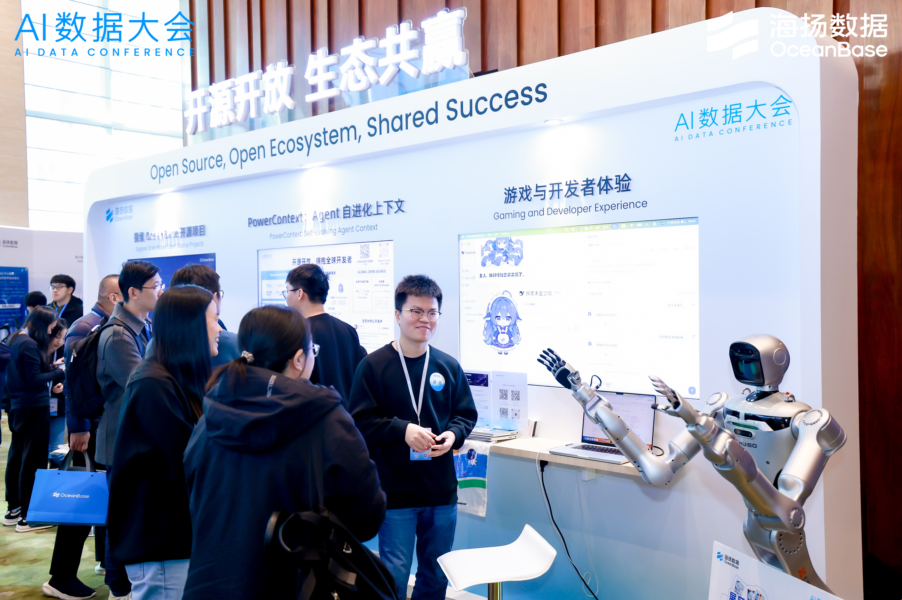
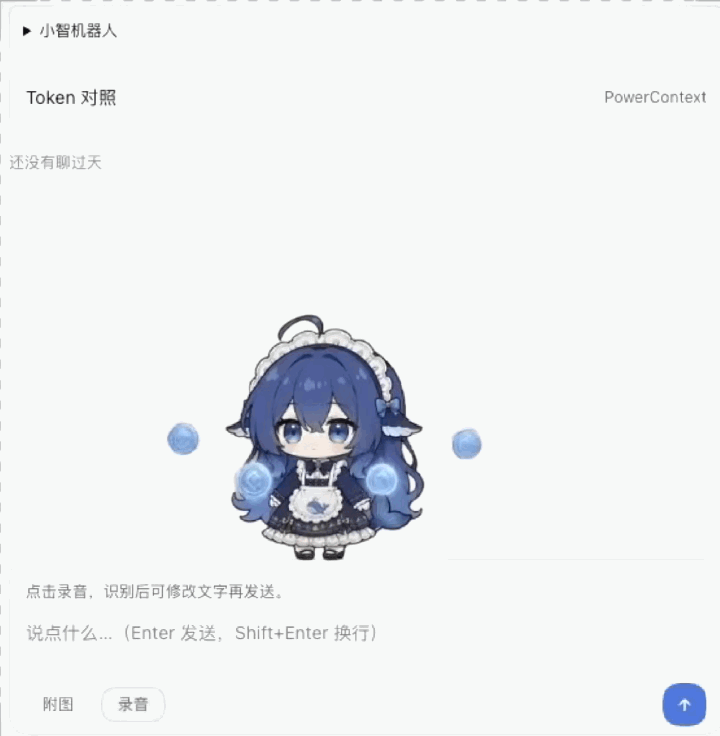
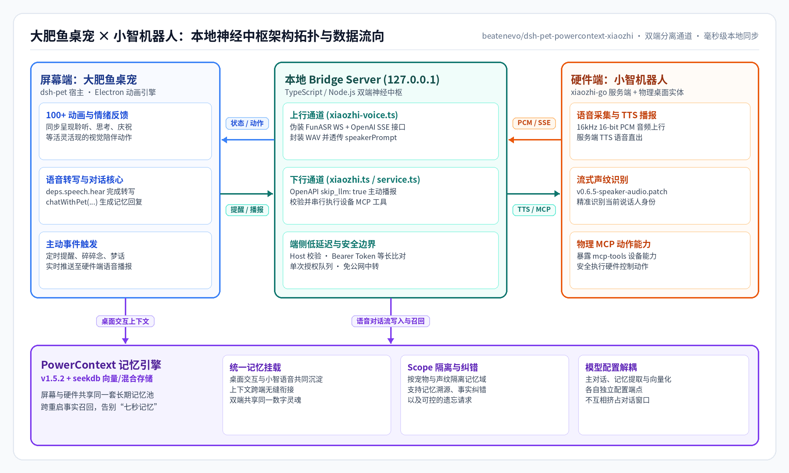
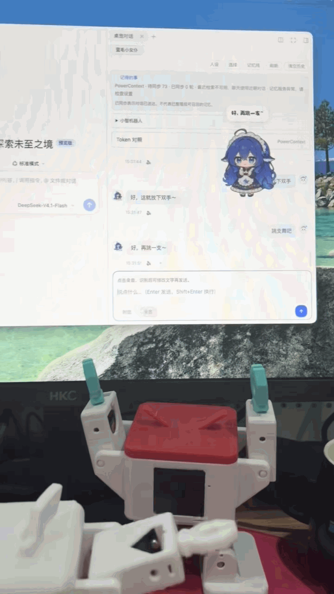

# 当屏幕里的大肥鱼，长出了“身体”

> 打通桌宠的“最后一公里”：让屏幕里的大肥鱼借桌面机器人开口说话

屏幕里有一只可以随时互动的自定义桌面宠物，桌角摆着一个能随时语音对话的桌面机器人——**单拎哪一个出来，在今天其实都算不上新鲜。**

真正让我决定把这两件事连在一起的契机，发生在11月24日的AI数据大会开源展位上。那天在展台现场，**靖顺**把搭载了 PowerContext 长期记忆的“大肥鱼”桌宠带到了现场，并同时接入了一台机器人做互动演示。

*AI数据大会现场*

看着屏幕里的大肥鱼和桌上的硬件同台配合，我回来后一直在琢磨：**如果它们共用同一个“灵魂”，是不是就能实现真正意义上的“桌宠”？** 顺着这个想法，我开始尝试把大肥鱼适配到大家日常就能放在书桌上的桌面机器人“小智”上。

试想一下：你在电脑前学习或写代码时，屏幕上的大肥鱼能记住你昨天聊过的话题；转头看向手边的小智，它不用你重新自我介绍，张嘴就能接上刚才的上下文，甚至能通过声音认出此刻站在桌前的是你、还是家里的小朋友。

基于上游开源项目 [ob-labs/dsh-pet-powercontext](https://github.com/ob-labs/dsh-pet-powercontext)，我完成了这次适配与打通，开源在 [beatenevo/dsh-pet-powercontext-xiaozhi](https://github.com/beatenevo/dsh-pet-powercontext-xiaozhi)。这篇文章想从两个层面聊聊这个小项目：前半部分拆解**怎么用本地 Server 做“双端神经中枢”，把虚拟桌宠和物理机器人连起来**，后半部分聊聊这件事背后关于 **AI × 教育、实体原型演进与“陪伴”** 的一点思考。

## 一、先给桌宠装上“记忆”：大肥鱼 + PowerContext

在把“大肥鱼”连接到物理桌面之前，先要解决一个老问题：很多桌面宠物之所以玩两天就腻了，是因为它没有记忆，每次重启都像第一次见面。当然，这里可以直接看前面某期发的《教你如何多快好省地养大肥鱼》。

上游仓库 [ob-labs/dsh-pet-powercontext](https://github.com/ob-labs/dsh-pet-powercontext) 是 **DeepSeek Harness (DSH)** 的桌面宠物插件（也可独立运行，桌面动画基于 Electron）。它本身支持点击、拖拽、抛掷等 100+ 动画交互，以及按宠物区分的性格、语音（TTS/ASR）、提醒与“碎碎念（whispers）”。

更关键的是，它集成了 **PowerContext（1.5.2）** 与本地向量/混合存储 **seekdb**：

* **模型配置解耦**：主对话模型与记忆提取（Generation）、向量化（Embedding）各自独立配置，不互相挤占上下文。

* **跨会话长期记忆**：支持跨重启与超长对话窗口的事实召回，按不同桌宠隔离记忆作用域（Scope），还支持记忆溯源、事实纠错与遗忘。

有了 PowerContext，大肥鱼不再只是一个桌面挂件，而是一个能持续积累共同经历的“数字伙伴”。但它的活动范围，依然被锁在显示器玻璃后面。

## 二、技术实现：本地起个 Server，做双端神经中枢

为了实现“大肥鱼”与“小智”的低延迟互联，我在 [beatenevo/dsh-pet-powercontext-xiaozhi](https://github.com/beatenevo/dsh-pet-powercontext-xiaozhi) 中并没有去重写一套全新的机器人固件协议，而是采用**本地轻量级中继 Server + 双向分离通道**的设计，在桌宠宿主（`dsh-pet`）与自建小智 Go 服务端（`xiaozhi-go`）之间搭起了一座连接虚拟桌面端与物理硬件端的“神经中枢”。

### 1. 架构拓扑与数据流向

### 2. 核心打通逻辑拆解

* **统一记忆挂载（PowerContext 接入）**：无论是你在电脑前通过桌宠交互，还是直接对桌上的小智开口说话，所有的对话流与事件上下文都会汇聚到同一套 PowerContext 记忆池中。这意味着小智知道你在电脑上干了什么，大肥鱼也记得你刚才和小智聊了什么。

* **本地 Server 协议伪装与双向路由**：在 [xiaozhi-voice.ts](https://www.google.com/search?q=https://github.com/beatenevo/dsh-pet-powercontext-xiaozhi/blob/master/dsh-pet/src/host/robot/xiaozhi-voice.ts) 中，我通过 `startXiaozhiVoiceBridge` 在宿主本机 `127.0.0.1` 启动了一个基于 TypeScript / Node.js 的 HTTP + WebSocket 服务，负责监听和转发双端事件：

  * **硬件触发屏幕（上行对话与状态联动）**：本地 Server 对 `xiaozhi-go` 同时兼容了 **FunASR WebSocket 离线识别接口**与 **OpenAI Chat Completions 接口**（支持标准 JSON 与 `text/event-stream` 流式 SSE）。小智采集的 `16000Hz` 16-bit 单声道 PCM 音频（单次上限 60 秒）发往本地 Server 后，会封装 44 字节 RIFF/WAVE 头交给桌宠 `deps.speech.hear` 转写，再转交 `chatWithPet(...)` 结合 PowerContext 记忆生成回复并由小智 TTS 播报；同时，小智的“聆听、思考、回复”状态也能实时驱动屏幕上的大肥鱼做出对应动画。

  * **屏幕触发硬件（下行主动播报与设备控制）**：通过 [xiaozhi.ts](https://www.google.com/search?q=https://github.com/beatenevo/dsh-pet-powercontext-xiaozhi/blob/master/dsh-pet/src/host/robot/xiaozhi.ts) 与 [service.ts](https://www.google.com/search?q=https://github.com/beatenevo/dsh-pet-powercontext-xiaozhi/blob/master/dsh-pet/src/host/robot/service.ts) 对接 `xiaozhi-go` 设备 OpenAPI（并由 [routes/robot.ts](https://www.google.com/search?q=https://github.com/beatenevo/dsh-pet-powercontext-xiaozhi/blob/master/dsh-pet/src/host/routes/robot.ts) 暴露控制路由）。当大肥鱼触发定时提醒、梦话或碎碎念时，可通过 `POST devices/inject-message`（显式设置 `skip_llm: true` 与 `mode: 'notify'`）让小智直接朗读原文；还可通过 `GET devices/<deviceId>/mcp-tools` 与 `POST devices/<deviceId>/mcp-call` 发现并调用设备 MCP 工具（配合 `AjvJsonSchemaValidator` 做严格的 JSON Schema 校验）。

* **声纹识别透传（让它知道“是谁在说话”）**：如果电脑和机器人由家长与孩子共用，光有记忆还不够。我在 [patches/xiaozhi-go/v0.6.5-speaker-audio.patch](https://www.google.com/search?q=https://github.com/beatenevo/dsh-pet-powercontext-xiaozhi/blob/master/patches/xiaozhi-go/v0.6.5-speaker-audio.patch) 中修复了 `xiaozhi-go` v0.6.5 里 `asr.go` 的流式声纹识别与首段语音裁剪逻辑；本地 Server 的 `readSpeakerPrompt` 会抽取系统提示词中的声纹身份并透传给 `chatWithPet`，让大肥鱼自然切换对应说话人的语气和记忆上下文。

* **端侧低延迟与隐私安全**：本地桥接 Server 仅绑定回环地址 `127.0.0.1`，严格校验 `Host: 127.0.0.1:<port>`、Bearer Token 等长比对及 WebSocket 并发数（`< 4`），物理设备动作执行则采用**单次授权 + 串行队列**（不自动重试，宿主重启自动解除授权），并在 [index.ts](https://www.google.com/search?q=https://github.com/beatenevo/dsh-pet-powercontext-xiaozhi/blob/master/dsh-pet/src/host/index.ts) 中由 `ctx.effect` 托管优雅启停。双端状态同步达到毫秒级响应，桌面交互上下文无需经过繁琐的公网中转，既保证了流畅度，也守住了本地隐私边界。

> 具体的启动配置与接口文档已整理在仓库的 README 与[中文小智集成指南](https://www.google.com/search?q=https://github.com/beatenevo/dsh-pet-powercontext-xiaozhi/blob/master/docs/zh/guides/xiaozhi.md)中，欢迎开发者直接拉取体验。

*大肥鱼与小智同步跳舞*
## 三、落地价值：AI × 教育，打破“玻璃墙”的寓教于乐

把技术链路跑通只是第一步，真正让我觉得这件事有意义的，是它在 **AI × 教育** 场景下的想象空间。

过去我们聊“具身智能”，往往想到的是昂贵的人形机器人；但对普通人的书桌来说，“屏幕内的数字分身 + 屏幕外的语音硬件”，本身就是一种极低门槛的轻量级具身形态。如今，越来越多的孩子和学生开始在日常学习中使用电脑和 AI 工具，但现有的 AI 教育产品普遍存在两个割裂感：**要么太像冰冷的“搜题/做题工具”，缺乏情感连接；要么把孩子死死按在屏幕前，交互门槛高且容易分心。**

当“桌面（屏幕）与书桌（实体）”实现互联后，一种全新的“寓教于乐”交互范式就成立了：

* **多模态的正向情绪反馈**：学习本质上是一件反人性的事，尤其是对青少年而言，即时的正向反馈极其重要。在双端联动下，手边的小智负责自然语言答疑、英语口语对练或学习节奏引导；而屏幕上的大肥鱼则化身“学习搭子”，在孩子答对问题或完成专注任务时，给出活灵活现的庆祝动作与视觉陪伴。**视觉情绪 + 语音交互**，极大提升了学习的趣味性。

* **无感化交互，回归自然学习状态**：遇到不懂的知识点，学生不需要切出当前的笔记或编程界面、不需要打开浏览器敲击冗长的 Prompt，只需要像问同桌一样转头问一句手边的小智；而屏幕上的桌宠则会同步给出回应的眼神与动作。**AI 从“需要刻意操作的软件”，退居成了“静静陪在身边的学习伙伴”。**

### 下一步的想象：从“借壳发声”到虚拟桌宠的“专属实体原型”

顺着 AI × 教育这个方向再往前想一步：现在的大肥鱼，还是借用通用方形小智机器人的“嘴”在说话。**既然上层的记忆引擎、声纹识别、本地中继 Server 和 MCP 动作协议都已经跑通，下一步是不是真的可以做出“大肥鱼”或者其他虚拟桌宠形象的专属实体原型？**

从工程实现来看，这条路径其实已经非常清晰：

* **软件灵魂不变，硬件外壳“具象化”**：借助开源语音硬件与 3D 打印技术，我们可以把通用的方盒子替换成大肥鱼自己的立体造型——内置麦克风阵列、扬声器、一块小尺寸表情屏，甚至加上控制摆尾或点头的微型舵机。通过本地 Server 的 MCP 通道，屏幕里的互动与桌面上的物理动作可以直接映射。

* **让每个自定义角色都能“走出屏幕”**：更有趣的是，这套架构并不绑定某一个固定形象。无论是“大肥鱼”，还是孩子自己设计的卡通伙伴、校园里的学科吉祥物，只要接入同一套 PowerContext 记忆池与本地桥接协议，就能同时拥有“屏幕里的数字分身”和“书桌上的实体手办”。平时在电脑上陪着写作业、查资料；关掉电脑后，它依然趴在书桌一角，记得你上周背过的单词和解出的难题。

对孩子来说，冷冰冰的“AI 工具”很难建立持久的归属感，但一个看得见、摸得着、甚至由自己参与定制形象的实体学习伙伴，却能把枯燥的日常学习真正变成一场有温度的陪伴。

## 四、写在最后：不如真正的陪伴

> **无论屏幕里的桌宠有多聪明，也无论桌角的机器人有多拟人，它们都比不上人之间真正的陪伴。**

AI 桌宠和桌面机器人再有趣，本质上也是用确定性的代码和概率性的模型，帮我们分担一点日常的琐碎、增添一点学习与工作时的微光。如果这套小工具能帮家长省下一点机械答疑的精力，或者让孩子在独自面对电脑时多一份轻松和好奇——它就已经完成了自己的使命。

剩下的时间，还是应该留给抬头就能看见的人，留给一次认真的倾听、一场一起出门的散步。

如果你也对“桌宠 × 硬件机器人 × 长期记忆”感兴趣，欢迎来仓库看看、提 Issue 或者一起折腾：

* 适配仓库：[beatenevo/dsh-pet-powercontext-xiaozhi](https://github.com/beatenevo/dsh-pet-powercontext-xiaozhi)

* 上游项目：[ob-labs/dsh-pet-powercontext](https://github.com/ob-labs/dsh-pet-powercontext),    [oceanbase/powercontext](https://github.com/oceanbase/powercontext),[PC2005-cloud/dsh-pet](https://github.com/PC2005-cloud/dsh-pet)
