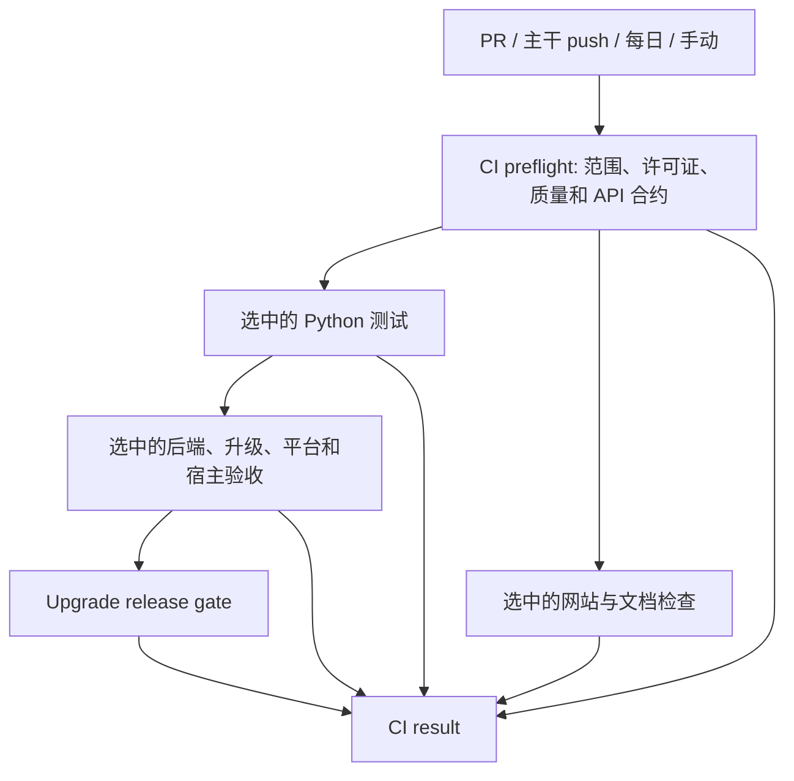

# GitHub CI 设计与运行

CI 的目标是让每次变更获得必要的验证，避免重复和过时的工作，并充分使用可用 runner 资源。上游主分支为 `master`，主干自动验证只监听该分支。工作流、路径归属与终态要求均随代码审查，发布验收独立保留。

## 入口和执行顺序

面向 `master` 的普通 PR 和 `master` push 只启动 `Main`。其中 `CI preflight` 任务只检出一次仓库，在同一 runner 上分别执行范围检测、许可证、质量和 API 合约检查，再将完整变更范围传给现有可复用工作流。被调用工作流复用结果，不再分别分配 runner 检测变更；直接手动运行子工作流时仍自行检测范围。Desktop 的 `codex/desktop-preview` 分支和各工作流手动诊断入口仍可独立运行。



前置检查失败后，不展开后续测试和重型任务；Python 测试失败后，不展开依赖它们的后端、升级、平台和宿主任务。网站和文档检查可以在前置检查成功后与 Python 测试并行。失败保留在最终状态中，不因跳过后续任务而变绿。四项前置检查合并为一个任务，每次常规验证减少两次 runner 分配，许可证和质量检查之间也无需再次排队；每项检查仍有独立的步骤结果和日志。

草稿 PR 不分配自动 CI runner。标记为 ready 时验证完整 PR；转回 draft 会取消旧运行。每个 PR 只保留最新一次自动运行。定时、push、手动入口使用不同的并发组，避免手动诊断取消主干或每日验证。并发组中的取消机制用于淘汰同一变更的旧运行，不作为跨 PR 的资源队列。

## Runner 选择与共用配置

本仓库的 Linux 任务默认使用已有内部 runner，包括从 fork 向本仓库提交的 PR CI。计算、构建、浏览器测试和服务测试都遵循这一规则。fork PR 无法获取仓库 secrets，不是将 Linux 检查移出内部资源池的理由；应复用 runner 提供的配置和共用 setup。独立 fork 仓库无法访问本组织 runner 时，仍可保留已有的 hosted fallback。

| 工作负载 | Runner 选择 |
| --- | --- |
| 轻量质量检查和集成检查 | `powercontext-ci-light` |
| Python 单元测试和 E2E 回归 | `powercontext-ci-python` |
| 较重的 Linux 构建、浏览器测试、服务和数据库验收 | `powercontext-ci-standard`；根据实测需求在已有资源池之间选择 |
| 必须使用原生 macOS 或 Windows 的测试、构建 | 保留对应的 GitHub 托管平台 |
| 验收 GitHub 托管环境本身，或已验证内部环境不支持的 Linux 能力 | 记录所需能力和验证依据，作为使用 hosted runner 的例外 |

内部 Linux 资源池可按需求扩容，并统一复用缓存和镜像，减少托管并发额度和重复外网下载对吞吐的影响。浏览器和服务测试本身不要求 GitHub 托管环境，而 macOS/Windows 原生行为需要在对应 OS 验证。

已有的 `ubuntu-*` 配置是历史状态，不是例外理由。`knowledge-base` 等仍使用 hosted 标签的 Linux 任务属于待修的迁移缺口；这份约定不表示它们已经完成迁移。也要检查可复用工作流内部的 `runs-on`：`workflow_call` 不会继承调用方的 runner，只有被调用工作流明确声明时，才能使用对应的 runner 输入。OS 矩阵只调整 Linux 项，保留原生 macOS/Windows 项。

复用 `setup-python-env`、`setup-uv`、`cache-npm`、`cache-pnpm` 等共用 action，以及完整的恢复、安装和保存步骤。只改标签或单独调用 `setup-uv`、缓存 helper，不会包装后续安装命令：普通 Python 安装使用 `setup-python-env`，npm/pnpm 安装使用 `PC_CI_NODE_INSTALLER` 提供的安装器。保留共用的 Python 阿里云镜像、npm/pnpm npmmirror 镜像、镜像直连、内部缓存和官方源回退，不改变锁定版本和哈希。不能假设这些 helper 会重定向或缓存所有工具 URL、浏览器下载和安装后脚本的网络请求；此类路径应分别验证。

新提交或新依赖版本在缓存未命中时也必须正常启动，不应给每个 job 增加人工预热。冷安装和首次启动验收要保留冷启动语义，不能用已缓存的工具或无关依赖绕过被测行为。已有 helper 的细节见下方依赖缓存存储章节。

## 验证层级

| 入口或输入 | Python 验证 | 其他验收 |
| --- | --- | --- |
| 普通 ready PR | 3.11/3.14 单元测试，3.12 E2E，共 3 个组合、4 个任务 | 运行选中的 SQLite、安装角色、平台和宿主验收；seekDB/OceanBase 延后至夜间 |
| PR 修改依赖、共享夹具、CI 策略，或出现未分类文件 | 3.11–3.14 × unit/E2E，共 8 个组合、12 个任务 | 在数据库仅运行 SQLite 的策略内，保守选择相关范围或全部范围 |
| 已带 `ci:full` 标签的 PR 更新或重新打开 | 8 个组合、12 个任务 | 按完整 PR 变更范围选择，数据库仍仅运行 SQLite |
| `master` push | 8 个组合、12 个任务 | 从成功主干基线选择，数据库仍仅运行 SQLite |
| 每日 UTC 18:00（北京时间次日 02:00） | 8 个组合、12 个任务 | 完整 SQLite、seekDB 和 OceanBase 验收，包含 schema 采集和短锁探针 |
| 手动运行 Main | 8 个组合、12 个任务 | 包含原生数据库的全量范围；升级默认 `full`，可选专门诊断子集 |
| 正式发布 | 独立的安装包与发布验收 | 完整升级证据、汇总与发布字节绑定；不受 PR 路径跳过影响 |

普通 PR 的 Python 测试组合数由 8 降至 3，减少 62.5%。这是组合数量的变化，不是已经测得的 runner 分钟或等待时间降幅。依赖和 CI 策略变更保持全矩阵，因此修改 CI 的 PR 本身可能仍运行 8 个组合。

每个 Linux E2E 组合运行两个任务，按各测试 ID 的稳定摘要分片。两个分片互不重叠，合并后覆盖完整的并行 E2E 测试集。第一个分片还运行串行 ZCode 验收，每个 Python 版本仅执行一次。单元测试仍为每个 Python 版本一个任务，因此普通层级运行 4 个任务，全量层级运行 12 个任务。Main 当前为单元测试任务设置 75 分钟、E2E 任务设置 90 分钟；分片不保证运行时间均分。本地 `make e2e-test` 仍运行完整的并行及串行测试集。

安装验证在 packaging 范围选中时运行两个任务，分别使用 Python 3.11 和 3.14。每个任务只构建一次 wheel，依次验证不带 extras 的 `core`，以及 `builtin`、`cli`、`builtin,cli`、`server,cli`，共五种角色。每个角色使用独立的虚拟环境、应用状态和临时目录，针对已安装 wheel 验证，排除 checkout 源码导入。core 角色检查未安装可选依赖时的公共导入。CLI 角色还检查安装无关的 SQLAlchemy、FastAPI 包后不会启用可选角色。各角色分别产生结果，任何角色失败都会使所属任务失败。全部十个 Python/角色组合仍受验证，同时减少八次 runner 分配和八次重复 wheel 构建。任务数量减少不代表已测得等待时间或吞吐量改善。

`ci:full` 在 PR 的 opened/synchronize/reopened/ready 事件中读取。给一个正在运行的 PR 添加标签不会再触发一套流水线；需要随后更新提交或重新打开 PR。手动 Main 使用 Actions 界面选择的仓库内 ref；fork PR 应在其来源仓库选择对应分支，不能把默认分支的通过结果当成 PR head 的通过结果。

## 数据库执行时间

普通 PR 和 `master` push 运行选中的 SQLite 检查。seekDB 和 OceanBase 回归任务通过 Main 的每日 UTC 18:00（北京时间次日 02:00）定时入口运行，也可以显式手动启动。定时任务验证默认分支，不能用夜间结果证明尚未合并的 PR head 已通过验收。工作流合入默认分支后，定时策略才会生效。

| 工作负载 | PR / `master` push | 夜间 Main | 手动 Main |
| --- | --- | --- | --- |
| Harness 回放 | 选中时运行 SQLite | SQLite 和 OceanBase | SQLite 和 OceanBase |
| 原生迁移、恢复、全文检索和验收 | 延后执行 | seekDB 和 OceanBase | seekDB 和 OceanBase |
| 已安装版本的升级验收 | 选中时运行全部 4 个 SQLite 配置 | 全部 12 个配置 | 默认全部 12 个；`seekdb-code` 仅供诊断 |
| Candidate schema 回放 | 选中时运行 SQLite | 全部 3 个后端 | 全部 3 个后端 |
| 历史 schema 采集 | 选中时运行 SQLite | 全部 3 个后端 | 全部 3 个后端 |
| 短锁探针 | 延后执行 | seekDB | 显式诊断 |

`ci:full`、共享输入、未知路径和缺失可信基线仍会扩大常规覆盖，但不会在 PR 或 push 中启用原生数据库任务。原生范围及其必需任务会一起从常规执行计划中移除。原生工作流的兜底条件和回放矩阵也遵守事件边界。

升级选择 `sqlite` 要求所有选中的用例通过，并记录延后运行的 seekDB/OceanBase 用例。该结果属于部分验收，不能生成发布产物或批准发布。夜间验收和正式发布继续要求完整矩阵，以及失败、清理和证据检查。需要合并前的原生数据库证据时，可以手动选择 PR 分支运行。

## 手动运行和每日报告

打开 **Actions → Main → Run workflow**，选择分支，将 `upgrade_selection` 保持为 `full`，即可执行包含 SQLite、seekDB 和 OceanBase 的完整验收。等价命令为：

```bash
gh workflow run master.yml --repo oceanbase/powercontext --ref master -f upgrade_selection=full
```

将 `master` 替换为仓库中的其他分支即可验证该分支。`automatic` 同样选择全部 12 个升级配置；`seekdb-code` 只选择诊断用升级子集，不能证明完整升级验收通过。该输入仅控制升级矩阵，不影响 Main 的其他测试范围。手动执行不会改变每日北京时间 02:00 的定时设置。

定时或手动触发的 **Main** 结束后，**Nightly CI report** 会生成报告，即使 Main 失败或被取消也会触发。查看入口是 **Actions → Nightly CI report**：打开对应运行，查看任务摘要，或下载 `nightly-ci-report-<run-id>-attempt-<attempt>-report-<report-attempt>`。产物包含 UTF-8 的 `report.md` 和机器可读的 `report.json`，保留 30 天。

报告记录源运行及执行次数、提交、分支、北京时间、Main 结论、各任务结果和执行耗时、异常步骤，以及日志和保留产物的链接。任务数量不是测试用例数量。跳过和取消会明确列出；API 数据获取不全时，报告会标为不完整，报告任务也会失败。报告任务成功只表示报告生成成功，不表示 Main 验收通过。重跑的任务结果限定在对应执行次数，产物清单则属于整个源运行，可能包含此前执行的产物。原始证据仍按各自产物的到期时间保留。

报告由独立的 `workflow_run: completed` 工作流生成，只使用只读权限，检出默认分支上的报告脚本，不执行或下载源运行中的代码。PR 和 push 结束时不会分配报告 runner。此监听工作流合入默认分支后生效，不发送邮件或聊天通知。

## 变更归属与基线

`.github/ci-paths.toml` 是归属表：`[suites]` 声明独立范围，`[shared.*]` 声明共同输入，`[checks]` 声明该范围选中后必须成功的 Main 根任务。`nightly_suites` 标记原生专属范围，`[nightly_checks]` 将其前置任务加入定时或手动运行的门禁。新增范围必须同时声明终态任务。

- PR 使用 merge base 到完整 head 的三点差异，覆盖全部提交，不混入无关基线变更。
- 主干 push 比较同一 Main 工作流、同一分支上最近的成功祖先，最多检查 100 次成功 push。失败或取消的提交不会成为基线，其变更保留到后续比较。
- 无可信基线、API 不可用、历史缺失或 diff 失败时，选择当前事件允许的全部范围和完整 Python 矩阵。未知路径也保守回退，不能静默漏检。
- 通过 Git 读取完整差异，禁用重命名检测，同时考虑迁移前后的路径，不受原生 paths 文件数量截断影响。
- 运行时、API、根依赖变更保守覆盖消费者；网站和独立集成仍按归属选择。长时间锁观察是手动操作。历史 schema 捕获在自身输入变化时只运行 SQLite，夜间或手动运行时覆盖全部后端。短 seekDB 锁探针在夜间或手动运行，长时间锁观察仍保留手动入口。

例如：纯文档变更只选择网站和文档合约；Cindy 改动选择 Python 回归和 Cindy 包检查；迁移与共享运行时改动在 PR 中保留 SQLite 回归和升级验收，原生数据库验收在夜间或手动运行时使用真实引擎。

Helm chart 改动选择部署合约检查。托管资源生产器通过 Main 选择 Windows x86-64、macOS arm64 和 macOS x86-64 候选构建，在质量检查和被选中的 Python 测试通过后执行。Main 按相同的范围选择条件单独调用 Linux 目标；其结果不阻断 Main 的必需门禁，并非需要手动开启的目标。这些构建不再独立响应 PR。共享运行时和依赖改动仍覆盖这些构建；无关的网站或桌面 UI 改动不启动它们。候选产物仍需通过独立的资源资格验证流程才能用于交付。

共享辅助文件按实际消费者选择：干净迁移 runner 脚本同时选择升级验收，原生 managed-startup 在夜间或手动运行时成为必需任务；pnpm 缓存 action 同时覆盖 Python 测试环境及 Cindy 包。路径规则需要沿依赖关系判定，不能只看目录名称。

## Harness 回放与 OceanBase 验收

可复用 E2E 工作流分别选择回放范围 `harness`，以及原生快照、HTTP、指标和归档回归范围 `oceanbase_acceptance`。

| 变更输入 | PR / push 回放任务 | 原生 OceanBase 验收 |
| --- | --- | --- |
| Bub 适配器或回放场景 | SQLite | 夜间或手动 |
| 原生 HTTP、指标或归档测试文件 | 无 | 夜间或手动 |
| 共用 Compose 定义或 harness 启动脚本 | SQLite | 夜间或手动 |
| 公共运行时、API 或根依赖 | SQLite | 夜间或手动，同时保留其他相关范围 |

夜间或手动运行中，两种范围同时选中时，OceanBase 部分共用一个任务和容器。任一种范围选中都会完成数据库启动与容量配置。仅选择原生验收时，不分配 SQLite 回放任务，也不安装 Bub 验证环境。选中的测试和证据必须成功，缺少报告或意外跳过都会使验收门禁失败。原生 JUnit 结果独立于回放产物保留。

OceanBase 验收任务的上限为 125 分钟：共享启动 15 分钟、原生回归 60 分钟、回放 40 分钟，另留 10 分钟用于诊断、证据和清理。回放包含镜像构建和独立的完整 Server schema 迁移。SQLite 回放保持 40 分钟的步骤上限，并另外预留 10 分钟用于启动、证据和清理。这些是上限，未选中的工作会跳过。原生进程的截止时间在自身步骤中开始计算，启动步骤显式传递容器 ID。原生报告校验和上传使用同一份 JUnit 文件。

Main 的 preflight 已检查全仓库的 lint 和格式；其 harness 验证运行 `make harness-test`，保留 harness 类型检查、场景测试、CLI 验证及 Compose 验证。独立运行仍通过 `make harness-lint` 检查格式；本地 `make harness-check` 同时执行两个目标。

`[exclusions].database` 中的精确测试路径使用 SQLite 或内存行为，仍由普通 Python 测试及其他匹配范围覆盖。仅修改这些测试时，不启动整套数据库验收。文件新增原生数据库用例时，需要移除对应例外。例外不能抵消其他变更文件、共享夹具、公共运行时选择或全量兜底。升级验收被选中时，PR/push 运行全部 4 个 SQLite 配置，夜间运行全部 12 个配置。

这些规则减少局部改动带来的无关任务。公共运行时和 CI 策略改动仍保留广泛覆盖；runner 分钟和排队时间需要上线后实测。

## 依赖缓存存储

自托管 Linux runner 提供 `PC_CI_CACHE_ENDPOINT` 时，共用缓存 action 会选择兼容 S3 的后端。以下配置由 runner Pod 提供，工作流文件不包含服务地址或凭据。

| 变量 | 含义 |
| --- | --- |
| `PC_CI_CACHE_ENDPOINT` | 内部兼容 S3 的服务地址 |
| `PC_CI_CACHE_BUCKET` | 已创建的缓存 bucket |
| `PC_CI_CACHE_ACCESS_KEY` | 由 runner 配置提供的访问密钥 ID |
| `PC_CI_CACHE_SECRET_KEY` | 由 runner 配置提供的访问密钥 |
| `PC_CI_CACHE_REGION` | 可选的签名区域，默认 `us-east-1` |

缓存步骤执行前，后端 helper 读取 Pod 继承的环境变量，通过 `backend` 输出 `s3` 或 `github`。配置了内部地址但缺少必填项时，配置校验会失败。未配置地址时，共用 action 继续使用 GitHub 缓存。Windows、macOS 和 GitHub 托管任务保持原缓存后端，包括托管任务的 Docker 构建缓存。Artifact 的上传和下载也仍使用 GitHub。

内部缓存通过 `runs-on/cache` 存储依赖与工具快照。已迁移任务中的 Python、pnpm、npm、pip、Cargo、Go、mise、OpenAPI generator 和 pre-commit 缓存使用共用 action。依赖安装和 pre-commit 环境准备完成后会在检查开始前保存快照；Rust 缓存也会在普通测试失败后保存。恢复 Rust 快照后会保留第三方依赖的编译结果，并重新构建工作区 crate，避免工作区之外的嵌入输入变化后仍使用旧二进制。取消任务或终止 runner 可能导致保存无法完成。GitHub 上已有的缓存对象不会自动复制；内部缓存和 runner 镜像都没有的软件包仍需从软件包源下载，命中缓存时则从内部服务传输内容。

npm helper 根据实际 Node/npm 版本及依赖文件或固定软件包版本生成内容下载缓存键，不恢复已安装的软件包。Bundle 构建根据 Python/pip 版本及导出的依赖清单缓存 pip HTTP 响应，本地构建的 wheel 不进入共享快照。Gateway TCK 任务还会缓存固定提交的上游源码。准备步骤在测试前填充这些缓存；原有的依赖安装、源码版本检查、构建和测试仍会执行。

Bundle 准备过程在隔离环境中安装固定版本的打包工具，并单独缓存其原始 wheel。依赖缓存使用原始依赖清单、工具版本清单及构建环境实际的 Python/pip 版本生成标识。优先使用兼容的锁定 wheel；没有兼容 wheel 时，先校验锁定源码归档，再使用这些工具离线构建。源码构建不限制包名或版本白名单，缺少后端时直接失败，不安装额外工具。每份 bundle 都保留原始依赖清单和源码到 wheel 的来源记录；生成产物的包身份与已校验输入一致后，安装清单才记录最终 wheel 的哈希。重新构建 wheel 不会改变下载缓存标识，也不会将该 wheel 发布到共享下载缓存。

内部 Linux 镜像可以在 `/opt/powercontext-ci-tools` 下预装固定版本的 `license-eye` 可执行文件和 `skill-up`。工作流复用匹配的已安装工具，工具不存在时保留原有下载或构建路径。Helm 同样复用符合要求的已安装版本。

Docker 镜像缓存与依赖快照分开配置。Runner 可以通过 `PC_CI_OCEANBASE_435_IMAGE` 和 `PC_CI_OCEANBASE_442_IMAGE` 使用对应固定版本 OceanBase 镜像的内部副本，也可以通过 `PC_CI_DOCKER_REGISTRY_MIRROR` 为嵌套 E2E daemon 指定 Docker Hub 镜像缓存；runner 外层 daemon 需要单独配置镜像缓存。嵌套 harness 也可以直接接收 `POWERCONTEXT_E2E_DOCKER_REGISTRY_MIRROR`。未配置这些变量时，沿用原有公共镜像地址和 daemon 行为。应逐个预热镜像，核对复制后的平台摘要，再将 runner 切换到内部副本。

内部 mise 缓存还会单独保存启动所需的二进制、版本记录和签名校验文件，并在已安装工具恢复后恢复该快照，避免旧工具快照覆盖这些文件。固定版本的上游 action 仍会在本地校验二进制、安装项目工具并导出环境。已安装工具精确命中时，仍可保存尚未命中的启动快照；显式指定 mise 版本时使用独立的启动缓存键。只发布文件齐全的启动快照；校验文件缺失时仅跳过缓存写入，不使已成功的工具安装失败。

普通 CI 使用源码 checkout 中的 `./.github/actions/` 本地 helper，嵌套 helper 也使用本地引用，因此解析它们不再下载第二份仓库归档。打包历史源码时保留顶层 `$/` 引用：这些 helper 自包含，从自身 action 目录加载工具，同时根据指定 checkout 的源码生成指纹。这要求使用 GitHub.com 和 2.336.0 或更高版本的 runner，详见 GitHub 的[同仓库 action 引用发布说明](https://github.blog/changelog/2026-07-30-reference-same-repository-actions-with-self-repository-syntax/)。

内部 runner 不再在每个任务开始前预下载仓库归档。只有解析远程 action 引用时，runner 才会下载所需归档。包含嵌套 `$/` 引用的旧版工作流继续使用这一原生下载路径，其中的下载可以由 runner 基础设施的下载缓存提供，不代表每次都访问公网。历史源码打包仍使用工作流版本的工具。应核对基础设施实际支持的路径，不能默认任意 URL 都有缓存。

缓存服务的存储必须在 worker 回收后保留，且所有 runner Pod 都能访问该服务。helper 会让服务地址的主机绕过出口代理。服务部署、bucket 创建和持久存储由基础设施配置负责，仓库工作流不会创建这些资源。验收时应在不同 Pod 中分别保存和恢复缓存，验证 worker 移除后缓存仍可用，并比较真实 CI 的依赖安装耗时。仅通过 YAML 校验，不能证明后端可用或性能已经提升。

## 并发预算与取消

| 矩阵 | 每次运行的最大并发 | 失败策略 |
| --- | --- | --- |
| Python 测试 | 按可用 runner 调度 | 保留所有选中组合的结果 |
| 隔离安装，每个 Python 版本一个任务 | 按可用 runner 调度 | 单个任务尝试全部角色；任务失败后取消尚未结束的另一个 Python 任务 |
| 安装发布升级 | 按可用 runner 调度 | 保留全部用例与证据汇总 |
| OceanBase 干净迁移分片 | 按可用 runner 调度 | 保留全部分片与完整性检查 |
| Candidate replay | 按可用 runner 调度 | 保留所有后端结果 |
| 历史 schema 捕获 | 按可用 runner 调度 | 保留所有配置结果 |
| 托管资源候选构建 | Main：最多 2 个 Windows/macOS 任务加 1 个独立 Linux 任务；单独运行矩阵：最多 2 个 | 保留所有选中目标；独立 Linux 结果不阻断 Main 的必需门禁 |

内部 Linux 任务应使用可用 runner 资源，不随意增加 `max-parallel` 限制。上表记录当前工作流配置，混合平台候选构建的上限不是新增内部 Linux 任务的默认值。内部 runner 各自运行在独立 Pod 中，按完整的 Pod 资源声明调度，不超卖。Pending 需求驱动 worker 扩容，直至配置的资源池容量上限。使用 hosted runner 的例外任务和独立 fork 仓库的 hosted fallback，仍受 GitHub 托管额度约束。提高 `max-parallel` 不会增加任务或 worker 容量。

不要为了“保守”增加 `maxRunners`、写死测试 worker 数或预留固定容量，让可用资源闲置。任务确需限制时，应有正确性要求或实测资源约束作为依据。检查要覆盖工作流、runner 资源池配置和测试命令，按观测结果配置资源。正确性依赖、取消过时运行、明确采用的 fail-fast 有各自的用途，应保留，不能与随意限流混为一谈。

`max-parallel` 只限制一条矩阵运行，不限制整个仓库或组织。不能把多个 PR 放进一个普通 concurrency 组来模拟全局 semaphore：默认组只保留一个 pending 项，会替换其他 PR 的等待任务。正式发布也不能与普通 PR 共用取消组。

并发上限不会减少工作总量，还可能延长单个 PR 的完成时间。减少排队主要依靠跳过无关范围、消除重复入口、让短检查共用 runner、复用安装构建、缩小普通 PR 的兼容矩阵，以及取消被新提交替代的运行。运行时和 CI 策略改动仍需广泛验收，完成时间依然受组织可用容量影响。

按实测需求使用已有资源池，并计入共享容量的其他仓库。原生 Windows/macOS 容量仍单独管理。新标签或资源池必须先创建并验证，再修改 `runs-on`；不存在的标签只会一直排队。资源池隔离应解决已观察到的调度或能力问题，不预留缺乏依据的固定比例。

以下配置需要组织管理员在上线时操作，代码不会修改付费计划、预算、runner group 或组织并发额度：

1. 在组织 Settings → Actions → Runners 检查实际活跃任务、并发上限、OS 上限及其他仓库占用；同时核查预算、账单和服务状态。
2. 内部 Linux 任务应检查节点可分配资源、完整 Pod 声明、Pending 原因和扩容状态。调整前对照每个 job 在运行周期内的实际 CPU、内存峰值；CPU 声明占满不等于实际 CPU 占满。
3. 工作流合并并验证后，将稳定的 `CI result` 配置为合并必需检查，同时保留现有审批要求。quality 任务显示的检查名称为 `CI preflight`，许可证和范围检测是其内部步骤，不再提供独立状态检查；仍要求旧 quality、许可证或范围检查名称的规则需要替换。工作流改为可复用后，部分检查名称会带 Main 调用任务前缀，外部规则必须同步核对。

GitHub 语义参见 [concurrency](https://docs.github.com/en/actions/how-tos/write-workflows/choose-when-workflows-run/control-workflow-concurrency) 和 [当前任务与组织容量](https://docs.github.com/en/actions/how-tos/manage-runners/github-hosted-runners/view-current-jobs)。

## 汇总门禁

`CI result` 依赖 Main 的全部根任务：任何失败或取消都会阻断；被选中范围对应的根任务必须成功，意外 skipped 或缺失同样阻断。仅由范围选择或数据库执行时间策略明确排除的任务允许跳过。夜间运行意外跳过原生前置任务仍会阻断门禁。

`Upgrade release gate` 只在前置检查成功且明确未选择升级时接受 skipped。选中的升级必须成功：PR/push 要求 SQLite，夜间要求完整矩阵。旧运行被取消后，汇总门禁不会再分配 runner；任务内部的必要清理和诊断仍保留 `always()`。升级发布继续检查全矩阵和证据文件，不能用 CI 路径判定替代发布验收。

升级证据收集在普通 case 失败后仍执行，缺失或失败的证据无法通过；整个运行被取消后停止。Harness Acceptance 显式检查 validate 成功及取消状态，跳过重复的子流程范围检测不会连带跳过 SQLite/OceanBase 验收矩阵。

## 处理当前积压

先按 job 检查，不把一个等待汇总的 workflow 算成整套矩阵尚未运行：

```sh
python3 scripts/ci_queue_report.py --repo oceanbase/powercontext \
  --max-runs 40 --output ./ci-queue.json
```

该命令只读，限制查询数量，输出采样覆盖范围和每条运行的真实 job 状态；不会取消、重试或修改任何任务。`workflow_age_minutes` 是整条运行的年龄，不能当成具体 job 的等待时间。查询不完整或出错不能解释成零积压。

处理顺序：

1. 按 PR 当前 head 和状态核对积压；仅清理已关闭或已被新 head 替代的旧运行。保留当前 head、主干最新验证、每日完整验证和发布任务。并发策略更新不应被当成已清理所有历史运行。
2. 如只剩被取消运行的汇总任务，核对父运行和 PR head 后清理旧运行；新工作流的取消条件用于防止重现。
3. 区分排队和正在运行的 job，也区分资源声明与实际占用。内部任务检查 Pod Pending 原因、节点容量和扩容失败；hosted 任务检查组织容量和预算。缩小矩阵不能替代容量排障。
4. 确定耗时发生在依赖下载、进程或服务启动，还是测试执行阶段。保留日志、浏览器 trace 和截图，Linux 失败优先在版本和运行配置对齐的内部 Pod 或 VM 复现，不靠反复外部重跑碰运气等绿。只有实测行为支持新的时间预算时才调整超时；保留行为断言，确定性缺陷先修复再重跑。

部署后连续观察至少一个完整工作日及一次每日完整验证：记录 ready PR 到基础检查完成、选中任务 job 级排队 p50/p95、实际 runner 分钟、取消但已消耗的分钟、每个 OS 的占用与失败重跑率。建议目标是基础检查 p95 小于 5 分钟、常规 PR 开始测试的等待 p95 小于 10 分钟；目标需要容量与运行数据验证，不是代码修改后的保证。

回滚时可将 PR profile 恢复为完整矩阵，同时保留统一入口、范围选择和取消修复。不要同时启用子工作流的自动触发和 Main 调用，否则会重新产生重复执行。

## 维护者合并前验证

1. 核对 PR 当前 head、base、run attempt 和实际 checkout SHA，区分分支 head、GitHub 生成的 synthetic merge 和最终合并提交。旧版全绿或其他分支的运行，不能证明新加入的代码、测试已经验证。
2. 逐个检查选中的 job。任务因 preflight 或其他前置失败而 skipped，不表示测试通过。保留有效依赖顺序并修复阻塞，不能通过删除依赖掩盖结果缺失。
3. 改动 runner 或下载路径时，验证新 runner 和尚未缓存的版本或提交，再验证另一个 runner 能复用缓存。使用共用配置，保留冷安装语义，并确认原生 macOS/Windows 检查仍在对应平台执行。
4. 修复后，在对齐环境中重复运行原始场景，评估已观察到的偶发性，再运行受影响套件。保留失败日志和产物。本地 fixture 或单次全绿不能代替受支持宿主、服务的验收。
5. 合并前重新确认 head 和结果。源码、测试、共用 setup 或 runner 配置变更可能使旧证据失效；应验证更新后的合并结果并记录剩余缺口。旧版全绿或选中任务 skipped 不能证明验收通过。

## 验证

```sh
uv run pytest -q tests/test_ci_changes.py tests/test_ci_pipeline.py \
  tests/test_upgrade_release_gate.py tests/test_workflow_actions.py tests/test_e2e_workflow_contract.py
uv run python scripts/check_workflow_actions.py .github/workflows .github/actions
actionlint -shellcheck= -pyflakes=
```

本地测试使用真实 Git 历史、模拟 Actions 元数据和实际执行的门禁脚本；它们验证选择、预算与终态合约，不能代替 GitHub 调度器、各原生 OS 和真实数据库验收。吞吐量改善应在上线后测量。
