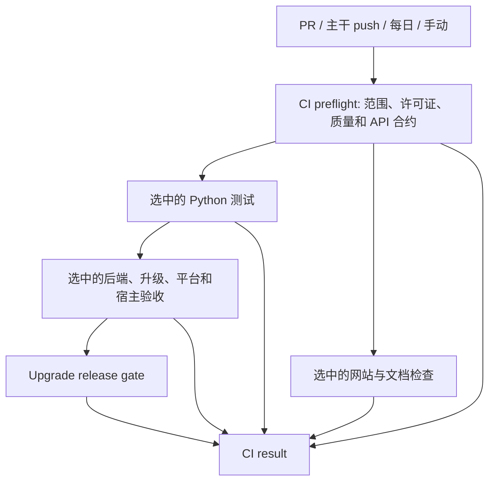

# GitHub CI 设计与运行

CI 的目标是让每次变更获得必要的验证，同时控制重复工作、无效工作和瞬时 runner 占用。上游主分支为 `master`，主干自动验证只监听该分支。工作流、路径归属与终态要求均随代码审查，发布验收独立保留。

## 入口和执行顺序

面向 `master` 的普通 PR 和 `master` push 只启动 `Main`。其中 `CI preflight` 任务只检出一次仓库，在同一 runner 上分别执行范围检测、许可证、质量和 API 合约检查，再将完整变更范围传给现有可复用工作流。被调用工作流复用结果，不再分别分配 runner 检测变更；直接手动运行子工作流时仍自行检测范围。Desktop 的 `codex/desktop-preview` 分支和各工作流手动诊断入口仍可独立运行。



前置检查失败后，不展开后续测试和重型任务；Python 测试失败后，不展开依赖它们的后端、升级、平台和宿主任务。网站和文档检查可以在前置检查成功后与 Python 测试并行。失败保留在最终状态中，不因跳过后续任务而变绿。四项前置检查合并为一个任务，每次常规验证减少两次 runner 分配，许可证和质量检查之间也无需再次排队；每项检查仍有独立的步骤结果和日志。

草稿 PR 不分配自动 CI runner。标记为 ready 时验证完整 PR；转回 draft 会取消旧运行。每个 PR 只保留最新一次自动运行。定时、push、手动入口使用不同的并发组，避免手动诊断取消主干或每日验证。并发组中的取消机制用于淘汰同一变更的旧运行，不作为跨 PR 的资源队列。

## 验证层级

| 入口或输入 | Python 验证 | 其他验收 |
| --- | --- | --- |
| 普通 ready PR | 3.11/3.14 单元测试，3.12 E2E，共 3 个组合 | 运行变更选中的完整后端、升级、安装角色、平台和宿主验收 |
| PR 修改依赖、共享夹具、CI 策略，或出现未分类文件 | 3.11–3.14 × unit/E2E，共 8 个组合 | 保守选择相关范围或全部范围 |
| 已带 `ci:full` 标签的 PR 更新或重新打开 | 8 个组合 | 按完整 PR 变更范围选择，不强行运行无关诊断 |
| `master` push | 8 个组合 | 从成功主干基线选择，保留此前未验证变更 |
| 每日 UTC 20:17（北京时间次日 04:17） | 8 个组合 | 完整常规验收；不自动生成历史 schema 或执行锁实验 |
| 手动运行 Main | 8 个组合 | 全量范围；升级默认 `full`，可选专门诊断子集 |
| 正式发布 | 独立的安装包与发布验收 | 完整升级证据、汇总与发布字节绑定；不受 PR 路径跳过影响 |

普通 PR 的 Python 测试组合数由 8 降至 3，减少 62.5%。这是组合数量的变化，不是已经测得的 runner 分钟或等待时间降幅。依赖和 CI 策略变更保持全矩阵，因此修改 CI 的 PR 本身可能仍运行 8 个组合。

安装验证在 packaging 范围选中时运行两个任务，分别使用 Python 3.11 和 3.14。每个任务只构建一次 wheel，依次验证不带 extras 的 `core`，以及 `builtin`、`cli`、`builtin,cli`、`server,cli`，共五种角色。每个角色使用独立的虚拟环境、应用状态和临时目录，针对已安装 wheel 验证，排除 checkout 源码导入。core 角色检查未安装可选依赖时的公共导入。CLI 角色还检查安装无关的 SQLAlchemy、FastAPI 包后不会启用可选角色。各角色分别产生结果，任何角色失败都会使所属任务失败。全部十个 Python/角色组合仍受验证，同时减少八次 runner 分配和八次重复 wheel 构建。任务数量减少不代表已测得等待时间或吞吐量改善。

`ci:full` 在 PR 的 opened/synchronize/reopened/ready 事件中读取。给一个正在运行的 PR 添加标签不会再触发一套流水线；需要随后更新提交或重新打开 PR。手动 Main 使用 Actions 界面选择的仓库内 ref；fork PR 应在其来源仓库选择对应分支，不能把默认分支的通过结果当成 PR head 的通过结果。

## 变更归属与基线

`.github/ci-paths.toml` 是归属表：`[suites]` 声明独立范围，`[shared.*]` 声明共同输入，`[checks]` 声明该范围选中后必须成功的 Main 根任务。新增范围必须同时声明终态任务。

- PR 使用 merge base 到完整 head 的三点差异，覆盖全部提交，不混入无关基线变更。
- 主干 push 比较同一 Main 工作流、同一分支上最近的成功祖先，最多检查 100 次成功 push。失败或取消的提交不会成为基线，其变更保留到后续比较。
- 无可信基线、API 不可用、历史缺失或 diff 失败时，选择全部范围和完整 Python 矩阵。未知路径也保守回退，不能静默漏检。
- 通过 Git 读取完整差异，禁用重命名检测，同时考虑迁移前后的路径，不受原生 paths 文件数量截断影响。
- 运行时、API、根依赖变更保守覆盖消费者；网站和独立集成仍按归属选择。长时间锁观察是手动操作。历史 schema 捕获和短锁探针只有自身输入变化或手动请求才执行，不加入每日常规验证。

例如：纯文档变更只选择网站和文档合约；Cindy 改动选择 Python 回归和 Cindy 包检查；迁移与共享运行时改动仍选择相关真实数据库和升级验收。调小 PR Python 矩阵不会将被选中的真实后端换成模拟测试。

Helm chart 改动选择部署合约检查。托管资源生产器通过 Main 选择 Windows x86-64、macOS arm64 和 macOS x86-64 候选构建，在质量检查和被选中的 Python 测试通过后执行，不再独立响应 PR。共享运行时和依赖改动仍覆盖这些构建；无关的网站或桌面 UI 改动不启动它们。候选产物仍需通过独立的资源资格验证流程才能用于交付。

共享辅助文件按实际消费者选择：干净迁移 runner 脚本同时触发 managed-startup 和升级验收；pnpm 缓存 action 同时覆盖 Python 测试环境及 Cindy 包。路径规则需要沿依赖关系判定，不能只看目录名称。

## 并发预算与取消

| 矩阵 | 每次运行的最大并发 | 失败策略 |
| --- | --- | --- |
| Python 测试 | 3 | 首个失败后停止其余组合 |
| 隔离安装，每个 Python 版本一个任务 | 2 | 单个任务尝试全部角色；任务失败后取消尚未结束的另一个 Python 任务 |
| 安装发布升级 | 3 | 保留全部用例与证据汇总 |
| OceanBase 干净迁移分片 | 2 | 保留全部分片与完整性检查 |
| Candidate replay | 2 | 保留所有后端结果 |
| 历史 schema 捕获 | 2 | 保留所有配置结果 |
| 托管资源候选构建 | 2 | 保留全部三个原生平台 |

`max-parallel` 只限制一条矩阵运行，不限制整个仓库或组织。不能把多个 PR 放进一个普通 concurrency 组来模拟全局 semaphore：默认组只保留一个 pending 项，会替换其他 PR 的等待任务。正式发布也不能与普通 PR 共用取消组。

并发上限不会减少工作总量，还可能延长单个 PR 的完成时间。减少排队主要依靠跳过无关范围、消除重复入口、让短检查共用 runner、复用安装构建、缩小普通 PR 的兼容矩阵，以及取消被新提交替代的运行。运行时和 CI 策略改动仍需广泛验收，完成时间依然受组织可用容量影响。

组织层应按实际 runner 并发和 OS 配额建立独立容量池：基础检查与 Python 测试优先保留容量，数据库/升级使用隔离的重型池，Windows/macOS 使用独立平台预算。需要时采用 GitHub larger runner 的 runner group 或有明确隔离边界的临时 runner；具体名称和容量要在组织侧创建后才能写入 `runs-on`，不能在工作流里填写不存在的标签。容量不足应按组织全体仓库核算，不只观察本仓库。

以下配置需要组织管理员在上线时操作，代码不会修改付费计划、预算、runner group 或组织并发额度：

1. 在组织 Settings → Actions → Runners 检查实际活跃任务、并发上限、OS 上限及其他仓库占用；同时核查预算、账单和服务状态。
2. 若需要容量隔离，先创建并验证 runner group，再迁移工作流。初始配比可按基础检查/普通测试/重型后端约 20%/40%/40% 试运行，根据实际分钟数调整；这不是当前已配置的容量。
3. 工作流合并并验证后，将稳定的 `CI result` 配置为合并必需检查，同时保留现有审批要求。quality 任务显示的检查名称为 `CI preflight`，许可证和范围检测是其内部步骤，不再提供独立状态检查；仍要求旧 quality、许可证或范围检查名称的规则需要替换。工作流改为可复用后，部分检查名称会带 Main 调用任务前缀，外部规则必须同步核对。

GitHub 语义参见 [concurrency](https://docs.github.com/en/actions/how-tos/write-workflows/choose-when-workflows-run/control-workflow-concurrency) 和 [当前任务与组织容量](https://docs.github.com/en/actions/how-tos/manage-runners/github-hosted-runners/view-current-jobs)。

## 汇总门禁

`CI result` 依赖 Main 的全部根任务：任何失败或取消都会阻断；被选中范围对应的根任务必须成功，意外 skipped 或缺失同样阻断。仅明确无关的任务允许跳过。

`Upgrade release gate` 只在前置检查成功且明确未选择升级时接受 skipped。选中的升级必须成功。旧运行被取消后，汇总门禁不会再分配 runner；任务内部的必要清理和诊断仍保留 `always()`。升级发布继续检查全矩阵和证据文件，不能用 CI 路径判定替代发布验收。

升级证据收集在普通 case 失败后仍执行，缺失或失败的证据无法通过；整个运行被取消后停止。Harness Acceptance 显式检查 validate 成功及取消状态，跳过重复的子流程范围检测不会连带跳过 SQLite/OceanBase 验收矩阵。

## 处理当前积压

先按 job 检查，不把一个等待汇总的 workflow 算成整套矩阵尚未运行：

```sh
python3 scripts/ci_queue_report.py --repo oceanbase/powercontext \
  --max-runs 40 --output /data/codex-tmp/ci-queue.json
```

该命令只读，限制查询数量，输出采样覆盖范围和每条运行的真实 job 状态；不会取消、重试或修改任何任务。`workflow_age_minutes` 是整条运行的年龄，不能当成具体 job 的等待时间。查询不完整或出错不能解释成零积压。

处理顺序：

1. 按 PR 当前 head 和状态核对积压；仅清理已关闭或已被新 head 替代的旧运行。保留当前 head、主干最新验证、每日完整验证和发布任务。并发策略更新不应被当成已清理所有历史运行。
2. 如只剩被取消运行的汇总任务，核对父运行和 PR head 后清理旧运行；新工作流的取消条件用于防止重现。
3. 若大量 job 排队而没有实际运行任务，先处理组织容量、预算或 runner 可用性；继续降低矩阵并不能替代容量排障。
4. 仅对确认具有非确定性的失败进行定向重跑。固定断言、合约漂移、数据库 schema 不兼容应先修复。失败日志和真实后端证据保留，不自动无限重试。

部署后连续观察至少一个完整工作日及一次每日完整验证：记录 ready PR 到基础检查完成、选中任务 job 级排队 p50/p95、实际 runner 分钟、取消但已消耗的分钟、每个 OS 的占用与失败重跑率。建议目标是基础检查 p95 小于 5 分钟、常规 PR 开始测试的等待 p95 小于 10 分钟；目标需要容量与运行数据验证，不是代码修改后的保证。

回滚时可将 PR profile 恢复为完整矩阵，同时保留统一入口、范围选择和取消修复。不要同时启用子工作流的自动触发和 Main 调用，否则会重新产生重复执行。

## 验证

```sh
uv run pytest -q tests/test_ci_changes.py tests/test_ci_pipeline.py \
  tests/test_upgrade_release_gate.py tests/test_workflow_actions.py tests/test_e2e_workflow_contract.py
uv run python scripts/check_workflow_actions.py .github/workflows .github/actions
actionlint -shellcheck= -pyflakes=
```

本地测试使用真实 Git 历史、模拟 Actions 元数据和实际执行的门禁脚本；它们验证选择、预算与终态合约，不能代替 GitHub 调度器、各原生 OS 和真实数据库验收。吞吐量改善应在上线后测量。
