# Desktop 界面

本文描述 2026-11-19 这一版 Desktop 的目标界面、状态切换和交互规则。截图来自当前 Tauri Desktop 开发预览的简体中文界面，并使用前端 mock 数据展示设计状态。mock 数据只用于设计验收，不代表对应后端能力已经接入。英文界面使用同一套布局，文案按界面语言本地化。

视觉令牌、组件状态和通用交互见仓库中的 `desktop/DESIGN.md`。本文只规定各个页面在不同数据状态下展示什么。

## 1. 设计目标

- 让用户先理解“服务 → 空间 → Agent → 记忆”的当前上下文，再进行操作。
- 无连接时只回答“下一步做什么”，不展示无法使用的业务内容。
- 已连接后保持同一套页面结构，根据数据状态自然展示空状态、列表、详情与管理操作。
- 本地服务与远程服务共用相同的信息层级，但只展示各自真正拥有的管理能力。
- 使用紧凑、稳定的桌面布局，不为不同 mock 场景维护不同页面实现。

## 2. 范围

| 连接状态 | 模块 | 设计状态 |
| --- | --- | --- |
| 无连接 | 首页、记忆、服务与 Agent | 统一引导用户安装本地服务或连接已有服务 |
| 有连接 | 首页 | 空间无 Agent / 无数据；空间有 Agent / 有数据 |
| 有连接 | 记忆 | 空列表、有数据列表、侧边详情、放大详情 |
| 有连接 | 服务与 Agent | 本地服务、远程服务、服务操作、Agent 操作、启动引导、模型配置 |
| 通用 | 设置、检查更新、状态刷新 | 桌面偏好、原生更新弹窗、服务和 Agent 状态轮询 |

## 3. 无连接：用户引导

### 3.1 首页

首页使用单一决策界面询问用户是否已有可用服务，并提供两个互斥入口：

1. **没有服务**：进入本机安装流程。
2. **已有服务**：进入远程或已有本机服务的连接流程。

此时隐藏顶部服务和空间上下文，避免展示空下拉或内部概念。主内容保持居中，用户无需先理解 Server、Scope 等实现术语。

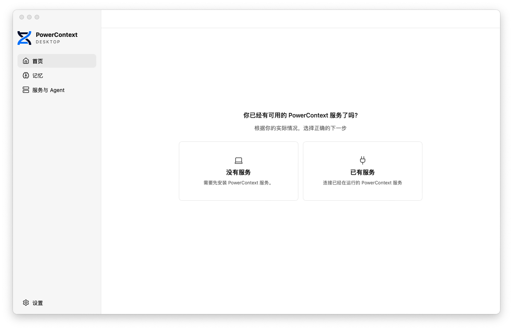

### 3.2 记忆

无连接时不能读取或写入记忆。进入记忆模块后沿用同一套连接前置引导：说明当前没有可访问的记忆空间，并提供“安装服务”和“连接服务”。不展示搜索、筛选、空列表或录入入口。用户完成服务连接并进入默认空间后，再切换到记忆页面。

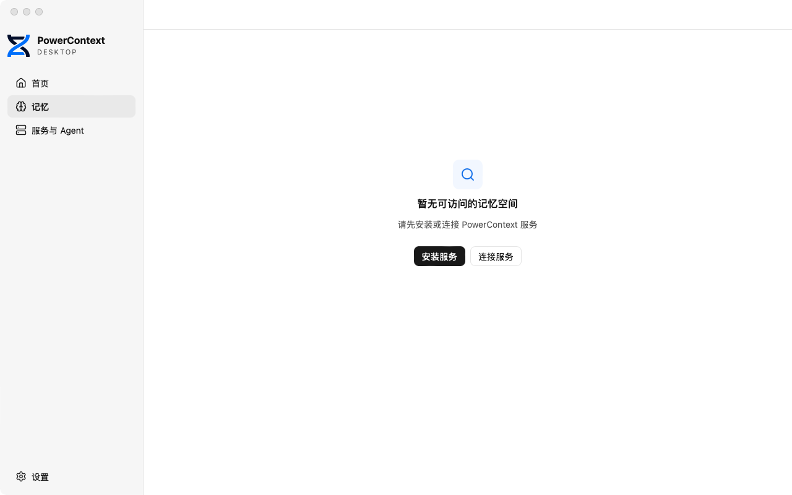

### 3.3 服务与 Agent

无连接时，本模块承接安装与连接。页面说明当前没有可用的服务与 Agent，并提供“安装服务”和“连接服务”。具体流程在对应弹窗内完成，不额外创建中间页面：

- 本地路径：说明安装位置和启动行为，完成后自动创建默认空间并回到首页。
- 已有服务路径：填写服务地址和认证信息，检查通过后激活连接并进入默认空间。
- 连接中和连接失败都在对应弹窗内反馈。

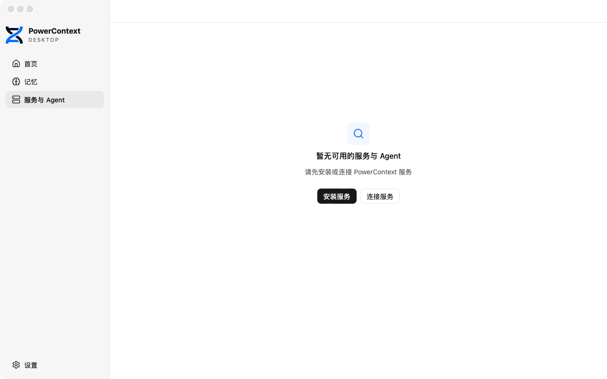

## 4. 有连接：首页

### 4.1 空间无 Agent、无数据

首页顶部展示当前服务和空间。内容区首先说明当前空间尚未连接本地 Agent，并提供主操作。右侧记忆概况显示真实的 0 状态。使用成效区域说明当前没有使用记录，不制造虚假趋势。

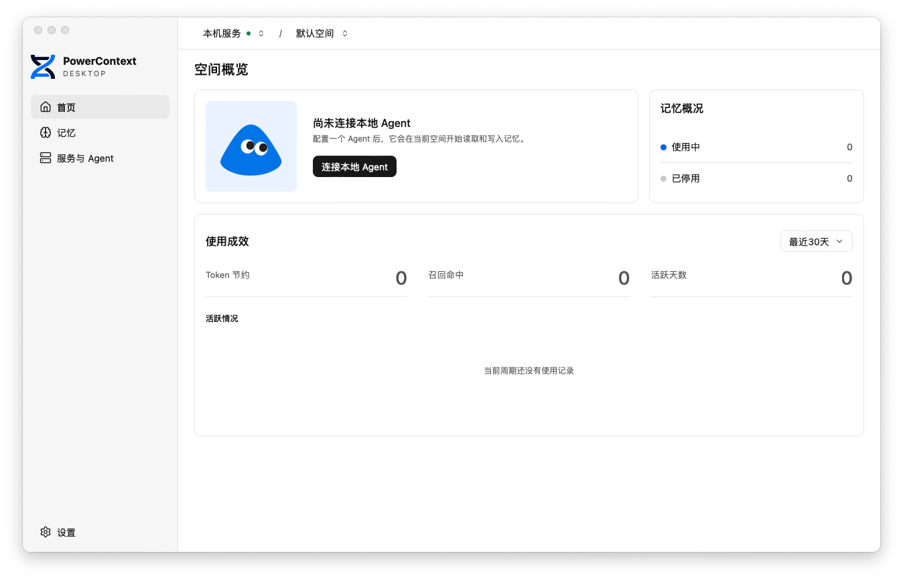

### 4.2 空间有 Agent 和数据

当空间已经绑定 Agent 并存在记忆数据时，首页切换为概览模式：

- Agent 列表展示名称、连接状态、项目、最近写入时间和管理入口。
- 记忆概况区分使用中和已停用数量。
- 使用成效展示 Token 节约、召回命中、活跃天数和周期活跃度。
- 周期选择只影响成效统计，不改变当前服务或空间。

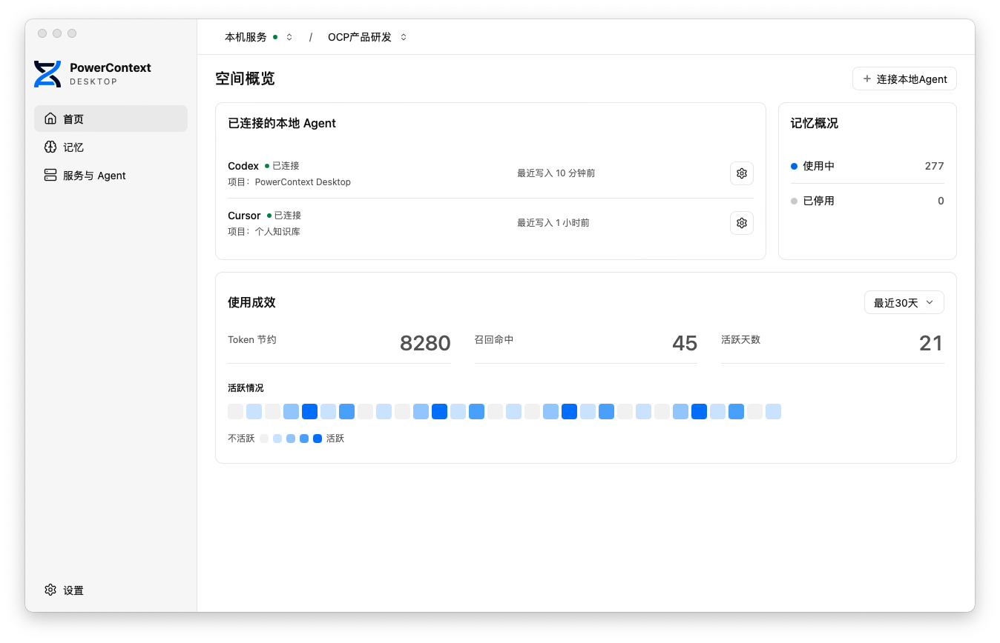

## 5. 有连接：记忆

### 5.1 列表与筛选

记忆页以列表为主。顶部固定提供搜索、状态、来源、排序和录入入口。列表行只展示判断所需的摘要、召回次数和最近使用时间，不在列表中堆叠详情标签。

- 搜索用于定位具体内容。
- 状态区分“使用中 / 已停用”。
- 来源区分手动录入和自动提取。
- 排序支持最近产生、最近使用和召回次数。
- 无数据时保留同一套页面骨架，并显示当前筛选条件下的空结果。

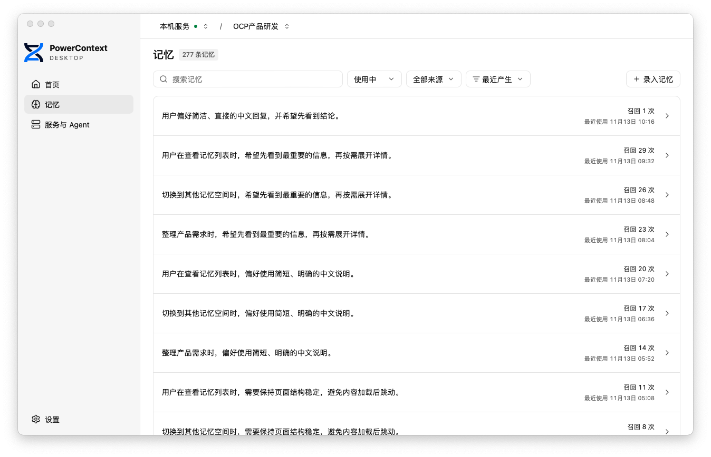

### 5.2 侧边详情

点击列表行后，在右侧打开详情面板，列表仍保留在左侧，便于连续查看。面板包含记忆内容、来源片段和基础状态。按 `Esc` 或关闭按钮返回列表，并把焦点归还到原列表项。

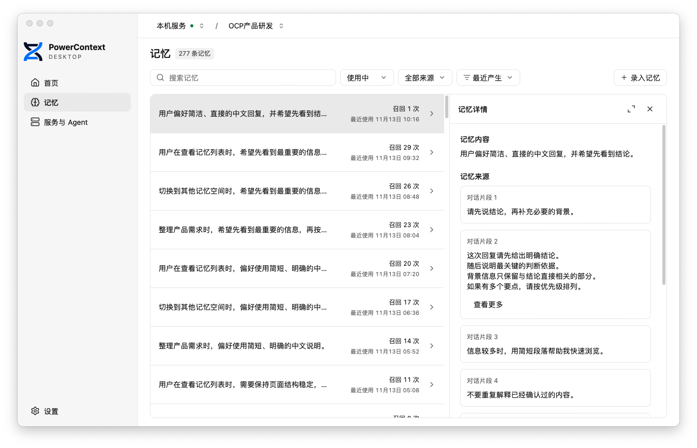

当前连接无法继续验证身份时，清除旧的记忆列表和详情。保存结果不确定时，在当前窗口的只读恢复区保留原文、原服务和空间。用户核对原目标并确认后，才可再次提交相同内容。空间选择器和保存确认界面均显示空间 ID，便于区分同名空间。

### 5.3 放大详情

当来源较多或内容较长时，可以放大详情。放大后主体用于阅读内容和来源，右侧集中显示状态、来源、产生时间、最近使用和召回次数，并提供启用或停用操作。顶部支持上一条、下一条和返回侧边模式。

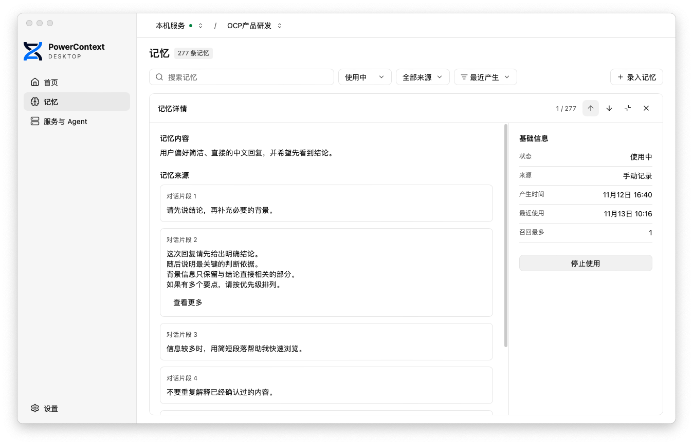

## 6. 有连接：服务与 Agent

### 6.1 本地服务

本地服务区域分成四层：

1. **服务信息**：类型、运行状态、地址和更多操作。
2. **本地 Agent**：仅展示关联到当前服务的 Agent，可连接、修改绑定、调整采集状态或删除连接。
3. **开机自动启动**：属于本地服务能力，不出现在远程服务中。
4. **模型配置**：分别展示生成模型和嵌入模型的配置状态。

服务更多操作包含编辑连接、检查状态、启动、停止、重启和卸载。危险操作必须经过二次确认。

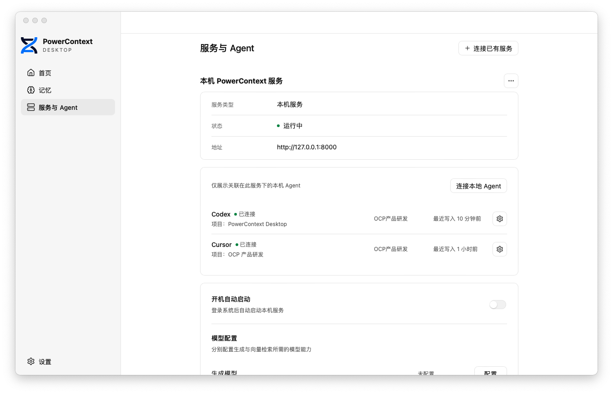

### 6.2 模型配置

模型配置提供两条路径：

- **Agent 协助**：选择目标 Agent，复制不含 API Key 的提示词。Agent 完成配置后，由 Desktop 检查结果。
- **手动配置**：填写服务地址和 API Key，校验连通性后选择模型并保存。

API Key 只保存在 Desktop 的安全存储中，不进入提示词、聊天内容或普通回执。校验失败使用语义化 Alert，并保留用户已输入的内容。

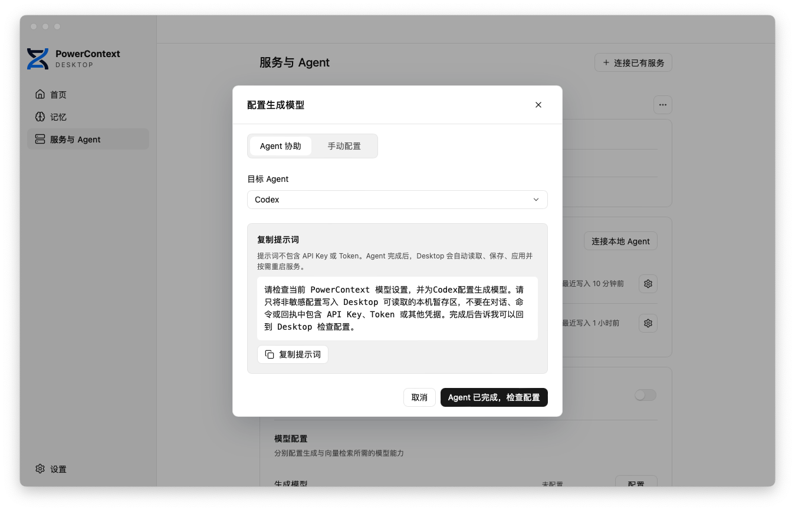

### 6.3 远程服务

远程服务区域保留连接地址、连接状态、更多操作和 Agent 关联，不提供进程控制或开机自启动。没有关联 Agent 时显示空状态，并保留“连接本地 Agent”。

页面上如果还没有本机服务，本机区域单独显示空状态和安装入口。安装、进程控制和开机自启动只属于本机服务，不写进远程服务自己的信息。

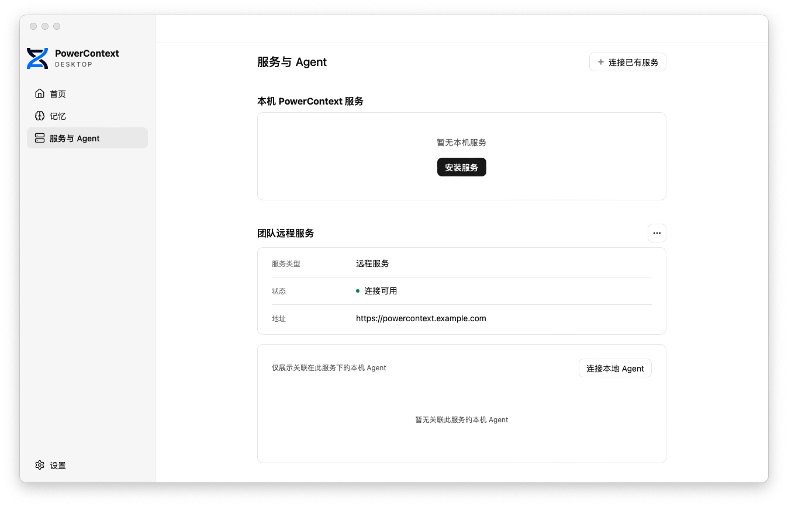

## 7. 设置

设置页只承载 Desktop 级偏好，不混入服务和空间配置：

- 语言：简体中文 / English。
- 外观：跟随系统 / 浅色 / 深色。
- 系统通知：服务异常、Agent 异常和版本更新提醒。
- 登录时打开 Desktop：只打开 Desktop，不等于启动 PowerContext 服务。
- 帮助与关于：使用帮助和问题反馈。

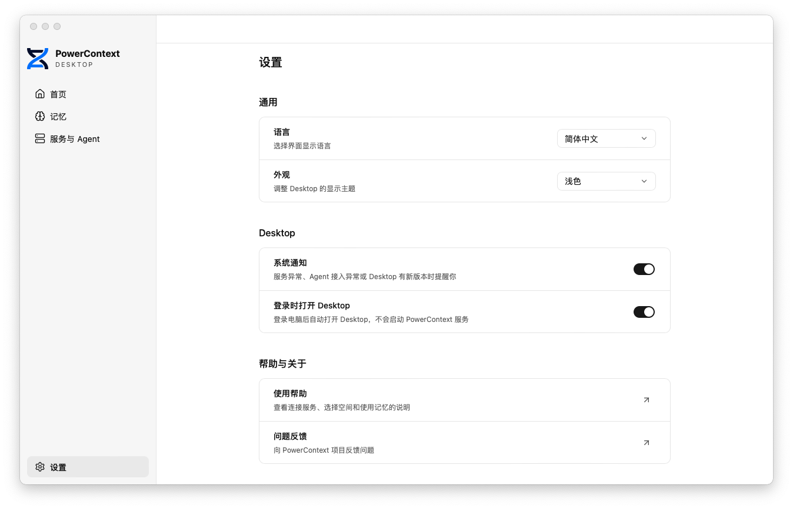

## 8. 其他交互

### 8.1 检查更新

- 在系统默认菜单基础上增加“检查更新”。
- macOS 和 Windows 使用各自的原生更新弹窗与系统行为。
- 检查中、已是最新版本、发现更新和检查失败都需要独立反馈。
- 当前 debug 构建未包含 Sparkle.framework，因此不能用 debug 预览截图验收正式更新能力。

### 8.2 服务与 Agent 状态刷新

- Desktop 间隔轮询服务与 Agent 状态，并在应用重新获得焦点时主动刷新。
- 正常、检查中和异常通过名称旁的小圆点表达。异常使用红色状态，不额外切换到另一套页面。
- 轮询失败不得清空上一次成功的数据，应保留内容并标记状态异常。
- 弹窗中的连接或校验过程由弹窗自身承载，不改写页面级状态。

## 9. Mock 数据

| 场景 | 示例数据 | 用途 |
| --- | --- | --- |
| 无连接 | 无连接配置、无活动上下文 | 验证安装与已有服务两条入口 |
| 默认空间 | 本机服务、默认空间、0 条记忆、无 Agent | 验证已连接后的空状态 |
| OCP 产品研发 | 277 条记忆、Codex 与 Cursor、30 天使用成效 | 验证有数据的首页、列表和详情 |
| 仅远程连接 | 团队远程服务、OCP 产品研发、无本机服务 | 验证远程服务的独立管理结构 |

所有示例名称、地址、时间和数量均为设计 mock。真实产品由同一套数据模型渲染，不为 mock 场景创建独立业务页面。

## 10. 验收关注点

- 无连接与已连接之间只切换数据状态，不切回旧版页面。
- 服务或空间切换后，首页、记忆和服务模块使用同一上下文。
- 记忆详情默认从右侧打开，放大是详情的第二层阅读模式。
- 本地服务和远程服务不展示不属于自身的操作。
- 浅色和深色保持相同的信息结构。状态色和插图背景使用对应主题 Token。
- 弹窗标题左对齐。表单字段、按钮、Alert 和焦点样式遵循 `desktop/DESIGN.md`。
- 键盘可以完成导航、菜单、筛选、详情关闭和弹窗操作。截图不能替代键盘与读屏验收。

## 实现边界

本文是设计与交互说明。当前 mock 可以完整展示界面，但记忆列表、Agent 管理、模型配置、本地服务控制、系统通知和登录启动等部分能力仍需正式接口或 Tauri 原生实现。界面验收不能代替这些能力的接口和宿主验收。

原生连接管理支持检查、编辑和移除已保存的本地和远程连接。连接检查验证服务可达性、身份和兼容性。就绪状态需要单独探测。服务安装、Agent 管理、模型配置、服务生命周期、系统通知和登录启动在接入各自接口前，在对应的原生界面中不可用。

断开后，可从已保存服务的操作菜单选择「使用此连接」，重新检查并进入默认空间。「检查连接状态」保留当前的服务和空间选择。
更改 Bearer 连接的地址时，请输入新地址的凭据。Desktop 沿用原有的凭据保存方式。
