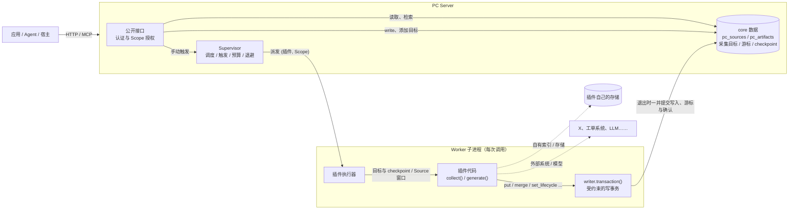

- Proposal Name: `plugin_interfaces`
- Start Date: 2026-11-08
- RFC PR: [oceanbase/powercontext#0000](https://github.com/oceanbase/powercontext/pull/0000)

# 概要

本提案重新定义 PowerContext 的第三方插件模型：每类插件只实现几个固定接口，PC Server 在需要时调用。插件是被调用方，
只负责“把输入变成结果”，不参与调度、状态管理和持久化协议。

- **Source 插件**提供 Source 定义（沿用现有 `SourceDefinition` / `SourceProjection`），可选实现 `collect`。写入时 Server
  调用定义完成校验、转换和保存。采集按**采集目标**进行，例如“X 上的某个账号”；宿主可以在运行中添加、停用和恢复目标，
  不需要重启。Supervisor 按调度派发 Worker 调用 `collect`，core 把返回的 Source 和各目标的 checkpoint 在同一事务中提交。
- **Artifact 插件**实现 `generate`。Supervisor 按配置的调度、新 Source 到达或手动请求派发 Worker，Worker 读取该 Scope
  尚未消费的 Source 窗口，连同一个**写入器**（`ArtifactWriter`）交给 `generate`。插件在写入器之外完成模型调用等耗时工作，
  然后在 `async with writer.transaction()` 块中执行 Artifact 写操作：块开始时 core 开启事务，块内的写操作直接作用于
  core 数据并立即返回真实的 revision，块正常结束时 core 把这些写入、消费游标和完成确认一起提交，块内抛出异常则整体回滚。
  插件读不到也改不了游标。
- core 只管理两类核心数据：`pc_sources` 和 `pc_artifacts`（含 heads、lineage、合并记录、生命周期、handle 和 tags），
  以及它们的消费进度。插件可以有自己的索引和存储，由插件自己管理和保证一致性。应用通过现有的 Artifact 公开接口读取
  和检索插件 family，读取路径不执行插件代码。
- `collect` 和 `generate` 在 Supervisor 管理的 Worker 子进程中执行，沿用现有的进程隔离、超时、并发预算、领导租约和
  失败退避。用户只需部署一个 Server。
- 插件在 Server 启动时按目录加载，代码或清单变更需要重启。Server 不保存插件的启用状态、注册代次或管理阶段，也不提供
  enable / disable / reload / unload 管理接口。

本提案取代 [Source 插件框架 RFC #2012](2012-source-plugin-system.md) 和 [Artifact 插件框架 RFC #2175](2175-artifact-plugin-system.md)
的插件契约与管理机制。两者的实现尚未作为稳定接口发布，本提案不保留兼容：旧的插件清单、管理接口、管理服务和插件管理相关的
表直接移除，旧 Artifact 插件写入的自定义 Artifact 数据不迁移。

本文描述目标设计，不代表主线或发布版本已经可用。接口名称和代码示例用于说明契约，最终语法以实现为准。

# 动机

现有两套插件框架都让 PowerContext 替第三方插件承担了大量生命周期管理：

| 框架 | Server 为插件承担的工作 |
| --- | --- |
| Artifact 插件（#2175） | 在 `pc_artifact_processing_binding_states` 中维护 `desired_state`、`phase`、`binding_generation`、`last_error`；七种管理状态及其转换；`enable-all / reload / enable / disable / unload` 管理接口与 `expected_generation` 并发校验；用注册代次屏蔽旧 Worker 提交；在 `pc_artifact_family_schemas` 中固化内容 schema 和索引定义，变更返回 409；框架负责自定义声明式索引的构建、重建和可用状态 |
| Source 插件（#2012） | 独立的插件管理服务及其 SQLite（实例、capability、target、期望状态、提交记录）；每个插件实例一个 Runtime 进程；管理服务与 Server 之间的 poll / reply 通道和能力目录同步；`source load` 部署命令；实例启停 MCP 工具 |

这些机制的代价由所有人承担：

- **插件作者**需要理解 binding、generation、schema 固化规则、索引声明和管理通道等框架概念，才能写出一个插件。
- **部署者**需要运行多个进程、维护两个数据库，并通过管理 API 让插件进入可运行状态。
- **维护者**需要为第三方代码维护状态机、并发屏蔽、schema 和索引治理以及恢复路径，这部分代码的规模和测试面已经超过
  插件业务本身。

插件真正需要的是：在合适的时机被调用，拿到需要的输入，把结果交回 core。调度、隔离、消费进度和事务提交是 core
本来就有的能力，Supervisor 已经为内置 Artifact 提供了这些能力。Dify 等系统的插件模型也说明，宿主定义接口和调用时机、
插件只实现接口，足以支撑大量第三方扩展。

本提案的目标：

1. 插件作者只需实现少量接口，不需要了解调度、游标和提交协议。
2. 插件代码在隔离的 Worker 进程中执行，插件故障不影响 Server 和其他插件。
3. 插件结果进入 `pc_sources` / `pc_artifacts`，与消费进度原子提交，现有读取接口直接可用。
4. core 只管理这两类核心数据及其消费进度；内容结构、索引和其他存储交给插件自己。
5. 插件对核心数据的写入只经过 core 提供的写入器，覆盖 Artifact 的全部通用写操作，并沿用 core 现有的校验规则。
6. Artifact 生成既可以按配置的调度执行，也可以由新 Source 或手动请求触发；采集目标可以在运行中增减。
7. 用户只需部署一个 Server；插件随 Server 启动加载。

# 指南级说明

## 1. 核心思路



| 职责 | 归属 |
| --- | --- |
| 认证、Scope 授权、公开 HTTP / MCP 接口、采集目标的增删改查 | Server |
| 何时调用：调度、触发合并、Worker 预算、超时、退避、领导租约 | Supervisor（现有） |
| 读取输入、提供受约束的写事务、在同一事务中提交核心数据 / 游标 / checkpoint / 完成确认 | Worker 中的插件执行器（core） |
| 外部数据读取、采集目标的识别与规范化、Source 定义与 Projection 计算 | Source 插件 |
| Artifact 内容结构、生成算法、插件自有的索引与存储及其一致性 | Artifact 插件 |
| 插件代码、依赖和插件自有存储的部署 | 部署者 |

插件代码只做一件事：给定输入，产出结果或抛出异常。抛出异常即失败，core 不提交任何核心数据，下次重试同一输入。

## 2. 插件目录与清单

Server 从 `POWERCONTEXT_SERVER_PLUGINS_DIR` 加载插件。每个直接子目录是一个插件，包含 `plugin.yml` 和代码：

```text
/opt/powercontext/plugins/
├── x-posts/
│   ├── plugin.yml
│   ├── definition.py
│   └── plugin.py
└── incident-report/
    ├── plugin.yml
    └── plugin.py
```

```yaml
name: incident-report          # 插件名，部署内唯一，与目录名一致
kind: artifact                 # source 或 artifact
entry: ./plugin.py:create      # 工厂函数，路径相对插件目录
scopes: [team-a]               # 可选；省略时处理所有存在匹配输入的 Scope
config:                        # 业务配置，由插件的 Config 模型校验
  title_prefix: 工单报告
  index_url: ${REPORT_INDEX_URL}     # ${NAME} 在 Worker 中从环境变量解析
```

清单只描述**插件是什么、怎样运行**，不包含启用状态。目录存在且加载成功，插件就可用；需要停用时移出目录并重启 Server。
同一份代码可以通过多个插件目录、不同的 `name` 和 `config` 部署多次。

## 3. Source 插件示例

Source 插件导出 Source 定义。只提供定义时，宿主可以通过现有的 Source 写入接口（MCP `pc_source_add` 的 write 用法）
提交完整内容，Server 调用定义的 `resolve` 和各 Projection，然后保存到 `pc_sources`。

需要从外部系统持续采集时，插件再实现 `collect`。采集以**采集目标**为单位：每个目标是插件能采集的一项外部资源，例如
X 上的一个账号。下面的插件每 5 分钟采集各目标账号的新帖子：

```yaml
name: x-posts
kind: source
entry: ./plugin.py:create
scopes: [team-a]
collect:
  schedule: {interval_seconds: 300}
  max_workers: 1
  timeout_seconds: 120
  max_items: 200
  targets:                      # 可选；首次启动时导入的初始目标
    - {scope_id: team-a, input: {account: "@oceanbase"}}
config:
  bearer_token: ${X_BEARER_TOKEN}
```

```python
from pydantic import BaseModel

from powercontext.plugins import (
    CollectedItem, CollectRequest, CollectResult, PluginContext, TargetIdentity,
)

from .definition import PostCapture, XPostDefinition

definitions = (XPostDefinition(),)


class Config(BaseModel):
    bearer_token: str


class TargetInput(BaseModel):          # 宿主添加目标时提交的输入
    account: str


def identify_target(value: TargetInput) -> TargetIdentity:
    account = value.account.strip().removeprefix("@").lower()
    if not account:
        raise ValueError("account must not be blank")
    return TargetIdentity(key=f"account:{account}", input={"account": account})


class XCollector:
    def __init__(self, client: XClient) -> None:
        self.client = client

    async def collect(self, request: CollectRequest) -> CollectResult:
        result = CollectResult()
        for target in request.targets:
            since = (target.checkpoint or {}).get("since_id")
            page = await self.client.user_posts(target.input["account"], since_id=since)
            result.add(target, [CollectedItem(definition="x-post", value=PostCapture(**p)) for p in page.posts],
                       checkpoint={"since_id": page.newest_id or since})
        return result


async def create(ctx: PluginContext, config: Config) -> XCollector:
    client = await ctx.enter_async_context(XClient(config.bearer_token))
    return XCollector(client)
```

宿主在运行中添加一个目标，无需重启：

```text
pc_source_add(scope_id="team-a", capability="x-posts", input={"account": "@PowerContextAI"})
```

Server 用 `TargetInput` 校验输入，调用 `identify_target` 得到稳定的目标键和规范化输入，保存目标后立即请求一次采集。
重复添加同一账号得到同一个键，复用已有目标；目标可以停用和恢复，进度保留。

每个目标的 checkpoint 是只读输入，插件通过返回值提出新的 checkpoint。core 把本次返回的所有 Source 与各目标的新
checkpoint 在同一事务中提交；`collect` 抛出异常或超时则不提交任何内容，下一次调用仍拿到旧 checkpoint。

## 4. Artifact 插件示例

下面的插件为每条工单 Source 生成一份报告：先用自己的向量索引查找相似的已有报告，命中则修订那份报告，否则新建；
同时把报告写进自己的向量索引。

```yaml
name: incident-report
kind: artifact
entry: ./plugin.py:create
scopes: [team-a]
generate:
  family: incident-report
  inputs:
    source_types: [example-ticket]
    projection: powercontext.text-evidence@1
    max_sources: 50
  schedule: {interval_seconds: 300}     # 定时检查
  on_sources: true                      # 新 Source 到达后触发
  manual: true                          # 允许手动触发
  max_workers: 1
  timeout_seconds: 300                  # 整次调用的时限
  transaction_timeout_seconds: 30       # 写事务块的时限
config:
  title_prefix: 工单报告
  index_url: ${REPORT_INDEX_URL}
```

```python
from pydantic import BaseModel

from powercontext.plugins import ArtifactWriter, GenerateRequest, PluginContext
from powercontext.sources import TextEvidence


class Config(BaseModel):
    title_prefix: str = "工单报告"
    index_url: str


class IncidentReports:
    def __init__(self, config: Config, index: VectorIndex, model: Summarizer) -> None:
        self.config, self.index, self.model = config, index, model

    async def generate(self, request: GenerateRequest, writer: ArtifactWriter) -> None:
        # 1. 耗时工作放在写事务之外：模型调用、向量计算
        planned = []
        for source in request.sources:
            evidence = TextEvidence.model_validate(source.projection)
            summary = await self.model.summarize(evidence.content)
            vector = await self.model.embed(summary)
            planned.append((source, summary, vector))

        # 2. 短写事务：块内读取能看到本块已写入的内容
        async with writer.transaction() as tx:
            for source, summary, vector in planned:
                match = await self.index.nearest(request.scope_id, vector, threshold=0.92)
                current = await tx.get(match.artifact_id) if match else None
                artifact_id = current.ref.artifact_id if current else writer.stable_id(
                    "report", source.ref.source_type, source.ref.source_id)
                ref = await tx.put(
                    artifact_id,
                    content={"title": self.config.title_prefix, "summary": summary},
                    search_text=summary,
                    source_refs=[source.ref],
                )
                # 拿到真实的 artifact_id 与 revision 后写入自有索引，按 ID upsert
                await self.index.upsert(request.scope_id, ref.artifact_id, ref.revision, vector)
        # 块正常结束：core 提交 Artifact 写入、游标推进与完成确认


async def create(ctx: PluginContext, config: Config) -> IncidentReports:
    index = await ctx.enter_async_context(VectorIndex.connect(config.index_url))
    return IncidentReports(config, index, Summarizer())
```

块内抛出异常时，core 回滚块内全部 Artifact 写入，游标不动，下次重试同一窗口。插件自有索引不在 core 的事务中：
插件按稳定 ID upsert，重试时会覆盖上一次留下的条目；读取自有索引时以 core 的当前 revision 为准（见参考级说明 1.6）。

应用通过现有的 Artifact 公开接口访问插件 family，这些接口直接读取 `pc_artifacts`，不执行插件代码：

| 用途 | 接口 |
| --- | --- |
| 浏览 | `GET /v1/scopes/{scope_id}/artifacts/{family}` |
| 读取当前内容 | `GET /v1/scopes/{scope_id}/artifacts/{family}/{artifact_id}` |
| 读取指定 revision / revision 历史 | `GET .../{artifact_id}/revisions/{revision}`、`GET .../{artifact_id}/revisions` |
| 读取 tags | `GET .../{artifact_id}/tags` |
| 文本检索 | `POST /v1/scopes/{scope_id}/artifacts/{family}/search` |
| 手动触发生成 | `POST /v1/scopes/{scope_id}/artifacts/{family}/generate` |

## 5. 调度与触发

插件的调度和触发都交给现有的 Artifact processing Supervisor。每个插件在启动时注册为一个 Supervisor binding，
binding 名为 `plugin:<name>`，调度键仍是 `(binding, Scope)`。

Artifact 生成支持三种调用来源，可以任意组合，至少配置一种：

| 配置 | 何时派发 Worker | `request.reason` |
| --- | --- | --- |
| `schedule: {interval_seconds: N}` 或 `schedule: {cron: "0 2 * * *", timezone: Asia/Shanghai}` | 到期时，对有待处理工作的 Scope | `schedule` |
| `on_sources: true` | Scope 的 Source journal 超过该插件的游标 | `sources` |
| `manual: true` | 调用手动触发接口 | `manual` |

- 配置了 `inputs` 的插件，每次调用都附带该 Scope 尚未消费的 Source 窗口；窗口为空时，定时和 Source 触发不调用插件，
  直接确认完成。
- 未配置 `inputs` 的插件（例如每天整理一次已有 Artifact）不消费 Source，到期即调用；必须显式配置 `scopes`。
- 手动触发总是调用插件，可以附带 `params`，由插件自行解释。手动请求在接受时持久化，返回 `202 Accepted`，
  Server 重启后仍会执行。

Source 插件的 `collect` 支持 `schedule` 和 `manual`（`POST /v1/scopes/{scope_id}/sources/plugins/{name}/collect`），
添加或恢复目标时也会请求一次采集。

同一插件、同一 Scope 同时最多运行一个 Worker。运行期间到达的触发由 Supervisor 合并成结束后的一次调用。

## 6. 运维

- 启动：Server 逐个检查插件目录。某个插件检查失败（清单无效、导入失败、缺少必需导出、family 或 Source 类型与内置或其他
  插件冲突）只影响该插件，Server 和其他插件正常启动。
- 查看：`GET /v1/plugins`（需要 `server.admin`）列出每个插件的检查结果、类型、family 或 Source 定义、调度配置，
  以及每个 Scope 的最近一次调用结果和下次重试时间。采集目标及其最近采集结果通过 `pc_source_status` 和目标接口查看。
- 变更：修改代码或清单后重启 Server。Server 不监视文件，也不在运行中重新加载插件。采集目标是业务数据，增减不需要重启。
- 停用：从插件目录移走后重启。已保存的 Source、Artifact、采集目标、游标和 checkpoint 保留并可继续读取；重新部署
  同名插件时从原位置继续。插件自有存储由部署者保留或清理。

# 参考级说明

## 1. 接口契约

公开接口位于新模块 `powercontext.plugins`，替换现有的 `powercontext.artifact_plugins` 和 `powercontext.source_management`
中面向插件作者的部分。接口以 `typing.Protocol` 和 Pydantic 模型表达。

### 1.1 入口模块、工厂与上下文

入口模块导出：

| 导出 | 必需 | 说明 |
| --- | --- | --- |
| 工厂函数（`entry` 指定） | 是 | `async def create(ctx, config) -> 插件实例` |
| `Config` | 否 | Pydantic 模型，校验清单中的 `config`；未导出时 `config` 必须为空 |
| `definitions` | Source 插件必需 | `SourceDefinition` 序列 |
| `TargetInput`、`identify_target` | 配置了 `collect` 的 Source 插件必需 | 采集目标的输入模型与识别函数 |

```python
class PluginContext:
    name: str                          # 清单中的插件名
    scope_id: str                      # 本次调用的 Scope
    plugin_dir: Path                   # 插件目录（只读约定）
    logger: logging.Logger             # 已绑定插件名的 logger

    async def enter_async_context(self, cm: AbstractAsyncContextManager[T]) -> T: ...
```

- 工厂在每次 Worker 调用中执行一次，实例不跨调用复用。需要关闭的资源（包括插件自有存储的连接）通过
  `ctx.enter_async_context` 注册，调用结束时由执行器释放。
- `${NAME}` 环境变量引用在 Worker 中解析后再用 `Config` 校验，凭据不进入 Supervisor 的派发参数和日志。
- 插件得不到 core 数据库的连接，也没有游标或 checkpoint 的写入接口。对核心数据的写入只有两条路径：Source 插件的
  `collect` 返回值，和 Artifact 插件的 `ArtifactWriter`。

### 1.2 Source 插件

```python
class TargetIdentity(BaseModel):
    key: str                          # 稳定的目标键，同一外部资源始终相同
    input: dict[str, JsonValue]       # 规范化后的输入，保留所有影响采集的参数

class CollectTarget(BaseModel):
    key: str
    input: dict[str, JsonValue]
    checkpoint: JsonValue | None      # 该目标上次成功提交的 checkpoint；首次为 None；只读

class CollectRequest(BaseModel):
    scope_id: str
    reason: Literal["schedule", "manual", "target_added"]
    targets: Sequence[CollectTarget]  # 本次要采集的已启用目标
    max_items: int
    params: JsonValue | None = None   # 仅手动触发

class CollectedItem(BaseModel):
    definition: str                   # definitions 中某个定义的 name
    value: BaseModel                  # 该定义 input_class 的实例

class CollectResult(BaseModel):
    targets: dict[str, TargetResult] = {}       # 键为目标键
    def add(self, target: CollectTarget, items: Sequence[CollectedItem], *, checkpoint: JsonValue | None) -> None: ...

class TargetResult(BaseModel):
    items: Sequence[CollectedItem]
    checkpoint: JsonValue | None
    has_more: bool = False

class SourceCollector(Protocol):
    async def collect(self, request: CollectRequest, /) -> CollectResult: ...
```

- 只提供 `definitions`、不配置 `collect` 的插件只支持 write。工厂只在 collect 调用时执行。
- `definitions` 中的 Source 类型与 Projection 在启动时注册到现有的 Source 定义清单，与内置类型和其他插件冲突时检查失败。
- **write** 不需要插件方法。Server 按 `definition.input_class` 校验输入，调用 `resolve` 得到 Source，计算各 Projection 后
  保存，语义与现有内置 Source 写入一致。
- **collect** 每次调用对应一个 Scope，最多携带 `max_targets`（清单配置，默认 50）个已启用目标；目标较多时按目标键轮转，
  `has_more` 的目标优先进入下一次调用。执行器对返回的每条 Source 执行与 write 相同的校验、`resolve` 和 Projection，
  然后在一个事务中保存全部 Source、写入各目标的 checkpoint 和最近采集时间，并确认本次调用。任一条失败则整次不提交。
  条目总数超过 `max_items`、返回了请求中不存在的目标键，都视为失败，不截断。
- 结果中没有出现的目标，checkpoint 保持不变。
- Source 身份由 `resolve` 决定。重复采集同一外部状态得到相同身份时，沿用现有去重规则，不产生重复 Source。

### 1.3 采集目标

采集目标是 core 保存的业务数据，与 Source 一样不属于插件生命周期状态：

| 操作 | 接口 | 说明 |
| --- | --- | --- |
| 添加 | MCP `pc_source_add`（collect 用法）、`POST /v1/scopes/{scope_id}/sources/plugins/{name}/targets` | 用 `TargetInput` 校验输入，调用 `identify_target` 得到键和规范化输入。同键且规范化输入相同则返回已有目标；同键但输入不同返回冲突。新目标保存为启用状态并请求一次采集 |
| 查看 | MCP `pc_source_status`、`GET /v1/scopes/{scope_id}/sources/plugins/{name}/targets` | 目标键、规范化输入、启用状态、最近成功采集时间、最近失败分类 |
| 停用 / 恢复 | MCP `pc_source_target_set_enabled`、`PATCH .../targets/{key}` | 停用后不再进入 collect 请求，checkpoint 和已采集的 Source 保留；恢复后从原 checkpoint 继续 |

- 添加和变更需要调用者对该 Scope 有 Source 写权限，并且 Scope 在插件的 `scopes` 范围内。
- `identify_target` 必须是纯函数：只做校验和规范化，不访问外部系统、不检查外部授权。外部资源是否存在、是否可读，
  在 collect 时由插件判断并以异常或空结果表达。它与 write 一样在 Server 进程中同步执行，有超时限制。
- 清单中的 `collect.targets` 只在对应键不存在时导入一次。之后以 core 中的数据为准，修改清单不会覆盖或删除已有目标。

### 1.4 Artifact 插件、写入器与写事务

```python
class ArtifactGenerator(Protocol):
    async def generate(self, request: GenerateRequest, writer: ArtifactWriter, /) -> None: ...

class GenerateRequest(BaseModel):
    scope_id: str
    reason: Literal["schedule", "sources", "manual"]
    sources: Sequence[GenerationSource]   # 本次窗口；未配置 inputs 时为空
    params: JsonValue | None = None       # 仅手动触发

class GenerationSource(BaseModel):
    ref: SourceRef                        # 精确 Source 引用
    projection: JsonValue                 # 清单 inputs.projection 指定的 Projection 内容

class ArtifactWriter(ArtifactReads):
    family: str                           # 固定为清单中的 generate.family

    def stable_id(self, *parts: str) -> str: ...
    def transaction(self) -> AbstractAsyncContextManager[ArtifactTransaction]: ...

class ArtifactTransaction(ArtifactReads):
    ...                                   # 读取（见 1.5）加写操作（见下表）
```

`generate` 的执行分两部分：

- **事务外**：插件通过 `writer` 读取已提交的数据（每次读取使用独立的只读短事务），完成模型调用、向量计算等耗时工作。
- **写事务块**：`async with writer.transaction() as tx:`。块开始时，core 开启写事务并重新校验 Supervisor 租约和调用意图；
  块内的写操作直接在该事务中执行，立即返回真实的 `ArtifactRef`（含 revision），块内读取能看到本块已写入的内容；
  块正常结束时，core 在同一事务中以 CAS 推进游标、确认本次调用并提交；块内抛出异常、超过 `transaction_timeout_seconds`
  或提交冲突，事务整体回滚，本次调用失败。

规则：

- 每次调用最多开启一个写事务块；第二次开启抛出异常。游标和调用确认只随这一个事务提交，因此一个窗口的核心数据不会
  被部分提交。
- 插件没有开启写事务块就正常返回，表示本窗口无需产出，执行器单独提交游标推进和调用确认。
- 写事务块提交后，`generate` 中后续代码抛出的异常不再影响已提交的结果，执行器记录为提交后错误，不重试该窗口。
  插件应把写事务块作为 `generate` 的最后一步。
- 写事务块的时限默认 30 秒，计入整次调用的 `timeout_seconds`。块内只应做读取、写操作和插件自有存储的写入，
  不应调用模型。

**写操作**：写事务覆盖 Artifact 的全部通用写操作，每个操作复用 core 现有的实现与校验规则，违反规则时立即抛出异常：

| 操作 | 复用的 core 实现 | 语义 |
| --- | --- | --- |
| `put(artifact_id, *, content, search_text=None, source_refs=(), artifact_refs=())` | `ArtifactRepository.create` / `revise` | 不存在则新建 revision 1；已存在则按当前 head 追加 revision。内容与 `search_text` 和当前 revision 相同时为 no-op，返回当前引用 |
| `revert(artifact_id, *, to_revision, reason)` | `revise` 的回滚路径 | 以历史 revision 的内容追加新 revision，记录 `restored_from_revision` 与原因 |
| `set_lifecycle(artifact_id, state, *, replacement_artifact_id=None)` | `ArtifactGovernanceRepository.transition` | active ↔ deprecated（可指定替代者），任意状态 → retired（不可逆）。修改 head 的治理状态，不追加 revision；被合并冻结的输入不能单独变更 |
| `merge(inputs, *, into, content, search_text=None, source_refs=())` | 公共合并方法（[RFC #1859](1859_artifact_merge.md)） | 以 `inputs` 的当前 revision 为输入，新建 `into`，记录合并关系并冻结输入。`into` 必须是新 ID |
| `preview_undo_merge(artifact_id)` / `undo_merge(artifact_id, *, preview=None)` | 公共合并方法的预览与恢复 | 撤销产生该 Artifact 的合并，恢复输入并退役结果；按预览执行时，相关状态变化则拒绝过期预览 |
| `bind_handle(handle_key, ref)` | Artifact handle 绑定 | 把稳定 handle 绑定到指定 revision |
| `set_tags(artifact_id, tags)` | Artifact tags 替换 | 整体替换该 Artifact 的 tags |

**写入约束**：

- 只能操作本 Scope、清单 `generate.family` 中的 Artifact，插件不能指定其他 family 或 Scope。
- `source_refs` 只能引用本次窗口中的 Source；`artifact_refs`、`to_revision` 和 `bind_handle` 的目标只能是本 family
  中实际存在的 revision。
- 每个写事务块的操作数、单份内容大小和总字节数有上限，超出即抛出异常并回滚，不截断、不部分提交。
- core 不校验 `content` 的业务结构，也不保存或固化 schema。内容结构的演进由插件负责，插件可以在 `content` 中自带版本字段。

### 1.5 读取

`ArtifactWriter`（事务外，只读已提交数据）和 `ArtifactTransaction`（事务内，同时看到本块已写入的内容）提供相同的读取方法，
范围固定为本 Scope、本 family：

```python
class ArtifactReads(Protocol):
    async def get(self, artifact_id: str, *, revision: int | None = None) -> ArtifactSnapshot | None: ...
    async def revisions(self, artifact_id: str, *, cursor: str | None = None, limit: int = 50) -> RevisionPage: ...
    async def list(self, *, states: Collection[LifecycleState] = ("active",), tags: Collection[str] = (),
                   cursor: str | None = None, limit: int = 50) -> ArtifactPage: ...
    async def search(self, query: str, *, states: Collection[LifecycleState] = ("active",),
                     limit: int = 10) -> Sequence[ArtifactSnapshot]: ...
    async def by_source(self, ref: SourceRef, *, cursor: str | None = None, limit: int = 50) -> ArtifactRefPage: ...
    async def lineage(self, ref: ArtifactRef) -> ArtifactLineage: ...
    async def governance(self, artifact_id: str) -> ArtifactGovernance: ...    # 生命周期、替代者、合并归属
    async def merge_record(self, artifact_id: str) -> ArtifactMergeRecord | None: ...
    async def tags(self, artifact_id: str) -> ArtifactTagSet: ...
    async def resolve_handle(self, handle_key: str) -> ArtifactRef | None: ...
```

- `get` 可以读当前内容或指定 revision；`revisions` 列出完整历史。
- `list` 和 `search` 可以按生命周期状态过滤，包括 deprecated、retired 和被合并冻结的 Artifact，用于查找“之前已经存在的
  数据”。`search` 是 core 提供的文本检索（见第 5 节），在写事务中能检索到本块已写入、尚未提交的内容。
- `by_source` 反查 lineage 引用了某条 Source 的 Artifact，用于 Source 更新后找到需要修订的 Artifact。
- 读取返回的快照都带精确 revision，可以直接作为写操作的 `artifact_refs` 或 `to_revision`。
- 插件需要向量相似度等 core 不提供的检索时，使用自己的索引，再用 `get` 以 core 中的当前 revision 为准。

### 1.6 一致性与幂等

**核心数据**：每个窗口的 Artifact 写操作、游标推进和调用确认在一个事务中提交。失败时核心数据完全不变，重试从干净状态
开始；成功后游标已越过该窗口，同一窗口不会再次投递。core 数据对每个窗口恰好提交一次。写事务内的操作直接作用于数据库，
冲突（例如 head 在读取后被并发修改）在操作时或提交时立即报告，整体回滚后由 Supervisor 重新调度。插件 family 第一版不开放
公开写接口，同一插件同一 Scope 又是单飞执行，因此这类冲突只在异常情况下出现。

**重复处理同一业务对象**：手动重跑、未配置 `inputs` 的定时整理等场景会再次处理已经处理过的对象。插件用
`writer.stable_id(...)` 从业务身份派生 Artifact ID，`put` 在内容相同时为 no-op，`set_lifecycle` 目标状态与当前相同时
为 no-op，`merge` 在输入已全部合并到同一结果时为 no-op，从而不会产生重复 Artifact 或无意义的 revision。

**插件自有存储**：插件的索引和其他存储与 core 是不同的数据库，不在 core 的事务中，core 不保证两者一致，由插件负责。
推荐做法：

1. 在写事务块内、拿到 `ArtifactRef` 之后写自有存储，按 `artifact_id`（必要时加 revision）upsert。这样自有存储的写入
   失败会让核心写入一起回滚。
2. 写事务提交失败时，自有存储可能留下本次的条目。重试会处理同一窗口、得到同一个稳定 ID，覆盖这些条目。
3. 从自有存储读出的结果，用 `get` 校验 core 中是否存在、revision 是否一致，忽略不一致的条目，或定期按 core 数据重建。

`generate` 本身可能因失败重试而执行多次，模型调用和插件发出的外部请求不是恰好一次。

## 2. 插件执行器与消费游标

插件执行器是 Worker 中的 core 代码，实现 Supervisor 的 Worker 入口，替代旧的 `run_artifact_plugin_worker`。
它对 Artifact 插件的一次调用如下：

```text
Worker 收到 (plugin:<name>, scope_id, request_generation)
  -> 短事务：ScopeInvocation.start；读取 pc_source_cursors 中 (scope_id, plugin:<name>) 的游标
     -> 读取 journal 高水位，确定窗口 (after, through]，through ≤ after + max_sources
     -> list_window_for_generation 读取窗口，按 inputs.source_types 过滤，计算 inputs.projection
  -> 加载插件、调用工厂、创建写入器、调用 generate（受 timeout_seconds 约束）
     -> 事务外读取：独立只读短事务
     -> 写事务块开始：开启事务；guard（租约与调用意图）
        块内写操作在该事务中执行
        块结束：游标 CAS 到 through；acknowledge；提交
  -> generate 返回且未开启写事务块：短事务完成游标 CAS 与 acknowledge
```

- 窗口内类型不匹配的 Source 被过滤，但游标仍推进过整个窗口；匹配类型的 Source 缺少所需 Projection 时调用失败，不跳过。
- 游标只在执行器的提交事务中推进，插件得不到游标值，也没有写入接口。游标 CAS 保证在读取窗口与提交之间即使发生
  领导权变更或重复派发，同一窗口也只提交一次。
- `on_sources` 复用现有的 `SourceProcessingPendingProvider`：journal 高水位大于游标时标记待处理，由 Supervisor 按预算派发。
  判断基于持久化数据，Server 重启后不会丢失待处理输入。
- 手动触发和添加采集目标复用现有的调用意图（`ArtifactProcessingIntentRepository.request`）：在接受事务中提升
  requested generation，多次请求合并，运行期间的新请求由后续调用处理。
- 未配置 `scopes` 时，自动调度对所有 journal 超过游标的 Scope 生效；配置了 `scopes` 时，自动调度和手动触发都只接受
  名单内的 Scope。

collect 调用结构相同：输入换成该 Scope 的已启用目标及其 checkpoint，提交内容换成 Source 与各目标的新 checkpoint。
collect 不需要写事务块，由执行器根据返回值一次提交。

## 3. 加载与生命周期

```text
Server 启动
  -> 扫描 POWERCONTEXT_SERVER_PLUGINS_DIR 的直接子目录（未设置则不加载插件）
  -> 对每个目录：解析并校验清单（name 与目录名一致、kind 与配置段匹配）
     -> 在有时限的检查子进程中导入入口，确认工厂、Config 和其他必需导出符合 kind，不调用工厂
     -> Source 插件：在 Server 进程导入 definitions、TargetInput 与 identify_target，注册 Source 类型
     -> 导入清单中尚不存在的初始采集目标
     -> 注册 family 的访问 profile；有 collect / generate 配置时注册 Supervisor binding
  -> 任一步失败：记录错误，该插件标记为 failed，继续下一个
Server 停止
  -> 按现有 Supervisor 关闭流程停止派发并回收 Worker
```

插件只有 `loaded` 和 `failed` 两种结果，只存在于进程内存中。Server 不持久化插件的启用状态、注册代次或配置快照；
每次启动按当时的目录内容重新检查。没有热加载，因此不需要注册代次来屏蔽旧 Worker，现有的 Supervisor 租约 fence
已经足以屏蔽领导权变更后的旧提交。

Worker 每次调用重新导入插件代码。插件目录在 Server 运行期间被修改时，新派发的 Worker 可能读到新代码；部署者应在
修改后重启 Server，第一版不检测这种情况。

## 4. 执行约束

- **隔离**：`collect` / `generate` 在 Supervisor 启动的 Worker 子进程中执行，崩溃、内存泄漏和阻塞不影响 Server。
  子进程隔离普通故障，不是不可信代码的沙箱：插件以 Worker 的操作系统权限运行，可以访问其文件、网络和环境变量。
- **超时与预算**：`timeout_seconds`（默认 300）是 Worker 总时限，`transaction_timeout_seconds`（默认 30）是写事务块时限，
  `max_workers`（默认 1）是该插件跨 Scope 的并发上限。前两者和并发上限映射到 Supervisor binding 的现有参数或由执行器强制。
  单次调用的输入字节、写操作数和输出字节有上限，超出即失败。
- **写事务的锁影响**：写事务块持有期间会锁住涉及的 head 和游标行；在 SQLite 上，写事务会阻塞整个数据库的其他写入。
  因此写事务块必须短，时限超出即回滚。
- **失败与退避**：调用失败时不提交任何核心数据，该插件该 Scope 进入 Supervisor 现有的退避，不影响其他 Scope 和插件。
  core 不会因为重复失败自动跳过输入；持续失败需要修复插件或数据后重启。collect 中某个目标持续失败会阻塞同一 Scope
  的其他目标，可以先停用该目标。
- **多实例部署**：OceanBase 多 Server 实例时，派发只发生在持有 Supervisor 领导租约的实例上；write、目标管理和读取
  可以在任意实例执行。插件自有存储需要能被执行 Worker 的实例访问。SQLite 部署只有一个 Server 进程。

## 5. 公开读取与检索

插件 family 的公开读取完全由 core 处理，不执行插件代码：

- list / get / revisions / tags 复用现有的通用 Artifact 读取路径。插件 family 的 `content` 按原样 JSON 返回，不需要
  `pc_artifact_family_schemas` 中的 schema。被合并冻结、deprecated 和 retired 的 Artifact 按公共合并与生命周期规则展示。
- search 是 core 为插件 family 新增的通用文本检索，与现有检索接口一样只接受文本 query：写入时把 `search_text`
  经现有词法分析写入 `pc_artifact_heads.searchable_text`，检索时在该列上匹配，只返回请求 Scope 中调用者有权读取的
  revision。未提供 `search_text` 的 Artifact 不参与检索。写入器的 `search` 使用同一实现。实现 PR 需要给出 SQLite 与
  OceanBase 上的检索方式和规模验证。
- Review、Recall 和 Prepared Context 第一版不对插件 family 开放；公开的创建、修订、合并、生命周期、handle 和 tags 写接口
  也不对插件 family 开放，插件 family 的写入只来自插件。对应接口返回明确的“不支持”错误，`GET /v1/capabilities`
  反映实际支持的操作。

## 6. 持久化

| 数据 | 处理 |
| --- | --- |
| `pc_sources`、Projection、Source journal、`pc_source_definition_manifests` | 保留；Source 插件的结果 |
| `pc_artifacts`、`pc_artifact_heads`、`pc_artifact_lineage_*`、合并记录、handle、tags | 保留；Artifact 插件的结果 |
| `pc_source_cursors` | 保留；Artifact 插件的消费游标，键为 `(scope_id, plugin:<name>)` |
| `pc_connector_checkpoints` | 保留；各采集目标的 checkpoint，键为 `(scope_id, 目标的 binding ID)` |
| `pc_source_collect_targets` | 新增；采集目标：Scope、插件名、目标键、规范化输入、启用状态、创建与更新时间、最近成功采集时间、最近失败分类 |
| Supervisor 的调用意图、pending、租约表 | 保留；插件 binding 与内置 binding 共用 |
| `pc_artifact_processing_binding_states` 中为插件新增的列（`plugin_id`、`plugin_family`、`binding_generation`、`desired_state`、`phase`、`last_error`） | 移除 |
| `pc_artifact_family_schemas` | 移除 |
| 自定义 family 声明式索引使用的搜索状态与向量索引数据 | 移除；实现 PR 确认内置 family 不依赖后删除对应表 |
| 旧 Artifact 插件写入的 Artifact、head、lineage | 删除，不迁移 |
| `pc_source_write_plugins` | 移除；write 入口改由插件目录在启动时提供 |
| Source 插件管理服务的 SQLite | 随管理服务一起移除 |
| 插件自有的索引与存储 | 不属于 core，由插件和部署者管理 |

目标的 binding ID 由插件名和目标键确定性派生，长度超过列宽时使用其摘要。新增与移除通过一次新的数据库迁移完成，
迁移说明中列出新增、删除的表、列和数据范围。

## 7. 接口变更

| 变更 | 内容 |
| --- | --- |
| 移除 | `/v1/admin/artifact-plugins` 及其子路径；Source 插件管理服务、插件实例 Runtime、poll / reply 通道；`source load` 命令；MCP `pc_source_instances`、`pc_source_instance_set_enabled` |
| 移除 | 自定义 family 的声明式索引（`ArtifactSearchDeclaration`、`TextIndex` 等）、`ArtifactFamily` 的 schema 声明、`ArtifactDraft` 和旧的 Worker 插件执行器 |
| 新增 | `GET /v1/plugins`、`GET /v1/plugins/{name}`（`server.admin`，只读） |
| 新增 | `POST /v1/scopes/{scope_id}/artifacts/{family}/generate`、`POST /v1/scopes/{scope_id}/sources/plugins/{name}/collect`（`202 Accepted`） |
| 新增 | `GET` / `POST /v1/scopes/{scope_id}/sources/plugins/{name}/targets`、`PATCH .../targets/{key}` |
| 调整 | 通用 Artifact 读取与检索接口支持插件 family；`GET /v1/capabilities` 列出插件 family |
| 调整 | MCP `pc_source_add` 的 write 用法使用插件定义，collect 用法添加采集目标；`pc_source_capabilities` 列出插件 Source 类型与目标输入；`pc_source_status` 报告目标及其最近采集结果；`pc_source_target_set_enabled` 改为作用于 core 保存的目标 |
| 调整 | 环境变量 `POWERCONTEXT_SERVER_PLUGINS_DIR` 取代 `POWERCONTEXT_SERVER_ARTIFACT_PLUGINS_DIR` 和 Source 插件目录配置 |

`openapi/powercontext.yaml` 按上表更新后重新生成 `src/powercontext/http/_generated/`。

## 8. 可观测性

插件调用复用 Supervisor 与 Worker 现有的操作词汇、执行身份和结果字段，不为定时调用生成 request ID。新增字段：

| 字段 | 含义 |
| --- | --- |
| `plugin_name` | 清单中的插件名 |
| `plugin_method` | `collect` 或 `generate` |
| `trigger` | `schedule`、`sources`、`manual`、`target_added` |
| `operation_count` | 本次提交的写操作数（Artifact）或 Source 条数（collect） |
| `target_count` | 本次 collect 携带的目标数 |
| `transaction_ms` | 写事务块从开始到提交或回滚的耗时，毫秒 |

指标标签可以使用 `plugin_name` 和 `plugin_method`，不包含 Scope ID 或目标键。日志经 `log_safely` 输出，不包含 Source
内容、Projection、Artifact 内容、目标输入、`params`、`config` 值和环境变量值；插件异常只记录类型和已知错误分类，
不记录异常消息。新增字段按开发指南登记到允许列表，并在中英文可观测性文档中说明。

# 缺点

- **部分插件代码在 Server 进程中执行**：write 需要同步返回，Source 定义的 `resolve`、Projection 和 `identify_target`
  不经过 Worker。它们应当是纯数据转换，但阻塞或异常仍会影响请求处理。Server 对这些调用设置超时并把异常转换为请求错误。
- **写事务持锁**：写事务块期间持有数据库锁，SQLite 上会阻塞其他写入。插件若在块内执行慢操作，会拖慢整个 Server 的写入，
  直到块超时回滚。
- **插件自有存储与核心数据不保证一致**：两者不在同一事务中，提交失败可能在自有存储中留下条目，插件需要按稳定 ID 覆盖
  并以 core 为准校验。
- **每次调用都要启动 Worker 并加载插件**：子进程启动和工厂初始化有固定开销，不适合秒级高频调用；插件不能在调用之间
  复用连接或缓存。
- **不是安全沙箱**：Worker 隔离普通故障，不限制插件的文件、网络和凭据访问，也不提供硬性的内存或 CPU 配额。
  写入器约束的是插件对核心数据的写入，不能阻止插件代码访问 Worker 可达的其他资源。
- **依赖必须兼容**：所有插件与 Server 共用一个 Python 环境，依赖冲突需要部署者解决。
- **内容结构不受 core 治理**：core 不校验 `content` 的 schema，历史 revision 的解释需要插件和应用自行保持兼容。
- **core 检索能力有限**：core 只提供基于 `search_text` 的通用文本检索；向量等检索需要插件自建索引。
- **采集与 Server 部署在一起**：采集在 Server 的 Worker 中执行，需要 Server 能访问外部数据源。
- **代码变更需要重启**：没有热加载，插件更新期间 Server 会短暂不可用。

# 理由与备选

| 方案 | 取舍 |
| --- | --- |
| 保留现有设计，只简化接口 | 插件作者体验改善有限，生命周期状态机、管理服务和 schema 固化的维护成本仍在 |
| 插件在 Server 进程内执行 | 部署和调用最简单，但插件故障会拖垮 Server；Supervisor 已经提供隔离和调度，没有理由另起一套 |
| 插件完全自管存储和游标 | core 读取接口无法直接使用，各插件需要重复实现窗口读取与幂等，游标与结果也难以原子提交 |
| 插件通过上下文接口逐条写入、各自提交，最后返回成功与否 | 写入与游标推进分属不同事务，失败时会留下部分结果，重试会重复写入 |
| 插件返回草稿，或由写入器在内存中暂存操作，最后统一提交 | 可以原子提交，但插件在提交前拿不到真实的 revision，难以同步写入自有索引；合并、撤销合并、生命周期等操作需要在内存中重新实现一遍 core 的语义；检索也看不到暂存内容 |
| 用一个事务包住整个 `generate` | 模型调用可能持续数分钟，长时间持锁会阻塞其他写入，SQLite 上会阻塞整个数据库；插件自有存储是另一个数据库，一个事务本来也覆盖不了 |
| `generate` 内的短写事务块（本提案） | 耗时工作在块外；块内直接复用 core 的写操作和校验，拿到真实 revision，读取能看到本块写入；块结束时与游标、确认一起提交，异常即回滚。代价是块内持锁，需要时限约束 |
| 常驻插件进程（类似 Dify 的插件守护进程） | 可以复用连接、支持多语言，但需要进程管理、序列化协议和取消协议。接口以请求 / 响应模型定义，后续可以替换执行方式而不改插件代码 |
| 支持热加载 | 需要重新引入加载状态、注册代次屏蔽和旧调用回收，与目标冲突 |

选择“Supervisor 派发 Worker、插件在短写事务块中直接写入、core 与游标一并提交”的原因：插件作者只需写一个工厂和一个方法；
隔离、调度、触发、退避和领导权都复用已经在生产中使用的 Supervisor；写操作直接复用 core 现有实现，不需要另一套语义；
Source 与 Artifact 留在 core 的统一存储中，现有读取接口、lineage、合并记录和访问控制直接适用；core 只管理两类核心数据
及其进度，其余交给插件。

# 先例

- **Dify 插件**：按插件类型（工具、模型、Agent 策略、扩展端点等）定义接口，插件用清单声明类型与参数并实现对应方法，
  Dify 在工作流或应用需要时调用。插件运行在独立的插件守护进程中。本提案沿用“宿主定义接口与调用时机”的思路，执行
  隔离复用 PowerContext 已有的 Supervisor Worker。
- **Airbyte 连接器协议**：Source 连接器的 `read` 接收上次的 state 并输出记录和新 state，由平台持久化 state。
  本提案的采集 checkpoint 采用相同分工，并按目标分别保存。
- **事务上下文管理器**：SQLAlchemy 的 `async with engine.begin()` 等接口在块开始时开启事务、正常结束时提交、异常时回滚。
  `writer.transaction()` 沿用这一使用方式，并在提交时附带游标与调用确认。
- **PowerContext 现有基础**：[Artifact processing Supervisor](1515_artifact_processing_supervisor.md) 的调度、调用意图、
  Worker 与租约 fence；[公共合并方法](1859_artifact_merge.md)；`ArtifactRepository`、`ArtifactGovernanceRepository`、
  handle 与 tags 的写入实现；`SourceDefinition` / `SourceProjection`；Source journal、`pc_source_cursors` 和
  `list_window_for_generation`；`pc_connector_checkpoints`；旧 Source 插件设计中的 `identify_target` 目标识别规则。

# 未决问题

| 问题 | 说明 |
| --- | --- |
| 插件自定义检索 | 现有检索接口只接受文本 query，第一版由 core 提供通用文本检索。后续是否允许插件为公开检索接口提供实现，需要确定检索代码在哪个进程执行 |
| 写事务块的时限与限额默认值 | 默认 30 秒是否合适；SQLite 与 OceanBase 是否采用不同默认值；单块操作数与字节上限 |
| 共享模型客户端 | 是否在 `PluginContext` 中提供 Server 已配置的模型客户端，让 LLM 插件不必自带凭据，并计入现有模型用量统计 |
| 采集目标的删除 | 第一版只支持停用和恢复。是否需要彻底删除目标及其 checkpoint，以及删除后已采集 Source 的处理 |
| 插件 family 接入 Recall / Prepared Context | 需要定义候选内容和预算约束，建议另行提案 |

# 后续可能

- 常驻插件进程，在保持接口不变的前提下复用连接和初始化结果。
- 更多插件类型，例如为 Recall 提供候选内容、为 Prepared Context 提供文本片段。
- 插件打包与安装工具，例如从 Git 地址或 wheel 安装到插件目录。
