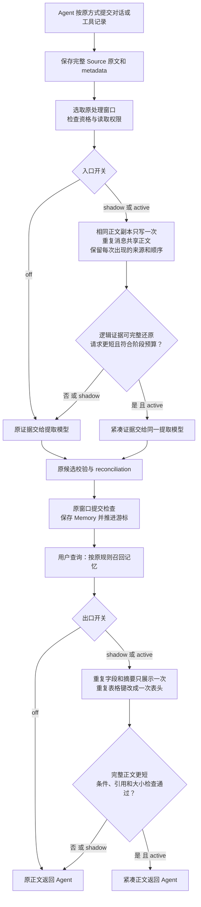

- Proposal Name: `token_efficient_memory_lifecycle`
- Start Date: 2026-10-13
- Status: Proposed
- RFC PR: [oceanbase/powercontext#1990](https://github.com/oceanbase/powercontext/pull/1990)
- Related Issue: [#1989](https://github.com/oceanbase/powercontext/issues/1989)
- Related Discussion: [#1971](https://github.com/oceanbase/powercontext/discussions/1971)
- Related RFCs: [RFC 1400](1400_source_definition_and_observation_model.md)、
  [RFC 1515](1515_artifact_processing_supervisor.md)、[RFC 1809](1809-atomic-memory.md)、
  [RFC 1489](1489_prepared_context_text_assembly.md)、[RFC 1560](1560_recall_sufficiency_gate.md)、
  [RFC 0081](0081_end_to_end_evaluation_architecture.md)

# Summary

在 PowerContext 已拥有的两个模型输入边界减少 Token：

1. **入口闸：Source 已保存，记忆尚未提取。**先去掉提取请求中重复的正文副本，再对同一窗口内反复出现的
   消息和结构化快照共享正文。模型仍能看到完整逻辑证据、每次发生的顺序、条件和来源。
2. **出口闸：Memory 已召回，尚未交给调用方。**在现有 `prepare_context` 中合并重复字段、摘要和表格键，
   只在完整正文更小且合同通过时采用新表示。

两道闸独立默认关闭，支持 `off / shadow / active`。入口减少 PowerContext 的提取输入，出口减少调用方
收到的历史正文；入口效果不能通过 prepare 的节省比例代替。普通 capture、flush/supervisor、prepare
调用保持原流程，不要求 Agent 替换历史或管理新状态。

首期 **0 新数据库表、0 新列、0 迁移、0 HTTP endpoint、0 MCP operation、0 公共请求/响应字段**。
原 Source 证据与正式 Artifact 内容不被压缩器改写。临时表示和正文共享只存在于当前处理窗口或请求。

首期 active 仅考虑经过验收的完整表示转换。识别“无需记忆”的输入可进一步省掉整个模型请求，但它改变
记忆生成机会，先放在 shadow，单独通过持久事实、时间、引用和未来问答质量验收后才讨论启用。

# Motivation

## 为什么必须同时看一进一出

只优化 prepare，已经为提取支付的模型输入不会减少。重复的对话快照、日志包装或 Source 投影可能先被
PowerContext 读入提取模型，再成为正式记忆，最后才进入 prepare。专项应从“已有原始证据到下游使用”的
完整生命周期计量，而不是只检查最终正文是否短了一点。

当前存在可落实的入口空间：

- Atomic 提取的 `content` 是 materialized Source 或已有 TextEvidence 投影；`source_metadata` 同时是
  完整 Source dump。对于 Content Source，以及携带 payload/projections 的 Observation，正文可能
  在一个提取请求中重复出现。需要消除重复表示，而不是把 metadata 整体当作无用信息删除。
- 同一窗口可能包含逐步增长的结构化对话快照。同一条早期消息可出现在多个 Source 中；每个 Source
  都已可靠保存，但提取模型不必反复接收同一正文。
- Topic 已按已知 Source 类型做投影，并有有界分片；Atomic 已有预算检查、超限窗口缩小。这些能力是
  baseline，不能把已有投影、分片、cursor 增量消费或 capture 幂等包装成新增节省。
- 出口的既有条数、字节和片段限制已经限制交付大小。专项新增收益必须来自重复表示减少或单独验收的
  覆盖变化，不能来自随意调小原配置。

入口实施位置由现有 [Atomic extraction](https://github.com/oceanbase/powercontext/blob/master/src/powercontext/builtin/artifacts/atomic_memory/extraction.py)、
[Atomic window processor](https://github.com/oceanbase/powercontext/blob/master/src/powercontext/builtin/runtime/atomic_memory_processing.py)
和 [Topic processor](https://github.com/oceanbase/powercontext/blob/master/src/powercontext/builtin/runtime/topic_memory_processing.py)
拥有。出口复用 [Runtime prepare](https://github.com/oceanbase/powercontext/blob/master/src/powercontext/builtin/runtime/application.py)
及原 builder/renderer。

## 产品切入点

PowerContext 保存原始证据，又负责把证据送给提取模型和把记忆送给下游模型。这两个服务端边界可以统一
执行“正文不重复送，来源和发生过程不合并”的规则，同时分别证明收益。

差异化的核心不是泛化的摘要器，而是**用完整原始证据支撑临时的共享表示，并保持提取、引用、提交与
后续问答都可验证**。尤其是结构化快照，可以只编码变化，同时保留完整逻辑快照；不必靠新增原文库或
跨请求记忆缓存才能实现。

成功标准是实际生成和使用链路净用量下降，并守住持久事实与任务质量。格式可还原只是算法门槛，不能
替代模型理解和最终答案的验收。

# Guide-level explanation

## 用户看到的完整流程

用户与 Agent 持续讨论订单重试规则：

```text
消息 m1：只读的幂等查询最多重试三次。
消息 m2：资金操作禁止自动重试。
消息 m3：从下周起，上限改为两次；其他限制不变。
```

宿主保存了三个结构化快照，内容分别是 `[m1]`、`[m1,m2]`、`[m1,m2,m3]`。

1. 三个 Source 均按原方式保存，原文和 metadata 可以通过原接口读回。
2. 入口闸把消息正文只编码一次，另列三个快照各自包含哪些消息。它**不是只给 m3**：模型仍能看到旧上限、
   新上限的生效时间和资金操作例外，并知道每个快照的独立来源与发生顺序。
3. 原提取模型产生候选，继续原 reconciliation、授权、写入检查与窗口事务，提交正式记忆。
4. 用户之后询问重试策略，原 prepare 检索相关记忆；出口闸把重复表达只展示一次，保留条件、引用和格式。
5. Agent 接收原接口返回的正文，照常工作。它无需替换历史、学习补读协议或执行解码工具。



图中“逻辑证据可完整还原”由服务端规则检查，模型收到的是直接可读的共享正文和出现记录。它不代表模型
必然理解正确；这个保证需要独立评测。未知普通文本不被当作结构化对话拆解。

## 开关与回滚

| 入口模式 | 出口模式 | 实际行为 |
| --- | --- | --- |
| off | off | 原提取与原交付 |
| active | off | 只改变提取输入，单独验证入口 |
| off | active | 原记忆生成，只改变 prepare 正文 |
| active | active | 两道闸一起工作，验证联合效果 |

任一侧 shadow 都只计算方案、记录安全计量，仍执行该侧 legacy 路径。入口 shadow 不额外调用第二个
提取模型、不生成第二份 Memory，也不让候选的 no-op 判断推进游标。

拟议入口配置：

```bash
export POWERCONTEXT_SERVER_RUNTIME_MEMORY_INPUT_OPTIMIZATION_MODE=off
```

出口沿用拟议的 `POWERCONTEXT_SERVER_RUNTIME_TOKEN_OPTIMIZATION_MODE`；入口默认 off，不继承出口
active，避免已有部署开启出口时意外改变持久记忆。配置在启动时读取，修改后重启，不新增请求级参数。

关闭出口会使后续 prepare 回到原正文。关闭入口只改变后续提取；**已经消费的 Source 不会自动重提取**。
原 Source 仍在不等于遗漏的 Memory 已恢复，projection rebuild 和 Artifact restore 也不等于 Source
重放。无损表示是入口首期的边界；有损入口必须先解决明确的恢复与重新验收流程。

# Reference-level explanation

## 1. 所有权与变化清单

| 项目 | 变化 |
| --- | --- |
| Source capture / GET | 原文、metadata、身份、幂等与读回合同不变 |
| 数据库 | 不新增表、列、索引或迁移，不存正文共享库或专项账本 |
| HTTP / MCP / SDK | 不新增 operation 或公开字段；调用方流程不变 |
| RuntimeConfig | 新增入口模式；保留出口模式、目标与 tokenizer 配置 |
| Atomic / Topic processing | 在授权后、请求编码和阶段预算之前产生临时模型输入视图 |
| 原提取输出 / publisher | 保留 evidence IDs、来源映射、候选校验、原窗口复核和事务提交 |
| prepare | 在原召回准入和当前可用性检查后，首次截断前选择紧凑表示 |
| 日志 / 评测 | 复用既有 trace、usage reporter 和仓库外工件，不建设业务统计表 |

域层持有完整原证据；生成器只发送已经选择的临时视图。不能把共享引用写进权威 Source，或让 workset
把压缩后的对象冒充原始证据。HTTP、MCP、宿主适配器不分别实现闸规则。

这不是全局拦截所有模型请求。只为内置 Atomic/Topic 的确定阶段启用输入编码，不给通用 generator 加
按 operation 猜测的剪裁分支。输出 schema 和业务证据 ID 不变；内置模型输入编码和相关说明可以版本化。
自定义 Prompt、未声明支持新编码的注入 pipeline 默认走 legacy，需要单独验收。

采用明确的**私有 typed 模型输入视图和专用内置生成器绑定**。现有通用生成器检查输入类型后直接
序列化原 typed 对象；Topic 的 content 是字符串且禁止额外字段，不能直接塞入 blocks/refs 字典。
实现保留原 Atomic/Topic logical input，另构建带编码版本、正文块和原 evidence 出现记录的私有输入类型。
仅内置阶段在工厂处绑定该类型及解释共享表示的 instructions，输出仍为原候选/proposal schema。

每个计划明确选择 legacy typed input/原生成器，或 compact typed view/对应内置生成器。预算、stage fit
和实际发送共用所选类型的确定序列化，并计入所选 instructions/schema；对最终序列化记录 digest，
验证被测表示确实成为实际请求。不能只算 compact、仍把原对象传给 TypeAdapter，也不能在预算检查后
另换未计量字符串。模型结果继续对原 ID 集合校验，后续 workset、lineage 与 publisher 使用原 logical evidence。
这一变化限于私有推理输入和内置绑定，不扩展公开 API 或通用 generator 的业务职责。

## 2. 与现有处理预算衔接

入口沿用 Atomic input limit、Topic stage budget、原 window limit、fragment 和输出 reserve，不额外设置
一个覆盖所有阶段的“小输入上限”。出口的 `token_optimization_target_tokens` 仍只针对 prepare 正文。
计量 profile 可复用 `token_optimization_tokenizer`，但不能假设它等于供应商 tokenizer。

首期先固定 legacy 选出的窗口和候选，再比较输入表示，不因 compact 更小就扩大窗口、历史候选或 Scope。
Topic window selector、batch fit、固定 prompt/schema 成本和最终发送必须使用一致的计量合同。不能在预算
检查后再换成另一份未计量输入，也不能把数据正文变小当作含 schema、说明和重试的完整请求已变小。

每个支持阶段生成 legacy 输入和候选输入，连同固定 instructions、输入/输出 schema、共享说明计量。
编码器错误、不支持格式、无法完整还原、候选不更短或不满足既有阶段预算时，执行原路径。原路径仍超限时
按原 window reduction / failure 合同处理，不能丢掉尾部 Source 后宣称已成功处理。

不新增在线“先让另一个 LLM 判断值不值得记”的必经步骤。将来若引入模型裁剪，其全部调用和失败成本都
计入入口总用量，不能只展示主提取请求的下降。

## 3. 入口 I1：同一证据只编码一份正文

针对 Atomic 输入的明确重复：

```text
原逻辑输入：
  evidence_id = source:41
  content = {source_id: s1, content: 正文 A, metadata: 原业务 metadata}
  source_metadata = {其他原字段, content: 同一正文 A, metadata: 同一业务 metadata}

临时模型输入：
  evidence_id = source:41
  正文 A：仅出现一次
  原 content.content 与 source_metadata.content 均指向这一份正文
  相同的 content.metadata 与 source_metadata.metadata 可共享完整子树
  其他字段及字段角色：完整保留
```

这减少的是同一请求里的副本，不是把 SourceRef、时间、metadata 或原始记录删掉。实现要求：

1. 只处理已知 Source/投影路径，按完整原字符串或类型严格相等的 JSON 子树识别重复。
2. 已知重复路径以本请求内的明确引用表示；保留路径和角色，不能把正文里的恰好相同句子当作系统 marker。
3. metadata 中的有效时间、记录时间、实体、角色、数量、条件、状态以及未知字段仍保留。schema/projection
   不支持时保留原输入，不凭字段名或关键词删除。
4. 服务端验证从视图展开后与原 typed 逻辑输入等价；标量类型、列表顺序、重复次数和所有来源 ID 不变。
5. Domain evidence 与 Source 原生 GET 不改。规则所需说明、路径和引用也计入 Token，短正文可能没有收益。

不能通过只把 `source_metadata` 改成一个极小字段白名单制造下降。先把已证明重复的副本合并，再讨论
有损字段选择。Topic 已有的标准投影独立作 baseline，不重复计算为 I1 收益。
上例对应 native ContentCapture；Observation 按实际 TextEvidence、payload/projections 路径逐子树验证，
不假设整个 content 与某个 payload 相同。

## 4. 入口 I2：共享重复正文，保留完整快照

I2 把**正文存几次**与**逻辑上发生几次**分开。共享只发生在同一已授权窗口及同一阶段输入内，不跨 Scope，
不查全库、不读取全历史，也不建立跨请求字典。

已验证结构化消息快照的候选表示示意：

```text
正文块：
  b1 = {role: user, text: 只读的幂等查询最多重试三次。}
  b2 = {role: user, text: 资金操作禁止自动重试。}
  b3 = {role: user, text: 从下周起，上限改为两次；其他限制不变。}

证据出现记录：
  source:41 = [b1]         + 该 Source 自己的时间与 metadata
  source:42 = [b1,b2]      + 该 Source 自己的时间与 metadata
  source:43 = [b1,b2,b3]   + 该 Source 自己的时间与 metadata
```

每个 Source 仍可在本请求内完整展开。模型引用 `source:41/42/43`，不引用 b1，也不引用一个虚构的重复组。
没有把第三个快照变成仅有 b3 的尾部；“其他限制不变”的上下文仍存在。

规则和边界：

- 首批只处理明确版本的结构化消息/记录序列或完整相等的长字段。未知 prose、嵌套格式、无法确定记录边界
  或过深对象保持原输入，不用分词相似度猜测相同事实。
- 块相等必须保留完整内容、类型和内部角色；不同数字、版本、否定、工具结果、exit code 不能共享成同值。
- 出现记录保存原顺序和重复次数。同一 Source 的 `[b1,b1]` 不能变成 `[b1]`；重复表格行不能变成一行。
- Snapshot 自己的事件/有效/记录时间、journal position 与独立条件不合并。相同正文在两个时间出现，仍是
  两次证据，不据“文本重复”跳过新 Source，也不用所有支持 Source 的最大时间给每个事实重新定时。
- 输入内块引用必须类型隔离、无环、无悬空、无跨作用域绑定；展开核查不能触发网络、模型或数据库读取。
  正文中包含看似 `b1` 的文字时，不能当作结构化引用。
- Planner 对扫描字符、深度、块数、引用数和 CPU 有界，超界回 legacy。只有完整请求更短才采用。

这是一种**可完整展开的窗口内增量编码**，不是跨窗口只抽新尾部，也不是把既有 cursor 增量消费重新命名。
主提取阶段仍看到完整逻辑证据，因此无需持久化新“已经记过的事实指纹”。

Atomic 的 extract 与 Topic 的 probe 是首批插入点。Topic 的 global/evolve/temporary 请求如果再次包含同一
原证据，可以按各自请求单独复用编码规则；不能只计 probe 的下降，掩盖后续展开、reduction 或重试增长。
reconciliation 的历史事实和冲突条件保持原合同，不使用输入闸删掉历史比较对象。

## 5. 入口 I3：确定无记忆信息时省掉请求

I3 是独立的准入策略，不能与 I1/I2 的表示收益混算。它试图省掉整个 extract/probe 及后续空操作，但
推断“不会生成有价值记忆”可能造成长期信息损失。

首期只作 shadow：对固定完整窗口计算 `would_noop`，执行原提取，再离线比较判断与独立事实。不会多发
第二个模型请求，也不会因 `would_noop` 就提前推进游标。

未来 active 资格必须按 family、内建 profile、Prompt 和格式分别审查。首个候选可以是内建 Atomic 规则
明确排除的孤立问候/填充输入，前提是**整个窗口**均符合完整匹配规则，没有未知 metadata、上下文依赖或
其他事件内容。Topic 不自动继承 Atomic 的规则，自定义 Prompt 不自动启用。

不能按消息短、关键词少、已有类似 Memory 或模型 confidence 低直接跳过。下列内容必须保留或回退：

```text
“好的”         可能确认上一个方案
“不行”         可能否决上一个决定
“改成周五”     改变计划时间
“失败了”       改变任务状态
“不要自动重试” 否定约束，不能按低信息过滤
```

局部重复和当前记忆相似不构成 no-op 证明。没有明确恢复/重提取流程和独立留出验收，I3 留在 shadow；
不存在“为了显著节省，默认将不确定内容判为无价值”的路径。

## 6. 证据身份、提交与游标

Atomic 的 `source:{journal_position}` 和 Topic 的窗口内 opaque evidence ID 继续由服务器分配，原
`evidence_id → StoredSource/SourceRef` 映射保留。只有正文被共享，逻辑证据身份不合并、不因压缩重编号。

提取输出只准引用本阶段实际提供的原 evidence IDs。服务端按这些 ID 映射精确 SourceRef，不把一个正文块
的全部出现 Source 自动并入每个事实的 lineage。共享正文不证明所有来源都支持同一事实，合法 ID 也不
证明语义支持关系正确；后者要独立评分。

两个 publisher 分别沿用各自既有提交检查，均保留**原始完整窗口**，不让未进入模型的来源从复核中消失：

- Atomic 重验窗口、generation eligibility、Source 授权、cursor generation 与相关 Artifact 读集合，
  并沿用可选处理 invocation guard，再按原事务提交。
- Topic 沿用 Worker fence、完整窗口重验、cursor CAS 和可选 commit_authorizer，不声称它已有 Atomic
  式完整 Artifact read-set 重验。

| 情况 | 候选/请求处理 | 游标 |
| --- | --- | --- |
| I1/I2 校验失败或未知格式 | 原输入执行提取 | 原成功/失败合同 |
| shadow | 原输入、原模型、原写入 | 原合同，不用候选计划推进 |
| 提取成功，候选为空 | 原空 workset / 空 operations 提交 | 原事务成功才推进 |
| 未来经批准的 I3 全窗口 no-op | 复用原空结果 publisher，仍复核完整窗口 | 原事务成功才推进 |
| 模型超时、无效输出、预算或提交失败 | 沿原失败/窗口缩小/冲突重试合同 | 不冒充成功，不越过失败 Source |

公共处理数量仍解释原窗口/合格 Source，不改成“唯一正文块数”。模型证据数、共享块数和 no-op 诊断只进入
内部 trace，避免悄悄改变 API 的 source_count 含义。

窗口冲突重试时，计划必须重新核对窗口、输入、策略与 Prompt。首期不引入持久提取缓存，也不跨请求复用
旧模型输出。Source 保留、关开关、策略更新均不隐式回滚已消费 cursor。

## 7. 出口：在原 prepare 中减少交付正文

出口作用于原授权、检索、准入和 Atomic 当前可用性检查之后、首次截断之前的有界 typed 候选。legacy 和
candidate 共用同一快照，不为优化重跑检索、补读 Source 全文或访问评测答案。

| 规则 | 实际省掉的内容 | 首期边界 |
| --- | --- | --- |
| O1 Experience 同值分组 | 不同字段逐字相同的完整值副本 | 全角色和全部不同值保留；failure 不跨角色合并 |
| O2 Topic 精确消重 | 与 summary 全字段相同的 snippet 副本 | 自包含说明匹配角色；不做语义合并或模糊子串替代 |
| O3 同构行表格化 | 多行反复出现的字段名 | 列、类型、顺序、重复行和数值保留；未知格式回退 |
| O4 任务相关完整段落 | 与当前问题无关的段落 | 有损；按格式、条件关系和留出质量单独资格化 |
| O5 低新增信息候选少交付 | 候选覆盖 | 有损；单列 origins / 信息覆盖变化，不冒充无损压缩 |

O1 示例：

```text
Action / Lesson: 仅幂等查询最多重试三次，资金操作禁止自动重试。
```

这保留两种角色及完整条件，只省掉原来两遍相同的句子。不是删除 Lesson，也不识别任意自由文本的隐含
依赖。Experience 的 situation/action/outcome/lesson 和 failure verification 作为完整组保护；Atomic
text 不拆句。Topic hit 不是 detail 全文，不能宣称包含所有隐藏条件。

O3 必须可按支持的输入合同还原所有列和值，拒绝缺字段、重复 JSON keys、非有限数值、不支持嵌套。
表头、JSON cell 转义、说明和 citation 都计入成本；结构可还原仍需检验模型是否误读。

完整新正文的 Token 和 UTF-8 字节同时更小，并满足原 request.max_bytes、assembly format/sections/
limit/show 和部署目标才采用。目标不达、不更小、不支持、protected group 不适配或内部错误都回 legacy。
回退不代表 legacy 的原前缀截断已满足条件保护，不能把 fallback 标成成功压缩。

首期 active 候选为 O1/O2/O3；O4/O5 保持空允许列表或 shadow，独立通过资格门槛。输出继续原
`schema/status/content/content_bytes`、trust、citation、escaping 与 truncated 合同，native GET 不改。
Profile、include_code 和未知格式首期保持原路径。

## 8. 覆盖范围与资源约束

| 既有流程 | 入口 | 出口 |
| --- | --- | --- |
| capture Source → Atomic/Topic processing | 处理服务器支持的输入阶段 | 查询调用 prepare 时适用 |
| 手动创建 Memory / Artifact | 不经过提取，无入口收益 | 查询调用 prepare 时适用 |
| HTTP / SDK prepare / 已有 recall hook | 不在此调用生成 Memory | 同一 Runtime 规则，无 Agent 改造 |
| MCP search/get/hint | 若其他路径生成 Memory，入口可独立生效 | 当前目录没有 prepare，不自动压缩原生读取 |
| 第三方工具历史 / 任意外部模型请求 | 不在服务器拥有的输入边界 | 不在 prepare 交付边界 |

不建设工具执行器、模型代理、原文 vault、持久字典、跨请求额度或 Agent checkpoint。实际提取和 prepare
都在服务端控制范围，二者可以独立部署灰度，无需宿主输入替换。

处理窗口和每阶段输入有界；共享计划、完整展开核查和双表示 tokenize 的 CPU/内存有独立限额。
不扫描全 Scope 或历史 revision，不为了去重搜索其他来源。I1/I2 不新增数据库读写；I3 如使后续阶段少
执行，其实际读写变化必须单列，不与“同窗零新增 I/O”混成一个承诺。

## 9. 计量：从生成到使用，不能只报一个比例

分别记录完整原请求/候选请求、最终采用和实际模型观测：

- 入口：mode、family/stage、策略/Prompt/编码版本、窗口范围、原证据数、共享块/出现数、规则与回退原因；
  完整请求 tokens/bytes、模型尝试次数、provider input/output/cache、fragment/reduction/retry 数。
- 生成副成本：reconciliation、相关召回、embedding/index，以及任何新分类/摘要/恢复调用。不能只计算
  extractor 或 probe，一切实际发生的工作均计入。
- 出口：完整正文 tokens/bytes、实际 origins、条件/信息覆盖和回退；实际 Reader input/output/cache。
- 质量：独立持久事实、时间/条件正确性、证据支持关系、合法输出格式及最终任务分数。

提取一次、使用 K 次时：

```text
总模型用量 = 一次完整记忆生成用量 + K 次实际查询流程用量
```

K 在实验前固定，同时报告生成成本和每次查询成本，不能事后选择最有利的复用次数。embedding 单独按
自身计价单位记录，不能和生成 tokens 不加区分相加。评测 Judge 费用单列，不归于产品在线收益。

提供方 prompt_tokens 已包含 cache 部分，不重复相加。实际 usage 缺失保持 unknown；预选失败仍在质量
分母，费用比较只使用计数完整的同条件配对，并披露缺失覆盖。模型输出的随机波动不能直接归于输入压缩。
只有已核实的价格合同才计算货币节省，不把 profile tokens 当作实际账单。

现有 Source→context recall estimator 不是入口 legacy→compact 或出口 legacy→compact 指标。
不改其分母放大收益。默认 trace 不保存原文、用户消息、完整 Prompt 或新 Source 副本；完整证据只在
受控外部评测目录留存。

## 10. 评测：两份生成快照，四个使用组合

### 10.1 四组与归因

| 组 | 记忆生成 | prepare 交付 | 比较目的 |
| --- | --- | --- | --- |
| I0O0 | 入口 off | 出口 off | 当前闭环 baseline |
| I1O0 | 入口 active | 出口 off | 单独发现提取损失与收益 |
| I0O1 | 复用 I0 生成快照 | 出口 active | 单独发现交付损失与收益 |
| I1O1 | 复用 I1 生成快照 | 出口 active | 联合效果及交互 |

入口 off/active 各生成一次 Memory，再把各自精确 Artifact revision 快照用于两个出口模式，停止后台写入。
不能为出口 active 另做一次随机提取；也不能先改变源材料，再拿出口变短冒充同证据压缩。

固定原 Source 内容、顺序、metadata、profile、Prompt/model、窗口/history/预算、检索、问题、Reader/
Judge、超时和重试。跨入口的 Artifact ID 可以不同，比较独立事实与原 Source 身份；同一入口的出口配对
必须使用精确相同 revision。重复批次重新生成两份隔离快照，并交替执行顺序。

报告 I1O0−I0O0、I0O1−I0O0、I1O1−I0O0 及交互，不把两侧独立比例直接相加。先使 I1O0 的持久质量
通过，再评联合场景；出口优化不能掩盖入口已丢事实。

### 10.2 复用仓库现有能力

| 现有工具 | 复用 | 必须补足的边界 |
| --- | --- | --- |
| LongMemEval-V2 | 冻结数据、prepare-consuming arm、Reader/评分、messages/hash、replay | 当前 insert 写预制 Memory，新增真正 capture→processing→持久读回 arm |
| Atomic supervisor E2E | 完成判断、lineage、重启、原 Source 回读、失败处理 | 录制模型不能证明真实模型抽取质量 |
| [实施 PR #1991](https://github.com/oceanbase/powercontext/pull/1991) 的 configured-service A/B harness | 实际 TCP HTTP、隔离库、逐次 usage、正文 hash | 需引入可复用源码；手工写 Topic 的静态 Reader 实验只证明出口，不能代替真实提取 |
| work-continuity | 对遗漏/过期事实、下一步行动的独立 rubric | 当前合成录制不等同原生 Agent 实测 |
| SWE-bench Pro / Bub | 独立补丁/任务验收、隔离、交替配对 | 整体 PowerContext OFF/ON 需拆成两闸 treatment，证明实际输入链路 |

[LongMemEval-V2](https://github.com/oceanbase/powercontext/blob/master/evaluation/memory/longmemeval_v2/README.md)
的 `query-time-compact-v1` 调公共 prepare，适合出口。现有插入路径捕获 Source 后由 harness 生成
deterministic projection 再直接 remember Memory，绕过真实提取，不能据它验证入口。

真正的入口实验通过现有 capture、flush/supervisor 和公开 Artifact/source 读回完成：

```text
冻结原资料与独立金标
→ 原 API capture
→ 等待目标 Source watermark 的真实处理完成
→ list/get/lineage 验证提交与引用
→ 停止写入，冻结 Artifact revision
→ 两个出口模式的 prepare
→ 保存实际完整 Reader messages 与 usage
→ 独立评分、重启读回与离线重放
```

Topic 已有分片、历史候选限制和 reduction，Atomic 已有 input budget，全部保持同配置。harness 对 Reader
的再次截断须单列 `memory_context_was_truncated`，不能记作出口收益。现有 aggregate usage 的缺失值和
transport failure 必须补逐次 unknown 记录，不能把未入账调用算成零。

### 10.3 固定反例与独立质量

独立金标先从原资料标注应该记住的事实、条件、有效时间、例外和证据范围；不把 off 提取结果当成金标。
资料、规则资格和 Reader 子集在输出前冻结，金标不进入编码器、提取输入或检索 query。

至少覆盖：

- 重复包装、无冗余、未知格式、嵌套结构、混合语言，以及相同表格只有一个数字/单位/版本变化。
- 多个增长快照的共享前缀、重复消息和重复表格行；次数、顺序、角色与完整上下文不能消失。
- 尾部否定、资金操作例外、版本限定、跨 fragment 的前提与结论、未完成进度和失败验证。
- 迟到旧证据、未来生效决定、相同正文不同时间/来源；不错误覆盖较新有效事实。
- 同文不同 Scope、合法 ID 但支持关系错、不同事实不能自动得到全部 Source 引用并集。
- 短确认、否定、更正、时间或状态变化；I3 不得误判为无信息。
- 提取后才揭示的问题，验证入口没有按已知当前问题删掉未来需要的事实。
- 无效 JSON/结构化输出、超时、provider usage 缺失、预算缩窗、提交冲突、授权或窗口变更。

验收通过公开 exact GET 核对引用 Source 的内容和 metadata，并按独立证据范围检查语义支持，不只检查
ID 属于允许集合。比较持久事实召回/精度、严重条件错误、时间解释、引用正确性和最终任务/格式成功率。
coding profile 只要求记住其合同内的昂贵决策、约束和进度，不强迫记住可便宜重新获取的代码事实。

### 10.4 持久性、成本与负载门槛

I1/I2 先验证展开等价，再验证真实模型质量。所有预选失败保留分母；输出被 Markdown 围栏包裹或重复
输出两个对象时，按预定合同失败，不因内部值正确就事后放宽评分。

上线资格必须满足：

1. Source 原文、metadata、身份和 digest 不变；持久 Memory 及引用经关闭并重启服务后的 GET/search/
   prepare 可用；模型/提交失败不越过 Source 游标。
2. 无新增严重条件、时间、身份或引用错误；持久事实和最终任务使用预注册非劣界限与配对置信区间。
   小 smoke 集只筛问题，不能宣称证明非劣。
3. 完整生成及查询流程的实际 provider 净用量下降；shared encoding 说明、全部阶段、重试、fallback
   和未知覆盖计入，不能只报一个正文的 profile 比例。
   关键计数缺失时，完整 cohort 净成本标为不可判定；不能只凭用量完整子集通过推广门槛。
4. 分别测入口 CPU、内存、提取阶段 p50/p95/p99、窗口吞吐/排队，及出口 prepare 的真实 HTTP/OceanBase
   负载；shadow overhead、no-op 和回退率单列。不能用纯算法 CPU 吞吐代替服务容量。

I3 或其他有损入口还要通过错误 no-op 的持久事实/未来问答验证，并交付明确的恢复方案。在隔离 Scope
从保留的 Source 完整重放只证明评测可恢复，不等同已提供生产恢复能力。未满足这些门槛时保持 shadow。

数据下载、冻结 fixtures、金标、数据库、模型原始回答、CSV、日志、报告和中间快照只在仓库外，例如
`/data/codex-tmp/`。仓库保留可复用 harness source 和说明，不提交运行结果或将测量附件嵌入 RFC。

## 11. 实施顺序与退出条件

1. **P0：入口真实基线、I1、出口 O1/O2/O3。**固定两处开关和逐阶段计数，先解决 Atomic 已知重复副本。
   建立真实 Source→Memory→prepare→Reader 四格实验；active 仍需各规则资格。
2. **P1：I2 的完整快照共享。**从明确版本的结构化消息格式开始，验证全窗口展开、时间、来源和模型理解；
   再覆盖 Topic 多阶段输入。未知格式不猜测，跨窗口尾部提取不在此阶段。
3. **P1 shadow：I3 no-op。**按 family/profile/格式冻结规则，测误判和潜在请求收益；通过持久质量和
   恢复门槛后才提出 active。出口 O4/O5 同样按独立有损资格推进。
4. **推广：**先单侧灰度，再联合；真实净成本、持久质量和尾延迟通过后扩大，不自动把出口允许规则
   迁移为入口规则。降低表示 Token 但增加失败、重试或总成本时，保留 off。

若自然材料重复率很低、字典说明抵消收益、共享视图使模型误读或不优于合理原预算，停止该规则。
不为制造显著收益删掉难例、扩大候选或预建指纹表。新增接口/存储必须另行证明现有合同无法支持的需求。

# Drawbacks

入口比出口更敏感：一次提取错误会影响后续多次查询；关闭入口不能自动修复已消费 Source 的遗漏。
可展开的表示也可能改变模型理解，需端到端验收。I1 命中取决于 Source 类型，I2 命中取决于真实重复率，
I3 有误判风险，不能承诺所有用户都节省。

共享编码、双表示计量和验证增加有界 CPU/内存；格式说明可能抵消小输入收益。现有预算本来已削减
交付和阶段工作，增量空间必须实测。两道闸仍无法控制外部 Agent 已有历史或任意第三方模型请求。

# Rationale and alternatives

| 选择 | 取舍 |
| --- | --- |
| 只优化 prepare | 可直接服务已有消费者，但不减少已发生的提取成本 |
| 在 capture 前丢数据 | 可能减少存储，却失去完整证据和重放基础，不采用 |
| 用廉价模型先摘要/分类 | 可能降低主请求，增加模型成本和错误面，作为独立实验而非必经路径 |
| 减小已有窗口/阶段预算 | 强 baseline；可能增加请求、丢覆盖，不能冒充新压缩 |
| 同窗口完整共享表示 | 不新增持久状态，保留每次发生和来源；需验证模型能正确理解 |
| 跨窗口“只送新增事实”缓存 | 需要依赖/时间/失效与恢复协议，首期不建设 |
| 宿主或模型代理 | 可能覆盖更多外部输入，增加适配和部署边界，不是两闸闭环的前提 |

# Prior art

复用现有 Source journal、标准证据投影、窗口/预算、候选引用、事务 publisher、prepare renderer 和
真实模型 usage。新行为是对同一逻辑证据构建可完整展开的临时表示，并在生成与交付两个边界分别验收。

# Unresolved questions

接受与实现前需确定：

1. I1 首批 Source 类型及重复路径；哪些未知字段必须完整保留，内置 Prompt 的兼容资格如何定义。
2. I2 首批结构化快照 schema、直接可读编码、扫描/块数限额及真实重复率；是否优于已合理配置的原输入。
3. I3 独立的 family/profile 规则、误判定义和生产恢复门槛；未解决前只作 shadow。
4. 入口各阶段 provider usage/unknown 的覆盖方式，持久事实非劣界限、净用量和 p95/吞吐门槛。
5. 既有出口规则的资格、未来问答留出集、联合四格的重复批次数及预先固定的复用次数 K。

# Future possibilities

先证明当前两道闸的成本与质量，再考虑跨窗口增量提取、语义必要性判断、更多输入格式或新的交付入口。
任何依赖持久指纹、重提取或范围补读的能力，单独设计兼容、授权、恢复与存储必要性，不作为首期隐藏前提。
