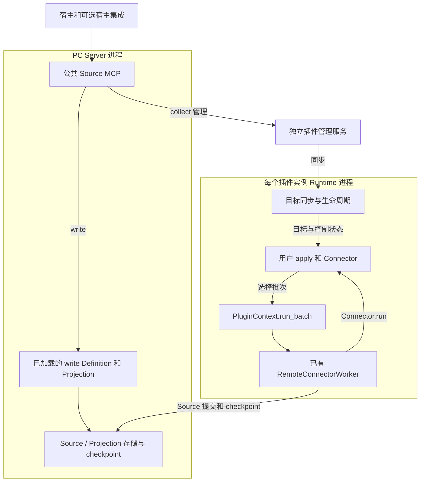
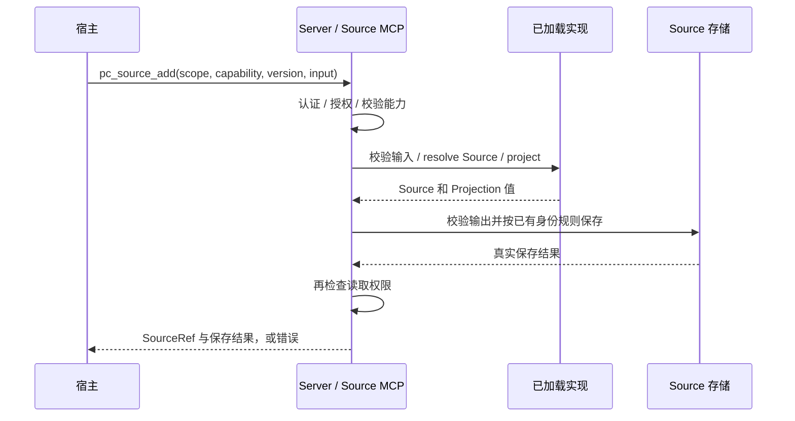
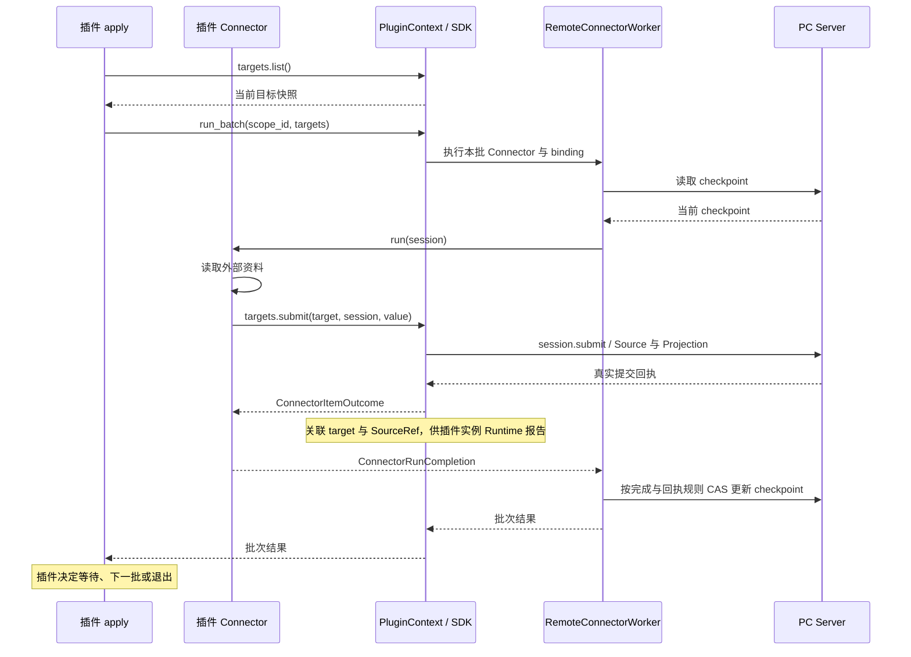
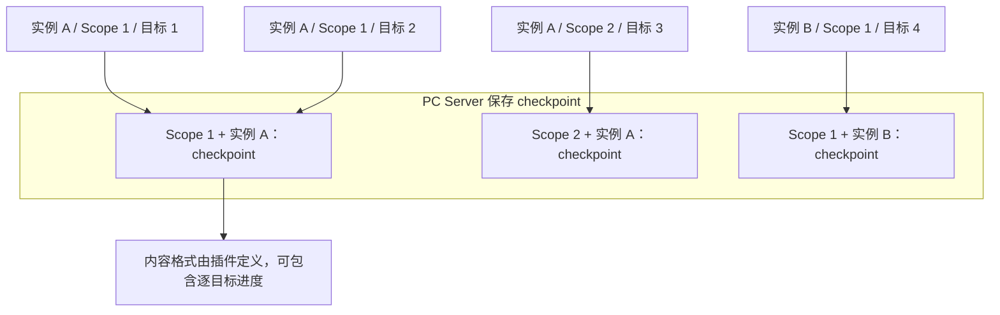
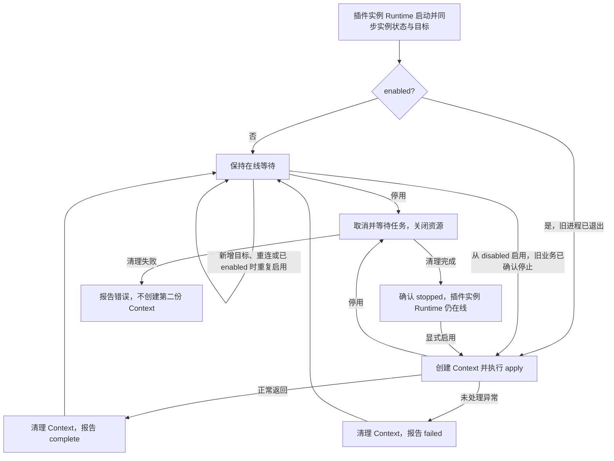

- Proposal Name: `source_plugin_framework`
- Start Date: 2026-10-14
- RFC PR: [oceanbase/powercontext#2012](https://github.com/oceanbase/powercontext/pull/2012)

# 概要

本提案为 PowerContext 引入 Source 插件框架，支持用户开发或直接使用插件，自定义 Source type、数据模型与 Projection，以及面向不同数据来源的采集逻辑，无需修改 PowerContext 核心代码。框架支持两种数据接入方式：`write` 由 Server 执行插件定义的校验与转换，同步保存调用方已有的完整内容；`collect` 由独立运行的插件持续读取外部资料，并支持在运行中新增和管理采集目标。框架负责插件加载、生命周期管理和数据提交管道，复用已有的 Source 保存规则与权限体系；插件决定采集内容、执行节奏和重试策略。应用和各类宿主通过公共 MCP 统一发现和使用内置与自定义 Source 能力。

本文规定提议的设计行为。接口和部署命令示例不表示对应功能已经在发布版本中可用。

**示例约定：** 本文中的命令、配置和代码用于说明预期使用方式与接口关系，不代表最终发布的语法。实现过程中可以调整拟议接口的命名、模块路径和配置布局；涉及公共接口或使用步骤的调整，应在实现 PR 中说明并同步本文，可执行用法以随实现发布的用户指南和示例为准。职责边界、权限、持久化、同步返回和重复调用语义等属于设计约束；如需改变，应在 PR 中说明理由并接受设计评审。已有公开接口仍遵循其既有契约。

# 动机

用户接入 PowerContext 的数据具有不同的业务含义。不同业务的数据在结构、Source 身份规则和 Projection 需求上存在差异，内置 Source type 难以覆盖所有需求。如果这些定制都依赖修改核心代码，业务扩展就会受 PowerContext 自身的发布和维护节奏限制。用户需要能够独立开发 Source 插件，也能够直接配置和使用他人提供的插件。

定义数据类型还不足以完成数据接入。同一种业务数据可能来自不同系统，各自有不同的认证方式、接口和更新规律。插件作者需要根据来源实现所需的读取、筛选或增量采集逻辑，并根据外部系统的访问限制和业务要求决定执行节奏；同时，应能复用 PowerContext 的提交和进度处理能力，避免每个插件重复实现这些通用逻辑。

用户获取数据的方式也不同：有时应用已经持有完整内容，只需将其保存；有时资料仍在外部系统，需要持续获取后续变化。这两类需求应能共用相同的 Source 数据定义与 Projection。保存已有内容应当可以直接完成，持续采集则需要独立运行，不随发起操作的应用或宿主退出而中断。

采集范围会在使用过程中变化。例如，用户需要把新建文档加入正在运行的采集实例，或让同一实例服务另一个获授权的 Scope。用户应能新增目标、查看已有提交并启停采集，复用已有实例与采集进度，无需为每份资料或每个 Scope 单独部署一套插件。

这些能力需要同时服务业务应用、自动化工作流、coding agent 等不同宿主。用户使用自定义 Source 时，应有与内置能力一致的发现和调用方式；新增插件也不应要求每种宿主分别实现对接逻辑。通过统一的使用入口和共享的采集实例，用户能够复用已有插件，并在不同应用和工作流中持续使用同一套数据接入能力。

# 1. 方案概览

宿主通过 **PC Server 的同一个公共 MCP** 使用内置和自定义 Source 能力：

- **write**：宿主提供完整内容，Server 执行已加载的 SourceDefinition 和 Projection，同步保存并返回。
- **collect**：插件持续读取外部资料。一个独立后台插件管理服务保存采集目标，每个插件实例由独立的插件实例 Runtime 进程执行，可服务多个获授权 Scope。插件管理服务和插件实例 Runtime 均可异机部署，多个宿主共享实例。

两条路径复用 SourceDefinition、Projection 和已有 Source 保存规则，同一种 Source type 可以同时由 write 和 collect 产生。框架提供加载、生命周期和数据管道；插件决定采集内容、节奏、分批、重试及退出。

一个插件管理服务对应一个 Server；不包含管理集群、自动迁移、通用任务调度或进程内 Python 代码热替换。默认本机部署由 Server 启动流程准备独立后台服务，安装或启动命令完成后退出，宿主退出不影响采集。

# 2. 架构、连接与存储

## 组件如何组织

图中箭头表示业务调用和数据流向。write 实现位于 Server 进程，collect 的 Context、Worker 和 Connector 位于插件实例 Runtime 进程。

| 组件 | 职责 |
| --- | --- |
| 公共 Source MCP | 位于 Server `/mcp`；认证宿主、检查 PC 权限，提供统一发现、提交、查询和启停入口 |
| PC Server 数据管道 | 加载 write 实现、注册 Definition，保存和读取 Source、Projection 与 checkpoint |
| 插件管理服务 | 保存插件实例、能力、目标、启停状态与收到的提交记录；交付管理请求，不调度采集或转存 Source |
| 插件实例 Runtime | 每个插件实例的外层框架；加载插件、维护管理连接、同步目标和控制状态，创建与结束业务运行 |
| PluginContext（Context） | 一次业务运行的上下文，以 ctx 传给 apply；管理 Connector、客户端和业务资源，提供 run_batch 等插件接口 |
| RemoteConnectorWorker | 已有批次管道；创建 session、调用 Connector.run、处理提交回执及 checkpoint CAS |
| apply / Connector | 插件业务代码；apply 决定节奏，Connector 读取、转换并提交本批数据 |

只使用 write 时仅需 Server；N 个插件实例增加一个插件管理服务和 N 个插件实例 Runtime 进程。插件实例 Runtime 默认作为普通后台进程运行，系统服务托管由用户显式选择。

## 启动加载与运行时新增实例

**write：** 部署者在 Server 机器准备可信代码与依赖，并以 `server.admin` 配置加载入口。Server 通用加载器导入模块，校验 Definition、Projection、能力声明及名称版本冲突，注册成功后才公开能力。注册 API 只保存定义契约，不传输 Python 实现，不能替代代码加载。入口及必要配置引用持久保存，Server 重启时重新导入。

**collect：** Server 启动时扫描一次通过环境变量指定的插件目录；每份 `powercontext.yml` 声明实例 `id`、代码入口、业务配置、凭据引用和可服务 Scope。id 即 instance_id，在同一 PC 部署内唯一且跨重启稳定。同一份本地代码可供多个实例使用，无需发布 wheel；配置进入可信目录表示部署者允许加载。

用户在插件执行机器通过 `source load` 加载实例配置，连接本机或远端 Server 和插件管理服务。命令校验插件，使用部署凭据注册 Definition、登记实例并完成所需 Scope 授权，准备 Runtime 凭据和启动配置，再启动本机独立插件实例 Runtime；已有权限会复用，外部 Server 的身份由其认证机制准备。用户无须另行执行登记脚本或手工提交凭据摘要。本机自动部署可按需准备插件管理服务；跨机器部署连接已准备好的服务。

Server 启动扫描复用同一加载流程；运行中新增实例显式执行 `source load`，不持续扫描目录，也不重启其他实例。重复加载同一 ID 和一致配置复用登记及进程，不重置启停状态；配置不同则报冲突，更新按第 5 节处理。

配置可包含初始 `targets`，每项指定 Scope、能力及业务输入。实例首次初始化目标时按正常添加规则导入插件管理服务，并记录已初始化；此后以插件管理服务为准，文件不再覆盖或补充目标。目标为空或连接失败不触发重新导入。

无插件实例时不必启动插件管理服务；单个实例准备失败不阻塞内置功能。删除目录、停止 Server 或停用全部实例不会隐式卸载独立服务或删除数据。远端机器准备代码和依赖后，在该机器执行 `source load`；命令只启动执行机器上的 Runtime，不负责远程 shell 或代码分发。

## 组件通信与连接方向

| 发起连接的一方 | 接收方 | 内容 |
| --- | --- | --- |
| 宿主 | Server | 公共 MCP 与数据读取 |
| 插件管理服务 | Server | 认证建连、同步能力目录、领取管理请求并回报结果 |
| 插件实例 Runtime | 插件管理服务 | 实例认证、资料身份确认、目标与控制同步、提交记录报告 |
| 插件实例 Runtime | Server | Worker 提交 Source、读取与更新 checkpoint |
| 插件业务 | 外部系统 | 获取资料，处理外部业务权限 |

管理通道采用主动 HTTP 轮询：插件管理服务调用 Server 的 `channel/poll` 领取请求，处理后通过 `channel/reply` 回传；Server 用临时消息 ID 关联原 MCP 调用并返回。业务请求从 Server 流向插件管理服务，网络连接始终由插件管理服务发起。插件实例 Runtime 同样主动连接插件管理服务，插件管理服务须能被插件实例 Runtime 访问。

插件管理服务连接或重连后主动同步完整**能力目录**：能力名称、版本、输入要求、对应实例、状态与公开范围；变化时更新。Server 合并内置及已加载的 write 能力，结合当前 PC 权限直接回答发现请求。实际 collect 管理操作仍经通道处理，目录缓存不代替操作时的权限和运行条件检查。

## 持久化数据与存储归属

插件框架新增的独立持久化管理集中在插件管理服务。PC Server 复用已有数据存储，插件实例 Runtime 仅保留启动所需文件，两者不另建插件业务状态存储；write 加载入口及必要配置引用作为部署配置保留。

| 保存方 | 权威数据与恢复依据 |
| --- | --- |
| 插件管理服务 | 自管 SQLite 保存实例、能力、collect 目标、期望启停状态及收到的提交记录；同时记录最近执行状态与确认时间 |
| PC Server | 已有存储保存 Source、Projection、checkpoint 和用户授权；write 加载入口及配置引用属于部署配置，代码与依赖留在 Server 文件系统 |
| 插件实例 Runtime | 仅持久保留代码、启动配置和凭据引用；目标快照、批次与未送达报告放在内存，重启后重新同步 |

管理存储中的 `records` 保存部署绑定、实例、能力、目标及提交记录（Source 引用和时间）；`follow_identity` 保存 collect 稳定资料身份到 target_id 的映射，用于重复添加时复用目标。write 直接沿用 Source 存储规则，不保存独立受理记录。

**插件管理服务保存“需要采什么”，Server 保存“已经采到什么”，插件实例 Runtime 负责执行。** Source 保存与提交记录报告是独立动作：报告丢失不撤销数据，插件管理服务也不保证重启后补齐。其结果视图不是 Server 全部数据的清单，两方的数据库均须持久保存。插件可按业务需要自行持久化数据。

# 3. 公共 MCP：宿主如何统一使用

## 调用前需要理解的对象

| 对象 | 含义 |
| --- | --- |
| capability | 宿主可调用的能力，声明名称、版本、说明、input_schema（业务输入结构）和 kind；不是 Source type，一个 collect 能力可产生多个类型 |
| kind | write 接收完整内容并同步保存；collect 建立持续采集关系；由能力声明确定 |
| capability_version | 输入和操作契约的版本；collect 还包含资料身份规则，与输出 SourceDefinition 版本分开 |
| instance_id | collect 的执行实例，代表一份配置、外部凭据和执行环境，可服务多个 Scope；write 不使用实例 |
| target_id | 持久采集关系的 ID，用于查询和启停，不是 Source ID |
| SourceRef | 已保存 Source 的 source_type 与 source_id，结合 Scope 通过已有数据接口读取 |
| enabled / actual | 期望启停状态 / 插件实例 Runtime 最近确认的业务状态；均不能代替连接可用性判断 |

宿主只调用 Server。Server 认证并检查 PC 权限后，直接处理 write 和目录发现，或经第 2 节的管理通道交付 collect 请求。插件管理服务核对资源所属 Scope 与执行条件，通过 reply 回传，Server 再结束原 MCP 调用；数据返回须通过当前读取权限检查。业务输入不能自行声明调用者身份，外部系统权限由插件实际访问时处理。各操作权限集中列在第 5 节。

以下说明拟议方法的关键参数、调用链路与返回含义。

## pc_source_capabilities：发现能力与输入要求

**输入：** scope_id，可按 capability、instance_id 筛选。

**链路：** 宿主调用 → Server 检查 Scope 读取权限及是否可写 → 根据本地能力和已同步 collect 目录筛选公开范围、可服务 Scope → 直接返回能力名称、版本、kind、input_schema，以及权限、实例和可用性。

发现不访问外部资料，也不请求插件业务授权预检。可见但离线或停用的实例仍可显示，明确不可用；管理通道失效时不能用旧目录承诺 collect 可执行，无法确认可见范围时不暴露记录。没有插件管理服务不影响内置和已加载的 write 能力。

宿主用发现返回的契约填写 input；collect 显式选择 instance_id，默认实例仅作建议，重试不重新选择实例或版本。发现状态是当时快照，add 仍须检查。

## pc_source_add：写入内容或添加采集目标

**输入：** scope_id、capability、capability_version、input；collect 另须 instance_id。Server 检查 `scope.contribute` 与 `scope.read`，按能力 kind 选择路径。

### write：原调用等待 Source 保存结果

1. Server 检查能力版本和加载状态，按关联 Definition 的输入模型校验完整内容。
2. 调用 `resolve()` 形成稳定身份的 Source，再调用 `project()` 生成 Projection，校验输出并沿已有管道保存。
3. 取得真实保存回执后，经原 MCP 调用返回 SourceRef 与 saved / unchanged；校验、转换或保存失败返回错误。宿主不需要再查询处理结果。

内置与自定义 write 使用同一路径。同一 `(scope_id, source_type, source_id)`、同数据复用，不同数据冲突；不同 ID 是不同 Source。稳定身份由底层提交方负责：内置适配层提供，自定义插件按 Definition 生成；需要宿主提供资料 ID 时在 input_schema 中说明。

超时或应答丢失不表示未保存，重试应保持相同身份和实际数据。Server 不恢复或重放中断调用；重复调用可能再次执行校验与转换，不承诺外部副作用只执行一次。

### collect：先返回采集关系，插件随后持续处理

1. Server 检查权限和输入，经管理通道把请求及可信调用者身份交给插件管理服务。
2. 插件管理服务通过插件实例 Runtime 调用插件 `identify_target`，取得稳定 `target_key` 和完整 `normalized_input`，含义见第 4 节。
3. 按 **Scope + 实例 + 能力及版本 + target_key** 查找目标；同身份同配置复用，不同配置报冲突。新目标还须确认 Definition 部署校验通过、实例可服务该 Scope、管理连接有效、enabled=true 且业务正在运行，再持久保存目标与身份关联。
4. 插件管理服务回传目标，Server 返回 target_id、enabled、tracking 及已有 Source 引用和最近提交时间。新目标尚无提交时，引用为空、时间为空；响应确认的是采集关系，不是外部资料已保存。

返回后，插件实例 Runtime 同步目标，现有 apply 从 `ctx.targets.list()` 取得新增资料，按插件节奏调用 run_batch。Worker 执行 Connector，Source 直接保存到 Server；SDK 关联真实提交回执，插件实例 Runtime 向插件管理服务报告引用与时间。宿主是否查询进展由宿主决定，查询不驱动采集。

重复 add 不重置进度、不触发额外采集、不恢复已停止目标。同 Scope 不同用户符合上述身份与配置时复用目标；不同 Scope、实例或版本不合并。身份确认要求插件实例 Runtime 可达，复用已有目标不要求 apply 正在运行；无法确认时返回错误，不猜测新建。停止目标保留身份，本方案不提供目标硬删除。

## pc_source_status：查询采集结果或控制状态

**输入：** scope_id、target_id；默认查询采集状态，`view="control"` 查询启停字段。

**链路：** Server 检查对应视图权限 → 插件管理服务核对目标实际 Scope → 读取持久目标及已收到的提交记录 → reply → Server 返回宿主。

| 视图 | 返回 |
| --- | --- |
| 默认 | target_id、enabled、tracking、source_refs、last_submitted_at、最近确认时间及实例可用性 |
| control | target_id、enabled、tracking；不含输入、Source 引用或业务错误正文 |

tracking 表示 enabled / stopping / stopped。提交记录只表示已确认并报告的保存事实，不表示目标全部采完；无新提交也不区分尚未处理、没有变化或暂无资料。插件实例 Runtime 失联显示 offline / unknown；插件管理服务不可达则查询返回不可用，仍可按权限直接读取 Server 中的 Source。

## pc_source_target_set_enabled：停止或恢复一个目标

**输入：** scope_id、target_id、enabled。

**链路：** Server 检查 scope.contribute → 插件管理服务核对目标 Scope，恢复时核对实例可服务范围 → 保存期望状态 → reply → 返回目标控制状态；插件实例 Runtime 同步后处理。

应答表示意图已保存，不承诺执行端已完成；保留目标身份、Source 与 checkpoint。恢复目标不会启用已停用的实例或重新运行已结束的 apply。

## pc_source_instances：发现实例或读取实例控制状态

| 视图与输入 | 从调用到返回 |
| --- | --- |
| 业务：scope_id | Server 检查 Scope 权限，按 capabilities 的目录规则直接返回可见实例、能力、可写性与运行状态 |
| 控制：instance_id、view=control | Server 检查 server.admin，经管理通道读取实例的持久控制状态与最近执行报告，再返回 instance_id、enabled、actual、可用性与更新时间 |

控制视图不要求 Scope，也不返回 Config、目标输入或 Source。仅插件实例 Runtime 离线时仍可读取控制状态，但须标注离线或未知；插件管理服务不可达则控制查询不可用。

## pc_source_instance_set_enabled：启停整个实例的业务运行

**输入：** instance_id、enabled。影响此实例所有 Scope 和目标，不负责安装或远程启动系统进程。

**链路：** Server 检查 server.admin → 插件管理服务核对切换条件并保存期望状态 → reply → 返回 instance_id、enabled、actual → 插件实例 Runtime 同步并执行，第 5 节规定清理与重启行为。

响应不承诺业务已启停。插件实例 Runtime 失联时可以保存停用意图，不能确认已停止；重新启用须确认旧业务 stopped。已启用时重复启用不重跑 apply，即使它已经 complete 或 failed；再次运行须显式停用、确认停止，再启用。单独停用的目标不会随实例重新启用而恢复。

## 操作重试

发现和查询只读；collect add 按稳定目标身份复用，write 沿用底层 Source 规则。启停直接设置期望状态，相同状态不产生新动作，不同意图按实际处理顺序生效。通信超时不撤销已保存数据或控制状态，宿主可按这些规则重复调用或读取当前状态。

# 4. 插件接口与数据管道

## 插件需要提供的契约

插件可直接加载本地目录。write 代码与依赖部署在 Server 机器，collect 部署在插件实例 Runtime 机器，可以复用同一代码包的数据定义。

**共同数据契约：** SourceDefinition 声明输入模型、Source 模型、名称及版本；`resolve(value)` 生成稳定身份的 Source，`projections` 中的 `project(source)` 生成 Projection。插件通过 `definitions` 导出实现对象，通过 `capabilities` 声明能力名称、版本、说明、kind 和 input_schema。能力描述可调用行为，Definition 描述输出数据；二者不是一一对应的类型体系。

**write 加载：** 每个 write 能力关联一个 Definition 的名称与版本，input_schema 对应其输入模型。插件模块导出实际 Definition 和 Projection 对象，Server 通用加载器按受信任入口导入并登记。新增模块只需准备代码、依赖和入口配置，不能仅通过注册 API 上传定义结构来获得可执行函数。

**collect 运行契约：**

| 导出项 | 插件职责 |
| --- | --- |
| plugin_api_version | 声明与插件实例 Runtime 对接的接口版本 |
| Config | Pydantic 模型，校验插件自身逻辑配置，例如外部凭据引用；不公开给宿主 |
| capabilities / definitions | 非空能力与数据定义；能力输入描述外部资料位置或选择条件 |
| connector_name / connector_version | 稳定 Connector 名称与兼容版本，用于核对 checkpoint 归属 |
| identify_target(request, config) | 按能力、版本、输入与实例配置确定稳定资料身份和规范化参数 |
| apply(ctx, config) | 异步入口；建立客户端、connect Connector，决定循环、分批、等待、重试与退出 |
| Connector.run(session) | 读取并提交本批数据，返回 ConnectorRunCompletion：本批完成情况与下一 checkpoint |

`identify_target` 独立于采集循环，返回 `target_key` 和 `normalized_input`。前者识别同一资料，例如去掉 URL 页面定位锚点后的文档 ID；后者保留全部影响采集的参数，用于识别配置冲突。它不判断授权或资料是否可读，这些在实际采集时处理；输入不足以确认身份时明确失败。

能力名称不能覆盖内置能力，同名同版本保持输入和操作语义兼容；collect 还须保持目标身份规则兼容。Definition 在部署或升级阶段由管理员注册，日常 Worker 只使用 Scope 执行权限，缺失或不匹配时报错，不每批注册。

## collect：从 apply 到 Source 保存

Context 持有一个 Connector 和业务资源；Worker 为每批建立 session，提供 Scope、checkpoint 与提交能力。**一次 run_batch 是一批，固定一个 Scope 和一组所选目标；一次 apply 可执行多批。**

插件通过 `ctx.targets.list()` 取得已同步的目标快照（目标身份、归属、规范化输入及已报告的 Source 引用），选择同 Scope 的目标，调用 `ctx.run_batch(scope_id=..., targets=selected)`。同一 Context 顺序执行批次，批内快照不并发改写。管理模式显式传所选集合，自主采集用显式空集合；独立入口保留 `run_batch(scope_id=...)`。

Connector 用 `ctx.targets.submit(target, session, item_id, definition_name, value)` 提交。SDK 校验实例、Scope 与批次归属，包装 session.submit，并用真实回执关联目标和 Source。item_id 在批内唯一，插件检查返回的 ConnectorItemOutcome 是否接受；数据直接保存到 Server，不由插件管理服务转存。

## collect 的提交回执与批次完成

| 信号 | 含义 |
| --- | --- |
| 成功提交回执 | Server 已接受一项数据，SDK 可以关联真实 SourceRef 并报告，不等待其他目标完成 |
| ConnectorRunCompletion | 本批是否完成及下一 checkpoint，Worker 按已有回执和完成规则处理 |
| 插件管理服务收到提交报告 | 已保存引用与时间，可供宿主查询；不表示持续采集目标已全部处理完 |

循环、分页和失败重试由插件决定。Source 保存、checkpoint 更新和报告是独立动作，故障恢复见第 5 节；框架不根据“没有新提交”推断业务处理结果。

## checkpoint 的隔离、推进与新增目标

ConnectorBinding 表示实例的 Connector 在某个 Scope 的执行归属，采用 instance_id 作为 binding_id。Server 按 `(scope_id, binding_id)` 保存 checkpoint，并核对 Connector 名称与版本；它不同于权限系统的 Scope Binding。

checkpoint 内容由插件定义，同实例同 Scope 的目标和能力共用一份，插件可在其中维护逐目标进度。Worker 读取当前值，按 Connector 返回的业务进度使用 CAS 更新（仅当存储中仍是本批读取的旧值才更新），不能越过尚未处理的资料。

例如 A 已采至时间 T，新加入的 B 早于 T，插件应为 B 初始化进度并补采，不能直接沿用 A 的时间游标跳过它。目标启停不清空 checkpoint，重启后从 Server 读取进度继续，不恢复上次批次的执行步骤；升级不能靠更换版本绕过进度兼容检查。

# 5. 生命周期、重启与权限

write 随 Server 加载和释放，新增实现可显式加载，一致配置重复加载复用登记；替换已有代码通过受控重启生效。重启重新校验入口，失败能力不可执行，其他有效能力照常使用。以下实例生命周期用于 collect。

## 插件实例 Runtime 在线与 apply 运行

插件实例 Runtime 维护管理连接，Context 持有一次 apply 的业务资源。enabled 是期望状态，actual 是最近确认的 running / complete / failed / stopping / stopped；连接失效另标 offline / unknown，不能用旧状态保证正在采集。

apply 返回或异常结束后清理 Context，插件实例 Runtime 仍在线；新增目标、重连或重复启用不重新调用 apply。需要持续处理新增目标的插件自行保持循环，等待不阻塞管理操作。

同一进程再次运行须停用、确认 stopped，再启用；进程重启则在同步后按 enabled 决定是否新建 Context。直接运行入口在 apply 结束后退出，不能与后台模式同时占用同一实例。系统服务卸载或退出后，须由执行机器的部署工具重新启动。

## 实例停用与资源清理

插件实例 Runtime 收到停用状态后阻止新批次，取消并等待 apply 及所属子任务，关闭 Context；完成后报告 stopped，外层保持在线。业务子任务归属 apply，资源通过 Context 登记清理，不能留下脱离生命周期的任务或吞掉取消异常。清理失败或旧任务未退出时不确认 stopped，也不创建第二份 Context。

停用不撤销已保存 Source，也不影响 Server 的 write 能力。失联不等于停止；插件管理服务不可达时不能确认新的控制状态已保存。

## 断线、重启与数据恢复

| 情况 | 行为 |
| --- | --- |
| 尚无初始目标快照 | list / run_batch 报不可用，插件决定等待或退出，不用空列表冒充无目标 |
| 插件实例 Runtime 与插件管理服务断线 | 按内存中最后同步的目标和启停状态继续采集，允许新批次；提交仍受 Server 权限检查 |
| 同一插件实例 Runtime 重连 | 先同步最新控制状态，再继续处理；不重跑当前或已结束的 apply |
| 插件实例 Runtime 进程重启 | 重新同步目标与状态，enabled 时执行新的 apply，即使上次 complete / failed；Worker 读取 Server checkpoint，未送达报告丢失 |
| 插件管理服务与 Server 断线 | 宿主 collect 管理操作不可用，已有采集可继续；内置和已加载 write 独立可用 |
| Server 不可用 | 数据提交失败或等待恢复；已保存 Source 保留，write 调用不自动恢复或重放 |

同一插件实例只运行一个 Runtime。重新部署前，先停止旧 Runtime。

恢复以各存储中的真实数据为准：Source 已保存而 checkpoint 未更新时可能重新采集，沿用稳定身份避免重复；checkpoint 更新响应丢失时重新读取；提交报告丢失不回退 Source 或 checkpoint，也不保证补齐管理记录。

## 新增实例、修改配置与升级

- **新增实例：** 部署代码与依赖，注册 Definition、登记并启动插件实例 Runtime，不重启其他实例。
- **扩展 Scope：** 授予执行身份相应 Scope Binding（Server 中的角色授权关系），更新实例可服务范围；同步后可添加新 Scope 目标，保留原 Context。传入 scope_id 本身不授予权限。
- **缩减范围、修改执行配置或升级 collect：** 停用并确认停止，退出旧插件实例 Runtime，校验和更新代码、Config 与登记；新插件实例 Runtime 校验成功后显式启用。凭据变更按配置更新处理，业务含义由插件解释。

升级保留 Source、目标、checkpoint 与已收到的提交记录，核对能力输入和目标身份、Definition、Connector 与 checkpoint 格式的兼容性。新代码须能处理保留的目标，包括停用目标。无法确认兼容时保持停用，由部署者明确处理，不自动迁移；新实例不自动继承旧目标。

write 更新先处置在途调用，再重启加载，保留能力与 Definition 契约及已有 Source 身份。普通重复加载不代替配置更新。

## 权限职责与操作条件

用户授权统一复用 Server 的 Access 体系。Principal 是 Server 认证出的用户或服务身份；插件管理服务不另建用户授权系统。

| 操作 | Server 检查 |
| --- | --- |
| 能力与业务实例发现 | scope.read，并标明是否有 scope.contribute |
| write、新建或重复 collect | scope.contribute 与 scope.read，因应答可包含数据或 Source 引用 |
| 查询 collect 结果、读取 Source | scope.read |
| 目标 control 视图、目标启停 | scope.contribute，仅返回控制字段 |
| 加载 write；实例控制视图、加载、配置、卸载或启停 | server.admin；实际进程操作由部署工具执行 |
| 授予 Scope 角色 | 沿用现有 Access 授权规则 |

Server 转交已授权操作及可信身份；插件管理服务核对资源实际 Scope、实例可服务范围和运行条件，避免以有权限的 Scope 操作其他 Scope 的目标。插件实例 Runtime 认证后仅同步和报告自身实例，不能冒充 Server 管理请求。插件处理外部系统权限，identify_target 不承担授权。

同 Scope 的贡献者均可控制目标，不限创建者；跨 Scope 的实例控制须 server.admin。collect 持续执行使用实例 PC 身份，每次提交由 Server 检查。write 使用当前宿主身份；拒绝返回不撤销已经保存的数据。控制响应不含业务配置、目标输入或 Source 数据。

## 凭据与初始化授权

AuthenticationProvider 将凭据映射为 Principal。本机部署可由部署控制的 Provider 准备身份；外部 Server 沿用其 Provider，必要时由管理员预置，不覆盖认证配置或承诺自动签发。

| 凭据 | 用途与归属 |
| --- | --- |
| 部署凭据 | 启动加载流程用于加载代码、注册 Definition、授权与登记，不下发插件实例 Runtime |
| 宿主凭据 | 保存在宿主安全配置，用于调用 Server |
| 管理通道凭据 | 插件管理服务向 Server 认证 |
| PC 执行凭据 | 每实例独立身份，提交 Source 和处理 checkpoint，不持有 server.admin |
| 实例连接凭据 | 插件实例 Runtime 向插件管理服务证明自身身份 |
| 外部系统凭据 | 插件保存和解释，可通过 Config 引用 |

启动加载流程在业务运行前确认实际身份、完成 Definition 注册和 Scope 授权、登记实例范围及连接身份，再用执行凭据检查权限。实例登记经 Server 校验部署权限后传给插件管理服务，后者保存实例连接凭据摘要；Runtime 连接时由插件管理服务直接校验，无须逐次请求 Server。复用已有身份与 Access 接口；无 Scope 授权可登记实例，但不能受理该 Scope 工作。write 不另发执行凭据，日常保存不借用部署权限。凭据不进入命令参数、能力目录或普通日志；跨机使用 TLS 或等效安全入口。

# 6. 缺点

**主要代价是框架比最初的独立插件进程方案更复杂。** 原方案只负责加载、后台启停和数据管道，目标管理由插件自行实现；本方案增加公共能力目录、持久目标与控制状态，以及插件管理服务和 Runtime 之间的同步、认证和断线处理。开发者需要维护更多协议，部署者需要管理额外组件与存储，排查问题也涉及更多环节。

这些成本用于换取不同宿主对内置与自定义 Source 的统一发现和管理，减少逐插件对接。统一入口背后的目标与生命周期管理必须有明确的承担方；本方案将其纳入框架。独立管理服务是具体的架构选择，并非统一入口的唯一实现方式，替代方案见第 7 节。仅需固定配置、自主采集的用户，也会承担这部分通用管理成本。

**第一版只执行部署者信任的插件代码，不提供不可信代码沙箱、自动签名验证或自动能力降级。** 第一版不提供插件分发体系；随 PowerContext 仓库提供的插件及其依赖纳入项目的代码审查、测试与发布流程。用户自行提供的插件仍可加载，其代码来源与依赖由部署者审核。管理员允许加载不等于框架证明代码安全；PC Access 限制标准接口上的数据操作，不能限制任意 Python 代码的系统访问。

| 路径 | 执行身份与影响范围 |
| --- | --- |
| write | 标准保存按宿主 PC 身份授权，但插件代码使用 Server 进程的操作系统权限，可访问该进程可用的资源。阻塞、资源耗尽或进程级故障可能影响整个 Server |
| collect | Worker 使用获授权 Scope 的实例 PC 身份，代码使用 Runtime 进程的操作系统权限。独立进程减少直接的进程故障传播，但同机资源竞争和过量提交仍可能影响其他组件 |

需要更强隔离时，部署者可使用独立系统用户、容器或机器；这些部署措施不构成框架提供的沙箱保证，进程分离也不保证高可用或资源配额。

# 7. 设计理由与替代方案

**write 的选择是减少执行组件，同时接受 Server 内执行可信代码的风险。** 宿主已有完整内容时，部署 Server 本地实现即可完成校验、转换与保存，无需另行管理执行进程。外部进程执行后同样可以同步返回，因此同步语义并不要求 Server 内执行。此路径复用数据契约和保存规则，但扩展了 #1400 中自定义实现由 Worker 执行的边界。

**collect 的选择是统一管理入口。** 最初的独立插件进程方案已支持一目录一后台进程、本地 run / stop、多 Scope，以及插件自行读取目标文件、配置服务或事件来新增目标；apply 结束则进程退出。其不足是目标格式与更新入口由各插件约定，宿主需要逐插件对接。

例如语雀插件已采集文档 A，宿主新建 B 后希望加入同一实例。原方案可以实现，但宿主须了解插件自己的目标接口。本提案要求内置与自定义 Source 使用一致入口，不同宿主复用公共管理能力，因此将目标接收、持久保存与启停纳入框架，采集节奏仍交给插件。

| collect 方案 | 优点 | 代价或限制 |
| --- | --- | --- |
| 仅为已有 Worker 增加发现与加载 | 组件少，复用采集和提交管道 | 动态目标与统一管理仍需插件或外部系统提供 |
| 最初方案：一目录一后台进程，插件自行管理目标 | 已提供后台启停、资源清理与多 Scope，插件可动态刷新目标 | 缺少跨插件的公共目标接口；apply 结束后没有继续接收控制的外层 Runtime |
| 将 collect 管理放入 Server | 少一个服务，减少管理通信，也能接入远端 Runtime | 采集管理与数据服务共用进程生命周期 |
| 独立插件管理服务与 Runtime | 多实例共享管理入口，管理服务可独立部署 | 增加服务、存储和通信成本 |

统一 MCP 不必然要求独立管理进程。本提案另有部署要求：单一管理服务供多个实例共享，可位于任意网络可达的机器，与 PC Server 分进程；因此选择独立服务，一个管理服务仍只对应一个 Server。write 的执行位置与 collect 的管理结构是两项独立取舍。仅需插件自主采集时，较轻的独立进程方案仍然适用。

# 8. 参考设计

[#1400：Source Definition 与 Connector 契约](1400_source_definition_and_observation_model.md) 提供数据定义、Projection、远程注册与提交、回执和 checkpoint 规则；其远程接入边界由 Worker 执行自定义实现，Server 校验并保存结果，定义注册不传输可执行代码。collect 复用这套管道，新增能力发现和目标管理；write 增加 Server 本地实现加载。用户授权继续复用现有 Access。本提案不以插件管理协议替换这些数据与权限契约。

# 9. 未决问题

以下事项由实现者在实现 PR 中提出并验证，维护者在首次发布前确认；改变本 RFC 的公共语义须先更新设计。

| 问题 | 已确定的边界与待决定事项 |
| --- | --- |
| 插件 API 兼容支持 | 第一版只加载框架明确支持的 plugin_api_version，不支持则在加载时拒绝；不建设多版本兼容层，也不承诺旧版本支持周期。随仓库提供的插件随框架同步维护，具体支持版本及拒绝行为在实现 PR 中列明并验证；Definition 和 checkpoint 的兼容规则仍须遵守 |
| Server 资源保护 | Scope 权限和进程分离不提供资源配额。需确定输入大小、并发和提交负载的限制及超限行为，并验证相应保护；当前不承诺插件对 Server 的资源影响上限 |

第一版的插件维护与信任边界见第 6 节；插件分发、自动签名与供应链验证不在本次范围内。

# 10. 后续可能性

后续可评估隔离执行 write、支持不可信代码的沙箱、插件签名与依赖验证，以及按实例设置资源配额。它们不属于第一版承诺；若改变执行位置、信任模型或公共调用语义，应单独设计评审。
