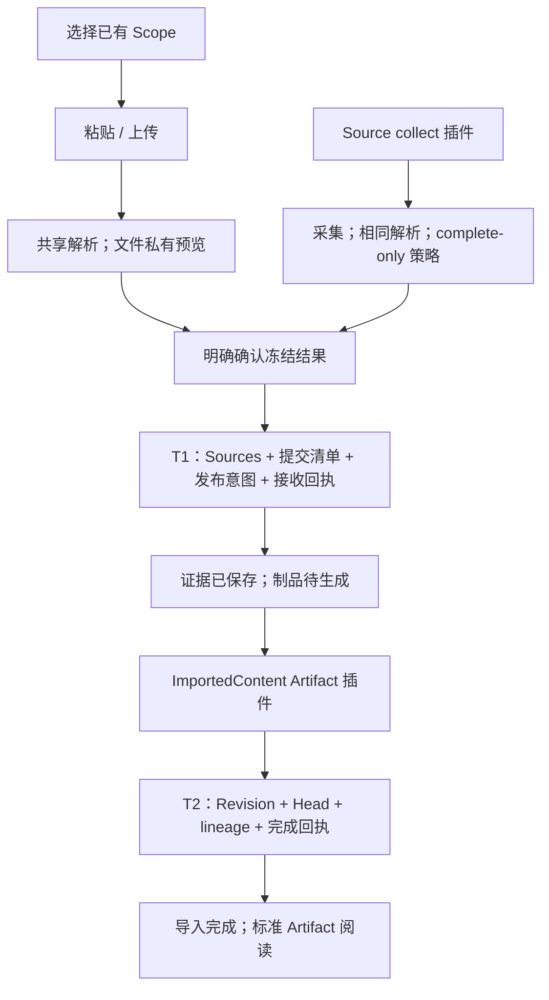
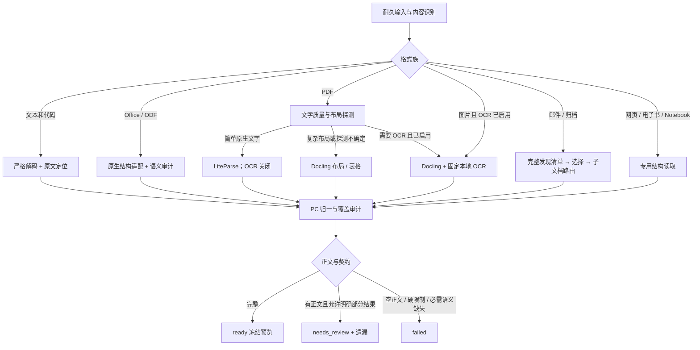
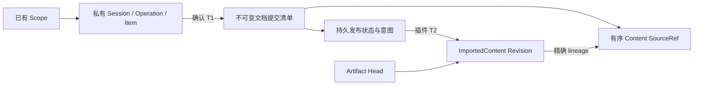
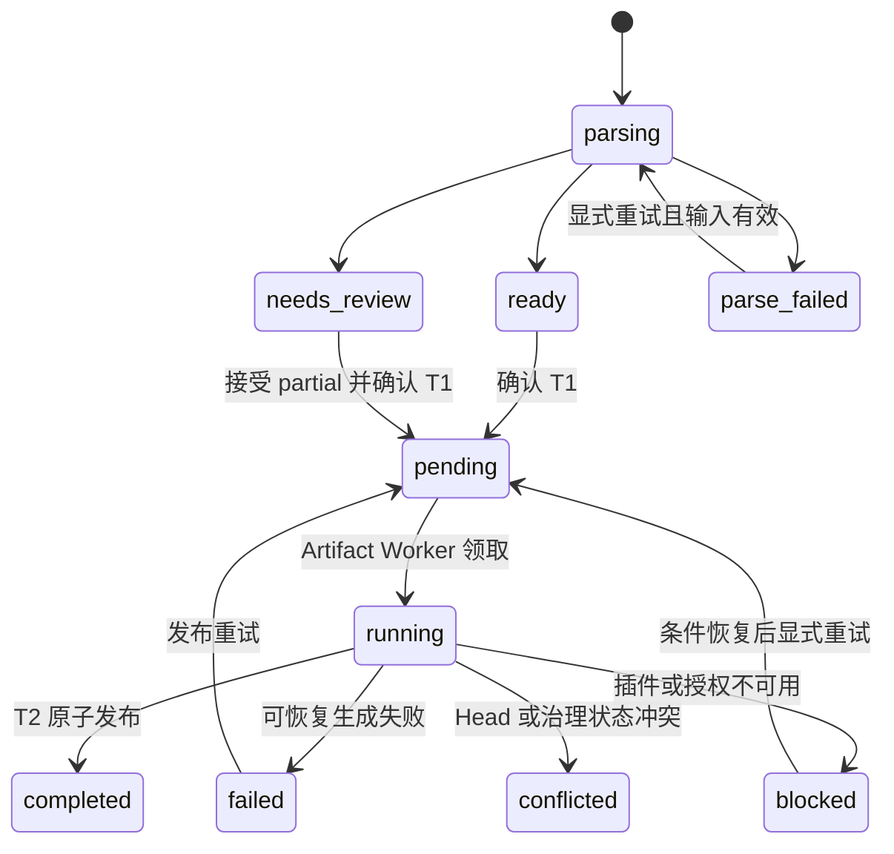

- Proposal Name: `text_material_import`
- Start Date: 2026-09-18
- Status: Proposed
- RFC PR: [oceanbase/powercontext#2073](https://github.com/oceanbase/powercontext/pull/2073)
- Design Baseline: [PowerContext master / cab054db（2026-10-19）](https://github.com/oceanbase/powercontext/tree/cab054dbf6d86e2311b079388e5158178257def2)
- Related RFCs: [Source Definition 与 Observation](https://github.com/oceanbase/powercontext/blob/cab054dbf6d86e2311b079388e5158178257def2/docs/zh/rfcs/1400_source_definition_and_observation_model.md)、[Source 与 Artifact REST API](https://github.com/oceanbase/powercontext/blob/cab054dbf6d86e2311b079388e5158178257def2/docs/zh/rfcs/1437_source_artifact_rest_api.md)、[Source 访问与生成准入](https://github.com/oceanbase/powercontext/blob/cab054dbf6d86e2311b079388e5158178257def2/docs/zh/rfcs/1458_artifact_generation_source_access.md)、[Scope 与 Source 发现](https://github.com/oceanbase/powercontext/blob/cab054dbf6d86e2311b079388e5158178257def2/docs/zh/rfcs/1502_scope_source_discovery.md)

- Plugin Baselines: [Source #2210](https://github.com/oceanbase/powercontext/pull/2210) (`6ef5c494d701c355686806b6b1042d5729267690`), [Artifact #2246](https://github.com/oceanbase/powercontext/pull/2246) (`9fe2e68220a6e0aa8ebe4b78900cd12421db5cc3`).

# Summary

为 PowerContext 提供文本、办公文档、网页文件、表格、邮件、电子书、代码、扫描件与归档包导入。用户必须选择已有且具有 `scope.read` + `scope.contribute` 权限的 Scope；粘贴或上传后，先解析和私有预览，再明确确认。持续采集使用 Source collect 插件和相同解析组件。

确认采用两个持久阶段：T1 原子保存一份文档的全部 `content` Sources、不可变提交清单、发布意图和接收回执；T2 由官方 ImportedContent Artifact 插件确定性组装制品，框架原子发布 Revision、Head、lineage、已声明索引与完成回执。T1 不生成 Artifact；两阶段之间允许“证据已保存，制品待生成”。`202` 不是导入完成，只有 T2 成功或明确复用已发布版本才是完成。

一份逻辑资料对应一个 `ImportedContent`，Family 为 `importedcontent`，`source_kind` 固定为 `content`。正文只长期保存在 Source，Artifact 记录文档信息、解析 provenance、遗漏与有序精确引用，不需要 LLM 或 Candidate 审批。不新增 ImportedContent 主表、版本表或 FileImportJob 业务资源。

本 RFC 区分插件已有能力、本文需要的框架扩展与导入专属能力。两项插件 PR 均是依赖基线，不代表已经合并或已支持完整文本导入；完整文档输入装配、持久交接和事务完成回调是交付前置条件。解析 profile 按部署真实状态公开 available/unavailable/planned，不把识别成功当作正文提取成功。长图作为独立说明材料，不嵌入 RFC。

# Motivation

Source 插件统一采集入口、目标与运行管理；Artifact 插件统一制品生成、版本、读取及声明式检索。导入不重复建设这些框架，但仍需处理文件上传、私有预览、用户确认、完整文档边界和失败恢复。普通 Source journal 窗口不能代替一份文档的完整输入，插件 checkpoint 也不能代替用户确认回执。

文件解析在证据保存前完成，保证预览正文与最终接受正文一致。制品生成只消费已接受的精确证据，不重新下载原文件，不重跑 OCR。Memory 等下游处理仍由各自配置控制，证据保存或 ImportedContent 发布均不保证下游生成完成。

# Guide-level explanation


## 支持范围与能力分级

以下是本 RFC 的目标支持矩阵。A 为基础能力，B 为标准文档能力包，C 为可选 OCR 或扩展适配器。发布时每一项都需要实际样本验收；未安装依赖显示“未启用”，未完成适配显示“尚不支持”，不得统一标为支持。

| 类别 | 文件类型与常见扩展名 | 级别与提取内容 |
| --- | --- | --- |
| 纯文本与日志 | `.txt`、`.text`、`.log`；显式选择的无扩展名文本 | A；正文与行号 |
| Markdown 与轻量标记 | `.md`、`.markdown`、`.mdown`、`.rst`、`.adoc`、`.asciidoc`、`.org`、`.tex` | A；保留标记源码、段落与行号，不运行排版程序 |
| 数据与配置 | `.csv`、`.tsv`、`.json`、`.jsonl`、`.ndjson`、`.yaml`、`.yml`、`.toml`、`.ini`、`.cfg`、`.conf`、`.xml` | A；原文本及可验证的记录、行列定位，不执行对象构造或外部实体 |
| 源代码与构建文件 | `.py`、`.js`、`.ts`、`.jsx`、`.tsx`、`.java`、`.c`、`.h`、`.cpp`、`.hpp`、`.go`、`.rs`、`.sh`、`.bash`、`.zsh`、`.sql`、`.css`、`.scss`、`.vue`、`.svelte`、`.rb`、`.php`、`.swift`、`.kt`、`.kts`、`.scala`、`.r`、`.R`、`.lua`、`.pl`、`.ps1`、`.bat`、`.cmd`、`.proto`、`.graphql`、`.gql`、`.diff`、`.patch`；Dockerfile、Makefile、CMakeLists.txt | A；按文本保留，不运行、编译或安装依赖 |
| 字幕与记录 | `.srt`、`.vtt`、`.ass`、`.ssa`、`.ics`、`.vcf` | A；保留时间标记或原始字段，不调日历或通讯录 API |
| 网页与离线网页 | `.html`、`.htm`、`.xhtml`、`.mhtml`、`.mht` | B；静态 DOM 正文、标题、列表、表格与链接文字，不执行脚本或读取外链；不承诺浏览器计算后的可见性 |
| PDF | `.pdf` | B；文本层、页码及可提取表格。扫描或混合页使用 C 级 OCR |
| Word 与模板 | `.docx`、`.doc`、`.dot`、`.dotx`、`.docm`、`.dotm` | B；段落、标题、表格、脚注；宏不执行 |
| Excel 与模板 | `.xlsx`、`.xls`、`.xlsb`、`.xlt`、`.xltx`、`.xlsm`、`.xltm` | B 目标；工作表、单元格值、公式与已有缓存结果，保留范围位置；XLSB 的完整/仅值 profile 按第 1.4 节分别准入 |
| PowerPoint 与模板 | `.pptx`、`.ppt`、`.pps`、`.pot`、`.ppsx`、`.potx`、`.pptm`、`.ppsm`、`.potm` | B；幻灯片文字、表格和演讲者备注，保留页序 |
| 开放办公与富文本 | `.odt`、`.ott`、`.ods`、`.ots`、`.odp`、`.otp`、`.fodt`、`.fods`、`.fodp`、`.rtf` | B；文档、工作表或演示内容，对应定位规则一致 |
| 电子书 | `.epub`、`.fb2` | B；目录、章节与正文，不处理 DRM 加密内容 |
| 邮件与邮箱导出 | `.eml`、`.msg`、`.mbox` | B；主题、发件信息、正文；邮箱按邮件拆分，附件按显式选择处理 |
| Notebook | `.ipynb` | B；Markdown、代码单元和已保存文本输出，不执行代码或重新计算 |
| XML 文档与订阅 | `.rss`、`.atom`、`.opml`、`.xlf`、`.xliff`、`.tmx`、`.svg` | A 可保留源码；B 提供语义文本提取；SVG 仅提取文字节点，不执行或承诺理解图形 |
| 图片与扫描件 | `.png`、`.jpg`、`.jpeg`、`.tif`、`.tiff`、`.bmp`、`.webp`；静态 `.gif` | C；OCR 文字、图像/页序和可提供的定位，动画 GIF 不静默只取首帧 |
| 批量归档 | `.zip`、`.tar`、`.tar.gz`、`.tgz`、`.gz`、`.bz2`、`.xz` | B；安全展开，逐成员识别与导入，压缩包不是一种正文格式 |
| 扩展归档 | `.7z`、`.rar`、`.tar.bz2`、`.tbz2`、`.tar.xz`、`.txz` | C；需安装并验收对应解包适配器 |
| 专有或长尾文档 | `.pages`、`.numbers`、`.key`、`.wps`、`.et`、`.dps`、`.wpd`、`.hwp`、`.chm`、`.one`、`.pst`、`.mobi`、`.azw`、`.azw3`、`.heic`、`.heif` | C 扩展目标；按格式代际、正文提取能力、解码器及许可证分别准入，不承诺仅安装通用解析器就全部支持 |

A、B 是正式文件导入的交付范围；C 是同一扩展机制下按部署启用的能力。轻量安装可以只启用 A；标准文档安装必须打包并固定 B 所需依赖。支持 WPS 保存的 DOCX/XLSX/PPTX 不等于已经支持 WPS 专有的 WPS/ET/DPS。识别新一代 iWork 文件也不等于能提取其正文。

纯文本兜底不限于表中扩展名：用户可以显式选择“按纯文本读取”，通过编码、控制字符与大小校验后保存原文。目录采集默认仅扫描允许的类型，不能把整个目录内一切可解码文件自动导入；默认排除密钥、凭据文件、`.env`、版本控制目录、依赖目录与构建产物，可由用户明确选择其他规则。

首期不做音视频转写、任意数据库转储解析、可执行文件反编译、图形/图表推理，也不破解加密或 DRM。语雀、网页和 Git 链接抓取属于独立 Connector；导入本地 HTML 或语雀导出的 Markdown，不等于支持直接抓取链接。

## 用户流程

从 Scope 内进入可以预选目标，全局入口必须选择已有 Scope；没有可用目标时引导到既有 Scope 管理流程。导入页不创建 Scope。会话固定 Scope 与创建者，切换目标需新会话。

页面先展示可用格式、限制、解析与发布就绪状态。文本请求本身即确认；文件展示正文、页/表/幻灯片数量、分段数、OCR 与遗漏后再确认。部分提取必须显式接受；取消、到期和未确认预览不产生正式 Source。



状态明确区分“解析中 / 待确认 / 证据已保存、制品待生成 / 生成阻塞或失败 / 导入完成”。T1 后证据已在 Scope 可见，其他获准处理器可以消费；新资料在 T2 前不出现在 Artifact 列表。更新期间旧 Head 始终可读，只有 T2 成功才推进。

同名文件或相同摘要不自动合并。首次手动导入创建新的文档身份，更新必须明确指定 artifact_id 与 expected_head_revision。一个文档同时最多存在一个未终结的发布提交；失败后恢复同一提交，不再上传同一文件。已保存证据不会因后续制品失败或取消剩余输入而回滚。


## 格式特有行为

- **编码**：支持 UTF-8、带 BOM 的 UTF-16/UTF-32，以及显式指定的 GB18030、GBK、Big5、Windows-1252、ISO-8859-1。自动检测仅提供建议，除 BOM 和严格有效 UTF-8 外不静默采用猜测编码；先让用户确认，禁止用替换字符掩盖解码错误。
- **表格**：保留工作表名与单元格坐标，不只读取首张表。CSV/TSV 保留原始文本，可另外提供经校验的行列定位。公式不重算，不更新外链；默认纳入隐藏表、行、列并标记隐藏状态，用户可在预览前显式排除，此选择参与快照身份。
- **演示文稿**：按幻灯片顺序提取，备注单独标记。默认纳入隐藏幻灯片并标记；不把图片中的文字当作已读取，嵌入图像的文字需 OCR。
- **Word/开放文档**：标题、正文、表格、脚注按声明规则提取；修订采用已接受视图，批注默认不导入并报告数量，用户可选纳入且标明批注作者。解析器不能可靠提供这些视图时应报能力不足。
- **HTML/Notebook**：HTML 不运行 JavaScript、不抓取 CSS/图片/链接；Notebook 不执行单元。Notebook 默认包含已保存的文本输出，隐藏元数据、富媒体与 widget 不视为已导入正文。
- **PDF/OCR**：按页选择文本层或 OCR，避免同一区域重复叠加。空白页、图片页、解析失败页分别报告；低质量 OCR 输出是机器识别结果，不能称为精确转录。布局/页数信息不可得时报告未知，不能伪造完整性。
- **邮件与归档**：邮件正文中的引用历史保留，纯文本与 HTML 二选一并记录规则，避免重复。附件默认列出但不导入；用户选择后逐附件处理。归档默认展开第一层，嵌套包需显式开启且受深度限制；失败或未选成员在清单中保留。

# Reference-level explanation

## 1. 架构与插件复用边界

| 能力 | 依据与状态 | 本功能如何使用 |
| --- | --- | --- |
| Source 能力发现、插件加载、Scope 权限、write/collect 分流 | 复用 #2210 | 管理员部署，普通用户在已有 Scope 操作；发现能力不等于格式解析已实现 |
| collect 实例、目标、独立 Runtime、启停与 checkpoint | 复用 #2210 | OpenDAL 作为采集插件；不再自建平行实例管理服务 |
| `content.inline` 同步写入 | #2210 已有，完整导入不直接调用 | 仅适合单 Source 捕获；不能替代完整文档确认事务 |
| Artifact Family/schema、ArtifactDraft、Worker、生命周期 | 复用 #2246 | 官方 importedcontent 插件确定性生成，不调用 LLM |
| Revision、Head CAS、lineage、标准 get/list/历史读取 | 复用 #2246 和现有 Artifact 存储 | 不建独立资料版本系统；Scope 共享读取策略需显式适配 |
| 声明式索引、构建与查询 | 复用 #2246，按部署声明启用 | 首期仅可声明标题/出处等 content 内字段；不自动解引用 Source 做全文检索 |
| 上传、受控暂存、私有预览、解析与确认 | 本 RFC 新增 | 文件 worker 与 Server 同步 write 隔离；保留导入专属接口 |
| `document_commit` 完整文档输入、精确分段读取与证据校验 | 本 RFC 要求的框架扩展 | 替代本 Family 的 journal-window 触发；不是已有 InputContract 字段 |
| T1 持久交接、T2 同事务完成回调、提交回执与恢复 | 本 RFC 新增集成 | 连接 Source 和 Artifact 两个事务；不能仅发送内存通知 |
| collect 调用导入提交并确认 checkpoint 的公开适配器 | 本 RFC 要求的 Source 集成扩展 | 不访问 PluginContext 私有 client，不把普通 run_batch 当整文档提交 |

固定依据：[Source write](https://github.com/oceanbase/powercontext/blob/6ef5c494d701c355686806b6b1042d5729267690/src/powercontext/source_management/write.py)、[Source Context](https://github.com/oceanbase/powercontext/blob/6ef5c494d701c355686806b6b1042d5729267690/src/powercontext/source_management/context.py)、[Artifact SDK](https://github.com/oceanbase/powercontext/blob/9fe2e68220a6e0aa8ebe4b78900cd12421db5cc3/src/powercontext/artifact_plugins.py)、[Artifact Worker](https://github.com/oceanbase/powercontext/blob/9fe2e68220a6e0aa8ebe4b78900cd12421db5cc3/src/powercontext/builtin/runtime/artifact_plugins.py)。这些链接说明可复用基线，本文新增契约必须另行实现并验收。

Source write 当前在 Server 内同步执行，一次提交一个 observation，add JSON 上限 1 MiB、observation 上限 4 MiB；不承载大文件或 OCR。自定义 write 禁止覆盖内置 Definition，不能靠重新注册 content 接管本功能。collect Runtime 可独立部署；当前本地 collect 进程管理要求 Linux，不能宣称 macOS/Windows 上已完成本地托管。

Artifact 当前按 journal 窗口提供证据，输入预算 1 MiB，draft 直接 SourceRef 必须来自该次调用；GenerationContext 的 Artifact 读取不能代替任意历史 Source 读取。ImportedContent 的 8 MiB/128 段文档范围需要专门的 document_commit 输入模式，不能直接调大 max_sources 或跳过校验。此模式通过受信服务端适配器装配，不改变其他 Family 的窗口与预算。

同一 importedcontent binding 仅启用 document_commit 模式，禁止同时消费全部 content journal。新插件默认 disabled；部署必须加载并显式启用，还须确认 schema、权限、文档预算与适配器就绪。解析器依赖在部署时安装，复杂解析在独立 worker，Artifact 插件只消费已保存的精确证据。


### 1.1 解析器职责与固定选型

采用“原生结构优先、PDF 按布局分流、OCR 显式开启”的组合方案。PowerContext 实现格式识别、结构审计、ImportedContentBundle 归一、证据分段、任务与保存；复用解析库完成格式解码、布局和 OCR，不自研通用 OCR 模型。下述 profile 名是拟新增的产品契约，不是上游已经提供的接口或已完成实现。

| 组件 | 本 RFC 中的固定职责 | 不承担的职责 |
| --- | --- | --- |
| 原生文本/容器适配器 | 严格解码，CSV/JSON/XML 等定位，OOXML/ODF 结构审计，邮件/归档发现 | 不执行内容，不用 LLM 重写正文 |
| LiteParse | 简单文本 PDF 的轻量提取、页几何与复杂度信号；标准路径关闭其内置 OCR | 不统一把 Excel/Word/PPT 转 PDF，不用其 Markdown 清理结果代替全部证据 |
| Docling | 复杂布局 PDF、现代 Word/开放文档的结构提取；启用 OCR 时使用指定本地引擎 | 不负责资料身份、提交或索引，不直接使用检索 chunk 作为 Source |
| openpyxl / Apache POI | 工作簿的原生单元格、公式与已有值；POI 同时用于传统 Office 结构适配 | 不计算公式，不刷新数据连接，不将工作簿打印成 PDF |
| python-pptx + OOXML 审计 | 现代演示的文字、表格、备注与隐藏状态 | 不执行宏，不将演示动画和图表理解混入正文 |
| Apache Tika | 传统文档、RTF、MSG 和已准入长尾格式的受控格式解析 | 不作为无限制自动探测/递归/云 OCR 兜底，不把 metadata 视为正文 |
| 本地 RapidOCR | 通过 Docling 处理扫描 PDF/图像，首个目标语言集为简体中文与英文 | 不自动外发；繁体、其他语言与手写须独立验收 |
| MinerU / DeepDoc / LlamaParse | C 级、独立启用的复杂文档替代 profile；LlamaParse 属外部或企业自托管服务 | 不加入标准 profile 的隐式 fallback 链 |
| LlamaIndex | 后续可选 Reader/检索变换参考，索引阶段按需使用 | 不接管导入事务、版本和 Source；不使用默认 Reader 的跳过错误行为 |

组件取舍基于 [RAGFlow 调研](https://yuque.antfin.com/obopensrc/knowledge_sharing/lmziuic5tzhgny8c)、[Docling/MinerU 调研](https://yuque.antfin.com/obopensrc/knowledge_sharing/rcga2z7gr8r3vwbo)与[LiteParse/LlamaIndex 调研](https://yuque.antfin.com/obopensrc/knowledge_sharing/yl6nfo4yugep4n6a)。这是拟实施的选型，不是解析质量排名。首轮适配基线采用已调研的 LiteParse Python 2.14.7、Docling 2.129.0；MinerU 4.0.5 仅作可选适配验证基线。发布镜像还必须锁定其传递依赖、模型和转换工具，不能使用 latest。其他组件在实施时固定通过样本与安全检查的具体版本及镜像摘要。

### 1.2 A 级：原生文本、标记与结构定位

以下各组覆盖支持矩阵中该类的全部扩展名；同类不同后缀不产生不同正文规则。A 路径保存解码后的原始文本，结构解析只增加可验证定位，默认不改写正文。

| 输入 | 默认 profile 与具体方式 | 提取/定位与失败规则 |
| --- | --- | --- |
| TXT、TEXT、LOG、显式无扩展名文本 | `text-native-v1`：Python 严格 codecs 解码 | 保留换行、缩进、字符和行号；编码不确定要求确认 |
| Markdown、RST、AsciiDoc、Org、TeX | `markup-source-v1`：同一文本解码器；Markdown 可用 markdown-it-py 辅助识别块 | 正文保存标记源码；不渲染 TeX，不执行 include、插件或远程资源 |
| 全部代码、构建文件、diff/patch | `code-source-v1`：原文与行索引 | 不编译，不运行 formatter，不因语言识别失败丢失正文 |
| CSV、TSV | `delimited-text-v1`：原文 + Python csv 读取器 | 固定分隔符、引号和编码；记录逻辑行、字段及原文范围；允许跨物理行字段，分隔符歧义要求确认 |
| JSON、JSONL、NDJSON | `json-source-v1`：有界 JSON 语法扫描、逐记录解析 | 保留原文及重复键顺序，定位记录与字段出现序号；不将 dict 序列化结果替换原文 |
| YAML/YML、TOML、INI/CFG/CONF | `config-source-v1`：保留源码；PyYAML SafeLoader、tomllib、禁用插值的 ConfigParser 仅作可选结构校验 | YAML 限制别名和深度，不构造任意对象；键路径无法唯一定位时只提供原文行号 |
| XML | `xml-source-v1`：禁用 DTD/实体/网络的 XML 读取器 | 保留源码；节点路径、命名空间和可提供的行号，不执行 XInclude/XSLT |
| SRT、VTT、ASS、SSA | `subtitle-source-v1`：文本 + 有界字幕时间标记扫描 | 保留全部原字段，增加时间范围；不重新排序或翻译 |
| ICS、VCF | `record-source-v1`：保留文本并识别折行和记录边界 | 原文行与逻辑记录区分，不调用日历/通讯录 API |
| RSS、Atom、OPML、XLF/XLIFF、TMX、SVG 的源码模式 | `xml-source-v1` | 保存源码；语义提取另走 B profile，不能静默切换 |

辅助结构校验失败时，返回原文可用、结构定位不可用的明确警告；如果用户选择的是要求结构完整的 profile，则失败或 needs_review，不能改成源码模式冒充成功。A 路径的原文字节/字符保真不以结构解析成功为前提，但仍必须通过编码、控制字符和大小校验。

### 1.3 PDF：文字、布局与 OCR 路由

默认 `pdf-standard-v1` 是固定版本的复合 profile：先用 LiteParse 做有界页面探测；全文文字层可用且无复杂布局信号时采用 LiteParse 的结构化 text_items；出现多栏、疑似复杂表格、顺序异常或探测不确定时，采用 Docling 标准布局/表格路径。两者均默认关闭 OCR 和生成式增强，路由判断及阈值作为 profile 的版本化配置，通过样本集固定。

| PDF 情况 | 解析方式 | 完整性规则 |
| --- | --- | --- |
| 简单文字层、正常阅读顺序 | LiteParse JSON/结构化输出 → PC 有序块归一 | 保留物理页序、显示页标签、页尺寸及可用 bbox；不依赖默认去页眉页脚的 Markdown |
| 多栏、复杂表格、目录/脚注布局 | Docling 标准 pipeline，读取 DoclingDocument 和 provenance | 结构节点与阅读顺序归一；表格保留行列/合并关系和原始页定位，不能只保存渲染 Markdown |
| 扫描、混合、乱码文字层，`ocr_mode=off` | 仅提取可用原生文字，明确标出需要 OCR 的页/区域 | 有正文则 needs_review；只有元数据或无正文则失败，返回 ocr_required/no_extractable_text |
| 扫描、混合，`ocr_mode=auto` | Docling + 固定本地 RapidOCR，对需要的页/区域识别 | 合并时按区域去重；记录实际 OCR、引擎、语言和遗漏，不能用 needs_ocr 代替执行记录 |
| `ocr_mode=force` | Docling + 同一 OCR 引擎，按明确范围强制识别 | 以配置的识别结果为准，不与原生文本双份叠加；强制策略和可能质量变化在预览中显示 |
| 公式、手写、复杂图表仍不可可靠提取 | 原路径保留可用文字和位置，报告不能识别的对象 | 不能根据图像猜正文；可由用户新建尝试选择 C 级 MinerU/DeepDoc/LlamaParse profile |

`needs_ocr` 与 layout complexity 分开使用；没有 OCR 需求不表示布局简单。源页数、请求范围、返回页、空白页、失败页分别统计。不能将引擎 max_pages 截断解释为完整文档；用户未请求部分范围而触发硬上限时，沿用本 RFC 的超限拒绝规则。

首期按整份 PDF 确定一个正文解析后端；该后端内部可以按页使用原生文字或 OCR。不同 PDF 引擎不逐页拼接结果，避免跨页表格、阅读顺序与坐标不一致。复杂度探测结果可暂存复用，但不是跨引擎通用的中间结果。跨页表格无法可靠合并时保留分表及页范围，并报告关系未确定。

PDF 默认纳入可提取的页眉页脚并标为相应块；水印、批注、表单和图片文字的纳入/排除必须在 profile 中声明。未开启某类内容不能把数量记为零；已检测存在却未处理的内容列入 omissions。文本位置是出处描述，首期不承诺原始 PDF 永久在线预览。

### 1.4 B 级：Office 与开放办公格式

原生文档结构优先于打印布局；现代 Office 不默认转 PDF。模板和宏变体通过 MIME、容器内容类型和关系识别；适配器读取原始容器，不能仅改后缀绕过库的限制。

| 输入 | 默认 profile / 后端 | 必须保留与准入条件 |
| --- | --- | --- |
| DOCX、DOTX、DOCM、DOTM | `word-ooxml-v1`：Docling DOCX 结构转换 + PC OOXML 审计/补充读取 | 标题、正文、表格、脚注/尾注、修订视图、选中批注；docm/dotm 宏不加载执行；后端不接受的变体由受控 OOXML 适配器读取，未验收则 planned |
| DOC、DOT | `word-legacy-v1`：受控 Tika OfficeParser / POI HWPF，适配器补齐结构审计 | 不以一段纯文本证明脚注、修订和批注完整；无法可靠提供用户选择的视图时 capability_insufficient，禁止静默转 PDF |
| XLSX、XLTX、XLSM、XLTM | `sheet-ooxml-v1`：openpyxl + OOXML 原始单元格/关系读取 | Sheet、A1 坐标、数据类型、合并范围、隐藏状态、公式及已有缓存值；宏只作为被排除对象计数 |
| XLS、XLT | `sheet-biff-v1`：POI HSSF 原生读取 | 读取公式 token 的可用表达及存储的缓存值，不调用 FormulaEvaluator；老 BIFF 代际逐项验收，不满足时拒绝该代际 |
| XLSB | `sheet-xlsb-v1`：POI XSSFB 事件读取 + 明确的结构适配 | 默认“公式与值”契约必须通过验收才 available；只读缓存值的能力另列 profile，见下文，不冒充完整工作簿 |
| PPTX、PPSX、POTX、PPTM、PPSM、POTM | `slides-ooxml-v1`：python-pptx + 原始 OOXML 关系/节点审计 | 幻灯片顺序、文字框/组内文字、表格、备注、隐藏页；修复模板入口需适配器明确处理，不修改原文件 |
| PPT、PPS、POT | `slides-legacy-v1`：POI HSLF，复用 Java worker | 原生幻灯片与备注；不能仅用 Tika 合并正文后推算页界；未知 OLE/图形对象列入遗漏 |
| ODT、OTT、FODT | `odf-text-v1`：Docling + PC 安全 ODF XML 结构读取 | 对打包/Flat XML、标题、表格、注释和修订视图逐项校验；不足时不降为“所有 XML 文本” |
| ODS、OTS、FODS | `odf-sheet-v1`：PC 安全 ODF XML 原生适配器 | 表/行列、重复计数、合并与覆盖单元格、隐藏、公式和已存值；展开重复行列前计算预算 |
| ODP、OTP、FODP | `odf-slides-v1`：PC 安全 ODF XML 原生适配器 | draw:page 顺序、文字框、表格、备注及显示状态；无稳定对象定位时明确降低定位能力 |
| RTF | `rtf-native-v1`：Tika RTFParser 的结构化输出 + PC 归一 | 正文/段落及可提供表格、脚注；嵌入对象只列清单，不执行；不支持的控制组报告 |

**Word 的补充读取是适配器工作，不是 Docling/python-docx 已完整实现的保证。** OOXML 按关系图审计段落、表格、脚注/尾注、批注和修订节点；“已接受视图”包含插入/moveTo、排除删除/moveFrom，对属性修订和不支持的复杂变更不能猜测。无法可靠生成该视图时拒绝该 profile；用户若选其他视图需新尝试和明确能力支持。补充文本按原锚点入序，不能在正文末尾随意追加造成重复和错序。

**工作簿不重算。** XLSX 读取公式视图与 data_only 缓存视图时使用同一输入摘要及 Sheet/坐标对齐；必要时直接读取 `<f>`、`<v>`，区分真实空单元格、空字符串缓存和未保存缓存。公式、缓存值、类型与格式化显示是不同字段；外部引用只保留字符串，不访问资源。损坏的 shared/array formula 或动态数据结构报告受影响范围。

**XLSB 是已知准入风险。** POI 的公开 XSSFB 文档明确存在公式表达提取限制，不能因支持读取 XLSB 就承诺公式保真。默认 `sheet-xlsb-v1` 在完整契约未实现前保持 planned；可单独发布显式选择的 `sheet-xlsb-values-v1`，仅在 Sheet/单元格/隐藏范围可核验时导入已有值，始终 needs_review，明确“公式表达未提取”，由用户 accept_partial。范围无法核验或无正文时仍失败。该有限 profile 不算完成 B 级完整 XLSB 交付，也不能被自动采集的 complete-only 接受。[POI XLSB 限制](https://poi.apache.org/apidocs/5.0/org/apache/poi/xssf/extractor/XSSFBEventBasedExcelExtractor.html)

**LibreOffice 不在标准工作簿路径中。** 格式转换可能改变公式缓存、字体、分页和对象语义；因此不通过 LibreOffice 把 XLS/XLSB/ODS 转 XLSX/PDF 来规避“不重算”契约。文档类如确需转换，仅在单独发布、经过无外链/宏/计算副作用验收的扩展 profile 中启用；首期不依赖该方式完成表格结构承诺。

### 1.5 B 级：网页、电子书、邮件、Notebook 与归档

| 输入 | 默认 profile / 具体方式 | 正文及成员规则 |
| --- | --- | --- |
| HTML、HTM、XHTML | `html-dom-v1`：html5lib 解析 + PC DOM 文本/结构遍历；XHTML 安全 XML | 标题、段落、列表、表格和链接文字；排除 script/style/template 及明确隐藏节点，不执行 CSS/JS；不能声称复现浏览器计算后的可见性 |
| MHTML、MHT | `mhtml-native-v1`：Python email MIME 解析 → 选定 root HTML → html-dom | 根据根部件信息与 content-location 识别正文；无法确定根文档时报告错误；内嵌资源只列清单，禁止 URL 回源 |
| EPUB | `epub-spine-v1`：安全 ZIP → container/OPF → spine 顺序 → html-dom | EPUB 阅读顺序、章节、导航与文本；不按 ZIP 文件名排序；脚本、远程资源、DRM 不处理 |
| FB2 | `fb2-native-v1`：安全 XML → body/section/notes | 正文、章节、脚注引用；二进制图片不作为正文 |
| EML | `mail-rfc822-v1`：Python email BytesParser | 解码 header/MIME；multipart/alternative 优先可用 text/plain，否则 html-dom；CID 图片/附件列清单，不拼接双份正文 |
| MBOX | `mailbox-mbox-v1`：有界 mbox 迭代 + mail-rfc822 | 先发现邮件成员再按选择解析；保留消息序号、可用 Message-ID 和容器链，重复 Message-ID 不当作唯一键 |
| MSG | `mail-msg-v1`：Tika/POI HSMF 受控读取 | 提取主题、发件信息与正文；HTML 走 html-dom，RTF 正文走 rtf-native；完整附件发现不得由自动递归文本合并代替 |
| IPYNB | `notebook-native-v1`：有界 JSON + nbformat 校验 | 原序 Markdown/code/raw cell；默认已保存 text/plain、stdout/stderr 和文字错误输出；HTML 输出显式净化/纳入，富媒体/widget 列为排除 |
| RSS、Atom、OPML | `feed-xml-v1`：安全 XML 的格式专用映射 | feed/channel/entry/item/outline 的标题、正文与链接文字，保留节点路径，不抓正文链接 |
| XLF、XLIFF、TMX | `translation-xml-v1`：按具体 schema 读取 source/target/segment | 单元 ID、语言与原/译文分别标记，不能把两种语言拼成重复正文；不同 XLIFF 代际独立验收 |
| SVG 语义模式 | `svg-text-v1`：安全 XML 提取 text/tspan/title/desc | 不光栅化运行脚本；path 轮廓文字和图形含义不承诺，图像资源不回源 |
| ZIP、TAR、TAR.GZ/TGZ | `archive-native-v1`：Python zipfile/tarfile 有界流式读取 | 先列完整成员，选择后递归分发；不调用 extractall 写任意路径；拒绝链接/设备/重复路径 |
| GZ、BZ2、XZ | `compressed-stream-v1`：对应标准库解压器 | 单流解压后重新识别，是 TAR 则进入归档发现，否则是一份子文档；不能将每个压缩流都称为多文件归档 |

Python MIME/mailbox 提供基础读取，PowerContext 仍负责资源上限、结构缺陷、选择与稳定来源规则；库返回对象不代表容器清单完整。[email parser](https://docs.python.org/3/library/email.parser.html)、[mailbox](https://docs.python.org/3/library/mailbox.html)

Tika 只调用注册的格式解析器，关闭自动 OCR、网络和不受控 embedded recursion；附件/嵌入资源通过受控回调参与发现，不能被解析器偷偷加入正文。对于已检测但无法列举完整附件的输入，discovery 失败，不发布可选择的“完整”成员清单。普通文档中的未选嵌入对象则按已声明的排除规则报告。

### 1.6 C 级：OCR、替代引擎与长尾格式

| 输入或需求 | 指定扩展方式 | 启用条件 / 限制 |
| --- | --- | --- |
| PNG/JPEG/BMP/WebP、静态 GIF | `image-ocr-v1`：Pillow 解码、方向归一 → Docling + 本地 RapidOCR | OCR 显式开启；记录原始与旋转后坐标映射；不识别图表语义 |
| TIFF/TIF 多页 | `image-multipage-ocr-v1`：有界枚举全部图像页 → 同一 OCR profile | 每页计数、像素和 OCR 预算；失败页明确报告；不能只读首帧 |
| 动画 GIF / 多帧变体 | 默认拒绝该变体 | 仅在独立多帧 profile 完成帧语义与重复文字验收后开放 |
| HEIC/HEIF | `heif-ocr-v1`：pillow-heif/libheif 解码 → image OCR | 区分主图、缩略图、辅助图和序列，固定选择范围；只有 metadata 不可用 |
| 复杂 PDF/扫描件替代 | `pdf-mineru-v1` / `pdf-deepdoc-v1` | 分别直接适配 MinerU 结构协议或隔离封装 DeepDoc；固定 tier/模型；不通过整套 RAGFlow 间接转接 |
| 可选服务解析 | `document-llamaparse-v1` | 部署显式启用、用户选择并看到数据流向；固定 API/版本/tier，下载结果后冻结；不作为本地解析失败后的自动外发 |
| 7Z / RAR | `archive-libarchive-v1`：libarchive-c 的已验收解码能力 | 先安全列举再有界读取；具体压缩方法/格式代际单独准入；加密仍拒绝 |
| TAR.BZ2/TBZ2、TAR.XZ/TXZ | `archive-native-extra-v1`：标准库解压 + tarfile | 复用归档限制；保留 C 级部署开关，不因依赖存在自动打开 |
| Pages | `iwork-pages-v1`：Docling format-iwork 路径 | 按容器代际验收正文/结构，未通过保持 planned；不使用 Tika 新代际 metadata 代替正文 |
| Numbers / Keynote | `iwork-legacy-v1`：仅对 Tika 能提取正文且结构验收通过的旧代际启用 | 新代际默认 planned；Numbers 需满足工作表要求，Keynote 需满足演示要求，否则要求用户导出 XLSX/PPTX |
| WPS/ET/DPS 专有格式 | `wps-native-v1` 保留受控扩展接口，首期 planned | 明确要求用户导出 DOCX/XLSX/PPTX；不以改扩展名、通用识别或自动打印成 PDF 宣称原生支持 |
| WPD | `wordperfect-tika-v1`：Tika WordPerfectParser | 仅准入已验收格式代际和内容范围 |
| HWP | `hwp-tika-v1`：Tika HwpV5Parser | HWP v5 单独验收，不扩展解释为所有 HWP/HWPX |
| CHM | `chm-tika-v1`：受控 Tika ChmParser 发现 HTML 成员 → html-dom | 禁止执行帮助程序，章节顺序可验证后开放 |
| ONE | `onenote-tika-v1`：Tika OneNoteParser | 需验证页/节边界和嵌入对象；不将完整笔记同步能力算入文件导入 |
| PST | `pst-tika-v1`：Tika OutlookPSTParser 的受控成员发现 → 邮件适配器 | 完整文件夹/邮件/附件清单及稳定来源规则通过后开放，不自动关联邮箱账号 |
| MOBI/AZW/AZW3 | `ebook-calibre-v1`：隔离的 calibre ebook-convert → EPUB → epub-spine | 仅无 DRM、已验收变体；固定转换版本与选项，标记转换损失，默认不启用 |

长尾方案依据 [Tika 格式说明](https://tika.apache.org/docs/4.0.x/formats.html)、[Docling 格式表](https://docling-project.github.io/docling/usage/supported_formats/)、[pillow-heif](https://pillow-heif.readthedocs.io/en/stable/pillow-plugin.html)与[calibre 转换接口](https://manual.calibre-ebook.com/generated/en/ebook-convert.html)。具体 profile 是 PowerContext 的实现选择；上述底层能力并不证明已经满足本 RFC 的全部语义。

### 1.7 路由、fallback 与冻结规则



每份输入在接受时冻结 router/profile 版本与候选链；探测后记录实际分支。`pdf-standard-v1` 只允许按已声明规则从 LiteParse 选择或提升到 Docling，不做结果投票、不默认运行所有引擎。OCR off 不因 fallback 自动开启；能力不足、加密、资源超限和禁止外发不会被另一个引擎绕过。

仅在技术性解析故障或结构校验未通过、另一个本地候选满足相同提取契约且 profile 预先声明时，允许一次备用解析；共享原任务截止时间和累计资源预算。已有冻结 bundle 后不再 fallback；用户更换引擎、OCR、视图或接受范围必须新建尝试。缺少部署声明的必需后端时返回 parser_unavailable，不能根据当前机器碰巧安装的库换路由。

记录 `selected_profile`、`router_version`、`actual_backend`、后端及模型版本、转换链、路由原因、OCR 实际执行信息、输出 schema 和归一版本。profile digest 覆盖所有会影响选择的策略；bundle/snapshot digest 同时覆盖实际采用的语义处理链。同一输入被两个后端解析出相同文字，也不能隐藏不同的定位、覆盖与处理来源。

### 1.8 部署单元与范围收敛

基础安装仅包含 A 所需轻量依赖；标准 B worker 固定 LiteParse、Docling、openpyxl、python-pptx、HTML/XML/Notebook 适配器，并以独立 Java worker 承载 Tika/POI。ODF/OOXML 的补充读取由 PowerContext 格式适配模块实现，使用统一的安全 XML 与容器预算，不复制多个无限制 XML 解析入口。OCR 模型、MinerU/DeepDoc、商业服务、专有解码和 calibre/libarchive 扩展独立打包启用。

标准 worker 可以预置布局模型；OCR 引擎与语言包只有启用 C 能力时才运行。全部依赖和模型在部署时准备，不在处理用户文件时下载、安装或更新。进程池、并发、PDFium 全局锁、Java 堆和 OCR worker 数分别限流，避免各后端自行开满 CPU。

B 级表示目标交付范围而非无条件可用承诺。未达到必需语义的 B profile 必须保持 planned；独立、明确的部分提取 profile 可以用于手动导入，但不能将其计作完整 B 交付。页面展示“正文/公式/批注/定位”等具体能力，避免用一个支持勾选掩盖差异。

## 2. 能力发现与识别

### 协议兼容与运行能力分层

沿用现有 Server 协议发现边界，三个入口回答不同问题，不能用包版本或静态契约推断解析器健康：

| 入口 | 职责与本 RFC 的扩展 |
| --- | --- |
| `GET /v1/server-info` | 保留部署身份和协议兼容信息；在 OpenAPI 的 `x-powercontext-feature-contracts` 中拟新增 `content.import: {major: 1, minor: 0}`，表示导入协议版本，不表示当前启用 |
| `GET /v1/capabilities` | 拟新增可选 `content_import` 对象，包含 `enabled`、`readiness`（ready/degraded/unavailable）及 `capabilities_endpoint`；缺失时客户端不得假定支持导入。这是当前 Runtime 的汇总，不替代逐格式健康状态或 Scope 授权 |
| `GET /v1/scopes/{scope_id}/import-capabilities` | 返回指定已有 Scope 下、当前调用方可用的实际格式、profile、限额及权限；页面据此展示并决定是否允许开始 |

`content.import` 和 `content_import` 均为拟新增契约，须同步更新 OpenAPI、生成代码、Server 组装和客户端兼容测试。现有两个全局入口继续要求 `server.observe`；仅具有 Scope 权限的普通导入者可以直接查询 Scope 级导入能力，不将全局观测权限新增为导入前提。Scope 级响应也包含导入协议版本与是否启用，客户端不必靠试写探测支持情况。

启用由导入服务配置控制，Dashboard 入口开关只控制页面写入口，不能代替 API 服务能力。`readiness=ready` 表示所有已启用且声明可用的 profile 均通过健康检查；部分失效为 degraded，仍可使用健康 profile；禁用或无可用 profile 为 unavailable。未实现的 planned profile 不拉低已启用能力的健康状态。关闭新增导入或解析器不可用，不影响已发布 ImportedContent 和精确 Source 的读取。能力查询是当前快照，创建 operation、retry 和 commit 仍须重新检查相关权限、运行状态和冻结结果有效性；commit 不因某个无关解析器离线而重新解析或丢弃已有冻结正文。

### 格式识别与 profile 能力

新增 `GET /v1/scopes/{scope_id}/import-capabilities`；必须携带指向已有 Scope 的 `scope_id` 并要求 `scope.read`；路径格式非法返回 400，不存在或不可见按 404/403 处理。响应展示是否具备 scope.contribute；开始导入仍须同时具备这两个权限。返回固定的 source_kind=content 以及每种格式的扩展名、规范 MIME、能力级别、状态（available/unavailable/planned）、parser profile、可提取内容、OCR/转换依赖及实际限额。状态来自服务注册和启动自检；不能在 API 上挂载解析器就宣称其 backend 健康。

识别顺序结合文件 magic、容器内部结构、声明 MIME 与扩展名。扩展名匹配不区分大小写，但来源路径身份保持原有大小写。扩展名仅是提示；伪装为 `.txt` 的 PDF 进入 PDF 识别或返回类型不一致，不直接解码。DOCX/XLSX/PPTX/EPUB 是专用文档容器，先按专用格式识别，不能当普通 ZIP 拆成一堆内部 XML。

未知二进制拒绝。无扩展名或未知后缀的文本，仅在显式 `as_text` 模式下进入纯文本兜底，响应记录其来源。服务端与 worker 选择相同、固定版本的 parser profile。

能力响应按“格式代际 + profile”返回 `profile_id`、`profile_digest`、`router_version`、默认标记、后端候选、实际安装版本、`extraction_scope`、`required_features`、`optional_features`、`locator_kinds`、`known_limitations`、依赖、数据流向和限额。公式、缓存值、批注、修订、备注、隐藏内容、附件发现及 OCR 分别声明；依赖未健康为 unavailable，适配/语义验收未完成为 planned，全部前置满足才 available。`available` 表示这个明确范围的 profile 可调用，不代表同扩展名所有 profile 都能完整提取。

同一后缀可有一个标准完整 profile 和显式选择的部分 profile；默认路由不得自动从完整切到部分。上传时校验所选选项是否在能力范围内：未知或矛盾组合为 422，识别后发现必需语义不受支持则解析失败 `capability_insufficient`。不能以 accept_partial 绕过格式识别、安全、大小、解密及用户选择的必需语义。仅已声明允许部分结果的 profile，可在有正文且遗漏可解释时生成 needs_review。

制品发布就绪状态单独报告为 publication；Source 插件能力发现不等于文件格式支持。document_commit 输入适配、ImportedContent 插件或声明 schema 不可用时，允许读取和私有预览，但确认返回 503 publication_unavailable。确认与插件状态变化竞争时，以事务门禁判断；已接受提交等待恢复，不能丢弃。

## 3. 数据模型与持久结构

ImportedContent 是资料身份；ImportSession/operation/item 是输入尝试；commit_id 是一次已经确认的不可变快照及其发布交接。提交状态不是第二份资料目录，不提供任意 CRUD，也不是 Artifact Revision。



以下为逻辑表职责；实现时冻结实际 SQL 名、约束和迁移清单。没有按文件后缀新增的业务表。

| 持久结构 | 归属 | 职责与约束 |
| --- | --- | --- |
| `pc_sources`、Source journal、既有 processing intents | 复用 Core | 不可变正文、精确引用和下游待处理登记 |
| `pc_artifacts`、`pc_artifact_heads`、Source/Artifact lineage 表 | 复用 Artifact | 发布后的唯一资料与版本权威 |
| Family/schema、binding/lease/cursor、索引定义/状态/投影 | 复用 #2246 | 不复制插件注册、调度和检索表；其八张逻辑框架表不算导入专属表 |
| collect 实例、目标、checkpoint 状态 | 复用 #2210 | 不复制实例生命周期；不能作为私有预览或完整文档回执 |
| `pc_import_sessions` | 导入新增 | 创建者、固定 Scope、期限 |
| `pc_import_operations` | 导入新增 | 耐久输入引用、发现、选择、租约、配额与解析状态 |
| `pc_import_operation_items` | 导入新增 | `(operation_id,item_id)` 唯一；冻结解析结果、目标和 commit_id，不复制永久正文 |
| `pc_import_source_authorities` | 导入新增/连接配置适配 | 可信连接身份、固定根/桶、获准 Principal 与 Scope；不能由 origin 自授 |
| `pc_import_source_bindings` | 导入新增 | `(scope_id,authority_id,source_key)` 唯一到 artifact_id；key 可用带原值碰撞检查的摘要索引 |
| `pc_import_request_receipts` | 导入新增 | 调用方、动作、规范化请求指纹、原始 HTTP 状态与响应；精确重放 |
| `pc_import_quota_ledger` | 导入新增 | Principal/Scope/部署共享预留与实际用量；CAS 和对账 |
| `pc_import_commits` | 导入新增 | commit_id、Scope、artifact_id、冻结目标/预期 Head、确认者、完整清单、接受语义与 SourceRef；T1 后不可变 |
| `pc_import_publications` | 导入新增/框架持久交接适配 | commit_id 唯一；状态、generation、租约、重试、完成 ArtifactRef；文档占位保证每个目标最多一个非终结提交 |

导入新增九项逻辑持久职责；是否复用已有配额/连接配置物理表须在实现迁移清单中明确，不能因此省略其约束。提交清单不复制正文，仅保存恢复与精确证据装配必需的信息；待发布记录不受 24 小时暂存 TTL 清除。成功后的轻量 commit_id→ArtifactRef 结果映射随版本保留，保证 collect 与客户端在短期请求回执过期后仍能核实。

`source_kind` 固定 `content`，不区分粘贴、文件、网页；具体入口、MIME、origin、parser 各司其职。省略与显式 content 在请求归一后等价，其他值返回 422。SourceRef 的字段仍是 `source_type`，不是 source_kind。同一 Scope 的已保存证据与已发布资料随 Scope 可读，私有操作只向创建者及显式授权管理员开放。


### ImportedContent Revision 的 content

| 字段 | 约束 |
| --- | --- |
| `schema_version`、`title` | title 去首尾空白后 1–256 个 Unicode 字符 |
| `source_kind`、`origin` | source_kind 固定为 content；origin 包含必填 namespace、key 和可选 display_name（1–256 个 Unicode 字符，无控制字符）；仅作出处，不证明授权 |
| `input_media_type`、`input_bytes`、`input_digest` | 原始输入类型、长度和 SHA-256；粘贴输入为接收的 UTF-8 字节 |
| `text_media_type`、`text_bytes`、`text_digest` | text/plain 或 text/markdown、完整提取文本长度及摘要 |
| `parser` | profile_id/profile_digest、router_version、实际后端及版本、路由原因、转换链、输出 schema、规范化和分段版本、编码、OCR 模型/语言与实际执行信息；这些语义信息纳入冻结摘要 |
| `bundle_digest`、`snapshot_digest` | 冻结解析结果及其接受语义的摘要，不参与逻辑文档身份，不包含运行或保存后分配的 ID |
| `content_manifest` | 有序 ordinal、字节数、分段摘要、全文字符区间和定位，不含 SourceRef、journal position 或临时 blob ID |
| `parts` | ordinal 对应的 SourceRef 与 journal position，和 manifest 一一对应；SourceRef 顺序必须与 lineage.sources 完全一致 |
| `coverage`、`warnings`、`omissions`、`accepted_partial` | 声明范围内的完整性与显式接受决定；已知遗漏长期保留 |
| `container_chain` | 逐层外部文件摘要、成员路径/序号及出处；与跨快照稳定成员身份分开 |

正文仅由 Source 长期保存，不在 content 中重复保存全文。Source metadata 保存 ImportedContent artifact_id、commit_id、part ordinal、source_kind、受控来源与定位；其中保存后分配的 artifact_id/commit_id/SourceRef 不参与内容摘要，source_kind、来源及定位已在冻结 bundle 中参与摘要。普通导入生成普通 captured ContentSource，显式保证 `working_note=False`、`internal=None`、`handoff_receipt=False`；不能设置 lineage_only、handoff receipt、working-note metadata 或其他系统保留角色。`source_kind=content` 只约束类型，不等于生成准入已满足；保存前同时通过既有 Source 类型及角色校验，拒绝客户端借 metadata 伪装内部 Source，不静默接受后再改变其语义。

namespace 最长 128 字符、key 最长 1024 字符，均非空且无首尾空白、控制字符。文件 key 为相对 POSIX 路径，拒绝绝对路径、反斜线、`.`、`..` 和空片段，不做大小写折叠。来源不保存凭据、签名 URL 或本机绝对路径。origin 为必填对象，namespace/key 由调用方提供；CLI/页面可根据输入生成并展示出处标签，但不按文件名匹配既有 Artifact；粘贴接口中的 key 是出处标签，不是稳定来源绑定。

Source 保存时尚无最终 Artifact Revision，禁止预填 revision 或发布后改写不可变 Source。content 另外保存 commit_id，发布成功后由提交状态记录关联精确 ArtifactRef。

### 如何判断同一份文档

| 输入方式 | 稳定身份规则 |
| --- | --- |
| 首次手动上传 / 粘贴 | 新建 artifact_id；同名、同内容也不自动归并。创建请求同键重放返回原文档 |
| 更新已有文档 | 显式提供 artifact_id 与 expected_head_revision；文件名、格式和正文可改变 |
| OpenDAL 本地目录 | Scope + 稳定 source_authority_id + 相对路径；namespace/显示名不代替 authority |
| OpenDAL 对象存储 | Scope + 稳定 source_authority_id + object key；ETag、mtime 和文件摘要不作逻辑身份 |
| 将来的知识平台 Connector | Scope + 受信平台实例/连接身份 + 原生 document ID；显示标题和可变 URL 不作身份 |
| 容器成员 | 父文档稳定来源键 + 逐层稳定 member key；ZIP 使用规范成员路径且禁止重复覆盖，邮件优先使用经验证唯一且稳定的原生 ID |

source_authority_id 是持久配置身份，指向固定存储根/桶和连接来源，不是凭据文本，也不是每次执行的 run ID。更换根或桶视为新来源；轮换凭据、修改 filter 或 parser profile 不自动改变文档身份。对新增来源绑定的创建与使用按该 Scope 的连接配置授权控制，任意上传 origin 字段不能接管别人的绑定。

成员 ordinal 仅能保证单次 operation 内定位稳定，不能保证跨版本对应。无唯一稳定 ID 的邮箱邮件或同名附件使用“父输入摘要 + 逐层 ordinal”作为快照局部身份；外层内容改变后默认新建文档，或由用户显式指定更新目标，不猜测一一对应。container_chain 保留外层摘要用于溯源，但有稳定 member key 时不把它加入跨版本身份。路径重命名且无原生稳定 ID 时视为新文档；旧文档保留。

同一 Scope 内稳定来源绑定使用唯一约束，防止并发首次采集创建两个 Artifact。显式手动新建不受 filename 或 digest 唯一约束。同一内容可以属于两份不同文档；内容缓存去重不能改变文档身份、权限或来源。

## 4. 规范化、定位与分段

纯文本严格按确定的编码解码，去除一个开头 BOM。保留换行、缩进及 Unicode 字符，不将非法字符替换成 U+FFFD，不做全局 NFKC 或代码格式化。拒绝空白正文、NUL、surrogate 和除 TAB/CR/LF 外的 C0 控制字符；原始控制字符密集的文件不按普通文本强行导入。

文档转换输出固定为 UTF-8，换行采用 LF；转换策略由 parser profile 固定，采用第 1 节的逐格式路由；Office 原生语义不默认经过 PDF 转换。CSV、代码和配置的原始标记可作为 text/plain 保留；格式专用结构化输出只有在明确选用并验收时启用，不能因 JSON/XML parse 失败而悄悄改成另一种语义。

提取结果先形成有序 ImportedContentBundle：完整正文、结构节点、页/表/幻灯片/单元/邮件定位、coverage 和 omissions。定位必须区分 PDF 页码、演示页码、工作表与 A1 范围、段落序号、代码行、Notebook cell index，不能给没有稳定页码的 Word 文档编页码。OCR 可选 bounding box 同时保存坐标系与图像尺寸。定位还记录所指对象为原始文件或转换产物；转换 PDF 的页码/bbox 不冒充原工作簿单元格或演示对象。未启用、已启用但为空、提取失败和覆盖未知分别表示。首期仅长期保留文字与结构定位，不提供依赖临时截图、转换 PDF 或预签名 URL 的永久跳转；相关资源清理后仍能精确阅读已保存 Source。

分段按章节、页、幻灯片、表格行组和段落等自然边界进行，单段最多 256 KiB UTF-8；过长单一段落再按行和 Unicode 字符边界切分。分段算法固定版本，无重叠、不截断。按 ordinal 拼接分段正文必须精确恢复冻结的完整提取文本，text_digest 一致。用于展示的标题和重复表头放 metadata，不能偷偷插入每段正文导致重建不一致。

每文档最多 8 MiB 提取文本、128 段，定位与 manifest 最多 2 MiB；超限拒绝该文档而非静默保留前半部分。每段内部 Source serialization 还须满足现有 4 MiB observation 上限。其他处理器继续遵守各自消费窗口；ImportedContent 专用 document_commit 模式必须校验完整文档，不把 T1 原子保存误解为 T2 同步完成。

## 5. 大小、时间与解析限制

| 对象 | 初始默认限制 |
| --- | --- |
| 直接粘贴 | 正文 256 KiB，JSON request 2 MiB |
| 单个上传文件 | 50 MiB；按实际流读取计量 |
| Dashboard 一次选择 | 100 文件、合计 200 MiB；最多 4 个上传并发 |
| PDF/演示/多页图像 | 500 页/幻灯片/帧；启用 OCR 时每任务最多 200 页 |
| 工作簿 | 100 工作表、100,000 个实际非空单元格；与提取字节上限同时生效 |
| 归档/邮箱容器 | 最多 1,000 个成员、展开后合计 200 MiB、单成员 50 MiB、显式嵌套深度最多 2 |
| 压缩比 | 展开实际累计字节/已消费压缩字节不超过 100，实际展开字节仍独立计量 |
| 单个文件 operation 的全部子文档 | 累计提取文本最多 32 MiB、分段最多 512；各文档自己的上限同时生效 |
| 单图像解码 | 最大 40 百万像素；不得仅根据压缩文件大小判断成本 |
| 普通解析/OCR 任务 | 120/600 秒，受独立进程内存与 CPU 额度限制 |
| 暂存期 | 24 小时，具体 expires_at 在任务中返回 |
| 目录扫描 | 每轮最多 10,000 个选中输入；有界 listing 和读取 |

这些是提案默认预算，实施前用真实样本验证；部署可在已验收的硬上限内降低。每种格式返回实际限制，不能只提供一个含义不明的 max_file_size。归档的展开限额同样作用于 Office/EPUB 等内部压缩结构；文档内部节点不按普通归档 1,000 个成员限制，应由专用 XML 节点、页数和输出预算控制。

超限错误指出输入大小、解压大小、页数、像素、单元格还是提取结果超限。不得无界载入后才判断大小，不得通过文件格式的声明长度绕过实际流计量。

### 服务端累计配额与背压

浏览器并发限制只改善交互；所有入口共用服务端配额，不能通过多标签页、CLI 或多个 API 副本绕过。以下是可配置的提案默认值，能力接口返回实际值与当前调用方可见的剩余额度，不公开其他 Principal 的使用详情。

| 预算 | 每 Principal、每 Scope、整个部署的默认上限 |
| --- | --- |
| 暂存实际字节（原文件、展开文件、输出缓存合计） | 1 GiB、5 GiB、20 GiB |
| 活跃任务槽（按下表的实际工作状态计量，不只看公开 status） | 20、100、500 |
| 同时运行的普通解析数 | 2、4、8 |
| 同时运行的 OCR 数 | 1、2、4；同时占用普通解析并发槽 |
| 每 UTC 自然日实际尝试的 OCR 页数 | 1,000、5,000、20,000 |

任务从接收起即归属创建者 Principal 和会话固定的 scope_id；管理员代操作仍记入原归属。所有入口始终同时满足 Principal、目标 Scope 与部署三个层级的配额才准入；同一 Scope 的多个会话共享 Scope 预算，不能通过创建会话绕过累计限制。所有预留、结算、释放和重试均使用会话固定的 scope_id，不设临时 Scope 额度或配额迁移。接收上传前，在共享耐久配额账本中原子预留任务槽和声明字节；未知长度先预留单文件上限，超出预留必须先扩容或停止读取。解析前预留有界展开/输出空间、并发槽与 OCR 页数；流式处理按实际占用结算，任何写入不得先越界后补账。上传准入失败直接拒绝且不创建任务；已接受任务在解析预留失败时保持可恢复的排队状态，并返回 blocked_reason/retry_after，不占用运行槽。

任务槽与 parser/OCR 运行槽分别计量。同一 operation 最多占一个任务槽；状态变化与配额账本在同一事务中更新，按以下规则决定是否占槽：

| 工作状态 | 任务槽 |
| --- | --- |
| uploading、queued、running；含等待解析资源的队列 | 占用 |
| idle 且成员发现完成等待选择，或有选中未提交的 ready/needs_review 文档 | 占用 |
| 部分已提交且仍有排队、解析、待选择或待确认工作 | 占用 |
| failed；包括部分已提交但仅剩失败文档且没有已安排的自动重试 | 不占用，显式 retry 时重新准入 |
| completed、cancelled、expired | 不占用 |

自动重试已被安排的任务保持 queued 并持续占槽；自动重试耗尽进入 failed 后释放任务槽。释放任务槽不释放仍存在的暂存字节，也不清除可重试资格。任何操作将不占槽任务转回排队或待处理状态，必须在同一事务内重新申请 Principal、Scope 和部署三个层级的任务槽；多个文档一起 retry 仍只申请一个槽。已有槽的任务不得重复计费。配额不足返回 429/503 和 Retry-After，任务、文档、generation 与重试次数保持不变，不入队、不形成成功接收回执；同一请求可在退避后使用原幂等键再次准入。已经成功接收的同键重放仅返回回执，不重复申请槽。

并发槽绑定租约并以 fencing 防止失效 worker 继续写入；多副本共用事务或等价原子账本。取消、任务进入无活动工作的失败状态和过期释放未消费的预留；单个文档失败不得释放其他活动文档所需的任务槽或预留，已使用磁盘空间仅在实际删除后释放；任务结束不代表 blob 已删除。OCR 已尝试页数不因失败或取消退款，重试再次消耗预算，仅释放未使用预留。故障恢复定期对账任务、blob 与租约，孤立文件也占用预算直至删除。已保存 Source 的长期存储另按现有存储治理处理。

Principal/Scope 配额不足返回 429，部署容量或依赖不足返回 503，均携带 Retry-After；单个输入硬上限仍为 413。已接受任务的等待原因通过查询返回，worker 持久化下次重试时间并带抖动退避，不能热循环重复上传。

所有选中文档达到 T1 且没有解析/预览待处理工作时释放解析任务槽，即使 operation 仍为 publishing；发布积压槽独立遵循第 6 节。

## 6. 解析执行、状态与保留

原文件耐久写入受控 staging、校验摘要、登记配额与队列后才返回上传 202。多副本使用共享耐久存储，不能依赖 API 进程 /tmp。上传中断不执行半文件；孤立 blob 对账清理前仍占字节配额。独立 parser worker 使用固定 profile、输入摘要、选择版本、租约 generation 和截止时间；过期 worker 不得覆盖新结果。

普通单文档自动选中。容器先完整发现有界成员清单，再原子发布发现完成和稳定 item_id，等待一次 select 冻结成员与各自目标。发现未完成不能选择或推进 checkpoint；附件默认不选。改变成员、解析选项或目标需新尝试。已发布清单不得被 retry 重新编号。

解析状态为 pending/parsing/ready/needs_review/failed。ready 表示声明提取范围完整且必需语义满足；已知遗漏为 needs_review，只有显式 accept_partial 才能确认。空正文、加密、安全违规、超限和必需语义不满足不能靠 accept_partial 绕过。冻结 bundle_digest 后不能预览 A、保存重算 B。

临时解析错误最多自动重试三次；永久错误不重试。显式解析 retry 仅处理尚未冻结且 retryable 的发现或文档，重新准入配额，不重置自动重试计数。解析和制品发布的重试互不混用：T1 后只能恢复同一个 commit 的生成，不能重新解析覆盖证据。



会话/未确认 operation 最长 24 小时，重试不延长；到期或取消与确认事务串行化，先成功的确认保留，先到期的未确认输入返回 410，取消返回 409。取消仅封闭未确认输入，不停止已接受提交或删除 Source。解析终态、tombstone 和请求映射保留到 expires_at 后 30 天；相同请求重放返回原 HTTP 状态和响应。

已确认提交的恢复不依赖 session、item 或 staging：T1 持久化生成所需清单和 provenance，正文来自 Source。所有选中文档接受后、取消或到期后，原始 blob/缓存最迟一小时内清理；未完成容器保留到期限。pending/running/blocked/failed 提交和必要来源映射不得随 TTL 清理；conflicted 记录保留核实结果及证据，不自动撤回 Sources。轻量完成映射与精确 Artifact 版本长期保留。原文件不是长期档案。

解析槽与发布槽独立：已有解析配额遵循第 5 节；T1 额外预留持久发布积压额度（每 Principal/Scope/部署默认 20/100/500）。pending/running/blocked/failed 均占用积压额度直到 completed/conflicted，防止插件停用期间无界接受。失败不释放持久发布额度；重试不重复计费，Worker 运行并发由 Artifact 框架控制。所有限额通过能力接口公布。


## 7. 身份、幂等与两阶段发布

### 会话、摘要与请求身份

ImportSession 创建要求已有 Scope、scope.read + scope.contribute，body 仅 `{}`。会话、operation、item、commit、Source 与 Artifact 固定同一 Scope；不接受 body 覆盖路径身份或跨 Scope 引用。每次读写重新授权，未确认输入还校验创建者；Source/Artifact 的已保存内容按 Scope 授权。

Idempotency-Key 必填，1–128 个 ASCII 字母、数字或 `-_.`。创建会话键空间为 Principal+动作+key，请求指纹含 scope_id；其他 session 操作为 Principal+session_id+动作+key，publication retry 为 Principal+scope_id+commit_id+动作+key。指纹包含完整路径、规范化 body、实际文件摘要、冻结目标及接受语义；相同 raw 请求沿用第一次默认值/profile。同键同请求返回原状态码和响应，不同请求 409；每次重放重新鉴权。429/503 未接收不形成成功回执。

artifact_id 是逻辑身份，commit_id 是接受快照，operation/item 是输入尝试，ArtifactRef 是已发布精确版本。bundle_digest 对 RFC 8785 canonical JSON 的 schema_version、source_kind、origin/container_chain、title、输入摘要/MIME/长度、parser/profile/编码/OCR、规范化/分段版本、全文摘要、content_manifest、coverage 与结构化遗漏计算 SHA-256。排除运行诊断、展示消息、时间、Principal、操作 ID、commit_id、artifact_id、Revision、SourceRef 与 journal position。snapshot_digest 对 `{schema_version,bundle_digest,accepted_partial}` 计算；不同文档和 A→B→A 历史允许重复摘要，禁止全局唯一摘要替代资料身份。

缓存只能复用解析结果，不能继承确认、权限或 Head。相同创建者、目标/预期 Head、原始输入、origin/title、profile/options/选择才可合并有效未冻结尝试；reparse=true 强制新执行。partial 缓存仍需本次显式接受，手动新建永远不按摘要跨文档归并。

### T1：确认与证据保存

统一确认服务拥有一个数据库事务：

1. 按固定锁序验证当前授权、Scope、私有输入、期限、冻结摘要、治理状态、来源绑定和 expected_head_revision；保留文档级发布占位。同文档已有非终结提交返回 409 publication_pending，新来源绑定通过唯一约束分配同一 artifact_id。
2. 校验发布适配器/Family/schema 已准入，预留积压配额；生成稳定 commit_id。若显式更新的预期 Head 匹配且快照等于当前已发布版本，同事务保存提交清单与 completed 结果映射、reused 回执及精确版本，释放本次占位/预留后返回 200，不新增 Source 或 Artifact；清单可以引用原版本的 Source。
3. 对新快照，在同一 connection 保存全部普通 ContentSource、journal、既有 dirty/pending；复用既有保存单元，不循环调用各自开启事务的 HTTP/capture 接口。metadata 记录 commit_id、artifact_id、ordinal，不预填最终 Revision。
4. 保存有序不可变提交清单、确认者及授权上下文、目标与预期 Head、解析 provenance、输入映射、发布意图、配额和幂等接收回执。任何一步失败全部回滚；不创建 Artifact/Head。
5. 提交后返回 202 和 C 状态地址，再尽力唤醒框架。通知丢失由持久发布意图恢复。其他处理器此时可见全部已接受 Source，但不保证同一消费窗口处理全文。

### 完整文档输入适配（必须新增）

`document_commit` 是本文提出的框架输入模式。调度以 commit_id 领取一份文档并绑定 generation、Scope、family/schema 与代码配置版本；不能同时走该 Family 的 journal cursor。受信适配器从持久清单逐段读取精确 SourceRef，核对 0 起连续 ordinal、段数、摘要、全文拼接摘要、归属及普通角色；缺失任何分段即阻塞，不发布部分文档。

插件获得有界的文档清单及受控 `read_part(ordinal)` 能力（拟新增 API），每次最多 256 KiB，整个文档最多 8 MiB，清单/定位最多 2 MiB、128 段。正文可流式校验；插件输出不复制全文，document_commit 模式的 draft JSON 总预算 4 MiB。这些是独立模式预算，不放宽当前窗口 1 MiB 限额。部署必须通过最坏样本的输入/输出及内存验收，未实现扩展时 publication 不得 ready。

适配器在服务端登记本次完整证据集合，draft.source_refs 必须与清单按顺序完全相等；不接受客户端任意 SourceRef、metadata 伪造的 commit_id 或越 Scope 读。只处理 T1 服务端提交记录，不把普通 content、Working Note 或系统命令包装为资料。官方插件仅校验、组装确定性 ImportedContent 内容，且返回这一 commit 的一个 draft；禁止网络获取和重跑解析。

### T2：插件生成与事务发布

复用 Artifact Worker、ArtifactDraft、Repository、索引准备、租约/fencing 与发布事务。新增受信完成适配器必须与发布共用 connection；不能在插件 Python 回调里另开事务写完成状态。

事务内重新验证提交 generation、插件代次/启用状态、文档占位、当前 Scope/治理状态、提交者 scope.read+scope.contribute 及 Worker 后台写权限。ImportedContent 采用明确的 Scope 共享 profile，不能直接继承通用插件“Worker owner”规则。撤权后标为 blocked，不将 Worker 权限视作用户授权替代；恢复相同主体权限后显式 retry，管理员代操作另行授权与审计。

新文档 expected_revision=0；更新必须读取精确基准 Revision 并由框架校验 expected_revision。发布事务写 Revision、Head CAS、有序 lineage、已准备的声明式索引、commit_id→ArtifactRef、publication=completed、完成回执并释放占位/积压额度。任何失败全部回滚，T1 证据不回滚。提交成功但响应丢失时，以完成记录恢复，不能再创建 Revision。

同文档第二个确认在前一个提交终结前返回 publication_pending。外部治理或写入导致 Head/目标状态变化时，发布标为 conflicted，释放占位但保留证据，不自动读最新 Head 重放覆盖；调用者检查新 Head 后用新请求重新确认。failed/blocked 保留占位，通过同一 commit 重试；相同快照重试至多一个 Revision。A→B→A 依次完成生成 R1/R2/R3，不回退到 R1。已完成请求重放不修改 Head。

### 读取、索引与保留

正式列表/详情/精确历史复用 Artifact API；通用 POST/PUT、回滚、合并不能绕过文档提交，首期不开放。Source 可见性从 T1 开始，Artifact 可见性从 T2 开始。插件停用/卸载不影响已发布读取；已有未完成提交持久等待恢复，新的确认被就绪门禁拒绝。

可在首次注册时声明标题/出处等 Artifact content 字段的文本索引，查询使用通用 search。正文仍仅在 Source，框架不会自动跟随 parts 建立全文索引；首期不承诺全文或向量检索。无声明则返回框架“不支持”，首次索引未就绪可返回 503，不能当作资料不存在。检索 schema/索引声明遵循 #2246 的冻结限制，不能把后续补全文索引描述成任意热更新。


## 8. HTTP、客户端与页面契约

### 8.1 规范、身份与接口清单

遵循 [RFC 1437](1437_source_artifact_rest_api.md)：Scope 定位资源，集合使用小写复数、静态多词路径使用 kebab-case，JSON/query/operationId 使用 snake_case，不带末尾斜线。领域动作使用 POST，不提供任意状态 PUT/PATCH。路径身份不得重复出现在 body；每级校验真实父子归属。以下都是拟新增导入契约，不能宣称 #2210/#2246 已提供。

```text
P = /v1/scopes/{scope_id}
S = P/import-sessions/{session_id}
O = S/operations/{operation_id}
I = O/items/{item_id}
C = P/import-commits/{commit_id}
```

| operationId | 方法与路径 | 成功状态与含义 |
| --- | --- | --- |
| `get_import_capabilities` | `GET P/import-capabilities` | 200；格式、profile、权限、解析及发布就绪状态 |
| `create_import_session` | `POST P/import-sessions` | 201；已有 Scope 的固定创建者会话 |
| `list_import_sessions` | `GET P/import-sessions` | 200；创建者恢复列表 |
| `get_import_session` | `GET S` | 200；会话及期限 |
| `import_content_text` | `POST S/texts` | 202；T1 已保存、待发布；当前已发布版本复用为 200 |
| `create_import_operation` | `POST S/operations` | 202；单文件耐久接收，尚未确认 |
| `list_import_operations` | `GET S/operations` | 200；输入操作恢复列表 |
| `get_import_operation` | `GET O` | 200；发现、解析、确认与发布汇总 |
| `list_import_items` | `GET O/items` | 200；成员元数据 |
| `get_import_item` | `GET I` | 200；冻结目标、解析结果与提交链接 |
| `get_import_part` | `GET I/parts/{ordinal}` | 200；有界预览，T1 后读取 Source |
| `select_import_items` | `POST O/select` | 202；冻结成员与目标并排队解析 |
| `commit_import_item` | `POST I/commit` | 202；单文档 T1 成功，非 Artifact 创建成功；复用为 200 |
| `retry_import_operation` | `POST O/retry` | 202；只重试发现或未冻结解析 |
| `cancel_import_operation` | `POST O/cancel` | 200；仅封闭未确认输入 |
| `get_import_commit` | `GET C` | 200；T1 已保存提交的当前发布状态与精确结果 |
| `retry_import_publication` | `POST C/retry` | 202；重新准入同一提交发布，不重跑解析 |

复用标准 Artifact 接口，不新增资料详情 API：

| operationId | 方法与路径 | 行为 |
| --- | --- | --- |
| `list_artifacts` | `GET P/artifacts/importedcontent` | 当前可见已发布 Head |
| `get_artifact` | `GET P/artifacts/importedcontent/{artifact_id}` | 标准 Revision 和 Head ETag；If-None-Match/304 |
| `list_artifact_revisions` | `GET P/artifacts/importedcontent/{artifact_id}/revisions` | 历史版本 |
| `get_artifact_revision` | `GET P/artifacts/importedcontent/{artifact_id}/revisions/{revision}` | 精确不可变版本 |

声明检索时复用 `POST P/artifacts/importedcontent/search`；可用模式由 Artifact 能力发现给出，不新增导入 search。通用 Artifact POST/PUT、恢复和合并不开放给本 Family，返回标准 422 不支持；其他 Family 的 ETag/304/412/428 不变。导入冻结 expected_head_revision 冲突为 409。插件管理复用其管理员接口，不赋给普通导入者。

### 8.2 公共字段、headers 与请求校验

| 项目 | 格式与约束 |
| --- | --- |
| `scope_id` | 沿用现有 Scope ID：1–256 字符且含非空白字符；作为单个 URL segment 编码 |
| `session_id`、`operation_id`、`item_id` | 服务端生成的不透明字符串，1–128 个可见 ASCII 字符；客户端不得解析前缀或假定 UUID |
| `artifact_id` | 沿用 Artifact ID 约束：1–128 个可见 ASCII 字符；必须属于路径 Scope 与 importedcontent Family |
| `revision` / `expected_head_revision` | 已发布版本和更新预期值为正整数；接收回执的 revision 在未发布时为 null |
| `ordinal` | 整数，从 0 开始；第 n 段的 ordinal=n-1 |
| 时间 | RFC 3339 UTC，例如 `2026-10-19T08:00:00Z` |
| 摘要 | `^sha256:[0-9a-f]{64}$`；input、bundle、snapshot、text 摘要含义独立 |
| 大小 / 时长 | 字节整数使用 `_bytes`；秒整数使用 `_seconds` |
| 缺失与 null | 请求默认值只在字段省略时应用；未声明可空的字段拒绝 null。响应未知统计值为 null，0 表示确认没有 |
| `source_kind` | 请求可省略，先补为 `content` 再计算指纹；显式值只能为 content，保存及读取必须包含 |

启用认证时携带 `Authorization: Bearer <token>`。全部导入写请求必须有 `Idempotency-Key`（1–128 字符，ASCII 字母、数字及 `-_.`）；缺失或非法 header 返回 400。所有成功/失败响应返回 `X-PowerContext-Request-ID`。JSON 使用 UTF-8；不使用额外 code/message/data 成功信封。未知 body 字段返回 422，未知 query、非法路径/header/cursor 返回 400；重复 multipart part 或额外 part 返回 422。服务端拒绝非空白正文中的 NUL、非法 Unicode 和除 TAB/CR/LF 外的 C0 控制字符。

创建会话的 Location 指向 S；创建操作的 Location 指向 O；文本/commit 成功的 Location 指向提交状态 C，精确 ArtifactRef 在 C 发布完成后返回。导入回执不是通用 Head 表示，不伪造其 ETag。返回 429/503 时包含秒数形式的 Retry-After。上传、选择和解析重试的 202 返回接收时的 ImportOperation 快照；文本/commit 返回 ImportAcceptanceReceipt，发布重试返回 ImportCommit 接收快照，重放不替换成最新状态，调用者通过 GET O 查询变化。

### 8.3 当前部署能力与会话

`GET P/import-capabilities` 要求 scope.read，不要求 server.observe。Scope 不存在或不可见时沿用 404/403 策略。响应字段如下：

| 字段 | 类型与含义 |
| --- | --- |
| `scope_id`、`family`、`source_kind` | 路径 Scope、importedcontent、content |
| `contract_version` | `{major:1,minor:0}`；与 content.import feature contract 一致，不表示当前可用 |
| `enabled`、`can_import` | boolean；部署是否启用、当前调用者是否具备所需写权限；不是后续授权凭证 |
| `readiness` | ready / degraded / unavailable；含义见第 2 节 |
| `limits` | 实际限额，包含 max_text_bytes、max_json_bytes、max_file_bytes、max_metadata_bytes、max_document_text_bytes、max_parts_per_document、max_part_bytes、max_selected_items、session_ttl_seconds、operation_ttl_seconds；还包含第 5 节按格式及累计配额的限制 |
| `formats[]` | format_id、extensions、media_types、level(A/B/C)、status(available/unavailable/planned)、default_profile_id（可空）、profile_ids、extraction_scope、limits、reason（可空） |
| `profiles[]` | profile_id、profile_digest、status、defaults、options_schema、extraction_scope、dependencies；options_schema 为有界的 JSON Schema 2020-12 子集，additionalProperties=false，不接受执行代码或任意 parser 类名 |
| `publication` | `{mode:"document_commit",status,reason}`；适配器、插件 schema/权限及文档预算都就绪才 ready；否则禁止新确认，已有提交持久保留 |
| `quotas` | 当前调用者允许查看的配额上限和剩余量；不泄漏其他 Principal 的使用情况 |

extensions 含点，例如 `.pdf`；media_types 使用规范 MIME；reason 为 `{code,message}`。profile 摘要覆盖固定配置和依赖版本，不是发布时钟。能力响应是当前快照，每个写动作仍重新校验。初始 limits 来自第 5 节，例如 max_file_bytes=52428800、max_text_bytes=262144、max_document_text_bytes=8388608、max_parts_per_document=128、max_part_bytes=262144、max_metadata_bytes=65536；客户端不得硬编码为部署实际值。

创建会话调用示例：

```http
POST /v1/scopes/project-docs/import-sessions
Content-Type: application/json
Idempotency-Key: session-notes-001

{}
```

请求体只能为空对象，不再接收 scope_id 或任何创建 Scope 参数。校验 scope.read + scope.contribute 后返回 201：

```json
{
  "scope_id": "project-docs",
  "session_id": "is_001",
  "created_at": "2026-10-19T08:00:00Z",
  "expires_at": "2026-10-20T08:00:00Z",
  "idempotency_expires_at": "2026-11-19T08:00:00Z"
}
```

`GET S` 返回相同 ImportSession 字段；时间为服务端计算结果。会话创建重放映射保留到会话期限后至少 30 天，包括从未上传文件的会话；所有子操作期限不晚于会话期限。列表仅列举路径 Scope 内当前创建者可见的会话，不提供本期跨 Scope 会话发现入口。

### 8.4 共用目标与来源

`artifact_target` 是带 mode 的互斥对象，默认 `{"mode":"create"}`，不从文件名或 origin 推断更新：

| mode | 字段 | 规则 |
| --- | --- | --- |
| create | 只有 mode | 本次明确新建意图；身份由服务端生成 |
| update | artifact_id、expected_head_revision，均必填 | 接收时冻结；提交时校验同 Scope/Family 与 Head，冲突不自动改目标 |
| source | source_authority_id、source_key，均必填 | 仅获准 Connector Principal；接收时解析已有绑定/不存在断言，冻结目标 |

source_authority_id 为 1–128 个可见 ASCII 字符；source_key 为 1–1024 个 Unicode 字符，非空、无首尾空白或控制字符，并符合已注册 authority 的规范化规则。响应的 `resolved_target` 为只读 `{mode,artifact_id,expected_head_revision}`；mode 为 create/update，create 的 expected_head_revision 为 null。容器未选择成员的目标为 null。客户端不能提交 resolved_target、sources、artifacts、parts 或任意可写 lineage。

`origin` 为必填对象：namespace（1–128 字符）、key（1–1024 字符）必填，display_name（1–256 字符）可选；均无控制字符，namespace/key 无首尾空白。文件 key 为相对 POSIX 路径，禁止绝对路径、反斜线、空片段、`.`、`..`。origin 仅作出处，不授予来源绑定权限，也不触发远程获取。容器成员的 origin 和 container_chain 由服务端按第 3 节稳定成员规则生成并回显，成员序号不能伪装成跨版本稳定身份。

### 8.5 粘贴文本直接保存

```http
POST /v1/scopes/project-docs/import-sessions/is_001/texts
Content-Type: application/json
Idempotency-Key: text-notes-001
```

```json
{
  "title": "接口约定",
  "artifact_target": {"mode": "create"},
  "source_kind": "content",
  "origin": {"namespace": "project-notes", "key": "api-conventions"},
  "media_type": "text/markdown",
  "text": "# 接口约定\n\n分页使用不透明游标。\n"
}
```

| 字段 | 必填 / 默认 | 含义 |
| --- | --- | --- |
| title | 必填 | 去首尾空白后 1–256 个 Unicode 字符 |
| artifact_target | 默认 create | 第 8.4 节目标 |
| source_kind | 默认 content | 固定 Source 类型 |
| origin | 必填 | 受控出处 |
| media_type | 默认 text/plain | 只接受 text/plain、text/markdown，描述保存的正文表示 |
| text | 必填 | 非空白字符串；UTF-8 字节数不超过 max_text_bytes，整个 JSON 不超过 max_json_bytes |

该请求本身即确认，不要求文件解析 operation；证据事务成功返回 202 ImportAcceptanceReceipt，复用当前已发布版本返回 200。随后通过 GET C 查询制品发布；不会同步保证 Artifact 已生成。粘贴 HTML/代码按所选正文表示保存原文，不执行或隐式提取；需要格式解析时使用文件入口。此接口不接受 parser、URL 或服务器文件路径。

### 8.6 文件上传与解析参数

`POST S/operations` 使用 multipart/form-data，恰好一个 `file` part（原始字节）和一个 `metadata` part（application/json，最多 64 KiB）；不接受额外文件、URL 或服务器路径。客户端 filename 与声明 Content-Type 只作为检测线索，服务端按字节、MIME 与容器结构识别真实格式。

```json
{
  "title": "产品使用手册",
  "artifact_target": {"mode": "create"},
  "source_kind": "content",
  "origin": {"namespace": "product-docs", "key": "manual.pdf"},
  "parser": {
    "profile_id": "pdf-standard-v1",
    "options": {"ocr_mode": "auto"}
  },
  "reparse": false
}
```

| metadata 字段 | 必填 / 默认 | 含义 |
| --- | --- | --- |
| title | 可省略 | 单文档标题，显式值遵守文本 title 约束；省略时使用规范化文件名，空名使用固定值 `Untitled material`，不随界面语言变化。容器只用作展示名，成员标题来自清单 |
| artifact_target | 单文档默认 create | 容器只接受省略或 create，update/source 由 select 为各成员单独指定；禁止套用一个目标到多个成员 |
| source_kind / origin | 默认 content / 必填 | 与文本接口相同 |
| parser | 可省略 | ParserSelection，字段见下表 |
| reparse | 默认 false | 本次新上传绕过解析结果缓存和跨键任务合并；不修改旧操作，不假设旧暂存仍存在 |

| parser 字段 | 类型与默认 | 语义 |
| --- | --- | --- |
| profile_id | string，可省略 | 能力接口中可用 profile；省略时冻结 router 注册表并按格式选择默认 profile |
| profile_digest | SHA-256，可省略 | 提供时必须同时提供 profile_id，要求精确配置；不匹配返回 409 profile_conflict，不静默换版本 |
| options | object，默认空对象 | 仅传显式覆盖项；不接受 profile 未声明的选项 |
| options.encoding | string，可省略 | 能力接口公布的编码名称；省略时 BOM/严格 UTF-8 或返回 encoding_required |
| options.as_text | boolean，false | 仅严格文本验证后启用，不能绕过二进制与资源限制 |
| options.ocr_mode | off / auto / force，off | OCR 禁用、按需、强制；实际执行另外记录 |
| options.languages | string[]，可省略 | 非空、去重，元素为 profile 公布的语言标识；省略使用固定语言集，不猜测或在线下载语言模型 |
| options.include_notes | boolean，true | 纳入支持格式的备注 |
| options.include_comments | boolean，false | 纳入支持格式的批注 |
| options.include_hidden | boolean，true | 纳入支持格式的隐藏内容 |
| options.archive_depth | integer，1 | 仅允许 1 或 2 |

客户端不适用的显式选项返回 422；profile 默认项只对适用格式生效。响应回显补齐默认值后的有效配置。容器冻结子文档 router/profile 注册表；请求覆盖项只作用于其适用成员，明确不适用任何已发现成员的覆盖项作为发现阶段参数错误报告，不能忽略。跨键要求固定 profile 时应同时传 profile_id/profile_digest。模型、转换和实际后端信息在 item 的 parser 结果中返回，客户端不能任意指定导入类名。

以下命令读取本地文件并上传到已选择 Scope 的会话；认证部署需另加 Authorization header。`metadata.json` 内容使用上例：

```bash
curl --request POST \
  'http://127.0.0.1:8000/v1/scopes/project-docs/import-sessions/is_001/operations' \
  --header 'Idempotency-Key: upload-manual-001' \
  --form 'file=@manual.pdf;type=application/pdf' \
  --form 'metadata=@metadata.json;type=application/json'
```

只有原始字节耐久保存、摘要校验、配额及队列/回执落库后返回 202 和 ImportOperation。上传中断不接受半文件；公开状态不包含 uploading，客户端自行展示上传进度。

单文档 202 响应示例（Location 为 `/v1/scopes/project-docs/import-sessions/is_001/operations/io_001`）：

```json
{
  "scope_id": "project-docs",
  "session_id": "is_001",
  "operation_id": "io_001",
  "family": "importedcontent",
  "status": "queued",
  "phase": "parsing",
  "discovery": {"status": "not_required", "retryable": false, "error": null},
  "selection_version": 1,
  "progress": {"discovered_items": 1, "selected_items": 1, "parsed_items": 0, "failed_items": 0, "committed_items": 0, "published_items": 0, "excluded_items": 0},
  "available_actions": ["cancel"],
  "created_at": "2026-10-19T08:05:00Z",
  "expires_at": "2026-10-20T08:00:00Z",
  "idempotency_expires_at": "2026-11-19T08:00:00Z",
  "blocked_reason": null,
  "retry_after_seconds": null,
  "error": null
}
```

### 8.7 操作、成员与预览

ImportOperation 字段用于 POST 接收快照、GET 和列表项：

| 字段 | 类型、含义 |
| --- | --- |
| scope_id、session_id、operation_id、family | 路径身份与 importedcontent |
| status | queued/running/awaiting_selection/awaiting_commit/publishing/completed/failed/cancelled/expired |
| phase | discovery/parsing/commit/publication/done；失败保留出错阶段 |
| discovery | `{status,retryable,error}`；not_required/pending/running/completed/failed |
| selection_version | 非负整数；容器选择前 0、冻结后 1；单文档 1 |
| progress | discovered_items、selected_items 未知时 null；parsed_items、failed_items、committed_items、published_items、excluded_items 非负整数，计数重叠不能相加为总数 |
| available_actions | select/retry/cancel 提示数组，不授予权限 |
| created_at、expires_at、idempotency_expires_at | RFC 3339 UTC；只约束输入与请求映射，不使已接受发布过期 |
| blocked_reason、retry_after_seconds、error | 可空安全原因、非负秒数、ErrorDetail |

优先级：cancelled 保留；尚有未确认输入且到期为 expired；否则有解析执行/队列分别为 running/queued，待选择为 awaiting_selection，待确认为 awaiting_commit；全部选中成员 T1 后，有待发布为 publishing，只有阻塞/失败/冲突为 failed，全部已发布或 reused 为 completed。发布与输入并存时按输入阶段显示，progress 和各提交状态仍展示发布进展。已接受提交不因 operation=expired/cancelled 停止，独立查询 C。committed_items 仅指 T1，published_items 才指制品完成。

ImportItem 字段：

| 字段 | 类型、含义 |
| --- | --- |
| scope_id、session_id、operation_id、item_id | 完整父子身份 |
| title、origin、container_chain、input_media_type | 有界元数据；未知 MIME 为 null |
| selectable、selection_suggested、selected | boolean；结构节点不可选 |
| artifact_target、resolved_target | 冻结目标；选择前可空 |
| parse_status、commit_status | pending/parsing/ready/needs_review/failed；uncommitted/committed，committed 仅指 T1 |
| commit_id、publication_status | T1 前为 null；之后关联 C，不能代替其权威状态 |
| retryable | 当前解析错误能否重试，不表示发布重试资格 |
| parser | profile_id/profile_digest/router_version/options/实际 backend 与转换信息，未识别为 null |
| statistics | page_count/sheet_count/slide_count/table_count/part_count/text_bytes，整数或 null；未知不等于 0 |
| ocr | requested_mode、used、processed_page_count、engine、languages；未确定项为 null |
| coverage、warnings、omissions | complete/partial/unknown 或 null；问题为 `{code,message,locator}` 有界数组 |
| input_digest、bundle_digest | SHA-256 或 null |
| reusable_artifact | 可空 `{family,artifact_id,revision}`；只表示解析缓存候选，不代表本次接受 |
| receipt | T1 后的不可变 ImportAcceptanceReceipt，之前 null |
| available_actions、error | 动作提示与安全 ErrorDetail |

`GET I/parts/{ordinal}` 返回 scope_id/session_id/operation_id/item_id/ordinal/text/media_type/text_bytes/text_digest/bundle_digest/locators。ordinal 从 0 开始，每次完整读取最多 256 KiB，不截断；缺段 404、未完成解析 409、未确认预览过期 410、取消 409。T1 后映射有效期内从 Source 读取，之后经 C 的精确 SourceRef 或 Artifact 读取。

locator 为 kind 判别对象：pdf/page_number；spreadsheet/sheet_name/cell_range；slide/slide_number；text/line_start/line_end。页、幻灯片、行从 1 开始，行区间含两端，字符采用 Unicode code point `[start,end)`。PDF bbox 同时携带页尺寸、unit=pt、origin=top_left，数组为 left/top/right/bottom；无法定位时明确 unknown。

### 8.8 容器选择、重试与取消

`POST O/select` 请求：

```json
{
  "expected_selection_version": 0,
  "items": [
    {"item_id": "ii_001", "artifact_target": {"mode": "create"}},
    {"item_id": "ii_002", "artifact_target": {"mode": "update", "artifact_id": "ic_002", "expected_head_revision": 3}}
  ]
}
```

expected_selection_version 必填且只能为 0；items 必填、非空、去重、最多 1,000 项，每项 item_id 必填，artifact_target 默认 create。仅完整清单已发布且尚未冻结时接受，原子校验全部目标、禁止多个成员更新同一 Artifact，再冻结 selection_version=1 并排队。未知/其他操作成员返回 422 且不泄漏信息，已冻结后的不同选择返回 409。同键重放返回原始接收快照；单文档不需要也不允许重新 select。

`POST O/retry` 使用以下两种互斥 JSON：

```json
{"stage": "discovery"}
```

```json
{"stage": "documents", "item_ids": ["ii_002", "ii_003"]}
```

stage 必填。discovery 禁止 item_ids，仅允许发现失败且 retryable、完整清单未发布、原始暂存有效的操作。documents 的 item_ids 必填、非空、唯一、最多 1,000 项，必须全部是本操作已选、失败、可重试且尚未冻结的文档；一个不满足即整请求拒绝，不部分重试。不能重试 ready/needs_review/committed，不改变输入/profile/目标或期限。手动重试不重置每阶段最多三次的自动重试计数。只有重新准入配额、队列和幂等回执原子写入后返回 202；429/503 表示本次未接收，可用原 key 退避重试。已接收的后台资源等待通过 GET O 的 blocked_reason 表达。

`POST O/cancel` 请求只能为 `{}`，原子封闭未提交写入并返回 200 ImportOperation。重复取消不重复执行，已完成返回 completed，已过期返回 expired tombstone，已保存 Source 和待发布提交继续保留并生成；取消仅影响未确认输入，不撤销已接受提交。select/retry 对 cancelled 返回 409，对 expired 返回 410。所有动作重新检查创建者、当前 Scope 权限和父子归属；管理员代操作遵循第 10 节。

### 8.9 确认、提交查询与发布重试

`POST I/commit` 只接受冻结摘要与接受决定：

```json
{
  "bundle_digest": "sha256:0123456789abcdef0123456789abcdef0123456789abcdef0123456789abcdef",
  "accept_partial": false
}
```

bundle_digest 必填；accept_partial 默认 false。ready 只接受 false，needs_review 必须 true；安全/格式/超限错误不可绕过。目标、title、origin、parser、预期 Head 均已冻结，不能在 commit 修改。摘要不符 409 bundle_conflict，Head 不符 409 revision_conflict，未终结发布占位 409 publication_pending；尚未完成/取消为 409，未确认输入到期 410。

T1 新快照返回 202 ImportAcceptanceReceipt 与 `Location: C`，当前已发布相同快照复用返回 200；不返回 201 Artifact 创建成功。同一请求重放永远返回第一次状态码及响应，即使已生成；通过 GET C 取得最新结果。C 独立于 session 生命周期，不在 body 重复 scope_id/commit_id。

`GET C` 需要当前 scope.read + 创建者身份，或显式管理员与 Scope 读权限；已公开 Artifact/Source 仍按 Scope 读取。返回 200 ImportCommit，生成失败不会变成 HTTP 500。`POST C/retry` 要求原确认者当前 scope.read+scope.contribute，或授权管理代操作；body 为：

```json
{"expected_generation": 2}
```

expected_generation 必填、正整数，取最近 GET C；不匹配 409。仅 failed 且 retryable，或阻塞原因已消除的 blocked 可以重试；completed/conflicted/running/pending 为 409，不改变快照、目标或预期 Head。重试沿用 commit_id 和 Source，CAS 增加 generation、保留积压预留并登记执行意图，返回 202 ImportCommit 接收快照和 Location C；同 key 精确重放。503 表示插件或授权前置仍不可用，不伪造已接收。

### 8.10 接收回执与发布结果字段

文本/commit 的 ImportAcceptanceReceipt 示例（标识与摘要仅演示格式）：

```json
{
  "scope_id": "project-docs",
  "commit_id": "icm_001",
  "family": "importedcontent",
  "artifact_id": "ic_001",
  "revision": null,
  "outcome": "accepted",
  "source_kind": "content",
  "accepted_partial": false,
  "snapshot_digest": "sha256:0123456789abcdef0123456789abcdef0123456789abcdef0123456789abcdef",
  "accepted_at": "2026-10-27T08:00:00Z",
  "status_url": "/v1/scopes/project-docs/import-commits/icm_001",
  "sources": [{"source_type": "content", "source_id": "cs_001"}],
  "parts": [{"ordinal": 0, "source_type": "content", "source_id": "cs_001", "journal_position": 42}]
}
```

| 字段 | 格式与含义 |
| --- | --- |
| scope_id、commit_id、family、artifact_id | 平铺身份；commit_id 为服务端不透明 1–128 可见 ASCII 字符，artifact_id 可能尚未发布 |
| revision、outcome | 新快照 null/accepted；当前版本复用时实际正整数/reused；回执不可变，不冒充标准 ArtifactRevision |
| source_kind、accepted_partial、snapshot_digest | 固定 content、本次接受决定与语义摘要 |
| accepted_at、status_url | T1 接受时间与同部署 C 的相对 URL |
| sources、parts | 有序标准 SourceTypeReference；parts 含 ordinal/journal_position，与冻结清单完全相同 |

ImportCommit（GET C 及 retry 接收快照）包含上述身份、摘要、接受信息、sources/parts，并包含：

| 字段 | 格式与含义 |
| --- | --- |
| status | pending/running/blocked/failed/conflicted/completed；不是 Artifact lifecycle_state |
| generation | 正整数；发布重试与 worker fencing 依据，客户端不得自增后盲写 |
| revision、outcome | 未完成均 null；completed 为实际 Revision 与 created/updated/reused |
| completed_at、artifact_url | 未完成 null；完成为 UTC 时间与精确版本相对 URL，不能只返回 Head URL |
| retryable、available_actions | boolean、数组；只提示，调用时重新鉴权与 CAS |
| error、blocked_reason | 可空 `{code,message,details}`、`{code,message}`，无正文、凭据或私有路径 |

```json
{
  "scope_id": "project-docs",
  "commit_id": "icm_001",
  "family": "importedcontent",
  "artifact_id": "ic_001",
  "source_kind": "content",
  "accepted_partial": false,
  "snapshot_digest": "sha256:0123456789abcdef0123456789abcdef0123456789abcdef0123456789abcdef",
  "accepted_at": "2026-10-27T08:00:00Z",
  "status_url": "/v1/scopes/project-docs/import-commits/icm_001",
  "sources": [{"source_type": "content", "source_id": "cs_001"}],
  "parts": [{"ordinal": 0, "source_type": "content", "source_id": "cs_001", "journal_position": 42}],
  "status": "completed",
  "generation": 1,
  "revision": 1,
  "outcome": "created",
  "completed_at": "2026-10-27T08:00:02Z",
  "artifact_url": "/v1/scopes/project-docs/artifacts/importedcontent/ic_001/revisions/1",
  "retryable": false,
  "available_actions": [],
  "error": null,
  "blocked_reason": null
}
```

来源引用始终使用 source_type，ArtifactRef 始终是 family/artifact_id/revision，SourceRef 不是 ArtifactRef。已发布 Artifact 的标准外形、ETag 和 content_digest 不变。T1 回执不预测最终版本；用户读取当前 Head 后必须按本次 C 的精确结果判断导入完成。

### 8.11 分页、错误、幂等与恢复

新增列表 query 使用 limit（默认 50，1–100）与 cursor（不透明字符串）；会话列表已由路径限定 Scope，操作列表可按 status 过滤，成员列表可按 selected/parse_status/commit_status 过滤。响应为 `{items:[],next_cursor:null}`，末页 next_cursor=null，不返回虚假 total。cursor 绑定调用者、完整父路径、过滤、limit、高水位及 TTL；每页重新授权。高水位限制新增记录，不冻结可变状态，因此过滤结果不承诺状态快照。非法/不匹配 cursor 为 400，过期为 410。标准 Artifact 列表沿用现有结构，沿用插件框架已提供的过滤项；不承诺新增 namespace 列表过滤。

错误使用现有 envelope：

```json
{
  "error": {
    "code": "revision_conflict",
    "message": "资料版本已变化，请查看当前版本后重新发起导入。",
    "details": {"artifact_id": "ic_001", "expected_head_revision": 2, "actual_head_revision": 3}
  }
}
```

| HTTP 状态 | 场景 |
| --- | --- |
| 400 | Path/query/header 格式错误、缺失 Idempotency-Key、非法/不匹配 cursor |
| 401 / 403 / 404 | 认证、权限、可见性或不存在；遵循现有策略，不能泄漏跨 Scope 资源 |
| 409 | 状态、版本、冻结摘要、选择、来源绑定、profile 或幂等冲突 |
| 410 | 会话/操作的未提交工作过期，或 cursor 过期 |
| 413 | 接收阶段可确定的请求/文件大小超限 |
| 415 | 接收阶段已识别的不支持格式 |
| 422 | JSON 结构、未知 body 字段、非法参数组合或 Family 能力不支持 |
| 429 | 准入配额或并发限制，携带 Retry-After |
| 503 | 准入时所需解析能力暂不可用，携带 Retry-After |

202 之后发生的格式、提取、超限或解析错误写入 operation/item.error；成功查询仍为 200，不伪装成 HTTP 500。ErrorDetail 复用 `{code,message,details}`，details 无内容时为 null，不包含凭据或私有 blob 地址。412/428 保留给既有条件请求，本期导入 commit 不借用它们。

导入的 Idempotency-Key 是此领域新增的耐久协议，不声称既有 Source/Artifact Create 已幂等。第 7 节定义键空间；补齐默认值后规范化请求，文件按实际字节摘要及 metadata 比较，不按 multipart boundary 比较。同 key 同请求返回原状态码和接收/提交回执，不同请求返回 409。相同 raw 请求重放沿用首次冻结默认值，不受部署 profile 更新影响。未接收的 429/503 不写成功回执；已确认重放即使发布状态或 Head 改变也返回原接收快照；GET C 返回本次精确结果，不产生新 Revision。期限、tombstone 与 GC 见第 6、7 节。

### 8.12 客户端、页面与使用举例

HTTP/OpenAPI 是契约源，生成 Python/JavaScript 调用；Dashboard 采用既有 Tabler/Jinja2/HTMX、中英文及主题。写入口默认关闭，显式启用并满足鉴权要求。CLI/SDK 使用同一服务，不自行串联逐段写入。MCP 的 source add 不能假装支持文件预览和提交；若暴露导入 MCP 工具，必须另行生成契约并覆盖同样的恢复测试。

| 场景 | 调用顺序与结果 |
| --- | --- |
| 粘贴 Markdown | 能力 → 创建会话 → POST S/texts 202 → GET C pending/completed → 精确 Artifact Revision；不调用 LLM |
| 80 页 PDF、40 个分段 | 上传 → 查看预览/OCR/遗漏 → POST I/commit 202 → T1 全部 40 段与清单一起保存 → 文档模式插件组装 → GET C completed；不依赖 20 条 journal 窗口凑齐 |
| 扫描 PDF 未启用 OCR | 显示 needs_review 或 ocr_required；无正文不得确认，有部分正文须用户明确接受；collect complete-only 不接受 |
| 更新已有资料 | 指定 artifact_id/expected_head_revision → 确认 202 → 旧 Head 可读 → T2 CAS 推进；冲突保留证据并显示 conflicted |
| ZIP/邮箱 | 完整发现 → 选择 → 各成员预览与确认 → 各自 C；独立事务，不因某成员失败撤回已保存资料 |
| 生成失败 | GET C failed → 修正依赖 → POST C/retry 带 generation → GET C completed；不重新上传或重复生成 Source |
| Source collect / OpenDAL | 相同解析与确认 API → 持久记录 commit_id → 独立恢复发布 → 收齐精确完成回执后 CAS checkpoint |

正式列表仅展示已发布 Artifact；恢复页同时展示已保存证据但尚未发布的提交，不能把空 Artifact 列表解释为文件未上传。操作取消后仍提供已接受 C 链接。历史与比较复用现有页面，通过精确 Revision.parts 按序读取 Source；不以当前 Head 补旧版本缺段。大文对比有明确计算/展示预算，不完整展示须提示。首期不显示回滚、恢复或合并按钮。


## 9. Source collect 与 OpenDAL

OpenDAL 采集实现作为 Source collect 插件部署，复用 #2210 的实例、目标、运行进程、启停、凭据隔离与 checkpoint 基础。插件加载要求管理员，运行身份只获得所需 Scope 权限。目标必须已有且不可自动创建。旧 opendal-text-files/text-file-snapshot evaluation 不原地改变类型、身份、权限或进度；新模式显式配置。

collect 插件通过拟新增公开导入适配器使用相同 capabilities/session/upload/confirm/commit-status API，不能访问 PluginContext 私有属性，也不能把当前 run_batch 的逐 Source 提交用作整文档 T1。解析组件可在采集机器附近运行，但 Server 必须重新验证规范化输入的预算、摘要与权限；本期公开上传不接受任意远程 URL/Server 路径。

Scope+source_authority_id+相对 path/object key 确定文档，mtime/ETag 仅辅助检测，实际读取字节摘要确定输入；优先固定外部不可变版本/conditional read。凭据轮换不改变 authority，根/桶变化是新 authority。profile/filter 策略变化需更新采集配置 fingerprint，但不改变资料身份。

持久尝试记录包含 binding、input_key、attempt_uuid、session/operation/item、commit_id、幂等期限和退避时间；先 CAS 记录尝试再发请求，响应丢失恢复同 key。T1 回执到达后持久记录 commit_id，session 到期仍通过 C 恢复制品发布，不重新上传已接受证据。T1 前输入到期才可重新提供字节并新建 attempt key。

checkpoint 的“完成”定义为本轮完整 listing 中全部选中成员均得到 completed/reused 的精确 ArtifactRef。T1 仅代表 evidence_saved，不推进成功 checkpoint；插件的最近单条 SourceRef 报告也不代表整个文档完成。适配器须复用 checkpoint CAS，并以同事务或等价耐久协议记录提交尝试关联。其他文件可以继续，但失败成员保留未完成状态；崩溃恢复不能重复创建 Revision。

自动确认只接受 coverage=complete，涵盖新解析、缓存与恢复结果；不继承历史 partial 接受。用户取消未确认输入后标记 paused，扫描不得自动重建。停止 target 不撤销已接受的服务端发布；界面明确显示已保存提交仍可完成。删除外部文件不删除 Source、Artifact 或历史，不完整 listing 和权限错误不能推断删除。

## 10. 权限与隔离

会话/私有预览只给创建者及显式授权管理员；T1 重新校验 scope.read+scope.contribute；T2 再检查原确认者与 Worker 当前权限。原确认者撤权后发布 blocked，管理员不能仅靠插件管理员权限静默替其接受资料。正式 ImportedContent 与 Source 采用 Scope 共享读取；必须适配 Family 授权、HTTP、runtime、SDK 和页面，不能使列表可见但详情受 Worker owner 限制。

Parser worker 仅得到指定 staging/profile，不获得任意 Scope 写权限。Artifact worker 得到受控提交证据，只读精确分段，不读取输入临时 URL。两种子进程隔离都不等于不可信代码安全沙箱，部署仅允许可信插件；文件仍须实施内存/CPU/超时、无网络默认、路径穿越和解压炸弹防护。

不执行代码、宏、Notebook 单元或 HTML 脚本；XML 禁用 DTD/外部实体；归档拒绝绝对路径、遍历、符号/硬链接、设备文件及重复覆盖。密码/DRM 输入明确拒绝。OCR 默认本地；云服务需显式部署和用户可见外发说明，不在线下载模型。日志、错误、指标不携带正文、签名 URL、凭据或私有路径。

## 11. 错误与可观测性

HTTP 401/403/404 沿用可见性；非法字段 422、硬限额 413、不支持格式 415、状态/幂等/版本冲突 409、未确认过期 410、配额 429、依赖未就绪 503。202 后的解析或发布错误由 GET 200 的状态对象表达；网络超时始终可能结果未知，先同 key 重放或查 C。429/503 使用 Retry-After。

分开统计上传、解析完整/部分、T1 接受、发布 pending/blocked/failed/conflicted/completed、索引就绪与下游处理，不把 202 计为导入完成。观测 generation、恢复时延、积压年龄、Source/parts 数和预算，日志关联 commit_id 而指标避免高基数身份。复用仓库 observability 的 operation/unit/outcome/error 规范，记录失败不改变事务结果。

## 12. 实施、迁移与验收

### 实施顺序与交付门禁

1. 固定两项插件依赖版本，登记与原 master 基线的兼容关系；依赖未合入不声称已有完整能力。
2. 交付 document_commit 输入/受控分段读取/证据验证、Scope 共享 Family 权限及 T2 同事务完成适配器，覆盖最大文档预算。
3. 实现九项导入持久职责、T1、C 查询/重试、幂等与配额；HTTP/OpenAPI 统一生成，不手改生成代码。
4. 实现官方 ImportedContent 插件和共享解析组件，保留第 1 节全部 A/B 目标与 C 可选范围；未验收 profile 保持 planned。
5. 接入 Dashboard/CLI/SDK 和 Source collect/OpenDAL 公开适配器，执行故障恢复与完整文档验收。

不自建第二套 Artifact 版本或 Source 插件进程管理；不把解析 worker 当 Artifact 生成 worker。仅安装插件不能宣称完成文本导入。长图为说明交付物，不嵌入 RFC；本 PR 只提出设计，不修改运行实现或数据库。

### 数据库与兼容

SQLite、embedded seekdb、OceanBase 均需登记导入与依赖框架 schema 的空库初始化、升级、索引、唯一约束和后置校验；不得首次请求临时建表。复用 db-migrate status/plan/apply/verify，新增 revision 与冻结 manifest，不重写已发布迁移。DDL 中断按后端实际事务能力恢复，MySQL 兼容 DDL 不承诺整次回滚。

备份与维护门禁覆盖所有写者；跨进程 checkpoint/文档占位/回执用数据库 CAS 和唯一约束，不只用进程锁。Source/Artifact 历史身份与引用保持不变，既有 content 不自动包装为 ImportedContent。验证 TTL 不删除待发布证据及永久结果映射。实现验收明确记录后端：本地 SQLite 可以先验证，seekdb/OceanBase 无实例时标为未实测，不以 SQLite 结果代替。

### 必须通过的行为验收

| 场景 | 验收结果 |
| --- | --- |
| 仅 scope.read+scope.contribute 的用户 | 无需管理员即可预览、确认、查 C 和读取发布内容；部署插件权限独立 |
| T1 任一 Source/清单/回执写入失败 | 全文证据和发布意图均不提交，不产生 Artifact |
| T1 成功后通知丢失、进程重启 | 根据持久意图恢复，返回原 202，不重复 Source |
| T2 任一步骤失败或回复丢失 | Artifact、Head、索引、完成回执共同回滚或共同提交；重试至多一个 Revision |
| 80 页/40 段跨 journal 窗口 | 按 commit 完整装配，缺段/乱序/摘要错阻塞，不先发布半文档 |
| 8 MiB/128 段、2 MiB 清单 | 模式独立预算与 4 MiB draft 上限实测；其他窗口预算不变 |
| 伪造 commit metadata/SourceRef、跨 Scope | 拒绝，不包装普通 content，不扩大证据授权 |
| 两次更新及 A→B→A | 同文档串行准入；R1/R2/R3 正确，旧任务不能覆盖新 Head |
| T1 后撤权、retire、Head 改变 | blocked 或 conflicted；旧版本可读，证据保留，不静默改目标 |
| 插件 disable/unload/reload | 已发布可读，未完成持久保留，旧 generation 不得提交，重新就绪后可恢复 |
| 24 小时到期、取消、30 天请求映射过期 | 仅清理私有输入；C 仍能核实已接受/已发布结果 |
| collect 与 checkpoint 间崩溃 | T1 不冒充完成；用 C 精确回执恢复后 CAS，不重复发布 |
| 文件格式矩阵 | 实测结构、编码、公式/缓存、修订/批注、OCR、容器选择、定位与遗漏；metadata-only 失败 |
| HTTP 与中英文 | 17 项导入操作一致；新增接受 202、复用 200、查询失败状态 200；标准 Artifact 条件请求不变 |
| 数据库与界面 | SQLite/seekdb/OceanBase 独立报告；预览/证据保存/制品完成/索引就绪明确区分 |

实现须运行 make api-generate、make contract-test、make check、针对 Source/Artifact/Access/Parser/SDK/Dashboard/Connector 的测试，以及 make docs-test；跨组件测试放 tests/e2e，影响 Python 支持范围时运行 tox。设计文档检查不等于运行时验收。

# Drawbacks

两阶段允许证据可见而制品尚未生成，发布失败不能回滚已被下游消费的 Source。需要持久交接和独立恢复界面；单文档一个在途提交会阻塞该文档的新更新，但避免未定义的乱序版本语义。

完整文档输入和同事务完成适配需要扩展框架，不能仅靠两个现成插件声明完成。大文档预算、解析依赖和 OCR 成本仍需真实样本验证；插件化不会消除这些成本。

# Rationale and alternatives

选择两个阶段以复用 Artifact 插件的执行和发布；T1 的原子范围是文档证据与发布意图，T2 是制品及完成记录。等待 HTTP 请求直到插件完成并不能把它们变成一个事务。

只保存 Source 可直接使用 content.inline，但缺少资料身份、版本和导入结果阅读。Source+Artifact 同步原子提交可以保留另一种产品契约，但需要专用受控发布接口，不能声称直接使用现有 generate 工作流。逐 journal 窗口拼装文档需新增持久聚合与证据回读，且容易提前推进游标；本提案采用完整 commit 作为输入单位。

解析采用原生结构与 PDF 布局分流，复用成熟解析库；不让 RAGFlow/LlamaIndex 接管版本、权限、任务或事务。正文仅保存一份 Source，ImportedContent 记录精确引用。后续全文索引需要明确的派生投影设计，不用复制全文来绕开当前输入预算。


# Prior art

本提案主要基于仓库中可核对的现有设计与实现，不依赖未经验证的竞品功能：

- [RFC 模板](https://github.com/oceanbase/powercontext/blob/cab054dbf6d86e2311b079388e5158178257def2/docs/zh/rfcs/0000_example.md)与[RFC 流程](https://github.com/oceanbase/powercontext/blob/cab054dbf6d86e2311b079388e5158178257def2/docs/zh/rfcs/README.md)：本文的结构与编号规则。
- [ContentSource 实现](https://github.com/oceanbase/powercontext/blob/cab054dbf6d86e2311b079388e5158178257def2/src/powercontext/builtin/sources/content.py)：captured text、metadata、内置文本投影与内部角色边界。
- [关系型 Source 保存](https://github.com/oceanbase/powercontext/blob/cab054dbf6d86e2311b079388e5158178257def2/src/powercontext/builtin/persistence/records.py)：Source 与待处理登记的既有事务路径。
- [OpenDAL evaluation](https://github.com/oceanbase/powercontext/blob/cab054dbf6d86e2311b079388e5158178257def2/integrations/opendal/README.md)与[ConnectorLifecycle](https://github.com/oceanbase/powercontext/blob/cab054dbf6d86e2311b079388e5158178257def2/src/powercontext/sources/connectors.py)：快照采集、逐项结果与 checkpoint CAS。
- [Dashboard 设计原则](https://github.com/oceanbase/powercontext/blob/cab054dbf6d86e2311b079388e5158178257def2/docs/zh/development/dashboard.md)：Scope 边界、全文阅读、错误恢复与静态身份约束。
- [Dashboard 补齐制品 RFC](https://yuque.antfin.com/obopensrc/knowledge_sharing/frkh86luw67rkcpt)：相邻页面规划与精确来源阅读；本文不改变其画像和交接导出契约。
- [SourceRepository](https://github.com/oceanbase/powercontext/blob/cab054dbf6d86e2311b079388e5158178257def2/src/powercontext/builtin/persistence/sources.py)与[Source 生成准入](https://github.com/oceanbase/powercontext/blob/cab054dbf6d86e2311b079388e5158178257def2/src/powercontext/builtin/source_eligibility.py)：connection 内保存、dirty 登记及普通正文角色约束。
- [Artifact 授权 profile](https://github.com/oceanbase/powercontext/blob/cab054dbf6d86e2311b079388e5158178257def2/src/powercontext/server/authz/profiles.py)与[Server 路由](https://github.com/oceanbase/powercontext/blob/cab054dbf6d86e2311b079388e5158178257def2/src/powercontext/server/app.py)：Family 授权与标准 API 接入边界。
- [版本历史页面](https://github.com/oceanbase/powercontext/blob/cab054dbf6d86e2311b079388e5158178257def2/src/powercontext/server/dashboard/revisions.py)与[合并恢复实现](https://github.com/oceanbase/powercontext/blob/cab054dbf6d86e2311b079388e5158178257def2/src/powercontext/builtin/artifacts/merge_restoration.py)：复用读取和比较，专用证据模型不能直接启用通用恢复。
- [Artifact Search RFC](https://github.com/oceanbase/powercontext/blob/cab054dbf6d86e2311b079388e5158178257def2/docs/zh/rfcs/1858-artifact-search.md)与[Artifact Merge RFC](https://github.com/oceanbase/powercontext/blob/cab054dbf6d86e2311b079388e5158178257def2/docs/zh/rfcs/1859_artifact_merge.md)：搜索注册、合并及恢复能力边界。
- [数据库迁移操作说明](https://github.com/oceanbase/powercontext/blob/cab054dbf6d86e2311b079388e5158178257def2/docs/zh/docs/operate/database-migrations.md)与[统一迁移 RFC](https://github.com/oceanbase/powercontext/blob/cab054dbf6d86e2311b079388e5158178257def2/docs/zh/rfcs/1771-unified-database-migrations.md)：受管 bundle、三后端迁移与恢复限制。
- [OpenAPI 契约](https://github.com/oceanbase/powercontext/blob/cab054dbf6d86e2311b079388e5158178257def2/openapi/powercontext.yaml)与[ServerInfo](https://github.com/oceanbase/powercontext/blob/cab054dbf6d86e2311b079388e5158178257def2/src/powercontext/server/info.py)：协议版本、feature contracts 和运行能力分离。

多格式解析参考以下官方资料；其能力用于评估适配方案，不作为 PowerContext 已完成支持的证明：

- [Apache Tika 文档格式说明](https://tika.apache.org/docs/4.0.x/formats.html)：提供跨文档类型的文本/元数据解析基础，明确指出识别范围大于正文解析范围；图像元数据不等于 OCR。
- [Docling 支持格式](https://docling-project.github.io/docling/usage/supported_formats/)：提供统一文档表示和多种文档转换入口，可用于布局与结构提取适配。
- [Microsoft MarkItDown](https://github.com/microsoft/markitdown)：提供文件到 Markdown 的转换和可选依赖机制，适合作为特定格式的候选适配器。
- [RAGFlow 调研](https://yuque.antfin.com/obopensrc/knowledge_sharing/lmziuic5tzhgny8c)、[Docling/MinerU 调研](https://yuque.antfin.com/obopensrc/knowledge_sharing/rcga2z7gr8r3vwbo)、[LiteParse/LlamaIndex 调研](https://yuque.antfin.com/obopensrc/knowledge_sharing/yl6nfo4yugep4n6a)：解析平台边界、格式路由、版本与证据约束的综合依据。
- [LiteParse 固定版本](https://github.com/run-llama/liteparse/tree/python-v2.14.7)：PDF 结构输出、复杂度、页范围及失败信息；不采用其 Office 转 PDF 作为工作簿默认路径。
- [Docling OCR](https://docling-project.github.io/docling/concepts/OCR/)、[openpyxl 读取选项](https://openpyxl.readthedocs.io/en/stable/api/openpyxl.reader.excel.html)、[POI 工作簿组件](https://poi.apache.org/components/spreadsheet/)、[python-pptx 备注](https://python-pptx.readthedocs.io/en/latest/user/notes.html)：选定底层组件的能力依据；PC 仍需补齐语义审计和逐格式验收。

# Unresolved questions

1. document_commit 的 SDK 命名、物理表映射与适配器装配位置需随框架实现固定；完整证据校验、两阶段事务和预算是不可省略的验收约束。
2. 50 MiB 文件、8 MiB 正文、128 段及 OCR 配额需真实样本与三种后端分别验证；未通过不得发布该能力。
3. 标题/出处检索是否作为默认部署声明，需要在首个 searchable schema 注册前确定；正文索引另行定义，不能假定热更新支持。

# Future possibilities

可以增加其他可信 Source Connector、长期原始文件归档、明确的全文检索投影及跨文档引用浏览。批量容器仍逐文档发布；下游 Memory 的覆盖与完成由其自身证据报告。所有扩展保持已有 Scope、稳定文档身份、精确版本、显式遗漏和可恢复提交。
