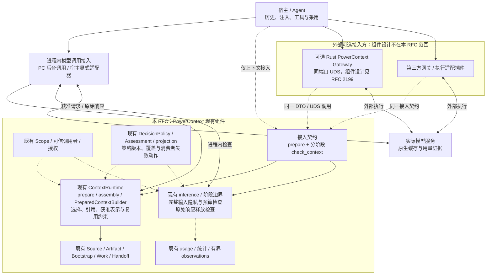
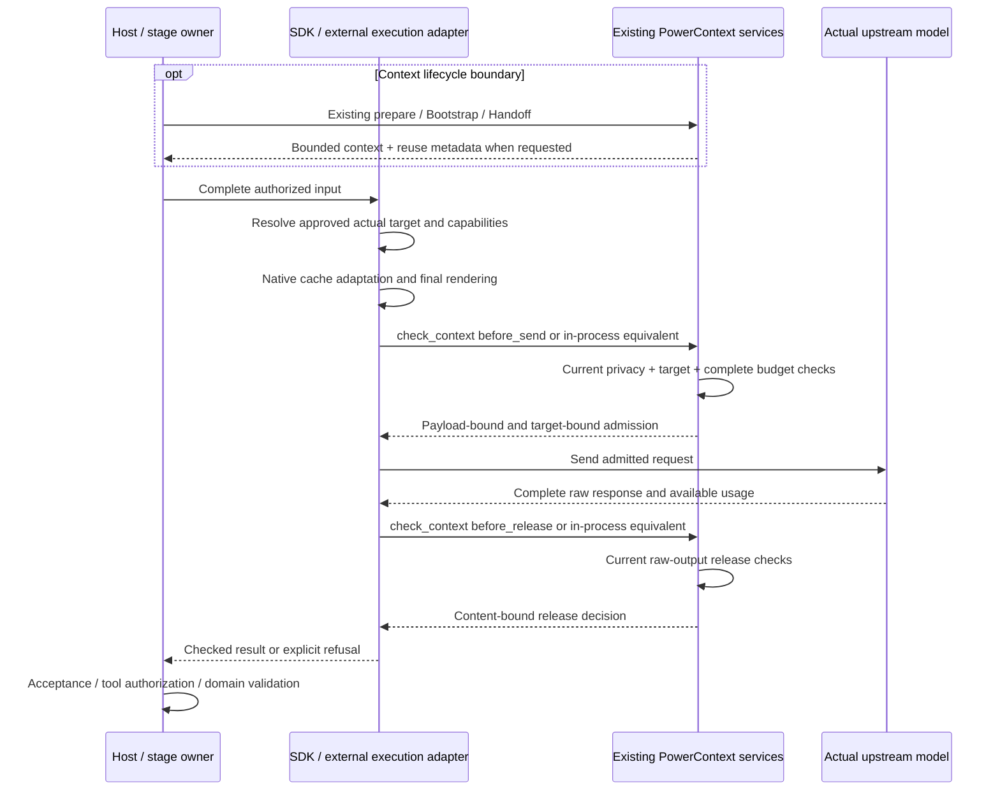

- Proposal Name: `integrated_privacy_interception_and_token_efficiency`
- Start Date: 2026-10-19
- RFC PR: [oceanbase/powercontext#2086](https://github.com/oceanbase/powercontext/pull/2086)
- Related RFCs: [RFC 0016](0016_pydantic_ai_inference_integration.md)、[RFC 0028](0028_context_pack.md)、
  [RFC 0046](0046_observability_foundations.md)、[RFC 0048](0048_handoff_artifact.md)、
  [RFC 1435](1435_explainable_prepared_context_receipts.md)、[RFC 1770](1770-decision-policy-governance.md)、
  [RFC 1783](1783-handoff-session-rollover.md)

# Summary

本 RFC 聚焦上下文这一层的两个产品目标：**隐私安全拦截**，阻止策略禁止的上下文外发或经模型结果交付；
**Token 效率优化**，在授权、资料新鲜度、任务质量与证据保真约束下，减少无效上下文、重复计算和不必要输出。
优先级为安全、正确性与证据、完整任务成本，再到缓存命中率。

两项能力扩展 PowerContext 现有上下文准备、策略治理、阶段投影和推理适配。
ContextRuntime 是已有 `ContextApplication.for_scope(scope_id).prepare(...)`、召回/assembly、
`PreparedContextBuilder` 与 Bootstrap/Work/Handoff 组合能力的名称，不新增上下文引擎、独立策略运行时或执行数据库。
公共准备结果仍是临时 `PreparedContext`，宿主保留历史、注入和采用权。

Core 负责上下文选择、获准表示、稳定复用边界、刷新条件及安全约束。
控制最终模型请求的执行适配器根据实际模型、API 和部署能力落实原生缓存设置，
并在最终渲染后、发送前，以及原始结果释放前执行必需检查。实际 KV Cache 属于推理服务。

本 RFC 复用既有准备入口，定义按需复用元信息和一个分阶段检查操作；内嵌调用无需 HTTP。
**PowerContext Gateway 与第三方网关都是外部可选接入方；网关组件的实现、语言、路由、限流、共享缓存和运行治理不在本 RFC 范围内。**
没有网关也可在 PowerContext 自身后台调用，或宿主显式接入的进程内模型适配器中执行完整检查；
只通过 SDK 获取上下文片段的接入不能声称控制完整请求。

实现基线为 `origin/main` 的仓库提交 `0bc42d0b`。本 RFC 是设计提案，不表示通用模型外发拦截、完整请求检查、原生缓存适配或节省收益已经在基线实现。

| 决策项 | 契约 |
| --- | --- |
| 核心目标 | 上下文层的隐私安全拦截与 Token 效率优化。 |
| 算法归属 | 复用现有 context、阶段投影、inference 与适用的 DecisionPolicy/Assessment/projection 消费者。 |
| ContextRuntime | 现有上下文组织能力，不新增选择器、转录库或只做转发的运行时类。 |
| 安全检查点 | 完整受支持请求发送前、原始响应释放前；辅助模型调用也遵守各自边界。 |
| 缓存职责 | Core 提供复用约束；最终执行侧 adapter 生成目标相关原生配置，供应商提供用量证据。 |
| 网关边界 | 预留 PowerContext Gateway 和第三方网关接入，不设计或交付网关组件。 |
| 公共接口 | 复用上下文/连续性 API；prepare 按需返回复用元信息，仅新增一个分阶段检查操作。 |
| 存储 | 本 RFC 的算法/检查零新增表；可选 Gateway 在 Server 同库的两张表由 #2199 单独定义，无新 Artifact 家族。 |
| 默认优化方向 | 既有有界选择、精确准备值复用、获准结构编码、缓存兼容和显式输出限制。 |
| v1 隐私处理 | 语义内容原样通过，或阻断/暂缓；不自动通用脱敏或恢复秘密。 |
| 验收口径 | 泄露反例、误阻断、任务质量、完整用量/费用、端到端延迟及明确覆盖范围。 |

# Motivation

PowerContext 已能选择并交付带引用的项目上下文、管理 Source/Artifact 证据、提供 Handoff，
并调用生成、Embedding、重排和判断后端。用户需要这些已有链路回答两个问题：

1. 策略禁止的资料会不会离开可信边界，或经模型输出交付给接收方？
2. 同一个任务能不能减少不必要的 token 和重复调用，同时保留必需事实和质量？

有用的改动是在所属边界加入对应算法。独立运行时会增加组合根、配置面与权威，
却不能替代真实 provider 调用适配，也容易掩盖上下文选择、隐私决策、序列化和 Artifact 校验各自不同的归属与失败语义。

优先顺序是：强制安全、正确性/证据、完整任务成本、缓存命中率。
输入变短但丢失约束、增加重试或破坏高价值缓存前缀，不能视作已经优化。
为了保持被禁止资料的前缀稳定而继续外发，也不是可接受的缓存策略。

## 范围与非目标

本 RFC 覆盖 PowerContext 所组织上下文的检索/交付规则、受支持模型调用中的上下文检查、
确定性表示优化、稳定复用约束和执行反馈契约。检查完整请求是防止宿主附加指令、历史或工具结果绕过上下文保护，
不意味着 Core 接管 Agent 历史、工具执行或全部网络流量。

首期不建设新的 Context Engine、Execution Kit、ContextPlan 资源或反馈总线。
不设计网关的认证实现、路由算法、负载均衡、连接池、队列、分布式缓存、请求合并、管理面和财务账本。
不新增通用有损摘要、compaction、响应/语义缓存或工具结果缓存。
这些能力需要独立场景、质量证据、权限/新鲜度与状态成本论证，不是接入本能力的前提。

内部可以在已有组件旁提取契约和失败语义相同的函数；不能因为共享算法诉求，先增加一个新的统一编排层。

# Guide-level explanation

## 一个 Coding 任务

用户让 Agent 在已注册项目 Scope 中修复 API 客户端：

1. 宿主在受支持召回边界调用现有 `/v1/context/prepare`。原运行时在获准 Scope 与 family 范围内检索、装配证据，保留引用和历史资料信任包装，不要求调用方逐条指定 Memory。
2. 宿主跨普通工具轮次保留这份精确准备值及注入位置。任务、资料新鲜度、权限或主动刷新要求变化时，通过原 prepare 或显式 Handoff 建立新边界。
3. 实际执行适配器确认获准目标及其缓存能力，在协议允许的位置装配上下文并生成原生缓存设置。SDK 与网关同时存在时，单次调用只有一个表示优化、最终渲染和发送所有者，不能重复准备或二次压缩。
4. 所属推理边界检查最终完整输入的隐私、目标、token 窗口和输出限制。强制检查通过后才允许发送；模型或最终载荷变化必须重新检查。
5. 适配器取得完整原始响应，完成必需释放检查后交给宿主。Strict 模式在批准前不交付模型内容。
6. 宿主采用检查后的回答或授权工具。后台结果仍需既有 schema、证据、资格和 Artifact 提交校验。获准不代表工具已执行或数据已持久化。

即使秘密只出现在宿主附加的工具结果中、从未进入 PreparedContext，也必须检查。
普通工具轮次不应为安全检查而重新召回上下文。准备结果 empty 仍然正常，隐私拒绝必须显式，不能伪装成空结果成功。

## 一个 Core 后台阶段

Memory 或 Topic 处理继续使用当前 Source 投影、指令和输出 schema。
Atomic Memory 提取已在输入投影中移除与所选正文的规范文本严格相等的重复载体，并保留不同的 payload、wire 或 Projection 证据；
直接复用该行为，不重写权威 Source。新增阶段 codec 才需要独立版本与验收，并保留每次出现、身份、顺序和证据引用。

Provider 边界检查真实请求，并在解析和领域校验前检查原始输出，阶段沿用既有生成/输出预算。
Embedding v1 只检查或阻断未改变语义的输入，不在原索引 profile 下对文档或查询进行通用压缩。

## 用户可观察的结果

隐私结果区分允许、阻断、不可用和不支持的覆盖范围，不回显命中秘密。
效率诊断区分准备频率、文本缩减估算、实际输入/输出、供应商缓存读写、失败尝试和缺失账目。
Strict 分别报告上游首 token 与首次内容释放时间，不能只根据文本变短或打开配置就声称节省或命中。

# Reference-level explanation

## 融入现有模块的具体位置

| 现有归属 | 已有能力 | 本 RFC 的扩展 |
| --- | --- | --- |
| `ScopedContextApplication.prepare` / `_prepare_build` | Scoped 召回、assembly、有界 recall effort、prepare 内查询向量复用 | 保留选择权威，在这里组合获准的上下文表示策略。 |
| `PreparedContextBuilder` / prepared text/code | 最终选择、引用、信任包装、遗漏和 UTF-8 预算 | 表示变化在最终 render/fit/count 前完成，不在别处二次截断已构建包装。 |
| 阶段输入投影 | 领域专用指令、schema、Source 窗口、证据与提取正文去重 | 只为对应阶段契约增加经过验证的结构 codec。 |
| `InferenceConfig`、inference ports 与 provider adapters | 生成、Embedding、重排、判断配置与真实调用 | 接入强制发送/释放检查、完整请求限制、缓存映射与逐尝试落实。 |
| `TokenEstimator` / estimator profile | 部署固定的文本估算和估算器身份 | 复用并明确范围/不确定性，不冒充供应商实际 token 数。 |
| `DecisionPolicy` / `DecisionAssessment` | 策略版本、模式、本地规则/模型 verdict 和 unknown 覆盖 | 按需注册窄域隐私消费者，最终动作仍归调用边界。 |
| `decision_projection` | 判断请求专用的有界临时投影保护 | 复用契约及兼容的已验证算法，不能把其载荷限制当成通用扫描上限。 |
| 现有 Source/Artifact、Work/Handoff | 证据、精确版本、显式连续性和提交 | 保留领域身份、权威、事务与支持的读取路径。 |
| Usage wrappers / 统计 / observations | 尽力而为的用量、有界诊断和 recorder 丢失观测 | 复用适用字段和 sink，不升级成财务或响应恢复账本。 |

实现基线：
[上下文 application](https://github.com/oceanbase/powercontext/blob/0bc42d0bc978ded22db1901305280c5b840d6533/src/powercontext/builtin/runtime/application.py)、
[上下文 Builder](https://github.com/oceanbase/powercontext/blob/0bc42d0bc978ded22db1901305280c5b840d6533/src/powercontext/builtin/runtime/prepared_context.py)、
[推理配置](https://github.com/oceanbase/powercontext/blob/0bc42d0bc978ded22db1901305280c5b840d6533/src/powercontext/builtin/runtime/config.py)、
[provider 适配](https://github.com/oceanbase/powercontext/blob/0bc42d0bc978ded22db1901305280c5b840d6533/src/powercontext/builtin/inference/pydantic_ai.py)、
[策略治理](https://github.com/oceanbase/powercontext/blob/0bc42d0bc978ded22db1901305280c5b840d6533/src/powercontext/builtin/runtime/decision_policy.py)、
[投影保护](https://github.com/oceanbase/powercontext/blob/0bc42d0bc978ded22db1901305280c5b840d6533/src/powercontext/builtin/runtime/decision_projection.py)、
[Token 估算](https://github.com/oceanbase/powercontext/blob/0bc42d0bc978ded22db1901305280c5b840d6533/src/powercontext/builtin/inference/tokens.py)、
[提取证据投影](https://github.com/oceanbase/powercontext/blob/0bc42d0bc978ded22db1901305280c5b840d6533/src/powercontext/builtin/artifacts/atomic_memory/extraction.py)、
[后台处理结果](https://github.com/oceanbase/powercontext/blob/0bc42d0bc978ded22db1901305280c5b840d6533/src/powercontext/builtin/runtime/models.py)、
[用量 recorder](https://github.com/oceanbase/powercontext/blob/0bc42d0bc978ded22db1901305280c5b840d6533/src/powercontext/builtin/runtime/_model_usage.py)。

## 架构与职责归属

### 算法内聚于现有组件



实线数据路径与虚线检查/接入路径表示职责，外部方不是 Core 的内部依赖。
检查请求携带真实待检内容，不是只传指纹；图中的外部执行箭头只有在相应最终边界已验收时才具有保护覆盖。
ContextRuntime 保留选择权威，推理边界消费完整请求；策略消费者不能授予检索权或替代 Artifact 提交。

### 实现与复用边界

新的内聚算法函数放在当前 context 或 inference 代码旁。
只有载体契约与失败语义相同时才共享扫描器、codec 或预算算法；
确定性准备 helper 不会自动成为 DecisionPolicy 消费者，只有注册的窄域消费者使用其治理契约。

共享的是领域规则、版本化契约和一致性样例。同一语言且契约一致时复用实现；
外部或不同语言接入通过检查接口消费 Core 决策，不预设 Python SDK 与网关链接同一份二进制或执行组件。
不增加平行规则引擎、通用插件框架、会话门面或为分组而存在的运行时。

现有窄域决策消费者保留原行为。`DecisionRequest` 的有界限制服务于自己的用途，
不能截取完整 prompt 的一小段就声称已检查全部内容。
只包装高层 structured generator 也不能证明覆盖最终序列化、内部重试、原始错误和首次释放。
每条承诺的 provider 路径必须接入并验证真实边界。

### 按可见性声明接入能力

| 接入方式 | 可承诺的能力 | 必须说明的限制 |
| --- | --- | --- |
| Context Provider / MCP / Hook 仅取得上下文片段 | 优化和检查 PowerContext 实际交付的上下文，保留引用与字节预算。 | 不知道宿主最终 prompt、模型和后续变更，不能承诺完整外发/释放保护或真实账单收益。 |
| 进程内模型调用接入 | 在已验证的最终发送与释放边界检查完整载荷，落实目标相关缓存设置并取得可用 usage。 | 不控制应用绕过该适配器的其他流量；覆盖按协议、载体、模型与版本声明。 |
| PowerContext Gateway 接入 | 通过同一准备与检查契约使用 Core 能力，在其实际发送/释放边界落实决策。 | 网关单独设计与交付，本 RFC 不要求部署它。 |
| 第三方网关接入 | 通过最终边界插件调用检查接口，或经受验证的透传路径接入。 | 透明程度、实际目标、重试、内容变换与 usage 决定覆盖，品牌或 OpenAI-compatible 标签不是兼容证明。 |

MCP、Hook 和 SDK 名称本身不决定权限；若某个宿主能控制更完整边界，按其实际能力验收。
没有 usage 时只报告交付字节、估算或本地复用，不把 unknown 当零。

例如，PowerContext 的 Atomic Memory 提取器在其实际 provider 边界接入检查，便可覆盖自身后台请求。
宿主若先调用 `prepare`，再直接用自己的模型客户端发送，仍然只有上下文交付覆盖；
宿主需显式将完整请求交给已验证的模型适配器，才获得对应发送/释放覆盖。
这里不要求替换所有模型 SDK，也不承诺导入 PowerContext 后自动拦截其他网络调用。

## 目标一：隐私安全拦截

### 检查内容与所属边界

| 边界 | 检查内容 | 归属与结果 |
| --- | --- | --- |
| 上下文检索/交付 | 既有 Scope/Artifact 授权、资料资格、信任包装；适用时执行已配置的交付规则 | 当前上下文/领域操作，保留原响应契约。 |
| 每次受覆盖的模型发送前 | 完整指令、支持内容、工具/schema/结果、允许目标和影响内容的设置 | 现有推理边界消费者：原样通过、阻断或暂缓。 |
| Strict 响应释放前 | 完整原始文本、工具参数、暴露给用户的 provider 错误、完成状态和当前释放策略 | 现有推理/执行器边界，检查通过前不释放。 |
| 领域写入前 | 既有 schema、证据、review、身份和提交校验 | 所属 Source/Artifact 服务，模型响应获准不能绕过。 |

能读取 Source 或获得准备结果，不等于可以把资料发给任意模型。
Prepare 不知道未来任意目的地，也不能认证尚未由宿主装配的完整请求。
最终外发检查仍然必需，跳过上下文准备时也一样。
检索中发生的查询 Embedding、重排和辅助调用，也需覆盖各自发送前边界；只检查最终准备结果，保护不了更早的外发。

首个 enforcing profile 覆盖已配置秘密值/格式、支持的文本/结构化工具载体和受控目的地，并声明检测边界与误阻断样例。
不声称通用语义隐私检测、完整 prompt injection 防护，或对不支持的不透明/多模态内容已建立保护。

### 复用策略，明确失败语义

基础规则随当前 PowerContext 进程执行：配置的秘密值/格式匹配与受控目的地检查无需单独部署组件。
PII 是个人身份信息这一类数据，不是指定库；如需姓名、地址等实体识别，可按场景选择进程内可选依赖或外部 DLP，
并明确检测覆盖、模型/资源成本和可信边界。Presidio、独立识别服务或 Gateway 都不是首期前提，
安装基础功能也不默认下载识别模型。可选检测器一旦被部署策略声明为必需，其不可用仍按强制检查暂缓处理。

先在本地执行确定性规则。实质本地判断可使用既有 `DecisionAssessment` 词汇，
注册的消费者复用版本、模式、原因、覆盖和 observation 契约，再由消费者映射到所属发送/释放动作。
`deny` 阻断，`unknown`、必需覆盖缺失或 enforcing 不可用时暂缓。
LLM 结果不能覆盖强制规则，也不能授予资料或工具权限。

`FailOpenDecisionModel` 保留当前 abstention 契约。可选 advisory 消费者可以按本领域契约忽略 abstention；
强制隐私消费者必须将同一 abstention 解释为不足以发送/释放，不能全局改变所有判断消费者，
也不能把 provider 故障记成隐私检查干净通过。

后台处理必须保留失败的领域含义。当前写入判断 `HOLD` 虽不提交 Memory，却会推进 cursor 并消费 Source 窗口；
强制隐私检查的 block/withhold、超时或 unknown 不能映射成该 `HOLD`、空提取成功或跳过窗口。
它们应在发送/释放边界显式失败，由所属处理流程保留待处理证据与进度，并遵守已有重试预算；
不能通过更换模型、重启或策略变更自动获得新预算，也不为此建立新重试库。
Topic Memory 已有阻塞/显式重试能力按其原授权与幂等契约使用，不挪用为通用推理状态。
写入判断的既有 `HOLD` 语义保持不变。

外部辅助模型只能接收已获准的有界投影，不能先把禁止资料送给托管分类、压缩或 Judge 模型，再判断能否外发。
现有 decision projection sanitizer 仍是判断请求专用能力，不构成通用模型 DLP 覆盖。

### 检查算法与内容处理

1. 绑定可信调用者、Scope、stage、目标和策略版本，由受控配置解析获准目的地/凭据。
2. 接受前校验协议、载体、编码、嵌套和大小限制，不支持的 strict 载体拒绝或暂缓。
3. 检查支持的原始表示和解析后的内容字段。JSON 归一化不能掩盖重复键被覆盖前的秘密、数字词法、转义值、错误正文或工具结构。
4. 执行必需本地规则及适用的可选评估，保留是否真正检查过的事实，unknown 不算 allow。
5. 检查最终完整外发表达或完整原始释放单元，返回无正文原因和有界覆盖信息。

v1 不自动脱敏代码、工具参数、标识符或签名内容，不维护持久占位符映射，只允许语义原样通过或阻断。
后续专用变换必须证明有效、保留权威原文、重新检查结果，并说明存储/安全成本。

未批准重定向、任意客户端 base URL、凭据转发和未知内容字段，不能靠宽松字符串白名单放行。
取消继续传播，安全错误和日志不回显命中内容。

### 隐私模式与优化模式相互独立

| 轴 | 模式/契约 |
| --- | --- |
| 隐私策略 | 适用时沿用 disabled/shadow/advisory/enforcing 治理，只有经验证覆盖的 enforcing 才能声称拦截。 |
| 部署必需规则 | 不受可选优化或 Judge 开关影响，客户端不能通过请求字段选择更弱策略。 |
| 新增表示优化 | 为新增合格策略提议 `off`、`shadow`、`active` 配置；每项默认 off，验收后才启用。 |
| 缓存规划 | Profile 显式选择，仍需最终载荷准入，不削弱隐私检查。 |

优化 shadow 计算候选但继续发送获准原输入，不隐含第二次模型调用。
隐私 shadow/observation 不阻止泄露，不能展示为 enforcing 保护。
策略晋升沿用窄域消费者证据要求，不新建中央策略服务。
既有提取正文去重、有界召回和查询向量复用保留当前行为，不被重新包装为默认关闭的新功能。

## 目标二：Token 效率优化

### 策略与所属位置

| 策略 | 所属位置 | 验收约束 |
| --- | --- | --- |
| 有界相关选择 | 当前召回/assembly 与 Builder | 保留家族选择、授权、精确引用和遗漏语义，以已有基线衡量增量收益。 |
| 减少重复准备 | 宿主生命周期接入与现有 prepare/bootstrap receipt | 普通工具轮次复用获准值；bootstrap 去重仍限于完整注入的 Atomic Memory 精确版本。 |
| 上下文表示 | 现有 prepared text/Builder 路径 | 专用、确定性、按需启用；保留信任标记、引用、标量内容、顺序和完整预算。 |
| 后台输入编码 | Provider 渲染前的阶段输入投影 | 仅用于获准 schema/codec 组合；保留身份、时间、元数据、顺序、重复次数和证据还原。 |
| 供应商前缀复用 | 现有推理 adapter/profile 与执行器 | 保持渲染前缀、合格消息/内容块边界与缓存控制，使用真实供应商证据计量。 |
| 输出效率 | 现有阶段 schema、指令与 `InferenceLimits`/模型设置 | 显式输出上限与必需字段，保留证据和完成检查，不自动截断后接受。 |
| 减少不必要模型工作 | 现有有界 recall effort 与阶段调度 | 计算实际减少的调用和新增 Embedding/rerank/Judge 成本，不新增 Agent 调度器。 |

基线已实现 Atomic Memory 提取输入的精确正文去重，并在单次 prepare 中复用合格查询向量、合并部分召回查询；
这些能力先作为对照基线，不计入本 RFC 的新增收益。向量复用仍遵守原查询/profile/后端兼容条件；
Atomic/Topic 复用要求实际 Embedding 后端一致且查询未经变换，不扩大到任意 Scope、profile 或跨调用缓存。
每个读取和外发边界仍需当前授权与适用规则，计算复用不能替代检查。
现有 `recall_embedding_timeout_seconds` 只是召回等待预算，不是整个请求或隐私检查的超时/放行规则。

基线没有涵盖以上全部策略的通用输入/输出优化器，也没有本 RFC 的强制外发/释放与原生缓存契约。
每项新增 active 策略都需定义支持输入、不变量、对照行为、版本、回退和质量证据。

### 表示算法与不变量

先复用已有 `project_atomic_memory_evidence`：只省去与所选正文规范文本相等的载体副本。
Source、wire、payload 或其他 Projection 中内容不同的事实必须保留，不能按字段名删除；
不合并不同 Source 的身份、顺序、出现次数或 lineage，不改存储内容与 journal。

如需跨记录结构 codec，再在受控阶段 schema 内编码严格相同的正文，保留有序出现/引用列表并证明等价。
时间、身份、元数据、次数和重复不能静默丢弃，日志行也不能仅因模板相似就合并。
这是待验收的阶段局部扩展，不是通用日志压缩器；已有去重不因此新增 wrapper 或通用 codec 层。

上下文交付的表示算法在 Builder 最终 render/fit/count 前执行，保留精确引用、历史信任边界、必需字段和诚实的截断/遗漏标记。
不能用未经验证的正则改写空白、代码、JSON 值或工具参数，删除当前公共展示契约必需字段也不算无损优化。

每次合格变换都要：识别支持格式、构造候选、验证还原或所承诺的字段等价契约、使用相同估算器/profile 计数，并只应用已验收策略。
没有测得缩减或校验失败时，只有原输入仍满足隐私和完整请求限制才能回退。
不安全或超预算的原输入不是合法回退。Shadow 记录有界候选诊断、保留获准原输入；
没有独立实验授权就不额外付费调用模型。

有损摘要、通用 compaction、任意脱敏和语义响应缓存留待独立设计。
模型输出过长或不完整仍需领域校验，减少输出 token 不意味着可以丢弃必需证据或接受半截 JSON。

### 补充上下文字节与完整请求 token

现有 `prepare.max_bytes` 仍是补充上下文 UTF-8 字节预算。
完整目标请求还包括指令、历史、工具/schema、协议开销和输出预留，准入依据经过验证的目标窗口，
并明确 tokenizer/估算 profile 和不确定性余量。启发式估算不能证明精确硬 token 保证；
应使用经过验证的保守边界，或拒绝需要而无法提供该精度的 profile。

放不下就暂缓发送。宿主可通过原 prepare API 请求更小上下文，或显式 Handoff。
推理代码不能静默召回另一组 Memory、截断已构建信任包装、删除工具交换，或把字节限制当成 token 限制。

### 稳定上下文复用与模型缓存接入

| 复用对象 | 本 RFC 的处理 |
| --- | --- |
| 已准备的准确上下文 | 宿主/调用内有界复用，保留位置、当前授权与刷新边界。 |
| 已有持久 Artifact | 沿用领域精确读取、版本与新鲜度，不新增缓存身份。 |
| 模型前缀 KV | 通过执行侧原生适配改善资格，仍由模型生成本次回答。 |
| 通用派生结果/编译缓存 | 不作为首期交付，后续独立论证状态与收益。 |
| 完整响应、语义回答和工具结果 | 不默认缓存或重放；副作用与幂等仍归宿主/工具领域。 |

```text
Turn 1: Stable instructions / tools + exact PreparedContext | Current request
Turn 2: Same prefix + original accepted history             | New messages / tool results
```

这是逻辑布局，实际角色、信任级别、消息边界和工具配对遵守目标协议。
宿主拥有历史和采用权，在显式本地任务 epoch 中保留准备值与注入位置；epoch 不是服务端会话资源。
新意图、资料新鲜度变化、权限撤销或主动刷新建立适当新边界。不能为缓存而继续使用已不获准内容。

| 层次 | 决策与责任 |
| --- | --- |
| 现有 context / Builder / 策略 | 选择与表示内容，给出可复用区段、语义顺序/信任约束、刷新条件与允许的保留范围。 |
| 最终执行侧 provider adapter | 在实际模型/API/部署确定后，将约束映射到原生模式、合格消息/内容块断点、TTL、键和路由要求；完成最终渲染、发送及 usage 解析。 |
| 模型服务 | 保存、查找与淘汰 KV，提供供应商定义的缓存计量；客户端不能承诺实际计算命中。 |

Core 不输出套用于所有模型的原生缓存参数。获准 `UpstreamProfile` 是可信配置与临时目标绑定，
声明模型/版本、协议/渲染器、影响前缀的工具/schema/设置、账号/区域/缓存共享边界、
支持模式/断点/保留语义，以及可取得的用量字段。适配器只能在获准能力内生成配置。
客户端自报 profile 或缓存能力不是可信授权；不支持的目标要显式标记。

复用约束通过现有 prepare 的显式 `include_reuse=true` 返回，不是新的 ContextPlan 或缓存资源。
未请求时保持公共 PreparedContext 默认形状；请求时返回版本化的 `context + reuse`。
适配器保留元信息，完成目标特定的缓存规划和最终渲染，再调用发送前检查；不增加规划预检或每轮召回 RPC。

适配器保留角色、工具顺序、内容块和可复用边界，不向稳定 prompt 插入随机 ID/时间戳，
不任意合并旧消息或丢弃原生缓存控制。一次调用只有一个表示优化与发送所有者。
更换模型、API、账号、区域、渲染器或 fallback 目标后重新规划和准入。
必需的目标/保留/隔离约束不能满足时暂缓；普通缓存未命中不自动重试，也不为达到缓存门槛默认填充无关内容。

缓存优化默认尽力而为，不把实际命中作为发送条件。可选缓存能力不可用时，只有原请求仍符合隐私、目标、
格式和完整预算才能省略可选原生缓存参数；如因此改变最终载荷，必须重新检查。
省略参数不代表关闭供应商的隐式缓存；目标仍须满足获准保留/隔离策略，无法验证时暂缓。
必需的数据保留/隔离约束不能随缓存优化一起关闭。

缓存协议兼容与实际命中分别验收。相同语义或前缀文字不证明具有相同原生边界；
最终正文摘要绑定已批准请求，但不能证明供应商内部 token 渲染或 KV 复用。
整个不断增长请求的摘要不是稳定缓存路由键；cache hint 也不是锁定机器或命中保证。

Scope 分区和请求缓存键不等于供应商物理隔离，必须验证目标账号、处理区域和隐私/保留策略。
TTL 字段是否表达最短计费覆盖、保留提示或删除期限，由获准 profile 明确；不能把缓存 TTL 自动当作隐私删除保证。
供应商返回的缓存读写是其定义的计量证据，不直接证明延迟下降或每次实际复用计算；性能独立测量。
输出检查影响后续获准重放，不能改变产生当前响应的请求已经决定的缓存资格。

### 表示优化与复用联合取舍

在质量、授权、新鲜度与目标窗口约束内，比较保持已有准确准备值、使用现有获准表示、
执行已验收确定性编码，以及显式刷新/缩小 prepare 等受支持选择。
保留较长但可复用的前缀可能比重新编码更便宜；更短输入也可能因丢失缓存而增加本次成本。

首期采用可解释的保守规则与对照实验，不预测未知剩余任务长度、不自动启动摘要/Judge 或在线自调策略。
达到窗口限制或安全/新鲜度变化时服从必需约束。
不能只按压缩比例决定重新表示，也不能用提高命中率代替成功任务完整费用与端到端延迟。

### 来源与索引兼容

公共 PreparedContext 的默认结果保持临时四字段：`schema`、`status`、`content`、`content_bytes`。
它不是完整 prompt、可信来源清单、授权 token 或注入证明。
自动跨 Scope 冻结重放在获得经过验证的来源/重新授权机制前不受支持，不能从引用文本推导权限或永久使用已撤销投影。

内部 `PreparedContextBuild.lineages` 已保留用于用量归属的不可变 Artifact 快照，可在契约相同时复用，
但它不是当前 head、完整来源清单或授权证明，也不改变公共四字段结果；不能用它直接批准冻结重放。

现有 `bootstrap_receipt_id` 仅对其支持的已完整注入 Atomic Memory 版本去重，不证明任意历史、Topic Memory、代码或 Handoff 覆盖。
[RFC 1435](1435_explainable_prepared_context_receipts.md) 提议的按需诊断尚未在基线实现，也不能提升为权限。

Embedding v1 检查或阻断原样文档/查询；未来变换需定义兼容且版本化的查询/文档 profile，以及显式重建索引/迁移策略。
Rerank 保留候选身份/顺序映射。后台调用不自动注入 Agent Memory，不递归启动增强/Judge。
切模型保留可移植历史/Handoff，不迁移私有 KV 或不透明推理状态；
rollover 按 [RFC 1783](1783-handoff-session-rollover.md) 仍归宿主。

## 执行流程与最小接口

### 复用现有入口

| 需求 | 现有 HTTP 路径 |
| --- | --- |
| 任务上下文 | `/v1/context/prepare` |
| 生命周期上下文/交付 | `/v1/context/bootstrap`、`/v1/context/bootstrap/receipts` |
| 当前工作连续性 | `/v1/work/handoffs/prepare-current`、`/v1/work/handoffs/acknowledge` |
| 显式 Handoff | `/v1/handoff/prepare`、`/v1/handoff/finalize`、`/v1/handoff/commit`、`/v1/handoff/continue` |
| 工作观察 | `/v1/work/contracts/create`、`/v1/work/outcomes/record` |

未请求复用元信息时，上下文准备保持当前请求与默认结果形状：

```json
{
  "scope_id": "project:powercontext",
  "query": "Fix the generated API client and preserve repository regeneration requirements",
  "max_bytes": 8000,
  "include_code": false
}
```

不需要创建 invocation/session/branch、context-plan API、策略运行时 API 或事件账本。
现有 `assembly`、`include_code` 和 bootstrap receipt 设置保留原支持行为。
普通自动召回不能仅为检查而重复 prepare，也不为此启用诊断 receipt。

### 在现有 prepare 上按需取得复用元信息

`POST /v1/context/prepare` / `prepare_context` 增加可选请求字段 `include_reuse`，默认 `false`。
未请求时保持现有严格四字段结果；显式请求且能力受支持时，返回版本化的 `context + reuse` envelope。
不向现有 `PreparedContext` 直接追加字段，因为其契约是 `additionalProperties: false`。

```json
{
  "scope_id": "project:powercontext",
  "query": "Fix the API client",
  "max_bytes": 8000,
  "include_code": false,
  "include_reuse": true
}
```

```json
{
  "schema": "powercontext.prepared-context-with-reuse.v1",
  "context": {
    "schema": "powercontext.prepared-context.v1",
    "status": "ready",
    "content": "Context",
    "content_bytes": 7
  },
  "reuse": {
    "schema": "powercontext.context-reuse.v1",
    "constraints": {
      "preserve": ["content", "citations", "trust", "order"],
      "refresh_on": ["permission_change", "source_ineligible", "context_boundary"]
    },
    "expires_at": "2026-10-23T01:30:00Z",
    "binding": "<authenticated encrypted preparation binding>"
  }
}
```

示例值和期限仅说明形状，不是默认配置或可使用的凭据。`context` 仍是原四字段对象；
`status=empty` 保留原含义，隐私拒绝或来源无法确认不能伪装成 empty。
实现时两个响应分支以 `schema` 严格区分，SDK/MCP 继续使用扁平 `prepare_context` 操作。
现有 `get_capabilities` 声明 opt-in、schema、支持 family/carrier 与数量/大小上限；
不支持时明确拒绝该选项，不能静默返回普通结果并声称支持复用。

Core 在实际 select/render/fit 完成后生成完整、有界依赖：
准确资源/版本、Scope、内容绑定、资格/新鲜度与保留条件。`origins/lineages` 不能直接当作完整证明。
`reuse.constraints` 只约束此次准备内容的保持与刷新，不规划整个宿主 prompt 或供应商 KV。
`reuse.binding` 是短期、有版本、可认证且加密的封装，绑定部署、主体/委托、Scope、
准确内容摘要、完整私有依赖和期限；限制长度与数量，校验 key version、audience 和篡改。
它不是 bearer 权限、已注入证明或永久 receipt，不新增表或 plan API。
未建立完整依赖的 family、代码或 reference 不能声明支持冻结重放。

内嵌调用取得同一语义的不可变内部结果，无需 HTTP 或私有 Builder API。
网关/宿主在工具轮次保留准确准备值及其元信息；检查不重新 prepare、搜索或 Embedding。
依赖失效、过期或不能确认时停止旧复用，由宿主显式刷新并建立新上下文边界，不能原地改写旧注入。

### 一个检查操作，两个明确阶段

| 提议的 POST 路径 | operationId | 阶段 |
| --- | --- | --- |
| `/v1/context/check` | `check_context` | `before_send`：完整最终请求的发送准入；`before_release`：完整原始响应的交付准入。 |

两个时机共用一个公开操作，仍分别检查；不能用发送批准代替响应检查。
该操作只返回决策，不检索、不改写内容、不返回优化候选、不规划原生缓存、不调用模型、不提交 Source/Artifact。
算法仍归现有 context、policy、stage/inference 组件，进程内直接调用同一规则，无需新运行时门面。
远端请求以 `phase` 区分严格 DTO；错误阶段的字段不能混用。

发送前请求示意：

```json
{
  "scope_id": "project:powercontext",
  "phase": "before_send",
  "target_profile": "coding-default",
  "payload": {
    "schema": "powercontext.model-json-payload.v1",
    "headers": {"content-type": "application/json"},
    "body": "<complete final provider request JSON>"
  },
  "prepared_contexts": []
}
```

`payload.body` 是保留原始 UTF-8 JSON 文本的字符串，不是已被归一化的 JSON 对象。
示例占位值必须替换为完整真实正文，不能用摘要或 hash 代替。
carrier schema 定义相关 headers、原始表示检查、严格解析和大小/深度上限；
后续转义解码、重复键或重新序列化不能隐藏禁止内容。不支持的 carrier 明确拒绝。
`target_profile` 是可信配置别名；调用者自报值不授予权限，执行器必须匹配实际
模型/API/endpoint、账号/区域、renderer、缓存设置和输出限制，不透明的下游改写不能取得完整覆盖。

重放准备内容时，`prepared_contexts` 必须列出每个完整历史块的 `binding` 和 `location`。
`location` 使用版本化的协议载体定位：JSON pointer 指向受支持的文本字段，
`start_byte` / `end_byte` 是解码后字符串的 UTF-8 字节半开区间，必须落在字符边界。
Core 对实际载荷中的准确完整块、信任/位置/顺序以及当前依赖重新验证；locator/hash 本身不是证明。
有界数组支持多个历史块，不能仅校验最新一次 prepare。
没有 PowerContext 准备块的纯检查可为空；需绑定的增强请求缺失绑定或位置时拒绝，不能降级为纯检查。

单个重放块的定位示例（原生消息该字段准确包含 `Context` 时）：

```json
{
  "binding": "<reuse.binding from prepare>",
  "location": {
    "schema": "powercontext.model-json-text-location.v1",
    "pointer": "/messages/1/content",
    "start_byte": 0,
    "end_byte": 7
  }
}
```

交付前请求示意：

```json
{
  "scope_id": "project:powercontext",
  "phase": "before_release",
  "target_profile": "coding-default",
  "request_binding": "<binding returned by before_send allow>",
  "payload": {
    "schema": "powercontext.model-json-payload.v1",
    "headers": {"content-type": "application/json"},
    "body": "<complete raw provider response JSON>"
  },
  "completion": "complete"
}
```

`request_binding` 关联此次真实发送请求，不能拿任意历史批准替代。
`strict` 在完整响应检查通过前不释放模型内容、工具参数或可暴露的错误正文；
不完整、超限、检查不可用时暂缓交付。可取得的 usage 按类型附带，未知值不能记为零。

统一决策结果示意：

```json
{
  "schema": "powercontext.context-check.v1",
  "phase": "before_send",
  "decision": "allow",
  "reason_codes": [],
  "coverage": {"profile": "text-and-tools.v1", "complete": true},
  "policy_version": "privacy.v1",
  "valid_until": "2026-10-23T01:01:00Z",
  "correlate_until": "2026-10-23T01:05:00Z",
  "binding": "<short-lived payload-bound and target-bound result>"
}
```

只有 `allow` 返回可用于该阶段的绑定；`block` 表示明确禁止，`withhold` 表示覆盖不足、
需刷新或当前条件无法确认，二者都不允许继续。原因码不得含敏感正文。
结果不携带复用/缓存规划；适配器先消费 `reuse.constraints` 和获准目标能力完成原生渲染，再检查最终载荷。
任何正文、相关 headers、目标或设置变化都需重新检查，批准后不再做语义优化。

绑定包含当前身份/委托、Scope、phase、实际目标、准确正文/相关 headers、限制与策略。
发送批准的 `valid_until` 与 `correlate_until` 分别给出发送期限和有界响应关联期限；后者不能延长再次发送权限。
交付批准只返回本阶段的 `valid_until`，仍按当前策略检查；不返回新的请求关联许可。
这不是持久单次许可证、模型恰好一次或响应恢复机制。
远端检查不能证明不可信执行器确实发送了受检字节；完整保护需要真实最终传输边界接入。

| HTTP 结果 | 调用者处理 |
| --- | --- |
| `200 + allow` | 验证阶段、覆盖、当前绑定与期限后，仅继续对应步骤。 |
| `200 + block/withhold` | 判断已完成，但禁止发送/交付；不能只判断 HTTP 成功。 |
| `401/403` | 认证、Scope 或资料授权失败，不继续。 |
| `422` | phase、schema、必需绑定、位置或载体契约不合法，不继续。 |
| `413`、检查超时或 `503` | 超限或检查不可用，不发送、不交付。 |

沿用根级 `scope_id`、`current` Scope 模式，以及现有 `scope.read` / 资料权限与可信委托。
请求体不能降低强制策略，也不能以 Scope 可读权限代替模型执行/付费权限。
两个阶段复用当前授权与内容规则，工具执行权限、质量校验和领域提交仍由原边界负责。

每次检查从当前认证请求重新绑定 Principal/委托；共享管理员密钥加任意 Scope ID 不是隔离。
内嵌 `for_scope` 只绑定分区，不执行认证；资料和 context references 仍由所属领域授权。
保留路径参数优先及冲突拒绝规则，旧检查或长连接不能提供永久权限。
JSON 示例不代表所有协议载体均受支持；SSE/其他原生输出需独立版本化 carrier 和一致性验收，
不能把丢失原始事件的摘要包装成完整原始响应。

本 RFC 只改设计，不修改运行时或生成契约。实现时将 prepare 的显式响应分支及 check DTO 写入
`openapi/powercontext.yaml`，运行 `make api-generate` / `make contract-test`，保留扁平操作与 scoped 领域语义。

### 一次受管理的上下文调用



Core 阶段表示优化在最终 provider 渲染前完成，之后必须检查最终输入。
编码前也检查原阶段投影，防止 codec 把禁止值隐藏在后续载体检查之外。
可选优化失败，仅能回退到仍获准、有效且在预算内的输入；优化关闭、失败或候选更短，都不能形成安全旁路。

### 自有与第三方网关的接入方式

**PowerContext Gateway：** [RFC 2199](https://github.com/oceanbase/powercontext/pull/2199) 的 Rust 组件
通过 HTTP over UDS 调用现有 prepare 和同一检查操作的两个阶段；显式远端/第三方走 HTTPS，
使用相同 schema、Scope/可信委托、目标 profile、绑定、失败与 usage 契约。
Rust 保留准备值与绑定，在实际 provider adapter 完成原生缓存配置和最终渲染后提交检查。
UDS 不代替当前认证，Rust 不复制 Python 上下文/隐私算法；网关启停、原端口归属和私有状态 IPC 由 #2199 定义。

算法与检查本身不要求网关或新增表。可选 Gateway 的两张专用表在 Server 选定的同一个
SQLite / SeekDB / OceanBase 数据库中，由 Server 既有后端/迁移设施承载。
同库不将它们变成 Source/Artifact，不使 check 产生状态写入；
组件状态命令和迁移资源归 #2199，不扩充本 RFC 的检查职责。

**第三方网关最终边界插件（预留）：** 已有网关可直接使用 Core，无需部署 Rust Gateway。
插件复用公开 get_capabilities、prepare/check 与原认证/委托，不取得 Gateway 私有状态/数据库权限。
这是稳定接入契约与一致性样例，具体品牌插件按需求单独交付；不建设通用插件平台。
在最后一次协议映射之后、真实发送之前调用 `check_context(phase=before_send)`，
在任何原始响应内容/工具参数/错误正文首次交付之前调用 `check_context(phase=before_release)`。
每个真实尝试提供实际目标，目标或载荷变化重新准入，传播取消并报告可取得的用量和缺失覆盖。
插件必须真正执行这些动作，调用过检查 API 本身不是执行证明。

**第三方网关作为上游透传路径：** 受管理 SDK/provider 适配器可通过获准端点发送，
但相应 profile 必须验证内容/缓存字段保持、实际目标、隐藏重试/fallback 和响应映射。
检查之后还有不透明变换时，保护只到已观察边界；必需端到端覆盖不能证明则暂缓或拒绝该 profile，
不能把未知默认为透明。只有上下文交付能力的接入按其实际范围展示，不冒充完整请求保护。

以上是接入方义务和验收条件，不规定任何网关内部路由、鉴权实现、共享缓存后端或管理协议。
基于第三方特性的正式兼容声明，必须另行完成真实版本、配置和链路验收。

## 流式、失败与恢复

Strict 在释放前缓冲完整受支持响应，并限制字节、时间和并发。
JSON/工具参数不完整、缓冲超限、强制检查失败或策略不可用时，不释放并尽力取消上游。
不溢写到新响应数据库，批准前连接/心跳元数据不能含模型或敏感内容。
Observe 不声称阻止泄露；bounded streaming 需独立验证安全单元契约，不属于首个 enforcing profile。

| 情况 | 必需行为 |
| --- | --- |
| 可选表示优化失败 | 只有原输入仍符合隐私、格式和完整预算才能保留原输入。 |
| 强制隐私检查失败/不可用/unknown | 暂停发送或释放，不能回退到未检查原文。 |
| 满足上下文字节限制，但超过目标窗口 | 暂缓，显式减小 prepare 或 Handoff，不隐式截断。 |
| 目标或最终载荷变化 | 发送前重新检查。 |
| 确定尚未发送的传输失败 | 唯一明确所有者在有效准入和有界次数内重试。 |
| 可能已到达上游 | 返回不确定，不自动付费重发或假设退费。 |
| 原始响应不完整/不获准 | 不释放 strict 内容，保留无正文失败证据。 |
| 检查通过，交付前响应丢失 | v1 不保证持久响应恢复，宿主处理自己的未解决调用。 |
| 获准输出随后领域校验/提交失败 | 领域操作仍按原契约失败或待处理。 |
| Usage 不可用 | 标记 incomplete/unknown，不记零或完整费用。 |

取消保持控制流。SSE 可在完整 strict 检查后组帧，这会延迟首次内容释放。
请求头已发出后，使用协议支持的错误/中断事件，不能声称改写此前 HTTP 状态。
发送前和首次释放前重新检查当前必需策略；撤销可以破坏缓存复用。
本地投影失效不能收回已外发或已释放内容。

## 存储、配置与观测

### 复用领域存储，新增零张表

| 信息 | 现有归属 | 复用约束 |
| --- | --- | --- |
| Scope / references | Scope 目录与访问平面 | 既有精确身份和授权。 |
| 真实观察 | `pc_sources` / Source journal | 显式领域证据，不记录所有模型请求/响应。 |
| Memory 等 Artifact / Handoff | `pc_artifacts`、heads 与 lineage | 现有不可变版本、治理、事务和精确读取。 |
| Work 连续性 | Source/Artifact 上的 Work 门面 | 不新增任务/会话聚合。 |
| Bootstrap 交付 | `pc_context_bootstrap_receipts` | 只用于其无正文专用生命周期契约。 |
| 策略评估 | 消费者符合契约时使用 `pc_decision_observations` | 注册有类型的 consumer/reason，复用保留策略；不保存 prompt 正文或逐次财务账本。 |
| 模型/召回聚合 | `pc_model_usage_daily`、`pc_recall_token_daily`、`pc_recall_effort_daily` | 保持原不完整/尽力而为的统计语义。 |
| 准备值、编码候选、检查绑定、缓存计划和缓冲 | 调用/宿主内存 | 有界、可丢弃派生值，不强制持久化。 |

不将 review candidates、processing leases、Topic Memory work budgets 或 Source/Artifact blob 改作通用推理存储。
规则与 profile 扩展所属边界的可信 runtime/inference 配置和策略 manifest，不新增策略数据库或通用工作流注册中心。

宿主历史保持对话事实权威。准备值复用可选且有界，按 Scope、可信访问分区、准确内容/版本、
当前策略、目标/渲染 profile 和有效边界建立资格，不能只用查询文本或内容 hash 代替当前授权。
首期不建立通用派生结果或编译缓存；已有制品复用沿用其领域读取、版本和新鲜度契约，
不能把 Artifact blob 改作缓存以绕过新增表论证。
重启后宿主提供保留上下文或重新准备，已提交 Handoff 通过原读取路径恢复。
Core 不恢复未持久化转录/响应，也不建立分布式选择前沿。

持久调用恢复、全局硬费用预留和分布式单次发送许可需单独的最小状态提案。
先比较现有仓储、定义缺失保证，再论证身份、隔离、事务、不确定发送/提交、保留、读取、成本和迁移。
本 RFC 不预先批准任何表。

### 配置与费用口径

在所属边界扩展已有配置：策略版本/模式/失败动作、获准策略与 codec 版本、估算器/profile、
目标/缓存能力、响应上限与重试归属。隐私 enforcing 与优化设置相互独立。
未启用新功能的既有用户保持原契约，关闭或仅观察的路径不能宣传 enforcing 覆盖。

不把允许丢失的聚合用量改称预算账本。单请求窗口/输出限制仅在经过验证的 profile 内成立；
跨实例重启安全的费用硬上限不是 v1 保证，关联 ID 也不是幂等保证。
已知、估算、未知和对账用量分开记录，包括辅助调用、失败尝试和可观察缓存写。
基线 `InferenceUsage` 只有请求/输入/输出计数。实现缓存读写、reasoning 用量和实际目标证据时，
需在既有 inference/usage 边界增加有类型的可选元数据，保留 unknown；现有日聚合不能还原这些字段。
v1 展示一次任务无需强制持久化这些新证据。
现有 recorder 的队列丢弃、写入失败与 worker summary 可用于标记统计不完整；
缺少 child report 是 unknown，不能按零丢失处理。`artifact_processing.worker.returned` 或进程退出不能证明业务提交，
处理成功仍以所属 supervisor 验证 durable acknowledgement 为准。
这些信号都不补齐缺失的 provider 用量，也不保证完整失败尝试账目；观测失败不能改变业务结果或吞掉取消。
执行反馈进入符合契约的既有 usage/sink、统计或决策 observation；
Trigger 的 Signal 是纯状态转换输入，不是现成的通用推理反馈库，不要求逐请求写 Source。
任务成功与工具副作用由宿主/领域事实确认，模型调用成功不能代替任务完成。

新增运行字段前遵循[现有可观测性指南](../development/observability.md)：稳定 operation/unit/outcome、
绑定身份、登记字段白名单和 `log_safely`。
日志/trace 排除 query、prompt、响应、证据正文、凭据和敏感路径，不把执行身份放进指标标签，
也不把采样诊断升级为审计或账单证明。

## 交付与验收

### P0：无网关依赖的上下文切片

选择一个既有上下文准备路径、一个后台生成阶段、固定受支持文本/工具协议与模型、无 context references 的单 Scope，
以及明确的 enforcing 规则，把算法接入当前 context/stage/provider 边界。
交付最终输入与 strict 原始响应检查、精确准备值复用，直接使用已有提取去重和召回计算复用。
先证明在这些现有优化之上的增量价值，不要求先发明新 codec；有具体收益假设时，再对一项新增表示策略先 shadow 验证。
使用原宿主历史和显式 Handoff，基础规则随现有进程运行，不新增运行时服务、表、Artifact 家族或会话初始化。
在已验证的进程内模型适配路径验证原生缓存适配，单独记录缓存计量与实际延迟。

### P1：跨进程/远端契约与一致性

提供一个分阶段 `check_context` 与现有 prepare 的显式 opt-in 复用 envelope，支持 UDS/HTTPS。
这些 schema、绑定、当前授权和版本协商是 Rust Gateway 首期的前置条件，不能延后到远端部署再补。
Core 无网关切片可独立交付；网关交付必须等待本节验收。完成 Scope/可信委托、真实内容、实际目标、
策略/有效期绑定、unknown 与最终准入/释放的契约验证。
用受控外部调用适配器验证与进程内路径一致的 Core 决策，并验证只接上下文时的有限能力声明。
这不是 PowerContext Gateway 组件或第三方网关的交付；测试适配器不能证明某个真实网关已经兼容。
网关内部功能、同端口代理、三后端组件状态与品牌/版本插件由 #2199 单独验收。
UDS 与 HTTPS 使用同一组当前授权、过期/篡改、多历史块与 block/withhold 样例；
私有 Gateway 状态 IPC 不作为新增公开 context 操作。

### 隐私与行为验收

- 验证原 prepare 选择、引用、字节限制、empty、Profile/代码 opt-in、引用拒绝、Bootstrap receipt 范围和 Handoff 读取仍有效。
- 在每个受支持输入/输出字段、工具结构、原始错误、转义/数字表示和重复键中放置配置的禁止值，证明被阻断输入未到达受控上游，strict 阻断输出未到达宿主。
- 覆盖强制检查超时/不可用/unknown、伪造 Scope/调用者/stage、目标变化、过期策略、不支持载体、跨片段内容、不完整 JSON、缓冲限制和取消。
- 证明 advisory abstention 保持原行为，而强制隐私消费者会暂缓；优化 off/shadow/失败不能关闭必需拦截。
- 验证强制隐私 block/withhold、超时与 unknown 不被转换成写入 HOLD 或空提取成功，不消费未处理 Source；重试遵守原有预算/显式恢复权限。
- 验证进程内基础规则无需额外部署；声明必需的可选检测器不可用时暂缓，单纯 SDK prepare 不被展示成完整调用保护。
- 验证已有去重保留不同 payload/wire/Projection 证据，再验证新增 codec 还原、顺序、重复次数、身份、引用、代码/JSON 标量保真，以及非法/不支持输入；不同日志行不能塌缩为一次出现。
- 覆盖 Embedding 原语义、rerank 身份映射、不递归 Judge/召回、逐次尝试 provider 检查、不确定发送/用量、进程丢失和约定恢复限制。
- 验证普通检查不创建 Source/Artifact 正文，已有领域提交保留校验、事务和精确读取。
- 覆盖 SDK 与外部适配器组合时唯一优化/发送所有者；客户端声称“已优化”不能跳过检查，也不能触发二次 prepare。
- 验证远端检查与进程内相同策略的决策一致，并拒绝伪造计划/hash、失效约束或不透明目标带来的覆盖升级。
- 验证默认四字段与 opt-in envelope 的严格分支、能力协商和不支持选项的明确拒绝。
- 验证错误 phase、缺失/过期/跨请求 request_binding、历史块缺失/错误位置与多块绑定，不能以 HTTP 200 绕过决策；检查不重复召回。

- 验证 Rust UDS 与 Python 进程内/HTTPS 相同 DTO 的决策一致，Core 重启后旧 generation 不授予权限；不透明第三方转换不能提升覆盖声明。

### Token 效率与完整任务实验

固定仓库任务、起始状态、模型/profile、工具/schema、策略和质量标准，所有可比优化实验组都开启必需隐私规则。
对比当前流程、获准的稳定上下文复用，以及相同复用加 opt-in 表示/缓存规划。
基线包含已有提取正文去重、合格查询向量复用和有界召回，忠实于实际宿主，不能人为重复检索放大收益。
不同优化组保留相同证据与任务要求；缺少 worker/usage 报告时标记完整费用不可确认，不能只算成功主调用。
不额外调用模型的 shadow 与付费配对实验分开说明。

测量冷/热条件，以及消息边界、工具/schema、上下文刷新、策略、模型和路由变化。
在相同目标、合格原生边界和受控预热条件下验证执行适配器保持复用资格；相同语义本身不构成缓存等价。
本 RFC 的核心实验不依赖部署网关。未来网关兼容实验另行比较直连与经网关，记录中间变换与覆盖。
供应商默认可能已经缓存，没有经过验证的开关就不能声称基线完全关闭缓存。

| 目标 | 必需证据 |
| --- | --- |
| 隐私拦截 | 按载体/规则的覆盖、已知泄露反例、实际阻断、误阻断、unknown/不可用率。 |
| 任务质量 | 最终结果/测试正确性、必需约束、证据保真、工具错误、重试/修复工作。 |
| 输入效率 | 准备频率、准确准备值复用、原文/候选估算及估算器/版本、供应商定义的普通输入/缓存读写；不同缓存类别分别记录。 |
| 输出效率 | 可取得的实际输出/reasoning 用量，有效完成/schema/证据和总尝试。 |
| 完整费用 | 检索/Embedding/rerank/判断/辅助成本、预热/缓存写、重试/失败、估算及缺失用量，不重复计算重叠缓存计数。 |
| 性能 | 本地扫描/编码/token CPU、请求字节、缓冲/内存/并发、准备/检查延迟、上游首 token、内容释放和最终交付、P95/P99。 |

更高命中率、更小准备值或更低输入估算，都不能单独证明总成本下降。
仅在已测覆盖、任务质量可比时接受优化，无法下结论就如实报告。
真实 provider/宿主支持必须实际执行，mock 或直接调用 hook 不构成证明。
本 RFC 本身不执行这类验收实验，也不公布节省数字。

# Drawbacks

算法融入已有模块仍需明确归属和逐 provider 边界工作，高层 wrapper 不能提供缺失可见性。
确定性规则有覆盖限制和误阻断，strict 输出检查增加内存、CPU 和交付延迟。
结构编码或更小输出上限若缺少不变量与验收，也可能损害质量。
冻结上下文在新鲜度和连续性间存在取舍，仍需重新授权。

首期不提供持久推理恢复、通用转录托管、自动秘密映射或全局财务预留。
不透明下游路由/重试和缺失 usage 限制保证；防任意网络旁路仍需强制部署边界，库无法管控应用所有外发。

# Rationale and alternatives

| 方案 | 决策 |
| --- | --- |
| 算法融入已有 context、policy 和 inference 组件 | 本方案，复用当前权威，在真实边界补行为。 |
| 独立策略运行时/服务 | 重复组合，仍需 provider 接入，不是两个目标的必需条件。 |
| 算法全放 Gateway | 嵌入式/后台用户被迫部署 Gateway 或重复语义。 |
| 将判断 sanitizer 当作完整扫描器 | 载体范围和 advisory 语义更窄，仅复用兼容原语/契约。 |
| 自动优化全部输入/输出 | 可能改变证据、代码、索引语义和缓存前缀，采用有范围、版本化的 opt-in 策略。 |
| 持久化全部检查或新增通用执行表 | 未证明需求就增加内容保留和状态保证，v1 保持临时与领域专用。 |

# Prior art

现有 scoped 上下文装配、token 估算、阶段限制、Source/Artifact lineage、Bootstrap/Work/Handoff、
DecisionPolicy/Assessment/projection、推理适配和 usage wrappers 提供基础，相关 RFC 见文首。
窄域治理与上下文 helper 不等于完整模型外发/释放覆盖。
供应商 KV 缓存与复用答案是两种能力，支持和节省取决于真实模型/profile/部署。

# Unresolved questions

实现验收前固定首个 host/provider/SDK 版本、秘密/规则覆盖、误阻断集、首个合格 codec/schema 组合、
必需还原/等价不变量、估算误差、缓存设置、撤销时延、缓冲/并发与工作负载 SLO。这些属于可测配置。

隐私拦截与 Token 效率是核心目标；既有模块归属、安全/优化不同失败语义、Scope 授权、最小接口和零新增表已是明确决策。
自动跨 Scope 冻结重放或新增原生协议支持，需要各自验证来源与兼容路径。

# Future possibilities

最小切片验收后，再独立评估更多结构 codec、获准上下文表示、多模态扫描、bounded streaming、
专用脱敏、经过质量验证的有损压缩，以及确有需求的派生结果/编译/响应缓存。
每项说明证据、信任、语义和存储成本；持久调用记账或恢复需单独的最小状态论证，不是 v1 的隐藏前提。
PowerContext Gateway 及第三方网关的路由、治理与共享缓存由独立组件设计，消费本 RFC 的接入契约。
