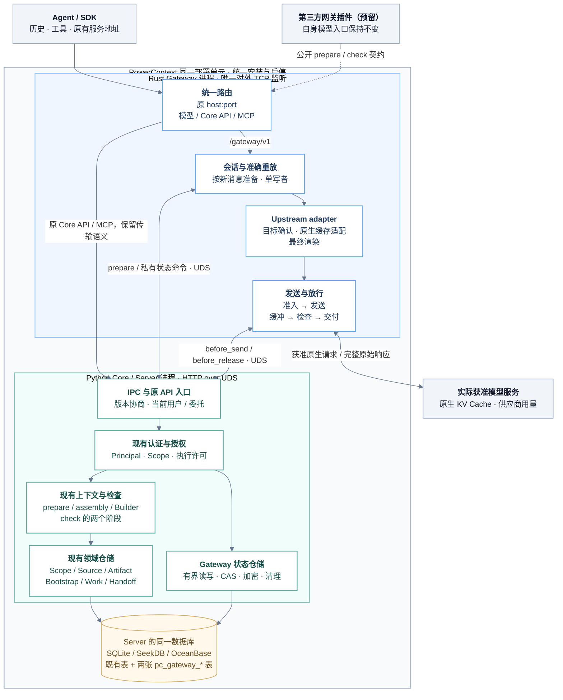
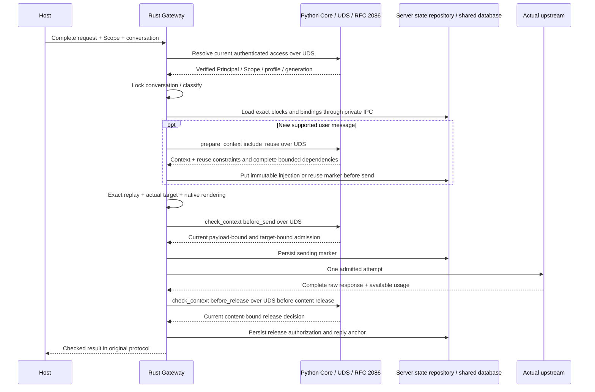
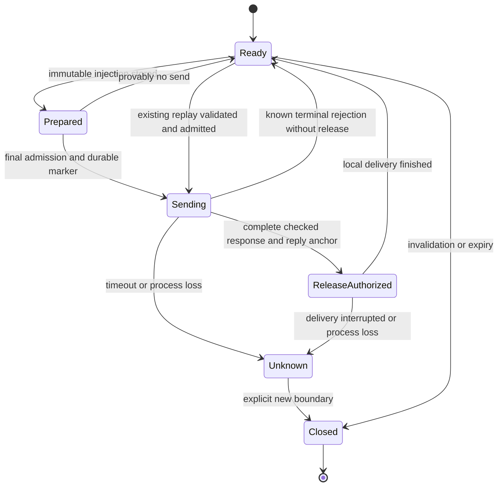

- Proposal Name: `powercontext_gateway`
- Start Date: 2026-10-22
- RFC PR: [oceanbase/powercontext#2199](https://github.com/oceanbase/powercontext/pull/2199)
- Related RFCs: [RFC 2086](https://github.com/oceanbase/powercontext/pull/2086)、
  [RFC 0016](0016_pydantic_ai_inference_integration.md)、[RFC 0046](0046_observability_foundations.md)、
  [RFC 1345](1345_scope_organization_and_agent_integration.md)、[RFC 1396](1396_handoff_access_control.md)、
  [RFC 1429](1429_project_bootstrap_context.md)、[RFC 1770](1770-decision-policy-governance.md)、
  [RFC 1783](1783-handoff-session-rollover.md)、[Working Note 设计](1790_source_backed_working_notes.md)

# Summary

PowerContext Gateway 是可选的模型调用入口。它把现有 PowerContext 的上下文组织能力接到 Agent 的模型请求路径，
在客户端保有历史和工具执行权的前提下，完成 Scope 绑定、按需准备、准确重放、实际目标选择、原生缓存适配和受控发送。
核心产品目标与 [RFC 2086](https://github.com/oceanbase/powercontext/pull/2086) 相同：
**上下文层的隐私安全拦截 + Token 效率优化**。

两份 RFC 组成同一条链路。#2086 定义 Core 的内容选择、表示策略、隐私与预算检查、复用约束及检查接口；
本 RFC 定义网关如何消费这些契约并控制最终请求、每次真实发送与首次响应释放。
网关不新增 ContextRuntime、GateRuntime、记忆算法或策略数据库，也不替代 Core 的领域提交。

PowerContext Gateway 由 Rust 实现，随 PowerContext 统一安装和启停，默认关闭。
启用时 Rust 接管现有对外端口，Python Core 只监听本机 Unix Domain Socket（UDS）；
原 Core API/MCP 路径由 Rust 转发，模型入口挂载于 `/gateway/v1`，不新增 TCP 监听。
支持完整历史的 Chat Completions 与无服务端会话依赖的 Responses；上下文增强要求可信会话关联。

网关持久状态复用 Server 的 `database` 配置和同一数据库，支持 SQLite、SeekDB、OceanBase，
只在启用持久重放时通过统一迁移增加两张 `pc_gateway_*` 表。
Python Server 持有连接、仓储与迁移，Rust 通过私有 IPC 读写网关状态；
不另建数据库文件、数据库服务或 Rust 版 Core 仓储。
首期不建设独立管理后台、自动工具循环、自动转录入库、自动摘要压缩、计费账本或语义响应缓存。

本 RFC 与 #2086 均为提案。源码基线为 `0bc42d0b`，协作设计基线为 #2086；
下述 Rust 进程、IPC、接口、权限、三后端 Gateway 表和插件契约均不是基线已发布能力。

| 决策 | 内容 |
| --- | --- |
| Core 的权威 | 上下文选择、资料资格、表示算法、隐私判断、复用约束和领域写入。 |
| Gateway 的权威 | 协议、可信会话、注入位置、不可变重放、实际目标、最终渲染、发送、缓冲和释放。 |
| 宿主的权威 | 用户历史、是否采用回答、客户端工具与副作用、工作完成、Handoff 时机。 |
| 模型服务的权威 | 原生 KV 的保存、复用和淘汰，以及供应商定义的用量。 |
| 接口增量 | 网关协议入口和两个会话元数据操作；Core 检查复用 #2086 的一个操作、两个阶段。 |
| 持久化增量 | Server 同一 SQLite / SeekDB / OceanBase 数据库中的两张 pc_gateway_* 表；无独立状态库。 |
| 默认部署 | Rust + Python 同机组合，默认关闭；启用后一个原有 TCP 入口，内部使用 UDS。 |
| 安全默认 | 必需检查不可用则暂缓；strict 响应批准前不释放模型内容。 |

# Motivation

只调用 `/v1/context/prepare`，PowerContext 能保证交付了什么，却看不到宿主随后添加的指令、工具结果和最终模型目标。
每一轮重新准备还可能改动历史前缀，增加召回成本，并降低模型原生缓存的复用机会。

网关补上执行侧的可见性和所有权：

1. 在真实模型入口检查完整请求，包括没有经过 PowerContext 的宿主历史和工具结果。
2. 只在受支持的新用户消息边界准备内容；普通工具轮次沿用原有注入。
3. 将已采用的上下文按原位置、原内容重放，减少不必要的表示变化。
4. 在实际模型/API/账号/区域确定后适配原生缓存，测量真实用量和完整任务成本。
5. 复用现有部署和领域 API，避免每个 Agent 自建召回、缓存参数和错误处理。

缓存稳定服从授权、资料资格、隐私和正确性。目标是改善复用条件，不能承诺命中、节省比例或模型质量提升。

# Guide-level explanation

## 一个 Coding Agent 如何使用

用户已注册 `project:powercontext`，部署方为该 Scope 配置允许的调用主体和模型 profile。
客户端把模型 base URL 指向网关，使用 PowerContext 认可的调用凭据。
支持额外请求头的宿主还传递稳定的会话 ID；不同工作使用不同会话。

下面是**提议接口**的完整历史调用示意，`coding-default` 是部署方的模型别名，不是供应商品牌：

```bash
curl https://pc.example/gateway/v1/chat/completions \
  -H "Authorization: Bearer $POWERCONTEXT_TOKEN" \
  -H "X-PowerContext-Scope-ID: project:powercontext" \
  -H "X-PowerContext-Conversation-ID: coding-client-001" \
  -H "Content-Type: application/json" \
  -d '{
    "model": "coding-default",
    "messages": [
      {"role": "user", "content": "修复 API 客户端，保留契约生成要求"}
    ],
    "stream": false,
    "max_tokens": 2048
  }'
```

1. 网关认证调用者，校验当前 Scope 读取权、付费调用权和 profile 使用许可。
2. Core 通过现有 prepare/assembly 选择带引用的上下文。网关不自行搜索数据库或排序 Memory。
3. 网关在协议允许的最新用户内容末尾追加完整 PreparedContext，保留其历史材料信任包装。经 Core 批准的准确重复整块可以继续使用历史注入。
4. 网关持久化准确注入、位置和复用依赖，再渲染目标请求，经 #2086 的最终输入检查后发送。
5. 原始回答完整到达并通过输出释放检查后，网关按客户端协议交付。
6. 客户端运行工具，再提交原历史和工具结果。网关原样放回已有注入，本轮不重新召回，仍检查完整输入。
7. 新用户消息可触发一次新的有界准备。刷新、撤销或资料失效时建立新边界，不为缓存继续使用失效内容。

准备结果 empty 是正常结果；隐私拒绝、复用资格失效和策略不可用有明确状态。
网关成功交付回答不代表工具已执行、Memory 已写入或任务已完成。

## 三种接入方式

| 接入方式 | 使用方法 | 能力边界 |
| --- | --- | --- |
| 同端口 Rust 网关 | 统一启动，模型请求发到 `/gateway/v1`；首期默认部署方式。 | 经 UDS 访问 Core 和 Server 网关状态仓储，保留当前认证与授权。 |
| 显式远端 Gateway | 后续通过 HTTPS 调用相同公开契约。 | 可信委托、绑定、远端状态访问和部署生命周期须独立验收。 |
| 第三方网关插件（预留） | 在其实际发送/释放边界调用公开 prepare/check；无需 Rust Gateway。 | 不使用私有 IPC/状态仓储；按具体版本验收，首期只预留契约。 |

只修改 base URL 不一定能启用可靠会话增强。没有稳定会话关联的客户端首期使用 `check_only`：
仍检查完整请求和响应，不推测项目、继承旧会话或自动注入。
受支持客户端清单必须记录真实版本、请求头能力、完整历史、取消、流式超时和原生签名行为。

## 两份 RFC 的分工

| 问题 | #2086 的契约 | 本 RFC 的落实 |
| --- | --- | --- |
| 放哪些上下文 | 现有 Scoped prepare、assembly、Builder、资料资格和获准表示。 | 在新消息边界调用一次，保留结果，不复制选择算法。 |
| 是否能继续复用 | 授权、新鲜度、保留范围、完整来源依赖与复用限制。 | 发送前验证资格；持久化准确块，失效则停止该重放 epoch。 |
| 怎么检查 | 同一输入/输出算法、模式、失败动作与临时绑定。 | 最终渲染后调用，每个真实尝试重新准入，strict 首次释放前检查。 |
| 怎么命中缓存 | Core 提供可复用边界，实际命中属于模型服务。 | Native adapter 选择目标能力、断点、TTL 和路由提示，解析可用 usage。 |
| 谁保存运行状态 | Core 不建立推理数据库；原 Source/Artifact 保持领域契约。 | Gateway 的两张专用表由 Server 仓储持久化在同库，不写通用模型转录。 |
| 如何写回知识 | 现有 Source/Artifact、Work/Handoff 及其验证。 | 首期不自动保存；后续显式采用现有 API，不能绕过提交。 |

# Reference-level explanation

## 1. 范围、层次与非目标

网关请求流水线、协议适配、准确重放、原生缓存设置和实际发送由 Rust crate 实现，
建议源码目录为 `crates/powercontext-gateway/`。
Python Server 继续拥有上下文算法、认证授权、三后端数据库连接、Gateway 状态仓储和统一迁移。
Rust 以稳定 DTO 访问这些能力，不导入 Python 对象，不复制上下文选择或隐私规则，
不直接读写 Source/Artifact 或重新启动嵌入式 SeekDB。
现有 Runtime 不反向依赖网关；Gateway 关闭时保留原 Python Server 运行路径。

首期支持单机、单网关进程、无 context references 的单 Scope、完整文本和已验证结构化工具载体。
增强 profile 先显式选择 `assembly.sections=[{"family":"memory","limit":6},{"family":"experience","limit":2}]`，
`include_code=false`；其他 family/代码/跨 Scope 只有完整复用依赖与验收齐备后才能进入持久重放。
这不改变原 prepare 用户的默认选择。

首期不提供任意协议互转、动态“便宜模型”升级、负载均衡、通用反向代理、全局费用硬预留、
多机共享 SQLite、上下文自动有损压缩、响应/语义缓存、秘密恢复或任意 Agent 工具执行。
Core 后台的 Embedding/rerank/提取仍由自己的 inference 边界负责，不强制绕经网关、不自动注入 Agent 上下文。

## 2. 组件和调用关系



蓝色分组是 Rust 执行进程，绿色分组是 Python Server；共享数据库中的网关表仍属于 Gateway 组件。
第三方插件走公开契约，不获得私有状态接口或数据库访问权。
实现按协议、upstream、replay 和请求流水线拆分；不先建设通用插件框架或新运行时门面。
Native adapter 必须控制最后一次实际发送，不能以高层 SDK 回调代替最终字节与逐次尝试覆盖。

### 2.1 同端口与本机 IPC

| 模式 | 对外监听 | Core 通信 |
| --- | --- | --- |
| Gateway 关闭 | Python 继续监听原 `http.host:http.port`。 | 无 Rust 子进程，无 Gateway 私有 IPC。 |
| 默认组合部署 | Rust 独占同一 `http.host:http.port`；Python 不再另开 TCP 端口。 | HTTP over UDS，复用同一 DTO、授权和算法。 |
| 显式远端部署 | 由部署方指定已有服务入口，独立验收。 | 公开 prepare/check 使用 HTTPS；远端 Gateway 状态服务不属于首期。 |

`/gateway` 是可配置挂载前缀；默认模型 Base URL 为 `http://localhost:8000/gateway/v1`。
模型协议相对路径保持 `/v1/...`，与挂载前缀分开定义；组合部署须拒绝与 Core/MCP/静态路由冲突的前缀。
健康、管理和 Gateway 指标复用原入口，不另外创建 admin/metrics TCP 监听。
原 `/v1/...`、MCP、健康检查、Dashboard 和静态资源按已注册路由转给 Python，
保留原路径、查询、认证、HTTP 状态、SSE/流式背压与取消。转发不表示对 Core 内容进行模型准入。
未知模型路径明确拒绝，不转成任意上游代理；Gateway 私有路径不能经公共路由到达。
外部 origin、代理头与请求关联只接受可信入口重建的值，不信任客户端伪造的内部头。
原地址和外部端口保持不变；切换监听所有者通过受控重启完成，不承诺热切换。

Linux/macOS 首期使用 UDS。启动器选择短且私有的运行目录，检查路径长度、
目录/套接字所有权与权限；只清理确认属于本实例的失效 socket。
Windows 本机 IPC 需独立 transport 和验收；未支持的平台明确拒绝启用，不能暗中回退到新 TCP 端口。
UDS 只改变传输，不代替用户认证。私有调用同时携带本实例通道凭据和当前用户认证/受支持委托；
凭据由启动器经受控句柄交付，不写日志、URL 或模型请求。

### 2.2 IPC 能力与进程生命周期

| 契约 | 责任与约束 |
| --- | --- |
| prepare / check | 使用 #2086 的公开 schema 和严格阶段；UDS 与 HTTPS 决策一致。`reuse.binding` 由 Core 生成/校验，Rust 原样保留。 |
| 私有访问解析 | Core 根据当前认证请求解析 Principal、actor、Scope、`gateway.invoke` 与 profile 许可；结果绑定请求及实例 generation，不能由 Rust 自报用户字符串替代。 |
| 私有状态命令 | 严格区分有界 load、put-if-absent 和 CAS transition；只操作两张 Gateway 表，不提供任意 SQL、表名或通用数据库代理。公开 GET/DELETE 复用同一仓储。 |
| 版本与预算 | 协商 wire/schema、carrier、必需功能和大小/时间/并发上限；不兼容时拒绝 readiness，不静默丢弃未知必需字段。 |
| 身份与有效期 | 每次受保护操作由 Core 校验当前授权；短期访问解析结果不授予永久读写或发送权。 |

每个真实发送/释放前，Core 在可信 Gateway 调用上下文中重验当前 `gateway.invoke` 与 profile 许可；
初始身份解析不代替后续执行授权，普通 check_only 的读取权限不因此扩大。

私有 IPC 操作实现时同样登记在权威 `openapi/powercontext.yaml` 并标记为 internal；
仅在 Gateway 的本机 UDS 模式装配，要求通道认证。生成器和路由测试必须证明其不进入公开
SDK/MCP、能力清单或公共监听。它们不是对第三方承诺的新管理 API。
两类公开 Core 操作保持不变，检查不夹带状态写入，状态命令也不能签发模型发送许可。

Python Server 主进程继续拥有数据库与生命周期，并管理 Rust 子进程：
先完成配置/数据库身份与 schema readiness、UDS 监听及版本握手，再让 Rust 占用原端口。
安装包交付匹配平台的 Rust 可执行文件；默认启动不现场编译或下载。
Gateway 关闭时无需启动该可执行文件。启用时版本不匹配、占用原端口或握手失败就明确失败，
不抢选随机端口，也不降级为未检查模型透传。

正常关闭先停止新准入，限时取消/排空在途请求，保存已知或不确定状态，再停止 Rust、
关闭 UDS 与数据库。Core 不可用时停止新发送与内容释放；通道断开传播取消。
Rust 退出由父进程确认旧 PID 终止后才可有界重启；Core 重启更新 generation，
旧通道凭据与旧状态命令失效，未解决发送进入 Unknown，不自动重新付费调用。
策略撤销、进程失联和取消的实际延迟以测量结果与配置期限声明，不宣称绝对即时。

主模型每次调用通常有两次完整检查 RPC；新消息另有 prepare。
状态读取按会话批量，写入只携带网关注入或有界状态，不额外复制完整转录/响应。
IPC 排队、序列化、数据库等待与连接复用都计入总期限和 CPU/RSS、P95/P99 验收，
Rust 实现不自动等同于整条链路更快。

## 3. 身份、Scope 和执行许可

Python Core 复用 `AuthenticationProvider`、`AuthenticationResult`、当前 Scope 目录与 `AuthorizationProvider`。
Rust 经私有访问解析取得经过验证的 Principal/actor/credential identity，不复制 Python 认证实现。
不新增网关用户库、独立租户体系或网关密钥表。
已有静态 Bearer 只映射一个固定主体，不能宣传为多用户隔离。

| 约束 | 设计 |
| --- | --- |
| Scope 选择 | `X-PowerContext-Scope-ID`，或可信部署配置将某一凭据绑定到唯一 Scope；有歧义则拒绝。 |
| Scope 权限 | 每次请求和必要重放验证当前 `scope.read`，原资料仍按自己的 access profile 授权。 |
| 付费执行 | 提议在现有授权词汇中增加 Scope action `gateway.invoke` 与最小角色 `gateway.user`；读取权不隐含模型消费权。 |
| Profile 许可 | 已认证主体只能使用部署方允许的 profile/模型别名；客户端 model 值只是选择请求。 |
| 状态隔离 | `deployment + principal + scope_id + conversation_id + epoch` 完整分区；他人的 ID 不可读、猜测或接管。 |
| 管理 | 配置变更复用运维配置与 `server.admin`；会话状态读取/删除还必须校验主体归属。 |
| 凭据 | 客户端的 PowerContext 凭据不转给模型；provider 凭据由获准 profile 从 secret reference 解析。 |

`gateway.invoke` 和 `gateway.user` 都是新增提案，不是已有枚举；现有角色不自动扩大授权。
是否授予管理员相应执行许可由明确角色映射决定，并在升级契约中说明。
会话 Scope 不可原地切换；切项目创建新会话。客户端 user、metadata、提示词标签和 provider session ID 都不能授予权限。
`for_scope` 只是分区绑定，不能代替 Server 的授权。

独立部署携带原用户认证或受支持的可信委托，Core 同时识别 subject/actor。
不能使用一个全权限服务 token 再信任请求中的任意 principal/scope，也不能在 PDP 不可用时继续读取或付费发送。
首期不增加跨用户共享重放；同 Scope 协作也不能读取另一主体的网关注入副本。

## 4. 配置、路由和目标 profile

使用现有 Server 配置加载机制增加可选 `gateway` 段。以下字段是提议值，阈值需在验收时固定：

```yaml
http:
  host: 127.0.0.1
  port: 8000
database:
  kind: sqlite
  url: sqlite+aiosqlite:///./powercontext.db
gateway:
  enabled: false
  mount_path: /gateway
  context_owner: gateway
  privacy_mode: enforcing
  output_mode: strict
  replay:
    enabled: true
    idle_ttl_seconds: 3600
    max_age_seconds: 86400
    max_context_blocks: 128
    max_context_bytes: 262144
    max_reuse_dependencies: 64
  limits:
    max_request_bytes: 8388608
    max_response_bytes: 2097152
    max_inflight: 16
  upstream_profiles:
    coding-default:
      protocol: openai-chat
      model: deployment-model-id
      base_url: https://approved-model.example/v1
      credential_ref: env:MODEL_API_KEY
      cache_adapter: validated-deployment-profile
```

示例 database 仅说明 SQLite 的同库落点；替换为现有 SeekDB/OceanBase 配置即可选择对应后端。
Gateway 不配置第二个数据库地址；UDS 路径与通道凭据由启动器管理。

`context_owner` 从可信配置选择 `gateway` 或 `host`。Host 已管理 prepare/bootstrap/Handoff 时，
网关不重复准备或追加第二份上下文，但完整请求检查始终执行。
提示词中出现某个标签不是 host 所有权证明，更不能关闭安全检查。

`UpstreamProfile` 与 #2086 使用同一契约，不建立第二套缓存能力模型：
包括准确目标、API/协议和 renderer 版本、账号/区域、允许的数据处理与保留、
模型窗口/输出上限、工具/schema/reasoning 能力、原生缓存模式/边界/TTL 语义及 usage 映射。
Profile 和配置快照有版本；普通变化在新 epoch 生效，吊销/安全规则变化立即按当前检查契约生效。

路由按可信 profile、请求协议、获准模型别名确定唯一目标，并在 epoch 内保持稳定。
相同优先级歧义在配置加载时拒绝；首期不做自动 fallback。
目标禁用/凭据失效时显式失败，不能静默换账号、区域、模型或协议。
未来允许目标切换也须重新规划、验证历史兼容性和完整准入，不能沿用旧缓存绑定。

默认禁止 provider 重定向、客户端指定 base URL、任意透传 authorization/cookie、未知查询参数和凭据拼接。
端点解析、DNS/IP 与网络出口策略必须防止受控配置变更绕过获准目标；不把字符串前缀匹配当作目的地证明。
第三方上游 profile 还须验证隐藏路由/重试，未知实际目标不能标记为已覆盖。

## 5. 协议、载体和会话识别

| 路径/协议 | 首期行为 |
| --- | --- |
| `POST /gateway/v1/chat/completions` | 完整 history、经验证的文本/工具请求；原协议输出。 |
| `POST /gateway/v1/responses` | 完整 input、`store:false`、没有 provider 端隐式历史；原协议输出。 |
| `GET /gateway/v1/models` | 只列出调用者可执行的已配置模型别名，不向任意上游广泛探测。 |
| `POST /gateway/v1/messages` | 后续独立适配和验收；不是首期已支持路径。 |
| Embeddings、批任务、文件、WebSocket、音视频和未知路径 | 首期拒绝；不自动变成未检查的通用代理。 |

Responses 的 `previous_response_id`、`conversation`、`background`、item reference、
不透明推理/签名块等，只有 profile 能还原检查所需内容并保持原生约束时才可支持。
首期 enforcing 路径无法检查隐藏历史时拒绝；不能静默透传并继续声称完整保护。
Chat/Responses 不互转；native signed/reasoning 内容不跨模型迁移，不自动改写或删除。

会话 ID 优先由受支持宿主稳定传递；网关生成 epoch，客户端不能指定旧 epoch 绕过校验。
同一 ID 仍需验证 history prefix、消息角色、工具 call/result 配对和此前回答的完整关联；
相同开场问题或相同 query hash 不构成同一会话。
首期不采用模糊历史检索或跨会话祖先猜测，未绑定请求只进入 `check_only`。

请求分类仅决定可选增强：

| 类型 | prepare | 既有注入重放 | 输入/输出检查 |
| --- | --- | --- | --- |
| 首条/新的用户消息 | 至多一次有界准备 | 验证后重放已有块 | 必需 |
| 工具结果、同轮续答、传输前重试 | 不重新准备 | 验证后准确重放 | 每次真实尝试必需 |
| 标题、后台 housekeeping 等已识别辅助请求 | 不增强、不自动存储 | 仅按已验证协议需要处理 | 独立完整检查 |
| 无可信会话关联或 host 所有权 | 不自动准备 | 不从网关继承 | 必需 |
| 无法识别的历史变更、客户端压缩/编辑 | 暂停旧 epoch | 不猜测补全 | 返回显式冲突或要求新边界 |

分类未知时可停止增强，但不降低安全覆盖；签名或历史一致性无法保证时拒绝该请求。
工具定义、参数、结果、错误文本和宿主新增材料都在完整检查范围。

## 6. 上下文准备、准确注入与可信复用依赖

新消息通过已有 `ScopedContextApplication.prepare` 流程取得一次 PreparedContext；
沿用 assembly、Builder 的引用、信任包装、UTF-8 预算和遗漏行为。
不重新拼装一份网关版 Memory 目录，也不把已有 prepare 再调用为“安全预检”。
先按同一 anchor 读取已有块；存在则直接验证并复用，不再 prepare。
empty 也保存无正文标记，避免重试反复召回。崩溃前未提交的准备候选可能重算，
因此承诺的是单一准确已提交表示，而不是准备计算恰好一次。

网关按协议在**最新用户内容末尾**追加完整上下文块，不提高它的指令级别。
不改写旧 system/developer/tools，不向稳定段插入随机 ID、时间戳或诊断字符串。
不能为了腾空间截断已经生成的引用包装。协议不允许安全追加时关闭该增强能力或拒绝必需增强 profile。

重放记录包含精确 prepared 文本、注入位置、目标原生块及 renderer 版本、内容摘要、消息 anchor、
来源复用绑定、保留约束和创建/失效时间。它在首次发送前以 put-if-absent 写入。
同一分区/epoch/anchor 发生不同值冲突时停止发送，不覆盖旧块、不重新召回“修复”旧注入。
写入失败时不发送该增强请求；发送后无法保存释放状态时不释放正文，保留 Unknown 语义。
客户端历史是事实权威；网关只保存自己增加的派生块，不保存用户完整 transcript。

anchor 使用固定版本的协议 canonicalizer，对原始客户端消息的有序前缀建立增量 HMAC 链，
包含消息序号、role、支持内容及工具 ID，不包含网关注入。
相同文本出现在不同位置、客户端编辑旧消息或改变工具关联时不会误用同一 anchor；
计算按完整请求线性推进，不为每个块重复扫描历史。

新用户消息仍可能选中已经存在的内容。Core 的可选整块交付复用策略只有在准确 prepared 文本、
完整依赖/版本、信任与位置约束都匹配，且旧块确实保留在本次待发历史并仍获准时，
才允许网关省略本轮重复追加；旧块保持原位，新的 anchor 保存有界复用标记。
判断归现有 context/inference 的复用约束，不由网关仅凭 hash 推断。
部分重合时首期不拆块、不删除单条 Memory、不改写包装；继续交付完整新块，
或者因总预算不符而暂缓。该可选策略沿用 #2086 的 off/shadow/active 和独立质量验收；
未启用或无法证明等价时不能声称已经去重。

### 6.1 准备结果与完整依赖

普通四字段 `PreparedContext`、引用文本、`PreparedContextBuild.lineages` 和 Bootstrap receipt
都不能单独批准持久重放。Core 在实际 select/render/fit 后产生完整、有界依赖：
准确资源/版本、所属 Scope、内容摘要、资格/新鲜度、最大保留与输出绑定。
首期增强仍限定 memory/experience；其他 family、代码和 reference 需完整依赖与独立验收。

Rust 经 UDS 调用现有 `prepare_context(include_reuse=true)`，取得 #2086 的版本化
`context + reuse`，而不依赖 Python 私有对象。未请求时保留严格四字段默认结果。
先由 `get_capabilities` 与本机握手确认 schema、carrier、family 和上限；不支持则拒绝对应增强。
`reuse.constraints` 交给 Rust native adapter，`reuse.binding` 连同准确注入经状态 IPC 保存到 Server 数据库。
准备、状态持久化和实际发送是不同边界，不能声称一次 prepare 已原子完成模型执行。

### 6.2 每次重放的当前资格与绑定

每次 `check_context(phase=before_send)` 提交所有历史块的绑定和准确载荷位置。
Core 重新认证，验证当前 Scope/资料权限、准确版本的资格、active/retired、
必要 head/freshness、隐私与保留要求；验证不重新语义搜索或 Embedding。
Scope 可读不表示已撤销资料可以永久外发，且不能只验证最新 prepare。

`reuse.binding` 使用 #2086 定义的有界、可认证加密格式，绑定主体/委托、Scope、
准确内容摘要、完整私有依赖、策略和期限。Rust 不持有 Core 签发密钥，也不能自行延长资格。
验证篡改、过期、audience/subject/Scope、key version、轮换和吊销延迟。
响应检查使用同一操作的 `before_release`，关联本次 `request_binding`；
准备绑定、发送批准和释放批准不能互相替代。

依赖失效、过期或无法确认时返回 `context_refresh_required` / withhold，停止旧 epoch，
由宿主以新会话或显式 Handoff 建立新边界；不原地替换历史块、拼接语义窗口或破坏签名。
Profile 明确最大新鲜度与新用户消息/显式刷新边界，不每轮重算历史查询。
能力缺失只能进入明确的 check_only 接入；已有增强会话不能静默丢弃绑定继续发送。

## 7. 模型原生缓存与完整预算

网关保存的是可重建模型输入的准确注入；模型服务保存的 KV 是另一种状态。
每次真实调用仍生成新回答。首期没有答案、语义或工具副作用缓存。

```text
Request 1: unchanged instructions/tools | user-1 + exact context-A
Request 2: same native prefix           | accepted answer-1 | tool results
Request 3: same historical placement    | user-2 + context-B
```

这是逻辑示意，实际缓存资格遵守目标协议的角色、内容块、token 边界和部署规则。

Native adapter 消费 #2086 的 `reuse.constraints`，在获准 profile 内选择自动/显式缓存能力、
合格原生断点、TTL 与路由提示。Core 不生成通用 `cache_control`，网关不自行决定哪些失效资料还能保留。
缓存设置在最终渲染前完成，随后检查准确正文、相关请求头、目标和输出限制。

| 部署缓存能力 | Adapter 如何执行 | 支持边界 |
| --- | --- | --- |
| 隐式前缀缓存 | 保持准确原生前缀；仅在目标支持时提供稳定路由提示；映射其实际 cached-input 用量。 | 没有显式断点也不能省略历史/目标验证，不承诺命中。 |
| 显式断点缓存 | 在 profile 允许的 tools/system/message 内容块设置原生断点与保留参数。 | 不把断点当作跨协议通用字段；必须保持对应原生边界。 |
| 独立远端缓存资源 | 涉及额外创建/引用/删除、付费与保留生命周期。 | 首期不支持；需独立验证完整输入可见性与资源治理，不预先批准存储。 |

模型别名不能自动推断以上能力。每个获准 profile 需固定实测能力、最小前缀要求和 usage 定义。
需要路由提示时从部署/主体/Scope/epoch/目标 profile 的稳定分区派生，不使用不断增长的完整请求摘要，
也不暴露原始业务身份；提示只影响目标支持的路由机制。

| 变化 | 处理 |
| --- | --- |
| 普通新工具结果/新用户消息 | 保持此前准确块与原生位置；对完整新增请求重新检查。 |
| 工具/schema、system、reasoning 设置变化 | 判断该协议是否可继续；新的缓存资格不能冒充旧绑定。 |
| 模型/API/账号/区域/renderer 变化 | 新目标规划与准入，必要时新 epoch；不迁移私有 KV。 |
| 权限撤销、资料失效、必需策略变化 | 优先停止旧复用，允许缓存失效。 |
| 可选缓存参数不支持 | 仅在原请求仍获准且预算合法时省略，再检查变化后的最终载荷。 |
| 缓存未命中 | 正常生成，不重试、不默认填充内容以凑缓存门槛。 |

省略 cache 参数不能证明禁用供应商隐式缓存。目标保留/地域/隔离要求无法满足时拒绝该 profile。
Scope/route key 不等于物理缓存隔离，缓存 TTL 不等于隐私删除期限。
稳定请求字节是本地可验证不变量，不证明供应商内部 token/KV 相同；
原生兼容、实际用量与延迟分别验收。

完整 token 预算包括指令、原客户端历史、已重放块、工具/schema、协议开销和输出预留，
使用声明过误差的目标估算器/profile。`prepare.max_bytes` 只限制补充上下文。
空间不足时暂缓，让宿主显式缩小下一次 prepare 或 Handoff，不自动裁剪历史或已批准上下文。
Core 表示策略在准备阶段执行；网关不得二次压缩已经冻结的 prepared 文本。

## 8. 发送、输出与失败状态



检查沿用 #2086 的 `allow/block/withhold`、当前授权、可信 stage/profile、
覆盖范围、最终内容/目标绑定和有效期；check-only 操作本身不证明真实发送行为。
本机 IPC 与远端执行必须用同一规则和一致性样例，不在网关实现另一个更宽松的隐私判断。

接收时先限制原始字节、严格解析 UTF-8/JSON、拒绝重复键和不支持结构，再执行可选增强。
原始载体保留到检查完成，与最终载荷一起纳入适用内容检查，避免序列化归一化隐藏禁止值；
目标 token 预算只对真正外发的最终载荷计算。
prepare 所需查询 Embedding/rerank 仍在 Core 自己的发送前检查边界，不能等主模型准入才保护这些辅助调用。

强制检查覆盖指令、历史、上下文、工具定义/参数/结果、支持的结构化内容、
原始输出、可暴露错误和完成状态。重复 JSON 键、转义/数字表示和未知字段不能隐藏敏感内容。
禁止资料不能先发送给远端分类器/摘要器，再判断是否可以外发；可选优化关停不影响必需规则。

### 8.1 严格输出与流式

`strict` 缓冲完整受支持输出，完成检查后再组装普通响应或 SSE。
在批准前可以发送无模型内容的协议心跳，不能向客户端发送答案片段、工具参数或原始 provider 错误。
这不是实时 token 透传，会增加首次内容释放延迟，需验证客户端和反向代理超时。
`observe` 只观测，不宣称阻止输出泄露；未独立验收 bounded streaming 前不提供相应 enforcing 声明。

缓冲限制覆盖响应字节、时间、并发、解析深度和总内存。2 MiB × 16 只是正文下界，不能当作进程 RSS 上限。
超限、不完整 JSON/工具参数、上游断流、释放检查失败或不可用时，不释放并尽力取消。
不把敏感响应溢写到任何数据库或临时文件。发送与释放前校验当前策略，撤销延迟按实际边界测量。
SSE 头已发出后，用受支持错误事件终止，不能声称改变已发出的 HTTP 状态。

### 8.2 有界发送与重启

连接池和存储等待计入准入期限；真实写入网络前复核绑定仍有效，过期就重新检查。
已持久化发送标记不能延长权限、策略或目标绑定，也不能被当作永久发送许可。

一次模型请求只有一个 retry owner；底层 SDK 的隐藏重试必须关闭或被最终边界逐次覆盖。
确定未发送的连接失败才可在有界预算内重试，重新完成准入。
任何可能到达上游的超时、连接丢失或进程崩溃都记为 `outcome_unknown`，不自动付费重发、不自动 fallback。

会话只允许一个在途请求，Rust 会话锁配合 Server 仓储的 version/generation CAS 保证状态更新。
首期不依赖租约过期推导“上游没执行”，不宣称分布式恰好一次。
同会话并发冲突返回 409，客户端在原调用完成后重试；取消按实际发送状态保存已知/不确定结果。
发送前被 block/withhold 不推进已发送状态；已取得完整终态但拒绝释放时记录已知失败，
不把明确拒绝误标为未知，也不自动再次调用模型。



重启读取 `Sending` 或未确认交付的 `ReleaseAuthorized` 时转入 Unknown，而不是重放旧模型请求。
没有持久响应正文，所以即使输入相同也不能恢复上一份回答。
`release authorized` 仅说明本地检查批准，不证明宿主采用、网络送达或任务完成。

首期不承诺客户端重复请求的模型幂等性。新的再生成可能再次计费；
Unknown 状态中的同一未解决调用返回 409，宿主显式开启新边界并决定是否承担再次执行。
#2086 的无持久响应恢复限制保持不变；网关状态仅防止它自己在重启后盲目自动重发。

## 9. 最小接口清单

Core API 的请求体继续使用 `scope_id` 和现有扁平 operationId；网关模型协议不往供应商 body 强塞领域字段。

| 类别 | 接口/操作 | 状态与归属 |
| --- | --- | --- |
| 上下文 | `prepare_context`；按宿主流程使用 Bootstrap/Work/Handoff | 已有 Core API，准备算法不复制。 |
| 发送/交付检查 | `POST /v1/context/check` / `check_context`；`phase=before_send / before_release` | #2086 提议的同一操作、两个时机；本网关不新增替代检查。 |
| 协议入口 | `/gateway/v1/chat/completions`、`/gateway/v1/responses`、`/gateway/v1/models` | 本 RFC 首期提议；使用对应协议的成功响应。 |
| 会话状态 | `GET /v1/scopes/{scope_id}/gateway/conversations/{conversation_id}` / `get_gateway_conversation` | 本 RFC 提议；仅返回 owner 可见的元数据。 |
| 删除派生副本 | `DELETE /v1/scopes/{scope_id}/gateway/conversations/{conversation_id}` / `delete_gateway_conversation` | 本 RFC 提议；关闭 epoch、阻止后续使用并删除网关重放块。 |
| 能力发现 | 现有 `get_capabilities` | 实现时扩展声明：协议、carrier、strict、增强、重放、远端绑定及版本。 |
| 准备复用元信息 | 现有 `prepare_context(include_reuse=true)` 返回 `context + reuse` | #2086 共同契约；默认四字段不变，显式 opt-in 使用新 schema，不增加 operation。 |

会话创建随首个合法增强请求发生，无需 start/plan/prepare/finalize 一组网关 CRUD。
GET 不返回上下文/响应正文、凭据或命中秘密；已不存在会话仍按隐私约束处理，不泄露他人资源存在性。
DELETE 是对网关派生副本的操作，不等于删除 Source/Artifact，也不能收回已发送给模型的材料。
删除与在途发送/释放在同一会话状态机排序；正在取消的请求返回 409/稍后重试，
成功只在阻止后续本地使用并完成可见行删除后确认，不承诺数据库页、备份或 provider 端物理擦除。

`X-PowerContext-Scope-ID` 必须与可信绑定一致；领域会话路径以路径 Scope 为准，冲突输入不能换归属。
如客户端不能传 Scope header，可信的一凭据单 Scope 绑定可以省略它；不能以全局默认 Scope 猜测隔离。

模型路径保留原生 envelope，失败使用协议允许的错误形状，带有无正文的稳定原因和请求关联。
`401/403` 用于认证授权，`409` 用于历史/在途/Unknown 冲突，`422` 用于不支持载体或窗口约束，
`429` 用于网关准入容量，`503` 用于强制策略/依赖暂不可用；被策略明确禁止的内容用 403。
不把 withhold、empty、upstream error 和本地拒绝混成同一种成功响应。
所有 PowerContext 控制头、复用绑定和调用凭据均在最终上游请求中剥离；只发送获准 provider headers。

公开管理操作继续使用原 Scope 路径；Gateway 关闭后的状态查询/清理由已授权 Server 仓储处理，
在途状态返回 409，不绕过释放排序。私有 IPC 不作为第三方接入面。

上述均为设计，本文不修改 `openapi/powercontext.yaml`。实现时 Core 检查/管理元数据与标记 internal 的 IPC 操作进入该权威契约、
生成客户端并运行 `make api-generate` / `make contract-test`；
模型 wire schema 单独版本化、记录 OpenAPI 入口和一致性 fixture，不用普通 Core ErrorResponse 冒充供应商协议。

## 10. 持久化、成本与生命周期

### 10.1 同库的两张 Gateway 表

准确注入需在请求重试和重启后恢复。Source 是领域证据，Artifact 是版本化知识，
Bootstrap receipt 用于特定交付去重，usage 是允许缺失的统计，均不承担网关发送/重放状态。
复用数据库和迁移设施，不把私密副本写成 Source/Artifact，不触发自动提取。

启用持久重放时，通过 Server 的统一迁移注册两张组件专用表：

| 表 | 主键与必要内容 | 更新约束 |
| --- | --- | --- |
| `pc_gateway_conversations` | deployment/Principal/Scope/conversation/epoch；配置/renderer/target profile；历史摘要、最近回答 anchor；最新 attempt 状态、最近 transition identity/hash、version、期限。 | CAS 更新；不含完整历史或回答正文，不是全量 attempt 账本。 |
| `pc_gateway_replay_blocks` | 完整会话分区 + message anchor；准确注入、原生位置、复用绑定、内容摘要和期限。 | put-if-absent，同值可读回，不同值冲突；仅保存本网关注入。 |

同库指复用 Server 已选择的准确数据库身份：SQLite 是同一文件，
SeekDB 是同一嵌入式实例/数据库，OceanBase 是同一已配置租户/数据库。
不增加 Gateway 数据库 URL、第二个 SQLite 文件、独立 schema 服务或独立迁移历史。
新增两张表归 #2199；#2086 的算法与检查本身仍零新增表。
不再增加 profile/key/log/response/capture/tool/summary 表。

### 10.2 Server 持有仓储，Rust 通过 IPC 访问

Python Server 复用现有 `AsyncDatabase`、backend profile、表定义与事务边界，
实现仅限 Gateway 表的状态仓储。Rust 无数据库凭据、不直接访问任何表；
私有状态操作验证当前用户/Scope、进程 generation、epoch、expected version 和合法状态转换。
加密、读回校验、配额与同值 put-if-absent 位于这一持久化边界。
这是 Gateway 组件的状态能力，不是新的记忆算法或任意数据库 RPC。

| Server 后端 | 同库落点与复用 | 必需验收 |
| --- | --- | --- |
| SQLite | 相同文件、现有 Python engine/事务与 WAL/busy timeout；两表与 Core 表共存。 | 与 Core 写入并发、锁等待、取消/回滚、进程重启、准确字节读回。内存库不能宣称持久重放。 |
| SeekDB | 复用 Python 持有的同一个 embedded profile 与数据库；不重复启动实例。 | 实际嵌入式运行、事务/CAS、冲突回滚、重启读回与完整清理。 |
| OceanBase | 复用现有官方异步 dialect、同一租户/数据库与连接策略。 | 实际服务上的提交、回滚、断连/不确定提交、二进制/JSON 字节与索引兼容；不能由 MySQL mock 代替。 |

两表使用现有方言无关类型与后端变体，不引入向量索引或供应商特有 JSON 更新语义。
键长度、大小写/排序规则、唯一约束、密文大小和期限索引须在三后端上验证；
不能截断身份字段或忽略约束以凑建表成功。
核心记录和 Gateway 记录共享数据库，但各自事务提交，不把资料写入和远端模型调用视为同一事务。

同值 put 判定依据完整身份、准确内容/绑定与摘要，而非比较每次随机加密后的密文字节。
最近 transition identity/hash 随 version 原子保存；若读回不能证明同一提交或已失效，就暂缓，不新增完整事件账本。

put 或 transition 的 IPC 回复丢失时，使用相同分区/anchor 或 transition identity 精确读回；
只有准确同值/预期 version 证明提交完成才能继续。不确定落库不能换 ID 再写。
网络模型调用不在数据库事务内等待。三后端均按并发上限控制仓储等待，避免拖住 Core 工作。

首期每个 deployment 只有一个活动 Rust 发送者，由同机启动器和生命周期锁约束。
共享远端数据库不等于多机发送协调：部署系统必须先停止或隔离旧发送者，再启用同 deployment 的新发送者；
未确认时拒绝接管，不能以租约到期或 CAS 推断上游没有执行。
重启遇到 Sending/未确认交付仍进入 Unknown，不自动付费重发。
多机自动故障转移与分布式恰好一次不属于首期。

### 10.3 统一迁移与兼容

复用 [RFC 1771](1771-unified-database-migrations.md) 及现有迁移入口，
将 `gateway-state` 注册为可选组件 bundle；该 bundle 是本设计的新增项，不是当前 CLI 已有选项。
SQLite、SeekDB、OceanBase 各有受验证的资源/适配，不让 Rust 启动另一个迁移器。
已存在数据库的升级执行明确的 plan/apply/verify；既有控制表复用，未知版本或缺少必需结构使增强 readiness 失败。
迁移与共享库写入者的协调按现有部署契约执行，不能只停 Rust 就假设所有 Core 写入者均已停止。

新部署和升级均在模型流量前完成 schema 校验，普通请求不做 DDL、全库回填或隐式修复。
关闭 Gateway 或仅使用 check_only 不自动创建网关表；已有表只保留/按策略清理，
禁用组件不删除 Core 数据。内存数据库拒绝持久增强，不悄悄创建文件替代。
升级不把今天的来源/权限赋给旧块；缺少必需依赖时关闭旧 epoch。
备份、恢复、retention 和容量规划覆盖整个共享库；恢复后先验证当前授权与绑定，不自动恢复旧发送许可。

### 10.4 上限、过期与清理

持久正文遵守部署保留策略，使用受管理密钥的认证加密；密钥不可用时拒绝敏感持久写入。
密钥不写进数据库；加密不能替代 Scope/owner 校验、备份权限和当前授权。
会话/消息摘要使用部署 HMAC，避免把低熵内容 hash 当作可公开诊断。

默认上限提议为 idle 1 小时、绝对 24 小时、128 个块、每会话 256 KiB；
真正有效期限取配置、Core 绑定和资料允许保留期限的最小值。
TTL 到期先停止读取/发送，再异步清理；cleanup 尚未执行不能延长资格。

128 块是条目上限，256 KiB 是累计 payload 上限，不是每块上限。
一个主体最多 100 个活跃增强会话时，正文上界约 25 MiB；1,000 个主体约 25 GiB，
还需计算索引、加密、WAL/redo 与备份；共享库容量必须包含这些网关副本。部署必须配置主体与全局总字节/会话准入上限，不能仅靠 TTL。
容量达到上限时拒绝新增强，不能驱逐仍需重放的块后继续发送。

读写按完整会话键和有界 anchor 批量查询；每次 prepare 的候选仍受原条目上限约束。
完整会话去重后的复用依赖最多 64 个，当前资格验证受该总上限约束，而不是只计算本轮 8 个候选。
达到依赖上限就暂缓并要求新边界，不能截断依赖清单继续发送。
单次新消息不扫描所有会话、全部 Source 或整份 Memory 集合。
会话行维护存储字节/块数，随状态事务更新。单活部署可在 readiness 按索引聚合恢复准入计数，
并测量该启动工作；普通增量请求不反复全库 SUM。计数或提交无法确认时先暂缓准入，再精确读回/重建。
过期清理按索引有界批次推进；测量三后端热会话并发、锁等待、WAL/redo 增长、重启和清理延迟。

客户端历史虽不持久化，仍要逐次解析/扫描，成本随请求长度线性增长；
完整隐私检查和 strict 输出缓冲的 CPU/内存成本不能被“只为新消息召回”掩盖。

## 11. 用量、运行治理与可观测性

跨语言沿用既有有类型 usage 与无正文观测契约：Rust 产生受限事件，Server 复用现有 sink。
Python 侧使用 `log_safely`；Rust 安全日志适配执行相同字段白名单与失败不改变业务结果的规则。
新增 operation/unit/outcome、协议、有限原因与 coverage 必须登记字段白名单并同步中英文指南，
使用 `log_safely`，复用请求/trace 身份，不记录 prompt、引用正文、响应、密钥或敏感路径。
日志与允许丢失的 usage 不能充当响应恢复、审计或财务账本。

网关产生有类型的 attempt 元信息：实际目标/profile、准备/检查/发送/缓冲/释放耗时、
可取得的普通输入/缓存读写/输出/reasoning 用量、已知/估算/未知状态和未完成原因。
复用 #2086 在 inference/usage 边界的可选元信息，不另定义第二套通用用量模型；
日聚合不能反推出缺失的缓存或失败尝试，unknown 不记零。
Rust 不直接调用 Python 日志函数；跨进程传递的事件仍需类型与字段白名单验收。
关联 task ID 是观测信息，不证明宿主任务成功。

首期执行治理是有界并发、输入/输出大小、超时、取消与背压，不建设复杂限流或硬费用预留。
区分上游首 token、第一次获准内容释放和交付结束；
客户端断开后尽力取消，不能假设上游立即停止计费。
强制依赖不可用时 readiness/操作显式报告，不能把安全组件故障降级成裸透传。

## 12. 后续能力与现有领域的组合

| 能力 | 组合方式 | 开启前的独立验收 |
| --- | --- | --- |
| 显式远端部署 | 相同公开 Core prepare/check、可信委托与可验证绑定；状态访问另验收。 | HTTPS、实际目标、轮换、过期、取消、故障与远端状态归属，私有 UDS 不公开。 |
| 只读记忆工具 | 显式允许的 MCP/HTTP 工具；结果保持原证据/权限，工具往返纳入完整检查与准确重放。 | 模型可见目录、宿主可见行为、轮数/成本上限、原生 tool/reasoning 配对。 |
| 写工具/副作用 | 默认关闭；用户明确授权，沿用领域审批、幂等和提交。 | 不能把执行许可当工具授权，不能在隐藏循环中默认批准写入。 |
| 显式保存对话片段 | 用户/宿主要求时，复用 `/v1/sources/content` 或 working-notes；稳定 source_id + 准确同值重试。 | 剥离网关注入仅依据可信注入记录；隐私/保留、回执、冲突与读取验收。 |
| 长对话连续性 | 优先宿主显式 Handoff/rollover，采用原 prepare/finalize/commit/continue 流程。 | 真实持久化/readback，不把临时摘要当 Handoff，不自动宣称接收/完成。 |
| 自动 compaction | 若有独立质量与完整费用证据，再定义新窗口、摘要证据和签名兼容。 | 摘要调用也逐次检查/计费，明确缓存失效与不可逆信息损失。 |

### 12.1 第三方网关插件接入契约

插件是可选接入方式，不是 Rust 网关首期必须同时交付的一套插件平台。
已有第三方网关的用户可以直接消费 Core，无需部署 PowerContext Gateway；
其模型 URL 保持自身规则，不要求实现 `/gateway/v1`，也不获得 Gateway 私有状态接口。

| 插件阶段 | 共同契约 |
| --- | --- |
| 能力/身份 | 使用公开 get_capabilities，绑定支持的用户认证/受限委托、Scope、目标 profile 与版本；不信任自报 Principal。 |
| 上下文准备 | 需要增强的新消息调用 `prepare_context(include_reuse=true)`；唯一注入所有者，保留准确值与绑定。 |
| 原生适配/发送 | 最终执行侧消费 `reuse.constraints`，完成实际目标的原生缓存设置与最终渲染；逐次尝试调用 `check_context(before_send)`。 |
| 响应交付 | 有界缓冲完整受支持响应，关联本次 request_binding 并调用 `check_context(before_release)`，获准后释放。 |
| 会话/失效 | 使用第三方已有的可靠状态设施；准确重放需完整依赖与稳定会话，失效则新边界，不能把同 Scope 当共享会话。 |

各品牌适配器只转换协议、身份和生命周期，选择/隐私规则保持在 Core。
请求级前置钩子不自动等于最终出站钩子；需覆盖协议映射之后的准确字节、每次 retry/fallback、
缓存回复、错误正文和首个流式内容。并行 moderation 或异步日志不能代替阻断。
首个 enforcing profile 关闭第三方答案/语义缓存，原生 KV 能力按目标单独验证；
后续缓存回复须独立定义当前授权与释放契约。

第三方网关必须是获准的数据处理方。若隐私目标包括阻止数据进入外部 SaaS 网关，
检查必须先在宿主或自建入口执行；远端插件不能撤回已经收到的数据。
将第三方作为 Rust Gateway 上游时，只启用已验证的透明目标/内容/cache-field 保持 profile；
有后续不透明变换时需第三方最终边界接入，必需覆盖无法建立则拒绝。

首期交付版本化规范与一致性样例，预留插件包入口；
具体网关插件按明确需求选择真实版本开发、验收、发布支持清单。
不宣称 LiteLLM、Portkey 或其他产品已兼容，不新增各品牌专用 Core API 或插件数据库表。

网关模型完成不等于用户采用，下一轮重复出现也不等于明确知识保存授权；首期不根据这些启发式自动入库。
未来保存使用现有同值 capture 幂等契约：同一完整 Source identity 和准确内容/metadata 返回原回执，
不同内容是冲突。不能因超时生成新 ID 掩盖不确定写入，也不能因 Source 202 声称 Memory 已生成。
Working Note 是显式短期证据，不自动晋升 Memory。

网关不重新实现后台写入门；强制隐私失败/unknown 不能被转成写入 HOLD 或空提取成功，
不能推进未处理 Source 游标。后台领域恢复和重试预算继续由原消费者负责。

## 13. 分期与验收

### P0：Rust 网关的同端口闭环

先完成 Rust 可执行文件交付、统一启停、UDS 协商/通道认证、当前身份与 Scope 解析、
Core API/MCP 代理兼容和有界状态 IPC；原端口由单个监听者持有，关闭组件保留原 Server 行为。
本机增强从首期就使用 #2086 的版本化 prepare/check、完整复用依赖与绑定，
这些跨进程契约是 Gateway P0 前置条件，不能留待远端部署阶段补齐。

交付单 Scope、明确会话 ID、memory/experience、Chat/完整历史 Responses、单一获准目标、
strict 文本/工具输出、准确重放和有界执行。
三后端共享数据库的表、迁移、事务与重启读回均需真实验收，
通过哪个后端就声明哪个后端；仅有接口或 SQLite 测试不能声称全部支持。
check_only 可不开重放，无需创建两表。第三方只交付接入规范与一致性样例，不强制开发具体插件。

### P1：选定插件、远端与更多协议

按需求选定第三方网关版本，验证最终发送/释放、原生缓存保持、可信委托和错误/取消语义，
再交付对应轻量适配插件；不先建设通用插件平台。
显式远端部署单独验收 HTTPS 与状态访问方案，不将私有 UDS 状态接口自动暴露公网。
补齐 Messages、原生签名及其他 carrier/family；每项公布真实客户端/部署版本。
Windows 本机 IPC 在对应实现完成后独立验收，默认不另占 TCP 端口。

### P2：按证据扩展

在明确需求和独立评审后增加只读工具、显式保存、更大部署规模或质量验证的 compaction。
这些不是完成 P0 的前提，也不预先批准新表、自动写知识或动态模型调度。

### 必需验证

| 维度 | 可复现验收 |
| --- | --- |
| 两份 RFC 一致 | Python 进程内、Rust UDS 和 HTTPS 使用相同策略样例、DTO 与绑定；当前授权/目标/期限一致。 |
| 检查契约 | phase 与 DTO 不混用；缺失/过期/跨请求绑定、历史块错误位置、HTTP 200 的 block/withhold 均不发送/释放；检查不重做 prepare。 |
| 端口与 IPC | 开关前后仅使用原 TCP 端口；真实双进程验证私有路由不可外达、伪造通道/用户失败、版本不匹配、父子退出、Core/MCP/SSE 代理兼容与取消。 |
| 三后端同库 | SQLite/真实 SeekDB/真实 OceanBase 分别验证同库两表、事务/CAS、约束、Unicode/密文读回、迁移、隔离删除及与 Core 并发写入。 |
| 插件预留 | 一致性样例覆盖逐次重试/fallback、变换后最终载荷与首个响应释放；没有实际品牌验收就不声明兼容。 |
| 隐私 | 在宿主历史、上下文、工具结构、转义/重复键、原始错误植入禁止值；受控上游/宿主分别证明未收到阻断内容。 |
| 复用与权限 | 当前 Scope 拒绝、Artifact retired/删除、head/freshness 变化、绑定篡改/过期、跨用户/Scope ID 不能继续重放。 |
| 历史一致性 | 首条、新消息、工具轮、准确整块重复与部分重合、重新生成、客户端编辑/压缩、不同会话同一问题、host/gateway 同时接入。 |
| 原生载体 | 角色/工具 ID/顺序/内容块不变，renderer 变化明确，签名或隐藏历史不支持时拒绝。 |
| 状态和恢复 | 三后端块冲突/存储不可用阻止发送；IPC 回应丢失按相同 identity 精确读回；真实双进程崩溃保留 Unknown。 |
| 并发与取消 | 同会话只准一个在途，PDP/策略失败不旁路，客户端中断、SSE 背压、超限和清理不泄露。 |
| 部署与迁移 | 默认关闭不建 Gateway 表；同端口启用只增 UDS，注册 bundle 后三后端读回；未知 schema/key 拒绝。 |
| 领域复用 | prepare 默认四字段/opt-in envelope 严格区分，不重复注入，不自动建 Source/Memory/Handoff，不把隐私失败消费成成功窗口。 |

实际协议支持需用受支持客户端和真实 provider 逐项验收。
Mock 上游适合证明本地字节/错误处理，不能证明真实缓存命中、签名兼容或真实宿主可用。

### 效率实验和上线标准

在同一任务/仓库/模型/协议/工具/schema、证据、策略、输出预算和质量标准下比较：

1. 当前直接调用，加相同必需隐私检查。
2. 经网关调用、关闭可选增强，测量网关和 strict 的额外成本。
3. 相同准备内容加准确重放，测量 prepare 次数、最终原生前缀和实际缓存用量。
4. 同一复用条件下再开启已验收表示/原生缓存策略，隔离其增量价值。

区分冷启动/预热/多轮、上下文刷新、模型参数变化、撤销和窗口边界。
供应商可能默认缓存，不能把“没传缓存参数”写成关闭缓存的基线。
所有组保留已有 Core 去重和召回优化，不人为重复检索放大节省。

记录完整任务质量、失败/修复/重试、主辅模型费用、检索/Embedding/rerank/判断、
缓存写/读、unknown 覆盖、CPU/RSS/磁盘、上游首 token/首次释放/总时长及 P95/P99。
需要真实付费对照时使用独立实验预算；shadow 候选不默认增加模型调用。
只有隐私、质量和资源约束通过，且实测收益达到事先固定的目标，才默认开启相应优化；
没有实验就不公布收益数字。

# Drawbacks

网关进入关键模型调用路径，会增加故障点、授权/扫描开销、strict 交付延迟和隐私副本保留责任。
Rust/Python 双进程、完整检查和状态 IPC 增加版本协商、序列化、取消与进程治理成本。
持久重放在 Server 共享库中增加私密副本、索引、锁等待、密钥、清理与升级负担；三后端支持不等于多机故障转移。
可靠增强要求会话/完整历史/协议能力，不能覆盖所有只改 base URL 的客户端。

缓存稳定、实时流式、即时资料变化和自动摘要存在取舍。
本设计优先当前授权、安全与准确历史，因此刷新可能降低缓存复用，strict 可能显著推迟内容交付。

# Rationale and alternatives

| 备选 | 决策 |
| --- | --- |
| 所有算法放网关 | 会重复 #2086 和现有 Core，后台/嵌入式用户也被迫使用网关。共享领域算法留在 Core。 |
| 只做无状态 prepare 代理 | 无法恢复客户端看不到的旧注入，破坏历史一致性；用于 check_only，不冒充稳定增强。 |
| 每轮重做全部召回 | 增加调用成本并改动历史前缀；只为新用户消息准备，当前资格验证不做语义搜索。 |
| 把完整 prompt 写 Source/Artifact | 混淆领域证据和网关私密派生副本，增加自动提取和保留副作用；采用两张受限专用表。 |
| 复制完整转录和响应/attempt 账本 | 首期没有相应恢复/财务保证需求，只保留注入和最近未解决状态。 |
| 新建网关用户/租户/策略管理平台 | 重复现有 Principal/Scope/Access/Policy；先复用现有边界和可信配置。 |
| 通过不透明下游代理宣称完整安全 | 无法验证真实目标/变换/重试；必须经最终插件或受验证透传路径。 |
| Rust 直接持有三后端连接与迁移 | 首期复用 Server 的 engine、嵌入式 SeekDB 生命周期与迁移；经有界 IPC 访问 Gateway 状态，承担相应调用成本。 |
| 缓存优先保留旧内容 | 可能继续外发已撤销资料；当前安全与资料资格优先。 |

# Prior art

现有 scoped context/assembly/Builder、Source/Artifact、Bootstrap/Work/Handoff、
Server 身份授权、DecisionPolicy、inference adapters 与 usage wrappers 提供可复用基础。
[RFC 2086](https://github.com/oceanbase/powercontext/pull/2086) 是本组件消费的上下文保护与效率契约，
不是另一份由网关重新实现的算法设计。模型协议及 provider 原生缓存由具体部署的适配器和验收 fixture 描述。

# Unresolved questions

合并前确定首个真实客户端/provider/SDK 版本组合、配置入口、部署 profile 所需的资料保留约束、
完整依赖的 family 细节、密钥设施和资源/SLO 验收数值。
Rust 流水线、同端口 UDS、Server 同库仓储、三后端、两张 pc_gateway_* 表、当前授权和不确定发送不重试均为明确决策。

公开复用绑定的 wire/加密轮换、内部 IPC schema/internal 过滤和三后端 gateway-state 资源
必须在 Gateway P0 启用前固定并验收；接口名字或单后端样例不构成已交付声明。
多机、财务账本、自动 compaction 和写工具不属于首期未完成工作。

# Future possibilities

在已验证的最小闭环上扩展多协议、受控只读工具、显式知识保存和宿主连续性。
需要多机或持久响应恢复时，再单独论证共享状态、单次执行/交付、不确定结果和数据删除，
同一数据库中的两张网关表不能直接提供分布式执行保证。
