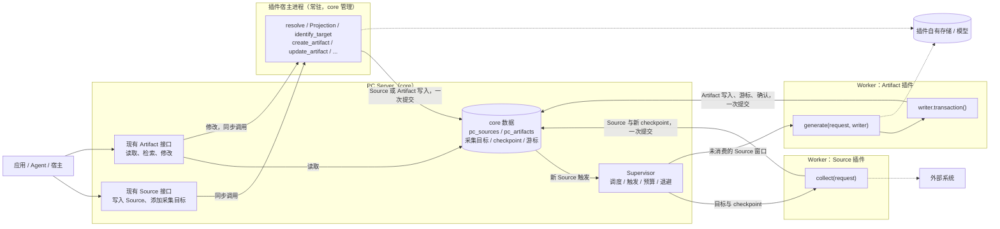

- Proposal Name: `plugin_interfaces`
- Start Date: 2026-11-08
- RFC PR: [oceanbase/powercontext#2549](https://github.com/oceanbase/powercontext/pull/2549)

# 概要

本提案重新定义 PowerContext 的第三方插件模型：插件只实现几个固定接口，PC Server 在需要时调用；调用方不直接调用插件，
而是像使用内置能力一样使用现有的 Source 和 Artifact 接口。

- **两类插件**：
  - **Source 插件**提供 Source 定义，需要持续采集时再实现 `identify_target` 和 `collect`。
  - **Artifact 插件**实现 `generate`，把尚未消费的 Source 加工成 Artifact。
- **插件形态**：一个插件是一个目录，包含 `plugin.py`，其中把一个声明对象（`SourcePlugin` 或 `ArtifactPlugin`）赋给
  `plugin`。声明写在代码里，没有单独的清单文件；部署相关的设置由插件从环境变量读取。
- **调用方式**：
  - 写入 Source、添加采集目标，使用现有的 Source 接口。
  - 读取、检索 Artifact，使用现有的 Artifact 接口。
  - 新建、编辑、合并、遗忘、恢复插件 Artifact，也使用现有的 Artifact 接口。core 负责鉴权、版本校验和溯源，再同步调用
    插件对应的方法；插件校验内容、维护自己的存储，并通过写入器写入。插件没有实现某项操作时，该接口返回 422。
- **执行**：
  - `collect` 和 `generate` 是后台调用，在 Supervisor 管理的 Worker 子进程中执行，沿用现有的隔离、超时、并发预算、
    领导租约和失败退避。
  - Source 写入时的 `resolve` 与 Projection、添加采集目标时的 `identify_target`、用户对插件 Artifact 的修改是同步调用，
    在 core 管理的常驻**插件宿主进程**中执行。每个 Server 进程为每个插件按需启动一个宿主进程，部署者不需要管理它。
- **写入**：Artifact 插件在 `async with writer.transaction()` 块中执行写操作，块结束时 core 把写入、消费游标和
  完成确认一起提交，异常则整体回滚。插件读不到也改不了游标。
- **core 的职责**：只管理 `pc_sources`、`pc_artifacts`（含 heads、lineage、合并记录、生命周期、handle 和 tags）及其
  消费进度。插件可以有自己的索引和存储，由插件自己管理；core 在部署使用的数据库后端上为每个插件提供一块专属存储，
  并把 Server 已配置的模型提供给插件使用。
- **端侧采集**：Server 可以以 `source-agent` 模式启动，只运行 Source 插件的采集，把 Source 和 checkpoint 提交到远端的
  中心 Server，用于具身智能等需要在设备上采集的场景。
- **生命周期**：插件在 Server 启动时按目录加载，变更需要重启。每个 Server 进程只在内存中记录本进程已激活的插件，
  不持久化插件的启用状态、注册代次或管理阶段。

本提案取代 [Source 插件框架 RFC #2012](2012-source-plugin-system.md) 和 [Artifact 插件框架 RFC #2175](2175-artifact-plugin-system.md)
的插件契约与管理机制。旧 Source 插件框架随 v1.5 发布，但目前没有对外发布的插件，因此本提案不保留兼容：旧的插件清单、
管理接口、管理服务和插件管理相关的表直接移除，旧 Artifact 插件写入的自定义 Artifact 数据不迁移。旧设计中合适的部分继续
沿用，包括 Source 管理接口（`pc_source_add` 等）及采集目标的身份规则，以及 core 已有的远程采集接口。

本文描述目标设计，不代表主线或发布版本已经可用。接口名称和代码示例用于说明契约，最终语法以实现为准。

# 动机

现有两套插件框架都让 PowerContext 替第三方插件承担了大量生命周期管理：

| 框架 | Server 为插件承担的工作 |
| --- | --- |
| Artifact 插件（#2175） | 在 `pc_artifact_processing_binding_states` 中维护 `desired_state`、`phase`、`binding_generation`、`last_error`；七种管理状态及其转换；`enable-all / reload / enable / disable / unload` 管理接口与 `expected_generation` 并发校验；用注册代次屏蔽旧 Worker 提交；在 `pc_artifact_family_schemas` 中固化内容 schema 和索引定义，变更返回 409；框架负责自定义声明式索引的构建、重建和可用状态 |
| Source 插件（#2012） | 独立的插件管理服务及其 SQLite（实例、capability、target、期望状态、提交记录）；每个插件实例一个 Runtime 进程；管理服务与 Server 之间的 poll / reply 通道和能力目录同步；`source load` 部署命令；实例启停 MCP 工具 |

这些机制的代价由所有人承担：

- **插件作者**需要理解 binding、generation、schema 固化规则、索引声明和管理通道等框架概念，才能写出一个插件。
- **部署者**需要运行多个进程、维护两个数据库、编写清单文件，并通过管理 API 让插件进入可运行状态。
- **调用方**需要区分内置能力和插件能力，使用不同的接口。
- **维护者**需要为第三方代码维护状态机、并发屏蔽、schema 和索引治理以及恢复路径，这部分代码的规模和测试面已经超过
  插件业务本身。

插件真正需要的是：在合适的时机被调用，拿到需要的输入，把结果交回 core。调度、隔离、消费进度和事务提交是 core
本来就有的能力，Supervisor 已经为内置 Artifact 提供了这些能力。Dify 等系统的插件模型也说明，宿主定义接口和调用时机、
插件只实现接口，足以支撑大量第三方扩展。

本提案的目标：

1. 插件作者只需写一个 `plugin.py`：一个声明对象和几个方法，不需要理解插件管理的内部机制。
2. 调用方不感知插件：Source 和 Artifact 的现有接口对插件产生的数据同样适用。
3. 插件代码只在 core 管理的子进程中执行（Worker 或插件宿主进程），插件故障不影响 Server 和其他插件。
4. 插件结果进入 `pc_sources` / `pc_artifacts`，与消费进度原子提交。
5. core 只管理这两类核心数据及其消费进度；内容结构、索引和其他存储交给插件自己。
6. 插件对核心数据的写入只经过 core 提供的写入器，覆盖 Artifact 的全部通用写操作，并沿用 core 现有的校验规则。
7. 用户对插件 Artifact 的修改经过插件，插件自有存储能与修改同步更新。
8. Artifact 生成可以按调度执行，也可以由新 Source 触发；采集目标可以在运行中增减。
9. 用户只需部署一个 Server；插件随 Server 启动加载。需要在设备上采集时，同一个程序以端侧模式运行。

# 指南级说明

## 1. 总体设计



图中有三条路径，一次调用只执行一个插件：

- **采集路径**：Supervisor 按调度派发 Source 插件的 Worker，传入该 Scope 已启用的采集目标及其 checkpoint；插件从外部
  系统读取数据并返回 Source；core 校验后把 Source 和新 checkpoint 在一个事务中保存。
- **生成路径**：新 Source 进入 journal 后，关注这些 Source 的 Artifact 插件被标记为待处理；Supervisor 派发 Worker，传入
  该 Scope 尚未消费的 Source 窗口和写入器；插件在写事务块中写入 Artifact，core 连同游标和确认一起提交。
- **同步路径**：调用方写入 Source、添加采集目标或修改插件 Artifact 时，Server 完成鉴权和版本校验后，把请求交给该插件的
  宿主进程；插件在宿主进程中完成转换或写入，结果在一个事务中提交后同步返回给调用方。

调用方只和 core 的现有接口打交道：

| 调用方要做的事 | 使用的接口 | 插件参与的方式 |
| --- | --- | --- |
| 提交一条 Source | 现有 Source 写入接口 | 宿主进程执行插件定义的 `resolve` 和 Projection |
| 添加、查看、停用采集目标 | 现有 Source 管理接口 | 添加时宿主进程执行插件的 `identify_target` |
| 浏览、读取、检索 Artifact | 现有 Artifact 读取与检索接口 | 不参与 |
| 新建、编辑、合并、遗忘、恢复、撤销合并 | 现有 Artifact 新建与编辑接口、通用合并接口 | 宿主进程执行插件对应的方法；未实现返回 422 |
| 打 tag、按 tag 查询 | 现有 tags 接口 | 不参与；tags 是 core 数据 |

职责划分：

| 职责 | 归属 |
| --- | --- |
| 认证、Scope 授权、公开 HTTP / MCP 接口、采集目标与 checkpoint 的保存、用户修改的版本校验与溯源记录 | core |
| 何时调用：调度、触发合并、Worker 预算、超时、退避、领导租约 | core（现有 Supervisor） |
| 宿主进程的启动、复用、超时终止与重启 | core |
| 读取输入、提供受约束的写事务、在同一事务中提交核心数据 / 游标 / checkpoint / 完成确认 | core（Worker 或宿主进程中的插件执行器） |
| 插件专属存储空间的分配、Server 已配置模型的封装 | core |
| Source 定义与 Projection 计算、采集目标的识别与规范化、外部数据读取 | Source 插件 |
| Artifact 内容结构、生成算法、用户提交内容的校验、插件自有的索引与存储及其一致性 | Artifact 插件 |
| 插件代码、依赖和环境变量的部署 | 部署者 |

插件代码只做一件事：给定输入，产出结果或抛出异常。抛出异常即失败，core 不提交任何核心数据；后台调用下次重试同一输入，
同步调用把错误返回给调用方。

## 2. 插件的形态

Server 从 `POWERCONTEXT_SERVER_PLUGINS_DIR` 加载插件。每个直接子目录是一个插件，目录名就是插件名；目录中必须有
`plugin.py`，可以有其他模块：

```text
/opt/powercontext/plugins/
├── x-posts/
│   ├── plugin.py
│   └── definition.py
└── incident-report/
    └── plugin.py
```

`plugin.py` 把一个声明对象赋给模块级变量 `plugin`：

```python
plugin = ArtifactPlugin(family="incident-report", ..., create=create)   # 或 SourcePlugin(...)
```

声明对象回答 core 在运行插件代码之前需要知道的问题：插件提供什么（Source 类型或 Artifact family）、消费什么、何时调用、
资源上限多少。它是普通的 Python 对象，由 Pydantic 校验；没有 YAML 或其他清单文件。

- **部署设置**：插件自己的凭据、外部服务地址等随部署变化的值，由插件在 `create` 中从环境变量读取。Server 不保存、
  不传递也不记录这些值。
- **core 提供的资源**：插件需要数据库和模型时，不必另行配置，通过上下文使用 core 封装好的对象（见参考级说明 1.2）：
  - `ctx.storage`：部署所用数据库后端上的一块插件专属空间。SQLite 是数据目录下的一个单独文件，OceanBase 和 seekdb
    是一个单独的库。插件拿到的连接只指向这块空间，不指向 core 的表。
  - `ctx.models`：Server 已配置的生成模型和 embedding 模型。插件只能调用，拿不到模型的地址和凭据；调用计入现有的模型
    用量统计。
- **启用与停用**：目录存在且检查通过，插件就可用；需要停用时移出目录并重启 Server。
- **检查**：Server 启动时在有时限的子进程中导入 `plugin.py`，校验声明，不调用 `create`。检查失败只影响该插件。

## 3. Source 插件

### 3.1 要实现的接口

| 接口 | 必需 | 说明 |
| --- | --- | --- |
| `definitions` | 是 | `SourceDefinition` 序列，沿用现有的 Source 定义：`input_class`、`resolve` 和各 Projection |
| `target_input` | 采集时必需 | Pydantic 模型，校验调用方添加目标时提交的输入 |
| `identify_target(value) -> TargetIdentity` | 采集时必需 | 纯函数，把输入规范化为稳定的目标键和规范化输入 |
| `create(ctx) -> SourceCollector` | 采集时必需 | 工厂，在 Worker 中每次调用执行一次，返回实现了 `collect` 的对象 |
| `collect(request) -> CollectResult` | 采集时必需 | 按目标和 checkpoint 读取外部数据，返回 Source 和新的 checkpoint |

只提供 `definitions` 的插件只扩展 Source 类型：调用方通过现有的 Source 写入接口提交内容，core 调用定义完成校验、
转换和保存。`resolve`、Projection 和 `identify_target` 都在插件宿主进程中执行；`collect` 在 Worker 中执行。

Source 与所有内置 Source 一样只能追加，没有修改和删除；要更正内容，提交一条新的 Source。文件、图片等大块内容由插件
存进自己的存储，Source 中只记录位置、摘要和媒体类型等元数据。

### 3.2 声明

| 字段 | 默认值 | 说明 |
| --- | --- | --- |
| `definitions` | 必填 | 见上表 |
| `collect` | `None` | 采集配置；为空表示只提供定义 |
| `collect.schedule` | 必填 | `Interval(seconds=...)` 或 `Cron(expression=..., timezone=...)` |
| `collect.max_targets` | 50 | 单次调用携带的目标数上限 |
| `collect.max_items` | 200 | 单次调用返回的 Source 条数上限 |
| `collect.timeout_seconds` | 120 | Worker 总时限 |
| `collect.max_workers` | 1 | 跨 Scope 的并发上限 |
| `target_input`、`identify_target`、`create` | 采集时必填 | 见上表 |
| `scopes` | `None` | 可服务的 Scope 名单；为空表示所有 Scope |

### 3.3 示例

下面的插件每 5 分钟采集各目标账号在 X 上的新帖子：

```python
import os

from pydantic import BaseModel

from powercontext.plugins import (
    Collect, CollectedItem, CollectRequest, CollectResult, Interval, PluginContext, SourcePlugin, TargetIdentity,
)

from definition import PostCapture, XPostDefinition


class TargetInput(BaseModel):
    account: str


def identify_target(value: TargetInput) -> TargetIdentity:
    account = value.account.strip().removeprefix("@").lower()
    if not account:
        raise ValueError("account must not be blank")
    return TargetIdentity(key=f"account:{account}", input={"account": account})


class XCollector:
    def __init__(self, client: XClient) -> None:
        self.client = client

    async def collect(self, request: CollectRequest) -> CollectResult:
        result = CollectResult()
        for target in request.targets:
            since = (target.checkpoint or {}).get("since_id")
            page = await self.client.user_posts(target.input["account"], since_id=since)
            result.add(target, [CollectedItem(definition="x-post", value=PostCapture(**p)) for p in page.posts],
                       checkpoint={"since_id": page.newest_id or since})
        return result


async def create(ctx: PluginContext) -> XCollector:
    client = await ctx.enter_async_context(XClient(os.environ["X_BEARER_TOKEN"]))
    return XCollector(client)


plugin = SourcePlugin(
    definitions=(XPostDefinition(),),
    collect=Collect(schedule=Interval(seconds=300), timeout_seconds=120),
    target_input=TargetInput,
    identify_target=identify_target,
    create=create,
)
```

### 3.4 调用方怎么使用

调用方使用现有的 Source 管理接口，不需要知道这是插件提供的能力：

```text
pc_source_add(scope_id="team-a", capability="x-posts", input={"account": "@PowerContextAI"})
pc_source_status(scope_id="team-a", target_id="...")
pc_source_target_set_enabled(scope_id="team-a", target_id="...", enabled=false)
```

- **添加**：core 用 `target_input` 校验输入，调用 `identify_target` 得到键和规范化输入。同一账号得到同一个键，复用已有
  目标。新目标保存为启用状态并立即请求一次采集，不需要重启。
- **checkpoint**：每个目标的 checkpoint 是只读输入，插件通过返回值提出新的 checkpoint。core 把本次返回的所有 Source
  与各目标的新 checkpoint 在同一事务中提交；`collect` 抛出异常或超时则不提交任何内容，下一次调用仍拿到旧 checkpoint。
- **格式校验**：`pc_source_capabilities` 发布 `target_input` 的 JSON Schema，调用方提交前就知道格式。添加时 core 先用
  `target_input` 校验，不合格返回 422 并指出字段；`identify_target` 抛出 `ValueError` 同样返回 422。外部资源是否存在、
  是否可读，只能在 `collect` 时判断，结果在 `pc_source_status` 的最近失败中体现。

### 3.5 端侧采集

具身智能等场景需要在设备上采集，再提交到中心的 PowerContext Server。同一个程序以端侧模式启动：

```text
powercontext source-agent --server https://memory.example.com
```

- 端侧只加载插件目录中带 `collect` 的 Source 插件，运行 Supervisor 调度 `collect`，不加载 Artifact 插件，也不提供
  Artifact 接口。
- 采集目标保存在端侧本地的 SQLite 中，通过端侧本地的 `pc_source_add`、`pc_source_status`、`pc_source_target_set_enabled`
  管理。中心看不到端侧的目标，只看到提交上来的 Source 和 checkpoint。
- 采集结果通过 core 已有的远程采集接口提交到中心：Source 走 `POST /v1/source-observations`，checkpoint 走
  `POST /v1/connector-checkpoints/commit`。`resolve` 和 Projection 在端侧执行，中心按已登记的定义清单校验，不需要
  加载插件代码。
- 断线、重启和重传都按幂等处理：先提交 Source，再以旧 checkpoint 为期望值提交新 checkpoint。中途失败时 checkpoint 不前进，
  下次调用从旧 checkpoint 重新采集；重新提交的 Source 身份相同、内容相同，由中心去重。
- 离线期间的数据积压由插件自己处理。提交失败时本次调用失败，checkpoint 不前进；外部系统无法回放的数据（例如传感器流），
  插件需要先存在自己的本地存储中，按 checkpoint 重新给出。

## 4. Artifact 插件

### 4.1 要实现的接口

| 接口 | 必需 | 说明 |
| --- | --- | --- |
| `create(ctx) -> ArtifactGenerator` | 是 | 工厂；Worker 中每次调用执行一次，宿主进程中每个 Scope 执行一次后复用 |
| `generate(request, writer) -> None` | 是 | 读取 `request.sources`（未消费的 Source 窗口），在写事务块中写入 Artifact |
| `create_artifact(request, writer) -> None` | 否 | 用户新建；`request.artifact_id` 由 core 分配 |
| `update_artifact(request, writer) -> None` | 否 | 用户编辑指定 ID 的 Artifact，`request.expected_revision` 为调用方看到的 revision |
| `merge_artifacts(request, writer) -> None` | 否 | 用户合并；结果的 ID 由 core 分配 |
| `forget_artifact(request, writer) -> None` | 否 | 用户遗忘 |
| `restore_artifact(request, writer) -> None` | 否 | 用户恢复、恢复到旧 revision 或撤销合并 |

后五个方法处理用户修改（见 4.4），每个都是可选的：没有实现的操作，对应接口返回 422，表示这个 family 不支持该操作。
插件在这些方法中校验用户提交的内容、更新自己的存储，并通过写入器完成 core 要求的那一项写操作。

### 4.2 声明

| 字段 | 默认值 | 说明 |
| --- | --- | --- |
| `family` | 必填 | 插件拥有的 Artifact family，不能与内置 family 或其他插件重复 |
| `inputs` | `None` | `Inputs(source_types=..., projection=..., max_sources=50)`：消费的 Source 类型、每条 Source 交付的 Projection、单个窗口的条数上限；为空表示不消费 Source |
| `on_sources` | `False` | 新 Source 到达后触发；需要 `inputs` |
| `schedule` | `None` | `Interval(seconds=...)` 或 `Cron(expression=..., timezone=...)`；与 `on_sources` 至少配置一项 |
| `scopes` | `None` | 可服务的 Scope 名单；不消费 Source 的插件必须填写 |
| `search_fields` | `None` | 参与全文检索的顶层内容字段；为空表示所有顶层字符串字段 |
| `timeout_seconds` | 300 | 整次调用的时限 |
| `transaction_timeout_seconds` | 30 | 写事务块的时限，不超过 `timeout_seconds` |
| `max_workers` | 1 | 跨 Scope 的并发上限 |
| `change_timeout_seconds` | 30 | 一次用户修改调用的时限，包括其中的写事务块 |
| `create` | 必填 | 见上表 |

### 4.3 示例

下面的插件为每条工单 Source 生成一份报告：先用自己的向量索引查找相似的已有报告，命中则修订那份报告，否则新建；
同时把报告写进自己的向量索引。它还支持用户编辑报告，没有实现的新建、合并、遗忘、恢复对该 family 返回 422。向量索引
放在 core 分配的专属存储中，模型使用 Server 已配置的模型。

```python
from powercontext.plugins import (
    ArtifactPlugin, ArtifactWriter, GenerateRequest, Inputs, InvalidContent, PluginContext, UpdateRequest,
)
from powercontext.sources import TextEvidence


class IncidentReports:
    def __init__(self, index: VectorIndex, model: Summarizer) -> None:
        self.index, self.model = index, model

    async def generate(self, request: GenerateRequest, writer: ArtifactWriter) -> None:
        # 1. 耗时工作放在写事务之外：模型调用、向量计算
        planned = []
        for source in request.sources:
            evidence = TextEvidence.model_validate(source.projection)
            summary = await self.model.summarize(evidence.content)
            planned.append((source, summary, await self.model.embed(summary)))

        # 2. 短写事务：块内读取能看到本块已写入的内容
        async with writer.transaction() as tx:
            for source, summary, vector in planned:
                match = await self.index.nearest(request.scope_id, vector, threshold=0.92)
                current = await tx.get(match.artifact_id) if match else None
                artifact_id = current.ref.artifact_id if current else writer.stable_id(
                    "report", source.ref.source_type, source.ref.source_id)
                written = await tx.put(artifact_id, content={"title": "工单报告", "summary": summary},
                                       source_refs=[source.ref])
                # 拿到真实的 artifact_id 与 revision 后写入自有索引，按 ID upsert
                await self.index.upsert(request.scope_id, written.ref.artifact_id, written.ref.revision, vector)
        # 块正常结束：core 提交 Artifact 写入、游标推进与完成确认

    async def update_artifact(self, request: UpdateRequest, writer: ArtifactWriter) -> None:
        # 用户编辑：校验内容，重算向量，再写入 core 和自有索引
        report = Report.model_validate(request.content)          # 不合格时抛出 InvalidContent，接口返回 422
        vector = await self.model.embed(report.summary)
        async with writer.transaction() as tx:
            written = await tx.put(request.artifact_id, content=report.model_dump(),
                                   expected_revision=request.expected_revision)
            await self.index.upsert(request.scope_id, written.ref.artifact_id, written.ref.revision, vector)


async def create(ctx: PluginContext) -> IncidentReports:
    index = await ctx.enter_async_context(VectorIndex.connect(ctx.storage.engine()))
    return IncidentReports(index, Summarizer(ctx.models))


plugin = ArtifactPlugin(
    family="incident-report",
    inputs=Inputs(source_types=("example-ticket",), projection="powercontext.text-evidence@1"),
    on_sources=True,
    search_fields=("title", "summary"),
    create=create,
)
```

块内抛出异常时，core 回滚块内全部 Artifact 写入，游标不动，下次重试同一窗口。插件自有索引不在 core 的事务中：
插件按稳定 ID upsert，重试时会覆盖上一次留下的条目；读取自有索引时以 core 的当前数据为准（见参考级说明 3.5）。

### 4.4 调用方怎么使用

调用方使用现有的 Artifact 接口访问插件 family。读取接口直接读 `pc_artifacts`，不运行插件代码；修改接口由 core 鉴权、
校验版本后，同步调用插件对应的方法：

| 用途 | 接口 | 插件方法 |
| --- | --- | --- |
| 浏览 | `GET /v1/scopes/{scope_id}/artifacts/{family}` | 无 |
| 读取当前内容、指定 revision、revision 历史、tags | `GET .../{artifact_id}`、`GET .../{artifact_id}/revisions/{revision}`、`GET .../{artifact_id}/revisions`、`GET .../{artifact_id}/tags` | 无 |
| 文本检索 | `POST /v1/scopes/{scope_id}/artifacts/{family}/search` | 无 |
| 新建（只提交内容，ID 由 core 分配） | `POST /v1/scopes/{scope_id}/artifacts`，请求体为 `{"family": ..., "content": {...}}` | `create_artifact` |
| 编辑（提交完整内容，`If-Match` 校验当前 revision） | `PUT /v1/scopes/{scope_id}/artifacts/{family}/{artifact_id}` | `update_artifact` |
| 读取治理状态（遗忘、合并前取得 `state_version`） | `GET .../{artifact_id}/governance` | 无 |
| 合并 | `POST /v1/scopes/{scope_id}/artifacts/{family}/merges` | `merge_artifacts` |
| 遗忘 | `POST .../{artifact_id}/forget` | `forget_artifact` |
| 恢复、恢复到旧 revision、撤销合并 | `POST .../{artifact_id}/restorations` | `restore_artifact` |
| 修改 tags | `PUT .../{artifact_id}/tags`；按 tag 查询用 `POST /v1/scopes/{scope_id}/artifact-tags/query` | 无，由 core 处理 |

修改同步返回结果。插件拒绝内容时返回 422，插件没有实现对应方法时也返回 422，宿主进程超时或不可用时返回 503。

## 5. 调度与触发

插件的后台调用（`collect`、`generate`）的调度和触发都交给现有的 Artifact processing Supervisor；同步调用由请求触发，
不经过 Supervisor。每个插件在启动时注册为一个 Supervisor binding，
binding 名为 `plugin:<name>`，调度键是 `(binding, Scope)`。

Artifact 插件：

| 声明 | 何时派发 Worker | `request.reason` |
| --- | --- | --- |
| `schedule=Interval(...)` 或 `schedule=Cron(...)` | 到期时，对有待处理工作的 Scope | 有新 Source 时为 `sources`，否则为 `schedule` |
| `on_sources=True` | Scope 的 Source journal 超过该插件的游标，约 2 秒内派发 | `sources` |

- 配置了 `inputs` 的插件，每次调用都附带该 Scope 尚未消费的 Source 窗口；窗口中没有匹配的 Source 时不调用插件，
  直接推进游标并确认。
- 未配置 `inputs` 的插件（例如每天整理一次已有 Artifact）不消费 Source，到期即对 `scopes` 中的每个 Scope 调用一次；
  第一版只支持 `Interval`。
- `Cron` 只能用于配置了 `inputs` 的插件，且不能与 `on_sources` 同时使用：Supervisor 的每个 binding 只接受一种
  interval 或 cron 策略。

Source 插件的 `collect` 按 `collect.schedule` 调用；添加或恢复目标时也会请求一次采集。

同一插件、同一 Scope 同时最多运行一个 Worker。运行期间到达的触发由 Supervisor 合并成结束后的一次调用。

## 6. 运维

- **启动**：Server 逐个检查插件目录。某个插件检查失败（缺少 `plugin.py`、导入失败、声明无效、family 或 Source 类型
  与内置或其他插件冲突）只影响该插件，Server 和其他插件正常启动。
- **查看**（都需要 `server.admin`，只读，数据都来自启动检查或数据库，任何 Server 角色都给出相同结果）：
  - `GET /v1/plugins`、`GET /v1/plugins/{name}`：每个插件的检查结果、类型、family 或 Source 类型、消费的 Source 类型、
    触发方式和 Scope 范围。
  - `GET /v1/plugins/{name}/scopes`：每个 Scope 是否有待处理的工作、已消费到的 journal 位置和当前 journal 位置。
  - 调用失败的原因通过日志和指标排查，不在接口中保存。
- **变更**：修改代码后重启 Server。Server 不监视文件，也不在运行中重新加载插件。采集目标是业务数据，增减不需要重启。
- **停用**：从插件目录移走后重启。已保存的 Source、Artifact、采集目标、游标和 checkpoint 保留并可继续读取；重新部署
  同名插件时从原位置继续。插件的专属存储不随之删除，由部署者保留或清理。
- **宿主进程**：由 core 按需启动、复用和重启，部署者不需要配置或管理。宿主进程的启动、终止和重启只体现在日志和指标中。

# 参考级说明

## 1. 公共契约

公开接口位于新模块 `powercontext.plugins`，替换现有的 `powercontext.artifact_plugins` 和 `powercontext.source_management`
中面向插件作者的部分。接口以 `typing.Protocol` 和 Pydantic 模型表达。

### 1.1 声明与加载

```python
class Interval(BaseModel):
    seconds: float                        # > 0

class Cron(BaseModel):
    expression: str
    timezone: str = "Asia/Shanghai"

class ArtifactPlugin(BaseModel):          # 字段见指南级说明 4.2
    family: str
    inputs: Inputs | None = None
    ...
    create: Callable[[PluginContext], Awaitable[ArtifactGenerator]]

class SourcePlugin(BaseModel):            # 字段见指南级说明 3.2
    definitions: Sequence[SourceDefinition]
    collect: Collect | None = None
    ...
```

- 插件名取自目录名，必须匹配 `^[a-z][a-z0-9-]{0,63}$`。
- 声明在构造时校验，包括调度组合、`inputs` 与 `scopes` 的依赖、时限关系和 family 命名。`create` 必须是 async 函数。
- 声明中除 `create`、`identify_target`、`definitions` 等代码对象外的部分可以序列化，Server 在检查子进程中得到它，
  用于注册 binding 和回答运维查询；Worker 每次调用重新导入 `plugin.py`，声明与启动时不一致则调用失败，提示重启 Server。

### 1.2 上下文

```python
class PluginContext:
    name: str                          # 插件名
    scope_id: str                      # 本次调用的 Scope
    plugin_dir: Path                   # 插件目录（只读约定）
    logger: logging.Logger             # 已绑定插件名的 logger
    storage: PluginStorage             # 插件专属存储
    models: PluginModels | None        # Server 已配置的模型；未配置时为 None

    async def enter_async_context(self, cm: AbstractAsyncContextManager[T]) -> T: ...

class PluginStorage(Protocol):
    backend: Literal["sqlite", "oceanbase", "seekdb"]
    def engine(self) -> AsyncEngine: ...   # 只指向本插件的专属空间

class PluginModels(Protocol):
    embedding_profile: EmbeddingProfile | None    # profile ID 与向量维度；未配置 embedding 时为 None
    async def embed(self, texts: Sequence[str], /) -> Sequence[Sequence[float]]: ...
    async def generate(self, messages: Sequence[ChatMessage], /, *, max_tokens: int | None = None) -> str: ...
```

- 工厂在每次 Worker 调用中执行一次，实例不跨调用复用；在宿主进程中每个 Scope 执行一次，实例在宿主进程存续期间复用。
  需要关闭的资源（包括插件自有存储的连接）通过 `ctx.enter_async_context` 注册，Worker 调用结束或宿主进程停止时由执行器释放。
- **专属存储**：core 使用 Server 现有的数据库连接配置，在同一个后端上为插件分配一块空间，不需要额外的数据库账号：
  - SQLite：数据目录下的 `plugins/<插件名>.sqlite3`。
  - OceanBase / seekdb：名为 `powercontext_plugin_<插件名>` 的库（`-` 换成 `_`），首次使用时由 core 创建。Server 的数据库
    登录没有建库权限时，由部署者事先建好。
  - 表结构和迁移由插件自己管理，core 不读取、不迁移、不备份这块空间。它不在 core 的事务中，与核心数据的一致性按 3.5 处理。
  - 插件与 Server 使用同一个数据库登录，这一划分防止插件误写 core 的表，不防止恶意插件；插件目录本身被当作可信代码。
- **模型**：`models` 封装 Server 的推理配置，插件拿不到模型的地址、请求头和凭据。`embedding_profile` 让插件在索引和查询时
  使用同一个 embedding 配置。调用沿用 Server 的超时设置，并计入现有的模型用量统计。插件也可以从环境变量读取自己的
  模型配置，自行创建客户端。
- 插件得不到 core 数据库的连接，也没有游标或 checkpoint 的写入接口。插件对核心数据的写入只有三条路径：Source 插件的
  `collect` 返回值、宿主进程中 `resolve` 的返回值，和 Artifact 插件的 `ArtifactWriter`。

## 2. Source 插件契约

```python
class TargetIdentity(BaseModel):
    key: str                          # 稳定的目标键，同一外部资源始终相同
    input: dict[str, JsonValue]       # 规范化后的输入，保留所有影响采集的参数

class CollectTarget(BaseModel):
    key: str
    input: dict[str, JsonValue]
    checkpoint: JsonValue | None      # 该目标上次成功提交的 checkpoint；首次为 None；只读

class CollectRequest(BaseModel):
    scope_id: str
    reason: Literal["schedule", "target_added"]
    targets: Sequence[CollectTarget]  # 本次要采集的已启用目标
    max_items: int

class CollectedItem(BaseModel):
    definition: str                   # definitions 中某个定义的 name
    value: BaseModel                  # 该定义 input_class 的实例

class TargetResult(BaseModel):
    items: Sequence[CollectedItem]
    checkpoint: JsonValue | None
    has_more: bool = False

class CollectResult(BaseModel):
    targets: dict[str, TargetResult] = {}       # 键为目标键
    def add(self, target: CollectTarget, items: Sequence[CollectedItem], *, checkpoint: JsonValue | None) -> None: ...

class SourceCollector(Protocol):
    async def collect(self, request: CollectRequest, /) -> CollectResult: ...
```

- **定义注册**：`definitions` 中的 Source 类型与 Projection 在启动时注册到现有的 Source 定义清单，与内置类型和其他插件
  冲突时检查失败。
- **写入**：调用方通过现有的 Source 写入接口（`POST /v1/scopes/{scope_id}/sources`、MCP `pc_source_add` 的 write 用法）
  提交内容。core 按 `definition.input_class` 校验输入，调用 `resolve` 得到 Source，计算各 Projection 后保存，语义与内置
  Source 写入一致。校验、`resolve` 和 Projection 在该插件的宿主进程中同步执行，有超时限制。`resolve` 必须是纯函数，
  不能有复制文件等副作用；需要把外部文件纳入插件存储时，用 `collect` 完成。
- **collect**：每次调用对应一个 Scope，最多携带 `max_targets` 个已启用目标；目标较多时按目标键轮转，`has_more` 的目标
  优先进入下一次调用。执行器对返回的每条 Source 执行与写入相同的校验、`resolve` 和 Projection，然后在一个事务中保存全部
  Source、写入各目标的 checkpoint 和最近采集时间，并确认本次调用。任一条失败则整次不提交。条目总数超过 `max_items`、
  返回了请求中不存在的目标键，都视为失败，不截断。结果中没有出现的目标，checkpoint 保持不变。
- **Source 身份**：由 `resolve` 决定。重复采集同一外部状态得到相同身份时，沿用现有去重规则，不产生重复 Source。

**采集目标**是 core 保存的业务数据，与 Source 一样不属于插件生命周期状态。管理接口复用现有的 Source 管理接口：

| 操作 | 接口 | 说明 |
| --- | --- | --- |
| 添加 | MCP / HTTP `pc_source_add`（`capability` 为插件名） | 用 `target_input` 校验输入，调用 `identify_target` 得到键和规范化输入。同键且规范化输入相同则返回已有目标；同键但输入不同返回冲突。新目标保存为启用状态并请求一次采集 |
| 查看 | MCP / HTTP `pc_source_status` | 目标键、规范化输入、启用状态、最近成功采集时间、最近失败分类 |
| 停用 / 恢复 | MCP / HTTP `pc_source_target_set_enabled` | 停用后不再进入 collect 请求，checkpoint 和已采集的 Source 保留；恢复后从原 checkpoint 继续 |

- 添加和变更需要调用者对该 Scope 有 Source 写权限，并且 Scope 在插件的 `scopes` 范围内。
- `identify_target` 必须是纯函数：只做校验和规范化，不访问外部系统、不检查外部授权。外部资源是否存在、是否可读，
  在 collect 时由插件判断并以异常或空结果表达。它与写入一样在宿主进程中同步执行，有超时限制。
- `pc_source_capabilities` 列出插件提供的 Source 类型和目标输入的 JSON Schema。

**端侧模式**（`powercontext source-agent`）沿用同一套 Source 插件契约，只替换提交目标：

| 项 | 端侧模式中的处理 |
| --- | --- |
| 配置 | `--server` 指定中心 Server；`POWERCONTEXT_SOURCE_AGENT_ID` 是端侧的稳定标识；`POWERCONTEXT_SOURCE_AGENT_TOKEN` 是对目标 Scope 有 `scope.contribute` 权限的凭据 |
| 本地数据 | 端侧数据目录下的 SQLite，保存采集目标（结构同 `pc_source_collect_targets`）和 Supervisor 的调度状态；不保存 Source |
| 定义清单 | 启动时把各 Source 定义的声明式清单登记到中心（`POST /v1/source-definitions/register`，需要 `server.admin`）；凭据没有该权限时，由部署者事先登记 |
| 每次 `collect` | 从中心读取各目标的 checkpoint（`/v1/connector-checkpoints/get`），调用插件，在端侧执行 `resolve` 与 Projection，逐条提交 Source（`/v1/source-observations`），全部成功后以旧值为期望提交新 checkpoint（`/v1/connector-checkpoints/commit`） |
| 目标的 binding ID | 由端侧标识、插件名和目标键确定性派生，两个端侧采集同一外部资源不会互相覆盖 checkpoint |
| 失败 | 任一步失败则本次调用失败，进入 Supervisor 退避；已提交的 Source 保留，checkpoint 不前进，下次重采由中心去重 |

端侧和中心之间不是一个事务：可能出现 Source 已保存而 checkpoint 未前进的情况，靠 Source 身份去重保证不重复。这要求
插件的 `resolve` 对同一外部状态给出相同的身份和内容；身份相同但内容不同时，中心返回冲突，本次调用失败。

## 3. Artifact 插件契约

### 3.1 请求

```python
class ArtifactGenerator(Protocol):
    async def generate(self, request: GenerateRequest, writer: ArtifactWriter, /) -> None: ...

class GenerateRequest(BaseModel):
    scope_id: str
    reason: Literal["schedule", "sources"]
    sources: Sequence[GenerationSource]   # 本次窗口；未配置 inputs 时为空

class GenerationSource(BaseModel):
    ref: SourceRef                        # 精确 Source 引用
    position: int                         # Source 在 journal 中的位置，用于按采集顺序处理
    projection: JsonValue                 # inputs.projection 指定的 Projection 内容
```

### 3.2 写入器与写事务

```python
class ArtifactWriter(ArtifactReads):
    family: str                           # 固定为声明中的 family
    def stable_id(self, *parts: str) -> str: ...
    def transaction(self) -> AbstractAsyncContextManager[ArtifactTransaction]: ...

class ArtifactTransaction(ArtifactReads):
    ...                                   # 读取（见 3.4）加写操作（见下表）
```

`generate` 的执行分两部分：

- **事务外**：插件通过 `writer` 读取已提交的数据（每次读取使用独立的只读短事务），完成模型调用、向量计算等耗时工作。
- **写事务块**：`async with writer.transaction() as tx:`。
  - 块开始时，core 开启写事务并重新校验 Supervisor 租约和调用意图。
  - 块内的写操作直接在该事务中执行，立即返回写入后的 `ArtifactSnapshot`（含精确 revision）；块内读取能看到本块已写入的内容。
  - 块正常结束时，core 在同一事务中以 CAS 推进游标、确认本次调用并提交。
  - 块内抛出异常、超过 `transaction_timeout_seconds` 或提交冲突，事务整体回滚，本次调用失败。

规则：

- 每次调用最多开启一个写事务块；第二次开启抛出异常。游标和调用确认只随这一个事务提交，因此一个窗口的核心数据不会
  被部分提交。
- 插件没有开启写事务块就正常返回，表示本窗口无需产出，执行器单独提交游标推进和调用确认。
- 写事务块提交后，`generate` 中后续代码抛出的异常不再影响已提交的结果，执行器记录为提交后错误，不重试该窗口。
  插件应把写事务块作为 `generate` 的最后一步。
- 写事务块的时限计入整次调用的 `timeout_seconds`。块内只应做读取、写操作和插件自有存储的写入，不应调用模型。

### 3.3 写操作

写事务覆盖 Artifact 的全部通用写操作，每个操作复用 core 现有的实现与校验规则，违反规则时立即抛出异常：

| 操作 | 复用的 core 实现 | 语义 |
| --- | --- | --- |
| `put(artifact_id, *, content, source_refs=(), artifact_refs=(), expected_revision=None)` | 公共合并方法的修改路径 | 不存在则新建 revision 1；已存在则按当前 head 追加 revision。给出 `expected_revision` 时，当前 revision 不一致即冲突，用于事务外读取、事务内写入的乐观并发。内容与当前 revision 相同时为 no-op，返回当前快照 |
| `revert(artifact_id, *, to_revision)` | 公共恢复方法（选定 revision） | 以历史 revision 的内容追加新 revision，记录 `restored_from_revision`；目标已被遗忘或被合并冻结时一并恢复 |
| `set_lifecycle(artifact_id, state, *, replacement_artifact_id=None)` | 公共遗忘与恢复方法；指定替代者或退役时使用 `ArtifactGovernanceRepository.transition` | `deprecated` 为遗忘，`active` 为恢复，`retired` 不可逆。恢复走共享恢复流程：记录一个内容相同的新 revision，被合并冻结的输入会撤销冻结它的合并，按组恢复。遗忘和退役不追加 revision |
| `merge(inputs, *, into, content, source_refs=(), artifact_refs=())` | 公共合并方法（[RFC #1859](1859_artifact_merge.md)） | 以 `inputs` 的当前 revision 为输入，新建 `into`，记录合并关系并冻结输入。`into` 必须是新 ID；同一组输入在撤销后再次合并时，插件应把输入 revision 纳入 `stable_id`，避免与已退役的结果撞号 |
| `preview_undo_merge(artifact_id)` / `undo_merge(artifact_id)` | 公共合并方法的预览与恢复 | 撤销产生该 Artifact 的合并，恢复输入并退役结果，返回恢复与退役的精确引用 |
| `bind_handle(handle_key, ref)` | Artifact handle 绑定 | 把稳定 handle 绑定到指定 revision |
| `set_tags(artifact_id, tags)` | Artifact tags 替换 | 整体替换该 Artifact 的 tags |

写入约束：

- 只能写本 Scope、声明中 `family` 的 Artifact，插件不能写其他 family 或 Scope。
- `source_refs` 在 `generate` 中只能引用本次窗口中的 Source，在用户修改中只能引用目标 Artifact 当前 lineage 中已有的
  Source（用于保留原始输入）。`artifact_refs` 可以引用本 Scope 中任意 family 实际存在的 revision；`to_revision` 和
  `bind_handle` 的目标只能是本 family 中实际存在的 revision。
- 检索文本由 core 按声明的 `search_fields` 从内容中提取，插件不单独提供；同一份内容无论由插件还是用户写入，
  检索文本都相同。
- 每个写事务块的操作数（1000）、单份内容大小（256 KiB）和总字节数（8 MiB）有上限，超出即抛出异常并回滚，
  不截断、不部分提交。
- core 不校验 `content` 的业务结构，也不保存或固化 schema。内容结构的演进由插件负责，插件可以在 `content` 中自带版本字段。

### 3.4 读取

`ArtifactWriter`（事务外，只读已提交数据）和 `ArtifactTransaction`（事务内，同时看到本块已写入的内容）提供相同的读取方法，
范围默认为本 Scope、本 family。`reads(family)` 返回同一 Scope 中其他 family 的只读视图，方法相同，可以读取内置 family
和其他插件的 family（内容按原样 JSON 返回），不能写入。这让一个插件可以基于另一个插件的结果工作，例如知识库插件读取
文档插件写入的 Artifact：

```python
class ArtifactSnapshot(BaseModel):
    ref: ArtifactRef                      # 精确 revision
    content: dict[str, JsonValue]
    lineage: ArtifactLineage              # 直接引用的 Source 与 Artifact
    lifecycle_state: LifecycleState       # active / deprecated / retired
    merged_into_id: str | None            # 被合并冻结时指向合并结果
    replacement_artifact_id: str | None
    governance_generation: int            # 治理状态版本，用于判断读取后是否被修改

class ArtifactReads(Protocol):
    async def get(self, artifact_id: str, *, revision: int | None = None) -> ArtifactSnapshot | None: ...
    async def revisions(self, artifact_id: str, *, cursor: str | None = None, limit: int = 50) -> ArtifactPage: ...
    async def list(self, *, states: Collection[LifecycleState] = ("active",), tags: Collection[str] = (),
                   cursor: str | None = None, limit: int = 50) -> ArtifactPage: ...
    async def search(self, query: str, *, limit: int = 10) -> Sequence[ArtifactSnapshot]: ...
    async def by_source(self, ref: SourceRef) -> Sequence[ArtifactSnapshot]: ...
    async def merge_inputs(self, artifact_id: str) -> Sequence[ArtifactRef]: ...
    async def tags(self, artifact_id: str) -> Sequence[str]: ...
    async def resolve_handle(self, handle_key: str) -> ArtifactRef | None: ...
    def reads(self, family: str) -> ArtifactReads: ...   # 同一 Scope 中其他 family 的只读视图
```

- 快照同时携带精确 revision、lineage 和当前治理状态，插件不需要再分别读取 lineage 和生命周期。
- `get` 可以读当前内容或指定 revision；`revisions` 列出完整历史；`merge_inputs` 读取合并结果的精确输入。
- `list` 可以按生命周期状态和 tags 过滤，包括 deprecated、retired 和被合并冻结的 Artifact，用于查找之前已经存在的数据。
- `search` 是 core 提供的文本检索（见第 7 节），只覆盖 active 的当前 revision；在写事务中能检索到本块已写入、尚未提交的内容。
- `by_source` 反查 lineage 引用了某条 Source 的 Artifact，用于 Source 更新后找到需要修订的 Artifact。
- 读取返回的快照都带精确 revision，可以直接作为写操作的 `artifact_refs` 或 `to_revision`。

### 3.5 一致性与幂等

- **核心数据**：每个窗口的 Artifact 写操作、游标推进和调用确认在一个事务中提交。失败时核心数据完全不变，重试从干净状态
  开始；成功后游标已越过该窗口，同一窗口不会再次投递。冲突（例如 head 在读取后被用户修改）在操作时或提交时报告，整体
  回滚后由 Supervisor 重新调度，下一次调用读到修改后的状态。
- **重复处理同一业务对象**：不消费 Source 的定时整理等场景会再次处理已经处理过的对象。插件用 `writer.stable_id(...)` 从业务
  身份派生 Artifact ID；`put` 在内容相同时为 no-op，`set_lifecycle` 目标状态与当前相同时为 no-op，`merge` 在输入已全部
  合并到同一结果时为 no-op，从而不会产生重复 Artifact 或无意义的 revision。
- **插件自有存储**：插件的索引和其他存储（包括 core 分配的专属存储）不在 core 的事务中，core 不保证两者一致，由插件负责。
  推荐做法：
  1. 在写事务块内、拿到 `ArtifactSnapshot` 之后写自有存储，按 `artifact_id` upsert。这样自有存储的写入失败会让核心写入
     一起回滚。
  2. 写事务提交失败时，自有存储可能留下本次的条目。重试会处理同一窗口、得到同一个稳定 ID，覆盖这些条目。
  3. 把自有索引当作候选来源：命中的 ID 用 `get` 读取 core 中的当前快照，以快照内容和状态为准。这样回滚留下的条目
     不会让插件读到过期内容。插件也可以定期按 core 数据重建索引。
  4. 大块内容（正文、分块、文件字节）按 `(artifact_id, revision)` 存成不可变的记录，先写入自有存储，再在写事务块中提交
     带摘要的 Artifact 内容。没有提交成功的记录不会被任何 revision 引用，读取时按 Artifact 内容中的摘要核对。
- `generate` 本身可能因失败重试而执行多次，模型调用和插件发出的外部请求不是恰好一次。

## 4. 用户对插件 Artifact 的修改

用户修改使用 core 的通用 Artifact 接口。Server 完成鉴权和版本预检后，把请求交给该插件的宿主进程；插件方法在宿主进程中
执行，通过写入器完成写入，结果在一个短事务中提交并同步返回。用户修改不进入 Supervisor，也不排队。

### 4.1 请求与方法

```python
class CreateRequest(BaseModel):
    scope_id: str
    artifact_id: str                      # core 分配，调用方不提交
    content: dict[str, JsonValue]

class UpdateRequest(BaseModel):
    scope_id: str
    artifact_id: str
    expected_revision: int
    content: dict[str, JsonValue]

class MergeRequest(BaseModel):
    scope_id: str
    inputs: Sequence[MergeInput]          # 每项为 artifact_id、revision、state_version
    into: str                             # core 分配的结果 ID
    content: dict[str, JsonValue]

class ForgetRequest(BaseModel):
    scope_id: str
    artifact_id: str
    expected_revision: int
    expected_state_version: int

class RestoreRequest(BaseModel):
    scope_id: str
    artifact_id: str
    operation: Literal["restore", "undo_merge"]
    revision: int | None = None           # restore 时可指定恢复到的 revision

class InvalidContent(Exception):          # 插件拒绝内容；接口返回 422，消息和字段返回给调用方
    def __init__(self, message: str, *, field: str | None = None) -> None: ...
```

| 方法 | 插件必须完成的写操作 |
| --- | --- |
| `create_artifact(request, writer)` | 恰好一次 `put(request.artifact_id, ...)`，目标此前不存在 |
| `update_artifact(request, writer)` | 恰好一次 `put(request.artifact_id, ..., expected_revision=request.expected_revision)` |
| `merge_artifacts(request, writer)` | 恰好一次 `merge(输入 ID, into=request.into, ...)`，输入与请求一致 |
| `forget_artifact(request, writer)` | 恰好一次 `set_lifecycle(request.artifact_id, "deprecated")` |
| `restore_artifact(request, writer)` | `restore` 为恰好一次 `revert` 或 `set_lifecycle(..., "active")`；`undo_merge` 为恰好一次 `undo_merge(request.artifact_id)` |

- 这些调用中的写事务只允许上表对应的那一项写操作，以及对同一 Artifact 的 `set_tags`；写其他 Artifact 时立即抛出异常。
  方法正常返回但没有完成要求的写操作，core 回滚并返回 502，表示插件没有按约定完成。
- 插件可以规范化内容（例如补全默认字段），写入的内容以插件提交的为准。
- 插件应在写事务块中、拿到快照之后更新自己的存储，做法同 3.5。

### 4.2 core 负责的部分

- **鉴权**：与内置 family 相同。新建和新建合并结果需要 Scope 的贡献权限，结果归属于调用者；修改已有 Artifact 需要该
  Artifact 的写权限（`artifact.write`）。插件在这些调用中只获得完成本次请求所需的写入范围。
- **版本校验**：调用插件前先检查 `If-Match`、`revision` 和 `state_version`，不一致直接返回 412 或 409，不调用插件；提交时
  在写事务中再次校验，期间被其他写入改变则回滚并返回 409。
- **溯源**：与内置 family 相同，新建、编辑、恢复和撤销合并时，core 在同一事务中把调用方提交的内容另存为一条内部
  Content Source（`lineage_only`，操作分别为 `artifact_create`、`artifact_replace`、`artifact_restore`、`artifact_undo_merge`），
  作为新 revision 的直接来源记入 lineage。这类 Source 由 core 写入，不进入任何插件的输入窗口。
- **合并注册表**：通用的合并、遗忘、恢复接口建立在共享合并引擎的注册表（`ArtifactMergeApplication`，
  [RFC #1859](1859_artifact_merge.md)）之上，对所有登记过的 family 生效。内置 family 登记了 Experience 和 Atomic Memory，
  由各自的适配器处理；插件 family 在加载时登记，处理方式是转交给插件对应的方法。没有登记的 family 返回 422。
- **不提供预览**：Atomic Memory 的专用接口支持先预览恢复影响、再凭签名 token 执行。通用接口不提供预览，也就不需要签名
  密钥；恢复和撤销合并按执行时的当前状态进行，合并和遗忘依靠 `revision` 与 `state_version` 校验。
- **tags**：`GET` / `PUT .../{artifact_id}/tags` 和 `POST /v1/scopes/{scope_id}/artifact-tags/query` 对插件 family 与内置
  family 相同，由 core 直接处理，不调用插件，也不产生新的内容 revision。

### 4.3 接口

| 接口 | 规则 |
| --- | --- |
| `POST /v1/scopes/{scope_id}/artifacts` | 请求体增加插件分支 `{"family": "<插件 family>", "content": {...}}`，family 不能是内置 family 的名字；ID 由 core 分配；响应与内置 family 的新建相同，包括 `Location` 和 `ETag` |
| `PUT /v1/scopes/{scope_id}/artifacts/{family}/{artifact_id}` | 请求体为 `{"content": {...}}`；`If-Match` 与当前 revision 不一致返回 412；Artifact 必须已存在 |
| `GET .../{artifact_id}/governance` | 返回当前 revision、生命周期状态、`state_version` 和合并目标；由 core 处理 |
| `POST /v1/scopes/{scope_id}/artifacts/{family}/merges` | 输入为至少两个当前 Artifact 的 `artifact_id`、`revision`、`state_version`，以及结果的完整内容；新建结果 Artifact 并冻结所有输入 |
| `POST .../{artifact_id}/forget` | 携带 `revision` 和 `state_version`；把 Artifact 标为 deprecated（无替代者），不追加 revision，退出检索 |
| `POST .../{artifact_id}/restorations` | `operation` 为 `restore`（默认，可指定 `revision` 恢复到旧内容）或 `undo_merge`；按组执行级联恢复和退役 |

| 情况 | 响应 |
| --- | --- |
| 插件没有实现对应方法 | 422，说明该 family 不支持此操作 |
| 插件抛出 `InvalidContent` | 422，带插件给出的消息和字段 |
| 版本不一致 | 412（`If-Match`）或 409（`revision`、`state_version`） |
| 插件抛出其他异常 | 500，只记录异常类型，不返回异常消息 |
| 插件没有完成要求的写操作 | 502 |
| 超过 `change_timeout_seconds`、宿主进程不可用或处于重启退避 | 503 |

- 新建请求的插件分支没有判别映射：OpenAPI 无法为任意插件 family 写映射，生成的客户端对这一分支的类型约束较弱。这与
  tags 接口把 family 改为字符串的处理相同。
- 只有删除语义的需求（例如撤下一份文档）使用遗忘；core 不提供物理删除。插件可以在 `forget_artifact` 中清理自己存储中的
  正文和索引，core 中的 revision 与 Source 保留。
- **并发**：用户修改与后台的 `generate` 可能同时发生。`generate` 在事务外读取、事务内用 `expected_revision` 写入时会发现
  冲突并整体回滚，下一次调用基于修改后的状态重新决策；用户修改不会被插件静默覆盖。

## 5. 插件执行器与消费游标

插件执行器是 Worker 中的 core 代码，实现 Supervisor 的 Worker 入口，替代旧的 `run_artifact_plugin_worker`。
它对 Artifact 插件的一次调用如下：

```text
Worker 收到 (plugin:<name>, scope_id, request_generation)
  -> 短事务：ScopeInvocation.start；读取 pc_source_cursors 中 (scope_id, plugin:<name>) 的游标
     -> 读取 journal 高水位，确定窗口 (after, through]，through ≤ after + max_sources
     -> list_window_for_generation 读取窗口，按 inputs.source_types 过滤，计算 inputs.projection
  -> 窗口为空且配置了 inputs：短事务完成游标 CAS 与 acknowledge，不加载插件
  -> 导入 plugin.py、核对声明、调用 create、创建写入器、调用 generate（受 timeout_seconds 约束）
     -> 事务外读取：独立只读短事务
     -> 写事务块开始：开启事务；guard（租约与调用意图）
        块内写操作在该事务中执行
        块结束：游标 CAS 到 through；acknowledge；提交
  -> generate 返回且未开启写事务块：短事务完成游标 CAS 与 acknowledge
```

- 窗口内类型不匹配的 Source 被过滤，但游标仍推进过整个窗口；匹配类型的 Source 缺少所需 Projection 时调用失败，不跳过。
- 游标只在执行器的提交事务中推进，插件得不到游标值，也没有写入接口。游标 CAS 保证在读取窗口与提交之间即使发生
  领导权变更或重复派发，同一窗口也只提交一次。
- 待处理工作的发现有两条路径：Server 进程中的 Source 写入会把关注该 Scope 的插件 binding 标记为待处理；启动时
  现有的 `SourceProcessingPendingProvider` 按 journal 高水位与游标的差值补齐其他进程写入的 Source。Supervisor 只在
  binding 的 interval 或 cron 到期时接纳待处理的 Scope，因此 `on_sources` 映射为约 2 秒的接纳间隔。判断基于持久化数据，
  Server 重启后不会丢失待处理输入。
- 未配置 `scopes` 时，自动调度对所有 journal 超过游标的 Scope 生效；配置了 `scopes` 时只接受名单内的 Scope。

collect 调用结构相同：输入换成该 Scope 的已启用目标及其 checkpoint，提交内容换成 Source 与各目标的新 checkpoint。
collect 不需要写事务块，由执行器根据返回值一次提交。添加采集目标通过现有的调用意图（`ArtifactProcessingIntentRepository.request`）
请求一次采集。

## 6. 插件宿主进程

同步调用需要在请求时限内返回，不能每次都启动 Worker：Worker 用 `spawn` 启动全新的 Python 进程，在 2 核开发机上仅导入
core 的执行模块就约需 5.5 秒、150 MB 内存。因此同步调用交给常驻的宿主进程：

| 调用 | 执行位置 |
| --- | --- |
| Source 写入的输入校验、`resolve`、Projection | 宿主进程 |
| 添加采集目标时的 `identify_target` | 宿主进程 |
| `create_artifact`、`update_artifact`、`merge_artifacts`、`forget_artifact`、`restore_artifact` | 宿主进程 |
| `collect`、`generate` | Supervisor Worker |

- **数量与启动**：每个 Server 进程为每个需要同步调用的插件维护至多一个宿主进程，第一次有同步调用时启动，之后复用。
  只提供 `generate` 的 Artifact 插件不启动宿主进程。端侧模式中，`resolve` 和 Projection 在采集 Worker 内执行，不启动宿主进程。
- **执行**：宿主进程启动时导入一次 `plugin.py` 并核对声明；与 Worker 一样，由 core 代码打开数据库连接，写入器在宿主进程中
  执行。一个宿主进程可以并发处理多个请求，并发上限由 Server 配置决定。
- **超时与故障**：每次调用受各自的时限约束（Source 写入与 `identify_target` 使用 Server 的同步调用时限，用户修改使用
  `change_timeout_seconds`）。超时、崩溃或失去响应时，core 终止该进程，进行中的请求返回 503，并在退避后重新启动；退避期间
  该插件的同步调用返回 503，后台调用不受影响。
- **代码变更**：宿主进程在存续期间不重新导入插件。修改插件后需要重启 Server，与 Worker 的规则一致。
- **隔离**：与 Worker 相同，宿主进程隔离普通故障，不是不可信代码的沙箱。

**已激活插件的内存记录**：每个 Server 进程在内存中记录本进程加载的插件：插件名、目录、类型、声明摘要、检查结果，以及
宿主进程的当前状态（未启动、运行中、重启退避）。路由用户请求、启动宿主进程和派发 Worker 都以这份记录为准。它不持久化，
也不跨进程同步；Server 重启后按插件目录重新建立。运维接口只返回各进程一致的检查结果和声明，宿主进程状态通过日志和指标查看。

## 7. 公开读取与检索

插件 family 的公开读取完全由 core 处理，不执行插件代码：

- list / get / revisions / tags 复用现有的通用 Artifact 读取路径。插件 family 的 `content` 按原样 JSON 返回，不需要
  `pc_artifact_family_schemas` 中的 schema。被合并冻结、deprecated 和 retired 的 Artifact 按公共合并与生命周期规则展示。
- list 返回的条目只含元数据，`title` 和 `summary` 对插件 family 为空；内容需要通过 get 读取。
- search 是 core 为插件 family 提供的通用文本检索，与现有检索接口一样只接受文本 query：
  - 写入时，core 按 `search_fields` 从内容中取出文本，经现有词法分析写入 `pc_artifact_heads.searchable_text`，并随 revision
    保存，恢复旧 revision 时检索文本随内容一起恢复。
  - 检索时在该列上匹配，只返回请求 Scope 中调用者有权读取的 active 当前 revision。没有可检索文本的 Artifact 不参与检索。
  - 写入器的 `search` 使用同一实现。
  - SQLite 上与 Experience、Skill 共用 `pc_artifact_fts`：该辅助表的重建会回填所有带检索文本的 head，就绪校验只比对内置
    family 的行。实现 PR 需要给出 OceanBase 上的检索方式和规模验证。
- Review、Recall 和 Prepared Context 第一版不对插件 family 开放，对应接口返回明确的“不支持”错误；`GET /v1/capabilities`
  列出插件 family。

## 8. 加载与生命周期

```text
Server 启动
  -> 扫描 POWERCONTEXT_SERVER_PLUGINS_DIR 的直接子目录（未设置则不加载插件）
  -> 对每个目录：在有时限的检查子进程中导入 plugin.py，校验声明，不调用 create
     -> 检查子进程返回可序列化的声明：Source 类型及其输入的 JSON Schema、目标输入的 JSON Schema、
        family、实现了哪些用户修改方法
     -> Source 插件：注册 Source 类型；插件代码不导入 Server 进程
     -> Artifact 插件：注册 family 的读取与检索，在合并注册表中登记；有调度或触发时注册 Supervisor binding
     -> 写入本进程的已激活插件记录
  -> 任一步失败：记录错误，该插件标记为 failed，继续下一个
Server 停止
  -> 停止接受同步调用，等待进行中的调用结束或超时后终止宿主进程
  -> 按现有 Supervisor 关闭流程停止派发并回收 Worker
```

- 插件只有 `loaded` 和 `failed` 两种结果，只存在于进程内存中。Server 不持久化插件的启用状态、注册代次或配置快照；
  每次启动按当时的目录内容重新检查。插件代码只在检查子进程、宿主进程和 Worker 中导入，Server 进程不导入插件代码。
- 没有热加载，因此不需要注册代次来屏蔽旧 Worker，现有的 Supervisor 租约 fence 已经足以屏蔽领导权变更后的旧提交。
- Worker 每次调用重新导入插件代码并核对声明。插件目录在 Server 运行期间被修改、声明随之改变时，调用失败并提示重启；
  只改了实现代码时，新派发的 Worker 会使用新代码。部署者应在修改后重启 Server。
- 只读 API 角色的 Server 实例也会检查插件并注册 family 和 Source 类型，用于读取、检索、Source 写入和用户修改；它会按需
  启动宿主进程，但不派发 Worker。
- 运行中增减插件（热加载）和插件自定义 API 另行提案，建立在宿主进程之上。

## 9. 执行约束

- **隔离**：`collect` / `generate` 在 Supervisor 启动的 Worker 子进程中执行，同步调用在宿主进程中执行，崩溃、内存泄漏和
  阻塞不影响 Server。子进程隔离普通故障，不是不可信代码的沙箱：插件以子进程的操作系统权限运行，可以访问其文件、网络和
  环境变量。
- **超时与预算**：`timeout_seconds` 是 Worker 总时限，`transaction_timeout_seconds` 是写事务块时限，`max_workers` 是该插件
  跨 Scope 的并发上限，分别映射到 Supervisor binding 的现有参数或由执行器强制。
- **写事务的锁影响**：写事务块持有期间会锁住涉及的 head 和游标行；在 SQLite 上，写事务会阻塞整个数据库的其他写入。
  因此写事务块必须短，时限超出即回滚。
- **数据库访问**：Worker 打开数据库时不创建表，Schema 由 Server 准备。现有的数据库就绪检查会校验每个待处理调用意图的
  binding 都已持久注册；`plugin:` 前缀的 binding 由插件目录在启动时决定，就绪检查对其放行，插件移除后遗留的调用意图
  不再被处理。
- **失败与退避**：调用失败时不提交任何核心数据，该插件该 Scope 进入 Supervisor 现有的退避，不影响其他 Scope 和插件。
  core 不会因为重复失败自动跳过输入；持续失败需要修复插件或数据后重启。collect 中某个目标持续失败会阻塞同一 Scope
  的其他目标，可以先停用该目标。
- **多实例部署**：OceanBase 多 Server 实例时，派发只发生在持有 Supervisor 领导租约的实例上；Source 写入、目标管理、
  读取和用户修改可以在任意实例执行，各实例使用自己的宿主进程。插件自有存储需要能被所有实例访问；core 分配的专属存储
  位于共享的数据库后端上，天然满足这一点。SQLite 部署只有一个 Server 进程。

## 10. 持久化

| 数据 | 处理 |
| --- | --- |
| `pc_sources`、Projection、Source journal、`pc_source_definition_manifests` | 保留；Source 插件的结果 |
| `pc_artifacts`、`pc_artifact_heads`、`pc_artifact_lineage_*`、合并记录、handle、tags | 保留；Artifact 插件的结果 |
| `pc_source_cursors` | 保留；Artifact 插件的消费游标，键为 `(scope_id, plugin:<name>)` |
| `pc_connector_checkpoints` | 保留；各采集目标的 checkpoint，键为 `(scope_id, 目标的 binding ID)` |
| `pc_source_collect_targets` | 新增；采集目标：Scope、插件名、目标键、规范化输入、启用状态、创建与更新时间、最近成功采集时间、最近失败分类 |
| Supervisor 的调用意图、pending、租约表 | 保留；插件 binding 与内置 binding 共用，也是 `GET /v1/plugins/{name}/scopes` 的数据来源 |
| `pc_artifact_processing_binding_states` 中为插件新增的列（`plugin_id`、`plugin_family`、`binding_generation`、`desired_state`、`phase`、`last_error`） | 移除 |
| `pc_artifact_family_schemas` | 移除 |
| 自定义 family 声明式索引使用的搜索状态与向量索引数据 | 移除；实现 PR 确认内置 family 不依赖后删除对应表 |
| 旧 Artifact 插件写入的 Artifact、head、lineage | 删除，不迁移 |
| `pc_source_write_plugins` | 移除；Source 定义改由插件目录在启动时提供 |
| Source 插件管理服务的 SQLite | 随管理服务一起移除 |
| 插件专属存储（`plugins/<插件名>.sqlite3` 或 `powercontext_plugin_<插件名>` 库） | 不属于 core 的 schema；core 只负责分配，表结构、迁移和清理由插件和部署者负责 |
| 插件自有的其他索引与存储 | 不属于 core，由插件和部署者管理 |
| 端侧模式的本地 SQLite | 只保存端侧的采集目标和调度状态，不保存 Source；Source 与 checkpoint 保存在中心 |

目标的 binding ID 由插件名和目标键确定性派生，长度超过列宽时使用其摘要。新增与移除通过一次新的数据库迁移完成，
迁移说明中列出新增、删除的表、列和数据范围。

## 11. 接口变更

| 变更 | 内容 |
| --- | --- |
| 移除 | `/v1/admin/artifact-plugins` 及其子路径；Source 插件管理服务、插件实例 Runtime、poll / reply 通道；`source load` 命令；MCP `pc_source_instances`、`pc_source_instance_set_enabled`；`plugin.yml` 与 `powercontext.yml` 清单 |
| 移除 | 自定义 family 的声明式索引（`ArtifactSearchDeclaration`、`TextIndex` 等）、`ArtifactFamily` 的 schema 声明、`ArtifactDraft` 和旧的 Worker 插件执行器 |
| 新增 | `powercontext.plugins`：`SourcePlugin`、`ArtifactPlugin`、`Inputs`、`Interval`、`Cron`、`PluginContext`、`PluginStorage`、`PluginModels`、写入器与读取接口、用户修改的请求模型与 `InvalidContent` |
| 新增 | `powercontext source-agent` 端侧采集模式，以及 `POWERCONTEXT_SOURCE_AGENT_ID`、`POWERCONTEXT_SOURCE_AGENT_TOKEN` |
| 调整 | `POST /v1/scopes/{scope_id}/artifacts` 的请求体增加插件分支 `{"family", "content"}`，ID 由 core 分配，由插件的 `create_artifact` 处理 |
| 新增 | `GET /v1/plugins`、`GET /v1/plugins/{name}`、`GET /v1/plugins/{name}/scopes`（`server.admin`，只读） |
| 新增 | `GET .../{artifact_id}/governance`、`POST /v1/scopes/{scope_id}/artifacts/{family}/merges`、`POST .../{artifact_id}/forget`、`POST .../{artifact_id}/restorations`：基于共享合并引擎注册表的通用接口，对所有登记过的 family 生效（内置为 Experience 和 Atomic Memory，以及加载的插件 family；插件 family 由插件对应的方法处理）。Atomic Memory 的专用接口保持不变 |
| 调整 | `PUT /v1/scopes/{scope_id}/artifacts/{family}/{artifact_id}` 接受插件 family，请求体为 `{"content": {...}}`，由插件的 `update_artifact` 处理 |
| 调整 | tags 接口接受插件 family：`TaggableArtifactFamily` 从枚举改为与 `ArtifactReadFamily` 相同格式的字符串，服务端校验为内置 family 或已加载的插件 family。网络上的数据格式不变，生成的客户端少了这个枚举类型 |
| 调整 | 通用 Artifact 读取与检索接口支持插件 family；`GET /v1/capabilities` 列出插件 family |
| 调整 | `pc_source_add` 的 write 用法使用插件定义，collect 用法添加采集目标；`pc_source_capabilities` 列出插件 Source 类型与目标输入；`pc_source_status` 报告目标及其最近采集结果；`pc_source_target_set_enabled` 作用于 core 保存的目标 |
| 调整 | 环境变量 `POWERCONTEXT_SERVER_PLUGINS_DIR` 取代 `POWERCONTEXT_SERVER_ARTIFACT_PLUGINS_DIR` 和 Source 插件目录配置 |

`openapi/powercontext.yaml` 按上表更新后重新生成 `src/powercontext/http/_generated/` 和各集成的操作表。

## 12. 可观测性

插件调用复用 Supervisor 与 Worker 现有的操作词汇、执行身份和结果字段，不为定时调用生成 request ID。新增字段：

| 字段 | 含义 |
| --- | --- |
| `plugin_name` | 插件名 |
| `plugin_method` | `collect`、`generate`、`resolve`、`identify_target`、`create_artifact`、`update_artifact`、`merge_artifacts`、`forget_artifact`、`restore_artifact` |
| `plugin_process` | `worker` 或 `host` |
| `trigger` | `schedule`、`sources`、`target_added`；同步调用为 `request` |
| `operation_count` | 本次提交的写操作数（Artifact）或 Source 条数（collect） |
| `target_count` | 本次 collect 携带的目标数 |
| `transaction_ms` | 写事务块从开始到提交或回滚的耗时，毫秒 |

宿主进程的启动、终止和重启各记录一条事件，带 `plugin_name` 和终止原因（超时、崩溃、Server 停止）。
指标标签可以使用 `plugin_name`、`plugin_method` 和 `plugin_process`，不包含 Scope ID 或目标键。日志经 `log_safely` 输出，不包含 Source
内容、Projection、Artifact 内容、目标输入和环境变量值；插件异常只记录类型和已知错误分类，不记录异常消息。新增字段按
开发指南登记到允许列表，并在中英文可观测性文档中说明。调用结果只进入日志和指标，不持久化，运维接口不提供“最近一次
调用结果”。

# 缺点

- **宿主进程常驻占用资源**：每个 Server 进程为每个需要同步调用的插件多一个常驻进程，多实例部署时数量随实例数增加。
  同步调用多一次进程间往返和序列化。
- **同步调用依赖插件可用**：宿主进程崩溃或处于重启退避时，该插件的 Source 写入和用户修改返回 503；插件代码中的缺陷会
  直接表现为用户请求失败。
- **写事务持锁**：写事务块期间持有数据库锁，SQLite 上会阻塞其他写入。插件若在块内执行慢操作，会拖慢整个 Server 的写入，
  直到块超时回滚。
- **插件自有存储与核心数据不保证一致**：两者不在同一事务中，提交失败可能在自有存储中留下条目。插件需要按稳定 ID 覆盖、
  按 revision 保存不可变记录，并以 core 的当前数据为准。
- **后台调用每次都要启动 Worker 并加载插件**：子进程启动和工厂初始化有固定开销，不适合秒级高频的后台调用；插件不能在
  Worker 调用之间复用连接或缓存。
- **专属存储只按约定隔离**：插件与 Server 使用同一个数据库登录，技术上能访问 core 的表。
- **端侧与中心之间不是一个事务**：依赖 Source 身份去重保证不重复，`resolve` 不稳定的插件在端侧模式下会产生冲突。
- **不是安全沙箱**：Worker 隔离普通故障，不限制插件的文件、网络和凭据访问，也不提供硬性的内存或 CPU 配额。
- **依赖必须兼容**：所有插件与 Server 共用一个 Python 环境，依赖冲突需要部署者解决。
- **同一份代码部署多次需要额外处理**：family 写在声明中，同一份代码复制成两个目录会因 family 冲突而检查失败。需要多次
  部署时，插件应从环境变量读取 family 等标识。
- **内容结构不受 core 治理**：core 不校验 `content` 的 schema，用户提交的内容由插件校验；历史 revision 的解释需要插件和
  应用自行保持兼容。
- **core 检索能力有限**：core 只提供基于声明字段的通用文本检索；向量等检索需要插件自建索引，公开检索接口暂时用不到它。
- **代码变更需要重启**：没有热加载，插件更新期间 Server 会短暂不可用。

# 理由与备选

| 方案 | 取舍 |
| --- | --- |
| 保留现有设计，只简化接口 | 插件作者体验改善有限，生命周期状态机、管理服务和 schema 固化的维护成本仍在 |
| 清单文件（YAML）描述插件 | 插件需要同时维护清单和代码，两者的字段要保持一致；清单中的变量替换、配置模型和导出约定又是一套额外规则。声明写在代码里，由同一个 Pydantic 模型校验，插件作者只写 Python |
| 插件在 Server 进程内执行 | 部署和调用最简单，但插件故障会拖垮 Server；Supervisor 已经提供隔离和调度，没有理由另起一套 |
| 插件完全自管存储和游标 | core 读取接口无法直接使用，各插件需要重复实现窗口读取与幂等，游标与结果也难以原子提交 |
| 插件返回草稿，或由写入器在内存中暂存操作，最后统一提交 | 可以原子提交，但插件在提交前拿不到真实的 revision，难以同步写入自有索引；合并、撤销合并、生命周期等操作需要在内存中重新实现一遍 core 的语义；检索也看不到暂存内容 |
| 用一个事务包住整个 `generate` | 模型调用可能持续数分钟，长时间持锁会阻塞其他写入，SQLite 上会阻塞整个数据库；插件自有存储是另一个数据库，一个事务本来也覆盖不了 |
| `generate` 内的短写事务块（本提案） | 耗时工作在块外；块内直接复用 core 的写操作和校验，拿到真实 revision，读取能看到本块写入；块结束时与游标、确认一起提交，异常即回滚。代价是块内持锁，需要时限约束 |
| 用户修改排队，插件在下一次后台调用中处理 | 调用方只能异步等待；一个始终失败的修改会阻塞该 Scope 的后续生成；还需要持久化请求队列，而 core 目前没有任务管理机制 |
| 用户修改由 core 直接执行，不经过插件 | 实现简单，但插件拿不到用户提交的内容：无法校验，自有存储和索引只能等之后重建才能跟上。存储由插件决定，修改也应由插件处理；内置 family 的新建和编辑同样经过各自的 family 代码 |
| 用一个 `write` 方法同时处理新建和编辑 | 新建不带 ID、由 core 分配，编辑必须指定 ID 和期望 revision；两者的输入和校验不同，合成一个方法需要插件自己分辨 |
| 同步调用每次派发一个 Worker | 复用现有机制，但 Worker 每次都启动新的 Python 进程，仅导入 core 模块就需要数秒，不能放在用户请求路径上 |
| Source 的 `resolve` 等代码在 Server 进程中执行 | 省去进程间往返，但插件阻塞或崩溃会影响 Server；插件的同级模块以顶层名字进入 `sys.modules`，多个插件的同名模块会互相冲突，后续也无法可靠地重新加载 |
| 常驻宿主进程处理同步调用，Worker 处理后台调用（本提案） | 同步调用不需要每次启动进程，Server 进程不导入插件代码；后台调用保留 Worker 的按次隔离和预算。代价是常驻进程的资源占用和进程管理 |
| 插件存储进入 core 的事务（插件在 core 库中建表） | 可以原子提交，但 core 要管理插件的迁移、升级和权限，三种后端都要支持，插件数据会混入 core 的 schema。插件的存储由插件决定，不放进 core |
| 一个插件声明多个 family | 可以在一个事务中写多个 family，但声明、权限和合并注册都要按多 family 设计。需要配合的场景用两个插件加跨 family 只读即可 |
| 把 core 的环境变量或数据库配置交给插件 | core 的配置不全来自环境变量；插件拿到 core 的数据库凭据就能绕过写入器。提供封装好的 `ctx.storage` 和 `ctx.models` |
| 端侧单独编译二进制 | 插件是带依赖的 Python 目录，冻结后的二进制无法导入插件的任意依赖，需要为每个插件和平台单独打包。同一个程序以 `source-agent` 模式启动即可 |
| 插件专用的触发与管理接口 | 调用方要区分插件与内置能力；现有的 Source 与 Artifact 接口已经覆盖调用方需要的操作 |
| 通用合并接口只对插件 family 开放 | 需要在接口里额外维护一份 family 白名单。能操作哪些 family 本来就由注册表决定，没有适配器的 family 无法登记；内置 family 的权限检查在引擎内，两个入口走同一套检查 |
| 本提案中支持热加载 | 需要处理多实例各自重新扫描、旧 Worker 提交的屏蔽和宿主进程切换，单独提案更清楚 |

选择这一方案的原因：

- 插件作者只需写一个 `plugin.py`：一个声明、一个工厂、一两个方法。
- 调用方只用现有的 Source 与 Artifact 接口，不感知插件。
- 隔离、调度、触发、退避和领导权都复用已经在生产中使用的 Supervisor。
- 写操作直接复用 core 现有实现，插件写入和用户修改遵循同一套语义；用户修改经过插件，插件存储能同步更新。
- Source 与 Artifact 留在 core 的统一存储中，现有读取接口、lineage、合并记录和访问控制直接适用。
- core 只管理两类核心数据及其进度，其余交给插件。

# 先例

- **Dify 插件**：按插件类型定义接口，插件实现对应方法，Dify 在工作流或应用需要时调用；插件运行在独立的插件守护进程中。
  本提案沿用“宿主定义接口与调用时机”的思路：同步调用使用 core 管理的常驻宿主进程，后台调用复用 PowerContext 已有的
  Supervisor Worker。
- **Airbyte 连接器协议**：Source 连接器的 `read` 接收上次的 state 并输出记录和新 state，由平台持久化 state。
  本提案的采集 checkpoint 采用相同分工，并按目标分别保存。
- **pytest 插件与 setuptools entry points**：插件以 Python 对象声明自己提供的能力，宿主导入后读取，不需要单独的清单文件。
- **事务上下文管理器**：SQLAlchemy 的 `async with engine.begin()` 等接口在块开始时开启事务、正常结束时提交、异常时回滚。
  `writer.transaction()` 沿用这一使用方式，并在提交时附带游标与调用确认。
- **PowerContext 现有基础**：[Artifact processing Supervisor](1515_artifact_processing_supervisor.md) 的调度、调用意图、
  Worker 与租约 fence；[公共合并方法](1859_artifact_merge.md)；`ArtifactRepository`、`ArtifactGovernanceRepository`、
  handle 与 tags 的写入实现；通用 Artifact 读写接口；`SourceDefinition` / `SourceProjection`；Source journal、
  `pc_source_cursors` 和 `list_window_for_generation`；`pc_connector_checkpoints`；远程采集接口（`source-observations`、
  `connector-checkpoints`、`source-definitions/register`）；内置 family 编辑时记录的 `lineage_only` Content Source；Source
  管理接口与 `identify_target` 目标识别规则。

# 未决问题

| 问题 | 说明 |
| --- | --- |
| 插件自定义检索 | 现有检索接口只接受文本 query，第一版由 core 提供通用文本检索。插件提供的检索（例如向量或混合检索）随插件自定义 API 另行提案，在宿主进程中执行 |
| 写事务块的时限与限额默认值 | 默认 30 秒是否合适；SQLite 与 OceanBase 是否采用不同默认值；单块操作数与字节上限 |
| 宿主进程的默认参数 | 同步调用时限、单个宿主进程的并发上限和重启退避的默认值 |
| 专属存储的建库权限 | Server 的数据库登录没有建库权限时，除了由部署者事先建库，是否允许退回到 core 库中按插件名前缀建表 |
| 采集目标的删除 | 第一版只支持停用和恢复。是否需要彻底删除目标及其 checkpoint，以及删除后已采集 Source 的处理 |
| 插件 family 接入 Recall / Prepared Context | 需要定义候选内容和预算约束，建议另行提案 |
| 窗口大小的回退 | 内置 Atomic Memory 在模型超时时会缩小下一次的 Source 窗口。插件无法影响窗口大小，过大的窗口会持续超时。是否允许插件以约定的异常请求缩小该 Scope 的窗口 |
| 持续失败的窗口 | 始终失败的 Source 窗口会阻塞该 Scope 的后续调用。是否提供跳过或转入死信的运维操作，以及如何记录被跳过的输入 |
| 消费全部 Source 类型 | `inputs.source_types` 需要逐一列出类型；内置 Atomic Memory 消费所有可用于生成的 Source。是否支持 `"*"` 表示全部类型 |
| 内置专属能力 | Scope Prompt 管理、写入闸门与决策观测、模型用量统计目前只服务内置 family，插件无法接入。是否以及如何向插件开放 |
| Atomic Memory 专用接口的去留 | 通用合并接口上线后，Atomic Memory 的合并、遗忘、恢复同时有专用和通用两个入口，行为一致。专用接口是否保留，或改为通用接口的别名 |

# 后续可能

- 热加载与插件自定义 API（含插件页面）：建立在宿主进程之上，另行提案。
- 后台调用也改用常驻进程，在保持接口不变的前提下复用连接和初始化结果。
- 更多插件类型，例如为 Recall 提供候选内容、为 Prepared Context 提供文本片段。
- 插件打包与安装工具，例如从 Git 地址或 wheel 安装到插件目录。
