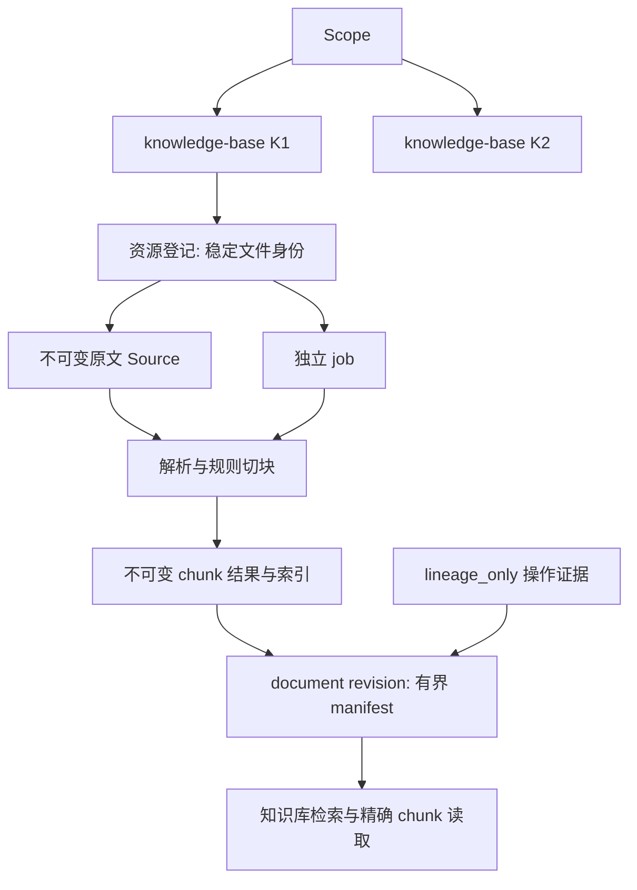
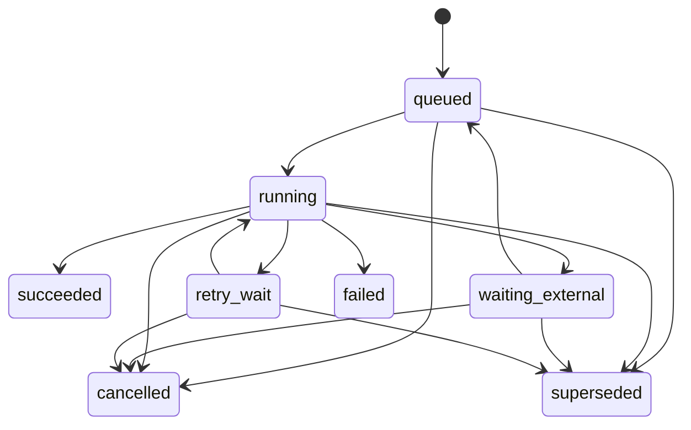

- Proposal Name: `knowledge_base_plugin`
- Start Date: 2026-11-10
- RFC PR: [#2570](https://github.com/oceanbase/powercontext/pull/2570)
- Tracking Issue: [#2440](https://github.com/oceanbase/powercontext/issues/2440)
- Related Issues: [#2441](https://github.com/oceanbase/powercontext/issues/2441), [#2442](https://github.com/oceanbase/powercontext/issues/2442), [#2443](https://github.com/oceanbase/powercontext/issues/2443), [#2444](https://github.com/oceanbase/powercontext/issues/2444)

# 概述

以一个 `knowledge-base` 业务插件提供本地文档接入、解析切块、版本管理和混合检索。一个 Scope 内可以预创建多个
`knowledge-base` Artifact；原文 Source 和整篇 `document` Artifact 各自独占归属一个知识库。复用现有 Source、Artifact、
head 和 lineage 表，不改变它们的结构；插件新增资源登记、独立任务和 chunk 三张业务表。后台处理不使用原有 Source
消费 cursor。本文是目标设计，依赖插件框架扩展，不表示功能已经发布。

# 动机

业务说明和 SOP 需要原文保真、片段检索、可预测更新与删除。解析可能较慢或依赖外部服务，需要持久任务和逐文件失败恢复。
业务插件应独立管理这些状态，不把知识库字段加入共享 Source 模型，也不通过一个顺序消费 cursor 阻塞其他文件。
Artifact 继续管理整篇文档版本；chunk 明细与索引分离，避免读取大型正文 JSON。

# 使用层说明

1. 通过通用 Artifact API 创建空 `knowledge-base`，再选择本地目录／文件导入。
2. 导入返回持久任务 ID；界面可以显示排队、处理阶段、失败原因、完成结果及当前可用版本，不要求百分比。
3. Markdown 和独立文字图片分别经过 Markdown 解析和 RapidOCR，统一切块、建立全文／向量索引后发布 document。
4. 原文件变化或显式重新解析沿用 document ID，成功后发布新 revision；失败继续使用旧版本。
5. 手动编辑或移除 chunk 也生成新 document revision，保留历史。检索可选择同一 Scope 内多个知识库。
6. 删除只改变逻辑可见性，保留业务正文、原文快照和历史；普通、精确、历史、证据和检索入口均遵守删除规则。

首期覆盖 SQLite、SeekDB、OceanBase，支持本地 OpenDAL fs、Markdown、RapidOCR + ONNX Runtime、规则切块和人工编辑。
Markdown 内图片保留引用，不自动抓取或 OCR。不要求几万篇规模测试。PDF／Office、场景图理解、远端上传／原文存储、
定时目录同步、语义／LLM 切块、恢复／永久擦除、逐知识库 embedding 空间和无停机索引切换不在首期范围。
任务状态接口属于首期；完整管理页面可以在相同契约上实现，不以调度效果图作为已实现能力。

# 参考层说明

## 1. 一个业务插件与命名

插件统一注册专用文档 Source 类型、`knowledge-base`／`document` family、后台任务入口、自有存储迁移和 API。
接入、解析、切块、检索是内部模块，不拆成独立安装的插件。方案依赖 [#2549](https://github.com/oceanbase/powercontext/pull/2549)
和 [#2579](https://github.com/oceanbase/powercontext/pull/2579) 后续提供所需的复合能力注册、受限写入和 API 扩展；不把提案当作已发布接口。

| 位置 | 标识 |
| --- | --- |
| 展示名 | Knowledge Base／知识库 |
| 插件与知识库 family | knowledge-base |
| 整篇文档 family | document |
| 归属／跨库选择字段 | knowledge_base_id／knowledge_base_ids |
| 模块与配置前缀 | knowledge_base |
| 插件表前缀 | pc_knowledge_base_ |



Scope 保持授权边界。知识库 Scope 的业务内容只包括文档 Source、document 和 knowledge-base；操作证据是内部记录。
所有归属都显式保存并核验，不从 tags 或 lineage 推断。文档原文只供 document 管线处理；原文不是 lineage_only。
框架的消费准入必须覆盖写入通知、启动恢复扫描、自动消费和手动生成，不能只靠 Source 类型名称或不发送唤醒来隔离。
同库部署依赖这些通用扩展点，不默认另建 PC Server；尚未实现准入之前不能宣称隔离有效。

插件独立持有 embedding／索引配置，可在安装时从兼容主路径初始化，此后不自动跟随。密钥保持在部署配置中。
首期同一 Scope 的 document 共用插件 profile，解析／切块可按知识库配置；模型和索引配置固定进任务及结果元数据。
当前 profile 引用保存在 knowledge-base Artifact 配置，同 Scope 的有效知识库必须一致，新建知识库继承该引用。
环境变量只提供初始默认值，不能覆盖已有数据的活动 profile。更换模型只能执行 switch_model_and_rebuild，覆盖整个共享 Scope，见 8.1。

## 2. OpenDAL、身份与去重

首期只接受插件运行环境可访问的本地目录。导入进程、Server 和 Worker 通过相同存储别名访问受管不可变快照目录，
可使用本机容器卷映射。OpenDAL fs 提供本地读取，不会让远端客户端路径自动可访问。拒绝根目录越界，固定符号链接策略。

Source 记录 `original_path` 作为出处，`snapshot_ref` 包含 store_id、object_key 和 digest。先保存快照并对实际字节计算
SHA256，再持久接受任务；解析只读快照，不读可能已变化的原文件。mtime／size 只用于提示，不能代替内容 hash。

```text
file_key       = (scope_id, knowledge_base_id, collection_id, normalized_relative_path)
document_id    = stable_hash(identity_version, file_key)
source_key     = stable_hash(source_schema_version, file_key, raw_content_digest)
processing_key = hash(parser/OCR/model/normalizer/chunker versions and settings)
index_key      = hash(complete embedding inputs, plugin profile and projection versions)
```

Collection 从存储实例和规范化根目录派生，与本次扫描／任务 ID 无关。核对完整身份以处理摘要碰撞，不截断路径。
Source payload 固定归属、document ID、文件身份、media type、摘要和快照；重放不重写采集时间等 canonical 信息。

| 情况 | 行为 |
| --- | --- |
| 同请求键、同参数 | 返回同一任务／确定结果；同键不同参数返回冲突 |
| 同文件字节／配置且有可用结果 | 复用 Source／document，检查索引是否可用，不重复解析 |
| 不同请求键命中相同活跃目标 | 返回 409 和已有任务引用，不创建重复执行 |
| 原文字节变化 | 新 Source，同 document ID，新目标代次和任务 |
| 显式重解析／切块配置变化 | 复用 Source 与 document ID，成功发布新 revision |
| 仅 embedding／索引变化 | 从已提交 chunks 重建，不重复 OCR |
| 同字节不同路径／知识库 | 不同逻辑 Source／document，可共享物理快照 |
| 存在人工编辑 | 普通重复导入保留编辑；重新解析必须明确 manual_edits_policy=discard |

Source 已存在不等于处理成功。文件回到旧字节可引用较早 Source，期望输入以资源登记中的最新目标为准，不以 journal 顺序为准。
改名首期视作新文件，目录消失不自动删除；已删除身份不因重导入静默恢复。显式 reprocess 不因结果相同而当作普通导入跳过。

## 3. 轻量解析与切块

解析器入口只需接受快照引用和固定配置，输出 Markdown、来源定位及可选警告。内部格式注册表选择 Markdown 或图片解析器；
后续格式增加解析器和测试样本即可，不要求通用文档 AST、解析器能力协商或独立解析插件系统。
解析器不写 Artifact、任务状态或索引；外部服务适配可以返回待完成引用，由任务执行层保存并继续。

Markdown 使用 markdown-it-py 提取结构和来源映射。图片使用 RapidOCR + ONNX Runtime，保留文本框、顺序、置信度及预处理坐标变换，
整理成 Markdown，但不猜测复杂标题、表格或流程图语义。规范化文本位置映射回原图，声明定位精度；派生 Markdown 不替换原文 Source。

- 默认按标题／内容块组织，再对超长块递归切分；缺少可靠标题时按段落／句子递归切分。
- 代码、表格和列表步骤尽量完整；超长表格按行拆分并保留表头，超长代码保留语言和续块标记，仍受硬上限限制。
- Overlap 用于拆开的长段落，不机械跨章节重叠；中文使用句号／分号等边界。
- 保存标题路径和原文定位；embedding 输入包含标题时，按完整输入检查模型 token 上限，不能把字符数等同于 token 或静默截断。
- 参数包含 max_chunk_chars、overlap_chars；1200／100 仅为待验证示例，不是质量结论。
- 校验 UTF-8、图片解码／像素上限、模型版本和资源限制；OCR 无文字显式失败，不伪装成功空文档。

规则保持确定、可测试。修改切块配置可复用可验证的解析结果；不要求首期建立复杂阶段缓存。

## 4. 持久化与关系

### 4.1 现有表原样复用

| 表 | 职责 |
| --- | --- |
| pc_sources | 不可变原文引用、成功人工／删除操作的 lineage_only 证据；不增加列 |
| pc_artifacts | knowledge-base 配置、document manifest、不可变 revision |
| pc_artifact_heads | 当前 revision、lifecycle_state、governance_generation |
| pc_scopes | 复用既有 Scope 行作为 core 短事务互斥点，不改字段或借用 version 作为任务计数 |
| pc_artifact_lineage_sources／pc_artifact_lineage_artifacts | 精确版本的输入／操作证据和 base 引用 |
| 既有权限、tags 和引用设施 | 复用公共语义，不承载无界任务或成员 JSON |

原有 processing intents、cursor、lease、binding state 表不用于本插件任务，不增加知识库字段或记录。
Source journal 可保留为原有持久化约束的一部分，但不驱动知识库任务发现或完成。

### 4.2 三张插件业务表

表属于插件专属存储，由插件迁移；复用 SQLite／SeekDB／OceanBase 连接和适配能力。全文／向量辅助结构不计入业务表数。

| 表 | 关键字段与约束 |
| --- | --- |
| pc_knowledge_base_resources | scope_id、knowledge_base_id、resource_kind、resource_key、document_id、source_ref、identity_payload、lifecycle_state、deleted_at、target_generation、current_job_id |
| pc_knowledge_base_jobs | job_id、scope_id、knowledge_base_id、document_id、operation、idempotency_key、request_digest、input_snapshot、target_generation、base_revision、state、stage、attempt、next_run_at、execution_token、lease_owner、lease_expires_at、error_code／summary、external_task_ref、result_id、result_revision、result_kind、parent_job_id、checkpoint、cleanup_cursor |
| pc_knowledge_base_chunks | scope_id、knowledge_base_id、document_id、result_id、chunk_id、ordinal、text、text_length、content_digest、heading_path、source_locator、origin、edit_metadata |

Resources 只支持两类固定记录，不是通用对象平台：

- `document`：每个稳定逻辑文件一行，首次解析前创建；保存路径身份、当前目标和删除标记，不要求提前创建空 document Artifact。
- `source`：每个原文 Source 一行，保存归属及独立删除标记；不把所有版本塞进一行 JSON。成功操作证据由其目标 Artifact 的可见性控制。

主键为 `(scope_id, knowledge_base_id, resource_kind, resource_key)`。Document key 来自 file_key，Source key 包含完整 SourceRef 身份摘要；
保存并比较完整身份，校验同一 Source 不跨库归属。SourceRef 必须包含 source_type 和 source_id。仅 document 行使用目标代次／当前任务字段。
资源删除是单向标记；已发布 revision 只读 Artifact head，不再复制一个发布指针。公共时间字段和有界错误／JSON 的存储类型由实现固定。

Jobs 对 `(scope_id, knowledge_base_id, operation, idempotency_key)` 建唯一约束，请求摘要覆盖全部业务参数和前置条件。
索引覆盖到期任务、过期租约、document 和知识库归属。目标行串行化同文档请求，不依赖跨后端不一致的条件唯一索引。
终态任务保留幂等回执；不另建回执／attempt 表，有限错误和 attempt 计数足够首期展示。

Chunks 主键为 `(scope_id, knowledge_base_id, document_id, result_id, chunk_id)`，同结果 ordinal 唯一。
`result_id` 在 core 分配实际 revision 前标识不可变结果，不能猜测下一个 revision 后写入。
完整结果保存独立分块快照，向量属于派生索引。`text_length` 为 Unicode 码点数量。

Document manifest 有界保存标题、knowledge_base_id、文件身份、root SourceRef、result_id、chunk 数量／摘要、处理／索引指纹、
人工修改标记、applied_job_id 及必要操作摘要，不嵌入正文或无界 chunk ID 列表。精确 revision 通过 manifest 找结果；历史不依赖当前索引。

## 5. 独立队列与状态机



`stage` 与状态独立：ingest、parse、chunk、index、publish、cleanup。等待外部服务的任务保存远端引用／next_run_at 后释放 Worker；
到期查询继续，不长期持有进程或事务。远端提交使用稳定幂等键；服务不支持幂等时需对账，不能承诺外部调用恰好一次。

KnowledgeBaseTaskSupervisor 只扫描插件 jobs，负责领取、心跳、过期回收和确认。可复用已有进程启动／终止、预算和关闭工具；
不接入原有 Scope／binding discovery、intent 或 Source cursor。若现有 Supervisor 与这些机制耦合，则实现轻量插件调度器，
不为复用而把逐文件任务塞回旧表。每个 document 串行发布，不同文档有界并发。

`target_generation` 表示用户期望哪个结果，`execution_token` 表示同一任务哪次执行拥有资格。领取、续租和状态更新均条件校验 token；
新目标使旧目标 superseded，租约恢复更换 token。SQLite 使用实际支持的事务／CAS，不假设所有后端均支持 SKIP LOCKED。

普通请求在授权及生命周期检查后先识别同键重放，再检查新请求的当前 base，避免成功重试被旧 ETag 拒绝。
删除入口允许授权调用者再次访问已删除目标的有限状态以补齐清理，不能先用通用 410 阻断该入口。
终态任务不复活；自动有限重试属于同一任务，普通处理的人工重试使用新幂等键／job。删除善后按第 7 节由再次删除自动创建新 job。
取消不回滚已发布结果；任何删除墓碑或 retirement 一经提交，相关删除／善后工作不可取消。状态机的 cancelled 边受此条件约束。
编辑／移除固定 base，有冲突的活跃变更时拒绝，不静默排队或换基准。逐文件失败不阻塞整个 Scope。

## 6. 接受、发布与跨存储恢复

Core 与插件专属存储不共享事务，不能声称 Source、任务、chunk、索引和 Artifact 一次原子提交。

| 边界 | 行为与恢复 |
| --- | --- |
| 快照 | 保存不可变原文字节；未接受的孤立快照不是可见内容，永久清理另定 |
| 插件接受事务 | 校验／锁定资源目标，幂等检查，保存固定输入与任务；202 后任务可恢复 |
| Source 登记 | Worker 在 ingest 阶段幂等保存／复用 Source；Source 写成功而任务未确认时可重试，不漏任务 |
| 事务外计算 | 固定快照与配置，解析／OCR／切块／embedding，不持有数据库锁 |
| 插件结果准备 | 保存不可变 result_id 对应的完整 chunks 和可用索引，核对数量及摘要，未被 manifest 引用的结果不可见 |
| Core 发布短事务 | 校验 base、归属和执行资格；提交 document revision、必要操作证据 Source、lineage 和 head |
| 插件完成事务 | 写实际 result_revision 和 succeeded；若确认丢失，按 applied_job_id／result_id 对账，不重复发布 |

提交闸门由 core 提供，复用 `pc_scopes` 中已存在的 Scope 行。OceanBase／SeekDB 使用同一 core 事务中的行锁，
SQLite 使用 core 数据库的 `BEGIN IMMEDIATE` 写事务；不新增锁表、不改 Scope 字段。发布、删除、接受新目标、取消、
领取／更换执行 token、租约回收及模型切换控制都必须先取得该闸门，再按固定顺序锁定插件资源／job，最后操作 Artifact head。
普通心跳只按 token 续租，不改变执行所有权；接入和同步 Artifact 修改入口也不得绕过闸门。

取得两侧锁后重新读取目标、token、租约、Source 墓碑、父知识库生命周期和 core 已发布结果。发布始终在持有 Scope 锁的同一 core
连接／事务中完成，不能转交另一个无锁连接。取消／换目标／重领先在闸门内对账，再提交插件状态，完成后才释放 core 锁。
发布路径则先提交 core，再补记插件成功；补记失败按确定结果恢复。这仍是分开提交，不是跨库原子事务。

插件数据库连接丢失时，core 锁仍阻止另一执行者取消或重领；core 连接丢失时，该事务不能再用于发布。
任一连接报错或提交结果不确定，都退出当前尝试，禁止自动重连后沿用旧资格。恢复必须新取 core 闸门，再对账、重验插件状态。
所有控制路径都遵循 core 在前、插件在后的锁顺序；不能在持有插件锁时反向等待 core 闸门。

该方案将同 Scope 的短提交串行化；解析、OCR、向量计算、索引构建和目录枚举在锁外并发进行。
闸门内不做模型调用、DDL 或长时间计算。三种后端验证真实锁／连接失效和超时行为，不用内存锁或仅一次 token 检查替代。
准备结果不可原地覆盖；重算不同内容使用新 result_id。普通发布失败保留旧 head 和可用旧索引。

## 7. 操作证据、编辑与软删除

成功创建／修改／删除 Artifact 需要对应的系统 `lineage_only` Source，关联实际输出 revision，不能用排队请求冒充成功证据。
复用既有创建／替换证据语义；删除／移除的具体动作及原因保存在有界操作摘要中，不擅自假设核心已有新的 operation 枚举。
任务是意图与执行记录，操作 Source 是成功事实，两者通过 job／operation ID 关联。

| 操作 | 版本和可见性 |
| --- | --- |
| 创建／配置 knowledge-base | 创建或新增配置 revision，关联操作证据 |
| 解析／重解析 document | 同 document ID 发布新 revision，lineage 关联原文；人工触发的变更保留操作证据 |
| 编辑 chunk／移除 chunk | document revision +1，完整新结果；关联成功操作证据，旧行不删 |
| 删除 document／knowledge-base | 新增含有界删除摘要的删除 revision，并在同一个 core 事务 retire head；关联删除证据 |
| 删除原文 Source | 标记 source 资源后立即阻断其原文及派生内容读取；document retirement、删除证据和索引清理由后台最终补齐 |

删除整个 Artifact 生成 revision 是本插件的业务约定，不改变其他 family 的治理规则。删除 revision 可复用之前的 result_id，
无需复制 chunk 正文。操作摘要必须使删除 revision 真正写入，不能被“相同 content 的 put 是 no-op”跳过。
证据、lineage、revision、head 在 core 同事务提交；失败不产生成功证据。同一已接受操作重放不增加 revision。

删除必须区分“已有 document Artifact”和“从未发布 Artifact 的逻辑文件”。在既有 core Scope 闸门及插件资源／job 锁内，
重新读取 head 并对账发布结果后选择分支：已有 head 按上述 revision／retirement 协议处理；确认从未发布时，删除逻辑文件只标记
其 document 资源并使待发布任务失效，不要求 Artifact ETag，不创建空 Artifact、删除 revision 或 Artifact 成功操作证据。
知识库级联也必须处理这些未发布资源。删除 Source 只标记指定 Source 并使依赖它的任务失效，不 retire 不存在的 document，
不删除无关 Source 版本；单独删除 document 仍保留原文 Source 可读。曾经发布但 head 缺失属于一致性错误，不能按未发布分支跳过。
资源墓碑和任务失效须在释放闸门前提交，避免判断无 head 后后台又完成首次发布。Job 记录完成，重复删除不虚构 Artifact 动作。
资源墓碑一经提交即属于删除生效，即使尚无 Artifact，也不能再取消该删除。

手动替换文字可保留逻辑 chunk ID，但引用必须带 revision；重切块可产生新 ID。人工正文标记非原文逐字引用，保留原始定位与编辑依据。
移除最后一块允许零 chunk 结果，当前检索无命中。重复导入不得覆盖人工修改，显式重新解析需要 discard 授权。

删除 knowledge-base 先提交父对象删除 revision／retirement，立即阻断全部子内容；接受的 cleanup job 可在进程重启后继续，
分批标记 Source、删除 document、取消处理任务。每个真正变化的 Artifact 生成自己的证据，使用共同 operation ID 关联级联。
Cleanup 是已删除父对象下的允许操作，不能被普通处理任务的父状态检查取消。清理游标只用于插件分批操作。
先持久接受删除／清理 job，再提交第一个删除标记。资源墓碑或 Artifact retirement 一旦提交，删除进入不可取消阶段；
后续错误只能恢复善后，不能报告“已取消”并遗留半完成删除。尚未产生删除效果的排队任务仍可取消。

删除 document 保留原文 Source 可读；原文读取不因 document 单独删除而失效。删除未发布替代 Source 保留基于其他原文的旧版本。
S1 对应旧 revision、S2 对应完整新解析时，删除 S1 不删除仅依赖 S2 的当前版本，但依赖 S1 的历史读取失效。
Source 删除入口返回已生效回执（包括 202 清理中）前必须提交墓碑；仅接受 job 不等于已经删除。
Source 墓碑提交是该原文及其派生内容的可见性截止点。此后开始的 document／chunk／历史／证据读取和检索都必须检查墓碑，
即使 document head 仍 active 或索引条目还在，也不能返回对应内容。删除开始前已返回给客户端的内容不作撤回保证。
只允许 document retirement、删除 revision／证据及索引维护最终一致，不允许在等待后台清理时继续暴露内容；检查服务不可用时关闭读取。
资源标记与 Artifact retirement 可分阶段完成，读取同时检查适用的父对象、document、精确 root 和 Source 标记。
通用 Source、Artifact 精确／历史和证据读取需要框架可见性扩展点；仅插件检索过滤不满足删除契约。归属登记缺失时拒绝读取，不回退为无约束内容。
受控内部恢复可以读取 retired 历史以对账；授权管理入口可查看删除后清理任务的有限状态，不开放正文或公共绕过参数。

再次删除复用同一个删除入口／operation，不新增 repair／retry API。鉴权后允许检查已删除目标的原删除记录和清理状态，
不因删除标记或原来的 ETag 已过时而直接拒绝善后；尚未删除的目标仍执行正常前置条件。重复请求参数冲突仍返回 409。

以下善后规则针对已经产生删除效果的操作。若首次删除在生效前失败或取消，再次删除按正常前置条件接受新删除任务；同幂等键仍重放原回执。

| 再次删除时的状态 | 返回和动作 |
| --- | --- |
| 首次删除或清理 job 仍活跃 | 返回同一删除操作标识与当前 job，202；不重复创建 |
| 清理未完成、上一次 job 已 failed／终止 | 后台创建新的 cleanup job，parent_job_id 关联原删除 job，202；旧任务不复活 |
| 所有清理已完成 | 200 already_deleted；不新增任务、revision 或证据 |

在 core Scope 闸门内串行检查和创建后继任务，避免并发重复删除产生多个善后任务。新的内部 job 使用新的派生幂等键，
原客户端删除请求的身份和输入不变；响应可更新 cleanup_job_id／状态，但稳定关联同一次删除操作。
清理按已提交墓碑、Artifact 删除摘要和原 operation ID 对账，跳过已完成对象；只为尚未实际修改的 Artifact 生成删除 revision／证据。
该规则覆盖 Source、document 和 knowledge-base。已删除父对象仅允许这些受授权善后行为，不恢复普通写入或内容读取。

## 8. 接口与检索

复用 Source 编码／身份／校验、Artifact CRUD／history／tags、认证、权限、ETag、分页、引用与错误封装。
文件导入使用插件 Source 接受能力，不能直接调用会触发旧消费者的写入路径。耗时编辑经插件任务接口返回 202；
不把同步 Artifact PUT 悄悄改成异步成功。通用写入不得绕过任务、版本、证据和删除规则。

路由为建议契约，插件 API 挂载遵循 #2579，实际注册语法随框架实现固定：
`P=/v1/plugins/knowledge-base/api/scopes/{s}`，`D=/v1/scopes/{s}/artifacts/document/{d}`。

| 操作 | 接口／返回 |
| --- | --- |
| 创建知识库 | POST `/v1/scopes/{s}/artifacts`，family=knowledge-base |
| 知识库／document 概览与历史 | 通用 Artifact GET／revisions，返回有界 manifest |
| 导入本地文件／目录 | POST `P/imports`，显式 knowledge_base_id、root／paths 和 idempotency_key；202 任务回执 |
| 重解析／编辑／删除 | POST `P/jobs`，类型化 operation、固定目标和前置条件；再次 delete_source／delete_document／delete_knowledge_base 自动补齐清理，cleanup 仅供内部使用 |
| 更换模型并重建索引 | POST `P/jobs`，operation=switch_model_and_rebuild，显式确认同 Scope 的影响范围；复用任务状态接口 |
| 任务列表／详情 | GET `P/jobs`、GET `P/jobs/{job_id}`，分页、阶段、状态、有界错误、成功 revision |
| 取消 | POST `P/jobs/{job_id}/cancel`，仅未发布且未提交删除效果的非终态工作；模型切换发布开始后也不可取消 |
| chunk 目录 | GET `P/documents/{d}/revisions/{rev}/chunks`，分页元数据，不含正文 |
| 单个 chunk | 上述路径追加 `/{chunk_id}`，正文、出处、人工修改信息 |
| 批量 chunk | 上述路径追加 `/batch-get`，POST 有界 chunk_ids |
| 混合检索 | POST `P/retrieve`，knowledge_base_ids、query、mode、limit，返回 chunk 命中 |

插件 chunk 路由使用与 Artifact 相同的 document ID／revision。路径从通用 Artifact 路由中分离，读取语义仍是精确 revision，
通过该 revision 的 manifest 解析 result_id，不回退当前 head。Directory cursor 绑定 Scope／document／revision，按 ordinal 排序。
Batch-get 要求非空、无重复 ID，按请求顺序返回；先授权父对象，任一 ID 不存在则整批 404。限制 ID 数量及响应字节数，超限拒绝，
不截断正文。已删除对象授权后返回 410，零块版本目录为空。

创建知识库：

```json
{"family":"knowledge-base","content":{"title":"Operations SOPs","parser":"markdown-v1","ocr":"rapidocr-local-v1","chunker":{"max_chunk_chars":1200,"overlap_chars":100}}}
```

导入，目录任务产生有界批次的逐文件子任务，parent_job_id 关联；目录完成只表示枚举／子任务接受结束，不等于全部文件处理成功：

```json
{"knowledge_base_id":"ops","root":"/work/docs","idempotency_key":"import-01"}
```

移除 chunk，已有 document 使用当前 If-Match；首次生成使用明确的无 head 前置条件，不猜未来 revision：

```json
{"knowledge_base_id":"ops","document_id":"doc-1","operation":"remove_chunk","idempotency_key":"edit-03","base_revision":2,"input":{"chunk_id":"chunk-3"}}
```

```json
{"job_id":"job-03","state":"queued","document_id":"doc-1","target_generation":5}
```

```json
{"job_id":"job-03","state":"succeeded","result":{"document_id":"doc-1","revision":3,"kind":"created"}}
```

精确版本目录和批量读取：

```json
{"document_ref":{"family":"document","artifact_id":"doc-1","revision":3},"items":[{"chunk_id":"chunk-1","ordinal":0,"heading_path":["Operations","Restart"],"text_length":128}],"next_cursor":null}
```

```json
{"chunk_ids":["chunk-1","chunk-2"]}
```

```json
{"knowledge_base_ids":["ops"],"query":"How should I restart a follower?","mode":"hybrid","limit":10}
```

```json
{"hits":[{"knowledge_base_id":"ops","document_ref":{"family":"document","artifact_id":"doc-1","revision":3},"chunk_id":"chunk-1","score":0.82,"source_ref":{"source_type":"document_file","source_id":"source-1"},"locator":{"heading_path":["Operations","Restart"]}}]}
```

检索 limit 计 chunk 数；可选 snippet 有界，正文从 chunk 接口获取。通用 Artifact search 继续返回 Artifact，不混入 chunk 响应。
索引命中必须对应当前 manifest 的 result_id 和索引 profile，并满足归属、权限及删除规则；过滤后继续补取候选，避免无效结果占满 top-k。
适配覆盖首次写入、版本替换、重建、coverage／摘要核对、零块、删除过滤和命中定位。保留历史正文不要求保留所有历史索引。
同 profile 重建保留旧可用索引，不能发布缺少所需索引的新内容；模型切换走 8.1 的受控维护流程。

同 Scope 可选择多个知识库；跨 Scope helper 逐个授权显式目标，调用同一分 Scope 接口，融合排名并保留目标身份／错误，
不直接比较不兼容向量空间的原始分数。不支持的 filter／rerank 明确拒绝。Python／MCP 复用同一业务服务。
权限复用 Scope 读／贡献和 Artifact 写／治理能力，跨对象请求逐个检查。接受失败沿用 428／412 前置条件、409 冲突、410 已删除、
422 校验、413 大小限制和 503 不可用；202 后的失败记录在任务状态中，不再靠日志推测。

### 8.1 更换模型并重建索引

已有数据的活动模型、维度和 embedding 参数不能通过配置 PUT、环境变量刷新或重启直接覆盖。
只能执行 `switch_model_and_rebuild`；target_profile 固定模型身份／版本、维度、完整 embedding 输入规则和索引配置，密钥仍只保存配置引用。
由于首期同 Scope 共用 profile，操作需 Scope 管理权限，并确认影响整个 Scope 的知识库；不能声称只修改发起请求的一个知识库。

```json
{"knowledge_base_id":"ops","operation":"switch_model_and_rebuild","idempotency_key":"model-switch-01","input":{"expected_profile_id":"embedding-v1","target_profile_id":"embedding-v2","confirm_scope_wide":true}}
```

复用 jobs 的 input_snapshot、checkpoint、parent_job_id 和逐文档子任务保存旧／目标 profile、阶段和重建进度，不新增控制表。
Scope 闸门保证同 Scope 只有一个未完成的切换操作。其持久 checkpoint 阶段为 preparing、rebuilding、publishing、completed、aborted；
失败／进程退出不会自动清除维护状态，不能只用 job 是否 running 判断是否暂停。
按原切换操作及后继任务链的最新有效 checkpoint 判定维护；后继 completed／aborted 可以关闭该操作，旧 failed 记录保留但不单独继续阻断。

| 阶段 | 行为 |
| --- | --- |
| 接受／preparing | 持久保存切换任务及旧／目标配置；暂停该 Scope 的检索和普通写入／发布，保留管理状态及精确内容读取；先完成已生效删除的善后 |
| rebuilding | 固定当前有效 document 版本，从已提交 chunks 构建目标 profile 的隔离索引，不重复 OCR；验证数量／摘要、维度和完整输入 token 上限 |
| publishing | 逐文档发布仅更新索引 profile 引用的新 revision，正文 result_id 可复用；写成功操作证据；同步更新所有有效 knowledge-base 的配置 revision |
| completed | 核验全部有效文档、知识库配置与目标索引一致，再在闸门内确认完成并解除维护；查询与后续任务一起使用目标 profile |

检索／普通写入在维护期明确返回 503 和切换任务引用，不能返回混合模型结果或静默空结果。新建知识库也参与维护检查。
已生效删除的再次删除／善后不被维护阻断，避免清理失败后无法继续准备切换；新删除请求属于暂停的普通写入。
切换前的旧 profile 待发布任务不得继续提交：冻结其执行资格并对账，未发布的旧目标标记 superseded，输入不原地改写；需要时由调用者提交新请求。
查询固定本次 profile，返回前复核维护状态及活动 profile；若期间改变，返回 503，不返回在途旧模型结果。
精确 chunk／历史读取仍使用固定 result_id，并照常执行删除检查。旧索引至少保留到切换成功。

在 preparing／rebuilding 阶段，取消或失败后须在闸门内确认没有 profile revision 发布，再持久记录 aborted 并恢复旧 profile 服务；
不能仅因任务 failed 就解除维护。原来已 superseded 的任务不自动复活。
一旦开始发布，禁止取消／自动退回旧配置：部分对象可能已切换，必须保持维护并向前补齐。
调用同一个 switch_model_and_rebuild 操作、相同目标 profile 和新的请求键可创建后继任务，关联原切换操作并跳过已完成 revision，
不复活失败任务、不重复成功证据。相同请求键只返回已有任务；未完成切换期间拒绝不同目标模型。
若新模型输入预算不足，重建失败并明确要求先调整切块，不静默截断。全程不要求跨数据库原子提交或无停机切换。

## 9. 实施与验收

仅新增插件存储迁移，已有核心表无需新增字段／迁移。插件框架需提供能力注册、消费准入、受限发布和可见性检查；
“不改表结构”不代表“不需要通用框架适配”。公开路由按主契约／插件 OpenAPI 的归属生成绑定。

SQLite、SeekDB、OceanBase 都验证：

- 同 Scope 多知识库、跨库授权、独占归属、原文排他消费，包括恢复扫描和手动入口。
- 固定 oceanbase/oceanbase commit 的编译运行、调试和 Wait Event 文档；真实文字图片与 OCR 来源映射。
- 同请求重放、不同参数冲突、同目标活跃冲突、内容去重、配置重解析和人工编辑保护。
- 任务接受后退出、Source 已登记但未确认、租约重领、迟到 token、目标替换、有限重试和取消。
- 结果准备后 core 回滚、core 成功但任务确认失败；旧版本可用、结果不提前可见、不重复发布。
- 插件连接单独断开、core 连接单独断开、提交响应未知与取消／重领竞争，验证 core Scope 闸门和禁止旧事务重连发布。
- 创建／修改／删除证据与实际 revision 一致；删除 chunk 版本递增、零块可读、历史保留。
- Source／document／knowledge-base 删除与发布竞争；墓碑已提交但 head／索引未清理时仍拒绝派生内容读取。
- 首次导入排队／失败且尚无 Artifact 时删除，知识库级联覆盖未发布资源；与首次发布竞争时不漏删，不虚构删除 revision／证据，资源墓碑提交后不可取消。
- 删除生效后取消被拒绝，反复删除补齐失败清理，并发重删只产生一个活跃善后 job，已完成对象不重复 revision／证据。
- 模型配置直接修改被拒绝，Scope 级切换／重建、部分发布后恢复、失败维护和旧 profile 任务失效。
- Chunk 目录／单块／批量边界、索引全生命周期、重建及有效候选补取。
- OpenDAL 本地快照对 Server／Worker 可访问，原文件随后变化不改变已接受输入。

真实后端和真实 OCR 验收不能由 mock 替代。先用小样本对比两种规则的答案片段召回、SOP 完整性及出处，不宣称已有质量或规模结论。
#2441 承担接入／资源归属，#2442 承担队列／处理／发布，#2443 承担检索／接口，#2444 承担运行与验收；不新增 Issue。

# 缺点

三张业务表及索引需要插件自己迁移、备份和恢复。独立存储需要发布对账和短提交闸门；完整 chunk 快照、成功操作证据、软删除及终态任务
都会增加存储。资源表两类记录需要明确约束。首期不提供跨库分布式事务或大规模性能保证，索引重建可能影响同 Scope 的多个知识库。

# 设计理由与替代方案

- 一个业务插件集中管理归属、任务和配置，内部解析模块仍可独立扩展。
- 三张插件表在不改核心模型的前提下提供逐 Source 删除和逐文件任务；资源登记合并固定两类记录，避免额外文档状态／回执表。
- Source 保存不可变内容与成功证据，jobs 保存可变执行状态；不把待执行命令伪装成成功操作 Source。
- Artifact 管理整篇版本，chunk 明细支持精确读取；直接编辑旧行无法保留历史。
- 独立队列适合慢解析及外部等待，不依赖原有消费 cursor；只复用 Supervisor 可分离的运行工具。
- 不可变结果先准备、core 再发布、任务最后确认，尊重插件存储隔离；跨库原子事务不是默认能力。
- 删除 revision 提供稳定操作证据，head retirement 和读取 guard 控制可见性；仅清除搜索索引不足以删除内容。

# 既有设计

基于 [插件接口 #2549](https://github.com/oceanbase/powercontext/pull/2549)、[插件 API #2579](https://github.com/oceanbase/powercontext/pull/2579)、
[Source 身份](1400_source_definition_and_observation_model.md)、[处理监督](1515_artifact_processing_supervisor.md)
和 [Source／Artifact API](1437_source_artifact_rest_api.md)。复用原文身份、Artifact revision、成功操作证据和治理机制，
独立实现知识库任务与 chunk 投影。现有 Atomic Memory retirement 不自动提供 Source 级联删除或插件生命周期检查。

# 待解决问题

实现前固定复合插件注册／受限 writer 的 core Scope 闸门接口、通用读取 guard 接入和 Source 排他消费准入。
锁顺序遵循 core Scope、插件资源／job、Artifact head，后端适配需验证连接失效和已有通用写入路径兼容性。
实现时固定 OCR 模型、切块参数、任务租约／并发／重试限额、API 数量／字节上限及 schema 具体类型。这些不改变本文的数据归属和提交语义。
恢复／擦除、任务归档幂等保留期、改名身份、逐知识库向量空间与完整编辑文档导出另定契约。

# 后续可能性

增加 Word／PDF／场景图解析器时复用任务、切块、发布和检索流程；外部解析通过保存远端引用并轮询继续，无需首期建设完整解析框架。
可进一步增加 OpenDAL provider、rerank、邻接／父章节上下文和受限多步检索。扩展效果与成本需要实测，不作为首期前置条件。
