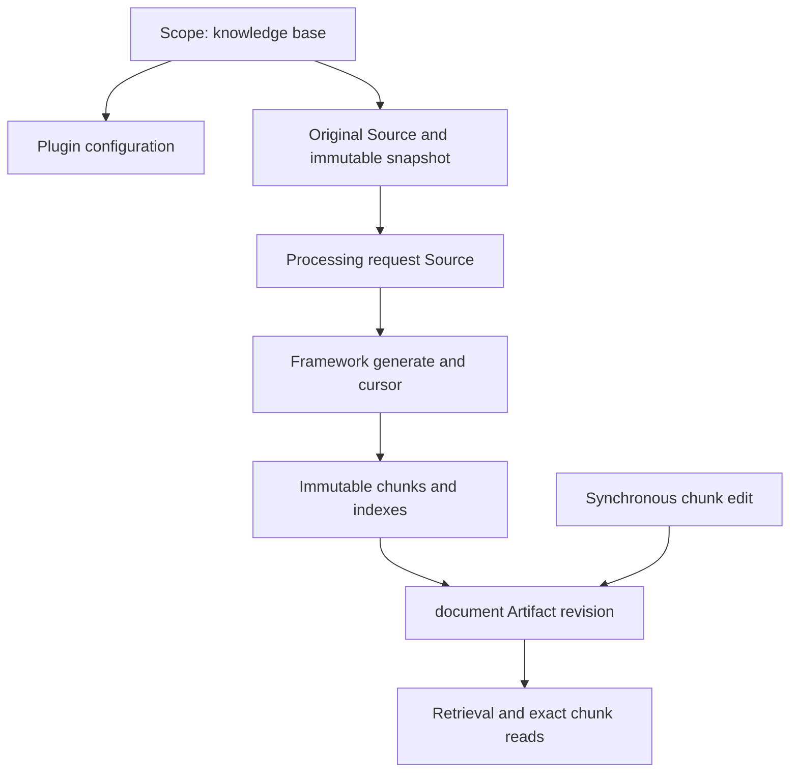

- Proposal Name: `knowledge_base_plugin`
- Start Date: 2026-11-10
- RFC PR: [#2570](https://github.com/oceanbase/powercontext/pull/2570)
- Tracking Issue: [#2440](https://github.com/oceanbase/powercontext/issues/2440)
- Related Issues: [#2441](https://github.com/oceanbase/powercontext/issues/2441), [#2442](https://github.com/oceanbase/powercontext/issues/2442), [#2443](https://github.com/oceanbase/powercontext/issues/2443), [#2444](https://github.com/oceanbase/powercontext/issues/2444)

# 概述

一个 `knowledge-base` 业务插件提供本地文档接入、解析、切块、版本管理及混合检索。一个普通 Scope 对应一个知识库，
插件只声明 `document` family，每个 Artifact 表示整篇文档。知识库本身不是 Artifact；业务配置按 scope_id 保存于插件存储。
插件附带原文和处理请求 Source 定义，后台复用框架 generate、Supervisor 和消费 cursor，不实现独立任务调度队列。

首期支持 SQLite、SeekDB、OceanBase，Markdown、独立图片 RapidOCR、规则切块、同步 chunk 编辑／移除和文档 forget。
这是依赖框架契约的目标设计，不表示当前实现 PR 已提供全部能力。

# 动机

业务描述和 SOP 需要可检索片段、原文溯源以及不会覆盖历史的人工修改。Scope 提供知识库的授权和组织边界；Artifact 管理
整篇文档版本；插件存储保存大块正文和索引。复用现有调度、版本前置条件与生命周期，可以减少知识库专有的运行机制。

# 使用层说明

1. 管理员创建知识库 Scope，并保存解析／切块配置，然后导入 Server 可访问的本地目录或文件。
2. 插件保存不可变原文快照、登记 Source，并提交处理请求 Source；导入接受不等于解析完成。
3. 框架异步调用 generate，处理 Markdown／图片，准备完整 chunks 和索引，再发布 document。
4. 内容变化或显式重解析沿用 document ID；失败保留已有版本。状态区分待处理、最近失败、已发布及冲突／跳过。
5. 用户同步编辑或移除 chunk，document revision 增加，core 在同一事务记录 lineage_only 成功操作 Source。
6. 文档软删除使用通用 forget：变为 deprecated、退出正常检索，不增加 revision。正文、原文和历史保留。

首期不承诺运行中撤销，不提供 Source 删除、知识库级联删除、物理擦除、独立任务队列、在线换模型、跨知识库聚合检索、
持续目录同步或远端 runner。PDF／Office、复杂场景图、Markdown 内嵌图片 OCR、语义／LLM 切块和几万篇规模评测不在首期。
恢复／合并方法首期不实现，对应通用入口按框架返回不支持；不能把导入当作恢复操作。

# 参考层说明

## 1. 插件、Scope 与框架依赖

遵循 [#2549](https://github.com/oceanbase/powercontext/pull/2549) 的单 family、Source 定义、writer、模型和存储契约，
以及 [#2579](https://github.com/oceanbase/powercontext/pull/2579) 的插件路由、Scope 管理和 upgrade 契约。
[#2616](https://github.com/oceanbase/powercontext/pull/2616) 是实现依赖；其三后端专属存储等能力需要实际落地验证。
[#2617](https://github.com/oceanbase/powercontext/pull/2617) 仅是后续持续采集的接入方向，不是本地显式导入的前置条件。

| 对象 | 模型 |
| --- | --- |
| 知识库 | 普通 Scope，scope_id 是知识库身份 |
| 插件 | knowledge-base，单个安装目录，单个 document family |
| 原文 | knowledge-base-file Source，固定快照及原路径 |
| 处理请求 | knowledge-base-process Source，固定原文引用、配置、base 和请求身份 |
| 文档 | document Artifact，整篇文档的有界 manifest |
| chunk | 插件存储中的不可变结果，不是独立 Artifact |



通过 ctx.scopes.create 创建 Scope，沿用 server.admin 要求；同幂等键返回同一 Scope。框架的插件外部引用标识创建归属。
标题／摘要使用 Scope 字段，业务配置使用插件表。Scope 创建成功但配置失败时，重试补齐配置；配置未就绪时拒绝导入。
授权沿用 Scope read／contribute、Artifact write 及框架版本校验，插件接口不得将 Scope 贡献权限等同于任意文档修改权限。

插件 inputs 只订阅处理请求 Source，原文不会重复触发本插件生成。知识库 Scope 按部署约定专用，不启用其他内容消费者；
不宣称 Source 类型名称提供框架级排他隔离，其他消费者的准入能力不属于本插件的保证。

## 2. 本地存储、身份与请求接受

OpenDAL fs 管理 Server、导入进程和 Worker 均可访问的本地快照目录。原路径只作出处，解析只读快照。
拒绝根目录越界并固定符号链接策略；先写快照，对实际字节计算 SHA256，再登记 Source。mtime／size 不能代替 hash。

```text
file_key    = (scope_id, collection_id, normalized_relative_path)
document_id = stable_hash(identity_version, file_key)
source_key  = stable_hash(source_schema_version, file_key, raw_content_digest)
request_key = (scope_id, idempotency_key)
result_id   = digest(canonical complete chunk result and provenance)
```

Collection 从存储别名和规范化根目录派生，不取自扫描批次；保存完整身份以检查 hash 碰撞。同文件跨 Scope 是独立逻辑文档。
同路径同字节复用原文 Source；变化产生新原文 Source，但 document ID 不变。改名视作新文件，文件消失不自动 forget。

每次处理请求固定 original_source_ref、snapshot_ref、处理配置、独立模型指纹、base_revision、manual_edits_policy 及请求摘要。
已有文档固定接受时的 revision；首次生成使用明确的无 head 前置条件。普通重复导入有可用同内容／配置结果时直接复用；
显式重解析或失败重试使用新的请求键，即使原文相同也产生新的处理请求 Source。人工修改不被普通导入覆盖；丢弃修改必须显式 discard。

插件资源行先保存有界、不可变的接受参数，再幂等登记原文和处理请求 Source，最后记录实际 SourceRef。
框架可能在插件确认字段写入前调用 generate，因此执行依据是已提交请求 Source 和固定接受参数，不等待额外的 ready 标记。
只在处理请求 Source 确认持久化后返回 accepted。任一步响应丢失，用相同请求键及参数补齐登记；相同键不同参数返回冲突。
插件登记不是任务队列，未成功登记 Source 的请求不承诺后台执行；调用者可重试原请求。未引用快照不形成可检索内容。

目录导入按有限文件批次调用同一逐文件接受流程，返回逐项回执；枚举完成不是全部解析完成。首期不保存独立目录扫描任务，
大目录通过客户端分批提交，失败后重复枚举仍按文件身份及请求键去重。

## 3. 解析、切块与原文溯源

Markdown 使用 markdown-it-py 提取标题、段落及来源位置。独立图片使用 RapidOCR + ONNX Runtime，保留文本框、顺序、
置信度及坐标变换，整理成 Markdown 后走相同切块流程；不猜测复杂表格或流程图语义。内嵌图片只保留引用。

默认按标题和内容块切分，超长块递归按段落／句子切分。代码、表格和 SOP 步骤尽量完整，超长表格保留表头；overlap 仅用于
被拆开的长段落。max_chunk_chars／overlap_chars 可配置，1200／100 只是初始验证值。完整 embedding 输入包含标题等附加文本，
必须按模型 token 上限检查，不能静默截断。UTF-8、图片尺寸、解码及 OCR 无文字等错误明确报告。

解析器只返回 Markdown、locators 和警告，不管理 cursor 或 Artifact。后续格式通过内部解析器注册表扩展，不新增插件类型。

处理请求记录原文 SourceRef 和快照引用。generate 的直接 source_refs 只引用当前窗口的处理请求；已消费原文未必出现在窗口中，
不能绕过 writer 的引用限制。Document manifest 保留原文引用，形成“document → 请求 Source → 原文 Source”的可检查溯源链，
不宣称原文总是每次 revision 的直接 lineage。同步编辑保留当前 lineage 及原文定位，并新增 core 的成功操作 Source。

## 4. 插件存储与模型

ctx.storage 使用与 Server 相同的后端：SQLite 为独立文件，SeekDB／OceanBase 为插件专属库。建库权限不足时由部署者预建。
插件通过 backend 选择迁移及全文／向量实现，不修改现有核心表。原文件仍在 OpenDAL 本地目录，不塞进 SQL 正文列。

| 插件业务表 | 字段及约束 |
| --- | --- |
| pc_knowledge_base_resources | 主键 (scope_id, resource_kind, resource_key)；固定三类 scope／document／request；有界 payload、request_digest、source_ref、document_id、最近处理观察及时间 |
| pc_knowledge_base_chunks | 主键 (scope_id, document_id, result_id, chunk_id)；ordinal 同结果唯一；text、text_length、content_digest、heading_path、source_locator、origin、edit_metadata |

Resources 是固定用途登记，不是通用任务框架：scope 行保存配置／版本；document 行保存稳定文件身份；request 行保存不可变接受参数、
幂等回执及最近尝试结果。它没有租约、执行 token、领取队列或清理 cursor，也不复制 Artifact 的发布指针与生命周期。
请求结果可以引用精确 revision 供对账，成功事实仍以 core 为准。全文／向量辅助结构属于派生索引，不计入业务表数。

Document content 只保存标题、原文 SourceRef、文件身份、result_id、chunk 数量／摘要、配置指纹、人工修改标记和 applied_request_ref。
正文及无界 chunk ID 列表不进入 manifest。结果 ID 来自规范化完整结果，不能用尚未提交的 revision 号作为存储键。

模型由插件独立配置和创建客户端，密钥来自部署配置，不存入 Source／Artifact。不自动跟随 ctx.models 或 Server 模型变化。
同一插件首期使用一个固定 embedding profile，包含模型身份／版本、维度、完整输入规则与规范化版本；维度相同不等于模型相同。
已有索引与部署 profile 不一致时拒绝向量查询及新发布，明确要求受控迁移，不自动覆盖配置或混用向量。
首期不提供在线换模型操作；同 profile 的索引修复从已提交 chunks 重建。解析／切块配置可按 Scope 保存并固定到请求。

## 5. 框架消费、状态与失败处理

声明 on_sources 和处理请求 inputs，复用框架 generate／Supervisor、Scope binding、消费 cursor、租约 fence 和失败退避。
没有独立 jobs 表，也没有插件自建 Worker 调度器。每次调用最多一个 writer.transaction，Artifact、cursor 和调用确认在 core 同事务提交。
配置小的 max_sources 和有界文件大小，避免一次窗口包含过多 OCR／模型工作；不承诺任意大小文件都能在框架时限内完成。

| 事件 | 行为 |
| --- | --- |
| 请求已提交、尚无结果 | 展示待处理，不虚构百分比 |
| 文件格式错误、无文字等确定输入错误 | 保存有界失败观察，跳过该输入；窗口正常确认后继续后续请求 |
| 数据库、模型服务、索引持久化故障 | 抛出异常，core 回滚，cursor 不前进，由框架退避重试 |
| 固定 base 已变化或文档已非 active | 记录冲突／跳过，不以新 base 自动覆盖；用户重新提交请求 |
| core 发布完成 | 从 manifest／历史中的 applied_request_ref 判定已发布及精确 revision |
| 发布成功但插件状态未更新 | 根据 core 对账，不能仅凭缺少状态把它判为失败或重复发布 |

资源表的失败是最近尝试观察，不等于 cursor 已确认；不能仅凭插件状态推进消费或跳过尚未证明完成的 core 写入。
基础设施持续故障可能阻塞该 Scope 的后续窗口，这是复用框架的边界，不承诺独立逐文件无限制并发或死信队列。
确定输入失败的人工重试使用新请求；旧 Source 不修改。处理请求是意图，不是 lineage_only 成功证据。

首次发布前确认无 head；更新核对固定 base、原文、人工修改策略和生命周期。框架重试也不能改写请求中的 base 或丢弃策略。
事务外准备后发生编辑／forget 时，发布使用框架的 revision／治理并发校验；不能自动恢复 deprecated 文档。
若实现不能在竞争中保护生命周期，必须修复框架适配并通过测试，不能用插件内存锁代替或承诺已支持。

## 6. 发布与索引一致性

1. 在 core 事务外完成解析、向量计算；持久保存不可变 chunks 及其全文／向量索引，校验数量、摘要和可读取性。
2. 在 writer.transaction 中校验前置条件并 put manifest，引用 result_id 与索引指纹；generate 同时提交 cursor，用户编辑同时提交证据。
3. core 提交失败时准备结果不可见，旧 manifest 和旧索引保持可用；重试不原地覆盖旧结果。
4. 检索候选必须匹配当前 active document 的 result_id 和 profile；过滤后补取，未发布结果不能占满 top-k。

索引按结果隔离，不以单一 document_id 覆盖旧有效候选。模型和文件计算不进入短事务，不新增 core Scope 行锁协议或跨库事务。
历史 chunk 通过精确 revision 的 manifest 定位，不依赖当前搜索索引。仅保留未引用的准备数据不会改变可见结果，永久清理另定。

## 7. 同步 chunk 编辑与软删除

编辑和移除 chunk 通过通用 Artifact PUT 交给 update_artifact，同步完成；不是插件 API 写入，也不排队。
插件的编辑载荷定义为有界 chunk 变更描述，包含 chunk ID／新文本或移除动作；服务端读取对应基准版本，合成完整结果，
只由服务端产生 manifest，拒绝客户端指定任意 result_id 或原文归属。Core 允许插件规范化提交内容；不开放任意 manifest 替换。

带 If-Match，先生成新结果及索引，再恰好一次 put(expected_revision=...)。Core 同事务保存提交的编辑载荷作为 lineage_only
Content Source，document revision 增加。修改保留逻辑 chunk ID 和原定位，标明人工文字并非原文逐字引用；移除最后一块允许零块版本。
新正文可能出现在编辑证据中，沿用现有权限，不宣称 forget 会抹除这些证据。

模型调用受同步时限及编辑大小限制，失败不发布半成品。提交响应未知时重新读取当前 revision／lineage；原 If-Match 不再满足时
不能盲目重试。通用 PUT 不另承诺幂等键或恰好一次 HTTP 执行。

整篇文档使用通用 forget，调用 forget_artifact，恰好一次 set_lifecycle(deprecated)。这只是生命周期变更：不追加内容 revision，
不生成本插件专有的删除证据，也不物理清理正文／索引／快照。正常检索及 Prepared Context 排除 deprecated 文档。
通用 get、历史和证据沿用框架可见性；授权的精确 chunk 读取与 rendering 可展示保留版本，不返回“所有内容均已删除”的承诺。
生命周期以 core 为准，不在插件表另建 document 墓碑；物理索引清理不是 forget 生效条件。

已忘记文档不因重复导入、重解析或迟到处理自动恢复；同步编辑仅允许 active 文档。尚无 document Artifact 时没有 forget 目标，
首期不支持运行中撤销导入，不创建空 Artifact 或删除 revision。原文 Source 不提供删除接口；不提供知识库级联删除，
不能将物理删除 Scope 当作软删除。重复 forget 使用框架现有前置条件及 no-op 语义，不启动清理任务。

## 8. 接口、检索和权限

令 `P=/v1/plugins/knowledge-base/api`，`D=/v1/scopes/{s}/artifacts/document/{d}`。插件路由通过 PluginApi／Route 声明，
使用框架支持的响应能力；以下 accepted 是业务状态，不假定插件接口已经支持自定义 HTTP 202。默认成功 JSON 可返回 200。

| 操作 | 接口和返回 |
| --- | --- |
| 创建知识库 | POST `P/knowledge-bases`，调用 ctx.scopes.create 并保存配置；返回 scope_id |
| 导入文件 | POST `P/scopes/{s}/imports`，有界 paths、idempotency_key；返回逐文件请求 SourceRef |
| 重解析／重试 | POST `P/scopes/{s}/documents/{d}/reprocess`，base、固定配置、原文引用、新请求键 |
| 处理状态 | GET `P/scopes/{s}/imports/{request_id}`，接受记录、最近尝试及可核实的发布结果 |
| 文档概览／历史 | 通用 Artifact GET／revisions，返回有界 manifest |
| 编辑／移除 chunk | PUT `D`，If-Match，同步返回新 document revision |
| 文档软删除 | POST `D/forget`，revision 和 state_version；遵循框架响应 |
| chunk 目录／正文 | GET `P/scopes/{s}/documents/{d}/revisions/{rev}/chunks`，追加 `/{chunk_id}` 获取正文 |
| 批量 chunk | POST 上述目录路径追加 `/batch-get`，有界 chunk_ids |
| chunk 混合检索 | POST `P/scopes/{s}/retrieve`，返回精确 revision、chunk ID、分数及出处 |
| 展示与通用检索 | render_artifact／search_artifacts；接入通用 search 和 Prepared Context |

创建知识库、导入、编辑、forget、检索示例：

```json
{"title":"Operations SOPs","summary":"Runbooks","idempotency_key":"kb-01","chunker":{"max_chunk_chars":1200,"overlap_chars":100}}
```

```json
{"root":"/work/docs","paths":["restart.md"],"idempotency_key":"import-01"}
```

```json
{"scope_id":"scope-ops","items":[{"document_id":"doc-1","request_ref":{"source_type":"knowledge-base-process","source_id":"request-01"},"status":"accepted"}]}
```

```json
{"content":{"operation":"edit_chunk","chunk_id":"chunk-1","text":"Check replica health before restarting."}}
```

```json
{"content":{"operation":"remove_chunk","chunk_id":"chunk-2"}}
```

```json
{"revision":3,"state_version":0}
```

```json
{"query":"How should I restart a follower?","mode":"hybrid","limit":10}
```

```json
{"hits":[{"document_ref":{"family":"document","artifact_id":"doc-1","revision":3},"chunk_id":"chunk-1","score":0.82,"source_ref":{"source_type":"knowledge-base-file","source_id":"original-1"},"locator":{"heading_path":["Operations","Restart"]}}]}
```

Chunk API 精确读取指定 revision，不回退当前版本；目录分页不返回正文，单块／批量返回有界正文及出处。Batch-get 拒绝重复 ID、
缺失 ID 和超限响应，不静默截断；每次先检查 Scope、document 权限和归属。专属存储跨 Scope 共享，不能只凭 chunk ID 读取。

通用 search 保持框架的 Artifact 引用格式；插件专用 retrieve 提供 chunk 结构。Prepared Context 使用 SearchHit 的片段与 locator，
并遵守字节预算。正常检索先过滤非 active、旧结果及未授权对象，再补取候选；不支持的 filter／rerank 返回明确错误。
不同 Scope 的查询分别授权，首期不提供聚合接口。Python／HTTP 使用同一业务处理；MCP 与 Dashboard 依框架实际可用能力接入。

## 9. 升级、实施与验收

upgrade(ctx) 负责插件表及索引元数据迁移，维护自己的 schema 版本。迁移可重复执行，多实例通过插件库协调；先兼容新旧代码，
历史 Artifact manifest 和旧 Source 定义仍需读取。首期部署可以重启升级，不以热加载实现完成作为知识库首期前提。
备份必须同时包含 core、插件库和 OpenDAL 快照；core 的备份不自动覆盖插件数据。

框架实现需满足三后端 ctx.storage、单 family writer、同步修改证据、治理并发校验、Source 定义及路由契约；
未落地部分属于现有框架依赖的实现缺口，不另建知识库锁表、读取 guard 或独立队列。必要适配不得绕过 core 公共约束。

在 SQLite、SeekDB、OceanBase 分别验证：

- 创建 Scope 的管理员权限、配置补写、多 Scope 隔离和固定原文快照。
- 导入请求各提交边界的重试、同键冲突、内容去重、重复处理及确定失败不阻塞后续文件。
- 框架窗口回滚／重新投递、失败观察与 core 成功对账；固定 base 冲突不能自动换基准。
- Markdown、真实 RapidOCR、超长块、完整 embedding 输入预算、原文溯源与人工标记。
- 同步编辑／移除的 revision 和 lineage_only 证据；零块结果、模型失败及响应丢失。
- 编辑／forget 与 generate 竞争，不覆盖人工编辑、不恢复 deprecated；原文和历史保留。
- 准备索引后 core 回滚，旧版本仍可检索；候选过滤、精确 chunk 读取、通用 search 和 Prepared Context。
- 插件模型指纹不匹配明确失败，Server 主模型变化不改变插件向量空间。

固定 oceanbase/oceanbase 文档 commit 做 Markdown 小样本，配合真实文字图片；mock 不能代替真实 OCR 和三后端验收。
#2441 覆盖接入／配置，#2442 覆盖框架消费／解析／发布，#2443 覆盖检索／编辑接口，#2444 覆盖运行及验收；#2440 总跟踪。
实现可集中在一个 PR，按模块提交并逐步验收；本文不新增 Issue。

# 缺点

复用 Source 窗口意味着基础设施持续失败可能阻塞同 Scope；同步编辑受接口时限约束。插件负责三后端索引、表迁移和备份，
不可变结果与保留历史增加存储。Forget 是退出检索而不是擦除或禁止历史读取；Source 保持不可变且可读。

# 设计理由与替代方案

- Scope 对应知识库，与单 family 插件一致，无需知识库 Artifact 或跨 family 写入。
- 复用 generate 和 cursor，使 Artifact 与消费进度在 core 原子提交；插件只记录接受及处理观察，不重复实现调度。
- 同步通用 PUT 提供版本校验和成功操作证据；插件 API 写入不自动具有这些证据语义。
- 原文 Source 与处理请求分开，使重解析不修改原始事实；直接 lineage 和原文溯源的职责明确。
- 不可变 chunk 结果引用保证历史与失败恢复，不能用覆盖正文的方式实现编辑。
- Forget 遵循框架生命周期，不增加 Source 墓碑、删除 revision 或全局读取拦截。

# 既有设计

基于 [插件接口 #2549](https://github.com/oceanbase/powercontext/pull/2549)、
[插件 API #2579](https://github.com/oceanbase/powercontext/pull/2579)、
[Source 身份](1400_source_definition_and_observation_model.md)、
[处理监督](1515_artifact_processing_supervisor.md) 和 [Source／Artifact API](1437_source_artifact_rest_api.md)。
未来持续采集可接入 [#2617](https://github.com/oceanbase/powercontext/pull/2617)，采集 checkpoint 只代表接入进度，不能代表解析完成；
删除采集目标不删除已采集 Source 或 document。

# 待解决问题

实现时确定 SQL 类型与索引细节、OCR 模型版本、窗口和文件大小、同步编辑时限、API 字节上限；用真实后端验证框架的
revision／生命周期竞争行为。三后端存储和 upgrade 等 RFC 能力与实现 PR 的差异需在实施前核对，不将提案当成已发布功能。
这些实现选择不改变 Source 不删除、forget 不增加 revision、同步编辑、固定请求 base 及独立模型的契约。

# 后续可能性

扩展 Word／PDF 解析、持续采集、跨知识库查询、rerank、邻接上下文、运行中撤销及受控模型迁移。
完整 Source 删除、历史访问撤销、知识库级联删除和独立长任务需要单独确认契约，不作为首期的隐含承诺。
